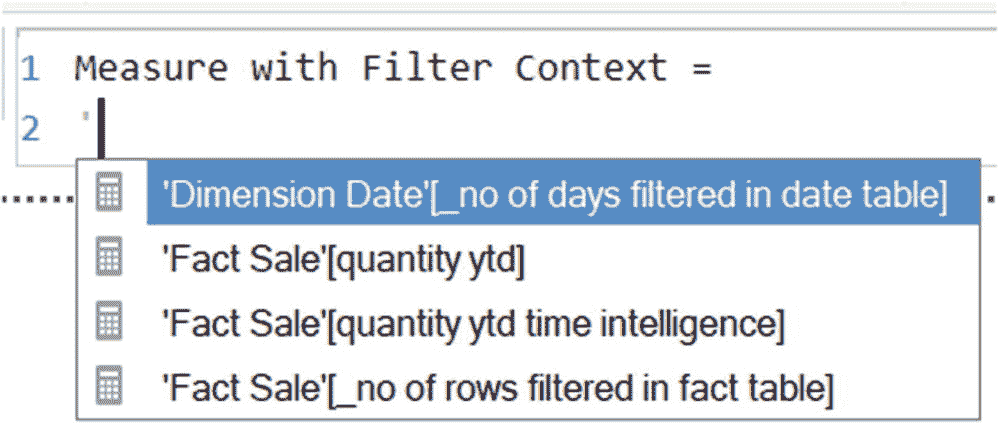
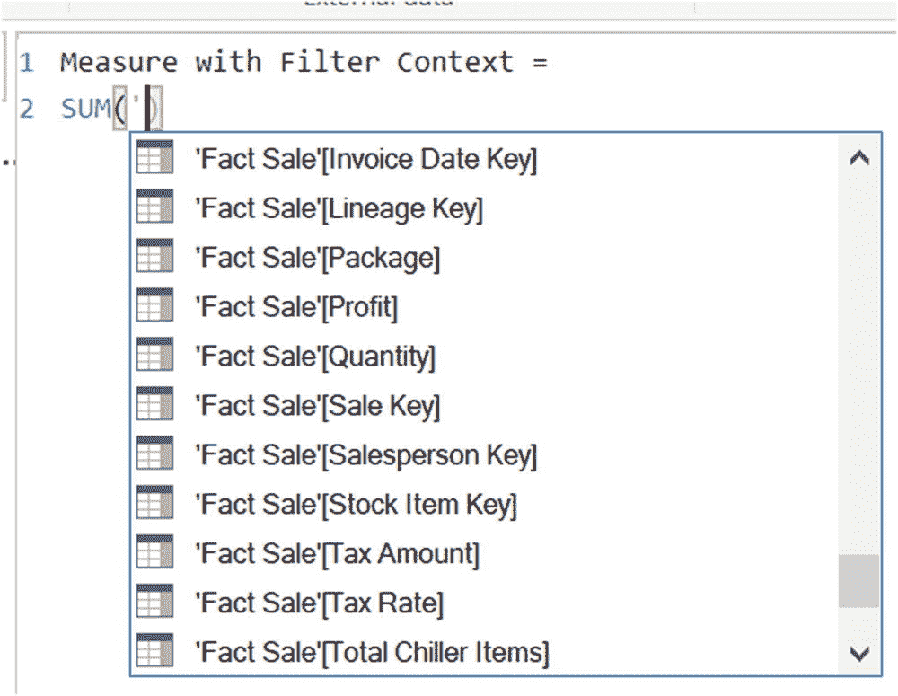
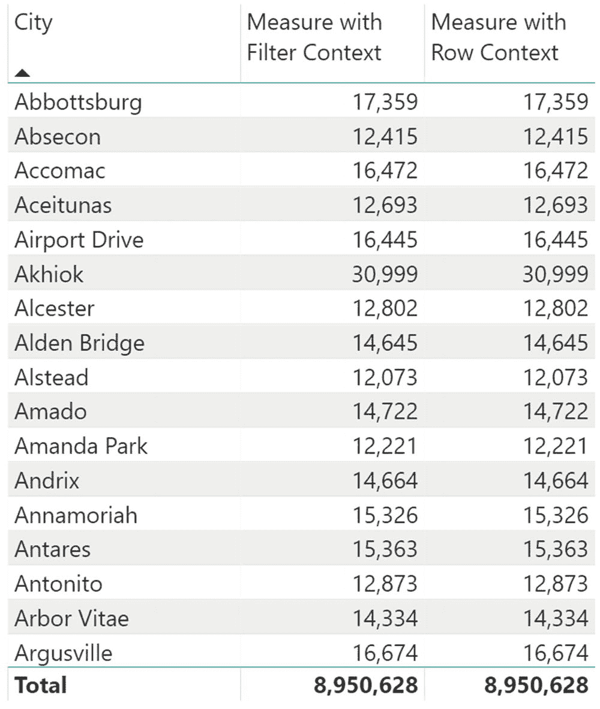
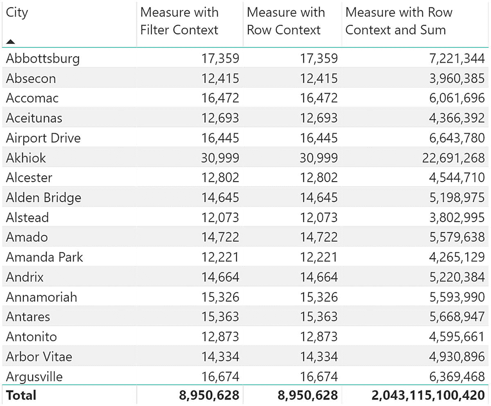
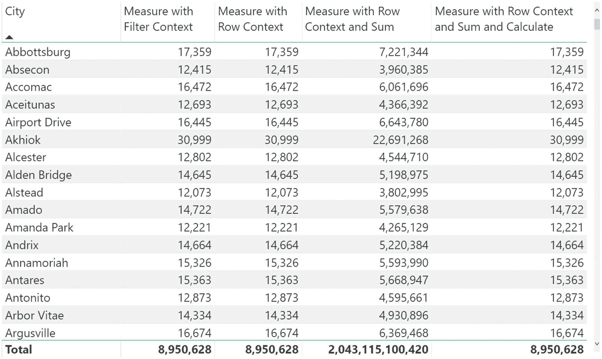
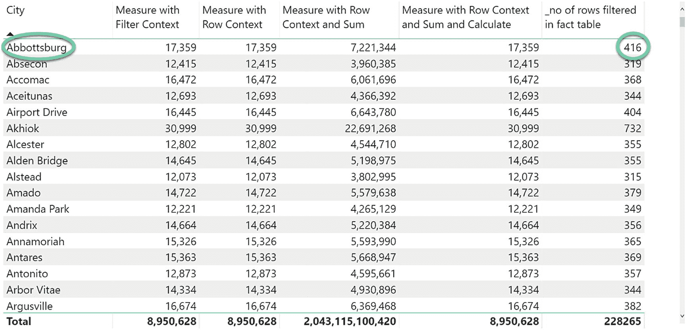
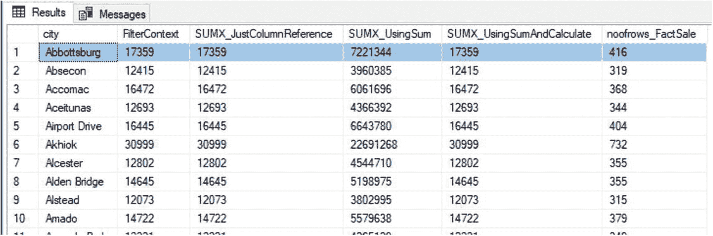

# 4. 这个奇怪的上下文问题

## 解释上下文：另一种方法

关于编写最复杂的 DAX 语句必须掌握的“评估上下文”，已有诸多论述，未来也还会有更多讨论。很有可能本书不会是最后一本关于 DAX 的著作。这是因为这一查询语言在持续增强，仅凭一本书不可能涵盖 DAX 的所有细节，或提供详尽的示例列表来解释 DAX 在每一个兴趣领域的应用。

需要明确的是，第一个需要高级 DAX 解决的问题并不会等到你学完所有可能的知识点才出现。很可能当前遇到的问题就需要比清单 4-1 中所示更复杂的 DAX 代码。

```
the simple measure = CALCULATE(SUM('Fact Sale'[Quantity]))
清单 4-1
简单度量值
```

拜托，即使你很想写出如上清单所示的度量值，也请千万不要这样做。使用`CALCULATE`包裹一个表达式而不使用任何额外参数（即不使用任何筛选表达式）被认为是一种不良实践。话虽如此，上述度量值实际上应该写成清单 4-1a 所示的形式。

```
Measure with Filter Context = SUM('Fact Sale'[Quantity])
清单 4-1a
简单度量值
```

事实是，我们需要回答的问题以及那些需要更复杂 DAX 的问题，并不会等到我们感觉准备充分了才出现。因此，我们必须勇敢地开始编写 DAX 并解决实际问题。但如果我们没有遇到实际问题怎么办？

加入`community.powerbi.com`上优秀的社区成员，并回答他们提出的问题，是一种极好的实践。下载提供的示例文件，并勇于在未完全理解问题时发问，是一种极佳的学习体验。要成为 DAX 黑带、DAX 忍者或任何你希望成为的角色，意味着要不断练习、练习、再练习……

前几章可以视为掌握高级 DAX 之旅的序曲。将数据模型视为分析解决方案的组成部分。理解 DAX 沿袭是编写 DAX 语句以及理解为何有时事情不如预期进展的关键。

每当执行一条 DAX 语句时，该执行都发生在一个上下文中。这个上下文决定了 DAX 语句的结果。正因如此，这个上下文被称为**评估上下文**。这是因为在语句执行之前，需要先评估该上下文。必须区分两种不同类型的评估上下文：

-   **筛选上下文**

    这是在使用 DAX 语句计算度量值时始终存在的上下文。它之所以被称为筛选上下文，是因为在表达式被评估/执行之前，会应用隐式筛选器，例如来自行和/或列标题的选择，以及来自切片器和可视化轴的选择。

-   **行上下文**

    这是在使用 DAX 语句创建计算列时，或者在表迭代函数（如`SUMX(<table>, <expression>)`）内部评估表达式时，隐式存在的上下文。迭代函数的表达式是在行上下文中执行的。

### 筛选上下文与行上下文：一种温和的入门方式

在某种程度上，判断是筛选上下文还是行上下文很容易。假设我们想要定义一个度量值，该度量值简单地对`Fact Sale`表中的`Quantity`列进行聚合。图 4-1 显示 Power BI 中的 DAX 编辑器并未提供选择此列的功能。



图 4-1

筛选上下文 – 缺失列

这仅仅是因为在筛选上下文中，对列的引用必须被包裹在聚合函数（如`SUM(<column reference>)`）中。图 4-2 显示了度量值定义，但这次已经使用了 DAX 函数`SUM(...)`。



图 4-2

筛选上下文 – 聚合函数

清单 4-2 显示了度量值定义。

```
Measure with Filter Context =
SUM('Fact Sale'[Quantity])
清单 4-2
带聚合函数的筛选上下文
```

除了现在可以选择该列这一显而易见的事实外，我们还可以从中推断出更多信息。


### 智慧箴言

度量值聚合了一行或多行。这个结论很简单，因为必须使用聚合函数。这是因为聚合函数聚合了来自不同行的多个值。

当然，也可以编写一个不聚合单行的`DAX`语句。前面的智慧箴言应被视为一条规则。了不起的宫城先生曾在电影《*龙威小子*》中说过：

> *先学站，再学飞。这是自然法则，丹尼尔，不是我的。*

思考被聚合的行对于编写`DAX`语句大有裨益。但不幸的是（或者幸运的是），同一个度量值也可以使用略有不同的`DAX`语句来编写。这个备用的`DAX`语句如代码清单 4-3 所示。

```
Measure with Row Context =
SUMX(
'Fact Sale'
,'Fact Sale'[Quantity]
)
代码清单 4-3
在表迭代器函数内包含行上下文的度量值
```

在代码清单 4-3 中，使用了表迭代器函数之一——`SUMX`（关于迭代器函数的更多内容，请参见第 6 章“迭代器”）。从代码清单 4-3 中可以学到以下几点：只要存在行上下文，就可以在不使用聚合函数包裹列的情况下引用该列。如图 4-3 所示，两个度量值返回的结果相同。



图 4-3
筛选上下文与行上下文对比

一旦编写了这两个简单的度量值，就会立即面临评估上下文的问题。当在现有的筛选上下文中使用诸如`'Fact Sale'[Quantity]`这样的列引用时，我们必须使用聚合函数；但是，我们可以通过在表迭代器内部直接引用该列来省略这个聚合函数。这是由于表迭代器函数创建的行上下文所致。

可以看出，定义度量值的方法不止一种。这当然是一件好事。但这种可能性也带来了负担。由于同一个问题有多种解决方案，编写`DAX`语句可能会变得复杂。当数据集和被聚合的行数不断增加时，情况尤其如此。

### 筛选上下文与行上下文：一些可能奇怪的观察

你可能已经完全理解了上一章的内容。不过，请将前面的内容视为一次回顾。为了增加一点复杂度，让我们看看代码清单 4-4 中所示的度量值。

```
Measure with Row Context and Sum =
SUMX(
'Fact Sale'
,SUM('Fact Sale'[Quantity])
)
代码清单 4-4
包含行上下文并使用 SUM 的度量值
```

与代码清单 4-3 相比，代码清单 4-4 中的语句只是在列引用外面包裹了聚合函数`SUM`。度量值`Measure with Row Context and Sum`的结果如图 4-4 所示。



图 4-4
包含行上下文并使用 SUM 的度量值

在详细解释该度量值的结果之前，将引入最后一个度量值。该度量值的定义如代码清单 4-5 所示。

```
Measure with Row Context and Sum and Calculate =
SUMX(
'Fact Sale'
,CALCULATE(SUM('Fact Sale'[Quantity]))
)
代码清单 4-5
包含行上下文并使用 SUM 和 CALCULATE 的度量值
```

该度量值的结果如图 4-5 所示。



图 4-5
包含行上下文并使用 SUM 和 CALCULATE 的度量值

图 4-5 显示，使用迭代器函数`SUMX`的度量值`Measure with Row Context`和`Measure with Row Context and Sum and Calculate`返回的值，与更简单的度量值`Measure with Filter Context`相同。关于度量值`Measure with Row Context`为何如此，前面已经给出了解释。原因在于：在行上下文中，来自被迭代表的每一行的引用列的值都会被传递给迭代器函数`SUMX`。

而将`CALCULATE`包裹在`SUM`外面的度量值产生相同结果的原因如下：`CALCULATE`将`SUMX`创建的行上下文转换为筛选上下文。这意味着当前被迭代的整个行的每个列值都被转换为一个筛选器。然后，`Fact Sale`表会被这个新创建的筛选器所筛选。这种转换被称为**上下文转换**。


#### 注意

`CALCULATE` 将现有的行上下文转换为筛选上下文。

由于表 `Fact Sale` 中存在唯一标识符，即 `Sale Key` 列，因此可以安全地说，从迭代器转换而来的当前行正在筛选自身。

现在来看度量值 `Measure with Row Context and Sum`，其行为可能并不直观，因为数值看起来可能有些奇怪，而且结果很可能并非预期。为此，清单 4-6 再次展示了该度量值的定义。

```
Measure with Row Context and Sum =
SUMX(
'Fact Sale'
,SUM('Fact Sale'[Quantity])
)
清单 4-6
包含行上下文并使用 SUM 的度量值
```

迭代器函数 `SUMX` 会遍历表 `Fact Sale`，但在迭代开始之前，所有现有的筛选器都已应用。请记住，度量值是在筛选上下文中计算的。在这个简单示例中，筛选器是来自表 `Dimension City` 的 `City` 列的行标题值。这意味着，在度量值计算之前，表 `Fact Sale` 中存在的行数会被筛选为 Abbottsburg 城市的 416 行。如果将清单 4-7 中的度量值 `_no of rows filtered in fact table` 添加到矩阵视觉对象中，则可以验证这一点，该矩阵视觉对象如图 4-6 所示。

```
_no of rows filtered in fact table =
COUNTROWS('Fact Sale')
清单 4-7
表 Fact Sale 的筛选行数
```



图 4-6

最终的矩阵视觉对象

请记住，迭代器函数 `SUMX` 创建了一个行上下文，对奇怪结果的解释如下：

- `SUMX` 遍历已筛选的表 `Fact Sale`，该表已通过隐式筛选器进行了筛选。
- `SUM` 聚合所有可用的行。

7221344 除以 416 的结果是 17359。这意味着该表达式执行了 416 次。每次执行时，聚合函数 `SUM` 都会对筛选出的行进行聚合。每次聚合的结果最终会被传递给 `SUMX`。

如果你可以访问安装了数据库 Wide World Importers 的 SQL Server，则可以使用清单 4-8 中的 SQL 语句来创建相同的结果。

```
USE [WideWorldImportersDW]
GO
WITH
acte AS(
SELECT
c.City
,   f.Quantity
,   SUM(f.quantity) OVER(PARTITION BY  c.[city])AS sumx_usingsum
,   SUM(f.quantity) OVER(PARTITION BY  f.[sale key])    AS sumx_usingcalculateandsum
FROM
Fact.Sale AS f
INNER JOIN Dimension.City AS c ON
f.[City Key] = c.[City Key]
)
SELECT
acte.city
,   SUM(acte.quantity) AS FilterContext
,   SUM(acte.quantity) AS SUMX_JustColumnReference
,   SUM(acte.sumx_usingsum) AS SUMX_UsingSum
,   SUM(acte.sumx_usingcalculateandsum) AS SUMX_UsingSumAndCalculate, COUNT(*) AS noofrows_FactSale
FROM
acte
GROUP BY
acte.city
ORDER BY acte.City ASC
清单 4-8
筛选上下文 – 迭代器 sumx
```

图 4-7 显示了结果的一部分。



图 4-7

筛选上下文与行上下文 – SQL 语句

如果你目前使用 SQL 比使用 DAX 更熟练，你可以将 `SUM` 等 DAX 聚合函数与相应的 SQL 函数（当然需要结合 `GROUP BY` 子句）进行比较。表迭代器函数可以与 SQL 中的窗口函数进行比较，遵循以下模式：

```
AGGREGATION(column) OVER(PARTITION BY ..., ... ORDER BY ..., ...)
```

### 提示——仅仅是个提示

正如我们在清单 4-5 中所看到的，使用 `CALCULATE` 函数只需要将其包裹在聚合函数周围，就解决了一个问题。由于 `CALCULATE` 是一个强大的函数，因此也有必要有意识地使用它。这意味着，每当需要转换行上下文时，必须使用 `CALCULATE`。如果需要更改筛选上下文以创建所需的结果，则同样需要使用 `CALCULATE`。

使用 `CALCULATE` 的唯一原因如下：

- 将行上下文转换为筛选上下文
- 更改现有的筛选上下文

## 不要迷失方向

请考虑以下事项：VertiPaq 引擎因其内存列式数据库的特性而运行快速。因此，每当我们编写 DAX 语句时，也必须回答以下问题：该 DAX 语句是否尽可能高效？优化 DAX 语句所花费的时间甚至可能超过编写第一版仅返回正确结果的时间。追求最有效的 DAX 语句也可能意味着需要创建一个额外的表（对数据模型的普通用户不可见），并定义一个或多个计算列。

因此，如果一条 DAX 语句能够在不妨碍决策者（即我们编写的 DAX 语句的用户）日常工作的前提下返回结果，那么就可以认为它足够好了。这种方法可以释放一些精力，用于寻找能够带来巨大商业价值的独特解决方案。因为我们不需要不断质疑自己是否真的了解每一个细节，我们大多数人也不需要编写需要处理数十亿或万亿行数据的 DAX 语句。

但我们必须为未来的数据增长做好准备。为此，第 14 章“扩展你的模型”讨论了如何使用 DAX 来扩展模型。本章开头曾提到：“需要澄清的是，第一个需要一些高级 DAX 知识的问题，并不会等到所有可学的内容都学完之后才出现。”

以下内容可以视为一种心法，当我们没有得到预期的结果时，它可以帮助我们重新集中注意力。

### 它只是一个单一值，大多数时候是一个数字

每当需要编写度量值或计算列时，都需要进行构建。我们绝不应该忘记，大多数时候 DAX 语句的预期结果是一个单一值。当然，我们确实会使用 DAX 来创建表，以筛选其他表，进而筛选更多表，以此类推……但无论筛选过程如何，最终返回的都是一个单一值。有时会发生一些情况，最后只是通过一次聚合或一个 `SELECTCOLUMN` 来创建一个可以隐式转换为标量值的结果。

### 该标量值是一个聚合结果

每当我们创建度量值时，都必须意识到行是被聚合的。只有一个例外，那就是我们在创建计算列并且不使用任何聚合函数时。这意味着，导致意外结果的原因不是表达式本身，而是行数，或者我们聚合了错误的行。

### 聚合结果由筛选后的行提供

通过本书自第 5 章“DAX 中的筛选”开始的后续章节，你将学习如何筛选将要被聚合的行。如果不清楚这意味着什么，请考虑以下两个简单的度量值：

-   **上个月的销量**  
    如果我们要创建一个返回上个月值的度量值，我们必须将当前月份的筛选器（即当前正在筛选表 `Fact Sale` 的月份）“移动”到上个月。

-   **各城市贡献度占总城市比例**  
    现在我们需要计算一个比值。例如，用某个选定城市（通过切片器或行/列标题选择）的销量除以所有城市的总销量。要确定所有城市的总值，需要扩展行数，这意味着我们必须移除现有的筛选器。


好的，作为一名高级文档工程师和翻译员，我将遵循您的注意事项，将以下英文文本翻译成中文。


