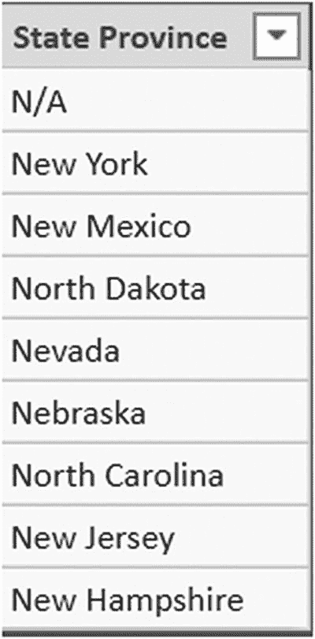
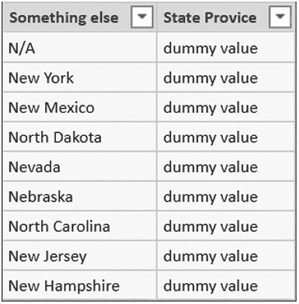
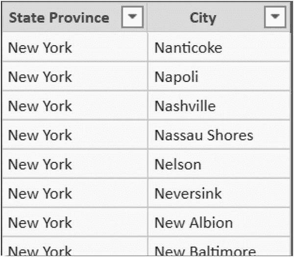
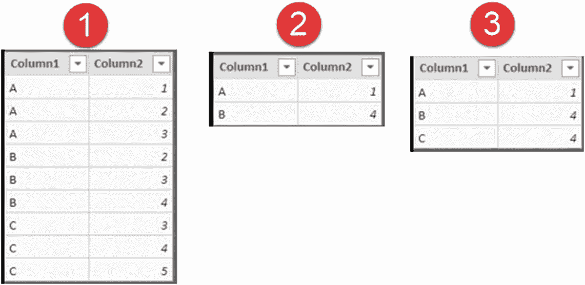

# 5. 在 DAX 中进行筛选

## 引言

Power BI 在允许报表作者创建一系列视觉对象方面做得非常出色，这些视觉对象为最终用户提供了一种拖放式探索数据模型的方式。但迟早会遇到需要报表作者为 DAX 计算添加某种形式筛选的需求。

本章将探讨并尝试解释这些概念，并希望在此过程中澄清基于计算的 DAX 筛选这一神秘世界中的一些细微差别。

乍一看，筛选规则似乎很简单。使用的逻辑和代码是一系列解析为布尔值 TRUE 或 FALSE 的表达式，以确定某行是否被认为与给定计算相关。

当你需要考虑筛选器应用的顺序时，乐趣就开始了。筛选规则是分层应用的，并且可能会以某种方式覆盖甚至相互矛盾，在处理高级计算时会很快变得令人困惑。

当所有层被解析后，被认为通过了所有筛选逻辑的行将被核心计算用来产生结果。

## 基础知识

为 DAX 计算添加筛选条件可以采取两种形式。第一种形式使用基于列的规则，例如`[State Province] = 'Texas'`或`[Calendar Year] = 2014`。这种方法指定一个值与列中的值进行比较。当使用此类语句时，它们会被评估为布尔值 True 或 False，以决定某行应该保留还是丢弃。布尔值 True 表示保留该行，而布尔值 False 表示该行应被忽略且不予考虑。

这些类型的语句可以与其他布尔测试结合，并在使用 AND（`&&`）和 OR（`||`）等运算符时遵循标准的布尔逻辑。

第二种筛选形式使用 DAX 表作为接受表作为筛选参数的函数中的筛选参数。将表作为筛选参数传递的效果是跨多个列应用筛选，每个列包含多个值，以确定从表中哪些行被考虑。

### 布尔筛选

`FILTER`、`CALCULATE`和`CALCULATETABLE`函数都接受`[Column] = <some value>`格式的筛选指令。清单 5-1 和 5-2 展示了布尔筛选的基本示例。`CALCULATE`和`CALCULATETABLE`函数将看似布尔语句的表达式转换为返回表表达式的格式，以用作筛选器。

```
CALCULATE(
COUNTROWS('Fact Sale'),
'Fact Sale'[Quantity] = 3
)
Listing 5-2
A basic example of Boolean filter expression in a CALCULATE function
```

```
COUNTROWS(
FILTER(
'Fact Sale',
'Fact Sale'[Quantity] = 3
)
)
Listing 5-1
A basic example of Boolean filter expression in a FILTER function
```

清单 5-1 和 5-2 中的布尔条件应用于`[Quantity]`列的不同值，以确定该行是否被计入最终总数。如果没有应用其他筛选器，它们返回相同的值 12,572，而`'Fact Sale'`表的总行数为 228,265。

只要 DAX 表达式可以被评估为单一的 TRUE 或 FALSE 值，就可以向逻辑中添加更多条件。可以使用括号对布尔逻辑门进行分组，以便在更复杂的场景中提供更多可能性。

使用括号和布尔运算符的效果与其他语言一致，如果你使用过 T-SQL 风格的谓词，应该会感到熟悉。

#### 注意

虽然清单 5-1 和 5-2 中的计算看起来相同，但当与切片器选择和视觉对象中的轴值等外部筛选器一起使用时，它们会产生不同的结果。

使用`FILTER`函数时，第一个参数需要是对要筛选的表的引用。该参数可以是物理表或表表达式。第二个参数中的布尔表达式可以使用第一个参数指定表中的任何列。还可以借助`RELATED`和`RELATEDTABLE`函数使用相关表中的列，如清单 5-3 所示。

```
COUNTROWS(
FILTER(
'Fact Sale',
RELATED('Dimension City'[State Province]) = "Texas"
)
)
Listing 5-3
A FILTER function using the RELATED function to apply filter across a relationship
```

在清单 5-3 中，`FILTER`函数使用`RELATED`函数对相关父表中的列进行筛选。如果没有应用其他外部筛选器，结果为 15,800，表示`'Fact Sale'`表中在 `"Texas"` 的`[State Province]`中销售的记录数。

`CALCULATE`函数以不同的方式应用布尔筛选器，本章稍后将详细解释，这种方式不需要使用`RELATED`和`RELATEDTABLE`函数来引用相关表中的列。

### 表作为筛选器

在 DAX 中提供筛选条件的第二种方式是使用表的形式。这种方法可以在`CALCULATE`和`CALCULATETABLE`函数的`<filter>`参数中使用，不仅提供了按值列表进行筛选的机会，还可以在单个步骤中影响多个列。

#### 注意

在底层，`CALCULATE`唯一支持的筛选器是基于表表达式的。布尔语法会在内部使用`FILTER`函数转换为表表达式。

如果你熟悉 T-SQL 等语言中基于集合的编程概念，可以将其视为一种基于集合的筛选。许多筛选指令可以在单个步骤中应用。表筛选功能非常强大，在学习这门技术时需要一定的思维训练。


### 单列表格筛选器

考虑以下清单 5-4 中的示例，该示例使用单列表格表达式来筛选计算。用作表格筛选器的单列表格包含名称以字母 N 开头的所有 `[State Province]`。

```
Test Measure =
VAR MyFilterTable =
FILTER(
VALUES('Dimension City'[State Province]),
LEFT('Dimension City'[State Province],1) = "N"
)
RETURN
CALCULATE(
SUM('Fact Sale'[Quantity]),
MyFilterTable
)
清单 5-4
一个使用包含多行的单列表格作为筛选器的 CALCULATE 函数
```

名为 `MyFilterTable` 的变量被赋值为一个包含九行数据的单列表格表达式，完整的数据集如图 5-1 所示。



图 5-1

展示了清单 5-4 中 `MyFilterTable` 变量的内容

当一个表格被传递给 `CALCULATE`（或 `CALCULATETABLE`）函数时，其效果是筛选掉那些不出现在此列表匹配列中的值。

清单 5-4 的计算中有以下几点值得注意。

### 扩展虚拟列

清单 5-4 中的核心计算使用了针对 `'Fact Sale'` 表中某列的 `SUM` 函数。在此计算中，表格筛选器中的列与 `'Fact Sale'` 表中的任何原生列都没有直接匹配。应用的筛选器代表相关表中的一列，但并未使用 `RELATED` 函数。

此处筛选能够生效，是因为 `'Fact Sale'` 表和 `'Dimension City'` 表之间存在基于两者 `[City Key]` 列的关系。

当在模型中定义了标准的一对多关系时，位于多端的表在理论上会被扩展，以包含所有位于一端的上游表，作为用于计算和筛选的虚拟列。在这种情况下，应用于 `'Dimension City'[State Province]` 的筛选器表现得就像数据模型被扁平化，并且 `'Fact Sale'` 表在物理上包含了这一列。

### 沿袭

那么，`CALCULATE` 函数是如何知道表格表达式中哪一列应该是筛选对象的呢？答案并非通过匹配用作筛选器的表和被筛选表的列名。

> **注意**：表格表达式中的列仅筛选具有共同沿袭的物理列——第 3 章“DAX 沿袭”中有关于沿袭的更多详细信息。

在清单 5-4 的示例中，`MyFilterTable` 变量使用 `FILTER` 函数将 `[State Province]` 值的数量缩减为仅以字母 “N” 开头的那些。`VALUES` 函数创建了 `'Dimension City'[State Province]` 列中每个值的非重复列表。

`'Dimension City'[State Province]` 列的内部列 ID 引用被存储在赋给 `MyFilteredTable` 变量的表格表达式中。然后，当该表格变量作为筛选器应用于 `CALCULATE` 函数时，表格表达式中的内部列 ID 引用被用于识别 `'Fact Sale'` 表扩展版本中的列，该扩展版本包含了来自 `'Dimension City'` 表的所有列。

内部列 ID 引用是数据库特有的，即使列名被诸如 `SELECTCOLUMNS` 之类的函数更改，或通过诸如 `SUMMARIZE` 之类的函数进行聚合，只要该引用 ID 在表格表达式被 `CALCULATE` 函数应用时仍然存在，筛选器就会按预期工作。

以下清单 5-5 中的计算扩展了清单 5-4 中的代码，并突出了沿袭对筛选的影响。

```
Test Measure 2 =
VAR MyFilterTable =
SELECTCOLUMNS(
FILTER(
VALUES('Dimension City'[State Province]),
LEFT('Dimension City'[State Province],1) = "N"
),
"Something else",[State Province],
"State Province","dummy value"
)
RETURN
CALCULATE(
SUM('Fact Sale'[Quantity]),
MyFilterTable
)
清单 5-5
一个使用包含多行的单列表格作为筛选器的 CALCULATE 函数
```



图 5-2

展示了清单 5-5 中 `MyFilterTable` 变量的内容

请注意，图 5-2 中显示的原始 `[State Province]` 列被重命名，并添加了一个新的虚拟列，其中包含在数据库中不存在的无意义硬编码值。当此表格表达式由 `CALCULATE` 函数作为筛选器应用于 `'Fact Sale'` 表时，其结果与清单 5-4 中的计算相同。

内部列 ID 引用用于匹配作为筛选器应用于 `CALCULATE` 表 `<表达式>` 中表的值的列表。

因此，即使该列现在被命名为 “Something else”，此列中的值仍然用于筛选物理表。


### 多列表格筛选器

用作筛选器的表格表达式不一定要只包含单列。在 清单 5-5 所示的示例中，使用了多列表格作为筛选器参数。当 `CALCULATE` 函数处理筛选表时，它会检查筛选表中的每个内部列 ID，并寻找被筛选表中是否有匹配项。所有匹配的列都会被筛选，而两个表中不匹配的列则会被忽略。

在 清单 5-6 中，一个包含两列的表格表达式被分配给了 `MyFilterTable` 变量。筛选器应用于这些列，因此它仅显示那些位于以字母 N 开头的州中，且城市名也以字母 N 开头的城市。此筛选条件仅用于演示目的，不太可能成为现实世界中的示例。存储在 `MyFilterTable` 变量中的表格表达式有 234 行，其数据样本如图 5-3 所示。

在此示例中，使用了 `ALL` 函数而不是 `VALUES` 函数。`ALL` 函数会从整个表中返回一个去重的值列表，并忽略可能存在的任何外部筛选。

```
度量值 5-6 =
VAR MyFilterTable =
FILTER(
ALL(
'维度城市'[州/省],
'维度城市'[城市]
),
LEFT('维度城市'[州/省],1) = "N" &&
LEFT('维度城市'[城市],1) = "N"
)
RETURN
CALCULATE(
SUM('事实销售'[数量]),
MyFilterTable
)
清单 5-6
一个使用包含多行的多列表格作为筛选器的 CALCULATE 函数
```



**图 5-3**  
展示了来自 清单 5-6 的 `MyFilterTable` 变量内容的一个样本

清单 5-6 中的 `CALCULATE` 函数与 清单 5-5 中的示例相同。无需向函数告知筛选应应用于哪些列。筛选是基于内部列 ID 来应用的。

结果是，`CALCULATE` 函数现在使用来自扩展后的 `'事实销售'` 表中的两列来应用筛选逻辑。作为表格筛选器传递的表格表达式中的两列，在扩展后的 `'事实销售'` 表中找到了匹配的列。`SUM` 函数返回的值为 85,999，但这意味着什么呢？

考虑一下图 5-4 所示的示例。步骤 1 中左侧的表格是一个将要被步骤 2 中的多列表格筛选的表格。假设每个表格中两列的沿袭是匹配的。

筛选完成后的结果显示在步骤 3 的数据集中。图 5-4 中的示例表明，筛选不是累积性的（布尔 AND 运算）；相反，它基于 OR 谓词。筛选所涉及的两列会彼此独立地进行测试，其结果反映了以下逻辑：

-   `Column1 IN ("A", "B")` 或 `Column2 IN (1, 4)`

如果你对步骤 3 中第三行的出现感到惊讶，那你可能原本期望该测试是基于 AND 运算的。



**图 5-4**  
展示了当左侧表格 (1) 被中间表格 (2) 筛选后的结果。结果是右侧的表格 (3)

### 多重筛选器

可以使用相同的技术提供多个表格。`CALCULATE` 和 `CALCULATETABLE` 函数可以接受多个筛选参数，这意味着可以使用其他表格表达式来扩展筛选逻辑，以包含来自其他表的列。清单 5-7 展示了 `CALCULATE` 函数的语法定义。

```
CALCULATE(<表达式>[, <筛选器 1> [, <筛选器 2> [, …]]])
清单 5-7
CALCULATE 函数的语法签名
```

清单 5-8 中的计算度量值类似于 清单 5-6 中的计算度量值；不过，这里添加了一个新的表格表达式，并将其赋值给 `MyFilterTableYear` 变量。新的表格变量作为第三个参数，被添加到 `RETURN` 语句中的 `CALCULATE` 函数里。这个额外的筛选器的作用是将 `'事实销售'` 表的数据过滤到与 2014 日历年度相关的活动。

```
度量值 5-8 =
VAR MyFilterTable =
FILTER(
ALL(
'维度城市'[州/省],
'维度城市'[城市]
),
LEFT('维度城市'[州/省],1) = "N" &&
LEFT('维度城市'[城市],1) = "N"
)
VAR MyFilterTableYear =
FILTER (
'维度日期',
'维度日期'[日历年度] = 2014
)
RETURN
CALCULATE(
SUM('事实销售'[数量]),
MyFilterTable,
MyFilterTableYear
)
清单 5-8
一个使用多个表格表达式作为筛选器的 CALCULATE 函数
```

在此示例中需要考虑的一个潜在性能问题是，`MyFilterTableYear` 变量存储了来自 `'维度日期'` 表的所有列，而不仅仅是 `[日历年度]` 列。`'维度日期'` 表中有 14 列，因此当该表格表达式在 `CALCULATE` 函数中应用时，所有 14 列的筛选都会被处理，这可能会导致大量不必要的处理开销。

更好的做法是，在表格表达式中仅存储用于筛选所需的最少列数。用于 `MyFilterTable` 变量的 DAX 模式是一个更高效的示例，因为它只包含筛选所需的列。


