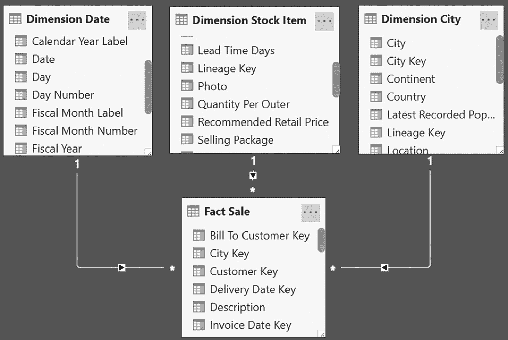
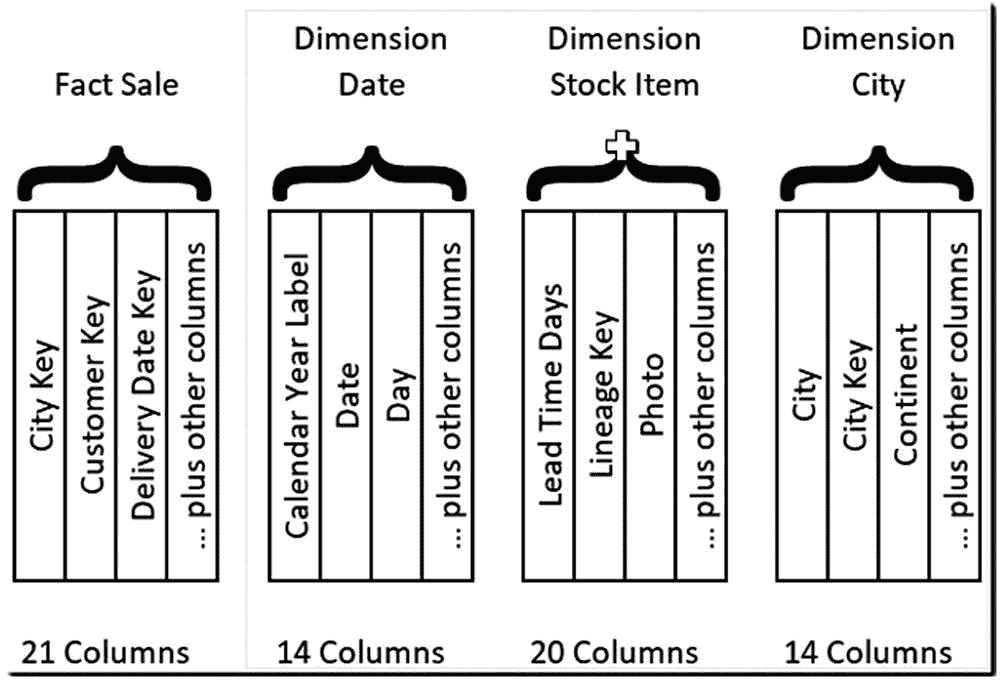
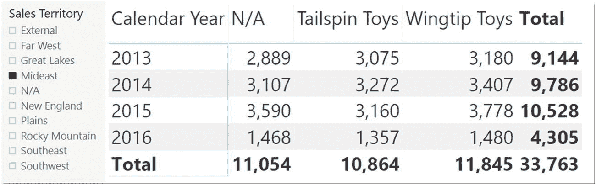
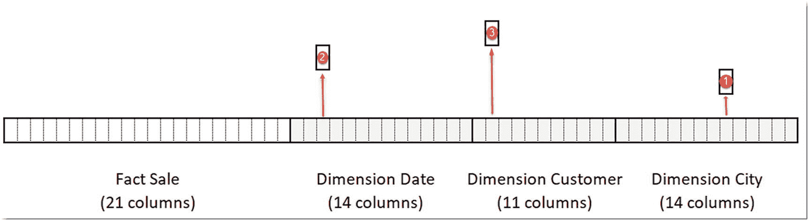
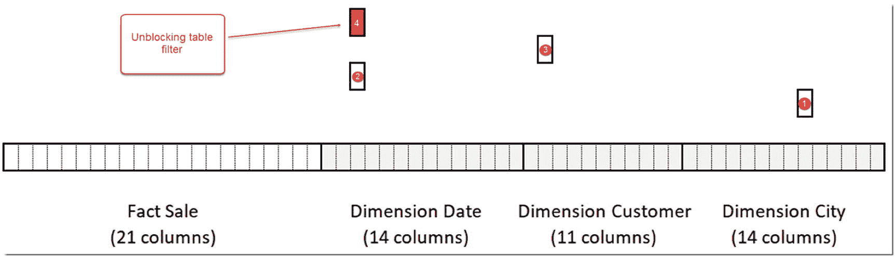
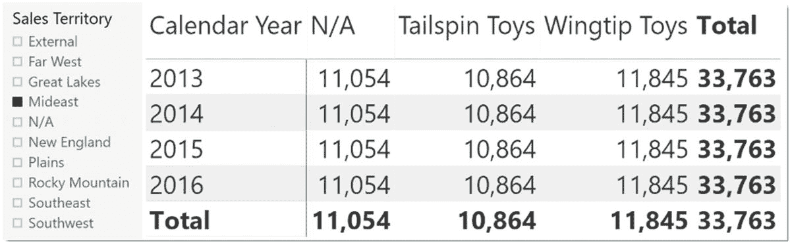
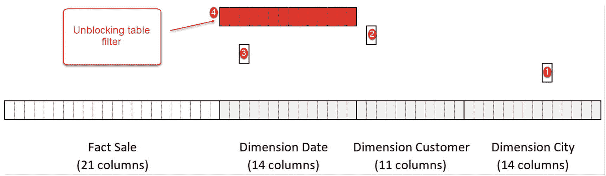
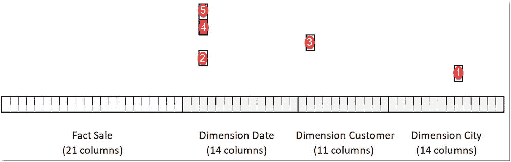
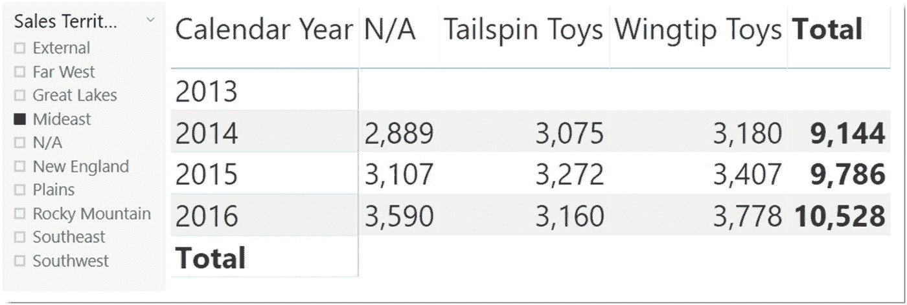
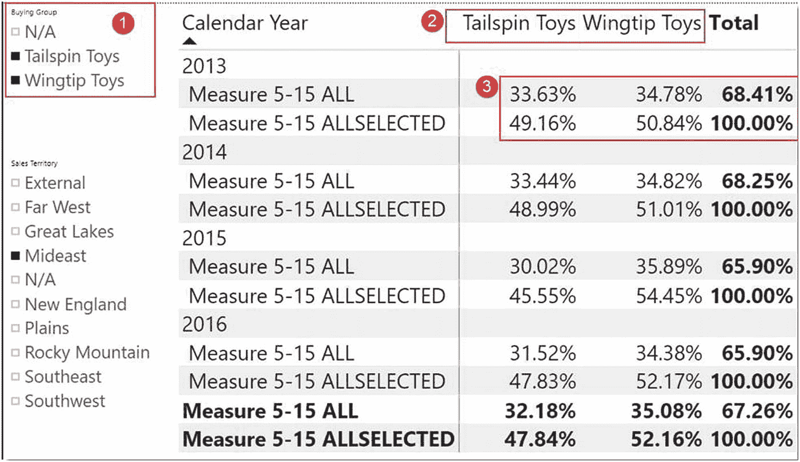

# 扩展表（虚拟列）

要理解筛选上下文和计算上下文，关键在于掌握扩展虚拟列的概念。每当数据模型中定义了一对多关系时，位于多端的表在逻辑上会被扩展，以包含来自一端表的所有列，用于筛选和计算。扩展后的表会基于多对一的方向，包含来自任何上游表的所有列，并且可以跨越多个层级。

参见图 5-5 中所示的表集合。共有四个表：



图 5-5

WWI 数据集在关系视图中的四个表

1.  `Fact Sale` – 21 列
2.  `Dimension Date` – 14 列
3.  `Dimension Stock Item` – 20 列
4.  `Dimension City` – 14 列

任何基于 `Fact Sale` 表的计算，所处理的都不仅仅是一个只有 21 行的表；相反，该表会被扩展，以同样包含来自相关父表的所有列。如果数据模型仅包含图 5-5 所示的四个表，那么扩展后的 `Fact Sale` 表将有 69 列：21 个原生列和 48 个扩展列。

`Fact Sale` 表与扩展表之间的连接被视为一个 `LEFT OUTER JOIN`，这意味着返回的是 `Fact Sale` 表中的所有行，以及扩展表中在用于定义关系的列上具有匹配值的行。

图 5-6 展示了一个被“加宽”的 `Fact Sale` 表，其中包含了来自扩展表的额外列。



图 5-6

展示了包含扩展列的 `Fact Sale` 表

图 5-5 所示的示例模型只有四个表，且关系仅跨越单个层级。如果三个父 `Dimension` 表中的任何一个也位于一对多关系的多端，那么其父表的所有列也会被包含到 `Fact Sale` 的虚拟扩展表中。正是通过这种扩展表，应用于多层关系顶部的筛选器才能影响那些与筛选表没有直接关联的表中的行。

由于三个 `Dimension` 表都没有父表，因此它们没有任何虚拟扩展列。

## 为什么这很重要？

在构建带筛选条件的计算时，在脑海中将计算所涉及的表形象化会很有帮助，这包括来自相关表的所有扩展列以及基表的原生列。

在任何计算开始时，扩展表都被视为未应用任何筛选器，表中的每一行都可能被聚合函数（如 `SUM`、`COUNT`、`MIN` 等）所使用。

筛选器会分层应用，最终确定一组行，这些行对计算中使用的聚合函数可见。筛选器通常是累加的，但并非总是如此，并且现有列上的筛选器可以被特殊的 DAX 函数覆盖。

筛选解除在 DAX 筛选中扮演着至关重要的角色，它使得诸如期间比较和父/子比率等计算成为可能。如果筛选器只能累加而无法被解除，那么这类计算将很难实现。

筛选解除指的是这样一种概念：先前在较早层应用于特定列的筛选器被移除，并且不再对该列产生任何影响。

## 筛选的层级

筛选器会在一系列层级中应用。为了演示这一点，请考虑列表 5-9 中的计算度量值。这个简单的计算度量值返回 `Fact Sale` 表中的行计数，该表恰好包含 228,265 行。如果未应用任何筛选器，`Fact Sale` 表中的每一行都对 `COUNTROWS` 聚合函数可见，并且该度量值每次都返回 228,265。实际情况是，每次使用此度量值为报表画布上的视觉对象生成值时，略微不同的筛选规则都会影响每个实例。

列表 5-9 中的计算度量值被添加到矩阵视觉对象中，如图 5-7 所示。矩阵视觉对象展示了此计算度量值的 20 个独立实例。有五行与日历年份相关，其中包括一个总计行。有四列与购买组相关，其中也包含一个总计列。

矩阵中显示的值没有一个等于 228,265（`Fact Sale` 表中的行计数），因此每个实例都受到了某种形式的筛选的影响。此计算度量值的 DAX 中没有特定的筛选指令，并且尽管每个单元格使用相同的 DAX 代码，但矩阵中显示的值也不尽相同。

每个单元格显示不同值的原因是，`[度量值 5-9]` 计算度量值的所有 20 次逻辑执行都在与其他单元格隔离的筛选上下文中运行。每个上下文开始时都没有筛选器，但随后筛选器会被应用到扩展后的 `Fact Sale` 表的列上。

```
度量值 5-9 = COUNTROWS('Fact Sale')
```

列表 5-9

一个使用 `COUNTROWS` 函数的简单计算度量值



图 5-7

展示了列表 5-9 中的度量值在矩阵视觉对象中，旁边是与 `Dimension City` 的 `[销售区域]` 列相关联的切片器

让我们通过分析第二个列第二行中的值 3,272 来剖析筛选过程。

计算从一份未筛选的、扩展后的 `Fact Sale` 表副本开始，最终为矩阵中这个单元格得出值 3,272。这个扩展表包含了 `Fact Sale` 中的所有 228,265 行以及 60 个列（21 个原生列 + 39 个相关列）。

此示例中的第一个筛选层级来自矩阵视觉对象旁边的切片器。切片器作用于 `Dimension City[销售区域]` 列，并且选中了单个值“Mideast”。切片器使用的列也存在于扩展后的 `Fact Sale` 表中；因此，一个在此例中只有单行单列的表被添加到该计算的筛选上下文中。如果切片器恰好还勾选了其他框，那么筛选表将包含更多行。

此示例中第一个外部筛选层级如图 5-8 中的步骤 1 所示。

捕获并研究 Power BI 为矩阵视觉对象生成的完整查询的 DAX 查询计划，有助于解释外部筛选器和内部筛选器的不同含义。

第二个和第三个筛选层级来自矩阵视觉对象。行标题使用 `Dimension Date[日历年份]` 列中的值，该列存在于 `Fact Sale` 的扩展副本中。

矩阵视觉对象的第二行包含单个值 2014，因此一个单列单行的表被添加到该计算的筛选上下文中，并在图 5-8 的步骤 2 中表示出来。


Matrix 视觉对象的第二列使用了 `Dimension City[Buying Group]` 列，该列也存在于扩展后的 `Fact Sale` 表中。该列只有一个值“Tailspin Toys”，因此一个单列、单行的表被添加到该计算实例的筛选上下文中，并在图 5-8 的步骤 3 中展示。



图 5-8：展示了扩展后的 `Fact Sale` 表，其中三列被数据表筛选。

添加到筛选上下文中的三层筛选均位于 DAX 计算代码外部，因此是累积的。此示例的 DAX 代码中不包含特定筛选指令，因此 `COUNTROWS` 函数仅受这三层筛选影响。

扩展后的 `Fact Sale` 表首先通过 `Sales Territory` 列的筛选表从 228,265 行缩减至 33,763 行。然后，该扩展表通过 `Calendar Year` 和 `Buying Group` 列的筛选表进一步缩减至 3,272 行。此时，`COUNTROWS` 聚合函数可以开始使用该扩展表进行计算。完成后，该单元格返回值 3,272。

对于使用此计算度量值的矩阵视觉对象中的其他 19 个单元格，逻辑上会重复相同的步骤。每个计算之间的区别在于添加到筛选上下文中的筛选表内容。这些筛选表包含基于相应列或行标题值的行；对于总计来说，添加到筛选上下文中的筛选表会更少。

### 解除筛选表阻塞

Power BI 报表中的一个常见需求是创建需要访问之前被坐标轴值筛选掉的行中数据的计算。

考虑一个期间比较度量值，它将给定期间内的特定值与来自不同期间的值进行比较。图 5-7 显示了一个矩阵值，它使用了列表 5-9 中的简单计算。矩阵的第二列第二行的值为 3,272，这表示在对三列应用筛选表后（如图 5-7 所示），`Fact Sale` 表中的行数。

需要一种方法来移除阻止查看与 2013 日历年份相关的行的筛选，以帮助计算 2014 日历年份的值 3,271 与 2013 日历年份的值 3,075 之间的百分比变化。

`DAX` 提供了一组特定的筛选函数，可以撤销在同一查询中较早应用于列的筛选。这些解除筛选阻塞的函数是：

- `ALL`
- `ALLEXCEPT`
- `ALLSELECTED`

当这些函数中的任何一个在 DAX 计算中使用时，它们会覆盖表表达式中包含的任何列的先前筛选。

要查看解除阻塞函数的实际应用，列表 5-9 中的 DAX 计算度量值在列表 5-10 中被修改，现在包含一个 `ALL` 函数。`MyFilterTable` 变量被分配了一个使用 `ALL` 函数构建的表表达式。`ALL` 函数本可以直接用作 `CALCULATE` 函数的第二个参数而无需使用变量，但我喜欢这种模式，因为它强调了 `ALL` 函数是一个由行和列组成的表。在此示例中，分配给 `MyFilterTable` 变量的表表达式包含一列和四行。

> **注意：** 直接在 `CALCULATE` 中使用 `ALL` 与通过变量间接使用 `ALL` 是不同的。

```
Measure 5-10 =
VAR MyFilterTable = ALL('Dimension Date'[Calendar Year])
RETURN
CALCULATE(
COUNTROWS('Fact Sale'),
MyFilterTable
)
```
列表 5-10：一个使用 `COUNTROWS` 函数的简单计算度量值。

图 5-9 展示了扩展后的 `Fact Sale` 表，在步骤 1、2 和 3 中对 DAX 计算外部应用了三层筛选。该图还显示了一个位于较早筛选器之上的新第四块。步骤 4 处的块表示存储在 `MyFilterTable` 变量中的表表达式，其效果是覆盖较早查询中应用于 `Dimension Date[Calendar Year]` 列的、来自矩阵视觉对象行标题的表筛选。此解除阻塞仅影响此计算度量值实例的作用域。



图 5-9：展示了扩展后的 `Fact Sale` 表，其中三列被数据表筛选。

图 5-10 显示的矩阵视觉对象展示了更新后的计算对值的影响。对 `Sales Territory` 和 `Buying Group` 列的筛选表不受影响。但是，每个列现在都重复相同的数字。更新后的结果反映了 `Calendar Year` 列现在 100% 未被筛选。每个单元格中显示的数字现在不受 `Calendar Year` 列的影响。



图 5-10：展示了扩展后的 `Fact Sale` 表，其中三列被数据表筛选。

在此示例中，`ALL` 函数针对单个列。`ALL` 函数也可以应用于整个表。

```
Measure 5-11 =
VAR MyFilterTable = ALL('Dimension Date')
RETURN
CALCULATE(
COUNTROWS('Fact Sale'),
MyFilterTable
)
```
列表 5-11：展示了来自列表 5-10 的度量值，但 `ALL` 函数应用于整个表，而不是特定列。

图 5-11 显示解除阻塞表现在是一个包含 14 列的 1,461 行表。之前这是一个包含单列的四行表。结果不会更改图 5-10 中显示的任何值，因为来自扩展 `Fact Sale` 表中的 `Dimension Date` 表的其余 13 列没有要解除阻塞的现有筛选。

列表 5-11 中的示例演示了一种效率较低的方法来解除筛选上下文中列的阻塞。



图 5-11：展示了 `ALL` 函数解除 `Dimension Date` 表中所有列的阻塞。

回到最初的需求：让一个度量值显示当前年份和上一年份之间的百分比差异。`ALL` 函数在列表 5-11 的计算度量值中被部分用于实现此需求。为了完全实现它，需要在*解除阻塞后*对 `Calendar Year` 列应用一个额外的筛选，将行匹配到上一年份。

此额外筛选被添加到列表 5-12 中更新的计算度量值中。

```
Measure 5-12 =
VAR MyPreviousYear =
SELECTEDVALUE('Dimension Date'[Calendar Year]) - 1
VAR MyFilterTable =
FILTER(
ALL('Dimension Date'[Calendar Year]),
[Calendar Year]=MyPreviousYear
)
RETURN
CALCULATE(
COUNTROWS('Fact Sale'),
MyFilterTable
)
```
列表 5-12：展示了列表 5-11 中的代码，并按 `Calendar Year` 进行了筛选。


在计算度量值中（见清单 5-12），变量`MyPreviousYear`被赋值为一个整数值，该值将行标题中的日历年份减去 1。变量`MyPreviousYear`用作`FILTER`函数中的谓词，该函数输出一个表表达式，并赋值给变量`MyFilterTable`。

然后，`CALCULATE`函数将存储在`MyFilterTable`变量中的单列、单行表表达式添加到其筛选上下文中，该筛选上下文重新对日历年份列引入筛选，但这次筛选表中的行具有不同的值。

图 5-12 显示了更新后的筛选上下文，其中新表位于步骤 5。前三个筛选表均来自计算度量值外部。步骤 4 的筛选表是解除阻塞的筛选表，它覆盖了步骤 2 的筛选表。步骤 5 的新筛选表对日历年份列重新引入了一些筛选，但使用了与该列在步骤 2 的原始筛选不同的条件。



**图 5-12**  
在`'Dimension Date'`表中，步骤 5 处针对日历年份列更新了筛选上下文，并添加了一个新的表筛选器。

更新后的结果显示在图 5-13 中，每个单元格现在显示上一年的行数。



**图 5-13**  
更新后的矩阵视觉对象，显示来自清单 5-12 的计算度量值。

为满足显示度量值与上一年相比变化百分比值的原始需求，最后一步是在同一个计算中捕获当前值和上一年值，并将差值除以首选值。

更新后的度量值见清单 5-13。

```
Measure 5-13 =
VAR MyPreviousYear =
SELECTEDVALUE('Dimension Date'[Calendar Year]) - 1
VAR MyFilterTable =
FILTER(
ALL('Dimension Date'[Calendar Year]),
[Calendar Year]=MyPreviousYear
)
VAR MyPreviousValue =
CALCULATE(
COUNTROWS('Fact Sale'),
MyFilterTable
)
VAR MyCurrentValue = COUNTROWS('Fact Sale')
RETURN
DIVIDE(
MyCurrentValue - MyPreviousValue,
MyCurrentValue
)
Listing 5-13
A calculated measure is returning percentage difference
```

对最终计算度量值所做的增强是，将原本位于`RETURN`语句中的内容赋给一个名为`MyPreviousValue`的变量。一个名为`MyCurrentValue`的新变量存储行数，其使用的筛选上下文包含三个外部驱动的筛选表，分别作用于`Calendar Year`、`Sales Territory`和`Buying Group`。赋值给`MyCurrentValue`变量的`COUNTROWS`函数的筛选上下文，与`CALCULATE`语句（该语句将表表达式赋值给`MyPreviousValue`变量）所使用的筛选上下文是分开的。

`RETURN`语句会得出一个差值，该差值除以前面的某个数值，从而生成一个值，当将其格式化为百分比时，可以显示如何操纵 DAX 筛选器以实现结果。

#### 注意事项

清单 5-13 中的计算度量值并非生成期间比较度量值的最佳实践推荐。有很多更好的替代方案，例如使用时间智能函数，如`PREVIOUSYEAR`函数。像`PREVIOUSYEAR`和`PARALLELPERIOD`这样的函数会在内部处理筛选上下文的工作，从而生成更简洁的代码。清单 5-14 展示了一种使用其中一个时间智能函数的替代方法。

```
Measure 5-14 =
VAR MyPreviousValue =
CALCULATE(
COUNTROWS('Fact Sale'),
PREVIOUSYEAR('Dimension Date'[Date])
)
VAR myCurrentValue =
COUNTROWS('Fact Sale')
RETURN
DIVIDE(
myCurrentValue - myPreviousValue,
myCurrentValue
)
Listing 5-14
An alternative calculated measure that uses the PREVIOUSYEAR Time Intelligence function
```

在清单 5-14 中，`PREVIOUSYEAR`函数返回一个包含 365 行（闰年为 366 行）的单列表表达式，其中包含了与`ALL`函数相同的解除阻塞信号，并覆盖筛选上下文中来自 DAX 计算度量值外部的任何筛选表。

#### ALLEXCEPT

`ALL`函数的配套函数是`ALLEXCEPT`。当添加到筛选上下文中时，此函数的行为与`ALL`函数类似。`ALLEXCEPT`函数会覆盖（解除阻塞）任何可能已有需要移除的筛选器的列。

`ALL`和`ALLEXCEPT`函数之间的区别在于语法以及如何指定需要覆盖筛选器的列。

考虑一个名为`Table1`的表，它有五列，分别称为 A、B、C、D 和 E。表 5-1 展示了使用这两个函数的各种语法选项的效果和表表达式。

**表 5-1**  
`ALL`和`ALLEXCEPT`函数不同用法的效果

| 语法 | 效果 | 表表达式 |
| --- | --- | --- |
| `ALL('Table1')` | 覆盖列 A、B、C、D、E 上的筛选器 | 返回包含列 A、B、C、D、E 所有不同组合的表表达式 |
| `ALL('Table1', 'Table1'[B], 'Table1'[D])` | 覆盖列 B 和 D 上的筛选器 | 返回包含列 B 和 D 所有不同组合的表表达式 |
| `ALLEXCEPT ('Table1', 'Table1'[B], 'Table1'[D])` | 覆盖列 A、C、E 上的筛选器 | 返回包含列 A、C、E 所有不同组合的表表达式 |

使用`ALLEXCEPT`代替`ALL`的一个原因可能是，当表包含大量列，且需要清除大部分列（但非全部列）的筛选器时。在这种情况下，`ALL`函数也可以工作，但需要将每一列作为需要解除筛选阻塞的参数传递。

如果一个表有 100 列，并且你需要清除其中 98 列的筛选器，那么`ALLEXCEPT`函数只需要`<table>`参数以及那两个不需要解除阻塞的列。所有其他 98 列的筛选器都会被解除阻塞。如果使用`ALL`函数，则需要将基础表以及所有 98 列作为参数添加到函数中。在这种情况下，`ALLEXCEPT`的可读性比使用`ALL`函数要好得多。

在底层，`ALL`和`ALLEXCEPT`函数做的是同一件事。唯一的区别在于如何选择要清除先前筛选器的列。在同一个筛选上下文中同时使用这两个函数是没有意义的。

#### ALLSELECTED

`ALL`和`ALLEXCEPT`函数会覆盖（解除阻塞）先前添加到筛选上下文中的表筛选器，无论这些筛选器是如何添加到上下文中的。表筛选器可以是由视觉对象（当前查询）直接添加到筛选上下文中，也可以是以筛选器（slicer）选择的形式间接添加到查询外部的筛选上下文中。

`ALLSELECTED`函数提供了灵活性，可以移除由行或列标题中的列，或由视觉对象的轴添加的筛选器，但保留由诸如切片器、报表外部项设置的筛选器。

与`ALL`函数一样，其语法允许您指定整个表或表上的特定列，以覆盖其筛选上下文。`ALLSELECTED`函数也提供了相应的功能。


### Note

当使用`ALL`、`ALLEXCEPT`或`ALLSELECTED`覆盖列筛选器时，如果目标列恰好按另一列排序，还需要包含“Sort by Column”（排序依据列）。

`ALLSELECTED`函数的一个很好的使用场景是，在视觉对象中需要获取父项总计的任何度量值。例如，像 Listing 5-15 中所示的比率型计算度量值，需要清除某些筛选器以确定年份的总体总计。

```
Measure 5-15 ALLSELECTED=
VAR myYearTotal =
CALCULATE(
    COUNTROWS('Fact Sale'),
    ALLSELECTED('Dimension Customer'[Buying Group])
)
VAR myMonthTotal = COUNTROWS('Fact Sale')
RETURN
    DIVIDE(
        myMonthTotal,
        myYearTotal
    )
Listing 5-15
An example of a parent/child ratio calculation
```

在 Listing 5-15 的示例中，变量`myYearTotal`被赋予了使用`ALLSELECTED`函数的`CALCULATE`的输出。该语句仅解除`ALLSELECTED`函数参数中传入的列，这些筛选器来自视觉对象内部（例如行或列）。`ALLSELECTED`函数不会解除来自使用该度量值的视觉对象外部的视觉对象或切片器的筛选。

赋值给`myMonthTotal`的值保留所有筛选，并在`RETURN`语句中用于提供一个比率。此度量值的理想格式化方式是百分比。

图 5-14 展示了来自 Listing 5-15 的百分比变化计算，以及一个几乎相同的、使用`ALL`函数替代`ALLSELECTED`的计算副本。

在图 5-14 左上角的步骤 1 中，一个切片器在`[Buying Group]`列上选择了三个项中的两个。相同的列在步骤 2 的视觉对象的列字段中使用。

步骤 3 显示的值，代表了 Listing 5-15 中的计算度量值添加到矩阵后的结果。顶部行（33.63%， 34.78%， 总计 68.41%）中的值使用了`ALL`函数的计算版本。此版本解除了步骤 1 中由切片器驱动的筛选，这些数字代表了整个`[Buying Group]`的细分。

步骤 3 第二行（49.16%， 50.84%， 100.00%）中的值使用了 Listing 5-15 中所示的`ALLSELECTED`函数的版本。此版本仅解除了步骤 2 中来自列标题`[Buying Group]`的筛选。步骤 1 中切片器应用于`[Buying Group]`列的筛选不会被清除，因此这些值代表的是总计的百分比，但仅针对筛选器选中的项。

根据您的需求，解决方案可能会使用`ALL`或`ALLSELECTED`。此示例旨在演示这两个函数之间的区别。



**图 5-14** 展示了使用两个相似的计算度量值来突出显示`ALL`和`ALLSELECTED`函数之间差异的矩阵。

## Summary

在本章中，我们更详细地探讨了筛选。我们涵盖了简单的基于布尔值的筛选，并展示了表如何作为筛选器使用。基于表的筛选器提供了基于集合的筛选，这种方法简单、强大且有效。

我们已经了解了扩展列和沿袭（Lineage）及其在整体筛选逻辑中的作用。理解沿袭在基于表的筛选中扮演的角色，以定义哪些列被筛选、哪些不被筛选，对第 3 章“DAX Lineage”中的更多细节很有帮助。

基于表的筛选器可以同时将筛选器应用于多个列，但在以此方式应用筛选器时，需注意理解其“或（OR）/与（AND）”特性。

最后，我们介绍了用于清理/解除之前为计算而筛选的列的函数，以及如何使用这些函数来提供灵活性，以解决更复杂的场景。

如需进一步阅读，我推荐 Jeffrey Wang（DAX 之父）的任何作品，他的`pbidax`或`mdxdax`博客网站上有更多信息。

