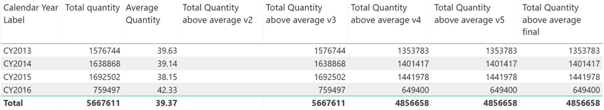
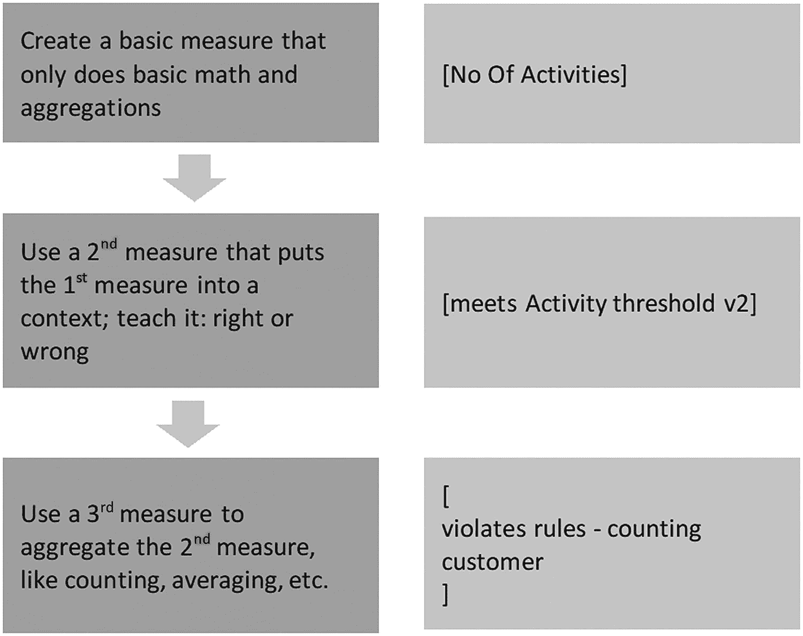
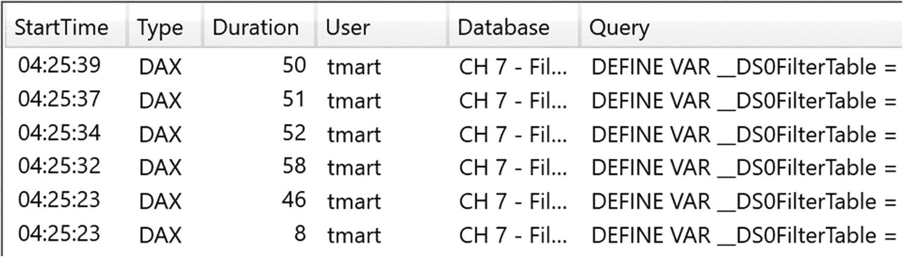
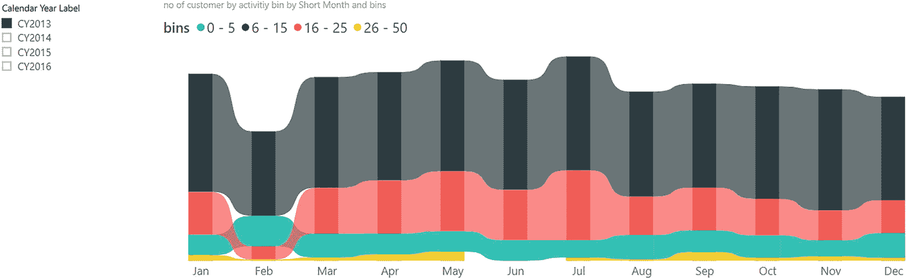

# 7. 使用度量值进行筛选

## 引言

This chapter will use a variety of techniques to showcase the possibilities of measures: measures are not only used for calculating numerical values but can also be extended to mark items that meet certain conditions, or worse, mark items that violate specific rules (i.e., rule breakers). These techniques range from simple filtering to more complex dynamic binning concepts. A use case for the latter is creating a visual (more precisely, a `ribbon chart`) to count the number of customers whose activity falls into specific bins.

**注意：** 本节内容将使用 Power BI 文件 "`CH7 – Filtering using measures.pbix`"。请注意，此文件应用了页面级筛选器，以避免显示 `Customer Key 0`，因为该键代表未知客户。

乍一看，专门为一个看似简单的“使用度量值进行筛选”主题留出一整章的篇幅，似乎是在浪费宝贵的空间；然而，事实证明事情往往并不像表面看起来那么简单。

本章的主题是筛选。行筛选是创建度量值的一个关键组成部分。创建一个度量值总是伴随着两个微妙之处：

*   **算法**：应用于筛选行的算法的复杂性。有时，底层的数学运算远比简单地将两个数字相乘要复杂得多。

*   **行筛选**：有时，确定一组特定的行比需要应用的算法更复杂。

本章关注后者：筛选值和/或行，特别是使用需要进行评估以确定是否应包含或排除特定值/行的度量值。

## 为何需要特别注意

除了第5章“DAX中的筛选”之外，本章还涵盖了一些额外的细微之处。每当在 `CALCULATE` 中使用度量值——不是作为第一个参数（数值表达式），而是作为最终用于创建筛选表的布尔表达式时——都必须记住这些细节。

**注意：** 本节内容引用了报表页面“意外结果”。

为了凸显这些微妙之处，我们假设定义了一个非常基础的度量值，用于计算平均数量。该度量值如代码清单 7-1 所示。

```
Average Quantity =
AVERAGE('Fact Sale'[Quantity])
代码清单 7-1
平均数量
```

上述度量值并无特别之处，只是一个起点。为此，我们需要让情况稍微复杂一些。因此，我们创建了度量值 `Total Quantity above average`。该度量值如代码清单 7-2 所示。

```
Total Quantity above average =
CALCULATE(
[Total quantity]
, 'Fact Sale'[Quantity] > [Average Quantity]
)
代码清单 7-2
高于平均值的总数量
```

不幸的是，此度量值无法创建，因为会触发图 7-1 所示的错误。


图 7-1：`CALCULATE` 无法在 TRUE/FALSE 表达式中使用

这是由于在筛选表达式内部引用度量值时必须考虑的一些限制。这些限制在 `CALCULATE` 函数的官方文档中已列出。该文档可在此处查阅：[https://docs.microsoft.com/en-us/dax/calculate-function-dax](https://docs.microsoft.com/en-us/dax/calculate-function-dax)

> 以下限制适用于用作参数的`布尔表达式`：
> - 表达式不能引用度量值。
> - 表达式不能使用嵌套的 `CALCULATE` 函数。
> - 表达式不能使用任何扫描表或返回表的函数，包括聚合函数。

考虑到这些限制，我们可能会想到一种重写度量值的方案，如代码清单 7-3 所示。

```
Total Quantity above average v2 =
CALCULATE(
[Total quantity]
,FILTER(
'Fact Sale'
, 'Fact Sale'[Quantity] > [Average Quantity]
)
)
代码清单 7-3
高于平均值的总数量 v2
```

但即使该度量值不会报错，其运行结果也并非预期。这个度量值不返回任何值，如图 7-2 所示。


图 7-2：度量值 `Total Quantity above average v2` —— 无返回值

尽管原因不明显，但解释很简单。`FILTER` 是一个表迭代函数，它为表中的每一行创建一个行上下文。由于度量值会隐式执行上下文转换，即将当前行上下文转换为筛选上下文，因此这个新的筛选上下文会被用来评估 `FILTER` 的条件。这直接意味着 `AVERAGE` 是针对每一行单独计算的；因此，条件永远不可能为 TRUE。表迭代器的每一行都会被忽略，导致列空白。如果将度量值 `Total Quantity above average v3` 拖到表格中，可以验证这一点；该度量值在条件中使用等号。需要注意的是，此时“总计”行的值才与 `Total Quantity` 列的值匹配。

为了使度量值按预期运行，有必要在表迭代之外评估度量值 `Average Quantity`。一种可能的解决方案如代码清单 7-4 所示。

```
Total Quantity above average v4 =
var theAverage = [Average Quantity]
return
CALCULATE(
[Total quantity]
,FILTER(
'Fact Sale'
, 'Fact Sale'[Quantity] > theAverage
)
)
代码清单 7-4
高于平均值的总数量 v4
```

上述代码清单显示，度量值`Average Quantity`的评估甚至在`CALCULATE`外部进行；平均值被存储在变量`theAverage`中。在数据模型内部，还定义了另一个度量值`Total Quantity above average v5`。该度量值将平均度量值的评估过程移近表迭代器，但仍在其外部进行评估。乍一看，在`CALCULATE`外部声明变量似乎很方便，但最佳实践是尽可能在使用变量的地方附近声明。当度量值开始变得复杂时，这一点尤其重要。

尽管如此，还应考虑尽可能保持筛选表较小，因为这样可以加快度量值的评估速度，即在度量值评估期间需要处理的数据更少。

为此，我们定义了最终的度量值`Total Quantity above average final`。请参阅代码清单 7-5。

```
Total Quantity above average final =
CALCULATE(
[Total quantity]
,
var theAverage = [Average Quantity]
return
FILTER(
ALL('Fact Sale'[Quantity])
, 'Fact Sale'[Quantity] > theAverage
)
)
```

代码清单 7-5
高于平均值的总数量（最终版）

该度量值使用了`DAX`函数`ALL`，它是可用于解除列上现有筛选器的`DAX`函数之一。

所有度量值及其结果如图 7-3 所示。



图 7-3
所有平均值度量值

## 提示

尽可能将变量放置在靠近其使用位置的地方，并保持筛选表尽可能小。

## 简单筛选

本章将从一个非常基础的用例开始：筛选（即查找）活动次数超过某个阈值的客户。

### 注意

本部分参考了报告页面“简单筛选”和“简单筛选 – 更复杂的情况”。

代码清单 7-6 展示了使用`DAX`函数`DISTINCTCOUNT`进行的度量计算。

```
活动数量 =
var 活动数量 = DISTINCTCOUNT('销售事实'[销售键])
return
IF(ISBLANK(活动数量),0,活动数量)
```

代码清单 7-6
活动数量

将度量计算和条件检查拆分为两个度量是一种良好的实践。

代码清单 7-7 展示了执行条件检查的度量，即判断某个值是否满足给定条件。

```
满足活动阈值 =
IF([活动数量] > 20 , 1 , 0)
```

代码清单 7-7
满足活动阈值

如果`活动数量`大于 20，度量`满足活动阈值`返回 1；否则返回 0。

图 7-4 展示了如何使用这两个度量来识别某个月内所有不满足阈值度量的客户。


图 7-4
不满足阈值的客户

上述筛选被认为是简单的。为了增加一点复杂性，我们对条件进行了修改。现在活动阈值定义如下：

如果以下条件不成立，则标记该客户：

- 如果`[总数量]`小于 1500，则`[活动数量]`必须小于 10。

为此，定义了第二个度量；参见代码清单 7-8。

```
满足活动阈值 v2 =
var 活动数量 = [活动数量]
var 总数量 = [总数量]
return
IF(
AND(
总数量 < 1500
, 活动数量 < 10
)
, 0 , 1 )
```

代码清单 7-8
满足活动阈值 v2

假设需要创建一个异常报告，重点分析不满足给定规则的客户，那么返回 1 会很有帮助，因为这些值将被汇总，从而返回违反规则的客户数量。这可以通过将度量嵌入到表迭代器函数`SUMX`中轻松实现，如代码清单 7-9 所示。

```
违反规则 - 客户计数 =
SUMX(
VALUES('维度客户'[客户键])
, IF([满足活动阈值 v2] = 0 , 1 , BLANK())
)
```

代码清单 7-9
违反规则 - 客户计数

图 7-5 展示了上述度量的应用。该截图取自报告页面“简单筛选”。


图 7-5
全年规则违反情况

需要注意的是，可以用以下模式来使用度量进行筛选（见图 7-6）。



图 7-6
基本模式

上述模式看似简单，但如果遵循这些步骤，有助于避免混淆。

## 警告

以上述方式重用度量可能会导致意外结果，因为度量会自动执行上下文转换，即将现有的行上下文转换为筛选上下文。

# 汇总表与度量

这一部分涉及在汇总表内部的使用，以及如何使用度量对这些表进行筛选。为此，需要先进行一些介绍。这个介绍基于一个假设：本节创建的所有汇总表稍后都将在度量内部使用。这意味着 PBIX 文件中使用的所有表仅用于演示目的。

在创建更复杂的 DAX 度量时，有许多理由表明创建汇总表变得很重要。以下是两个原因：

- 通过使迭代器尽可能紧凑（列和行尽可能少），加速表迭代器函数的执行。
- 创建与报表无关的表，用作计算的输入。

用于创建汇总表最熟悉的 DAX 函数是`SUMMARIZE`；这很可能是因为它的可用性久。为此，我们将用一小节专门介绍`SUMMARIZE`。

## 使用 SUMMARIZE

到目前为止，关于筛选上下文已经讲了很多。特别是，关于表迭代器函数是否执行上下文转换的讨论一直在进行。而且，关于`SUMMARIZE`的一般用法也讲了很多，但说实话，`SUMMARIZE`仍然有其价值。这主要是因为出现了像`GROUPBY`或`SUMMARIZECOLUMNS`这样较新的函数。如果需要计算度量，`SUMMARIZECOLUMNS`并不可用，即使这是一本关于 DAX 的书，我们假设大多数读者并不涉及查询编写。

> **注意：** 本部分参考了报告页面“汇总表与度量”。

有一些理由说明应该只使用`SUMMARIZE`来汇总数据以创建汇总表。至于添加计算列，强烈建议使用以下模式来添加这些列：

```
ADDCOLUMMNS(
SUMMARIZECOLUMNS(
‘’
, 
, 
)
, "" , 
, “" , 
)
```

sqlbi.com 的优秀团队已经非常详细地描述了这个模式（文章链接：[`www.sqlbi.com/articles/best-practices-using-summarize-and-addcolumns/`](http://www.sqlbi.com/articles/best-practices-using-summarize-and-addcolumns/)）。

下面提及了一些不应被遗忘的值得注意的独特性。代码清单 7-10 展示了创建该表的 DAX 语句。

```
包含 Summarize 的表 =
ADDCOLUMNS(
SUMMARIZE(
'销售事实'
, '维度城市'[销售区域]
, "内部求和" , SUM('销售事实'[数量])
)
, "外部求和" , SUM('销售事实'[数量])
, "使用度量" , [总数量]
)
```
**代码清单 7-10** 包含 Summarize 的表

图 7-7 显示了上述 DAX 语句创建的表。


要准确理解发生了什么，有必要记住`SUMMARIZE`和`ADDCOLUMNS`这两个函数都被视为所谓的表迭代器函数。但与`SUMMARIZE`相反，`ADDCOLUMNS`不执行上下文转换，并且不会从迭代的当前行创建筛选上下文。这就解释了为什么`外部求和`列中的所有行值都与“总计”行值匹配。由于没有筛选上下文，表迭代器中的所有行都被使用了。

当然，如果使用度量来计算`使用度量`列的列值，则不会出现这种效果。度量总是会执行上下文转换——将行上下文转换为筛选上下文。

### SUMMARIZE 与 GROUPBY 的对比

`GROUPBY`是后期才被引入 DAX 的函数，因此使用频率并不高，至少在社区（即[`community.powerbi.com`](http://community.powerbi.com)）中并不常见。但这种忽视并不合理，原因如下：

- **性能** – 在某些场景下，`GROUPBY`的执行速度比`SUMMARIZE`更快。当分组行数较少时尤其如此（当然，数据量大小的判定取决于诸多因素）。
- **高级分组** – `GROUPBY`支持对“计算列”进行分组。这在复杂度量值中变得非常重要。

> **注意：** 本节内容涉及报表页面“嵌套排名”、“SUMMARIZE 组内排名”和“GROUPBY 组内排名”。

为了比较这两个函数的性能，我们定义了三个度量值。基础度量值`_r`如代码清单 7-11 所示。

```
_r =
RANKX(
    CALCULATETABLE(
        SUMMARIZE(
            'Fact Sale'
            , 'Dimension City'[Sales Territory]
            , 'Dimension City'[State Province]
        )
        , ALL('Dimension City'[State Province])
    )
    , [Total quantity]
    ,
    , DESC
)
```
**代码清单 7-11** `_r`

由于`RANKX`本身并非最简单的函数，也不是最快的表迭代函数，此处用它来对底层数据模型施加一些压力。该度量值的作用是：在每个`Sales Territory`内，根据度量值`Total Quantity`对列`State Province`的相关值进行排名。图 7-8 展示了这一度量值。


由于本章主要讨论如何使用度量值对结果进行筛选，因此额外定义了两个度量值：

- `SUMX GroupBy Filtered`
- `SUMX Summarize Filtered`

两个度量值几乎完全相同，此处仅展示第一个的代码清单。见代码清单 7-12。

```
SUMX GroupBy Filtered =
SUMX(
    FILTER(
        ADDCOLUMNS(
            GROUPBY(
                'Fact Sale'
                , 'Dimension City'[Sales Territory]
                , 'Dimension City'[State Province]
            )
            , "q" , [Total quantity]
            , "r" , [_r]
        )
        , [r] <= 2
    )
    , [q]
)
```
**代码清单 7-12** `SUMX GroupBy Filtered`

该度量值的工作原理很直接。首先使用`GROUPBY`构建一个汇总表，并通过排名度量值`_r`为表添加计算列。最后，为每个销售区域仅保留排名前两位的州。

与度量值`SUMX GroupBy Filtered`略有不同，第二个度量值`SUMX Summarize Filtered`使用`SUMMARIZE`函数来创建汇总表。

图 7-9 和 7-10 展示了性能测试的第五次迭代。每次迭代包含以下步骤：

- 打开已激活“空白页”报表页面的 pbix 文件。
- 启动 DAX Studio，连接到 pbix 文件，并激活“全部查询跟踪”。
- 切换到感兴趣的 Power BI 报表页面，即“SUMMARIZE 组内排名”或“GROUPBY 组内排名”。
- 依次选择可用的切片器值。
- 对另一个报表页面重复上述步骤。




两张图均显示，基于`GROUPBY`的筛选略占优势，但务必针对具体数据集测试`SUMMARIZE`和`GROUPBY`这两个函数。

### 数据分箱与 GROUPBY 的强大功能

关于动态分箱的论述已有很多，讨论也层出不穷，未来还会有更多。这意味着这不会是关于动态分箱的最后一篇文章。但由于使用了`GROUPBY`，至少带来了一些新意。

分箱是指将数据归类到预定义的桶中。通常这些桶有下限和上限，本例也不例外。如果桶的大小选择得当，统计桶内的数据量能揭示深刻的洞察。请注意，本例中桶的大小选择并不明智。同样重要的是，聚合函数并不限于`COUNT`。

> **注意：** 本节内容涉及报表页面“分箱”。

图 7-11 展示了根据`Fact Sale`表中列`Sale Key`的值分布创建的`bins`表内容。


图 7-12 展示了`bins`表、度量值和带状图（Ribbon Chart）的组合。



## 代码清单 7-13

代码清单 7-13 展示了度量值 `binning using group by`。

```
binning using group by =
var abt =
GROUPBY(
    ADDCOLUMNS(
        VALUES('Fact Sale'[Customer Key])
        ,"NoOfActivities",[No Of Activities]
    )
    ,[NoOfActivities]
    ,"SumOf",SUMX(CURRENTGROUP(),[NoOfActivities])
)
return
SUMX(
    VALUES('bins')
    ,
    var binMin = 'bins'[min]
    var binMax =
        IF(
            NOT(ISBLANK('bins'[max]))
            ,'bins'[max]
            ,MAXX(abt,[NoOfActivities])
        )
    return
    SUMX(
        FILTER(
            abt
            ,[NoOfActivities] >= binMin && [NoOfActivities] <= binMax
        )
        ,[SumOf]
    )
)
```

代码清单 7-13 `binning using GROUPBY`

上述度量值分为两部分：第一部分创建分组，并将分组结果存入表变量 `abt`。第二部分将表映射到 `bins` 表。由于 `bins` 表与数据模型无关，这种映射必须动态完成。

第一部分 `GROUPBY` 同样使用了度量值 `No Of Activities`。为了更好地理解其运作原理，下面用一个简单的图表来解释第一部分复杂的内部机制。

图 7-13 展示了使用 `CURRENTGROUP` 的 `GROUPBY` 概念。


“内部表”仅由两列组成，一列是 `Customer Key`（请注意，该列来自表 `Fact Sale` 而非表 `Dimension Customer`）。通过 `ADDCOLUMNS` 添加度量值 `No Of Activities`。该度量值仅用于统计活动数量。这个表由大家熟悉的函数 `VALUES` 和 `ADDCOLUMNS` 创建。

当读者意识到 `GROUPBY` 部分实际上是对一个计算列进行汇总时，可能会感到一丝神奇。结合 `CURRENTGROUP` 函数（该函数可类比于 T-SQL 中 `OVER` 语句的 `PARTITION BY` 子句），几乎可以创建出一个包含多列的新表。遗憾的是，如果不采取进一步的措施，这个表目前无法直接用于可视化对象，因此需要将其映射到代表桶的无关表。

在第二部分中，`abt` 表被映射到 `bins` 表。这是通过嵌套表迭代实现的。第一层迭代遍历所有桶，第二层迭代根据桶的上限和下限，将已分组的 `abt` 表中的所有行映射到对应的桶中。

# 摘要

使用度量值来筛选数据集，以及操作 `CALCULATE` 的筛选表达式并非易事，尤其是在目前还没有一种简洁的写法能完全发挥 DAX 函数作用的情况下。本书也不例外。DAX 仍在不断发展变化中，但使用度量值进行筛选是值得的，这一点毋庸置疑。


