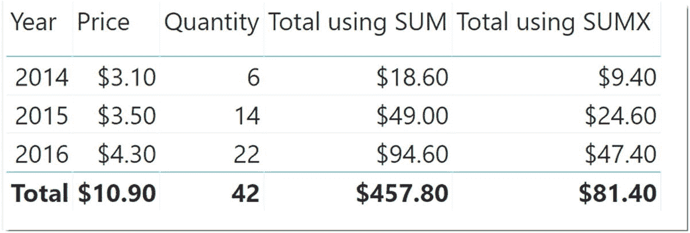
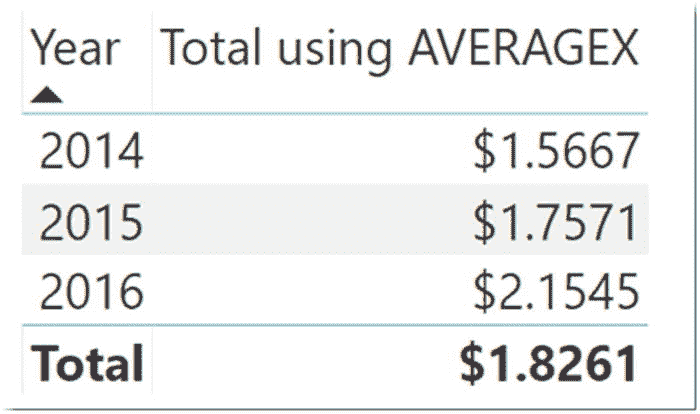
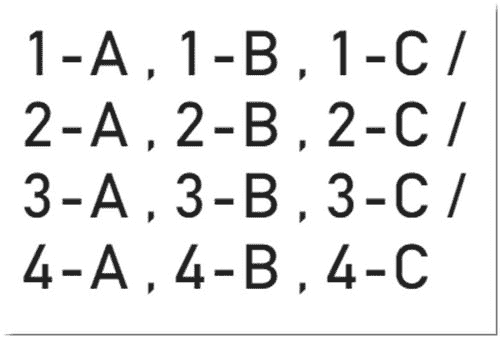
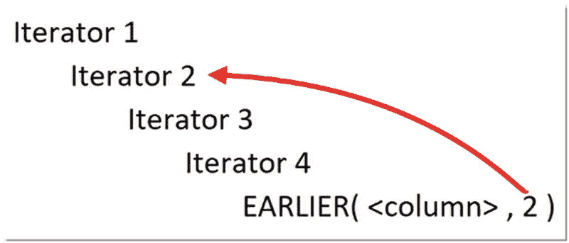

# 循环流控制

当在 DAX 计算中使用迭代函数时，它会在内部执行一系列循环。`<table>` 参数中的行数决定了循环的次数。如果一个`<table>`恰好有七行，那么迭代函数就会精确地迭代七次。

一旦迭代次数确定且循环开始，迭代函数会在每次迭代时评估第二个参数指定的`<expression>`。该表达式会产生一个适用于当前循环的单一值，同时会考虑所有相关的筛选上下文。`<expression>` 可以简单到只是一个列名，但只要它能为循环输出一个单一值，它也可以是一个涉及多行 DAX 代码的复杂计算。迭代函数会跟踪每次迭代生成的每个值。

在迭代过程中，迭代函数会跟踪每次循环生成的输出值。如果使用了`SUMX`迭代函数，那么每次循环生成的值会被累加起来得到总和。如果使用了`AVERAGEX`迭代函数，那么迭代函数会计算每次循环生成值的平均值。

能够对数据执行两次遍历，是诸如`AVERAGE`和`AVERAGEX`这类不同函数之间的关键区别，并且也常常是你选择使用迭代函数而非其非迭代版本的原因。使用迭代版本，你可以在执行最终的平均值计算之前，先将数据处理成正确的格式。

务必记住，迭代函数执行的循环次数等于用作第一个参数的`<table>`中的行数。迭代次数可能意味着`<expression>`在更多行上执行计算。不要混淆`<expression>`所考虑的行数与`<table>`中的行数。

## 基本形式

迭代函数最基本的形式如列表 6-1 所示。这个*计算度量值*示例使用了`SUMX`迭代器来精确执行六次循环。循环次数由用作第一个参数的表表达式中的行数决定。

一个名为`MyForEach`的变量被赋值为一个包含恰好六行的表表达式，这是`GENERATESERIES`函数的输出。在此示例中，`GENERATESERIES`函数输出一个单列六行的表。然后，`MyForEach`变量在`RETURN`语句中被用作`SUMX`迭代函数的第一个参数。

```
SUMX 示例 =
VAR
MyForEach = GENERATESERIES(1,6)
RETURN
SUMX( MyForEach, 2 )
列表 6-1
一个在计算度量值中使用迭代函数的基础示例
```

列表 6-1 中的`SUMX`函数的每次迭代都会评估一个`<expression>`，在此例中该表达式被硬编码为整数值`2`。在这个示例中，计算度量值的输出始终是`12`。`SUMX`函数对每次迭代的输出执行`SUM`求和：

- `2 + 2 + 2 + 2 + 2 + 2 = 12`

对列表 6-1 中的计算稍作修改，是调整`<expression>`，使其使用模型中的数据而非硬编码值。在列表 6-2 中，`<expression>`被扩展为使用存储在`MyForEach`变量中的表表达式的值。

#### 注意

`<expression>`参数中使用的数据不必来自或与用作第一个参数的`<table>`存在关系。

```
SUMX 示例 =
VAR
MyForEach = GENERATESERIES(1,6)
RETURN
SUMX( MyForEach , [Value] ∗ 2 )
列表 6-2
计算度量值中的 SUMX 迭代函数
```

列表 6-2 中更新后的计算仍然精确执行六次迭代；然而，在这种情况下，每次循环的`<expression>`每次都会返回不同的输出。`<expression>`中的`[Value]`引用是一个介于`1`和`6`之间的数字，具体取决于迭代次数，然后该值会被乘以`2`。

这里使用的变量名`MyForEach`是为了强调示例的意图，并非迭代逻辑的一部分。

第一次迭代计算的`<expression>`生成的值是`2`，第二次迭代生成的值是`4`，依此类推。`SUMX`函数最终返回的值是`42`。

- `2 + 4 + 6 + 8 + 10 + 12 = 42`

这个结果恰好也是关于生命、宇宙以及一切终极问题的答案。所以，至少你现在知道了，这个著名的问题可以用 DAX 中的迭代函数来解决。☺

列表 6-2 中的示例也展示了传递给迭代函数的`<expression>`可以比在单列上进行操作更复杂。


## 常见用例

迭代器函数的一个常见用例是，在需要逐步执行计算的数据上提供精确的总计。列表 6-3 展示了一个计算，其中迭代器的输出是 `[Quantity]` 列与 `[Price]` 列相乘的结果。

考虑表 6-1 中以下包含六行数据的集，以及一个要求：显示每年的行总计金额以及精确的整体总值。表 6-1 中的数据将被列表 6-3 中的计算度量值使用。

**表 6-1** 用于演示 `SUM` 与 `SUMX` 的简单数据集

| 年份 | 数量 | 价格 |
| --- | --- | --- |
| 2014 | 2 | $1.50 |
| 2014 | 4 | $1.60 |
| 2015 | 6 | $1.70 |
| 2015 | 8 | $1.80 |
| 2016 | 10 | $2.10 |
| 2016 | 12 | $2.20 |

满足该要求的计算度量值使用了迭代器，并展示在列表 6-3 中。

```
Total using SUMX =
SUMX(
'Table 6-1',
'Table 6-1'[Price] ∗ 'Table 6-1'[Quantity]
)
列表 6-3
使用 SUMX 迭代器函数和表 6-1 数据的计算度量值
```

另一个名为 `[Total using SUM]` 的计算度量值被添加到数据模型中，并展示在列表 6-4 中。这个计算度量值有助于展示迭代器函数与非迭代器函数之间的差异，特别是在 Power BI 中两者同时用于同一个表或矩阵视觉对象时。

```
Total using SUM =
SUM('Table 6-1'[Price]) ∗ SUM('Table 6-1'[Quantity])
列表 6-4
使用 SUM 函数和表 6-1 数据的计算度量值
```

当两个计算度量值都被添加到表格视觉对象时，结果如图 6-1 所示。



**图 6-1** 展示了使用列表 6-3 和列表 6-4 中计算的视觉对象

以表格视觉对象的第一行为例。第四列中的 $18.60 使用了列表 6-4 中的 `[Total using SUM]` 计算度量值，该度量值*不*进行迭代。它对 Price 的 `SUM` 执行单次计算，然后将结果与 Quantity 的 `SUM` 相乘。

`SUM` 函数将 2014 年 `[Quantity]` 列中的两个值相加得到 6，然后将两个 `[Price]` 值（$1.50 和 $1.60）相加，最后将这两个结果相乘，得到总计 $18.60。

- 6 x $3.10 = $18.60

这个 $18.60 的值就是 `[Total using SUM]` 列第一行显示的结果。虽然 $3.10 乘以 6 确实等于 $18.60，但这并不是我们想要的结果。

右侧的 `[Total using SUMX]` 列是一个计算度量值，它使用迭代器函数在价格和数量之间执行相同的乘法，但区别在于乘法是在每一行上分别进行的。

底层数据集中 2014 年有两行数据，因此为了得到 2014 年的 $9.40，迭代器首先计算 2 x $1.50，得到两次迭代中第一次迭代的结果 $3.00。

### 说明

`SUM` 在底层实现上与 `SUMX` 是相同的。`SUM` 是处理单列情况下的*语法糖*，其灵活性不如 `SUMX`。

第二次迭代计算 4 x $1.60，得到 $6.40。当所有迭代完成后，每个表达式的输出结果被确定，迭代器函数会对每次迭代产生的值进行最终计算。在本例中，迭代器函数是 `SUMX`，因此这些值被相加得出总计 $9.40。

- (2 x $1.50) + (4 x $1.60) = $9.40

在本例中，使用迭代器函数和非迭代器函数的区别通常在与总计相关的值中更为明显。图 6-1 中的总计行在 `[Total using SUM]` 列显示值为 $457.80，这是对 `[Price]` 的总计与 `[Quantity]` 列所有值的总计进行单次乘法计算的结果，得出的值为 $457.80。

- 42 x $10.90 = $457.80

虽然这个计算运行很快，但它并不是我们想要的结果。

### 说明

在本例中，Price 列的总计行中可以看到 $10.90 这个值。我们有意未隐藏 $10.90，以帮助演示两个度量值之间的差异。通常，这个值应该被隐藏，以防止混淆。

## 平均值的平均值

另一个利用迭代器的典型场景是需要对某个平均值再进行平均。暂且不讨论此类需求的统计意义，考虑一下如何利用表 6-1 中的同一数据集来找出年平均价格。

处理这一数据的一个特殊挑战是确定任意一年的平均价格；计算需要考虑每个价格点售出的数量。对于 2014 年，以 $1.60 价格售出的商品数量多于 $1.50 的价格。2014 年的平均价格不应仅仅是两个价格值的中点；它应反映基于 Quantity 列中数值的权重。

根据表 6-2 中*展开的*值，2014 年销售的平均价格为 $1.5667。

**表 6-2** 表 6-1 中 2014 年的值，并展开行以显示权重

| 年份 | 数量 | 价格 |
| --- | --- | --- |
| 2014 | 1 | $1.50 |
| 2014 | 1 | $1.50 |
| 2014 | 1 | $1.60 |
| 2014 | 1 | $1.60 |
| 2014 | 1 | $1.60 |
| 2014 | 1 | $1.60 |
| 总计 | 6 | $9.40 |

- $9.40/6 = $1.5667

使用相同的逻辑，2015 年的平均价格为 $1.7571，2016 年的平均价格为 $2.1545。

目标是创建一个计算度量值，将其添加到 Power BI 报告的表格视觉对象中，以生成与表 6-3 中所示相同的值。

**表 6-3** 表 6-1 中每年的平均值，包括三年内的平均值

| 年份 | 平均价格 |
| --- | --- |
| 2014 | $1.5667 |
| 2015 | $1.7571 |
| 2016 | $2.1545 |
| 平均值 | $1.8261 |

如果不使用迭代器函数，很难得到正确的结果。像列表 6-4 中那样，简单地对 Price 列进行 `SUM` 再与 Quantity 列的 `SUM` 结合计算，无法提供满足此要求所需的足够细粒度的数据访问。

为了使最终计算更易于阅读，并强制转换行上下文，以下两个计算度量值（如列表 6-5 和 6-6 所示）被添加到数据模型中。

```
Sum of Quantity = SUM('Table 6-1'[Quantity])
列表 6-6
一个计算度量值，用于生成 Quantity 列中数值的和
```

```
Sum of Price = SUM('Table 6-1'[Price])
列表 6-5
一个计算度量值，用于生成 Price 列中数值的和
```


### 嵌套迭代器

迭代器的一个便捷特性是能够进行嵌套，这意味着外层迭代函数可以放心地调用内层迭代器。针对本练习提出的解决方案使用了嵌套迭代器，以协助完成必要的处理来达到预期结果。清单 6-7 以此方式使用了两个迭代器，将其作为计算的一部分。

外层 `AVERAGEX` 迭代器执行了三次迭代，因为 `VALUES` 函数返回的表表达式正好有三行。`VALUES` 函数返回一个单列表格，其中每一行对应于表 6-1 中 `Year` 列的不同值。

这里需要注意的重要一点是，`AVERAGEX` 函数执行了三个循环，而不是根据表 6-1 的行数执行六个循环。`VALUES` 函数将六行原始数据聚合为三行。

内层 `SUMX` 迭代函数在外层 `AVERAGEX` 函数每次迭代时都会执行，其自身的迭代次数与作为第一个参数的表中的行数相同。对于这个数据集，`SUMX` 函数针对上下文中的每一年恰好执行两次迭代。

```
Total using AVERAGEX =
AVERAGEX(
VALUES('Table 6-1'[Year]),
DIVIDE(
SUMX(
FILTER(
'Table 6-1',
'Table 6-1'[Year] =
EARLIEST('Table 6-1'[Year])
),
[Sum of Price] ∗ [Sum of Quantity]
),
[Sum of Quantity]
)
)
清单 6-7
一个显示每年平均价格的计算度量值
```



图 6-2 显示清单 6-7 中计算的结果

清单 6-7 中所示代码的伪逻辑（结果如图 6-2 所示）可以转换为以下逐步逻辑：

1.  针对表 6-1 中的每个不同年份运行一个外层循环 (`AVERAGEX`)。外层循环总共进行三次迭代，每年一次（2014 年、2015 年和 2016 年）。
2.  针对步骤 1 中的三个外层循环中的每一个，使用 `SUMX` 对表 6-1 的原始数据运行一个内层循环。每个内层循环都会被过滤到当前外层循环的年份。此过滤导致 `SUMX` 函数的每个内层循环执行两次迭代。
3.  `SUMX` 的每次迭代计算 `Price x Quantity`，以确定当前正在迭代的行的总金额，该行数据来自内层 `SUMX` 函数的第一个参数所指定的表。
4.  一旦内层 `SUMX` 完成迭代，每个结果会相加，以确定内层循环的总值。
5.  内层 `SUMX` 的结果除以当前外层循环的 `Quantity` 总和，以确定该特定年份的平均销售数量。此除法作为外层 `AVERAGEX` 循环的 `<expression>` 的一部分执行。
6.  针对内层函数每次迭代的输出值（即步骤 5 的输出）计算一个平均值。该平均值需要考虑三个结果。

```
{
2014 :
{
{ 2 x $1.50 = $3.00 }
+
{ 4 x $1.60 = $6.40 }
} / 6 = $1.5667
+
2015 :
{
{ 6 x $1.70 = $10.20}
+
{ 8 x $1.80 = $14.40 }
} / 14 = $1.7571
+
2016 :
{
{ 10 x $2.10 = $21.00 }
+
{ 12 x $2.20 = $26.40 }
} / 22 = $2.1545
} / 3 = $1.8261
清单 6-8
伪代码显示了清单 6-7 中 DAX 函数的循环和值
```

为了得出 $1.8261 的结果，清单 6-8 总共执行了六次迭代。有三个外层循环，每个外层循环运行两个内层循环。这些内层/外层循环演示了迭代器函数如何提供对数据的细粒度访问，从而允许在聚合发生*之前*执行计算。这个示例并不意味着你应该一直用 `SUMX` 替代 `SUM`，或用 `AVERAGEX` 替代 `AVERAGE`。此示例旨在展示不同的 DAX 函数如何适用于不同的需求，以及迭代器函数可以如何使*一些*复杂场景更容易解决。

### EARLIER 和 EARLIEST

当像清单 6-7 中的示例那样嵌套迭代器时，内层迭代有时需要访问其迭代逻辑外部的值。两个用于满足此类需求的 DAX 函数是 `EARLIER` 和 `EARLIEST`。这些函数允许计算访问调用栈中层级更高的当前值。尽管这些函数名称听起来如此，但它们并非专门设计用于解决基于日期或时间的难题，也不能让你直接访问同一表中其他行的数据——例如同一表中上一行或下一行的值。

没有对应的 `LATER` 或 `LATEST` 函数。


### EARLIER

为了演示使用嵌套迭代器的这些函数，请考虑清单 6-9 中计算所得的度量值。其意图是使用数字和字母构建一个基于文本的字符串，以帮助突出嵌套迭代器的流程控制。

此计算中使用了两个迭代器：一个遍历数字 1 到 4 的外部迭代器，以及一个遍历字母 A、B 和 C 的内部迭代器。结果是一个文本项，清晰地展示了内外循环的操作顺序。

清单 6-9 中的计算还包含一些以双斜杠（`//`）开头的注释行。

```
Loop Measure =
VAR outerLoop = GENERATESERIES(1,4)
VAR innerLoop = DATATABLE("Value",STRING,{{"A"},{"B"},{"C"}})
RETURN
CONCATENATEX(
// foreach row in the outerLoop table
outerLoop ,
CONCATENATEX(
//foreach row in the innerLoop table
innerLoop ,
EARLIER([Value]) & "-" & [Value] ,
//inner loop delimiter
", "
),
//outerLoop Delimiter
" / "
)
清单 6-9
展示在嵌套迭代器中使用 EARLIER 的计算度量值
```



图 6-3
展示使用清单 6-9 中计算度量值输出的可视化效果。

在清单 6-9 所示的计算中，有两个`CONCATENATEX`函数。紧跟在`RETURN`语句之后的第一个`CONCATENATEX`函数是外部循环。其第一个参数是存储在`outerLoop`变量中的表表达式。该表表达式是一个包含四行的单列表。该表中的值是数字 1 到 4。

另一个`CONCATENATEX`函数嵌套在第一个`CONCATENATEX`的第二个参数中，并使用存储在`innerLoop`变量中的表表达式来确定该迭代器的循环次数。

外部`CONCATENATEX`函数从存储在`outerLoop`变量中的表表达式的第一行开始，其值为 1。然后内部`CONCATENATEX`函数启动，并遍历用于驱动内部迭代器的表中的三行。

用于构建每段文本的`<expression>`是以下代码行（第 11 行）：

```
EARLIER([Value]) & "-" & [Value],
```

在这段代码中，对`[Value]`列的引用出现了两次。用于内部和外部迭代器的表都是单列表，列名均为`[Value]`。`EARLIER`函数帮助计算区分正确的列引用。

在此例中，`EARLIER`函数内部的`[Value]`列引用指向外部循环中的表表达式，因此它会从`outerLoop`表函数的当前行返回一个值。代码中的第二个`[Value]`未使用`EARLIER`函数，它指的是属于内部`CONCATENATEX`函数当前迭代的`innerLoop`表的`[Value]`列。

用于表示`innerLoop`表一次迭代的分隔符是逗号，而用于表示`outerLoop`表一次迭代的分隔符是斜杠。这些分隔符可以在图 6-3 的结果中看到，逗号代表内部循环的进展，斜杠表示外部循环已迭代一次。

### EARLIEST

清单 6-9 中的示例使用了两个嵌套的迭代器函数。这并不妨碍你在一个语句中嵌套三个或更多迭代器。在这种情况下，某些内部迭代器可能需要访问某个外部迭代器（不一定是紧邻的外部迭代器或最外层迭代器）的当前值。

`EARLIER`函数可选的第二个参数`<number>`允许你指定在调用栈中要引用的外部循环。如果使用值 1，则引用紧邻当前迭代器外部的循环，因此这与留空此参数没有区别。

#### 注意

`EARLIER( <table> , 1 )` 等同于使用 `EARLIER (<table> )`。

这个可选参数允许迭代器的`<expression>`通过指定一个大于 1 的值，来访问任何外部循环中使用的表的当前行上下文。

图 6-4 中显示的示例有四层嵌套迭代器。最内层迭代器中的`EARLIER`函数为第二个参数指定了值 2。此值意味着`EARLIER`函数的`<column>`参数是对嵌套循环序列中向上*两层*的迭代器当前行上下文的引用。值 3 将引用迭代器 1 的当前行上下文，其效果与指定`EARLIEST( <column> )`相同。



图 6-4
展示了第四层的`EARLIER`函数引用第二层的列。

如果可选第二个参数中指定的数字大于嵌套迭代器的数量，则会生成错误。

`EARLIEST`函数提供了引用最外层迭代器的快捷语法，从而无需计算出用作`EARLIER`函数参数的正确数字。

使用清单 6-9 中的代码，下面清单 6-10 中显示的三种变体会产生相同的结果。但是，如果存在三层或更多层的嵌套迭代器，使用`EARLIEST`函数的变体可能会产生不同的结果。

```
EARLIER([Value]) & "-" & [Value],
EARLIER([Value],1) & "-" & [Value],
EARLIEST([Value]) & "-" & [Value],
清单 6-10
在此情况下返回相同结果的 EARLIER 和 EARLIEST 的三种变体
```


