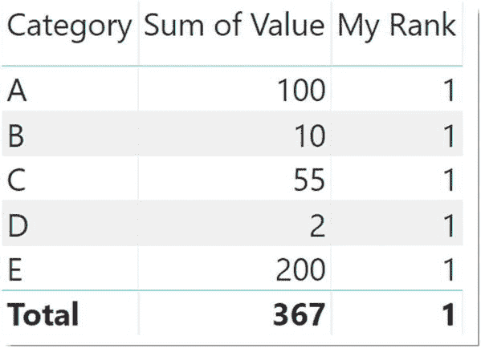
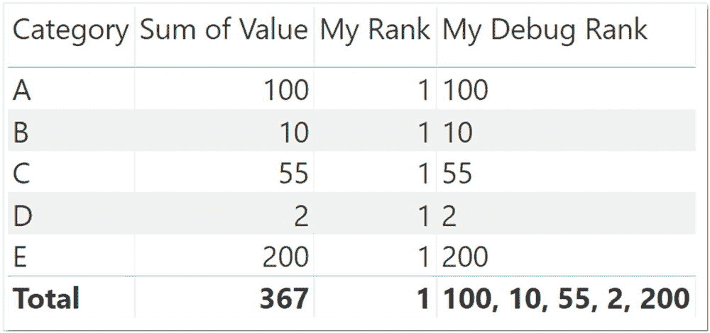
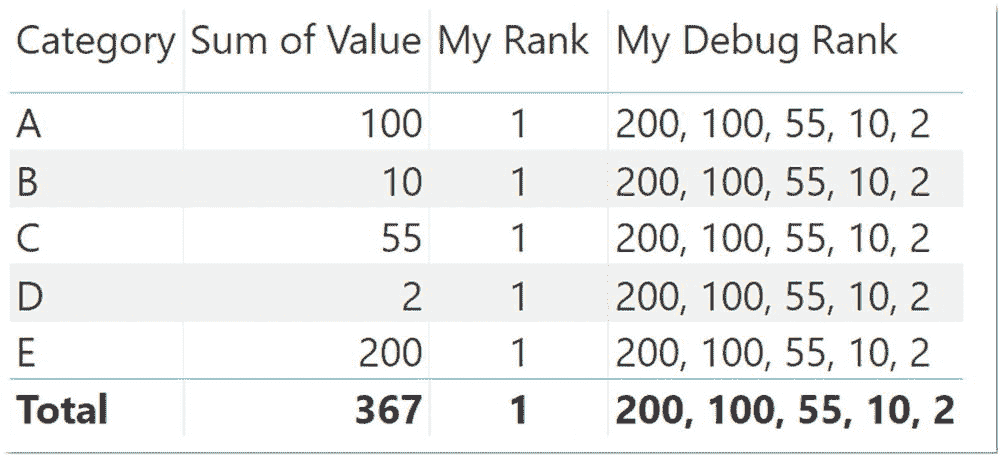
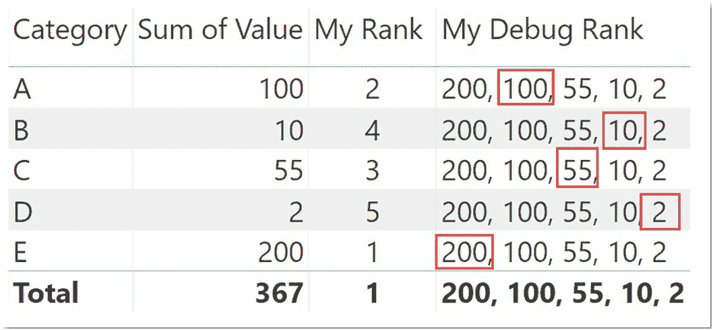
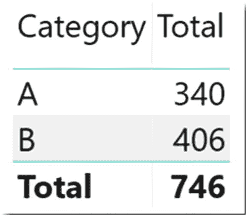
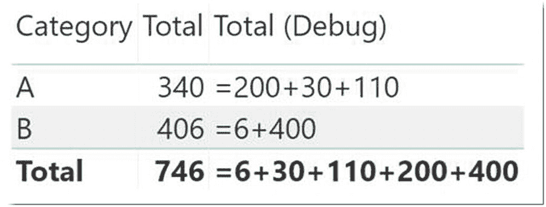
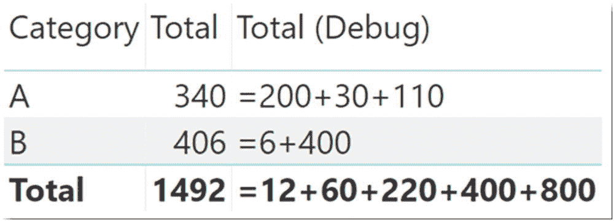

# 调试迭代器函数

如本章所示，在处理复杂场景时，迭代器函数非常有用。但使用各种迭代器函数进行计算时，我们也容易迷失方向，或被其内部工作原理所困扰。它们输出单个值，但该函数返回的值是否按预期方式计算，往往并不明确。

幸运的是，有一种相对简单的方法可以调试迭代器函数，那就是使用其中一个迭代器函数来提供一种简单的调试形式。我用于调试的函数是 `CONCATENATEX`。

所有迭代器函数的前两个参数都共享相同的参数签名或典型模式。第一个参数始终是一个 `<表>`，它可以是物理表，也可以是表表达式。第二个参数始终是每次迭代要计算的 `<表达式>`。

这种典型模式提供了一种简便的方法：克隆你想要调试的计算，然后将用于调试的迭代器函数替换为 `CONCATENATEX` 函数。

为了演示这一点，请考虑以下数据表（表 6-4）以及一个需求：创建一个简单的计算度量值，根据 `Value` 列中的数值对 `Category` 列中的项进行排名。计划是生成一个介于 1 到 5 之间的计算度量值，最高值的排名为 1，最低值的排名为 5。

**表 6-4** 用于排名计算的一组数据

| Category | Value |
|----------|-------|
| A        | 100   |
| B        | 10    |
| C        | 55    |
| D        | 2     |
| E        | 200   |

清单 6-11 中显示的计算度量值被添加到数据模型中。`[My Rank]` 计算度量值使用了 `[Sum of Value]` 度量值。

```
Sum of Value = SUM('Table 6-4'[Value])
My Rank =
RANKX(
'Table 6-4',
[Sum of Value]
)
```

**清单 6-11** 添加到数据模型中的两个计算度量值。`[Sum of Value]` 执行简单的求和，`[My Rank]` 是需要调试的度量值。

乍一看，在包含 `[Category]` 列的视觉对象中使用时，使用 `RANKX` 迭代器进行此计算的 DAX 看起来会产生介于 1 和 5 之间的值。然而，图 6-5 中显示的实际结果却显示 `[My Rank]` 度量值在每一行都重复为 1。



**图 6-5** `[My Rank]` 度量值在每一行都显示为 1

`[My Rank]` 度量值一遍又一遍地生成相同的值，包括底部的“总计”行。

要理解计算为何如此表现，一种调试方法是克隆该度量值，并将 `RANKX` 迭代器函数替换为 `CONCATENATEX` 函数，如清单 6-12 所示。

```
My Debug Rank =
CONCATENATEX(
'Table 6-4',
[Sum of Value],
-- 格式化参数 --
", "
)
```

**清单 6-12** 使用 `CONCATENATEX` 进行调试的计算度量值

图 6-6 显示了来自图 6-5 的表格视觉对象，其中添加了来自清单 6-12 的新的 `[My Debug Rank]` 计算度量值。在新列中要注意的一个关键点是，在前五行中，每行的输出只显示一个值。出现单个输出是因为 `[My Rank]` 和 `[My Debug Rank]` 计算考虑了来自 `[Category]` 列的筛选器。

图 6-6 中表格视觉对象的顶行，其 `[Category]` 列的值为“A”，这成为了对同一行中同样使用“表 6-4”的计算的隐式筛选器。这种筛选导致 `RANKX` 和 `CONCATENATEX` 函数使用的表从原始五行减少到仅用于 `[My Rank]` 和 `[My Debug Rank]` 度量值的单一行。

因此，`RANKX` 函数只能考虑单个值，这就是它输出结果为 1 的原因。`CONCATENATEX` 函数则有助于阐明这一点，它突出了隐式筛选器和显式筛选器的综合影响，并建议用能清除来自 `[Category]` 列选择的隐式筛选器的代码来修改原始计算。



**图 6-6** 显示 `[My Debug Rank]` 度量值的表格视觉对象

因此，根据 `[My Debug Rank]` 调试度量值提供的有用信息，清单 6-13 展示了解决此问题的计算更新版本。

```
My Debug Rank =
CONCATENATEX(
ALL('Table 6-4'[Category]),
[Sum of Value],
-- 格式化参数 --
", ",
-- 排序依据 --
'Table 6-4'[Sum of Value],
ASC
)
```

**清单 6-13** 清单 6-12 中调试度量值的更新版本

主要变化是，作为第一个参数传递的表被包裹上了 `ALL` 函数。这一变化明确清除了 `[Category]` 列上存在的任何内部或外部筛选器。`CONCATENATEX` 函数中添加了额外的参数，以便对连接后的输出应用排序顺序。添加这些额外参数纯属为了外观，旨在直观地突出 `RANKX` 函数的行为。

图 6-7 展示了使用更新的 `[My Debug Rank]` 度量值的表格视觉对象。现在，右侧列中的每一行都显示进行了五次迭代，这比以前显示的单个值要好。

调试度量值的更新看起来不错，因此可以将相同的更改应用于 `[My Rank]` 度量值，这应该可以解决问题。



**图 6-7** 显示更新后的 `[My Debug Rank]` 度量值的表格视觉对象

`[My Rank]` 度量值的更新代码如清单 6-14 所示。

```
My Rank =
RANKX(
ALL('Table 6-4'[Category]),
[Sum of Value]
)
```

**清单 6-14** 调试完成后已修复的 `[My Rank]` 计算

一旦 `[My Rank]` 计算被修改，更新后的表格视觉对象如图 6-8 所示。



**图 6-8** 显示来自清单 6-14 的更新后的 `[My Rank]` 度量值的表格视觉对象

现在，`[My Rank]` 列基于每个 `[Category]` 的 `[Sum of Value]` 与其他类别比较后，显示了您所期望的值。`RANKX` 的默认行为是为序列中的最高值返回排名 1，为第二高的值返回排名 2。在图 6-8 中，`[My Debug Rank]` 列中使用了方框来显示在该排序序列中，每个 `[Sum of Value]` 针对特定行所处的位置。

在类别“A”的第一行中，`[Sum of Value]` 为 100，当从左到右（从高到低）读取序列中的值时，它位于第二位置。在类别“B”的第二行中，`[Sum of Value]` 为 10，使用相同的读取顺序，它位于第四位置。该位置反映了 `RANKX` 函数生成的数字。

### 更多调试方法

上一节演示了如何使用 `CONCATENATEX` 函数来帮助调试 `RANKX` 函数。同样的技术对于其他迭代器函数也同样有用。

考虑以下数据表（表 6-5），其中包含四个项目，分为两个类别。表中总共有五行交易数据，要求是在一个表格视觉对象中按类别显示汇总总数。该总数需要是一个计算值，该计算值对交易级别的 `[Quantity]` 和 `[Value]` 列进行相乘。

**表 6-5** 用于帮助演示调试 `SUMX` 计算的数据集

| 类别 | 项目 | 数量 | 值 |
| --- | --- | --- | --- |
| A | A1 | 2 | 100 |
| A | A2 | 3 | 10 |
| A | A2 | 2 | 55 |
| B | B1 | 3 | 2 |
| B | B2 | 2 | 200 |

清单 6-15 展示了一个计算度量值，它使用 `SUMX` 迭代器函数来计算每个类别的总数，并为总计提供一个准确的数值。

```
Total =
SUMX (
'Table6-5',
'Table6-5'[Value] ∗ 'Table6-5'[Quantity]
)
```

**清单 6-15** 使用表 6-5 中的数据计算总和的度量值

当清单 6-15 中的计算度量值连同“类别”字段一起添加到表格视觉对象中时，结果如图 6-9 所示。



`图 6-9` 显示来自 `表 6-5` 的数据以及 `清单 6-15` 中度量值的表格视觉对象

右侧列中显示的数字看起来是正确的，但很容易被看似正确却实际错误的数字所迷惑，尤其是当涉及到底部总计行中的值时。我们如何确定总计中显示的 `746` 这个值是使用正确的粒度得出的呢？或者，我们能否证明总计的值不仅仅是通过对“值”列求和再乘以“数量”列的求和得到的？

将 `SUMX` 函数替换为 `CONCATENATEX` 函数的技术有助于阐明 `SUMX` 函数是如何得出图 `6-9` 中所示的三个值的。第一步是复制 `清单 6-15` 中显示的计算度量值，并对复制后的计算进行以下调整。

```
Total (Debug) =
"=" &
CONCATENATEX(
'Table6-5',
'Table6-5'[Value] ∗ 'Table6-5'[Quantity],
"+"
)
```

`清单 6-16` 一个新的度量值，用于使用 `表 6-5` 中的数据调试总计

除了更改原始计算的名称外，`清单 6-16` 中将 `SUMX` 函数替换为了 `CONCATENATEX` 函数。`[Total (Debug)]` 度量值的最终输出是文本，因此添加了一个 `"="` 作为前缀，并指定了 `"+"` 作为 `CONCATENATEX` 函数的分隔符。

新函数与原始计算度量值一起添加到表格视觉对象中，结果如图 `6-10` 所示。



`图 6-10` 显示来自 `表 6-5` 的数据以及 `清单 6-15` 和 `6-16` 中代码的表格视觉对象

新的 `[Total (Debug)]` 计算度量值更详细地分解了三行中每一行的总计数字是如何得出的。类别 A 第一行的值 `340` 是 `200`、`30` 和 `110` 相加的结果。调试度量值的输出显示执行了三次迭代，尽管类别 A 中的项目 `A2` 出现了两次。迭代器仍然会为迭代器第一个参数中使用的表的每一行评估 `<表达式>`。

类别 B 的值 `406` 是 `6`（`3 x 2`）和 `400`（`2 x 200`）相加的结果，这表明迭代器只执行了两次迭代就得到了这个数字。

视觉对象中一个关键的数字是总计行中的 `746`。调试度量值的输出表明发生了五次迭代。这些评估在逻辑上是独立的，不受第一行和第二行中进行的计算的影响。总计行中的结果显示，该值与同一列中的其他计算是并行计算的。

基于文本的调试计算输出也有助于确认 `746` 的结果不是通过将“值”列相加然后乘以“数量”列的总计得出的。

### 与 `MDX SCOPE` 等效

为了突出总计计算的独立性，对计算所做的以下修改仅影响总总计。如果你有幸使用过多维数据模型，那么 `SCOPE` 命令是一个非常方便的功能。`SCOPE` 命令允许数据建模者将特定代码嵌入度量值中，从而允许你在特定情况下覆盖逻辑。

DAX 没有 `SCOPE` 函数，但可以使用 `清单 6-17` 中所示的技术来实现相同的效果。

`清单 6-15` 中的计算已更新以展示类似 `SCOPE` 的效果。`[Value] ∗ [Quantity]` 的计算结果会加倍，但仅当该行恰好是总计行时才生效。

```
Total =
SUMX (
'Table6-5',
'Table6-5'[Value]
∗ 'Table6-5'[Quantity]
∗ IF(
ISINSCOPE('Table6-5'[Category]), --<= 测试
1, --<= 则
2  --<= 否则
)
)
```

`清单 6-17` `清单 6-15` 中度量值的更新版本

`清单 6-17` 中修改后的度量值显示在 `SUMX` 函数的 `<表达式>` 逻辑中添加了一个 `IF` 函数。该函数检查筛选上下文以查看是否对“类别”列应用了任何筛选。如果 `ISINSCOPE` 函数返回 `TRUE`，则表达式乘以 `1` 以保持不变。

但是，如果 `ISINSCOPE` 函数返回 `FALSE`，则表示未对“类别”列进行筛选，这意味着该计算是针对总计行的，因此乘以 `2`。图 `6-11` 中显示的结果假设 `清单 6-17` 中突出显示的修改同时应用于 `[Total]` 和 `[Total (Debug)]` 度量值。



`图 6-11` 显示来自 `表 6-5` 的数据以及 `清单 6-17` 中代码的表格视觉对象

图 `6-11` 显示的结果表明，与图 `6-10` 相比，前两行没有变化。然而，底部行显示的数字反映了更新后的代码对输出的影响。`[Total (Debug)]` 列中的文本强调了该计算在逻辑上如何独立于同一列中的其他计算。虽然这些结果在实际意义上毫无意义，但你可能需要在数据模型中应用的许多业务规则也同样如此。☺