# 10. 寻找缺失的数据

## 引言

DAX 最明显的应用领域之一是计算基于现有数据的度量值，例如，计算返回随时间累积值的度量值。一个可能在使用 DAX 时不会首先想到的领域是发现缺失的数据。“缺失的数据”——诚然——听起来有些模糊；因此，需要更详细地解释。这些缺失的数据之一，例如，是停止购买的客户。

本章将介绍如何找到这些缺失的数据，首先从识别停止购买的客户的简单介绍开始。然后介绍如何识别事件之间的间隔、计算间隔数量以及确定每个间隔的长度。

最后，区分了计算前一个值（这里基本上没有缺失，因此是容易的部分）和查找最后一行，此时突然出现了缺失的索引。

## 月亏与月盈

这背后的问题是：“哪些客户在上一个期间购买了商品，但在当前期间没有再次购买？”如果将其可视化，这就会变得清晰得多。为此，图 10-1 显示了基础情形，后续图表展示了如何回答这个问题。


**图 10-1** 非回头客户基础情形

图 10-1 中的左侧圆圈表示过去曾购买过的客户。右侧圆圈则表示在当前期间有购买的客户。对于“哪些客户在当前期间没有购买，但在过去期间有购买？”这一问题的概念性答案，如图 10-2 所示。


**图 10-2** 非回头客户（月亏）

为简化表述，我们将代表在当前期间未购买的客户的圆圈形状称为*月亏*。这意味着过去有比今天更多的客户（项目）。相反的问题“哪些客户刚刚在当前期间购买了商品，但在上一期间没有？”也可以用同样的方式可视化。图 10-3 展示了*月盈*，或者更简单地说，*新客户*，即那些在当前期间有购买但在上一期间没有购买的客户。


**图 10-3** 新客户（月盈）

要回答上述两个问题，需要识别两组客户：

- 上一个期间的客户

- 当前期间的客户

根据两组客户的组合方式，可以识别出非回头客户，也可以识别出新客户。下一节将展示如何回答这两个问题。

**注意**：本节引用的 pbix 文件为`CH 10 Waning and Waxing moon`。

### 新客户：月盈

本章展示如何计算与上个月相比在当前月份中没有购买过的客户数量。

为确定在过去期间未购买的客户数量，使用了以下度量值（参见列表 10-1）。

```dax
No of New Customer =
var theseCustomers = VALUES('Fact Sale'[Customer Key])
var theMonthBefore = SELECTEDVALUE('Dimension Date'[RunningMonthIndex]) - 1
var theseCustomerBeforeCurrentMonth =
CALCULATETABLE(VALUES('Fact Sale'[Customer Key]),FILTER(ALL('Dimension Date'[RunningMonthIndex]),'Dimension Date'[RunningMonthIndex] = theMonthBefore ),ALL('Dimension Date'))
return
COUNTROWS(EXCEPT(theseCustomers,theseCustomerBeforeCurrentMonth))
```

**列表 10-1** `No of New Customer`

这个度量值背后的思路相当简单：只需找出所有在当前期间之前的各个期间有购买的客户。这些客户存储在表变量`theseCustomerBeforeCurrentMonth`中。所有在当前期间有购买的客户存储在变量`theseCustomers`中。使用`EXCEPT`，可以很容易地找出所有在之前所有期间都没有购买的客户。

### 缺失的客户：月亏

要找出在当前期间未购买的客户数量，可以使用与计算新客户数量相同的度量值。只是有一个小变动：传递给`EXCEPT`函数的表的顺序被颠倒了。

## 至少一次，或者每次：一致性衡量指标

通常，随着时间的推移保持一致性被视为一件好事，尤其是当积极体验能与这段时间相关联时。检测一致性的缺失，或者更妙的是，在一致性开始消失时就察觉它，有助于避免产生负面体验。

为简化起见，一致性定义如下：在过去的 6 个月中，客户必须至少购买过四次商品。如果客户在过去两个月内没有任何购买行为，一致性就面临风险。图 10-4 展示了一致性各种状态示意图。

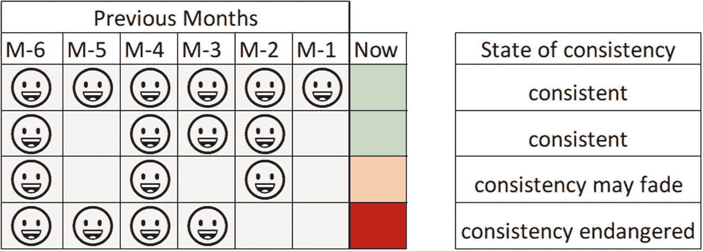

**图 10-4** 一致性状态

清单 10-2 展示了度量值 `State of consistency`。

```dax
State of Consistency =
var DateMax = MAX('Dimension Date'[Date])
// 上个月末
var DateEndOfPrevMonth =
EOMONTH(
DATE(YEAR(DateMax) , MONTH(DateMax) - 1, 1) ,0)
// 过去 6 个月
var DateStartOfRange =
DATE(YEAR(DateMax) , MONTH(DateMax) - 6, 1)
var filtertableconsistencyrange =
DATESBETWEEN(
'Dimension Date'[Date]
, DateStartOfRange
, DateEndOfPrevMonth
)
var consistencymayfade =
IF(
COUNTROWS(
CALCULATETABLE(
SUMMARIZE(
'Fact Sale'
, 'Dimension Date'[Calendar Month Number]
)
, filtertableconsistencyrange
)
)
< 4 , 1 , BLANK()
)
// 过去 2 个月
var DateStartOfRangeEndangerd =
DATE(YEAR(DateMax) , MONTH(DateMax) - 2, 1)
var filtertableconsistencyendangered =
DATESBETWEEN(
'Dimension Date'[Date]
, DateStartOfRangeEndangerd
, DateEndOfPrevMonth
)
var consistencyendangerd =
IF(
COUNTROWS(
CALCULATETABLE(
SUMMARIZE(
'Fact Sale'
, 'Dimension Date'[Calendar Month Number]
)
, filtertableconsistencyendangered
)
)
< 2 , 1 , BLANK()
)
return
IF(consistencyendangerd = 1 , 3 , IF(consistencymayfade = 2 , 2 , 1))
```

**清单 10-2** 一致性状态

其工作原理如下：

-   确定一个筛选表`filtertableconsistencyrange`，它包含过去 6 个月的所有日期。

-   如果被该筛选表筛选后的`Fact Sale`表中可用的月份数少于 4，则返回值 1，并存储在变量`consistencymayfade`中。

-   确定一个筛选表`consistencyendangerd`，它包含过去 2 个月的所有日期。

-   如果被该筛选表筛选后的`Fact Sale`表中可用的月份数少于 2，则返回值 1，并存储在变量`consistencyendangerd`中。

-   最后，返回一个数值：3 表示“一致性面临风险”状态，2 表示“可能消失”状态，1 表示“一致”状态。

度量值`State of consistency`被用在清单 10-3 所示的度量值 `State of consistency – Customer` 中。

```dax
State of Consistency - Customer =
MAXX(
VALUES('Dimension Customer'[Customer Key])
, [State of Consistency]
)
```

**清单 10-3** 客户一致性状态

度量值`State of Consistency`遍历每个客户，并返回度量值`State of Consistency`的最大值。这使得当在像矩阵可视化（如图 10-5 所示）这样的层次结构视图中使用该度量值时，能够将状态“向上冒泡”。图 10-5 中展示的矩阵可视化可在“在过去每个月份均未购买”报表页上找到。

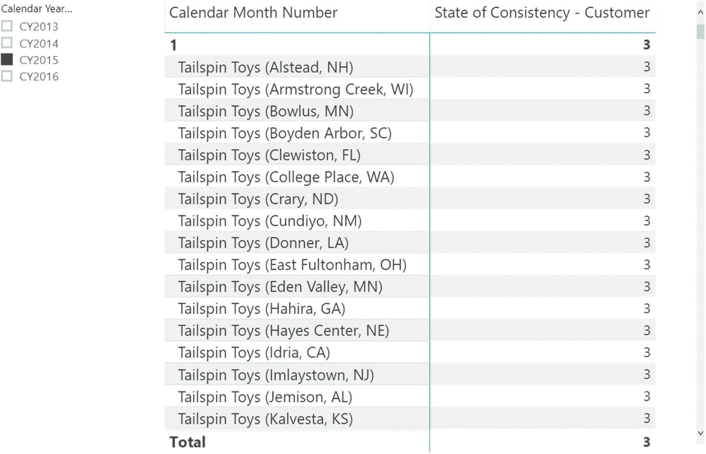

`图 10-5` 一致性状态 – 向上冒泡

仅仅进行简单计数的度量值，如果以一种更具创意的方式使用，例如，基于计数的行来推导状态，也能提供巨大的洞察。

#### 事件序列或事件缺失

在某些情况下，了解缺失的事件被视为有价值的信息。有时，这些信息比测量到的信息（即有数据可查的信息）更有价值。例如，缺失的事件可以看作缺失的订单。因此，不仅要分析可用的信息，还要分析那些未发生的事件。了解客户不活跃的持续时间，可以引发防止客户流失的行动。

这里只考虑与日期相关的序列，由于如果这些序列用整数值而不是日期或日期时间数据类型来表示，序列的计算通常会简单得多，因此我们将这些整数值添加到日历表中。由于日历表从 2013 年 1 月 1 日开始，到 2016 年 12 月 31 日结束，针对前面的文本，一个例子就是为月份创建一个整数。这意味着 2013 年 1 月的所有日期都将被索引为数字 1，2014 年 1 月的所有日期被索引为数字 13，最后，2016 年 12 月的所有日期被索引为值 48。

清单 10-4 显示了在`Dimension Date`表中创建计算列的 DAX 语句。

```
RunningMonthIndex =
var minYear = YEAR(MIN('Dimension Date'[Date]))
var thisYear = YEAR('Dimension Date'[Date])
return
(thisYear - minYear) * 12 + MONTH('Dimension Date'[Date])
```

`清单 10-4` `RunningMonthIndex`

该 DAX 语句内部的基本逻辑是：
-   使用`YEAR(MIN(...))`确定日历表中的起始日期，提取起始年份，并将该值存储在变量`minYear`中。
-   从当前行的日期列中提取年份，并将该值存储在变量`thisYear`中。
-   使用简单的数学计算得出表示月份的整数索引。

使用月份只是为了简化。根据业务类型、销售的产品或许多其他原因，考虑最合适的时间范围可能是一项非常复杂的任务，但也可能更具启发性。当不能预期每个客户或每个产品都以相同的频率销售时，这些考量是必要的。

#### 说明

本部分参考的是 pbix 文件`“CH 10 Waning and Waxing moon.”`

清单`10-5`展示了度量值`SEQ – length of gap`。

```
SEQ - length of gap =
var maxRunningMonthIndex =
CALCULATE(
MAX('Dimension Date'[RunningMonthIndex])
, ALL('Dimension Date')
)
var abt =
ADDCOLUMNS(
ADDCOLUMNS(
SUMMARIZE(
'Fact Sale'
,'Dimension Customer'[Customer Key]
,'Dimension Date'[RunningMonthIndex]
)
, "nxtMonth" ,
var thisRunningMonth = 'Dimension Date'[RunningMonthIndex]
var nxtRunningMonthFromFact =
CALCULATE(
FIRSTNONBLANK('Dimension Date'[RunningMonthIndex],[Total quantity])
, ALL('Dimension Date')
, 'Dimension Date'[RunningMonthIndex] > thisRunningMonth
)
return
IF(NOT(ISBLANK(nxtRunningMonthFromFact)) , nxtRunningMonthFromFact , maxRunningMonthIndex)
)
,"length of gap",
var l = [nxtMonth]-[RunningMonthIndex] - 1
return
IF(l = 0 , BLANK() , l)
)
return
SUMX(
abt
, [length of gap]
)
```

`清单 10-5` 序列 – 间隔长度

具体逻辑如下：首先创建一个汇总表，其中包含`Customer Key`和`RunningMonthIndex`列的所有有效组合（即存在于`Fact Sale`表中的组合）。

这是通过以下 DAX 实现的：

```
SUMMARIZE(
'Fact Sale'
, 'Dimension Customer'[Customer Key]
, 'Dimension Date'[RunningMonthIndex]
)
```

使用`ADDCOLUMNS`为表添加`nxtMonth`列。该列通过`FIRSTNONBLANK`查找下一个月份索引。必须使用`CALCULATE`将`ADDCOLUMNS`引入的现有行上下文转换到新的筛选上下文中，并将`Customer Key`列的值添加到新的筛选上下文。这是通过以下 DAX 完成的：

```
CALCULATE(
FIRSTNONBLANK(
'Dimension Date'[RunningMonthIndex]
, [Total quantity]
)
, ALL('Dimension Date')
, 'Dimension Date'[RunningMonthIndex] > thisRunningMonth
)
```

结果存储在变量`nxtRunningMonthFromFact`中。此步骤是为了避免出现负值。如果不存在下一个值，则在本例中，将使用最新的索引。

然后，通过简单的数学计算，得出下一个月与当前月之间的差值；这将返回以月为单位的间隔长度。

最后，结合迭代器函数`SUMX`使用该表，该函数将计算所有间隔的总和。

第二个度量值`SEQ – no of gaps`的基本逻辑相同，唯一区别在于它统计的是间隔数量。

图`10-6`显示了一个简单表格。

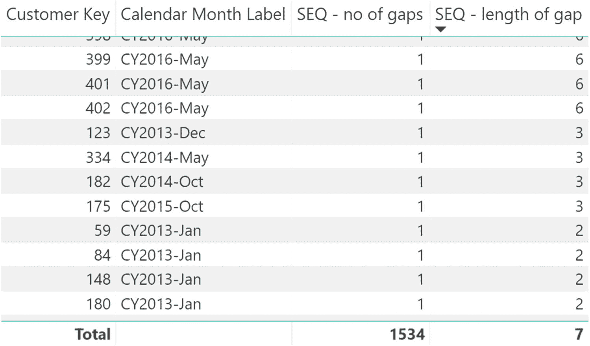

`图 10-6` SEQ 表

这两个度量值都可以看作是分析缺失事件的开端。

## 缺失的索引

寻找前一行的任务与上述类似但又有所不同。需要解决的问题是找到前一行。即使这听起来与寻找前一个值相似，但实际并非如此。在大型数据集中找到前一行并非易事。为此，有必要先解释一下两者的区别。

DAX 经常与其他查询语言（如 SQL 或 MDX）进行比较。在有些比较中，DAX 性能更优，而在另一些比较中则不然。DAX 不提供与 T-SQL 窗口函数（如`ROW_NUMBER`、`LAG`或`LEAD`）类似的功能。这些函数功能强大，可以对一组行进行编号（这与提供排名不同）。`LAG`和`LEAD`允许在行之间进行导航，例如，查找前一行或后一行。

有时，需要在更复杂的度量值中计算前一个值，例如，计算同比 (YoY) 比较。
有时，需要找到前一行，例如，为了确定逐行的变化。

尽管这两个任务看起来相似，但它们并不相同。必须能够区分这两个任务。因此，接下来的两节将更详细地解释这些任务。

#### 前一个值

如果能够从给定的上下文中确定前一个值，那么这就属于前一个值问题。

图`10-7`将展示其含义。

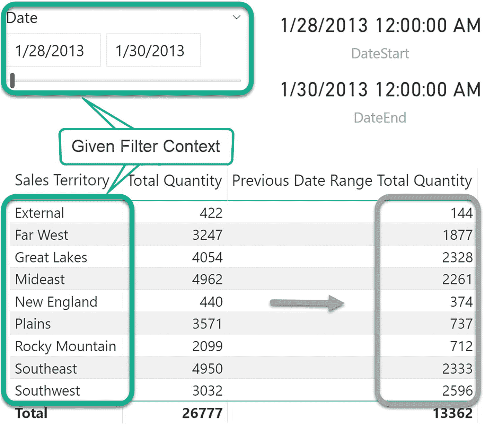

`图 10-7` 前一个值

清单`10-6`展示了如何从给定的筛选上下文中推导出筛选前一个日期范围所需的日期范围。

```
Previous Date Range Total Quantity =
var DateRangeStart = [DateStart]
var DateRangeLength = DATEDIFF([DateStart] , [DateEnd] , DAY)
var PrevDateRangeEnd = DateRangeStart - 1
var PrevDateRangeStart = PrevDateRangeEnd - DateRangeLength
var PrevDateRange = DATESBETWEEN('Dimension Date'[Date] ,  PrevDateRangeStart , PrevDateRangeEnd)
return
CALCULATE(
[Total Quantity]
, PrevDateRange
)
清单 10-6
前一个日期范围的总数量
```

筛选表`PreDateRange`的内容无需任何额外的表扫描即可确定，只需“调整”给定的筛选上下文即可。

### 前一行

确定前一行的问题将通过表格`Fact Sale`（参见图`10-8`）中的`Sale Key`列进行演示。

### 警告

如果你使用的是附带的 pbix 文件`“CH 10 – Finding whats not there.pbix”`，请确保已选择`Customer Key`。

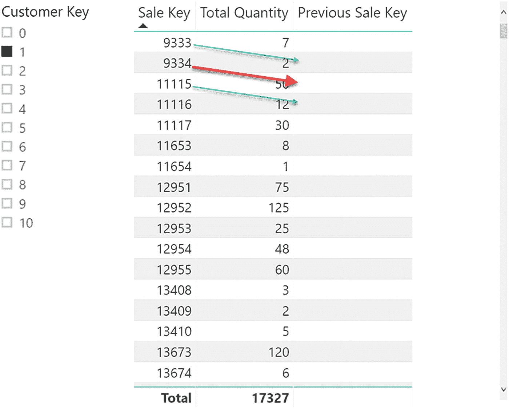

图 10-8

前一行

一种简单的方法是直接通过当前`Sale Key`减 1 来确定前一行：

`PreviousRow(SaleKey: 9334) = 9334 – 1 = 9333`

其复杂性在图`10-9`中表现得更加明显。

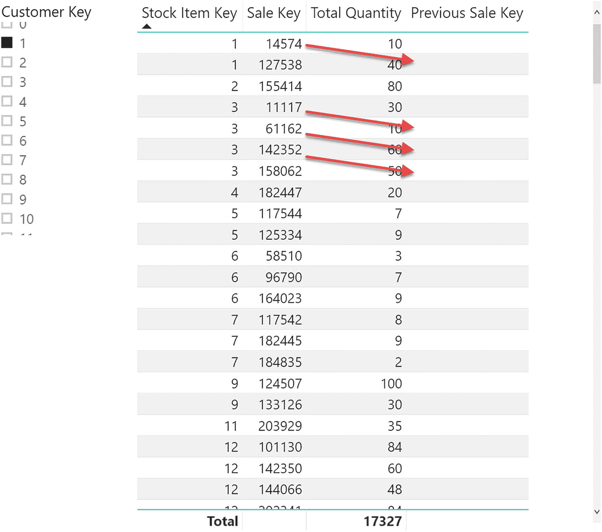

图 10-9

前一行 – 更复杂的情况

图`10-9`显示，除了`Customer Key`列的值之外，还必须考虑`Stock Item Key`列的值才能确定前一行。

#### 查找前一行：使用 DAX

要使用 DAX 查找前一行，有必要理解完成该任务需要执行哪些步骤。

在这个例子中，使用表`Fact Sale`中的`Sale Key`列，因为这些值可用于标识每一行。

由于这不是一个简单的方法，所使用的解决方案还考虑了`Customer Key`。图`10-10`显示了一个概念性的小表格，以帮助理解这些步骤。

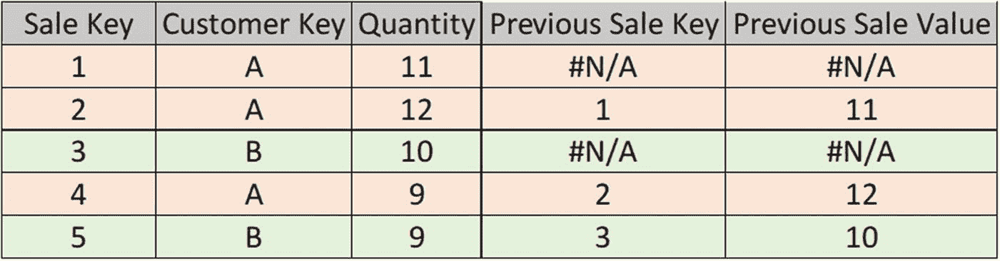

图 10-10

前一行 – 概念

*   创建一个用于迭代的表。
    在当前的筛选上下文中，`Customer Key`和`Sale Key`的可用的组合。

*   确定前一个`Sale Key`。
    前一个`Sale Key`是当前`Sale Key`之前的最接近的`Sale Key`。
    将使用当前迭代中的当前`Sale Key`来查找所有小于当前`Sale Key`的 Sale Key。当前`Sale Key`之前最接近的`Sale Key`是所有小于当前`Sale Key`的`Sale Key`中的`MAX(‘…’[Sale Key])`。

*   检索前一个值。
    使用前一个`Sale Key`来筛选`Fact Sale`表，从而检索前一个值。

#### 注意

在将 10-7 清单中的度量值“上一笔销售价值”添加到 Power BI 文件“CH 10 查找不存在的项.pbix”的报告页“上一行”的表中之前，请确保`客户密钥`切片器仅选择了单个`客户密钥`。

下一个清单，即 10-7，展示了一个用于查找上一行的“仅限 DAX”解决方案。其强制性要求是存在一个唯一标识符，以便能够找到上一行。

```
previous sale value =
var t =
ADDCOLUMNS(
FILTER(
SUMMARIZE(
'Fact Sale'
, 'Dimension Customer'[Customer Key]
, 'Fact Sale'[Sale Key]
)
, [Customer Key]  0 // 客户密钥 0（未知）不予考虑
)
, "thePrevQuantity" ,
var currentSaleKey = [Sale Key]
var prevsalekey =
MAXX(
FILTER(
CALCULATETABLE(
VALUES('Fact Sale'[Sale Key])
, ALL('Fact Sale'[Sale Key])
)
, 'Fact Sale'[Sale Key] < currentSaleKey
)
, 'Fact Sale'[Sale Key]
)
var prevQuantity =
CALCULATE(
[Total Quantity]
, 'Fact Sale'[Sale Key] =  prevsalekey
)
return prevQuantity
)
return
SUMX(
t
, [thePrevQuantity]
)
清单 10-7
上一笔销售价值
```

以上清单将在下面进行更详细的解释。

首先，所有可用的（在当前筛选上下文中的）`客户密钥`和`销售密钥`组合将通过以下 DAX 进行汇总：

```
SUMMARIZE(
'Fact Sale'
, 'Dimension Customer'[Customer Key]
, 'Fact Sale'[Sale Key]
)
```

除此之外，还使用`FILTER`来排除`客户密钥`为 0 的情况，因为此密钥代表“未知”客户。

`ADDCOLUMNS`向表中添加了`thePrevQuantity`列。需要注意的是，`ADDCOLUMNS`是表迭代器函数之一。这意味着用于计算`thePrevQuantity`的表达式是在行上下文中求值的，该行上下文由`客户密钥`和`销售密钥`列决定。

此 DAX

```
CALCULATETABLE(
VALUES('Fact Sale'[Sale Key])
, ALL('Fact Sale'[Sale Key])
)
```

将当前`客户密钥`和`销售密钥`的组合，扩展为当前筛选上下文中当前`客户密钥`的所有销售密钥。这是因为`CALCULATETABLE`执行了以下操作：

-   将现有的筛选上下文克隆到一个新的筛选上下文中。
-   将当前行上下文添加到新的筛选上下文中（针对每次迭代），同时阻止现有筛选（已存在于克隆的筛选上下文中）；可以这样理解：`客户密钥`和`销售密钥`列上的现有筛选被行上下文的列所替代。
-   在旧的筛选上下文中评估筛选表达式`ALL(...)`，并“替换”新筛选上下文中`销售密钥`列上已存在的筛选。
-   在新上下文中评估第一个参数`VALUES('Fact Sale'[Sale Key])`。

此步骤的结果如图 10-11 所示。

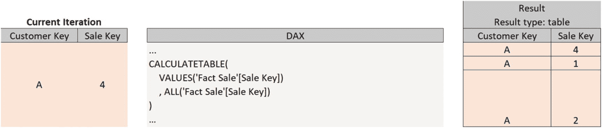

图 10-11

上一行 – 概念 – 展开

然后，对上一步得到的结果表进行筛选，只保留销售密钥小于当前销售密钥（存储在变量`currentSaleKey`中）的所有行。结果如图 10-12 所示。

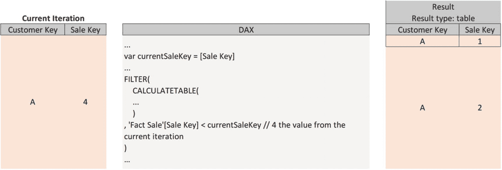

图 10-12

上一行 – 概念 – 筛选

`MAXX`用于在由`FILTER(...)`返回的筛选表对象中查找最大值。这将返回上一个`销售密钥`。`MAXX`返回的标量值存储在变量`prevsalekey`中。最后，使用此变量检索上一个销售密钥的数量。

### 查找上一行：使用建模方法

解决上一行问题的另一种方法是基于建模的方法，即使用一个已包含上一行值的附加表。此表必须在数据模型外部创建，例如，使用 Power Query 或——甚至更好——在源系统内部创建。这种方法有助于解决大数据集的性能问题。创建此表可能具有挑战性，但有助于克服大数据集的性能问题。该 pbix 文件包含表“`Fact Sale – Previous Value`”，该表已在 SQL Server 内部使用 10-8 清单中的 SQL 语句创建。强烈建议将此附加表对数据模型的最终用户“隐藏”，以避免混淆。
```

# 使用 LAG 查找上一值并优化性能

## SQL 语句

```sql
select
f.[Customer Key]
, f.[Sale Key]
, f.[quantity]
, LAG(f.[Sale Key] , 1) over(partition by f.[Customer Key] order by f.[Sale Key] asc) as prevsaleeky
, LAG(f.[Quantity] , 1) over(partition by f.[Customer Key] order by f.[Sale Key] asc) as prevquantity
from
Fact.Sale as f
```
清单 10-8
使用 `LAG` 查找上一值的 T-SQL.sql

然后，通过使用`销售密钥`列在表`Fact Sale`和`Fact Sale – Previous Sale`之间建立关系，将此附加表集成到数据模型中。由于这些列在任一表中都是唯一的，Power BI 会创建一个基数为“一对一 (1:1)”的关系。有必要将基数更改为“一对多 (1:*)”，并将表`Fact Sale`放在“一”侧，以充分利用筛选传播的速度。此关系如图 10-13 所示。

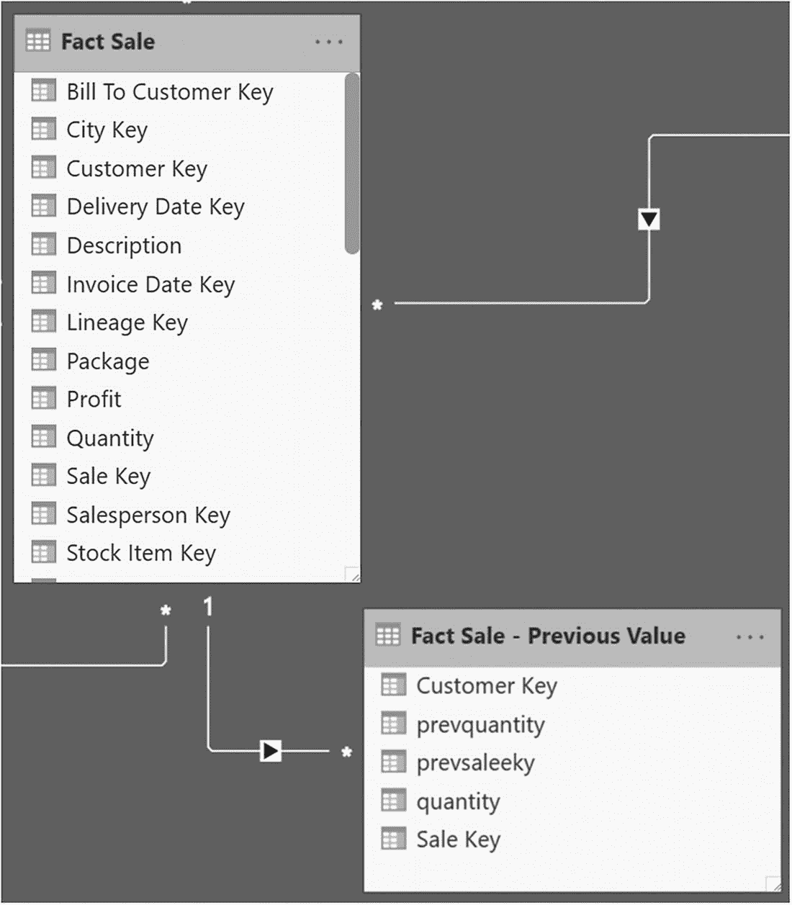
图 10-13

上一行，基于事实表 – 关系

可以使用如 10-9 清单所示那样简单的度量值来计算上一行的值。

```dax
上一笔销售价值 - 基于事实表 =
SUM('Fact Sale - Previous Value'[prevquantity])
```
清单 10-9
上一笔销售价值 – 基于事实表

使用建模方法具有巨大的性能优势。接下来的两个图表展示了这种性能优势。图 10-14 显示了使用仅限 DAX 的方法计算`客户密钥` 2 及`客户密钥` 2–200 的上一行值的查询持续时间。图 10-15 显示了相同的情况，但使用了附加事实表`Fact Sale – Previous Value`。

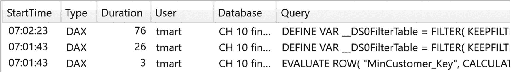
图 10-15

上一行值，基于事实表

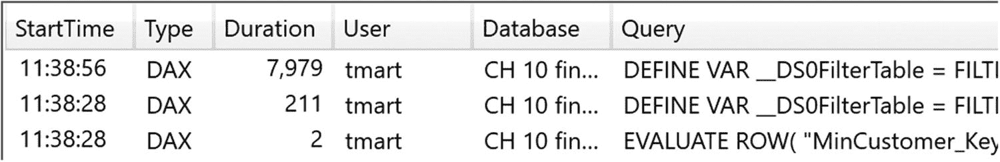
图 10-14

上一行值，仅限 DAX

在两个图表中，最底部的查询用于填充`客户密钥`切片器；1 毫秒的微小差异可以忽略不计。

中间的那条线显示了`客户密钥` 2 的上一行值的计算，即使这种差异看起来不大，因为两个查询都不到一秒就返回了答案。

但最顶部查询之间的差异是巨大的。使用“仅限 DAX”的方法计算`客户密钥` 2–200 的上一行值需要`近 8 秒钟`。

而利用附加事实表的简单度量值在`不到 80 毫秒`内就返回了结果。这是一个巨大的性能提升。

#### 注意

使用额外的事实表也有其缺点。由于该附加表与事实表具有相同的粒度，它自然会消耗额外的内存。创建额外的事实表也可能需要比前文中的 SQL 语句复杂得多的语句，因为确定先前的 `Sale Key` 可能涉及比本例中使用的简单方法多得多的逻辑。

对于如何处理前一行问题，并没有明确的答案，但希望这能证明，一个复杂且缓慢的 DAX 语句（或许）可以通过利用数据库引擎的所有底层能力（数据建模和 DAX）来简化。

# 11. 行级安全性

## 简介

在某些时候，您可能会遇到这样的需求：创建一个报告，该报告需要根据查看报告的当前登录用户，提供特定的结果。一种场景是，不同的团队成员需要一个报告，该报告显示他们各自负责的项目的低层级细节，但阻止他们看到同一团队中其他成员的相同细节层。另一种场景可能是向组织外部的多个群体提供报告，确保访问报告的人只能看到他们应该看到的信息。

一种解决方案是创建数据模型的主副本，并根据需要制作尽可能多的克隆来满足所需的信息孤岛数量。每个克隆可以填充特定于某个用户或组织的数据，然后，每个报告仅提供给应该有权访问的用户。这种方法降低了数据泄露的风险。

然而，一旦数据孤岛数量超过少数几个，这种方法就会变得复杂且难以管理。当需要对模型中已有的计算进行修改或添加新的计算时，每个数据模型都需要被修改、测试、上传等等。使用这种方法需要注意的其他问题包括：数据刷新调度、模型大小，以及管理每个数据模型中控制仅导入适当数据的唯一代码。

幸运的是，还有一种替代方案：行级安全性 (`RLS`)。`RLS` 允许您将所有相关数据纳入一个数据模型中，并提供一个安全且健壮的过滤层来管理谁能看到什么。行级安全性的概念并不新鲜。`SQL Server Analysis Services` 数据库长期以来一直提供行级安全性的概念，其多维和表格版本都提供了此类功能。

`Power BI Desktop` 和 `Power BI Web` 服务使用 `SSAS` 数据库的表格版本，微软理解并重视此功能对于组织管理其数据的关键性。

在单个数据模型上配置 `RLS` 后，不同的用户可以访问同一个模型，但可以安全地防止他们看到不应该看到的数据。使用 `RLS` 的一些优势在于，当添加新的计算或更新现有计算时，只需在一个地方进行更改。管理单个模型在数据刷新、网关和大小调整等方面会变得容易得多。

通过 `RLS`，可以定义规则，以多种不同的方式过滤数据。可以授予供应商访问数据模型的权限，以查看其产品的库存和销售数据，但不能查看同一模型中其他供应商或整个表（例如员工或财务数据）的数据。在多门店环境中，特定门店内的个人可以使用带有 `RLS` 的数据模型访问报告，并下钻到非常低级别的细节，以查看其门店的业绩，同时也可以看到其他门店的汇总信息，这些信息提供了有用的比较基准。其他门店的个人可以同时访问具有相同约束的同一数据模型。

组织内的员工可能需要访问模型中的特定数据，但不能访问敏感数据（财务、薪资）。其他人可能需要访问高级别的汇总数据，但被阻止下钻到可能暴露他们无需访问的敏感或个人身份信息的层级。而使用同一模型的其他人员则需要酌情全面访问细节。

`RLS` 非常灵活，足以满足您可能遇到的任何需求。`RLS` 规则的局限性未必是技术性的，更多的是在涉及大量复杂规则时的可管理性和可维护性——尤其是在规则冲突或重叠的情况下。

好消息是，用于配置 `RLS` 的规则都基于 `DAX`。`RLS` 规则被定义为 `DAX` 筛选表达式，可以像 `[Country] = "USA"` 一样简单，也可以像一个复杂、多层的语句系列，最终解析为布尔值 `true` 或 `false`，以决定应过滤掉或保留哪些行。

将 `RLS` 筛选表达式视为一个 `T-SQL` `WHERE` 子句，该子句被添加到报告中的每个查询和每个视觉对象中。另一种思考 `RLS` 的方式是将其视为一个多过程过程。如果定义了 `RLS`，第一遍是将 `RLS` 规则应用于表，只有通过第一遍 `RLS` 的行才对来自报告的查询可见。

### 角色

`Power BI` 中的 `RLS` 是基于角色的。如果您想使用 `RLS`，则必须在模型中至少定义一个角色。您可以根据需要创建任意数量的角色。角色可以量身定制，以适应单个用户、组或其他非特定用户的实体。角色可以是部门性的、区域性的，甚至基于时间的。

`Power BI Desktop` 允许您创建角色，但不管理谁被分配到哪个角色。将用户分配到角色的工作是在 `Power BI Web` 服务中完成的。分配用户到角色的活动可以由与为每个角色配置规则的人完全不同的人执行和管理。

在 `Power BI Desktop` 中，要添加或编辑角色，请单击功能区“建模”选项卡“安全”部分中的“管理角色”按钮。图 11-1 显示了功能区中的“管理角色”按钮。

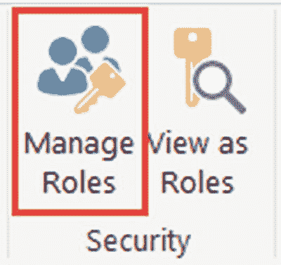

**图 11-1** 显示用于访问 `RLS` 角色的“管理角色”按钮

单击“管理角色”按钮会弹出一个对话框窗口，其中列出了数据模型中当前定义的每个角色。图 11-2 中显示的“管理角色”对话框的三个元素是：角色、表和筛选器。

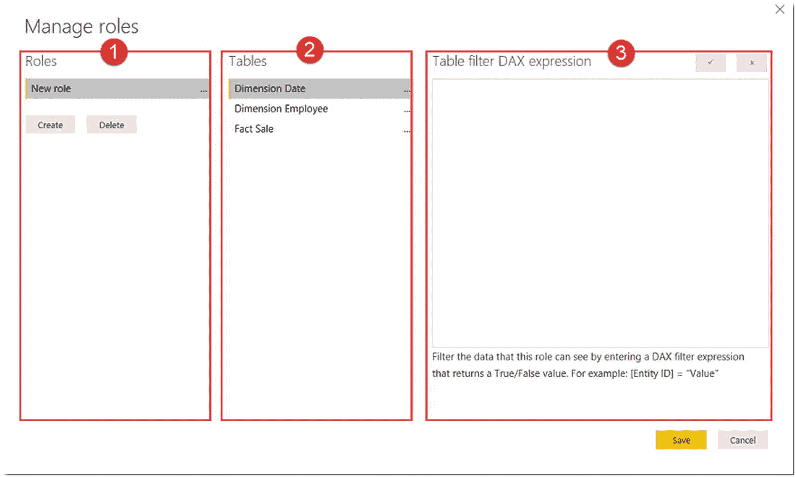

**图 11-2** `Power BI Desktop` 中的“管理角色”对话框窗口

1.  角色

2.  表

3.  筛选器

### 角色

第 1 步中的“角色”部分显示了当前定义的角色列表。此部分提供了创建新角色或删除现有角色的按钮。单击角色列表中的角色名称会更新“表”和“筛选器”部分中的信息，以显示特定于该高亮角色的详细信息。一次只能高亮一个角色。

角色名称右侧的省略号提供了重命名或克隆现有角色的功能。

### 表

在“角色”部分旁边是一个列表，显示了数据模型中的每个表。“表”面板如图 11-2 的步骤 2 所示。点击右侧的省略号，表名会打开一个上下文菜单，初始提供“添加筛选器”或“清除表筛选器”选项。展开“添加筛选器”选项会列出表中的每个列，点击任一列会在“筛选器”部分创建或扩展 `DAX` 筛选表达式。

一旦某个表至少定义了一个筛选器，该表省略号旁边就会出现一个筛选器图标，表示现在已存在筛选器。点击表名会更新“筛选器”部分中的文本，以显示该表当前的 `DAX` 筛选表达式。如果在上下文菜单中点击了列名，该列名会出现在“筛选器”窗口中，并附带示例运算符和值，以帮助指导正确的语法。

点击`'Dimension Date'`表中的`[Date]`列，会在“筛选器”部分填充一条建议的 `DAX` 筛选表达式。该建议会考虑所选待筛选列的列数据类型，并为数值列和文本列提供不同的建议。图 11-3 中展示了一个示例。

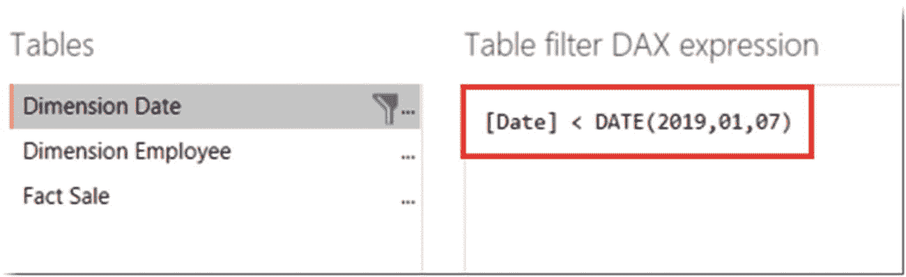

图 11-3

`'Dimension Date'`表上的 `RLS DAX` 筛选表达式示例

### 筛选器

“管理角色”对话框的最后一部分是“筛选器”部分，如图 11-2 的步骤 3 所示。“筛选器”部分提供了一个面板，显示用于对所选表/角色筛选行的当前 `DAX` 表达式。窗口中的文本可以直接编辑，并且作为一个完整的表达式，它必须计算为布尔值 `true` 或 `false`。

子查询可以在 `RLS` 筛选语句中使用，本章稍后的“使用子查询的动态 `RLS`”一节中提供了一些示例。

对于一个给定的角色，可以在多个表上定义筛选器，这意味着单个角色可以拥有类似以下的筛选器定义：

*   `Geography[Country] IN {"USA","Canada"}`

*   `Date[Calendar Year] >= 2020`

*   `Employee[Department] = "Sales"`

在上述角色的筛选器定义中，三个表都应用了筛选器。`Geography` 表中的每一行都会根据一条规则进行评估，该规则规定`'Geography'`表中`[Country]`列的值必须匹配“USA”或“Canada”。注意使用了 `DAX` `IN`函数来允许多选。

`Date` 表也有一条规则，用于筛选掉 2020 年之前的年份。最后，`Employee` 表会被筛选，以便仅返回`[Department]`列中值为“Sales”的行。

假设该示例中的每个表都是星型模式中的一个维度表，位于与某些事实表的一对多关系的一端。这些规则会自动沿着一对多关系向下传播，并应用于下游表。规则不必定义在定义关系的列上。

“筛选器”部分的右上角还提供了两个按钮，如图 11-4 所示。勾选按钮会验证编辑器窗口中的 `DAX`，以确保其返回布尔值，并检查可能在 `RLS` 筛选语句中无效的代码。

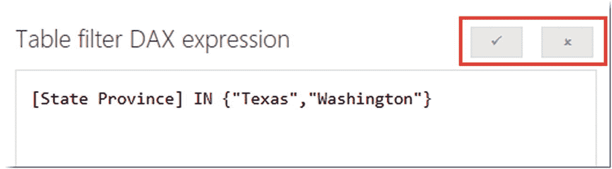

图 11-4

用于检查或清除 `RLS` 筛选规则的按钮

带有叉号的按钮会清除当前所选表所在窗口中的所有测试。

## 测试角色

与任何开发形式一样，测试你的更改以确保它们按预期运行至关重要。`Power BI Desktop` 提供了一种有用的方法来测试 `RLS` 角色，从而尽早发现问题。如果模型中的数据是敏感的，且某些人员绝不应看到，那么 `RLS` 尤为重要。

功能区中“管理角色”按钮旁边是“以角色身份查看”按钮。点击它会打开一个对话框，让你选择已使用“管理角色”屏幕定义的任何角色的名称。该按钮如图 11-5 所示。


图 11-5 建模选项卡中“安全性”部分的“以角色身份查看”按钮

假设一个名为“测试角色 1”的单独角色是在数据模型中使用 Wide World Importers 数据集中的`'Dimension City'`、`'Dimension Date'`和`'Fact Sale'`表定义的。`'Dimension City'`和`'Fact Sale'`之间使用`[City Key]`列存在标准的一对多关系，而`'Dimension Date'`表使用`[Invoice Date Key]`列连接到`'Fact Sale'`表。图 11-6 显示了当前示例的关系视图。

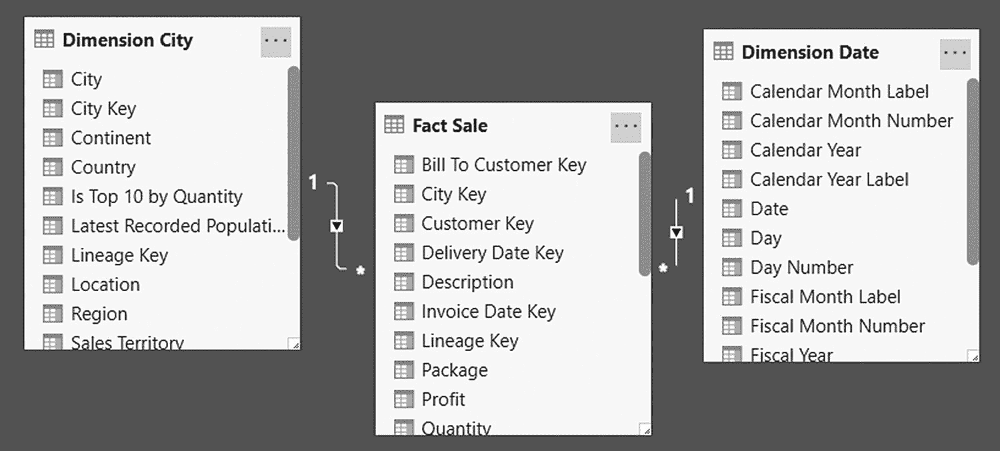

图 11-6 测试示例的关系视图

“测试角色 1”角色应用了以下 RLS 筛选规则：

*   `'Dimension City'[State Province] IN {"Texas","Washington"}`
*   `'Dimension Date'[Calendar Year] = 2015`

`'Dimension Date'`和`'Fact Sale'`表之间的关系使用`[Invoice Date Key]`列。在此示例中，这两个表之间只有一个关系，并且该关系被配置为活动关系。RLS 筛选规则仅通过活动关系向下传播，因此额外的*非活动*关系对于 RLS 来说毫无意义。

为了建立测试的基准线，使用清单 11-1 中的代码创建的`[Sum of Quantity]`计算度量值被添加到一个空白的报表页面上，且没有其他筛选器。结果值 8，950，628 在图 11-7 的可视化对象中显示。

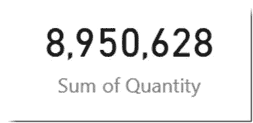

图 11-7 `[Sum of Quantity]`计算度量值的未筛选结果

```
Sum of Quantity = SUM('Fact Sale'[Quantity])
```

清单 11-1：一个用于帮助测试 RLS 的基本计算度量值

要测试“测试角色 1”角色，请点击建模选项卡中“安全性”部分的“以角色身份查看”按钮。点击此按钮会弹出一个对话框，其中包含如图 11-8 所示的选项。勾选“测试角色 1”旁边的复选框，然后点击“确定”按钮。在此对话框中，点击“无”旁边的复选框是一种清除 RLS 筛选器的方法。

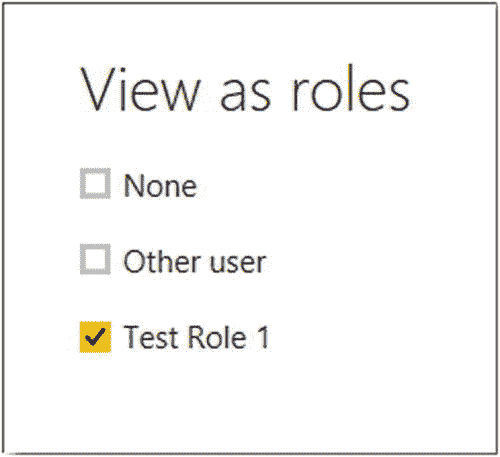

图 11-8 “以角色身份查看”对话框窗口

图 11-7 中使用计算度量值的未筛选可视化对象现在显示了一个不同的值。图 11-9 中显示的 244，520 这个值考虑了 RLS，并受到在`'Dimension City'`和`'Dimension Date'`表上定义的规则的筛选。报表中没有其他筛选器直接应用于`'Fact Sale'`表。

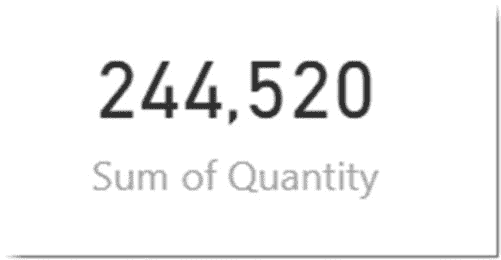

图 11-9 使用 RLS 时`[Sum of Quantity]`计算度量值的未筛选结果

Power BI Desktop 的“报表”和“数据”视图现在会在功能区下方显示一个黄色条带，其中包含一条消息，提示您“现在以以下角色查看报表：Test Role 1”。此警告消息如图 11-10 所示。单击此警告消息上的按钮可移除 RLS 筛选。

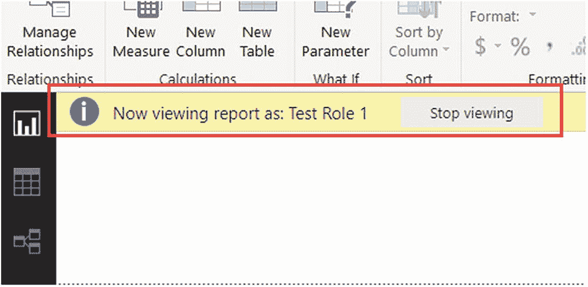

`图 11-10` `[Sum of Quantity]` 计算度量值的未筛选结果

另一种查看测试的方法是通过 Power BI Desktop 的“数据”视图窗口。“数据”视图仅显示满足活动角色 RLS 筛选要求的行。当没有测试任何角色时，“数据”视图会显示每个表中的所有行。当测试某个 RLS 角色时，行数会更新以反映 RLS 筛选。表 11-1 显示了“Test Role 1”对“数据”视图中可见数据的影响。由于此特定测试未对`Dimension Employee`表应用任何筛选，因此该表没有变化。

`表 11-1` RLS 角色对数据模型中表行数的影响

| 表名 | 无 RLS 时的行数 | 使用 RLS 测试时的行数 |
| --- | --- | --- |
| Dimension City | 116,295 | 10,427 |
| Dimension Date | 1,461 | 365 |
| Dimension Employee | 213 | 213 |
| Fact Sale | 228,265 | 6,378 |

快速检查`Fact Sale`表的方法是排序`Invoice Date Key`列，并检查顶部和底部的边界值是否仍符合 2015 年这一筛选要求，即属于 2015 日历年的数据。

RLS 筛选不仅适用于计算度量值或可视化对象；筛选发生在数据模型的更高级别，因此即使在“数据”视图中可见的数据也会受到限制。

### 测试多个角色

当您的数据模型中使用了动态 RLS 并且您有多个角色时，已发布数据集的用户可能存在于多个角色中。为了在 Power BI Desktop 中对此进行测试，请在“以角色身份查看”对话框中启用多个复选框，如图 11-11 所示。

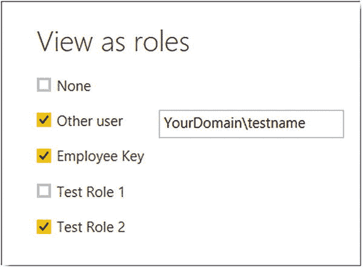

`图 11-11` “以角色身份查看”对话框显示选中了多个角色

请注意，Power BI Desktop 将不同角色之间的规则视为 OR（或）关系，而非 AND（与）关系。

请考虑以下场景。

“Test Role 1”角色定义了以下 RLS 筛选规则：

*   `Dimension City`[State Province] = “Texas”

“Test Role 2”角色定义了以下 RLS 筛选规则：

*   `Dimension Date`[Calendar Year] = 2015

当仅选择“Test Role 1”时，`Fact Sale`表中的数据会被筛选为仅显示属于“Texas”的行。

当仅选择“Test Role 2”时，`Fact Sale`表中的数据会被筛选为仅显示属于 2015 年的行。

然而，当同时选中“Test Role 1”和“Test Role 2”时，`Fact Sale`表中的行可以属于“Texas”或者 2015 年。属于其他`State Province`的行也会出现，但仅限于 2015 年的数据。

此效果可以在图 11-12 中看到，该图使用了一个矩阵可视化对象，其列是`Calendar Year`，行是`State Province`。此视图是在使用“以角色身份查看”对话框同时选中“Test Role 1”和“Test Role 2”时捕获的。

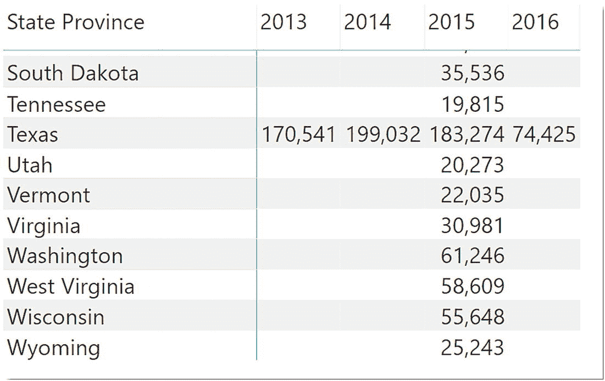

`图 11-12` 一个矩阵可视化对象，展示了多个角色如何被视为 OR 关系而非 AND 关系

图 11-12 显示的结果也会在 Power BI Web 服务中体现，并且在设计具有多个 RLS 角色的数据模型时，理解这一点至关重要。请记住，在 Power BI Web 服务中，一个用户帐户可以被分配给多个角色。

## 活动关系与 RLS

使用前面的示例，让我们看看当更改`Dimension Date`和`Fact Sale`表之间活动关系所涉及的列时会发生什么。当前关系将`Fact Sale`表中的`Invoice Date Key`列与`Dimension Date`表中的`Date`列链接起来。

让我们更新关系，改为使用`Fact Sale`表中的`Delivery Date Key`列，并查看“报表”和“数据”视图会发生什么变化。为“Test Role 1”角色定义的 RLS 筛选规则保持不变。

报表视图中的可视化对象现在显示了一个与之前看到的不同的值。图 11-13 中显示的新值是 243,923，而之前是 244,520。这反映了 RLS 筛选现在应用于 `Dimension Date` 表，并向下传播到 `Fact Sale` 表中不同的行集。

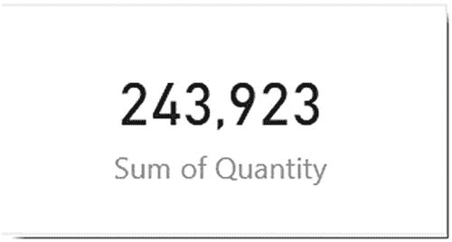
**图 11-13** 关系更改后计算度量值的更新值

## DAX 查询计划

让我们使用第 13 章“查询计划”中推荐的跟踪事件，查看上述示例的一些 DAX 分析器事件。

推荐的跟踪事件是：

*   查询事件

    *   Query End

*   查询处理

    *   DAX Query Plan

    *   VertiPaq SE Query Cache Match

    *   VertiPaq SE Query End

在 SSMS 分析器中启用这些事件并使用空缓存时，刷新图 11-9 中所示的可视化对象时会捕获以下事件。

### 逻辑计划

逻辑计划的简化版本如代码清单 11-2 所示，其中没有任何关于 RLS 应用的任何筛选规则的线索或引用。逻辑计划建议对 `Fact Sale'[Quantity]` 列执行 `Sum_VertiPaq` 操作。

```
AddColumns:
Sum_Vertipaq:
Scan_Vertipaq: Fact Sale'[Quantity]
'Fact Sale'[Quantity]:
```

**代码清单 11-2** 使用 RLS 角色测试计算度量值时捕获的逻辑计划简化版本

### 物理计划

代码清单 11-3 中显示的物理计划不包含任何根据该角色的 RLS 筛选规则进行筛选的操作符或指令。与代码清单 11-2 中的逻辑计划一样，无论是否应用 RLS 筛选，物理计划都是您所期望看到的。

```
AddColumns:
SingletonTable:
SpoolLookup: LogOp=Sum_Vertipaq
ProjectionSpool>:
Cache: IterPhyOp
```

**代码清单 11-3** 使用 RLS 角色测试计算度量值时捕获的物理计划简化版本

### DAX Query End

Query End 事件携带了 Power BI Desktop 为获取可视化对象所需结果而向数据模型中的数据库发出的实际 DAX 查询。该 DAX 如代码清单 11-4 所示，与逻辑计划和物理计划一样，它没有引用根据正在测试的活动 RLS 角色进行的筛选。即使关闭 RLS 测试，也会产生完全相同的 DAX Query End 事件。

```
EVALUATE
ROW(
"Sum_of_Quantity", 'Fact Sale'[Sum of Quantity]
)
```

**代码清单 11-4** 计算度量值的 DAX Query End 文本

### VertiPaq 扫描

最后需要检查的事件是与查询存储引擎（SE）相关的事件。行级安全（RLS）过滤规则会在这里的 SE 事件中出现。图 11-14 展示了一个 `WHERE` 子句被添加到了由 SE 事件生成的伪 T-SQL 查询中。

当关闭 RLS 角色测试时，`WHERE` 子句会从该事件中消失。

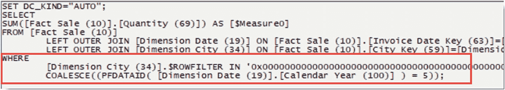
**图 11-14** – 正在测试的计算度量值的存储引擎查询

如图 11-14 所示，存在一个 `WHERE` 子句，它包含两行。`WHERE` 子句中的第一行与 'Dimension City' 表上的筛选器有关。这一行 `WHERE` 子句中的文本使用了 `IN` 谓词，并且非常长。滚动到该文本的最右侧，可以看到“[总计 1818 个单位，未全部显示]”。DAX 查询引擎会将应用于 [State Province] 的 RLS 筛选规则转换为特定值，用于筛选 'Dimension City' 表中的内部 rowid 列。

`WHERE` 子句中的第二行与 'Dimension Date' 表有关，并且再次在谓词中使用 `IN` 运算符来指定对 2015 年内在字典值的筛选。

捕获到的 VertiPaq SE 事件还显示了当多个 RLS 角色同时生效时的扫描行为。伪 T-SQL 揭示了一个 `WHERE` 子句，它使用 `OR` 运算符（而不是 `AND` 运算符）连接一系列规则。`VertiPaq SE Query End` 是一个有用的跟踪事件，用于精确了解 DAX 查询引擎正在从底层数据库中请求哪些数据。

### 查询计划总结

总而言之，RLS 应用于存储层，而不是通过对 Power BI Desktop（或 Web 服务）生成的 DAX 查询进行修改，也不是通过对在“数据”视图中生成数据的查询进行修改。

## 动态行级安全

本章前面的示例都对列筛选使用了硬编码值。迟早，你会遇到需要动态应用 RLS 规则的需求。一个典型的例子是考虑查看报表的用户的用户名。

Wide World Importers 数据集有一个 'Dimension Employee' 表，其中包含 20 个不同的 [Employee ID] 值。假设你有一个锁定报表的需求，使其只显示属于已登录用户的数据。解决此问题的一种方法是创建 20 个 RLS 角色，每个角色都有一个硬编码规则，例如 `[WWI Employee ID] = 1`，然后在数据集发布到 Power BI Web 服务后，将相应的个人分配到该角色。

这种方法很耗时，并且在配置 Web 服务时存在出错的风险，并且意味着当员工入职和离职时需要管理角色。

幸运的是，有更好的方法可以通过实现动态 RLS 来解决。有几个有用的 DAX 函数可以帮助检测当前用户，从而实现动态 RLS。这些函数是：

- `USERNAME()`

- `USERPRINCIPALNAME()`

这些函数返回的文本包含当前查看报表的用户的登录详细信息。在 RLS 筛选器中使用的 DAX 表达式可以使用这些函数，与预填充的已知 UserName（或 UserPrincipalName）值表中的列进行比较。如果测试找到匹配项，则该表以及任何下游相关表都会被筛选，以仅显示该用户名对应的行。

一种方法是预填充一个全新的表，或者向现有表中添加一列，其值可能匹配这些函数的输出。因此，你首先需要查看每个函数生成的输出。测试此输出的最简单方法是将清单 11-5 中的计算度量值添加到数据模型中，然后放在显示文本的报表视觉对象中。

```
动态 RLS 测试 =
COMBINEVALUES(
", " ,
"USERNAME() = " & USERNAME() ,
"USERPRINCIPALNAME() = " & USERPRINCIPALNAME()
)
```

**代码清单 11-5** – 用于显示 `USERNAME()` 和 `USERPRINCIPALNAME()` 函数输出的计算度量值

当 `[Dynamic RLS test]` 计算度量值被添加到 Power BI Desktop 的报表画布时，你可能会看到每个函数都输出一个使用 *domain\username* 模式的值。

将同一个报表发布到 Web 服务并在登录 Web 服务后检查显示的值非常重要。此时该值应该不同，并且更可能是一种类似于 *username@yourcompanydomain.com* 的模式。这个示例是在数据模型中预填充表以使用 RLS 筛选器进行筛选时需要使用的模式，而不是 *domain\username* 模式。

下一步是将这些用户名添加到你的数据模型中。为了使用 Wide World Importers 数据集满足此要求，请将清单 11-6 中的计算列添加到 'Dimension Employee' 表中。

```
用户主体名称 =
REPLACE('Dimension Employee'[Employee]," ",".") &
"@wideworldimporters.com"
```

**代码清单 11-6** – 添加一个值以用作动态 RLS 筛选器的计算列

清单 11-6 中的代码生成一个新列，该列创建一个旨在匹配 `USERPRINCIPALNAME()` 函数在 Power BI Web 服务中的输出。此计算列中显示的模式并非适用于每个组织，因此需要根据实际情况进行调整。图 11-15 显示了一个使用清单 11-6 代码的示例表。

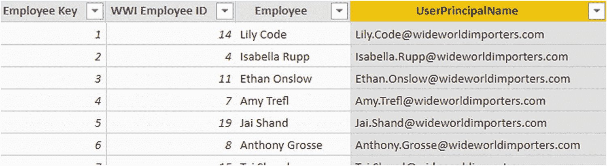
**图 11-15** – 'Dimension Employee' 表，包含清单 11-6 中的计算列

接下来，需要在数据模型中创建一个新的 RLS 角色，该角色对 `‘Dimension Employee’` 表应用筛选器。在图 11-16 中，添加了一个名为 `“Dynamic RLS Role”` 的新角色和一个简单的 DAX 表达式。

带方括号的 `[UserPrincipalName]` 文本引用了高亮显示的 `‘Dimension Employee’` 表中的一列，而文本右侧带圆括号的 `UserPrincipalName()` 则引用了 DAX 函数。

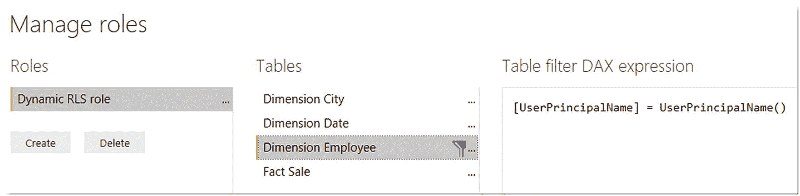

**图 11-16** 一个基本的 RLS 角色，旨在通过 `USERPRINCIPALNAME` 函数筛选 `‘Dimension Employee’` 表

可使用 `View as Roles` 功能测试新角色，并且可以使用此功能模拟任何用户。图 11-17 显示了为测试而配置的 `View as Roles` 对话框。在此对话框中，同时选中了 `“Other user”` 和 `“Dynamic RLS role”`。

当选中 `“Other user”` 旁边的复选框时，会出现一个文本框，允许您输入一些文本。您在此处输入的文本将同时在 Power BI Desktop 中的 `USERNAME` 和 `USERPRINCIPALNAME` 函数中生效。

能够在 `“Other user”` 旁边输入任意文本，使您可以在 Power BI Desktop 模式下模拟任何用户。

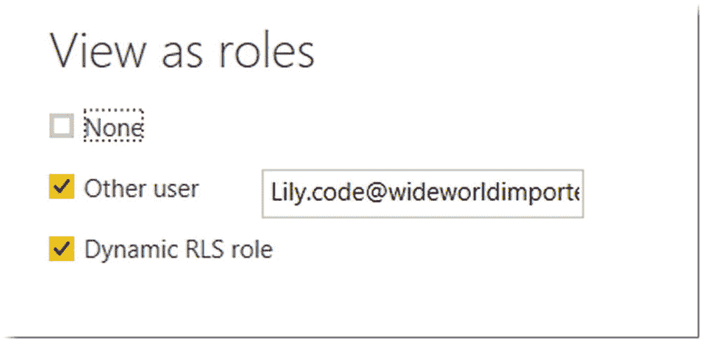

**图 11-17** 为测试动态 RLS 而配置的 `View as Roles` 对话框

在图 11-17 中，`“Other user”` 设置为 `Lily.code@wideworldimporters.com`，并且 `“Other user”` 和 `“Dynamic RLS role”` 选项都被勾选，这意味着它们在 Power BI Desktop 中都变为活动状态。

两个角色都激活的效果可以在报表和数据视图中看到。在数据视图中，`‘Dimension Employee’` 表现在只显示 18 行，这 18 行中新的 `[UserPrincipalName]` 列与在 `View as Roles` 对话框中输入的值相匹配。

`‘Fact Sale’` 表现在只显示 22,642 行，而不是应用 RLS 之前的 228,265 行。`‘Fact Sale’` 中可见的行被限制为仅属于员工 Lily Code 的行。

任何报表页上的所有视觉对象现在都会自动筛选为仅显示这些行。不会对任何计算的度量值或列进行修改。

这种方法的好处是，当有新用户添加到 `‘Dimension Employee’` 表时，除了将他们添加到相应的应用工作区之外，无需对 Power BI 报表进行任何操作，新用户就能使用筛选功能访问该报表。

### 在 Power BI Web 服务中进行测试

现在，该报表已准备好发布到 Power BI Web 服务。理想情况下，您可以将报表发布到应用工作区。一旦报表存在于应用工作区中，您可以导航到该应用工作区的“数据集”区域，并点击单击省略号后出现的上下文菜单中的“安全性”选项，如图 11-18 所示。

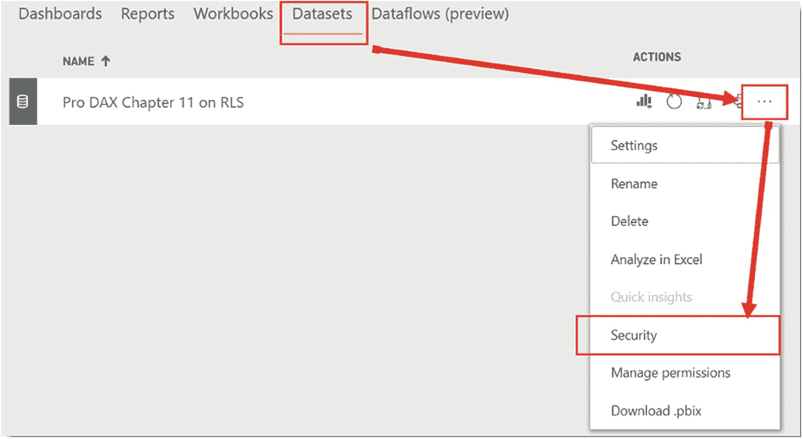

**图 11-18** Power BI Web 服务中应用工作区的“数据集”屏幕

“安全性”选项会加载所选数据集的行级安全性屏幕，如图 11-19 所示。此屏幕允许您在 Web 服务中为数据集配置 RLS。点击角色名称旁边的省略号，您可以测试该报表。

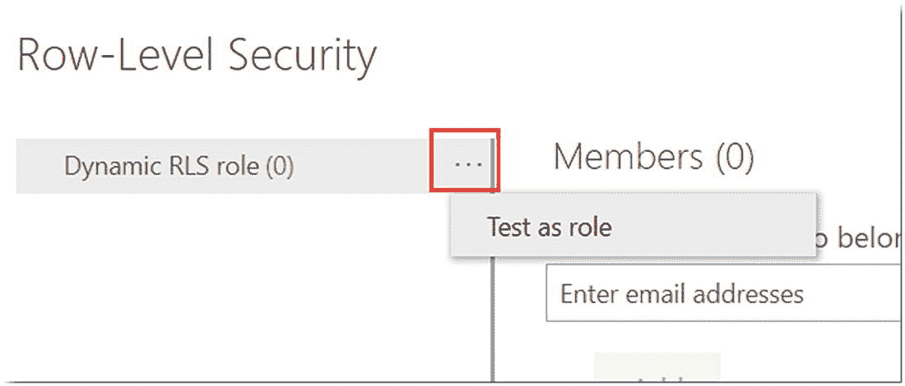

**图 11-19** 如何在 Power BI Web 服务中调用 `Test as role` 功能

一旦您在 Web 服务中调用 `Test as role` 功能，报表便会显示出来，此时 RLS 处于激活状态，并且已设置为根据您的凭据进行筛选。此功能如图 11-20 所示。报表顶部会出现一个蓝色栏，允许您通过点击 `“Back to Row-Level Security”` 箭头来关闭测试。

点击 `“Now viewing as: ”` 文本可以打开一个对话框，允许您输入另一个用户进行测试。当您在文本框中输入时，租户中有效的用户会出现，让您可以选择合适的用户。此功能在检查每个用户看到的内容时非常有用，尤其是当跨多个角色的筛选规则开始变得复杂时。

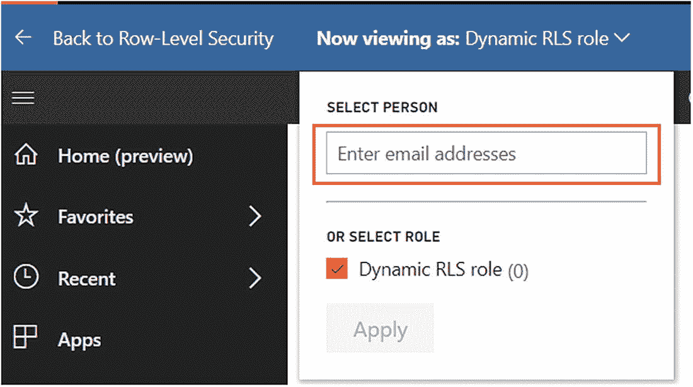

**图 11-20** 使用不同用户进行测试

测试完成后，您可以点击蓝色栏中的 `“Back to Row-Level Security”` 文本，导航回数据集的行级安全性配置窗口。

### 使用子查询的动态 RLS

`USERPRINCIPALNAME` 函数非常适合将数据筛选到特定用户。有时，在其他场景下，可以使用动态 RLS 角色来最小化所需角色的总数。

子查询可以在 RLS 筛选器中替代硬编码值。

只要 RLS 筛选表达式能解析为布尔值 true 或 false，就可以包含大多数 DAX 表达式。图 11-21 的筛选器面板中显示的示例展示了一个使用 `MAXX` 函数的筛选器。

`IN` 运算符可以与任何返回单列表的 DAX 函数（如 `SELECTCOLUMNS`、`TOPN` 或 `VALUES`）结合使用。`VALUES` 函数可以包裹一个筛选器以提供额外的灵活性。

`TOPN` 不会计算相关表中的值，因此，尝试根据相关 `‘Fact Sale’` 表中的列，将 `‘Dimension City’` 表限制为仅显示前十个 `[State Province]` 值的查询无法生效。

这个限制很可能是因为 RLS 筛选在存储引擎级别的实现方式，它无法使用不同的表进行筛选。这些场景可以通过在数据建模中，在 `‘Dimension City’` 表中预先计算一个列来解决，该列将 `[Is Top 10 State Province By Quantity]` 显示为 1 或 0。一旦添加了此类列，就可以在 RLS 筛选器中快速有效地使用它。

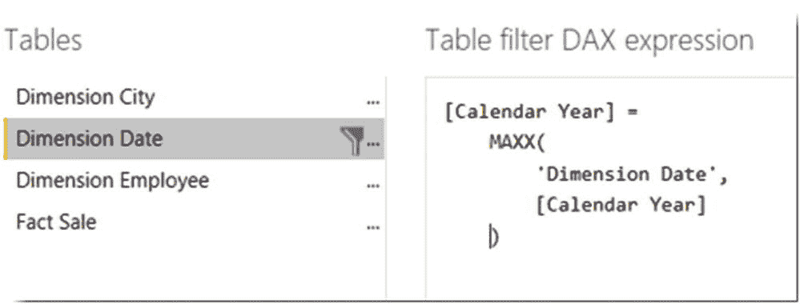

**图 11-21** 作为 RLS 筛选器一部分使用的子查询

添加到包含图 11-21 中所建议筛选器的任何角色的用户，其数据都会被限制为仅包含最近一年，除非他们也被包含在其他角色中，在这种情况下，他们还可以看到其他角色所允许的数据。

如果向 `‘Dimension Date’` 表中添加了代表更新的 `[Calendar Year]` 数据，RLS 会将新的筛选状态动态应用于分配给该角色的所有用户，而无需任何直接的配置更改。

### 将用户分配到角色

一旦在数据模型中定义了至少一个角色，并且将报表发布到 Web 服务后，就可以将用户或组分配到角色，从而使他们在查看报表时受到行级安全性（RLS）筛选的影响。

要将用户或组分配到某个角色，请在应用工作区中找到数据集，单击省略号，然后选择`安全`选项，如图 11-22 所示。

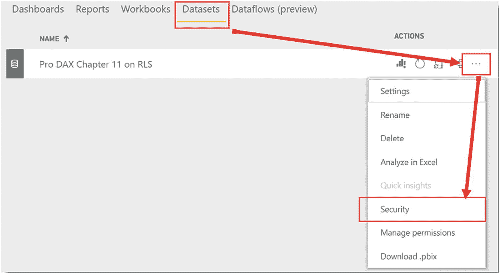

**图 11-22** 在应用工作区中访问数据集的`安全`选项

单击`安全`选项会加载行级安全配置屏幕，其中显示模型中定义的所有角色列表。在此视图中无法修改每个角色的筛选规则，只能在 Power BI Desktop 中进行更改。

图 11-23 显示的是行级安全屏幕，您可以在其中为每个角色添加/删除用户或组。完成更改后，单击保存按钮以提交更新。

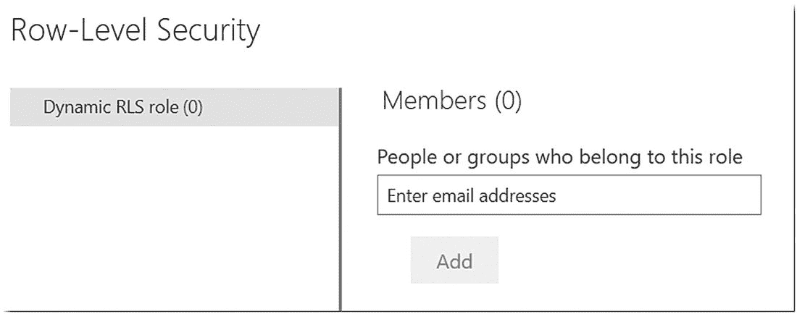

**图 11-23** 用于 RLS 的添加/删除用户或组屏幕

# 开始在文本框中输入时，系统会显示属于该租户的有效用户列表，方便您选择正确的用户（或组）。Azure Active Directory 组也可以分配到角色，如果您的 Power BI 租户连接到了一个维护良好的 Azure Active Directory，这将大大减少管理工作。

## 注意

如果用户是应用工作区的管理员，则 RLS 筛选会被忽略。RLS 仅适用于只读成员。

# RLS 总结

行级安全是企业数据建模中一个常用且往往至关重要的功能。它足够灵活，能够满足许多场景的需求。RLS 可能会加快报表速度，但同样地，复杂的筛选规则也可能导致性能下降。RLS 可以应用于现有报表，并且不需要更新实际的计算过程即可生效。

本章向您展示了 RLS 是基于角色的，其筛选规则是使用 `Power BI Desktop` 定义和管理的。一旦 `pbix` 文件发布到 `Web` 服务，就需要一个单独的过程来将用户（或组）分配到角色。

角色的筛选规则可能会变得复杂，因此本章还展示了如何在 `Power BI Desktop` 和 `Web` 服务中测试 RLS。

角色可以是动态的，这有助于减少每当用户开始或更改内部角色时自动更新 `pbix` 文件的需求。可以使用查询来满足复杂的需求。

用户可以同时存在于多个角色中，在这种情况下，用户会看到其有资格查看的每个角色的所有有效数据。

# 第四部分：调试与优化

# 12. DAX Studio

## 简介

首先，DAX Studio 是`那个`工具，也许是为数不多能帮助优化度量值性能的工具，它甚至有助于提升整个报表或特定报表页面的整体性能。

虽然它至关重要，但我们不能忘记 DAX Studio 是完全免费的。DAX Studio 背后的团队为其投入了巨大的精力。因此，如果在性能优化过程中某件事导致您需要重启 DAX Studio，甚至不止一次，请保持冷静，并记住如果没有 DAX Studio，您可能根本无从开始优化过程。同样重要的是，DAX Studio 绝非一个充满缺陷的工具，但它也只是由凡人编写的软件，这意味着偶尔可能发生一些小状况。

DAX Studio 可从此处下载：

[`www.sqlbi.com/tools/dax-studio/`](http://www.sqlbi.com/tools/dax-studio/)

源代码可在此处获取：

[`https://github.com/DaxStudio/DaxStudio`](https://github.com/DaxStudio/DaxStudio)

完整文档在此处：

[`https://daxstudio.org/`](https://daxstudio.org/)

无论何时您遇到 Darren Gosbell 或来自 `sqlbi.com` 的各位（Marco Russo 和 Alberto Ferrari），请去告诉他们，DAX Studio 在您理解和掌握 DAX 的道路上一直是一个多么优秀的伙伴。即使 DAX 的内部运作机制看起来复杂或神秘，也请毫不犹豫地创建一个仅包含一个视觉对象的报表页面来探究其原理；也许某天您会发现视觉对象使用的某个 `DAX` 函数当前并未在文档中说明。

## 预期效果

您可能看过很多视频，人们使用 DAX Studio 来解决报表和 `DAX` 语句的性能问题。请注意，并不是 DAX Studio 独自解决了所有这些性能问题，而是用户解决了问题。DAX Studio 会提供巨大的帮助，因为它有助于发现问题的本质并找出性能瓶颈。

## 空白报表页

使用 DAX Studio 的原因有很多：

*   优化报表页面的整体性能
*   优化特定度量值的性能
*   探寻幕后发生的情况

但无论具体原因是什么，一切始于一个空白报表页。这样做是因为报表页面上每个可见的视觉对象都会创建自己的 `DAX` 查询。因此，有必要从一个空白报表页开始处理 `pbix` 文件，因为这样不会创建任何查询。将 DAX Studio 连接到打开的 Power BI 文件，启用`所有查询`跟踪标志，然后，如果 DAX Studio 已设置好，切换到该报表页面。

## 连接到 Power BI Desktop 文件

由于 Power BI Desktop 发展迅速，DAX Studio 的开发也同样迅速。因此，您可能会发现截图存在细微差异，但由于这不是官方文档，我们已尽量使用最新版本进行截图。

尽管如此，要连接到一个 `pbix` 文件，该文件必须处于打开状态。在连接到 `pbix` 文件之前，该文件必须已打开。请确保文件是从一个空白报表页开始的。如果报表并非始于空白页，请切换到一个空白页，或创建一个。保存文件，关闭 Power BI Desktop，然后再次打开该文件。

#### 注意

使用的 Power BI 文件是 `CH12 – a simple report – large.pbix`。

请确保报表以 `空白页` 报表页面处于活动状态启动。

如果 `DAX Studio` 要求建立连接，它可以连接到各种类型的表格数据模型，但由于此处涉及的是 Power BI Desktop，请选择文件 `CH12 – a simple report – large.pbix`，如图 12-1 所示。

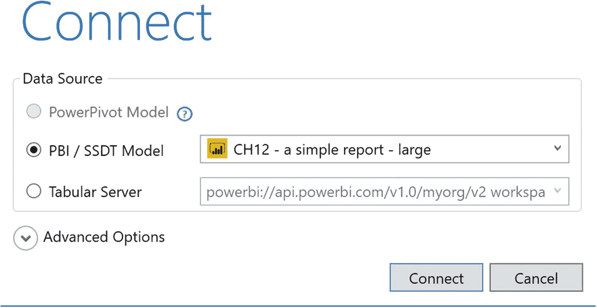

图 12-1 连接到 `pbix`

图 12-2 将简要说明成功连接后你会看到的内容。

| 我在这里 | 简要说明 |
| --- | --- |
|  | 数据模型。 |
|  | 可用视图：`Metadata` – 提供数据模型的洞察。 `Functions` – 可用的 DAX 函数列表。 `DMV` – 动态管理视图列表。请注意，并非所有 DMV 都能与 Power BI Desktop 文件内的数据模型结合使用。 |
|  | 选项卡：此表格将提供 DAX 查询的不同视角。 |
|  | 在 Power BI Desktop 内部运行的 Analysis Services 引擎实例的服务器名称。此服务器名称也可用于连接 SQL Server Management Studio 到这个数据库。使用 SQL Server Profiler，它还可以用来追踪 Power BI 报表内部发生的情况。 |
|  | 当前为空的部分，允许编写/修改 DAX 语句。这是编辑器窗口。 |

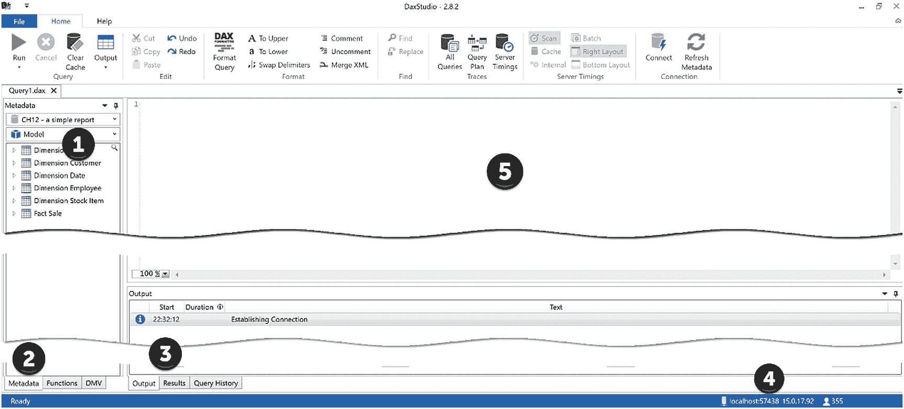

图 12-2 首次接触

## 探究我的报表内部发生了什么

在 `DAX Studio` 连接到 Power BI 报表（更准确地说，连接到 Analysis Services 引擎）后，就可以开始探究报表内部发生了什么。为此，需要激活 `所有查询` 追踪。点击菜单栏中的 `所有查询` 图标即可激活此追踪。

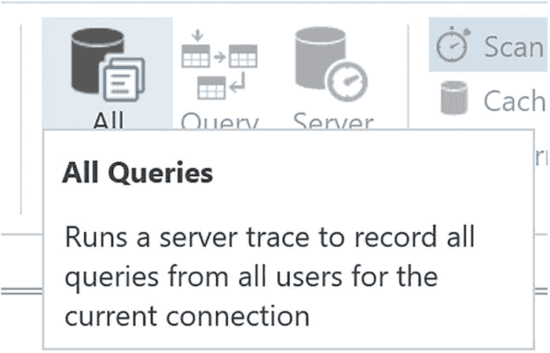

追踪的激活状态可视化地展示出来，因为图标现在已高亮显示。此追踪类型的激活状态也会显示在 `输出` 选项卡中（图 12-3）。

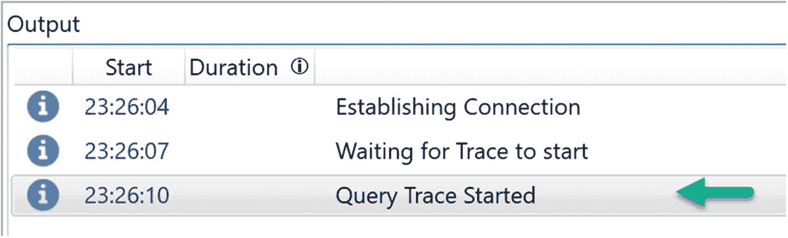

图 12-3 `所有查询` 追踪已激活

### 简单视觉对象

为了捕获报表页面激活时执行的查询，请激活 `简单视觉对象` 报表页面。

激活报表页面后，DAX 查询将出现在 `DAX Studio` 中（图 12-4）。

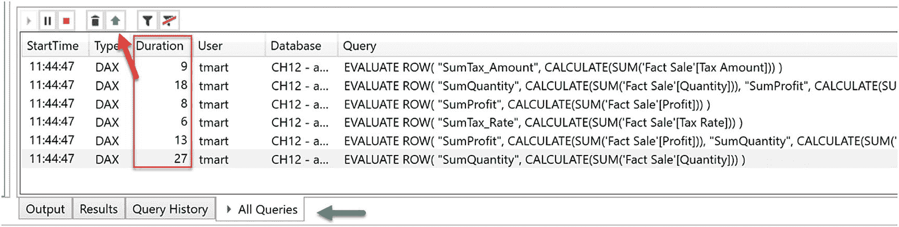

图 12-4 每个视觉对象都有自己的查询

使用 `全部复制` 图标可以将所有追踪结果复制到编辑器窗口中（图 12-5）。

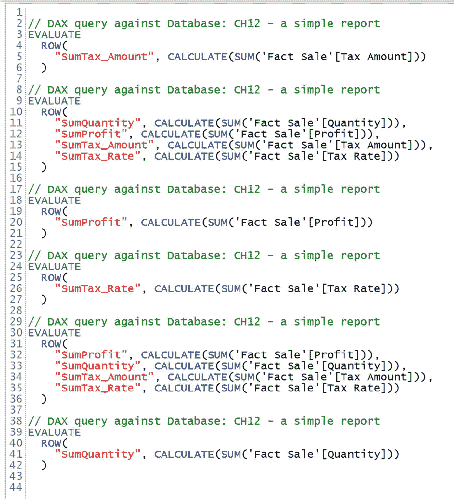

图 12-5 追踪结果 - 简单视觉对象

目前，关键要点如下：

- 每个视觉对象都由其查询填充数据。
- 每个查询都返回一个表格，即使是被用来填充卡片视觉对象的查询也是如此。

### Power BI 报表页面和筛选器窗格

在 2018 年 11 月，产品团队为 Power BI Desktop 引入了新的筛选器体验。除了通过放置切片器来重新获得宝贵的屏幕空间之外，筛选器窗格的另一个基本功能几乎悄无声息地随之而来。如前所述，每个可见的视觉对象都会生成自己的 DAX 查询。添加到新筛选器窗格中的列在报表启动时不会被计算。

清单 12-1 显示了当激活 `简单视觉对象 – 切片器` 报表页面时生成的 DAX 查询。

```dax
清单 12-1: 激活‘简单视觉对象 – 切片器’时生成的 DAX 查询
```

# DAX 查询与筛选器窗格

## 清单 12-1 与切片器查询

清单 12-1 包含一个用于填充报表页面上切片器的 DAX 查询。该 DAX 查询在此清单中已高亮显示。

如果从 `简单视觉对象 – 筛选器窗格` 报表页面捕获 DAX 查询，需要注意的是，不会执行任何 DAX 语句来填充切片器，或者更准确地说，填充添加到筛选器窗格页面级部分的筛选器。

图 12-6 显示已从筛选器中选中了一个值。

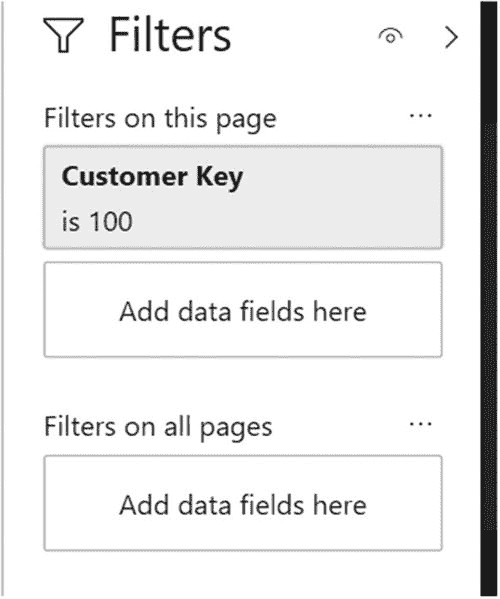

图 12-6 选中了值的筛选器窗格

如果从报表页面捕获查询，并且选中的值是 `Customer Key is 100`，那么需要注意的是，只会创建/执行六个查询。清单 12-2 仅显示了这六个查询中的一个。

```
DEFINE VAR __DS0FilterTable =
TREATAS({"100"}, 'Dimension Customer'[Customer Key])
EVALUATE
SUMMARIZECOLUMNS(
__DS0FilterTable,
"SumTax_Amount", IGNORE(CALCULATE(SUM('Fact Sale'[Tax Amount])))
)
```

清单 12-2：DAX 查询 – 报表页面 “Simple Visuals – filter pane selected value.dax”

需要注意到的重要事项是：它并没有执行查询来填充切片器，而是仅给每个查询添加了一个很小的字符串，该字符串定义了一个筛选器表，并在查询中用于检索视觉对象的数据。定义筛选器表的行已被高亮显示（粗体）。

### 提示

将切片器移到筛选器窗格！你实际使用它的频率可能远低于你的想象。这可以极大地提高报表/报表页面的整体性能。

### 报表级与页面级筛选器：提示与警告

通常情况下，数据模型会包含一些不应在报表页面或整个报表中使用的数据。因此，可以通过定义 **页面级筛选器** 或 **报表级筛选器** 来排除列中的特定值。图 12-7 展示了两个被排除的销售区域；该图引用的是名为“报表与页面级筛选器”的报表页面。

#### 注意事项

此前的所有截图和列表均未考虑报表级筛选器；因此，若要跟随本节内容进行学习，必须添加该筛选器。

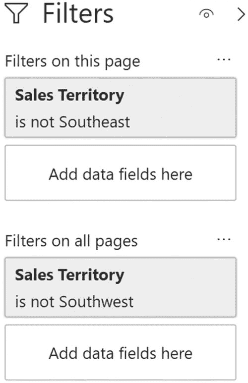

**图 12-7** – 报表级与页面级筛选器

列表 12-3 展示了通过启用“报表与页面级筛选器”报表页面所创建的所有查询。该列表包含为填充报表页面上的视觉对象而执行的全部四个查询。

```
// DAX query against Database: CH12 - a simple report
DEFINE VAR __DS0FilterTable =
FILTER(
    KEEPFILTERS(VALUES('Dimension City'[Sales Territory])),
    AND(
        'Dimension City'[Sales Territory] <> "Southeast",
        'Dimension City'[Sales Territory] <> "Southwest"
    )
)
EVALUATE
SUMMARIZECOLUMNS(
    __DS0FilterTable,
    "Quantity___All_Sales_Territories", IGNORE('Fact Sale'[Quantity - All Sales Territories])
)
// DAX query against Database: CH12 - a simple report
DEFINE VAR __DS0FilterTable =
FILTER(
    KEEPFILTERS(VALUES('Dimension City'[Sales Territory])),
    AND(
        'Dimension City'[Sales Territory] <> "Southeast",
        'Dimension City'[Sales Territory] <> "Southwest"
    )
)
EVALUATE
SUMMARIZECOLUMNS(
    __DS0FilterTable,
    "Quantity___Values_Sales_Territories_", IGNORE('Fact Sale'[Quantity - Values(Sales Territories)])
)
// DAX query against Database: CH12 - a simple report
DEFINE VAR __DS0FilterTable =
FILTER(
    KEEPFILTERS(VALUES('Dimension City'[Sales Territory])),
    AND(
        'Dimension City'[Sales Territory] <> "Southeast",
        'Dimension City'[Sales Territory] <> "Southwest"
    )
)
EVALUATE
TOPN(
    502,
    SUMMARIZECOLUMNS(
        ROLLUPADDISSUBTOTAL('Dimension City'[Sales Territory], "IsGrandTotalRowTotal"),
        __DS0FilterTable,
        "Total_Quantity", 'Fact Sale'[Total Quantity],
        "quantity_divided_by_all", 'Fact Sale'[quantity divided by all],
        "quantity_divided_by_allselected", 'Fact Sale'[quantity divided by allselected],
        "quantity_divided_by_values", 'Fact Sale'[quantity divided by values]
    ),
    [IsGrandTotalRowTotal],
    0,
    'Dimension City'[Sales Territory],
)
ORDER BY
    [IsGrandTotalRowTotal] DESC, 'Dimension City'[Sales Territory]
// DAX query against Database: CH12 - a simple report
DEFINE VAR __DS0FilterTable =
FILTER(
    KEEPFILTERS(VALUES('Dimension City'[Sales Territory])),
    AND(
        'Dimension City'[Sales Territory] <> "Southeast",
        'Dimension City'[Sales Territory] <> "Southwest"
    )
)
EVALUATE
SUMMARIZECOLUMNS(
    __DS0FilterTable,
    "Quantity___ALLSELECTED_Sales_Territory_", IGNORE('Fact Sale'[Quantity - ALLSELECTED(Sales Territory)])
)
```

`列表 12-3` – `DAX queries – "report and page level filter.dax"`

页面级筛选器（`销售区域不是 Southeast`）和报表级筛选器（`销售区域不是 Southwest`）被合并到同一个筛选表`__DS0FilterTable`中。这一合并操作通过以下代码行实现：

```
DEFINE VAR __DS0FilterTable =
FILTER(
    KEEPFILTERS(VALUES('Dimension City'[Sales Territory])),
    AND(
        'Dimension City'[Sales Territory] <> "Southeast",
        'Dimension City'[Sales Territory] <> "Southwest"
    )
)
```

这里需要注意：在定义变量之前必须使用`DEFINE`关键字；定义部分以下一个`EVALUATE`语句结束。该筛选表包含当前筛选上下文中`'Dimension City'[Sales Territory]`列的所有值，但排除了由页面级和报表级筛选器排除的值。这个筛选表会被用于每个查询中。

### 警告

每当使用`ALL`函数时，被页面级或报表级筛选器排除的值将被重新包含进来。因此，当使用报表级筛选器排除或指定一个或多个值时，请花点时间考虑在数据加载期间将这些元素从数据集中移除。在报表级和页面级筛选器与`ALL`函数结合使用时，容易出错。换句话说，`ALL`函数不会考虑报表级或页面级筛选器。

### 时间智能：自动日期/时间

每当 DAX Studio 连接到`pbix`文件时，它不仅会显示显而易见的表，还会显示一些系统表。这些系统表在图 12-8 中已高亮显示。

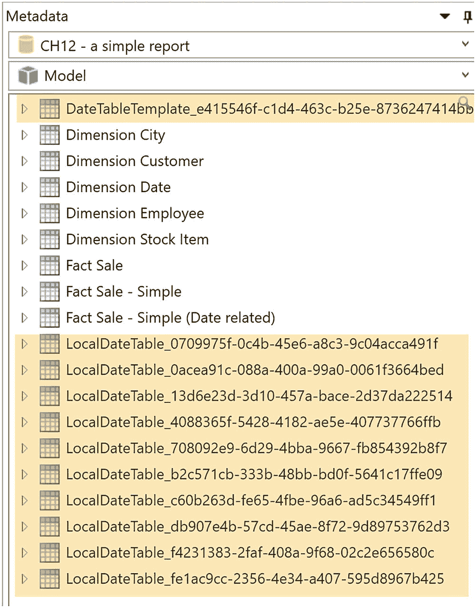

`图 12-8` – 日期列与日期表

目前，Power BI 会为每个数据类型为`date`或`datetime`的列自动创建专用的日期表。如果一张表中有两个日期列，则会创建两个表。如果在另一张表中还有另外两个此类数据类型的列，则又会创建两个日期表。这种功能通常被认为是一种不良“习惯”，原因如下：

- 内存消耗

- 数据模型的加载时间

内存消耗可以忽略不计，因为 Power BI Desktop 内部的数据模型仅占用大约 834 MB 的 RAM。

模型的加载和刷新时间则更为重要，尤其是当数据模型中包含大量日期或日期时间列时。尽管这些系统生成的表不会造成任何损害，但众所周知的最佳实践是不要依赖这些系统日期表。

与专用的日历表相比，这些表似乎有一个优势：每当在视觉对象上使用日期列时，它们允许使用日期层级结构。该层级结构是在`DateTableTemplate`中定义的，但也可以在专用的日历表中定义层级结构。

要禁用这些系统日期表的创建，需要禁用“自动日期/时间”设置，如图 12-9 所示。

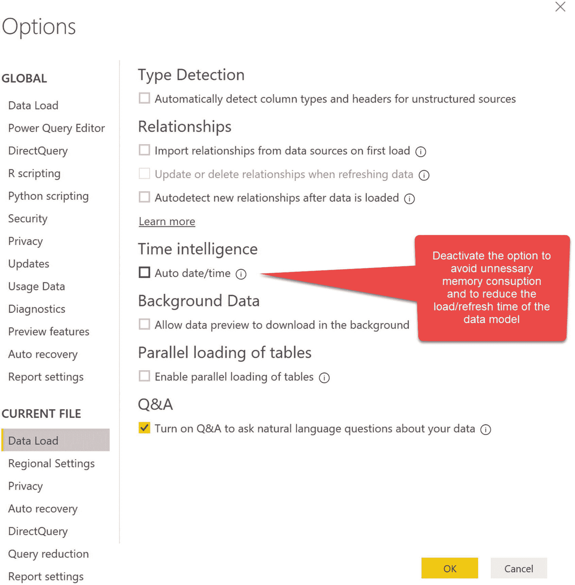

`图 12-9` – 时间智能 – 自动日期/时间

## DAX Studio 中的 DAX 查询编辑器

### 注意

从现在开始，将使用`CH12 – a simple report.pbix`。

在开始优化 DAX 语句之前，有必要先熟悉编辑器。因此，请打开`CH12 – a simple report.pbix`文件，并确保它以“Blank page”报表页启动；如果不是这样，请选择此页面，保存文件，然后重新打开。

当文件以"Blank page"页面激活状态打开后，启动`DAX Studio`，连接到 Power BI Desktop 文件，并激活`All Queries`跟踪。

在左侧的`Metadata`选项卡中，标记度量值`Quantity – All Sales Territories`并打开其上下文菜单。如图 12-10 所示。

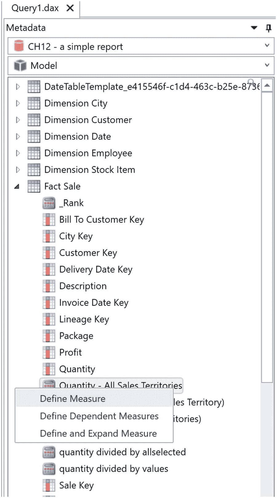

图 12-10

`DAX Studio`编辑器 – 度量值上下文菜单

这三个命令的工作原理如下：

| 命令 | 动作 |
| --- | --- |
| `Define Measure` | 将度量值的定义复制到编辑器中 – 结果：`DEFINE MEASURE 'Fact Sale'[Quantity - All Sales Territories] = CALCULATE([Total Quantity], ALL('Dimension City'[Sales Territory]))` |
| `Define Dependent Measures` | 将度量值的定义复制到编辑器中 – 结果：`DEFINE ---- MODEL MEASURES BEGIN ---- MEASURE 'Fact Sale'[Total Quantity] = CALCULATE(SUM('Fact Sale'[Quantity])) ---- MODEL MEASURES END ---- MEASURE 'Fact Sale'[Quantity - All Sales Territories] = CALCULATE([Total Quantity], ALL('Dimension City'[Sales Territory]))` |
| `Define and Expand Measure` | 创建一个单独度量值，其中所有依赖的度量值都被展开 – 结果：`DEFINE MEASURE 'Fact Sale'[Quantity - All Sales Territories] = CALCULATE(CALCULATE(CALCULATE(SUM('Fact Sale'[Quantity]))), ALL('Dimension City'[Sales Territory]))` |

### 使用度量值定义

从`Metadata`选项卡中，为`Fact Sale`表中的度量值`quantity divide by all`选择上下文菜单中的"Define Dependent Measures"。如图 12-11 所示。

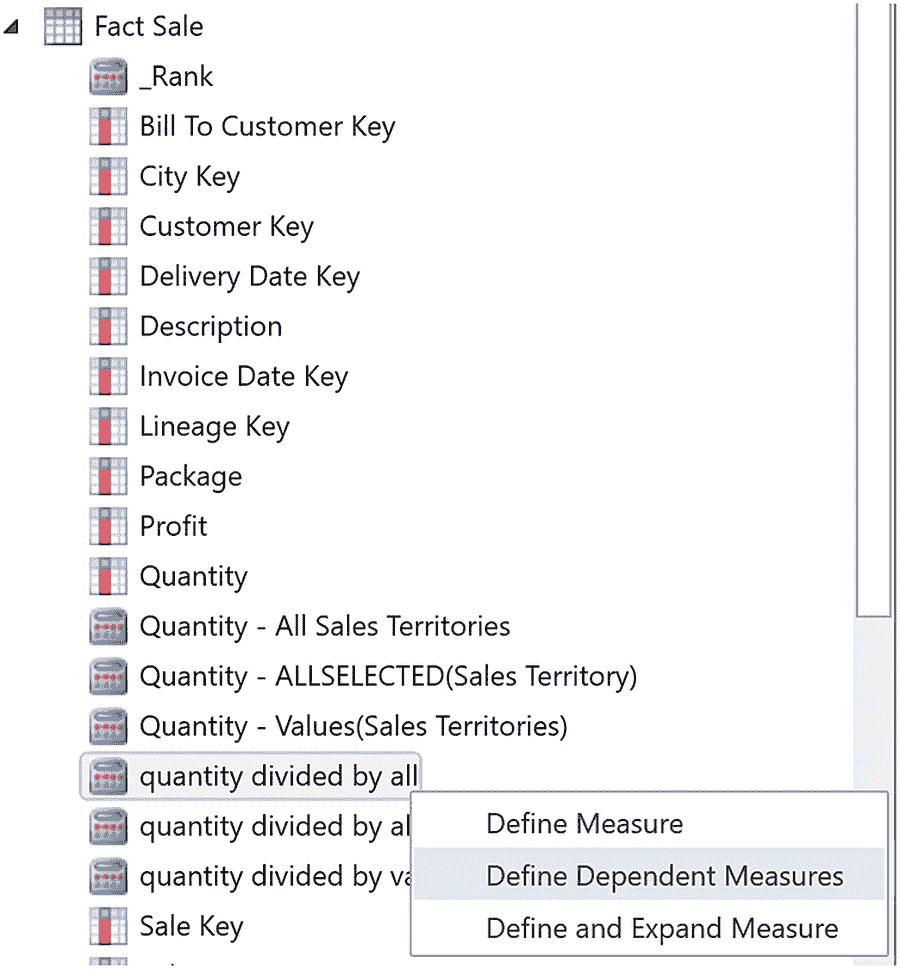

图 12-11

`DAX Studio`编辑器 – 定义依赖度量值

图 12-12 显示了此操作在查询编辑器中的结果。

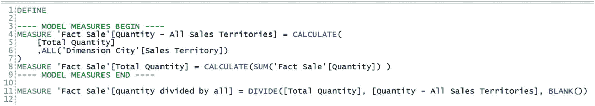

图 12-12

`DAX Studio`编辑器 – 依赖度量值

这一点至关重要：

### 注意

`DEFINE` 引入度量值的定义阶段。关键字 `MEASURE` 开始度量值定义。

如果你想知道为什么使用表名作为前缀，这对应于度量值分配到的表。在 Power BI 中引用度量值时，不要使用表名。这会混淆 DAX 语句的读者。

## 查询性能

查询性能优化通常旨在减少计算度量值所需的时间。创建能返回预期正确结果的 DAX 语句需要时间，而创建能以极速返回正确结果的 DAX 语句则需要更多时间。这不能仅仅通过阅读一本书来实现。当然，这可能会有所帮助，但没有实践和更多的实践，更不用说实践的重要性，是不可能掌握 DAX 的。

为了更好地理解发生了什么，有必要了解如何使用`DAX Studio`跟踪性能；有必要捕获一个查询。因此，请打开 pbix 文件"CH12 – a simple report.pbix"，并确保文件以"Blank page"报表页打开。将`DAX Studio`连接到该文件并启用`All Queries`跟踪。

然后激活报表页"open events – unrelated"。我们感兴趣的是清单 12-4 中所示的 DAX 语句。

```
EVALUATE
TOPN(
502,
SUMMARIZECOLUMNS(
ROLLUPADDISSUBTOTAL('Dimension Date unrelates'[Calendar Month Label], "IsGrandTotalRowTotal"),
"events_in_progress___not_so_fast", 'Fact Sale'[events in progress - not so fast]
),
[IsGrandTotalRowTotal],
0,
'Dimension Date unrelates'[Calendar Month Label],
)
ORDER BY
[IsGrandTotalRowTotal] DESC, 'Dimension Date unrelates'[Calendar Month Label]
清单 12-4
DAX 查询 – "event not so fast.dax"
```

目前，完全理解正在发生的事情并不那么重要。但是，通过双击查询选择"large"查询（持续时间），`DAX Studio`将如图 12-13 所示。

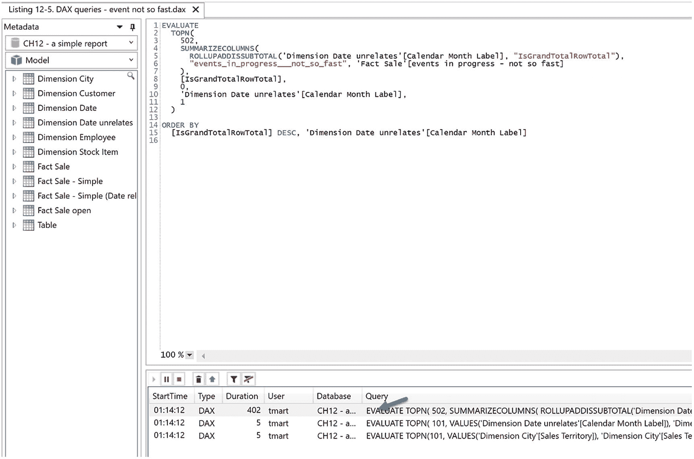

图 12-13

事件 – 准备服务器计时

将感兴趣的查询捕获到查询编辑器后，可以切换跟踪。第一个跟踪将是`Server Timings`（参见图 12-14）。要激活此跟踪，需要先停用"All Queries"跟踪。

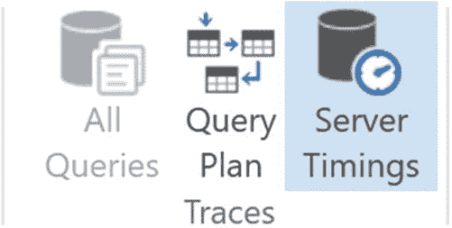

图 12-14

事件 – 服务器计时

激活`Server Timings`跟踪后，`Server Timings`输出窗口将变为可用（图 12-15）。

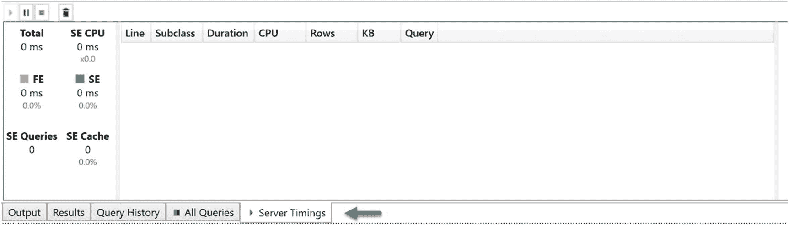

图 12-15

事件 – 服务器计时输出

有必要理解每次运行所测量的性能计数器。这些是常用的性能计数器：

*   `Total` – 总查询持续时间（毫秒）
*   `FE`（公式引擎） – 使用公式引擎所花费的时间
*   `SE`（存储引擎） – 使用存储引擎所花费的时间

必须记住，存储引擎是快速引擎。这意味着在公式引擎中花费的时间越多，查询优化（即 DAX 优化）就变得越重要。

更详细的描述可以在这里找到：`https://daxstudio.org/documentation/features/server-timings-trace/`。

# 13. 查询计划

## 查询计划简介

`DAX` 引擎的一项便捷功能是能够访问名为“查询计划”的有用信息。查询计划可以深入了解 `DAX` 引擎如何执行其任务，以交付任何给定 `DAX` 查询所请求的结果。

一个现实中的类比可能是提供完成某个特定项目所需任务的分解。如果项目是建造一个鸟屋，可以在开始前生成一个项目计划，并在执行特定测试后随时更新。

一个用于建造鸟屋的伪查询计划可能如下所示：

```
用设计工具组装零件。
寻找理想鸟屋的蓝图。
在互联网上搜索想法。
获取所需的零件。
开车去五金店采购材料。
支付材料费用。
从工坊取回所需工具。
拿锤子。
拿锯子。
拿钉子。
拿卷尺。
```

在这个示例中，计划中的每一行都代表整个项目的一个子任务。项目的最终步骤列在最顶行，缩进程度最小。任务的顺序不一定是自上而下的。有三个同级节点专门对应寻找蓝图、获取零件和工具的任务。这三个同级节点都有一系列子任务，这些子任务与紧接其下的具体步骤相关，缩进有助于突出显示每个子任务在节点内的顺序和关系。

查询计划在尝试调试或优化性能缓慢的查询时尤其有用。如果你用过 `T-SQL`，可能对这个概念并不陌生，因为使用 `SQL Server` 数据库引擎时也能获得类似的查询计划。当你执行 `T-SQL` 查询时，可以选择将查询计划与查询结果一起返回。可以在 `SSMS` 工具中将 `T-SQL` 查询计划视为返回结果所采用方法的图形化描述。

`T-SQL` 版本的查询计划提供了每个子步骤的分解，并包含有用的信息，例如每个步骤所花费的时间、是否使用了索引、每个子步骤输入或输出的行数等。

`DAX` 版本的查询计划是基于文本的，并使用多行和缩进进行格式化，以提供基本的树形结构。计划中的每一行都代表整个查询中的一个操作。任何能够针对 `Analysis Services` 数据模型启动并运行跟踪的客户端工具都可以使用查询计划。缩进和等效的制表符间距用于突出显示同级节点与子任务。

### 有关查询计划的更多信息

在 `DAX` 中，每个查询会生成三个计划。但只有两个计划作为跟踪事件公开。这三个计划是：

- 查询表达式树

- 逻辑计划

- 物理计划

查询表达式树是 `DAX` 表达式的直接树形映射，不会作为探查器事件出现在数据库跟踪中。查询表达式树会被转换并简化为逻辑计划树。`DAX` 引擎可能会在构建物理计划树之前部分执行逻辑树。物理计划被执行，以从数据库返回最终数据集。

在针对数据库运行跟踪时，“查询计划”事件始终返回两个查询计划。一个是逻辑计划，另一个是物理计划。逻辑计划可以帮助你了解高级函数使用的原始操作。可以使用逻辑计划识别函数是其他操作的语法糖快捷键的场景。

物理计划有助于突出显示查询中公式引擎导致性能问题的区域。

### 如何查找

可用于访问查询计划的两个免费工具是 `DAX Studio` 和 `SQL Server Management Studio (SSMS)`。这两个工具都可以针对 `SQL Server Analysis Services (SSAS)` 数据库的实例运行探查器跟踪。`Power BI Desktop` 是一个 `SSAS` 数据库实例。

探查器跟踪可捕获数据库引擎内发生的事件。事件形式多样，且并非总是与用户生成的查询相关。在针对数据模型启动跟踪时，只需选择特定感兴趣的事件；否则，跟踪会产生大量信息，难以聚焦到有用的细节上。

一旦跟踪启动，可以暂停或停止它。捕获的事件可以保存为 `TRC` 文件，以供后续查看。

使用 `SSMS` 运行跟踪的第一步是连接到目标数据模型。如图 13-1 所示，连接时需要提供数据模型的端口号。有几种方法可以确定 `Power BI Desktop` 实例的本地端口号。查找端口号最简单的方法之一是使用 `DAX Studio` 连接到你想要运行跟踪的数据模型。图 13-1 中显示的端口号是 `localhost:50086`，在为跟踪连接到数据模型时，需要完整添加此信息。


*图 13-1* – 显示 `Power BI Desktop` 实例的端口号

可以从 `SSMS` 的“工具”菜单中启动探查器工具，方法是点击“`SQL Server Profiler`”选项。也可以从操作系统菜单中直接启动该工具，只需在搜索区域中搜索“`SQL Server Profiler`”即可。探查器工具启动后，会出现一个类似图 13-2 的对话框，要求提供如何连接到数据模型的信息。

对于本地机器上的 `Power BI Desktop`，“服务器类型”下拉框应始终设置为“`Analysis Services`”。“服务器名称”文本框中需要包含文本 `localhost:` 以及你要连接的实例的当前端口号。每次重新启动 `Power BI Desktop` 时，此端口号都会发生变化。


*图 13-2* – 显示探查器工具的连接对话框

### 说明

在 Power BI Web 服务中开启 XMLA 端点后，你可以将 Profiler 工具直接连接到云中已发布的数据模型。

一旦 Profiler 工具成功连接到一个数据模型，就可以通过`文件`菜单中的`新建跟踪`选项启动新跟踪。点击`新建跟踪`会打开一个跟踪属性窗口。该窗口中的`事件选择`选项卡会列出跟踪运行期间报告的事件。建议选择以下事件进行基本跟踪：

- 查询事件

    - `Query End`

- 查询处理

    - `DAX Query Plan`

    - `VertiPaq SE Query Cache Match`

    - `VertiPaq SE Query End`

Alberto Ferrari 在 2012 年撰写的一篇题为“理解 DAX 查询计划”的白皮书中指出，这些事件是捕获 Analysis Services 数据库跟踪时的理想事件。我同意这些事件是极好的起点，只有在更高级的场景下才应添加其他事件类型。这两个查询事件仅适用于导入的表。DirectQuery 表则有不同的事件。

图 13-3 展示了按推荐事件配置后的跟踪属性窗口。


**图 13-3** – SSMS Profiler 推荐的跟踪属性事件

事件定义完成后，点击跟踪属性窗口中的`运行`按钮即可启动跟踪。此后，任何针对数据模型的查询都会向显示跟踪活动的窗口添加多个跟踪事件。跟踪窗口包含 Power BI Desktop 报表画布区域中的用户活动，以及使用 SSMS 或 DAX Studio 直接针对数据模型发出的 DAX 查询。

可以重新排列跟踪窗口中的列，以便将有用的列分组到窗口的左侧。以下是一些方便移动到列顺序左侧的列：

- `EventClass`

- `EventSubclass`

- `Duration`

- `CPUTime`

### 说明

跟踪事件可以保存为跟踪模板，以便在将来调试时快速检索事件集。

## 基本计划（我的第一个计划）

使用一个简单的 DAX 查询来介绍 DAX 查询计划的结构和基本布局，以帮助将计划提供的信息量保持在最低限度。清单 13-1 中显示的查询非常简单，旨在清晰明了，而非反映更真实的场景。

```
EVALUATE
ROW(
"My Column Name",
1 + 1
)
```

**清单 13-1** – 用于生成简单查询计划的基本 DAX 查询

图 13-4 显示了 SSMS 中的查询以及使用清单 13-1 中的查询预期的结果“2”。


**图 13-4** – 使用 SSMS 的基本 DAX 查询及结果

当清单 13-1 中的查询在启用了跟踪的数据模型上运行时，会报告以下三个事件。其中两个事件是 `DAX Query Plan`，第三个是 `Query End` 事件。`EventSubClass` 列中的详细信息显示了两个 `DAX Query Plan` 事件中哪个是逻辑计划，哪个是物理计划。

当选中单个 `DAX Query Plan` 行时，跟踪窗口的底部会显示每个查询计划的完整详细信息。相同的信息也会显示在 `TextData` 列中。

### 逻辑计划（我的第一个计划）

逻辑计划中每一行的结构都遵循相同的模式。第一个冒号之前的第一个文本项是运算符名称。第一个冒号之后的所有文本代表运算符属性，其中运算符属性的第一项显示运算符类型。

如表 13-1 所示，逻辑计划运算符类型只有两种。`ScaLogOp` 类型始终返回单个值。`RelLogOp` 类型通常处理涉及多列且这些列不总是在同一张表上的操作。`RelLogOp` 运算符类型通常可以有使用 `ScaLogOp` 运算符类型的子步骤。`ScaLogOp` 运算符类型也可以将 `RelLogOp` 作为子步骤。

**表 13-1** – 逻辑计划的运算符类型

| 运算符类型 | 描述 |
| --- | --- |
| `ScaLogOp` | 标量逻辑运算符 – 返回单个值（文本、数字、布尔值等） |
| `RelLogOp` | 关系逻辑运算符 – 返回值表 |

**表 13-2** – 物理计划的运算符类型

| 运算符类型 | 描述 |
| --- | --- |
| `LookupPhyOp` | 查找物理运算符 – 以当前行为输入，返回单个标量值 |
| `IterPhyOp` | 迭代器物理运算符 – 返回一行序列 – 可选的以当前行作为输入 |

### 说明

最常用的 `RelLogOp` 之一来自 `Values('Table'[Column])`，这是一个单列。`ScaLogOp` 和 `RelLogOp` 之间的区别在于前者返回值，后者返回表，无论涉及的列数和物理表数量如何。

清单 13-1 中的查询生成的逻辑计划如清单 13-2 所示。

```
AddColumns: RelLogOp DependOnCols()() 0-0 RequiredCols(0)("[My Column Name])
Constant: ScaLogOp DependOnCols()() Integer DominantValue=2
```

**清单 13-2** – 为清单 13-1 中的查询返回的逻辑计划

在清单 13-2 所示的示例中，逻辑计划由两行组成。每行中的第一个文本项是运算符名称。第一行中，运算符名称是 `AddColumns`，第二行中，运算符名称是 `Constant`。这些代表了 DAX 为满足查询的每个方面而使用的基础原始函数。

第一行的运算符类型是 `RelLogOp`。该运算符类型与 `AddColumns` 的运算符名称相结合，表明它们属于清单 13-1 查询中的 `ROW()` 函数，并且与返回最终表的工作相关。

第二行的运算符类型 `ScaLogOp`，与 `Constant` 的运算符名称相结合，表明这一行与简单的数学运算相关。

该查询没有引用数据模型中的任何表或列，因此跟踪中不会报告与存储引擎相关的事件。

运算符属性中的其他文本提供了与每个运算符相关的额外详细信息。

### 物理计划（我的第一个计划）

物理计划的结构与逻辑计划相同。每行中的第一个文本代表运算符名称。物理计划中有许多运算符，它们提供了线索，表明使用了哪个内部 DAX 函数来满足查询的每个方面。表 13-2 显示了物理计划的主要运算符类型。

第一个分号后的文本与该行的运算符属性有关，分号后的第一项声明了该运算符的运算符类型。物理计划只能有两种类型的运算符。

清单 13-1 中的查询生成的物理计划如清单 13-3 所示。

```
AddColumns: IterPhyOp LogOp=AddColumns IterCols(0)("[My Column Name])
SingletonTable: IterPhyOp LogOp=AddColumns
Constant: LookupPhyOp LogOp=Constant Integer 2
```

**清单 13-3** – 为清单 13-1 中的查询返回的物理计划

此物理计划有三行。顶行代表查询的最终输出。查询有两个处于同一级别的子节点。`SingletonTable` 运算符的类型为 `IterPhyOp`，这意味着它可能返回一系列行。计划的第三行，即底行，告诉我们该运算符是 `Constant`，类型为 `LookupPhyOp`，这意味着它返回单个值。该行的附加属性指定该值为 2（1+1 的结果），并且 `Constant` 的数据类型为 Integer。

### 查询时间

#### 注意

DAX 查询计划事件类型不会报告事件探查器跟踪中的持续时间值。

逻辑计划和物理计划事件都不会报告持续时间，这意味着仅凭这些事件并不总能用于调试长时间运行的查询。通常，将 DAX 查询计划*与*其他事件相结合有助于隔离和识别性能不佳的查询背后的原因。

### 清除缓存

调试 DAX 查询性能时，一个关键提示是需要在查询之间清除 DAX 引擎缓存，以便进行公平的比较。在不清除缓存的情况下连续运行相同的查询，可能会因后续执行利用了缓存结果而导致持续时间值出现偏差。

xVelocity 引擎保存了一个小型缓存，可以通过在事件探查器跟踪中包含 *VertiPaq SE Query Cache Match* 事件来观察。理想情况下，在进行性能测试时，您不应看到此事件发生。此事件表明查询利用了先前同一查询的执行结果。

清除缓存需要向数据模型传递一个 XMLA 查询。可以在 SSMS 或 DAX Studio 中执行该 XMLA 查询。

#### 使用 SSMS

要使用 SSMS 清除数据模型缓存，请启动一个新的 XMLA 查询类型，并连接到相关的数据模型。通过单击“新建查询”菜单项中的 XMLA 按钮（如图 13-5 所示）来启动一个新的 XMLA 查询类型会话。


**图 13-5** 使用 SSMS 菜单启动到数据模型的 XMLA 连接

XMLA 命令可以从任何查询类型（MDX、DMX、XMLA 和 DAX）中应用；但是，在 DAX 或 MDX 连接窗口中使用时，可以在 `ClearCache` 块和 DAX `EVALUATE` 语句之间插入 `GO` 语句，以同时批处理并运行多个 DAX 语句。图 13-8 显示了一个在 SSMS 中使用 `GO` 语句的代码示例。

使用 `GO` 和 `ClearCache` 语句分隔多个 DAX 查询是在同一批次中执行相似查询以进行调试和诊断的绝佳方法。此技术还有助于防止意外忘记清除缓存，并避免因错误的性能结果而分心。图 13-8 显示了一个与 DAX 查询结合使用的 `ClearCache` 命令示例。请确保在批处理中的每个 DAX 语句之前添加一个 XMLA `ClearCache` 语句。

一旦成功建立 XMLA 连接，就可以发出图 13-6 中的 `ClearCache` 查询。请注意，`DatabaseID` 元素内的值需要更新以反映每个数据模型。不要使用图 13-6 中显示的 `DatabaseID`。如果数据模型是 Power BI Desktop 文件，则该值可能是一个由字母、数字和连字符组成的 GUID 样式的字符串，每次关闭并重新打开 `.pbix` 文件时该字符串都会发生变化。

SSMS 对象资源管理器在对象层次结构树中显示数据库的名称。在 SSMS 中按 `F8` 键可显示对象资源管理器窗口。

用于 `DatabaseID` 的值需要精确匹配，如果从 SSMS 对象资源管理器中拖拽该值，则可能需要移除开头/结尾的一些方括号。


**图 13-6** 用于清除数据模型缓存的 XMLA 查询

一旦清除缓存查询运行成功，您应该会看到类似于图 13-7 的结果。如果清除缓存查询失败，请仔细阅读错误消息，但很可能是由不正确的 `DatabaseID` 引起的。


**图 13-8** 在 SSMS DAX 查询窗口中使用 `GO` 关键字批处理多条语句


**图 13-7** 成功清除缓存的 XMLA 查询结果

### 我的下一个查询

下一个查询扩展了前面的示例，但将硬编码的常量替换为使用存储引擎的一些 DAX。更新后的查询是对 `Quantity` 列的简单 `SUM`，如清单 13-4 所示。此未筛选的代码生成一个值为 8,950,628 的单个值。

## EVALUATE

```
ROW (
"Sum of Quantity",
SUM('Fact Sale'[Quantity])
)
```
Listing 13-4
A Simple DAX query showing the SUM over the entire Quantity column

## 逻辑计划

清单 13-4 中查询的四行逻辑计划如图 13-9 所示。


图 13-9
清单 13-4 中查询的逻辑计划

逻辑计划的顶行与清单 13-2 中的示例相比没有变化。此顶行与最终输出相关，并表示查询中使用的 `ROW` 函数。

计划中的其余行与查询中使用的 `SUM` 函数相关。第二行运算符名称为 `Sum_VertiPaq`，类型为 `ScaLogOp`。所有逻辑 `ScaLogOp` 类型都共有的运算符属性包括 `DependsOnCols`、`DataType` 和 `DominantValue` 属性。

### DependsOnCols

`DependsOnCols` 属性显示两对括号，且对于 `ScaLogOp` 和 `RelLogOp` 来说格式相同。这些括号有时可能为空，如当前逻辑计划中的第 2 行所示。当这些括号被填充数值时，第一对括号显示一个逗号分隔的数字列表，这些数字与数据模型中的内部列 ID 相关。此编号与模型中的列 ID 无关，它仅是在当前查询中唯一标识某个列实例的数字。第二对括号显示相同列的完全限定文本版本。

列数字有助于识别查询中同一列的多个引用。例如，在累计总计计算中，内部循环和外部循环对同一列进行不同追踪时，就会出现这种情况。

括号并不总是被填充，有时会显示为 `()()`，表示不依赖任何列。

### 列范围（仅适用于 RelLogOp）

仅针对 `RelLogOp` 操作，在 `DependsOnCols` 属性之后可能会显示一个额外的数字范围。该数字指代一个列范围，这些列确定了查询下一部分所需的最小列集合。如果查询不涉及关系，则计划中可能不会出现此范围。

列范围的格式为 `*<起始列 ID> - <结束列 ID>*`。在图 13-9 所示的示例中，为 `RegLogOp` 指定的列范围是相当宽的 `0–102`。在 `RequiredCols` 运算符属性中，该列范围被缩小到特定列。`RequiredCols` 运算符可能来自 `DependsOnCols` 或列范围。

### RequiredCols（仅适用于 RegLogOp）

`RequiredCols` 运算符属性指定了满足操作所需的实际列。其模式与 `DependsOnCols` 运算符属性类似，也包含两对括号。第一对括号包含一个逗号分隔的数字列表，表示内部列标识符；第二对括号显示列的完全限定名称，包括表名和列名。

### DataType（仅适用于 ScaLogOp）

在 `DependsOnCols` 属性之后，会列出六种数据类型之一，以显示返回值的类型。该值也可以为空。当前示例中的两个 `ScaLogOp` 操作都使用了整数数据类型。

### DominantValue（仅适用于 ScaLogOp）

标量逻辑运算符的最后一个属性是 `DominantValue` 属性，它表示计划可以将列识别或过滤为特定值或少量值。此属性可设置为 `NONE`，否则可能显示特定值。当属性设置为特定值时，DAX 引擎可能会选择一个比设置为 `NONE` 时快得多的计划。在分析逻辑计划时，此属性值是一个有用的参考指标。

## 物理计划

清单 13-4 中的查询生成一个五行物理计划，如图 13-10 所示。


图 13-10
清单 13-4 中查询的物理计划

第一行是最外层操作，使用 `AddColumns` 运算符输出最终结果。第二行引用的操作使用了 `IterPhyOp` 类型，即使此查询只返回单行数据。如果查询设计为返回更多行，`AddColumns` 运算符也不会改变。

第三行表示对存储引擎的调用，对于此计划，它解释了引擎如何满足执行求和的要求。此运算符的 `LogOp` 属性指定了使用 `Sum_VertiPaq` 运算符。`Sum_VertiPaq` 运算符类型对性能而言是个好消息，意味着在存储引擎读取数据的同时，即可完成生成所需值的工作。公式引擎无需额外工作即可产生正确结果。

最后两个运算符提供了与 `SpoolLookup` 运算符相关的子节点的一些细节。

物理计划中一个重要的运算符属性是 `#Records` 运算符属性。该属性提供了关于操作处理的假脱机中行数的信息。有时该值可能远高于预期，这表明有机会在查询中重新组织筛选，以帮助减少冗余和不必要的工作量。

## VertiPaq 运算符

在使用 DAX 查询计划来帮助提升性能时，逻辑计划和物理计划中需要关注的关键运算符是 VertiPaq 运算符。

VertiPaq 运算符与 VertiPaq 引擎协同工作以检索数据，某些操作可以在从数据库检索数据的*过程中*进行，从而显著提升查询的整体性能。VertiPaq 操作还可以在多线程环境中并行运行，从而带来潜在的性能提升。

任何无法由 VertiPaq 运算符完成的工作都会传递给单线程的公式引擎来处理。在从数据库检索数据的同时，能够处理的数据越多，性能结果就越好。

```
Scan_Vertipaq
GroupBy_Vertipaq
Filter_Vertipaq
Sum_Vertipaq
Min_Vertipaq
Max_Vertipaq
Count_Vertipaq
DistinctCount_Vertipaq
Average_Vertipaq
Stdev.S_Vertipaq
Stdev.P_Vertipaq
Var.S_Vertipaq
Var.P_Vertipaq
```
清单 13-5
VertiPaq 逻辑运算符的部分列表

图 13-9 中的查询计划在第 2 行显示使用了 `Sum_VertiPaq` 运算符。该运算符表示，当从 VertiPaq 引擎检索数据时，`[Quantity]` 列中的值可以相加，这意味着读取操作完成后数值即可用。公式引擎无需执行额外的处理来满足此查询。

`Sum_VertiPaq` 操作属性也出现在图 13-10 第 3 行的物理计划中，其键值对为 `LogOp = Sum_VertiPaq`。

### VertiPaq 查询事件

建议添加到 Profiler 跟踪中的两个事件是 `VertiPaq SE Query Cache Match` 和 `VertiPaq SE Query End` 事件。查看这些事件时，它们会显示类似 T-SQL 的伪查询，并为调试提供有用的反馈。这些事件还会在 Profiler 跟踪输出中报告每个存储引擎查询的持续时间值。该持续时间值表示每次存储引擎扫描所花费的时间（以毫秒为单位）。这些事件专门报告与查询 VertiPaq 存储引擎相关的任何活动。

每个存储引擎查询会捕获两个 Profiler 事件。两者的文本相似，但 `EventSubClass` 略有不同。

图 13-11 显示了已添加这两个事件的“跟踪属性”窗口。这两个事件位于“查询处理”部分。


图 13-11 – 用于跟踪 VertiPaq 存储引擎查询的 Profiler 事件

考虑以下清单 13-6 中的 DAX 查询，该查询使用 `'Dimension Date'` 表构建一个唯一日期列表，然后使用 `ADDCOLUMNS` 函数为每个日期附加一个 SUM 值。

```
EVALUATE
ADDCOLUMNS(
VALUES('Dimension Date'[Date]) ,
"Quantity Per Day",
SUM('Fact Sale'[Quantity])
)
```

清单 13-6 – 用于演示 DAX Profiler 事件的查询


图 13-12 – 清单 13-6 中查询的 Profiler 跟踪

图 13-12 中的 Profiler 跟踪总共显示了七行。最上面一行的 `EventClass` 为 `DAX Query Plan`，与逻辑计划相关。清单 13-7 中显示了该逻辑计划的简化版本。

逻辑计划表明查询期间发生了两次 VertiPaq 扫描。这些扫描在逻辑计划的第 2 行和第 4 行中被引用，每行都以文本 `Scan_VertiPaq` 开头。需要两个 VertiPaq 操作，首先是从 `'Dimension Date'` 表生成一个唯一日期值列表，第二次扫描处理来自 `'Fact Sale'` 表的 `Quantity` 列，属于 `Sum_VertiPaq` 操作。

第三行的运算符名称是 `Sum_VertiPaq`，这意味着在从底层模型中检索数据的同时，可以执行值的相加过程。

```
AddColumns: RelLogOp ([Date], [Quantity Per Day])
Scan_Vertipaq: RelLogOp ('Dimension Date'[Date])
Sum_Vertipaq: ScaLogOp
Scan_Vertipaq: RelLogOp ('Fact Sale'[Quantity])
'Fact Sale'[Quantity]: ScaLogOp ([Quantity])
```

### 清单 13-7
清单 13-6 中查询的简化逻辑计划

图 13-11 中的 Profiler 跟踪在 `VertiPaq SE Query End` EventClass 中显示了四个事件。这些事件代表两次 VertiPaq 扫描，因为一次扫描将生成两个事件。

图 13-11 中 Profiler 跟踪的第六行显示了第二个 `DAX Query Plan` 事件。此事件的 `EventSubClass` 为 `2 – DAX VertiPaq Physical Plan`，代表查询的物理计划。清单 13-8 显示了物理计划的简化版本，省略了一些文本，但仍保留了意图。

```
AddColumns: IterPhyOp (0,1)([Date],[Quantity Per Day])
Spool_Iterator: IterPhyOp LogOp=Scan_Vertipaq [Date]
ProjectionSpool: SpoolPhyOp #Records=1461
Cache: IterPhyOp
SpoolLookup: LookupPhyOp LogOp=Sum_Vertipaq
ProjectionSpool: SpoolPhyOp #Records=1
Cache: IterPhyOp
```

### 清单 13-8
清单 13-6 中查询的简化物理计划

物理计划中最外层的操作是第一行，与 DAX 查询中的 `ADDCOLUMNS` 函数相关。此操作的物理运算符类型为 `IterPhyOp`，它启动一个对 `[Date]` 列的迭代器。`#Records=1461` 运算符属性指定了要迭代的项数为 1,461 个，并使用 `Scan_VertiPaq` 的逻辑操作。

第五行表示一个 `SpoolLookup` 操作。此情况下的物理操作类型是 `LookupPhyOp`，它返回单个标量值，并使用 `Sum_VertiPaq` 的逻辑操作。这一行是负责累加 `'Fact Sale'[Quantity]` 列中所有值的操作。

对物理计划的粗略解释是：对 `'Dimension Date'` 表中找到的每个唯一日期值执行一个循环，然后对于找到的每个日期，找到单个值，该值是 `'Fact Sale'` 表中 `[Quantity]` 列的总和。日期处理的顺序并不重要。没有一个日期的输出依赖于另一个日期。该任务可以分解为多个并行的流，结果仍然相同。

Profiler 跟踪中的最后一行是 `Query End` EventClass，它提供了有用的持续时间（以毫秒为单位）数据。

清单 13-6 中查询的结果如图 13-13 所示。您可能会注意到 `[Quantity Per Day]` 列中的值没有变化；相反，它对于每一行都反复反映 `'Fact Sale'` 表中 `Quantity` 列的总体总和。这种省略是故意的，本章后面的“上下文转换”部分将展示如何使用查询计划来识别和修复此问题。


### 图 13-13
显示清单 13-6 中查询的结果

## 计划优化

如本章前文所述，当查询运行时，会发生几件事情，包括生成逻辑计划和物理计划，以帮助确定产生所需结果的最佳方法。

`DAX 查询优化器`会生成一个逻辑计划，并尝试找到它认为最高效的方法来完成任务。这种优化意味着，以多种方式编写的查询最终可能会产生相同的计划，因此也具有相同的性能特征。

请考虑清单 13-9 中以下三个 *不同的* 查询，它们都产生相同的结果。所有三个 `DAX` 查询前面都有一个 `ClearCache` 块，为简洁起见，本例中将其缩写。

```
GO
EVALUATE
ROW(
"Basic SUM",
SUM('Fact Sale'[Quantity])
)
GO

GO
EVALUATE
ROW(
"Calculate SUM",
CALCULATE(SUM('Fact Sale'[Quantity]))
)
GO

GO
EVALUATE
ROW(
"SumX SUM",
SUMX('Fact Sale','Fact Sale'[Quantity])
)
```

### 清单 13-9
三个具有相同逻辑计划和物理计划的不同 DAX 查询

简化的逻辑计划（三个查询相同）显示在清单 13-10 中，并突出显示查询使用了 `Sum_VertiPaq` 运算符，从而获得了最佳性能。三个查询的逻辑计划相同这一事实也突显了，在简单情况下，`SUMX` 函数与 `SUM` 函数没有区别，或者说 `SUM` 函数等同于 `SUMX` 函数。

对于使用 `CALCULATE` 函数的中间查询，`DAX 查询优化器`也没有使用 `Calculate` 逻辑运算符。优化器已确定，由于没有提供筛选器，因此可以构建一个更简单、更快速的计划。如果将筛选器参数传递给 `CALCULATE` 函数，则会生成不同的逻辑计划和物理计划。

```
AddColumns: RelLogOp
Sum_Vertipaq: ScaLogOp
Scan_Vertipaq: RelLogOp 'Fact Sale'[Quantity]
'Fact Sale'[Quantity]: ScaLogOp
```

### 清单 13-10
清单 13-9 中所有三个 DAX 查询的简化逻辑计划

如果代码的某些部分是冗余的，`DAX 查询优化器`会从逻辑计划（以及物理计划）中消除这些逻辑分支。这种情况可能发生在 `IF` 函数只有一种输出（`THEN`/`ELSE`）时。冗余操作会从计划中被删除。

如果检测到冗余代码，`DAX 查询优化器`会从逻辑计划（以及物理计划）中消除这些逻辑分支。当条件语句（如 `IF`/`ELSE`）仅可能有一种输出时，就可能出现这种情况。冗余操作会从计划中被删除。

## 流程控制

### 简单的 IF 语句

查询优化器会创建一个只包含被认为完成查询所必需的代码路径的逻辑计划。如果 `DAX` 查询包含一个具有两种可能结果的 `IF` 函数，优化器会在最终确定逻辑计划之前检查这两个路径是否都会被用到。

考虑清单 13-11 中的以下查询，它包含一个带有无法到达代码的 `IF` 函数。无法到达的代码是 `IF` 语句的 `ELSE` 部分，其中包含一个使用 `'Fact Sale'[Profit]` 列的 `SUM` 函数。

```
DEFINE
VAR varTest = "Quantity"
EVALUATE
ADDCOLUMNS(
VALUES('Dimension Date'[Calendar Year]) ,
"IF Test" ,
IF (
varTest = "Quantity" ,
SUM('Fact Sale'[Quantity]) ,
SUM('Fact Sale'[Profit]))     --<= 冗余
)
```

### 清单 13-11
一个 ELSE 分支永远无法到达的 IF 语句

```
varTest: Constant: ScaLogOp VarName=varTest
AddColumns: RelLogOp
Scan_Vertipaq: RelLogOp [Calendar Year]
Integer->Double: ScaLogOp DependOnCols [Calendar Year]
Sum_Vertipaq: ScaLogOp MeasureRef=[Sum Quantity]
Scan_Vertipaq: RelLogOp
'Fact Sale'[Quantity]: ScaLogOp [Quantity]
```

### 清单 13-12
清单 13-11 中 DAX 查询的简化逻辑计划

清单 13-12 中清晰的逻辑计划显示了两次 VertiPaq 扫描。第一次 VertiPaq 扫描与 `VALUES` 函数相关，用于获取 `[Calendar Year]` 列中的唯一值列表。只返回了四个值。

然后，对于这些值中的每一个，使用 `Sum_VertiPaq` 运算符进行第二次 VertiPaq 扫描，查询 `[Quantity]` 列。逻辑计划中没有引用 `'Fact Sale'[Profit]` 列，尽管该列在 `DAX` 查询中被直接引用。该列之所以从逻辑计划中缺失，是因为查询优化器已确定 `IF` 语句的 `ELSE` 路径永远无法到达。

如果修改清单 13-11 中的 `DAX` 查询，使得分配给 `varTest` 变量的值不是 `'Quantity'`，`DAX查询优化器`将生成相同的计划，只是将 `[Quantity]` 列替换为 `[Profit]` 列。

逻辑计划中一个有趣之处是沿途从 `Integer` 到 `Double` 的转换。此转换明确与设置为 `Integer` 数据类型的 `'Fact Sale'[Quantity]` 列有关，逻辑计划确定需要执行一个操作，将其转换为小数（`Double`）作为查询的一部分。

### 复杂的 IF 语句

如果 `IF` 函数的两个代码路径在 `DAX` 查询中都有效，则优化器会将额外的操作包含到逻辑计划中以覆盖这两个路径。清单 13-13 显示了一个略微修改的查询，该查询旨在当年份等于 2015 年时返回与其它年份不同的度量值。此查询的目的是展示当 `IF` 函数的 `THEN` 和 `ELSE` 路径都有效时，查询优化器如何构建逻辑计划。

```
AddColumns: RelLogOp
Scan_Vertipaq: RelLogOp [Calendar Year])
If: ScaLogOp 'Dimension Date'[Calendar Year]
'Dimension Date'[Calendar Year] = 2015: ScaLogOp
PredicateCheck: RelLogOp
ScalarVarProxy: ScaLogOp
PredicateCheck: RelLogOp
ScalarVarProxy: ScaLogOp
Sum_Vertipaq: ScaLogOp MeasureRef=[Sum Quantity]
Scan_Vertipaq: RelLogOp
'Fact Sale'[Quantity]: ScaLogOp
Sum_Vertipaq: ScaLogOp MeasureRef=[Sum Profit]
Scan_Vertipaq: RelLogOp
'Fact Sale'[Profit]: ScaLogOp
清单 13-14
清单 13-13 中 DAX 查询的简化逻辑计划
```

```
DEFINE
MEASURE 'Fact Sale'[Sum Quantity]
= SUM('Fact Sale'[Quantity])
MEASURE 'Fact Sale'[Sum Profit]
= SUM('Fact Sale'[Profit])
EVALUATE
ADDCOLUMNS(
VALUES('Dimension Date'[Calendar Year]) ,
"IF Test" ,
IF (
[Calendar Year] = 2015 ,
[Sum Quantity]  ,    --<= Then
[Sum Profit]    --<= Else
)
)
清单 13-13
具有两个有效代码路径的复杂 IF 函数
```

清单 13-14 中显示的逻辑计划与清单 13-12 中显示的逻辑计划之间的区别在于，前者包含了一个 `IF` 运算符，该运算符包含多个子节点以覆盖不同的代码分支。该逻辑计划还表明，执行了三次存储引擎扫描，一次扫描专注于检索 `[Calendar Year]` 列中的值列表，而另外两次则根据 `IF` 语句的条件分支，使用 `Sum_VertiPaq` 操作类型来高速处理数字。

#### SWITCH 语句

如果清单 13-13 中的 DAX 查询被修改为使用 `SWITCH` 函数替代 `IF` 函数，查询优化器将生成相同的计划。

然而，在使用 `SWITCH` 函数时需要警惕一点：在某些情况下，即使看似只有一个分支是可能的，代码路径的所有分支仍然会被计算。当报表使用度量值表为用户提供动态体验（允许他们从切片器中选择指标）时，可能会发生这种不期望的情况。考虑清单 13-15 中 DAX 计算度量值的示例，该度量值将 `UserSelection` 变量赋值为在名为 `'Measure Table'` 的表中的某一列切片器上所做的选择。

这里的期望是，当用户进行单一选择时，`SWITCH` 语句仅调用特定度量值，并且在计算过程中三个度量值中只有一个需要被计算。

```
SWITCH Measure =
VAR UserSelection = SELECTEDVALUE('Measure Table'[Column1])
RETURN
SWITCH(
TRUE() ,
UserSelection = "Measure 1" , [Test Measure 1],
UserSelection = "Measure 2" , [Test Measure 2],
[Test Measure 3]
)
清单 13-15
动态度量值中 SWITCH 语句的示例
```

### CALCULATE 语句

下一部分聚焦于查询计划中与 `CALCULATE` 函数使用相关的有趣方面。第一部分重点介绍如何在查询计划中发现上下文转换，第二部分则提供一个有趣的示例，展示如何通过重写一个性能较差的查询以使用 `CALCULATE` 函数来获得显著的性能提升。

#### 上下文转换

考虑清单 13-16 中的查询，它返回一个结果，其中每个 `[Calendar Year]` 对应一行，并有一个额外的列显示 `'Fact Sale'[Quantity]` 列的总和。在此示例中，`[Quantity Per Year]` 列中的值是重复的相同值，并未考虑第一列同一行中显示的日历年份。清单 13-16 中代码的完整结果如图 13-14 所示。

```
EVALUATE
ADDCOLUMNS(
VALUES('Dimension Date'[Calendar Year]) ,
"Quantity Per year",
SUMX('Fact Sale','Fact Sale'[Quantity])
)
清单 13-16
无上下文转换的简单 SUMX 计算
```


*图 13-14 – 显示清单 13-16 中查询的结果集*

现在考虑对清单 13-16 中同一个查询进行略微修改后的版本。新查询在清单 13-17 中，唯一的区别是在 `SUMX` 函数外层添加了一个 `CALCULATE` 函数。查询未做其他修改，也未向 `CALCULATE` 函数添加任何筛选参数。

此修改使得上下文转换得以发生，这意味着当前行的行级筛选器将转换到由 `CALCULATE` 语句创建的新上下文中。

```
EVALUATE
ADDCOLUMNS(
VALUES('Dimension Date'[Calendar Year]) ,
"Quantity Per year" ,
CALCULATE(
SUMX('Fact Sale','Fact Sale'[Quantity])
)
)
清单 13-17
发生上下文转换的简单 SUMX 计算
```


*图 13-15 – 显示清单 13-17 中查询的结果集*

清单 13-18 展示了清单 13-16 中未使用 `CALCULATE` 函数的查询的简化逻辑计划。为便于直接比较，清单 13-19 展示了清单 13-17 中使用了 `CALCULATE` 函数的修改后查询的简化逻辑计划。图 13-15 显示了清单 13-17 中代码的完整结果。

```
AddColumns: RelLogOp
Scan_Vertipaq: RelLogOp
Sum_Vertipaq: ScaLogOp
↳ DependOnCols(0)([Calendar Year])
Scan_Vertipaq: RelLogOp
↳ DependOnCols(0)([Calendar Year])
↳ 1-110
↳ RequiredCols(0, 13)
↳([Calendar Year], [Quantity])
'Fact Sale'[Quantity]: ScaLogOp
清单 13-19
清单 13-17 中查询的简化逻辑计划（带 CALCULATE）
```

```
AddColumns`: RelLogOp`
`Scan_Vertipaq`: RelLogOp`
`Sum_Vertipaq`: ScaLogOp`
↳ `DependOnCols()()`
`Scan_Vertipaq`: RelLogOp`
↳ `DependOnCols()()`
↳ 1-110`
↳ `RequiredCols(13)('Fact Sale'[Quantity])`
`'Fact Sale'[Quantity]`: ScaLogOp`
清单 13-18`
清单 13-16 中查询的简化逻辑计划（无 `CALCULATE`）
```

对于清单 13-16（无 `CALCULATE`）和清单 13-17（有 `CALCULATE`）中展示的两个简化计划，为了简洁起见，移除了非必要且相同的运算符属性。

两个计划都有五个操作，因此有五行。`↳` 字符用于标识为了可读性而引入的换行。

这两个计划之间的关键区别在于，未使用 `CALCULATE` 函数的查询中，名为 `DependsOnCols` 的运算符属性未填充列值。

然而，在使用 `CALCULATE` 的版本中，`DependsOnCols` 运算符属性提供了两次扫描之间的链接。在两个查询中，都执行了两次 VertiPaq 扫描；但是，`Sum_VertiPaq` 操作考虑了相关的 `[Calendar Year]`。

两个查询的物理计划非常相似，除了计划中与 `Sum_VertiPaq` 逻辑操作相关的一行，该行包含一个 `LookupCols` 属性，该属性在两次扫描之间建立了链接。

在性能方面，这两个查询在拥有 228,265 行的 `'Fact Sale'` 表上表现出相似的性能特征，但在数据集大得多的情况下可能会有所不同。

### 运行总计

继续以 `CALCULATE` 函数为例，另一个有趣且能突出查询计划用途的例子是累计总计计算。清单 13-20 展示了两个以不同方式编写但产生相同结果的 DAX 查询。

```
GO
EVALUATE
ADDCOLUMNS(
VALUES('Dimension Date'[Date]),
"Running total of Quantity" ,
CALCULATE(
SUMX(
'Fact Sale',
'Fact Sale'[Quantity]
),
'Dimension Date'[Date]
)
GO
EVALUATE
ADDCOLUMNS(
VALUES('Dimension Date'[Date]),
"Running total of Quantity" ,
SUMX(
FILTER(
'Fact Sale',
'Fact Sale'[Invoice Date Key]<=
↳ EARLIER('Dimension Date'[Date])
),
'Fact Sale'[Quantity]
)
)
```

该批次中的两个查询都使用了 `SUMX` 函数结合 `ADDCOLUMNS` 函数，来添加一列显示由 `VALUES` 函数返回的每一天的累计总计。

两个查询都返回相同的 1,461 行结果集。它们使用的筛选条件也相同；然而，筛选条件的位置和方法对每种方法的性能特征产生了巨大影响。

清单 13-20 示例中的第一个查询使用 `CALCULATE` 函数来执行核心的 `SUMX` 函数，并将筛选逻辑分离到 `CALCULATE` 函数的筛选参数中，而第二个查询则在 `SUMX` 表达式内部使用了 `FILTER` 函数。

两个查询都执行了两次 VertiPaq 存储引擎扫描。第一次 VertiPaq 扫描与 `VALUES` 函数相关，用于确定结果集中唯一日期的数量，另一次 VertiPaq 扫描则使用了 `[Quantity]` 列。

第一个查询使用了 `CALCULATE` 函数，其完成时间可靠地低于 1 秒。第二个查询将筛选逻辑嵌入到 `SUMX` 表达式内部，其完成时间在 20 到 30 秒之间。对于两个看起来非常相似的查询而言，这种性能差异是巨大的。

这两个查询的查询计划揭示了两者差异的线索，其简化版本的两个逻辑计划分别展示在清单 13-21 和清单 13-22 中。

```
AddColumns: RelLogOp
Scan_Vertipaq: RelLogOp
SumX: ScaLogOp DependOnCols(0)
Filter: RelLogOp DependOnCols(0)
Scan_Vertipaq: RelLogOp
LessThanOrEqualTo: ScaLogOp
'Fact Sale'[Invoice Date Key]: ScaLogOp
'Dimension Date'[Date]: ScaLogOp
'Fact Sale'[Quantity]: ScaLogOp
```

```
AddColumns: RelLogOp
Scan_Vertipaq: RelLogOp
Calculate: ScaLogOp
Sum_Vertipaq: ScaLogOp
Scan_Vertipaq: RelLogOp
'Fact Sale'[Quantity]: ScaLogOp
Filter: RelLogOp DependOnCols(0)
Scan_Vertipaq: RelLogOp
LessThanOrEqualTo: ScaLogOp
'Dimension Date'[Date]: ScaLogOp
'Dimension Date'[Date]: ScaLogOp
```

重申一次，为了提高可读性，我们已经移除了逻辑计划中的干扰和重复内容，对其进行了简化。两个计划之间的巨大差异在于，清单 13-21 中的第一个计划（即速度更快的查询）使用了 `Sum_VertiPaq` 运算符，这意味着 `SUMX` 函数可以在读取数据时在存储引擎中执行其工作。该操作可能通过多线程并行发生。在此处使用 `Sum_VertiPaq` 也解释了为什么总体查询时间比 VertiPaq SE 扫描事件报告的时间要稍长一些。

清单 13-22 中的第二个逻辑计划使用了 `SumX` 运算符（第 3 行），而不是 `Sum_VertiPaq` 运算符。`SumX` 运算符不作为存储引擎执行工作的一部分，它必须等待所有数据被检索完之后，才能使用单线程方法继续执行以满足需求。

图 13-16 中的“Duration”列显示了每个查询的持续时间概况。请注意，第二个查询中的其中一个 VertiPaq SE 查询持续时间较长，为 58 毫秒。持续时间较长是因为该扫描注入了一个额外的行标识符列，公式引擎中的 `SumX` 操作需要此列来完成工作。

如果从查询结束事件相关的持续时间中减去 VertiPaq SE 查询事件的持续时间，你会得到一个近似值，该值表示为了满足查询而在公式引擎中花费的时间。

图 13-16 展示了清单 13-20 中两个查询的分析器跟踪详细信息。标记为 1 的顶部七个行块与使用 `CALCULATE` 函数的较快查询有关。此查询所花费的总时间显示在查询结束事件的“Duration”列中，为 580 毫秒。

标记为 2 的底部七个行块与不使用 `CALCULATE` 函数的较慢查询有关。此查询耗时 23 秒（23,251 毫秒）完成，并且其大部分工作在公式引擎中执行。


### DAX Studio

美观（且免费）的 DAX Studio 是编写 DAX 查询时的绝佳伴侣，它包含的众多出色功能（如图 13-17 所示）包括：


1.  在每次运行前自动执行 `ClearCache` 的能力
2.  开关查询计划和服务器计时（包括扫描和缓存计时）
3.  任何存储引擎工作的持续时间和 CPU 计时（每扫描一行）
4.  SE 活动的总计，可用于推导公式引擎时间
5.  用于显示查询结果、逻辑和物理计划以及计时详细信息的选项卡

在图 13-17 中标记为 5 的“查询计划”选项卡，当功能区中的“查询计划”选项（标记为 2 处）被启用时，提供对逻辑和物理查询计划的访问。此屏幕显示从查询窗口执行的特定查询的详细信息。如果在运行中启用了“清除缓存”选项，这些详细信息包括物理计划顶部的额外行。

### 总结

本章向你介绍了 DAX 查询计划，以及如何利用它来帮助理解特定查询运行缓慢的原因。

查询计划与存储引擎分析器事件相结合，可以为各种 DAX 查询的性能特征提供有用的见解。

在研究计划时，请查找各种 VertiPaq 运算符（例如 `Sum_VertiPaq`）的存在。当 DAX 引擎在纯 VertiPaq 模式下运行时，其运行速度最快。

在查看物理计划时，请查看筛选器和节点的顺序和位置，并尝试以不同的方式重写查询以比较计划。在针对性能优化查询时，`#Records` 运算符属性也是一个非常有用的指标。

在为性能进行调试时，始终要清除缓存！

仅提供的持续时间数字是针对 DAX 查询结束事件和 VertiPaq SE 事件的。

如需进一步阅读，我推荐 Alberto Ferrari 在 2013 年撰写的一篇优秀白皮书，名为《理解 DAX 查询计划》，以及 Jeffrey Wang（DAX 之父）在其网站`mdxdax.blogspot.com`上撰写的任何相关主题的文章。

# 14. 扩展模型规模

## 引言

编写 DAX 语句有两种应用场景。第一种是针对特定数据集回答具体问题。第二种是为通用性问题寻找答案，这类解决方案将使我们未来能更快地解答类似问题。

因此，后一种解决方案也被称为模式。乍看之下，不使用现有模式或不开发新模式似乎很愚蠢。但当然，有时事情没那么简单，因为可能没有时间开发模式，甚至没有时间快速上网搜索现有模式并直接将其适配到特定问题。这听起来很奇怪，但开发模式只有在充分了解系统细节（至少部分细节）时才有可能，特别是不同情况会如何影响系统中所有组件的复杂运作。培养这些技能代价高昂（从时间角度来看）。诚然，立即找到问题答案的体验也很棒；有时必须即刻找到解决方案，因为今天下午演示中最重要视觉元素所展示的图表并未显示正确（或至少是预期的）数值。这种"救火式"的 DAX 开发在情感和智力层面都可能带来乐趣和回报。但正如所有真正的消防员所知，这其中存在风险。幸运的是，"救火式" DAX 开发的风险仅此而已：无法在规定时间内找到解决方案。当消防员进入未知建筑时，必须寻找一些类似的类比。为此，让我们把未知建筑想象成 Power BI 数据模型。消防员不知道不同的房间（表）是如何通过门（关系）连接的，也不清楚这些门是单向的还是可以双向使用（交叉筛选方向等于一对多或双向）。

本章将介绍如何通过提供将小数据模型扩展为大数据模型的技术，来帮助您成为更出色的"消防员"。数据模型的扩展将在 DAX 中完成；这意味着准备可扩展的数据模型也能训练对 DAX 的整体理解，当然还包括 DAX 与数据模型之间的交互。

从小数据模型入手，可以轻松审视结果并使用心算验证 DAX 语句。对较小数据集进行扩展，可以检验 DAX 语句的适用性。DAX 语句的适用性可与消防员的身心素质相类比。正如本书中多次提到的，存储引擎是 VertiPaq 引擎中能够极快执行 DAX 语句特定部分的组件，而公式引擎则可以计算复杂语句。两个组件的协同利用对度量值的成功至关重要，特别是当度量值要应用于大数据模型时。

#### 注意
小数据模型的扩展并不意味着创建跨越数 PB 的大数据数据集。扩展是指将数据模型从数十或数百行扩展到数千或数百万行。

## 有偏差的数据

如今，使用有偏差的数据集并不可取，至少当数据集源于草率的实验时不应如此。为了更好地理解有偏差数据，想象一下：为了预测一款即将上市的新产品能否成功而进行了一项调查。如果这款产品是专为老年人设计某些额外功能的智能手机，你必须确保调查对象不只是附近高中的孩子，因为这些孩子并非目标群体，他们对功能的评价会有偏差。

然而，创建一个完全由随机算法生成的数据集也不是好主意。这是因为数据会因以下原因产生"偏差"：

*   某些产品更受客户青睐，因此它们在销售数据集中出现得更频繁。
*   由于法律限制，某些产品无法销往某些市场；因此，如果数据集上进行地理空间相关分析，这些产品将不会出现在数据集中。
*   某些产品不会贯穿整个时间段出现，因为它们在后续时间点才发布，或者因其产品生命周期结束而消失。

用于开发度量值的数据集产生偏差的原因有很多。主要原因很简单：由算法创建的有偏差数据集比完全随机化的数据集更接近真实世界的数据集。

## 维度表和事实表

维度表和事实表是数据模型的核心；如果这些表不包含相关数据，任何 DAX 语句都无法计算出哪怕最简单的度量值。设计一个包含示例数据的可扩展数据模型是一项艰巨的任务。因此，必须记住模型必须简单，简单到可以进行心算，但又足够复杂，以便在不同情况下验证度量值的结果，即在不同视觉对象中使用度量值，这些视觉对象中的隐式筛选器会影响聚合的行数。假设一个度量值在任意时间点计算总数量，而不考虑任何其他维度（除了日历维度），那么有必要测试该度量值在使用不同表中的列（例如客户表中的列）筛选事实表时是否返回相同的值。

关于不同类型维度表和事实表的优秀参考书是克里斯托弗·亚当森的《星型模式：完全参考手册》。这本书可用于创建代表各种业务流程的多种数据模型。

本章的重点不是为特定业务流程创建完整的数据模型。这里仅涉及创建一些可用于测试度量值正确性以及度量值在更大数据集上性能的表。

示例数据模型由一个配置表创建，而该配置表本身当然是使用 DAX 语句定义的。清单 14-1 显示了定义此配置表的 DAX 语句。

```
Sample Data Configuration =
UNION(
    ROW("Parameter Name", "No Of Products to use", "Parameter Value", 1000)
,   ROW("Parameter Name", "No Of Events", "Parameter Value", 10)
,   ROW("Parameter Name", "No of Products per events (max)", "Paramter Value", 5)
,   ROW("Parameter Name", "No of days ahead", "Paramter Value", 10)
)
```

**清单 14-1** 配置表

不同的参数存储在一个表中，可根据需要扩展该表。

### 维度表

忽略任何与业务相关的内容，维度表可简化为以下要素：

*   单行唯一标识一个业务对象，例如，一个产品。
*   属性用于描述该业务对象，例如，产品颜色。

#### 注意

本章使用 Power BI 文件 `CH14 – the sample model.pbix`。此 `pbix` 文件使用 Excel 文件 `Dimension Template.xlsx` 作为数据源。请注意，此文件中的数据（甚至包含在数据模型中的部分）不会在最终数据模型中使用，即与此模型没有建立关系。

由于此 `pbix` 文件使用 Excel 文件作为数据源，因此该 Excel 文件的路径被配置为一个参数，可以非常快速地更改以适配您的文件位置。查询参数是一个旧功能（如果对于一个像 Power BI 这样年轻的产品来说这能称之为旧功能的话）。以下是查询参数公告的链接：[`https://powerbi.microsoft.com/en-us/blog/deep-dive-into-query-parameters-and-power-bi-templates/`](https://powerbi.microsoft.com/en-us/blog/deep-dive-into-query-parameters-and-power-bi-templates/)。

#### Excel 源文件 “Dimension Template.xlsx”

如果你好奇为什么使用 Excel 源文件仅仅是为了存储一些信息，而为什么不直接用 DAX 来存储像产品颜色这样简单的内容，答案很直接：与调整 DAX 代码来存储诸如颜色名称等海量文字信息相比，将 Excel 文件适配到某些特定需求要方便得多。

#### 维度基表

在创建示例数据模型时，必须确保维度表不包含任何重复的标识符。代码清单 14-2 展示了创建并填充 `Dimension Product – base table`（维度产品 - 基表）的 DAX 语句；该代码清单仅创建了一个包含 ID 列和名称列的基表。需要留意的是，所创建的维度不一定是产品维度。类似的 DAX 代码也可用于创建客户维度。

```
Dimension Product - base table =
var NoOfProductsToUse = [_No of Products To Use] --由于使用了 DISTINCT，重复行会被剔除，因此你可能得不到确切的数字
var NoOfProductsAvailable = COUNTROWS('Dimension Template')
var ZeroPadding = CEILING(LOG10(NoOfProductsAvailable),1)
var p0_productbasetable = DISTINCT(
    SELECTCOLUMNS(
        ADDCOLUMNS(
            GENERATESERIES(1, NoOfProductsToUse, 1)
        ,   "Product ID", RANDBETWEEN(1, NoOfProductsAvailable)
        )
    ,   "Product ID", [Product ID]
    ,   "Product Name", "P " & RIGHT(REPT("0", ZeroPadding) & [Product ID], LEN(NoOfProductsAvailable))
    )
)
return
    p0_productbasetable
```

**代码清单 14-2** 产品维度 – 基表

该 DAX 语句创建了一个表，表中创建的行数取决于度量值 `NoOfProductsToUse`（要使用的产品数量）。此度量值通过使用 DAX 函数 `GENERATESERIES`（生成序列）来控制将创建多少行，即多少个产品。

在此阶段，维度表仅包含两列：

- `Product ID`（产品 ID）
- `Product Name`（产品名称）

`Product ID` 是一个整数值。`Product ID` 通过使用 DAX 函数 `RANDBETWEEN`（随机介于）创建。`RANDBETWEEN` 从给定的整数范围（可重复）中执行随机抽取。由 `RANDBETWEEN(1, NoOfProductsAvailable)` 定义的范围内每个值被抽中的概率相同。不幸的是，这也意味着第二次抽取可能再次选中对应的整数值。由于需要创建一个代表 `Product ID` 的唯一整数值列表，因此还需要使用 `DISTINCT`（去重）作为创建基表的最外层函数。DAX 函数 `SELECTCOLUMNS`（选择列）用于选择 `Product ID` 列（一个随机整数值），同时也创建 `Product Name`（一个简单的文本拼接，主要用于创建一个字符串值）。`SELECTCOLUMNS` 的另一个用途是省略由 `GENERATESERIES` 自动创建的列值。当你开始使用并更改可用参数时，你将会遇到参数 `No Of Products to use`（要使用的产品数量）与实际创建的产品行数不匹配的情况，如图 14-1 所示。


图 14-1 – 意外情况

#### 注意

在本章中，将使用 ID，因为如果在可视化对象上使用，数字数据类型会自动使用 `SUM` 聚合。为此，请确保将聚合调整为“不汇总”。

预期结果是：通过使用代码清单 14-3 中的度量值，`Dimension Product – base table` 表中使用的产品数量将等于 30。

```
No of products - base table =
COUNTROWS('Dimension Product - base table')
```

代码清单 14-3
产品数量 – 基表

有时度量值并不会返回已配置的结果。

必须始终牢记，所使用的产品是随机选择的。因此，如前所述，可能会出现一个 `Product ID` 被“抽取”多次的情况。使用函数 `DISTINCT` 将纠正这个“错误”。正因如此，两个度量值可能会显示不同的结果。

#### 通过分箱和分组创建层次结构

除了创建示例数据之外，还需要创建层次结构。这仅仅是因为层次结构将维度的唯一值分组为若干区块。产品将被分组为产品子类别，而产品子类别将被分组为产品类别。

创建层次结构可能是一件繁琐的工作。为了省去这种繁琐且易出错的工作，这里使用一种算法来创建层次结构。通过算法对 ID 进行分组可以分解为两个部分：

- 确定组（分箱）的数量。

- 将 ID 分配给某个组。

由于业务对象通常被分组成多个层次结构，因此使用了两种不同的算法。有关所用算法的更多信息，可在此处找到：[`https://en.wikipedia.org/wiki/Histogram`](https://en.wikipedia.org/wiki/Histogram)。

由于使用何种算法并不那么重要，这里使用了较为简单的算法：

- 斯特奇斯公式

- 赖斯法则

代码清单 14-4 显示了创建 `Product Dimension – hierarchy`（产品维度 - 层次结构）表的完整 DAX 语句。该表包含两个层次结构：

- `Product ID` ➤ SG1 …（子组 1） ➤ G1 …（组 1）

- `Product ID` ➤ SG2 …（子组 2） ➤ G2 …（组 2）

关键部分已突出显示，并在代码清单之后进行更详细的解释。

```dax
Dimension Product - hierarchy =
var NoOfProductsToUse = [_No of Products To Use] -- 由于使用了 DISTINCT，重复行会被消除，因此你可能不会得到精确的数字
var NoOfProductsAvailable = COUNTROWS('Dimension Template')
var ZeroPadding = CEILING(LOG10(NoOfProductsAvailable),1)
var p0_productbasetable = DISTINCT(
SELECTCOLUMNS(
ADDCOLUMNS(
GENERATESERIES(1 , NoOfProductsToUse , 1)
, "Product ID" , RANDBETWEEN(1 , NoOfProductsAvailable)
)
, "Product ID" , [Product ID]
, "Product Name" , "P " & RIGHT(REPT("0" , ZeroPadding) &  [Product ID], LEN(NoOfProductsAvailable))
)
)
/* ***************************************************************** */
/* 用于创建层级结构的通用信息 */
var NoOfRowsBaseTable = COUNTROWS(p0_productbasetable)
var MaxMinRange = MAXX(p0_productbasetable,[Product ID]) - MINX(p0_productbasetable,[Product ID])
/* ***************************************************************** */
/* 使用 Sturges 公式确定分组宽度 */
var noOfGroupsSturges = ROUND(LOG(NoOfRowsBaseTable,2),0)+1
var subgroupWidthSturges = CEILING((MaxMinRange/noOfGroupsSturges),1)
var groupWidthSturges = subgroupWidthSturges * 2
/* ***************************************************************** */
/* 使用 Rice 规则确定分组宽度 */
var noOfGroupsRice = ROUND(2 * POWER(COUNTROWS(p0_productbasetable),1/3),0)
var subgroupWidthRice = CEILING((MaxMinRange/noOfGroupsRice),1)
var groupWidthRice = subgroupWidthRice * 2
var p1_productsWithHiearchy =
ADDCOLUMNS(
p0_productbasetable
,
/* 用于创建组数的公式取自：https://en.wikipedia.org/wiki/Histogram */
/* ************************************************************* */
/* 使用 Sturges 公式确定分组宽度 */
"SG1 range"
,
var groupNumber = CEILING([Product ID] / subgroupWidthSturges,1)
return
"SG1 range " & 1+(groupNumber-1) * subgroupWidthSturges & " to "  & FLOOR(groupNumber * subgroupWidthSturges,1)
, "SG1 number"
,
"SG1 number" & RIGHT(REPT("0", 3) & CEILING([Product ID] / subgroupWidthSturges,1),3)
,"G1 range"
,
var groupNumber = CEILING([Product ID] / groupWidthSturges,1)
return
"G1 range " & 1+(groupNumber-1) * groupWidthSturges & " to "  & FLOOR(groupNumber * groupWidthSturges,1)
, "G1 number"
,
"G1 number " & RIGHT(REPT("0", 3) & CEILING([Product ID] / groupWidthSturges,1),3)
/* ********************************************************* */
/* 使用 Rice 公式确定分组宽度 */
,"SG2 range"
,
var groupNumber = CEILING([Product ID] / subgroupWidthRice,1)
return
"SG2 range " & 1+(groupNumber-1) * subgroupWidthRice & " to "  & FLOOR(groupNumber * subgroupWidthRice,1)
, "SG2 number"
,
"SG2 number" & RIGHT(REPT("0", 3) & CEILING([Product ID] / subgroupWidthRice,1),3)
,"G2 range"
,
var groupNumber = CEILING([Product ID] / groupWidthRice,1)
return
"G2 range " & 1+(groupNumber-1) * groupWidthRice & " to "  & FLOOR(groupNumber * groupWidthRice,1)
, "G2 number"
,
"G2 number " & RIGHT(REPT("0", 3) & CEILING([Product ID] / groupWidthRice,1),3)
)
return
p1_productsWithHiearchy
```

**清单 14-4** 产品维度 – 层级结构

清单 14-4 中的代码行可归结为三个部分。这些部分用于存储将在表迭代函数 `ADDCOLUMNS` 内使用的值，该函数用于向产品维度基表添加列。第一部分存储了关于基表的通用信息。两种算法都使用相同的这些信息。

```dax
/* 用于创建层级结构分箱的通用信息 */
var NoOfRowsBaseTable = COUNTROWS(p0_productbasetable)
var MaxMinRange = MAXX(p0_productbasetable,[Product ID]) - MINX(p0_productbasetable,[Product ID])
```

存储的值是：

*   基表中的行数。
*   产品 `ID` 的范围。该范围可以通过公式 `MAX(list) – MIN(list)` 计算得出。

由于这个列表（即 `[Product ID]` 列）包含在一个“虚拟”表中，因此必须使用表迭代函数 `MAXX` 和 `MINX`。

这两种算法都使用上述两个值来确定箱数和每个箱的宽度。下一部分仅描述基于 Sturges 公式的计算：

```dax
/* 使用 Sturges 公式确定分组宽度 */
var noOfGroupsSturges = ROUND(LOG(NoOfRowsBaseTable,2),0)+1
var subgroupWidthSturges = CEILING((MaxMinRange/noOfGroupsSturges),1)
var groupWidthSturges = subgroupWidthSturges * 2
```

上述几行代码使用 Sturges 公式计算箱数。该值存储到变量 `noOfGroupsSturges` 中。每个分组的宽度被计算出来并存储到变量 `subgroupWidthSturges` 中。即使每个分组的宽度相同，这也不意味着宽度的计算没有考虑 `ID` 的分布情况。

在上述部分之后，还有一个小任务：需要使用已定义的变量来创建代表层级结构的附加列。接下来的几行展示了这些变量如何被用于将要创建的八列中的仅两列，因为这些行会通过使用不同的变量进行微小更改后，在其他所有列上重复：

```markdown
## 其他维度属性

创建层次结构对于全面测试度量值至关重要。然而，构成层次结构的属性并非唯一会被使用的属性。例如，像产品颜色这样简单的东西也是一个非常重要的属性。当然，也可以将任何其他属性作为产品表中的附加列来使用。未用于形成层次结构的属性（列）是判断度量值是否返回正确值的得力助手，因为从这类属性中选择一个值会过滤掉产品数量。这对于任何试图提取见解，且层次结构在其中扮演重要角色的计算都可能产生巨大影响。虽然听起来很简单，但有时在测试度量值时，这些简单的事情反而会被忽略。

因此，本章将介绍如何添加一个像颜色这样的简单属性到表`Product Dimension – color`。该表基于`Product Dimension – base table`表创建。这仅仅是为了简便。在本章的末尾，会提供一个最终列表的参考，它结合了所有不同的方面，形成一个单一的DAX语句，以创建最终的维度表。

列表14-5展示了如何将颜色属性添加到维度表。同样，重要的部分会突出显示，并在列表之后进行更详细的解释。

```dax
Dimension Product - color =
var NoOfProductsToUse = [_No of Products To Use] --由于使用了 DISTINCT，重复行将被消除，因此你可能不会得到完全相同的数字
var NoOfProductsAvailable = COUNTROWS('Dimension Template')
var ZeroPadding = CEILING(LOG10(NoOfProductsAvailable),1)
/* ***************************************************************** */
/* 非层次结构属性 */
var NoOfroductColors = COUNTROWS('Product_Color')
var path_Colors = CONCATENATEX(TOPN(NoOfroductColors,'Product_Color',[Attribute1_ID]),[Attribute1_Name],"|")
var p0_productbasetable = DISTINCT(
SELECTCOLUMNS(
ADDCOLUMNS(
GENERATESERIES(1 , NoOfProductsToUse , 1)
, "Product ID" , RANDBETWEEN(1 , NoOfProductsAvailable)
)
, "Product ID" , [Product ID]
, "Product Name" , "P " & RIGHT(REPT("0" , ZeroPadding) &  [Product ID], LEN(NoOfProductsAvailable))
)
)
var p2_productcolor =
ADDCOLUMNS(
p0_productbasetable
,/* 这是产品颜色 */
"Color"
,
var randomvalue = RANDBETWEEN(1,NoOfroductColors)
return
PATHITEM(path_Colors ,randomvalue, TEXT)
)
return
p2_productcolor
```
**列表 14-5** 产品维度 - 颜色

这几行代码

```dax
/* 非层次结构属性 */
var NoOfroductColors = COUNTROWS('Product_Color')
var path_Colors = CONCATENATEX(TOPN(NoOfroductColors,'Product_Color',[Attribute1_ID]),[Attribute1_Name],"|")
```

的工作方式如下：

*   颜色数量被存储到变量`NoOfProductColors`中。

*   `TOPN`返回一个按`Attribute1_ID`列排序的表。然后使用该表，通过`Attribute1_Name`列创建所有颜色名称的字符串。使用分隔符`"|"`可以调用所有`PATH`函数，如`PATHITEM`。

这几行代码

```dax
var randomvalue = RANDBETWEEN(1,NoOfroductColors)
return
PATHITEM(path_Colors ,randomvalue, TEXT)
```

创建了：

*   一个使用`RANDBETWEEN`生成的随机整数。该整数被存储到变量`randomvalue`中。

*   `PATHITEM`函数允许从一个由`"|"`分隔项目的字符串中检索项目（即颜色）。

如前所述，列表14-6将创建完整的维度表`Product Dimension – final`。
```

# Dimension Product - final =
```dax
var NoOfProductsToUse = [_No of Products To Use] --由于使用了 DISTINCT，重复行将被消除，因此你可能不会得到完全相同的数字
var NoOfProductsAvailable = COUNTROWS('Dimension Template')
var ZeroPadding = CEILING(LOG10(NoOfProductsAvailable),1)
var p0_productbasetable = DISTINCT(
SELECTCOLUMNS(
ADDCOLUMNS(
GENERATESERIES(1 , NoOfProductsToUse , 1)
, "Product ID" , RANDBETWEEN(1 , NoOfProductsAvailable)
)
, "Product ID" , [Product ID]
, "Product Name" , "P " & RIGHT(REPT("0" , ZeroPadding) &  [Product ID], LEN(NoOfProductsAvailable))
)
)
/* ***************************************************************** */
/* 用于创建层次结构的分箱通用信息 */
var NoOfRowsBaseTable = COUNTROWS(p0_productbasetable)
var MaxMinRange = MAXX(p0_productbasetable,[Product ID]) - MINX(p0_productbasetable,[Product ID])
/* ***************************************************************** */
/* 使用斯特吉斯公式确定分箱宽度 */
var noOfGroupsSturges = ROUND(LOG(NoOfRowsBaseTable,2),0)+1
var subgroupWidthSturges = CEILING((MaxMinRange/noOfGroupsSturges),1)
var groupWidthSturges = subgroupWidthSturges * 2
/* ***************************************************************** */
/* 使用斯特吉斯公式确定分箱宽度 */
var noOfGroupsRice = ROUND(2 * POWER(COUNTROWS(p0_productbasetable),1/3),0)
var subgroupWidthRice = CEILING((MaxMinRange/noOfGroupsRice),1)
var groupWidthRice = subgroupWidthRice * 2
/* ***************************************************************** */
/* 非层次结构属性 */
var NoOfroductColors = COUNTROWS('Product_Color')
var path_Colors = CONCATENATEX(TOPN(NoOfroductColors,'Product_Color',[Attribute1_ID]),[Attribute1_Name],"|")
var p1_productsWithHiearchy =
ADDCOLUMNS(
p0_productbasetable
,
/* 创建组数的公式来自： https://en.wikipedia.org/wiki/Histogram */
/* ************************************************************* */
/* 使用斯特吉斯公式确定分箱宽度 */
"SG1 range"
,
var groupNumber = CEILING([Product ID] / subgroupWidthSturges,1)
return
"SG1 range " & 1+(groupNumber-1) * subgroupWidthSturges & " to "  & FLOOR(groupNumber * subgroupWidthSturges,1)
, "SG1 number"
,
"SG1 number" & RIGHT(REPT("0", 3) & CEILING([Product ID] / subgroupWidthSturges,1),3)
,"G1 range"
,
var groupNumber = CEILING([Product ID] / groupWidthSturges,1)
return
"G1 range " & 1+(groupNumber-1) * groupWidthSturges & " to "  & FLOOR(groupNumber * groupWidthSturges,1)
, "G1 number"
,
"G1 number " & RIGHT(REPT("0", 3) & CEILING([Product ID] / groupWidthSturges,1),3)
/* ********************************************************* */
/* 使用赖斯公式确定分箱宽度 */
,"SG2 range"
,
var groupNumber = CEILING([Product ID] / subgroupWidthRice,1)
return
"SG2 range " & 1+(groupNumber-1) * subgroupWidthRice & " to "  & FLOOR(groupNumber * subgroupWidthRice,1)
, "SG2 number"
,
"SG2 number" & RIGHT(REPT("0", 3) & CEILING([Product ID] / subgroupWidthRice,1),3)
,"G2 range"
,
var groupNumber = CEILING([Product ID] / groupWidthRice,1)
return
"G2 range " & 1+(groupNumber-1) * groupWidthRice & " to "  & FLOOR(groupNumber * groupWidthRice,1)
, "G2 number"
,
"G2 number " & RIGHT(REPT("0", 3) & CEILING([Product ID] / groupWidthRice,1),3)
)
var p2_final =
ADDCOLUMNS(
p1_productsWithHiearchy
,/* 这是产品颜色 */
"Color"
,
var randomvalue = RANDBETWEEN(1,NoOfroductColors)
return
PATHITEM(path_Colors ,randomvalue, TEXT)
)
return
p2_final
```

列表 14-6
产品维度 - 最终版

### 事实表

事实表核心上是存储事件度量值的。在创建可扩展数据模型时，这个简单的事实本身就存在其难度。因此，本章将创建两个典型的事实表。

#### 订单与订单行

假设一个事件是一次销售，即某人（客户）正在购买某物（产品）。这个简单的假设引出了许多我们必须回答的问题。其中一些问题如下：

- 在一个事件中，一个产品可以被销售多次吗？

  - 简单的答案是“可以”。度量会记录产品和数量，但在某些情况下，一个事件会多次记录同一个产品，例如在超市购买商品。根据零售商的不同，所有产品会被分别扫描，但有时收银员只扫描一次产品，如果购买多个相同产品，则手动输入数量。当然，世事难料，同一个产品可能会从其他产品下面冒出来，然后被再次扫描。

我们必须决定哪些情况是可能的。由于我们是从可用产品列表中随机抽取，我们决定单个事件只记录一次产品，但很明显，产品有可能被购买多次。

清单 14-7 展示了一个符合上述定义的非常简单的事实表。

# 事实表配置与日历表创建

## 事实表 – 简单版

清单 14-7 中的操作如下：

- 一个有序的产品列表被存储在变量 `ProductsPath` 中。这个列表再次通过使用带有特殊分隔符“|”的函数 `CONCATENATEX` 创建。

- 函数 `GENERATE` 组合了由 `GENERATESERIES` 创建的两个嵌套表，其中外部的 `GENERATESERIES` 代表事件（订单），内部的代表订单行。

- `DISTINCT` 用于避免同一个产品在单个订单中出现多次。

- 从给定的产品列表中，选择一个随机数字，其中产品的最大数量受限于度量值 `[_No of Products per transaction (max)]`。

图 14-5 展示了表 `Fact – simple` 以及数据模型的配置。


图 14-5 事实表 – 简单版

清单 14-8 展示了用于配置示例数据模型以生成上图的语句。

```
Sample Data Configuration =
UNION(
ROW("Parameter Name" , "No Of Products to use", "Parameter Value" , 1000)
, ROW("Parameter Name" , "No Of Events", "Parameter Value" , 10)
, ROW("Parameter Name" , "No of Products per event (max)" , "Paramter Value" , 5)
)
```

数据模型配置为使用所有可用产品（1000 个），但每个事件最多只包含 5 个产品。仔细观察可以发现，每个事件都是从同一个产品池中抽取。这并非预期效果（至少在本例中不是）。这个效果是因为 `ProductsPath` 是在 `GENERATE` 外部定义的，并且紧挨着它创建了一个始终包含 `TOPN` 个产品 ID 的列表。清单 14-9 使用了已知组件的不同组合。重要的部分已高亮显示，并在清单下方进行更详细的解释。

```
Fact - not that simple =
var noOfAvailableProducts = COUNTROWS('Dimension Product - final')
var ListOfAvaliableProducts = CONCATENATEX(VALUES('Dimension Product - final'[Product ID]),[Product ID],"|")
return
ADDCOLUMNS(
GENERATE(
SELECTCOLUMNS(
GENERATESERIES(1 , [_No of Events] , 1 )
, "Order ID" , [Value]
)
,var noofproductspertransaction = RANDBETWEEN(1 , [_No of Products per event (max)])
return
DISTINCT(
SELECTCOLUMNS(
ADDCOLUMNS(
GENERATESERIES(1 ,  noofproductspertransaction)
, "Product ID" , PATHITEM(ListOfAvaliableProducts , RANDBETWEEN(1 , PATHLENGTH(ListOfAvaliableProducts)) , INTEGER)
)
, "Orderline ID" , [Value]
, "Product ID" , [Product ID]
)
)
)
,"Quantity" , RANDBETWEEN(1 , 10)
)
```

代码行 `var ListOfAvaliableProducts = CONCATENATEX(VALUES('Dimension Product - final'[Product ID]),[Product ID],"|")` 只是创建了一个字符串，该字符串可以再次被 `PATH` 函数使用。

代码行 `PATHITEM(ListOfAvaliableProducts , RANDBETWEEN(1 , PATHLENGTH(ListOfAvaliableProducts)) , INTEGER)` 从存储在变量 `ListOfAvaliableProducts` 中的字符串里随机抽取一个项目，但由于使用了特定的分隔符，它可以通过 `PATHITEM` 函数进行搜索。

图 14-6 展示了使用表 `Fact – not that simple` 生成的报表。


图 14-6 事实表 – 没那么简单版

### 不同日期

日期对于几乎所有的分析都至关重要。因此，我们将为这个模型添加一个非常简单的日历表。

清单 14-10 展示了如何使用 DAX 创建这个日历表。

```
Calendar table =
ADDCOLUMNS(
CALENDAR(
DATE(2018 , 1 , 1)
, DATE(2019 , 12 , 31)
)
, "Year-Month" , FORMAT([Date] , "YYYYMM")
, "Year", FORMAT([Date] , "YYYY")
)
```

### 注意事项

日历表被标记为日期表，且已禁用 `自动日期/时间` 选项（`选项和设置` ➤ `选项` ➤ `当前文件` ➤ `数据加载`）。

此处将重点为每个事件创建不同的日期。这些日期将是：

- **订单日期** – 从日历表中随机选取的日期。

- **交货日期** – 该日期将在订单日期之后随机增加天数，最大天数将通过 `示例数据配置` 表进行配置。

创建交货日期时须考虑日历表的结束日期。

清单 14-11 展示了如何创建一个与日期相关的表，并将其集成到清单 14-9 的语句中。

# Fact - with Dates =

```dax
Fact - with Dates =
var noOfAvailableProducts = COUNTROWS('Dimension Product - final')
var ListOfAvaliableProducts = CONCATENATEX(VALUES('Dimension Product - final'[Product ID]),[Product ID],"|")
var maxDate = MAX('Calendar table'[Date])
var maxDaysAhead = [_No of days ahead]
var maxDateRandom = maxdate - [_No of days ahead]
var c0_base = FILTER(ALL('Calendar table'[Date]) , [Date] <= maxDateRandom)
var NoOfAvailableDays = COUNTROWS(c0_base)
var c0_base_path = CONCATENATEX(TOPN(NoOfAvailableDays , c0_base, [Date] , ASC) , [Date], "|")
var t_OrderID =
SELECTCOLUMNS(
ADDCOLUMNS(
GENERATESERIES(1 , [_No of Events] , 1 )
, "Order date" , DATEVALUE(PATHITEM(c0_base_path , RANDBETWEEN(1 , NoOfAvailableDays), TEXT))
)
, "Order ID" , [Value]
, "Order date" , [Order date]
, "Delivery date" , [Order date] + RANDBETWEEN(1 , maxDaysAhead)
)
return
ADDCOLUMNS(
GENERATE(
t_OrderID
,var noofproductspertransaction = RANDBETWEEN(1 , [_No of Products per events (max)])
return
DISTINCT(
SELECTCOLUMNS(
ADDCOLUMNS(
GENERATESERIES(1 ,  noofproductspertransaction)
, "Product ID" , PATHITEM(ListOfAvaliableProducts , RANDBETWEEN(1 , PATHLENGTH(ListOfAvaliableProducts)) , INTEGER)
)
, "Orderline ID" , [Value]
, "Product ID" , [Product ID]
)
)
)
,"Quantity" , RANDBETWEEN(1 , 10)
)
```

清单 14-11
事实表 – 包含日期

该语句将用于抽取随机日期。每个事件都会生成一个订单日期和一个交货日期。交货日期取决于参数`maxDaysAhead`，当然也取决于所有可用日期。可用最晚日期的计算方式如下：

```dax
var maxDateRandom = maxdate - [_No of days ahead]
```

此计算确保交货日期不会超出日历表的最大日期。

可用日期将存储到表变量`c0_base`中。这些可用日期将被转换为一个有序列表。该列表存储在变量`c0_base_path`中。

## 结语

创建示例数据不仅有助于测试度量的性能，也有助于理解问题。有时，度量可能无法返回预期结果。

保持冷静，继续使用 DAX。

### 索引

#### A

`ALL` 和 `ALLEXCEPT` 函数

#### B

中断沿袭

#### C

`CALCULATE` 函数 上下文转换 DAX 计算 Studio 逻辑计划 探查器跟踪 运行总计结果 `SUMX` 计算 日历 方法 `<year_end_date>` 输出值 测试 `TOTALYTD` 函数 `YEAR`/`YTD` 复合函数 *vs.* 原始函数 `CLOSINGBALANCEMONTH` 逻辑计划 `OPENINGBALANCEMONTH` `TOTALMTD` 类型

#### D

数据建模的筛选器方面 (*另见* 筛选器传播) Power BI 项目 关系 基础函数 累计月份数 累计值 编辑对话框 开始菜单 矩阵值 单表方案 数量 ytd relationships.pbix table.pbix 时间智能 单表 Auto-Exist DAX 语句 度量 查询 已发送 报表 重写代码 行视图 单表 星型架构 错误期望 雪花架构 星型架构方法 DAX 机制 上下文转换 数据库 计算列 度量 对象 关系 示意图表 VertiPaq 显式筛选器 五指死拳 隐式筛选器 聚合函数 B3/红筛选器 `CALCULATE` 函数 `Filtertable` 矩阵 `Matrix` 视觉对象 表 页面级筛选器 简单表 值 `SUMMARIZECOLUMNS` 函数 表值 矩阵 法则/原则 Power BI Desktop 数据建模技术 表格数据模型 细微差异 DAX Studio `CALCULATE` 函数 空报表页 期望 large.pbix 含义 Power BI Desktop 文件 Power BI 报表 `ALL` 函数的激活 自动日期/时间 筛选器窗格 级别筛选器和报表页 报表页 跟踪结果 视觉对象 查询编辑器 命令 依赖度量 度量上下文菜单 度量定义 性能

#### E

计算上下文 聚合函数 `CALCULATE` 函数 筛选器和行 (*另见* 筛选器和行上下文) 度量 简单度量 单值 表值 类型 VertiPaq 引擎

#### F, G, H

伪造沿袭 维度日期表 `EVALUATE` 语句 修复断开的沿袭 修改 `MyYearFilter` 变量 `TREATAS` 的结果 `DATATABLE` 函数 `FILTER` 方法 函数 语法 筛选器和行上下文 温和方法 聚合函数 缺失列 并列表 `SUMX` 表迭代器函数 奇怪观察 上下文转换 迭代器求和的一小部分 矩阵视觉对象 度量结果 SQL 语句 `SUM` 函数 筛选方法 布尔语句 扩展虚拟列 事实销售表 关系 视图表 解锁概念 形式 层级 `COUNTROWS` 函数 事实销售表 解锁 (*另见* 解锁筛选器) 表 (*另见* 表筛选) 筛选器传播 概念 `CROSSFILTER` 函数 DAX and xmSQL 一对多关系 关系基数 `EmployeeFirstName` 详情 多对多关系 一对一关系 `RELATED` 函数 强关系 `SUMMARIZE` 函数 `Schema.pbix` 存储引擎 xmSQL 修复断开的沿袭 流程控制 复杂 `IF` 函数 `IF` 语句 `ELSE` 分支 逻辑计划 `VALUES` 函数 `SWITCH` 语句

#### I, J, K

迭代器函数 平均值 优势 `AVERAGEX` 函数 `EARLIER` 函数 展开的行 循环和值 嵌套语句 目标 伪逻辑 代码计算 常见用例 数据集 调试计算 `CONCATENATEX` 函数 数据模型 MDX `SCOPE` 等效 排名计算输出 `SCOPE` 函数 `SUMX` 函数 表视觉对象 排名 更新版本 `GENERATESERIES` 函数 列表 循环流程控制 查询 `SUMX` 函数

#### L

沿袭 断开选项 组件 概念 `COUNTROWS` 函数 定义 伪造 (*另见* 伪造沿袭) 筛选表 物理表 重命名列 行上下文 `SUMMARIZECOLUMNS` 函数 表表达式 VertiPaq 扫描详情

#### M, N, O, P

度量 算法 平均数量 `CALCULATE` 函数 创建 动态分箱 筛选 `DISTINCTCOUNT` 函数 模式 违规规则 截图 阈值 用例 违反规则 measures.pbix 总数量 结果行 汇总表 概念可视化 `CURRENTGROUP` 函数 动态分箱 `GROUPBY` *vs.* `SUMMARIZE` 嵌套排名 原因 `SUMMARIZE` 函数 总数量 度量，布尔表达式 缺失索引 `LAG` 和 `LEAD` 上一个值问题 行 `ADDCOLUMNS` `CALCULATETABLE` 复杂键概念 DAX 模型 筛选概念 建模方法 上一个销售值 关系图 需求表 事实销售表 客户和销售键

#### Q

# 数据建模与查询技术参考

## R

报表需求的颜色渐变因子分解热力图、十六进制颜色码和 RGB 网站数据驱动工具格式化度量条件格式对话框动态可视化标题填充颜色流程图标题 vizAid 图表度量表内容创建主页 `pbix` 文件截图表格（*参见*无关表）行级别安全性（RLS）活动角色分配用户复杂规则 DAX 查询计划概念逻辑计划物理计划查询结束事件跟踪事件 VertiPaq 扫描动态事件数据模型数据集屏幕维度员工表函数 Power BI Web 服务子查询测试 `USERNAME` 和 `USERPRINCIPALNAME` 函数视图对话框配置多商店环境角色筛选器管理对话框窗口建模选项卡角色部分表格测试建模选项卡多个角色的效果关系视图报表和数据视图视图对话框窗口的未筛选结果

## S

可扩展数据建模有偏差的数据集维度表和事实表属性基表分箱和分组组件配置表不同类型维度表 Excel 源文件层次结构事实表存储日历表不同日期订单和订单行模式事件序列/缺失 `ADDCOLUMNS` DAX 语句间隙长度 `RunningMonthIndex` `SEQ` 表 SQL Server Analysis Services 多维模型（SSAS MD）SQL Server Management Studio（SSMS）

## T

表格筛选单列表格 `CALCULATE` 函数扩展虚拟列沿袭多列表格多个表格 `MyFilterTable` 变量时间智能自动日期/时间表日历（*参见*日历）日期表调试代码度量表定义函数计算列 `CALCULATE` 函数 `DATEADD` 函数维度日期表 `PREVIOUSMONTH` Wide World Importers 数据整数与日期格式原始函数与复合函数的输出不规则日历基于周（*参见*基于周的报告）

## U

解除筛选 `ALLEXCEPT` 函数 `ALL` 函数 `ALLSELECTED` 注意事项 `COUNTROWS` 函数维度日期表事实销售表函数矩阵可视化 `PREVIOUSYEAR` 和 `PARALLELPERIOD` 函数返回百分比差异源代码表更新后的筛选上下文无关表 DAX 代码动态度量选择预期结果 `FILTER` 函数筛选后的销售区域流程图基本规则映射排名排序 `SUMX` 函数 `tableWithRank` 变量非预期结果变量定义

## V

VertiPaq 运算符逻辑运算符查询事件 `ADDCOLUMNS` 函数物理计划探查器事件探查器跟踪结果简化逻辑计划 `SpoolLookup` 操作

## W、X、Y、Z

月亏与月盈状态一致性冒泡客户代码度量映射月盈（*参见*月盈）月亏流失客户非回头客户基本情况底层基本情况月盈新客户非回头客户基本情况底层基本情况基于周的报告图表绘制折线图饼图 `WEEKDAY` 函数 `WEEKNUM` 函数

查询性能计数器 事件 输出 报表页 服务器计时 查询计划 基本计划 `CALCULATE` 函数 上下文转换 `DAX Studio` 运行总计 列顺序 连接对话框 设计工具 特征 流程控制 逻辑计划 `DataType (ScaLogOp)` `DependsOnCols` `DominantValue (ScaLogOp)` 运算符类型 查询 `RelLogOp` `RequiredCols` 结构 优化 物理计划 运算符类型 查询 `SpoolLookup` 运算符 结构 次数 探查器工具的端口号 查询表达式树 推荐事件 `SSMS and SSAS` 数据库 `SSMS` 数据模型 跟踪属性窗口 未筛选代码 VertiPaq（*另见* VertiPaq 运算符）