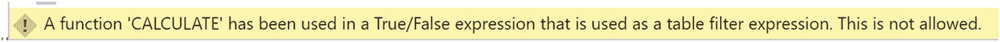
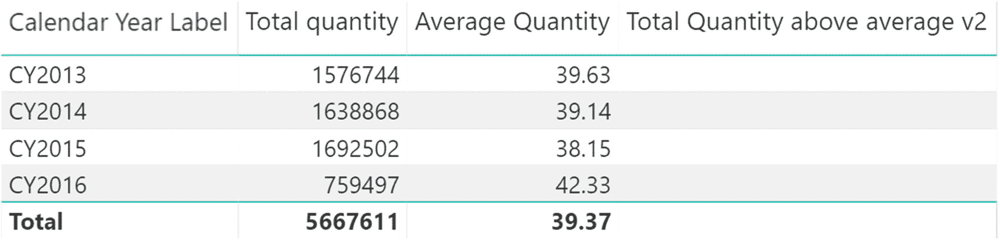
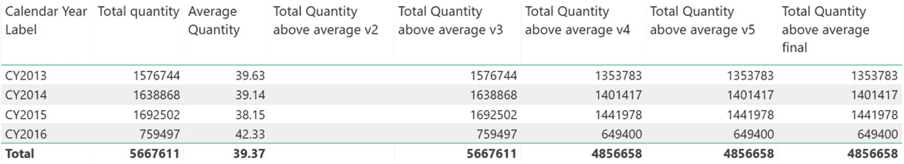
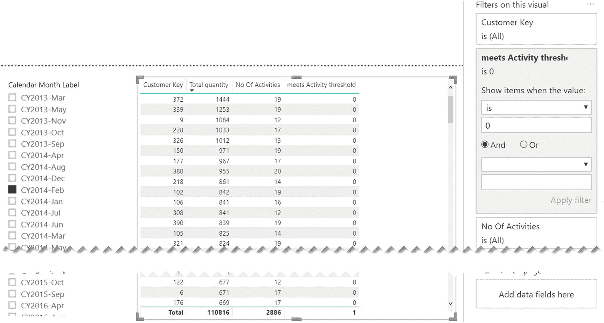
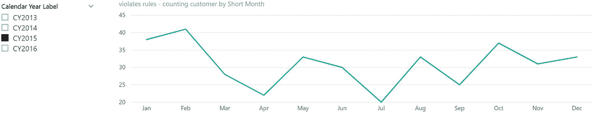
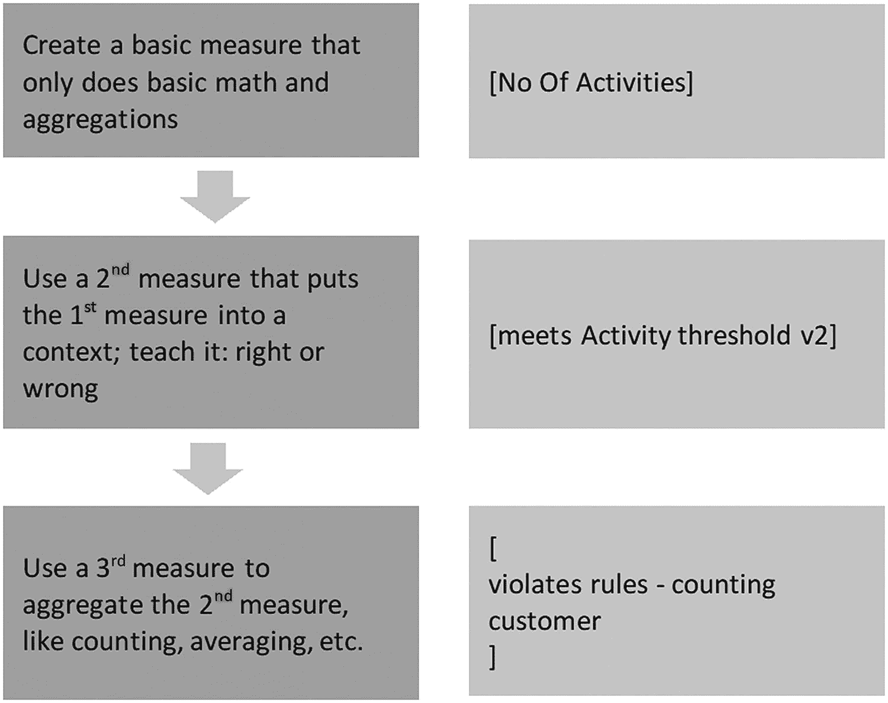

# 7. 使用度量值进行筛选

## 引言

This chapter will use a variety of techniques to showcase the possibilities of measures: measures are not only used for calculating numerical values but can also be extended to mark items that meet certain conditions, or worse, mark items that violate specific rules (i.e., rule breakers). These techniques range from simple filtering to more complex dynamic binning concepts. A use case for the latter is creating a visual (more precisely, a `ribbon chart`) to count the number of customers whose activity falls into specific bins.

**注意：** 本节内容将使用 Power BI 文件 "`CH7 – Filtering using measures.pbix`"。请注意，此文件应用了页面级筛选器，以避免显示 `Customer Key 0`，因为该键代表未知客户。

乍一看，专门为一个看似简单的“使用度量值进行筛选”主题留出一整章的篇幅，似乎是在浪费宝贵的空间；然而，事实证明事情往往并不像表面看起来那么简单。

本章的主题是筛选。行筛选是创建度量值的一个关键组成部分。创建一个度量值总是伴随着两个微妙之处：

*   **算法**：应用于筛选行的算法的复杂性。有时，底层的数学运算远比简单地将两个数字相乘要复杂得多。

*   **行筛选**：有时，确定一组特定的行比需要应用的算法更复杂。

本章关注后者：筛选值和/或行，特别是使用需要进行评估以确定是否应包含或排除特定值/行的度量值。

## 为何需要特别注意

除了第5章“DAX中的筛选”之外，本章还涵盖了一些额外的细微之处。每当在 `CALCULATE` 中使用度量值——不是作为第一个参数（数值表达式），而是作为最终用于创建筛选表的布尔表达式时——都必须记住这些细节。

**注意：** 本节内容引用了报表页面“意外结果”。

为了凸显这些微妙之处，我们假设定义了一个非常基础的度量值，用于计算平均数量。该度量值如代码清单 7-1 所示。

```
Average Quantity =
AVERAGE('Fact Sale'[Quantity])
代码清单 7-1
平均数量
```

上述度量值并无特别之处，只是一个起点。为此，我们需要让情况稍微复杂一些。因此，我们创建了度量值 `Total Quantity above average`。该度量值如代码清单 7-2 所示。

```
Total Quantity above average =
CALCULATE(
[Total quantity]
, 'Fact Sale'[Quantity] > [Average Quantity]
)
代码清单 7-2
高于平均值的总数量
```

不幸的是，此度量值无法创建，因为会触发图 7-1 所示的错误。



图 7-1：`CALCULATE` 无法在 TRUE/FALSE 表达式中使用

这是由于在筛选表达式内部引用度量值时必须考虑的一些限制。这些限制在 `CALCULATE` 函数的官方文档中已列出。该文档可在此处查阅：[https://docs.microsoft.com/en-us/dax/calculate-function-dax](https://docs.microsoft.com/en-us/dax/calculate-function-dax)

> 以下限制适用于用作参数的`布尔表达式`：
> - 表达式不能引用度量值。
> - 表达式不能使用嵌套的 `CALCULATE` 函数。
> - 表达式不能使用任何扫描表或返回表的函数，包括聚合函数。

考虑到这些限制，我们可能会想到一种重写度量值的方案，如代码清单 7-3 所示。

```
Total Quantity above average v2 =
CALCULATE(
[Total quantity]
,FILTER(
'Fact Sale'
, 'Fact Sale'[Quantity] > [Average Quantity]
)
)
代码清单 7-3
高于平均值的总数量 v2
```

但即使该度量值不会报错，其运行结果也并非预期。这个度量值不返回任何值，如图 7-2 所示。



图 7-2：度量值 `Total Quantity above average v2` —— 无返回值

尽管原因不明显，但解释很简单。`FILTER` 是一个表迭代函数，它为表中的每一行创建一个行上下文。由于度量值会隐式执行上下文转换，即将当前行上下文转换为筛选上下文，因此这个新的筛选上下文会被用来评估 `FILTER` 的条件。这直接意味着 `AVERAGE` 是针对每一行单独计算的；因此，条件永远不可能为 TRUE。表迭代器的每一行都会被忽略，导致列空白。如果将度量值 `Total Quantity above average v3` 拖到表格中，可以验证这一点；该度量值在条件中使用等号。需要注意的是，此时“总计”行的值才与 `Total Quantity` 列的值匹配。

为了使度量值按预期运行，有必要在表迭代之外评估度量值 `Average Quantity`。一种可能的解决方案如代码清单 7-4 所示。

```
Total Quantity above average v4 =
var theAverage = [Average Quantity]
return
CALCULATE(
[Total quantity]
,FILTER(
'Fact Sale'
, 'Fact Sale'[Quantity] > theAverage
)
)
代码清单 7-4
高于平均值的总数量 v4
```

上述代码清单显示，度量值`Average Quantity`的评估甚至在`CALCULATE`外部进行；平均值被存储在变量`theAverage`中。在数据模型内部，还定义了另一个度量值`Total Quantity above average v5`。该度量值将平均度量值的评估过程移近表迭代器，但仍在其外部进行评估。乍一看，在`CALCULATE`外部声明变量似乎很方便，但最佳实践是尽可能在使用变量的地方附近声明。当度量值开始变得复杂时，这一点尤其重要。

尽管如此，还应考虑尽可能保持筛选表较小，因为这样可以加快度量值的评估速度，即在度量值评估期间需要处理的数据更少。

为此，我们定义了最终的度量值`Total Quantity above average final`。请参阅代码清单 7-5。

```
Total Quantity above average final =
CALCULATE(
[Total quantity]
,
var theAverage = [Average Quantity]
return
FILTER(
ALL('Fact Sale'[Quantity])
, 'Fact Sale'[Quantity] > theAverage
)
)
```

代码清单 7-5
高于平均值的总数量（最终版）

该度量值使用了`DAX`函数`ALL`，它是可用于解除列上现有筛选器的`DAX`函数之一。

所有度量值及其结果如图 7-3 所示。



图 7-3
所有平均值度量值

## 提示

尽可能将变量放置在靠近其使用位置的地方，并保持筛选表尽可能小。

## 简单筛选

本章将从一个非常基础的用例开始：筛选（即查找）活动次数超过某个阈值的客户。

### 注意

本部分参考了报告页面“简单筛选”和“简单筛选 – 更复杂的情况”。

代码清单 7-6 展示了使用`DAX`函数`DISTINCTCOUNT`进行的度量计算。

```
活动数量 =
var 活动数量 = DISTINCTCOUNT('销售事实'[销售键])
return
IF(ISBLANK(活动数量),0,活动数量)
```

代码清单 7-6
活动数量

将度量计算和条件检查拆分为两个度量是一种良好的实践。

代码清单 7-7 展示了执行条件检查的度量，即判断某个值是否满足给定条件。

```
满足活动阈值 =
IF([活动数量] > 20 , 1 , 0)
```

代码清单 7-7
满足活动阈值

如果`活动数量`大于 20，度量`满足活动阈值`返回 1；否则返回 0。

图 7-4 展示了如何使用这两个度量来识别某个月内所有不满足阈值度量的客户。



图 7-4
不满足阈值的客户

上述筛选被认为是简单的。为了增加一点复杂性，我们对条件进行了修改。现在活动阈值定义如下：

如果以下条件不成立，则标记该客户：

- 如果`[总数量]`小于 1500，则`[活动数量]`必须小于 10。

为此，定义了第二个度量；参见代码清单 7-8。

```
满足活动阈值 v2 =
var 活动数量 = [活动数量]
var 总数量 = [总数量]
return
IF(
AND(
总数量 < 1500
, 活动数量 < 10
)
, 0 , 1 )
```

代码清单 7-8
满足活动阈值 v2

假设需要创建一个异常报告，重点分析不满足给定规则的客户，那么返回 1 会很有帮助，因为这些值将被汇总，从而返回违反规则的客户数量。这可以通过将度量嵌入到表迭代器函数`SUMX`中轻松实现，如代码清单 7-9 所示。

```
违反规则 - 客户计数 =
SUMX(
VALUES('维度客户'[客户键])
, IF([满足活动阈值 v2] = 0 , 1 , BLANK())
)
```

代码清单 7-9
违反规则 - 客户计数

图 7-5 展示了上述度量的应用。该截图取自报告页面“简单筛选”。



图 7-5
全年规则违反情况

需要注意的是，可以用以下模式来使用度量进行筛选（见图 7-6）。



图 7-6
基本模式

上述模式看似简单，但如果遵循这些步骤，有助于避免混淆。

## 警告

以上述方式重用度量可能会导致意外结果，因为度量会自动执行上下文转换，即将现有的行上下文转换为筛选上下文。