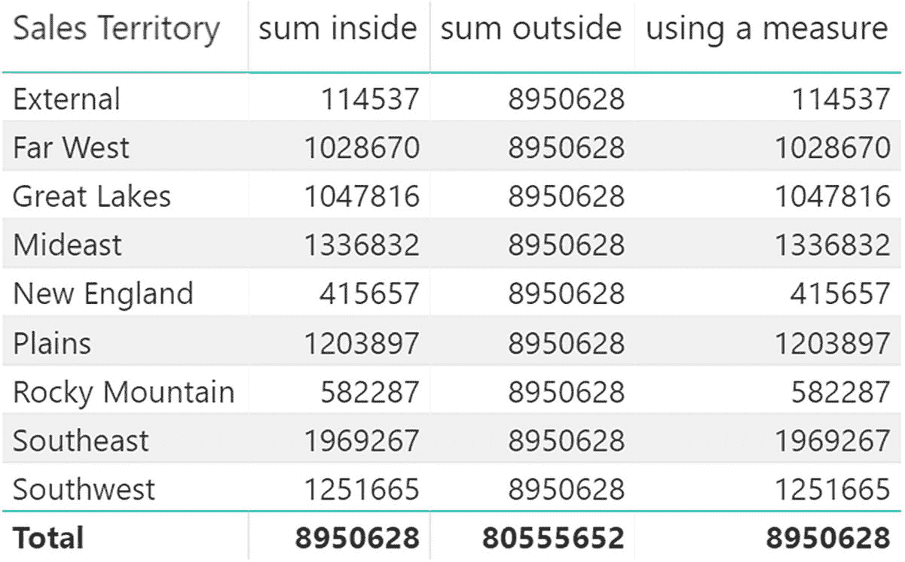
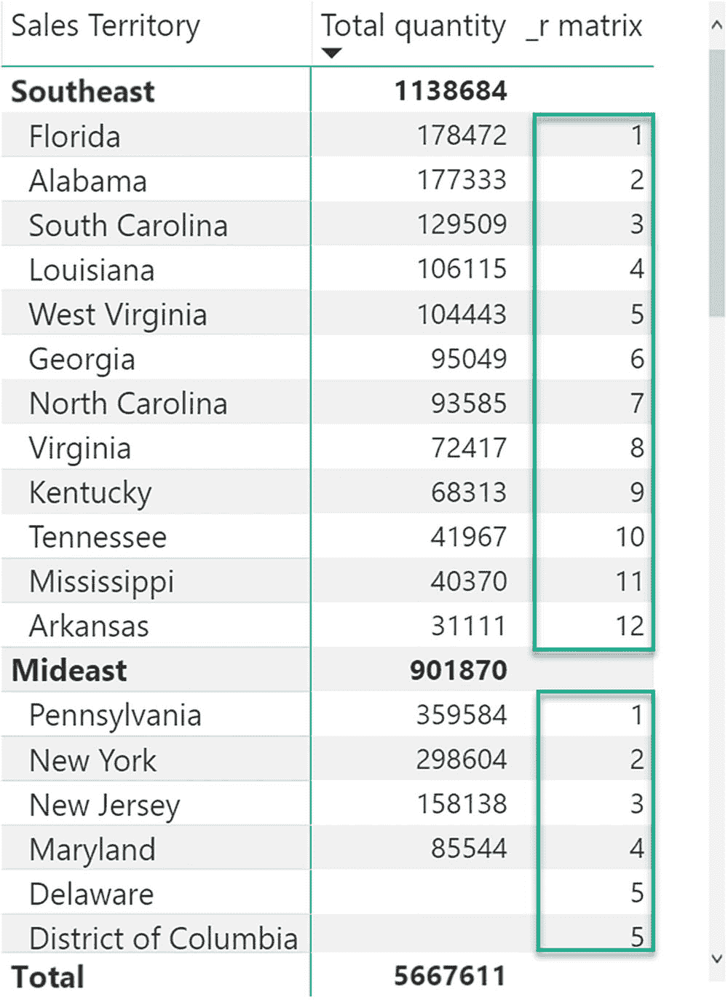
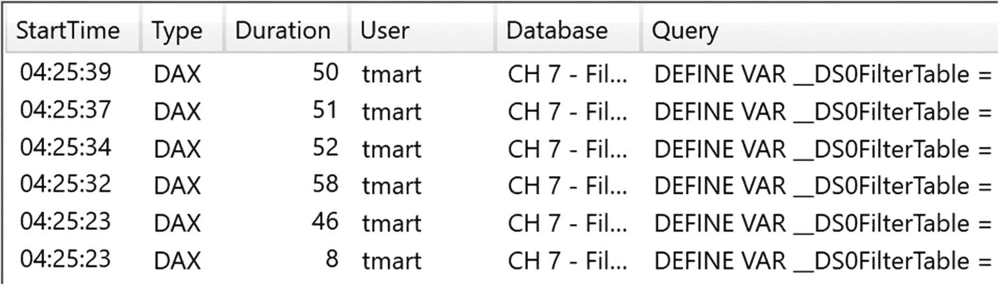
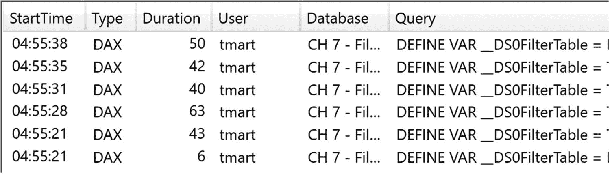
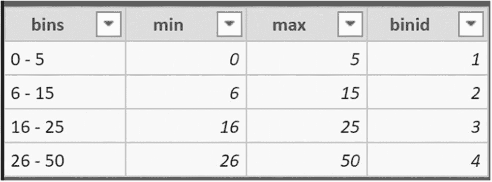
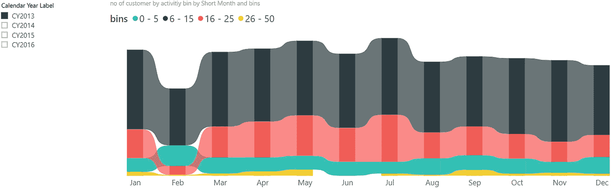
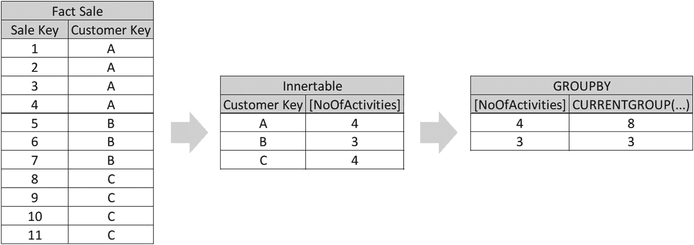

# 汇总表与度量

这一部分涉及在汇总表内部的使用，以及如何使用度量对这些表进行筛选。为此，需要先进行一些介绍。这个介绍基于一个假设：本节创建的所有汇总表稍后都将在度量内部使用。这意味着 PBIX 文件中使用的所有表仅用于演示目的。

在创建更复杂的 DAX 度量时，有许多理由表明创建汇总表变得很重要。以下是两个原因：

-   通过使迭代器尽可能紧凑（列和行尽可能少），加速表迭代器函数的执行。
-   创建与报表无关的表，用作计算的输入。

用于创建汇总表最熟悉的 DAX 函数是 `SUMMARIZE`；这很可能是因为它的可用性久。为此，我们将用一小节专门介绍 `SUMMARIZE`。

## 使用 SUMMARIZE

到目前为止，关于筛选上下文已经讲了很多。特别是，关于表迭代器函数是否执行上下文转换的讨论一直在进行。而且，关于 `SUMMARIZE` 的一般用法也讲了很多，但说实话，`SUMMARIZE` 仍然有其价值。这主要是因为出现了像 `GROUPBY` 或 `SUMMARIZECOLUMNS` 这样较新的函数。如果需要计算度量，`SUMMARIZECOLUMNS` 并不可用，即使这是一本关于 DAX 的书，我们假设大多数读者并不涉及查询编写。

#### 注意

本部分参考了报告页面“汇总表与度量”。

有一些理由说明应该只使用 `SUMMARIZE` 来汇总数据以创建汇总表。至于添加计算列，强烈建议使用以下模式来添加这些列：

```
ADDCOLUMMNS(
SUMMARIZECOLUMNS(
‘’
, 
, 
)
, "" , 
, “" , 
)
```

sqlbi.com 的优秀团队已经非常详细地描述了这个模式（文章链接：[`www.sqlbi.com/articles/best-practices-using-summarize-and-addcolumns/`](http://www.sqlbi.com/articles/best-practices-using-summarize-and-addcolumns/)）。

下面提及了一些不应被遗忘的值得注意的独特性。代码清单 7-10 展示了创建该表的 DAX 语句。

```
包含 Summarize 的表 =
ADDCOLUMNS(
SUMMARIZE(
'销售事实'
, '维度城市'[销售区域]
, "内部求和" , SUM('销售事实'[数量])
)
, "外部求和" , SUM('销售事实'[数量])
, "使用度量" , [总数量]
)
代码清单 7-10
包含 Summarize 的表
```

图 7-7 显示了上述 DAX 语句创建的表。



图 7-7  
使用 SUMMARIZE 的表

要准确理解发生了什么，有必要记住 `SUMMARIZE` 和 `ADDCOLUMNS` 这两个函数都被视为所谓的表迭代器函数。但与 `SUMMARIZE` 相反，`ADDCOLUMNS` 不执行上下文转换，并且不会从迭代的当前行创建筛选上下文。这就解释了为什么 `外部求和` 列中的所有行值都与“总计”行值匹配。由于没有筛选上下文，表迭代器中的所有行都被使用了。

当然，如果使用度量来计算`使用度量`列的列值，则不会出现这种效果。度量总是会执行上下文转换——将行上下文转换为筛选上下文。


### SUMMARIZE 与 GROUPBY 的对比

`GROUPBY` 是后期才被引入 DAX 的函数，因此使用频率并不高，至少在社区（即[`community.powerbi.com`](http://community.powerbi.com)）中并不常见。但这种忽视并不合理，原因如下：

- **性能** – 在某些场景下，`GROUPBY` 的执行速度比 `SUMMARIZE` 更快。当分组行数较少时尤其如此（当然，数据量大小的判定取决于诸多因素）。
- **高级分组** – `GROUPBY` 支持对“计算列”进行分组。这在复杂度量值中变得非常重要。

> **注意：** 本节内容涉及报表页面“嵌套排名”、“SUMMARIZE 组内排名”和“GROUPBY 组内排名”。

为了比较这两个函数的性能，我们定义了三个度量值。基础度量值 `_r` 如代码清单 7-11 所示。

```
_r =
RANKX(
    CALCULATETABLE(
        SUMMARIZE(
            'Fact Sale'
            , 'Dimension City'[Sales Territory]
            , 'Dimension City'[State Province]
        )
        , ALL('Dimension City'[State Province])
    )
    , [Total quantity]
    ,
    , DESC
)
```

*代码清单 7-11 `_r`*

由于 `RANKX` 本身并非最简单的函数，也不是最快的表迭代函数，此处用它来对底层数据模型施加一些压力。该度量值的作用是：在每个 `Sales Territory` 内，根据度量值 `Total Quantity` 对列 `State Province` 的相关值进行排名。图 7-8 展示了这一度量值。



由于本章主要讨论如何使用度量值对结果进行筛选，因此额外定义了两个度量值：

- `SUMX GroupBy Filtered`
- `SUMX Summarize Filtered`

两个度量值几乎完全相同，此处仅展示第一个的代码清单。见代码清单 7-12。

```
SUMX GroupBy Filtered =
SUMX(
    FILTER(
        ADDCOLUMNS(
            GROUPBY(
                'Fact Sale'
                , 'Dimension City'[Sales Territory]
                , 'Dimension City'[State Province]
            )
            , "q" , [Total quantity]
            , "r" , [_r]
        )
        , [r] <= 2
    )
    , [q]
)
```

*代码清单 7-12 `SUMX GroupBy Filtered`*

该度量值的工作原理很直接。首先使用 `GROUPBY` 构建一个汇总表，并通过排名度量值 `_r` 为表添加计算列。最后，为每个销售区域仅保留排名前两位的州。

与度量值 `SUMX GroupBy Filtered` 略有不同，第二个度量值 `SUMX Summarize Filtered` 使用 `SUMMARIZE` 函数来创建汇总表。

图 7-9 和 7-10 展示了性能测试的第五次迭代。每次迭代包含以下步骤：

- 打开已激活“空白页”报表页面的 pbix 文件。
- 启动 DAX Studio，连接到 pbix 文件，并激活“全部查询跟踪”。
- 切换到感兴趣的 Power BI 报表页面，即“SUMMARIZE 组内排名”或“GROUPBY 组内排名”。
- 依次选择可用的切片器值。
- 对另一个报表页面重复上述步骤。





两张图均显示，基于 `GROUPBY` 的筛选略占优势，但务必针对具体数据集测试 `SUMMARIZE` 和 `GROUPBY` 这两个函数。

### 数据分箱与 GROUPBY 的强大功能

关于动态分箱的论述已有很多，讨论也层出不穷，未来还会有更多。这意味着这不会是关于动态分箱的最后一篇文章。但由于使用了 `GROUPBY`，至少带来了一些新意。

分箱是指将数据归类到预定义的桶中。通常这些桶有下限和上限，本例也不例外。如果桶的大小选择得当，统计桶内的数据量能揭示深刻的洞察。请注意，本例中桶的大小选择并不明智。同样重要的是，聚合函数并不限于 `COUNT`。

> **注意：** 本节内容涉及报表页面“分箱”。

图 7-11 展示了根据 `Fact Sale` 表中列 `Sale Key` 的值分布创建的 `bins` 表内容。



图 7-12 展示了 `bins` 表、度量值和带状图（Ribbon Chart）的组合。



代码清单 7-13 展示了度量值 `binning using group by`。

```
binning using group by =
var abt =
GROUPBY(
    ADDCOLUMNS(
        VALUES('Fact Sale'[Customer Key])
        ,"NoOfActivities",[No Of Activities]
    )
    ,[NoOfActivities]
    ,"SumOf",SUMX(CURRENTGROUP(),[NoOfActivities])
)
return
SUMX(
    VALUES('bins')
    ,
    var binMin = 'bins'[min]
    var binMax =
        IF(
            NOT(ISBLANK('bins'[max]))
            ,'bins'[max]
            ,MAXX(abt,[NoOfActivities])
        )
    return
    SUMX(
        FILTER(
            abt
            ,[NoOfActivities] >= binMin && [NoOfActivities] <= binMax
        )
        ,[SumOf]
    )
)
```

*代码清单 7-13 `binning using GROUPBY`*

上述度量值分为两部分：第一部分创建分组，并将分组结果存入表变量 `abt`。第二部分将表映射到 `bins` 表。由于 `bins` 表与数据模型无关，这种映射必须动态完成。

第一部分 `GROUPBY` 同样使用了度量值 `No Of Activities`。为了更好地理解其运作原理，下面用一个简单的图表来解释第一部分复杂的内部机制。

图 7-13 展示了使用 `CURRENTGROUP` 的 `GROUPBY` 概念。



“内部表”仅由两列组成，一列是 `Customer Key`（请注意，该列来自表 `Fact Sale` 而非表 `Dimension Customer`）。通过 `ADDCOLUMNS` 添加度量值 `No Of Activities`。该度量值仅用于统计活动数量。这个表由大家熟悉的函数 `VALUES` 和 `ADDCOLUMNS` 创建。

当读者意识到 `GROUPBY` 部分实际上是对一个计算列进行汇总时，可能会感到一丝神奇。结合 `CURRENTGROUP` 函数（该函数可类比于 T-SQL 中 `OVER` 语句的 `PARTITION BY` 子句），几乎可以创建出一个包含多列的新表。遗憾的是，如果不采取进一步的措施，这个表目前无法直接用于可视化对象，因此需要将其映射到代表桶的无关表。

在第二部分中，`abt` 表被映射到 `bins` 表。这是通过嵌套表迭代实现的。第一层迭代遍历所有桶，第二层迭代根据桶的上限和下限，将已分组的 `abt` 表中的所有行映射到对应的桶中。


好的，作为一名高级文档工程师和翻译员，我将严格遵循您提供的注意事项和示例格式，将给定的英文文本翻译成中文。

译文如下：


