# 8. 使用 DAX 解决高级报表需求

## 引言

到目前为止，DAX 一直被用于计算度量值或计算列，旨在从数据模型中创建和提取见解。尽管这是使用 DAX 最显而易见的方面，但这并不是 DAX 唯一能发挥作用的地方。Power BI 是一个数据驱动的报表工具，使用户能够探索大量数据；Power BI 也是一个允许共享报表并与同事协作的工具。这就使得创建易于使用者操作的报表和仪表板变得很有必要。几乎可以强制要求，由其他用户构建的报表使用者或报表消费者，在访问报表时能够尽可能轻松快捷。这里的“访问”并非从技术角度而言，而是从可用性的角度出发。一旦业务分析师要分享其发现，他就必须确保报表的接收者能够完全专注于其主要任务——从底层数据中提取见解。除了创建度量值和计算列之外，DAX 还可以用于创建更具动态性的报表。

## 一些简单但不失强大的 DAX

#### 注意

在本节中，将使用 Power BI 文件“CH08 – unrelated tables.pbix”。

随着 Power BI Desktop 2019 年 4 月版本的发布，“可视化标题的条件格式”功能被引入。乍一看，这个功能似乎微不足道，但它极大地提升了报表的可读性，并有助于传达见解。

对于那些仅用于更改某些视觉对象格式属性的度量值来说，将它们与常规度量值分开是一个好主意。这种分离可以通过创建一个专用的度量值表来实现。由于从技术角度看，度量值独立于任何表，因此将“格式设置”度量值分配到一个专用表中似乎是一个明智的选择。

### 创建度量值表

可以通过从“开始”菜单中使用 `输入数据` 手动添加一个表来创建度量值表（见图 8-1）。

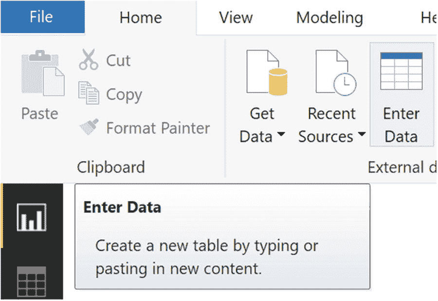

**图 8-1** – 创建度量值表 – 输入数据

由于在分配第一个度量值后，其内容将被删除，因此内容并不重要，如下一个屏幕截图所示（见图 8-2）。表的名称应谨慎选择，因为它将提供有关内容的信息。

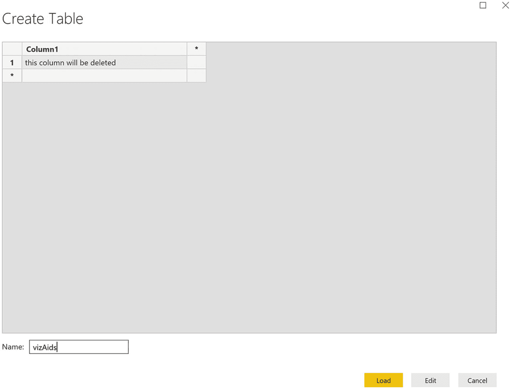

**图 8-2** – 创建度量值表 – 内容

为了完成度量值表的创建，我们使用清单 8-1 中的 DAX 语句创建一个非常简单的度量值。

```
vizAid chart title = "This is the title of a chart"
```

**清单 8-1** – 一个非常简单的度量值

图 8-3 显示了新创建的表 `vizAids` 的内容。

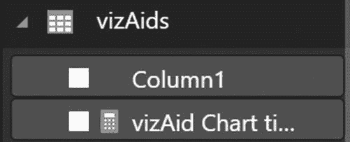

**图 8-3** – 创建度量值表 – 表的内容

创建度量值 `vizAid Report title` 后，可以从表中删除列 `Column1`。删除 `Column1` 后，需要保存、关闭并重新打开 Power BI 文件。

重新打开 `pbix` 文件后，字段列表看起来会有所不同（见图 8-4）。

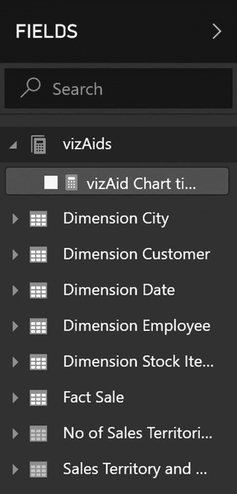

**图 8-4** – 创建度量值表 – 度量值表

需要注意，现在该表是字段列表中的第一个表，并且其图标也变成了度量值的图标。

#### 注意

不要将所有度量值都分配给一个专用的度量值表。问答功能依赖于度量值的表分配，因为这有助于简化与其他表之间关系的发现。将度量值分配到专用度量值表可能会影响问答体验。

### 使用度量值创建动态可视化标题

本章将解释如何将度量值用作报表页面“动态轴内容”上图表标题。

启用图表的标题（见图 8-5）。

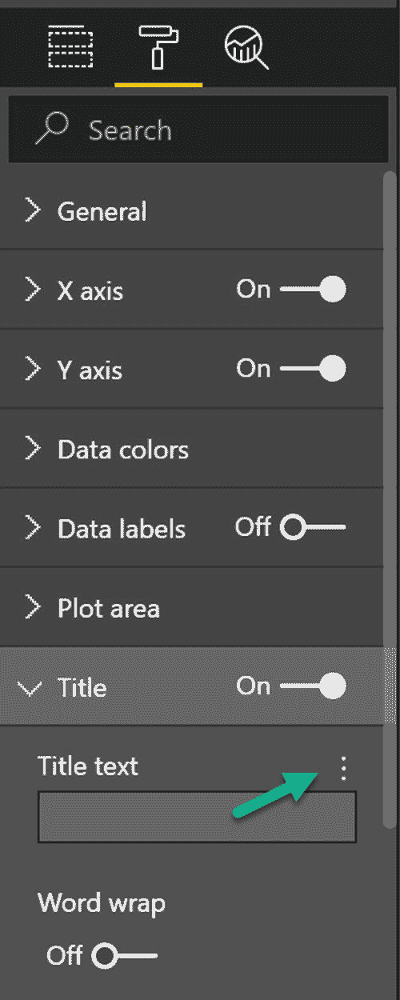

**图 8-5** – 使用格式设置度量值 – 标题

在“标题文本”属性旁边，当鼠标靠近时会出现一个省略号按钮。点击省略号按钮可以进入条件格式对话框（见图 8-6）。

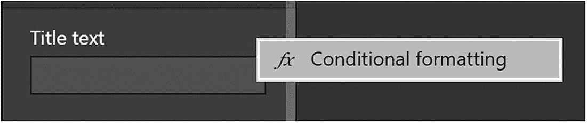

**图 8-6** – 使用格式设置度量值 – 条件格式

需要注意以下事实：基本上，视觉对象的所有属性都可以使用 DAX 进行更改。由于这里只是动态更改标题，因此只能选择一个选项。稍后我们会看到，根据要格式化的对象，可以使用更多选项。目前，只能使用度量值更改标题的文本。在后续阶段，很可能也可以使用 DAX 语句更改文本的其他属性。图 8-7 展示了如何通过选择“按字段值设置格式”选项来分配度量值。

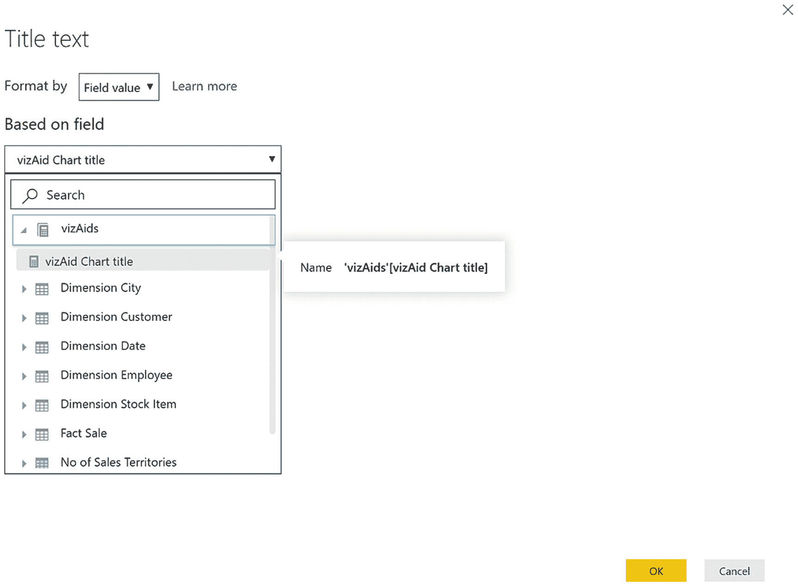

**图 8-7** – 使用格式设置度量值 – 标题文本

选择该度量值后，将为图表创建标题（见图 8-8）。

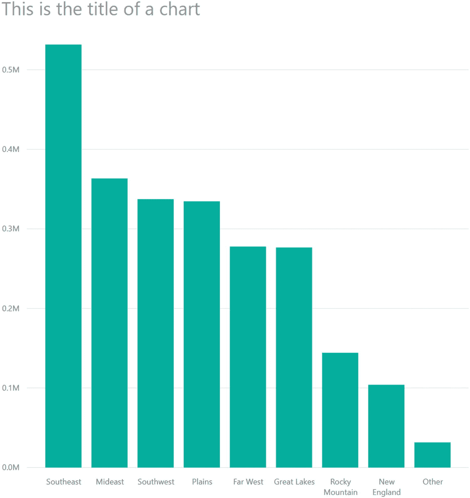

**图 8-8** – 使用格式设置度量值 – 基于度量值的标题

由于当前标题不是动态的，我们将使用另一个度量值，即 `vizAid Chart title dynamic`。该度量值如清单 8-2 所示。

```
vizAid Chart title dynamic =
var NoOfTopNSalesTeritory = [No of Sales Territories Value]
return
IF(NoOfTopNSalesTeritory = 1
,"Just the Top One Sales Territory is chosen"
,"The Top " & NoOfTopNSalesTeritory & " are chosen"
)
```

**清单 8-2** – 动态切片器标题

度量值 `vizAid Chart title dynamic` 创建了一个依赖于切片器选择参数值的度量值。这意味着可以组合一个动态标题，将其他度量值集成到标题文本中。


### 使用度量值更改填充颜色

图 8-8 所示的柱状图使用了调色板中的默认颜色。可以通过使用度量值来更改此颜色，这意味着可以用度量值来控制每一根柱子的颜色。代码清单 8-3 展示了用于控制填充颜色的度量值，以强调代表 x 轴上“其他”元素的柱子。

```
vizAid fill color =
IF(HASONEVALUE('Sales Territory and other'[Sales Territory])
,var theCurrentAxisValue = VALUES('Sales Territory and other'[Sales Territory])
return
IF(theCurrentAxisValue  "other", "darkgrey", "darkred")
,"darkgrey"
)
代码清单 8-3
填充颜色
```

该度量值的工作原理如下：

*   使用 DAX 函数 `HASONEVALUE`，检查列 `'Sales Territory and other'[Sales Territory]` 中是否仅选中了一个值。
*   如果 `HASONEVALUE` 返回 `FALSE`，表示当前筛选上下文中不存在该列的单个值。此时返回字符串 `"darkgrey"`。
*   如果 `HASONEVALUE` 返回 `TRUE`，表示当前筛选上下文中存在单个值。第二个 `IF` 函数会检查该单个值是否等于字符串 `other`。如果值等于 `other`，则返回字符串 `"darkred"`；否则，返回字符串 `"darkgrey"`。

图 8-9 展示了将度量值 `vizAid fill color` 应用于确定填充颜色后的图表。

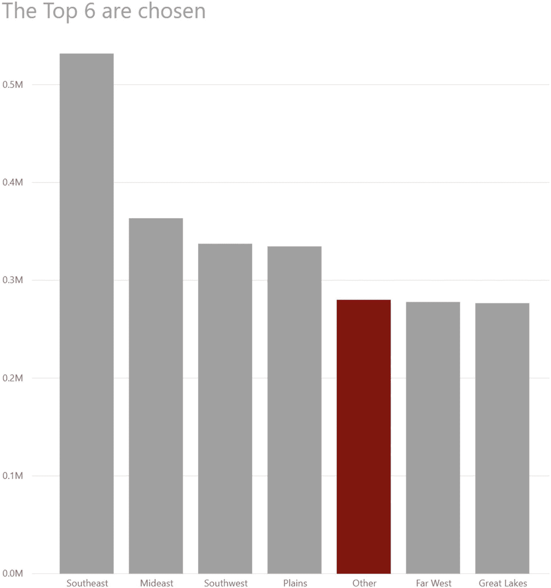

*图 8-9 使用格式化度量值 – 填充颜色*

## 非相关表

到目前为止，本书的每一章都探讨了使用 DAX 的某个特定方面——表迭代器、筛选等。但现在需要解决一个更复杂的任务。

#### 任务

将前 N 个销售区域（按数量计）以柱状图形式显示，此外，所有剩余的区域（不包含在前 N 个中的）需要合并归为“其他”。

要解决此任务，必须始终牢记以下基本原则。

### 规则

无法在图表轴上、或者行或列标题中可视化数据模型中不存在或已被筛选掉的值。

#### 注意

除非另有说明，本节内容均参考 Power BI 文件“CH08 – unrelated tables.pbix”中的“Using SUMX”报表页。

因此，我们必须分解上述任务并回答两个基本问题：

*   我们能否可视化想要可视化的内容？
*   我们能否创建一个有助于可视化所需内容的计算列？

这两个问题的答案都是简单的“不能”。

因此，需要跳出固有思维模式，“非相关表”的概念可能看起来很晦涩，尤其是回想起第 2 章“数据建模”的内容。但是，一旦这个概念变得自然，非相关表就能为更多的任务提供无数的解决方案。

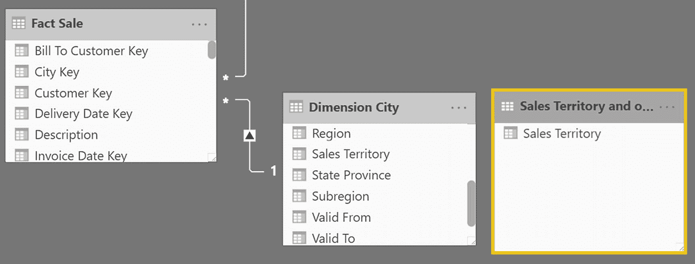

*图 8-10 非相关表*

图 8-10 展示了非相关表 `Sales Territory and other – unrelated`。在图表轴上或作为行或列标题使用此表，可以可视化数据模型中不存在或通过选择筛选器内的值而被筛选掉的元素。

代码清单 8-4 展示了如何使用 DAX 创建该表。

```
Sales Territory and other - unrelated =
UNION(
DISTINCT('Dimension City'[Sales Territory])
,ROW("Sales Territory","Other")
)
代码清单 8-4
非相关表
```

现在可以使用此表来可视化一个名为 `Other` 的成员。不幸的是，解决第一个问题“我们能否可视化想要可视化的内容？”是有代价的。由于此表与数据模型中的任何其他表都没有关联，因此需要映射匹配的值。这种匹配必须完成将 `Dimension City` 表中 `Sales Territory` 列的值映射到非相关表中相应成员的任务。使用 `Fact Sale` 表中的 `Quantity` 列无法产生我们想要的结果。图 8-11 展示了非相关表与 `Quantity` 列结合使用时会出现的状况。

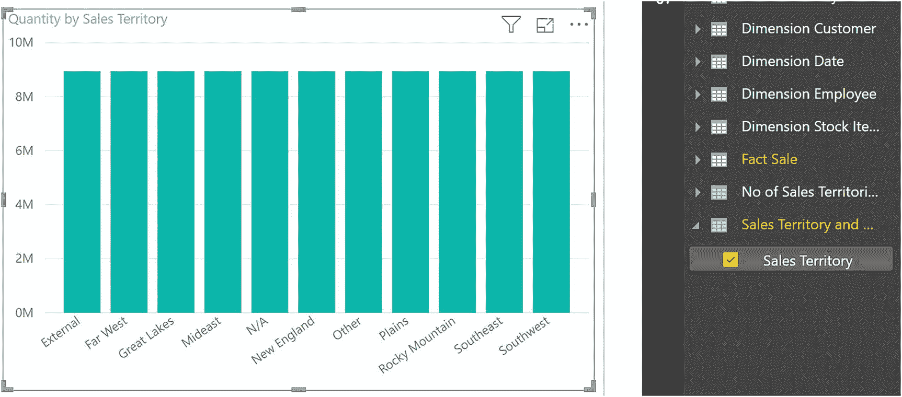

*图 8-11 非相关表 – 非预期结果*

由于 x 轴上使用的列来自非相关表，所有值都相同。

为了克服这个问题，可以使用像 `SUMX` 这样的迭代器函数。第 6 章“迭代器”已经解释并演示了迭代器函数的工作原理——创建一个度量值，该度量值遍历包含非相关表的 `Sales Territory` 列值的表。代码清单 8-5 定义了将 `Quantity` 值映射到非相关表中相应 `Sales Territory` 的度量值。

```
_simple mapping to the unrelated table =
SUMX(
VALUES('Sales Territory and other - unrelated'[Sales Territory])
,
var SalesTerritoryFromUnrelated = 'Sales Territory and other - unrelated'[Sales Territory]
return
CALCULATE(SUM('Fact Sale'[Quantity]), 'Dimension City'[Sales Territory] = SalesTerritoryFromUnrelated)
)
代码清单 8-5
简单映射到非相关表
```

图 8-12 显示了上文提到的图表，但此时也使用了代码清单 8-6 中的度量值。

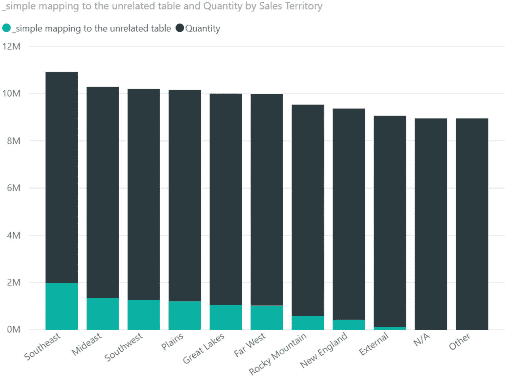

*图 8-12 非相关表 – 简单映射*

图 8-12 显示相应的值已被映射。映射的工作原理如下：

*   遍历表参数中的每一行。为此，需要使用 `VALUES` 函数，因为它返回当前筛选上下文中被引用列的一个表。由于轴值本身创建了一个筛选上下文，因此该表仅包含一行。
*   通过使用非相关的销售区域值作为 `Dimension City` 表的筛选器来计算 `Quantity` 值。


#### 注意

务必注意，由于 `SUMX` 与 `VALUES` 配合使用，计算得出的 `Quantity` 仅是映射结果，并未对多个销售区域进行本质上的求和。这是因为每个 `VALUES` 返回的表仅包含单行数据。

图 8-12 不幸地揭示了最终解决方案必须考虑的三个额外方面：

*   即使事实表中不存在值，坐标轴值依然会显示为“无”。
*   坐标轴值“其他”将会消失，因为该值在“城市维度”表中找不到对应的值。
*   由于迭代遍及不相关表的所有列值，最终解决方案必须考虑到并非所有销售区域都存在于当前筛选上下文中。

因此，在度量值 `_dynamic content SUMX` 中定义的最终解决方案是一个更复杂的 DAX 度量值。图 8-13 展示了包含预期结果的柱形图。

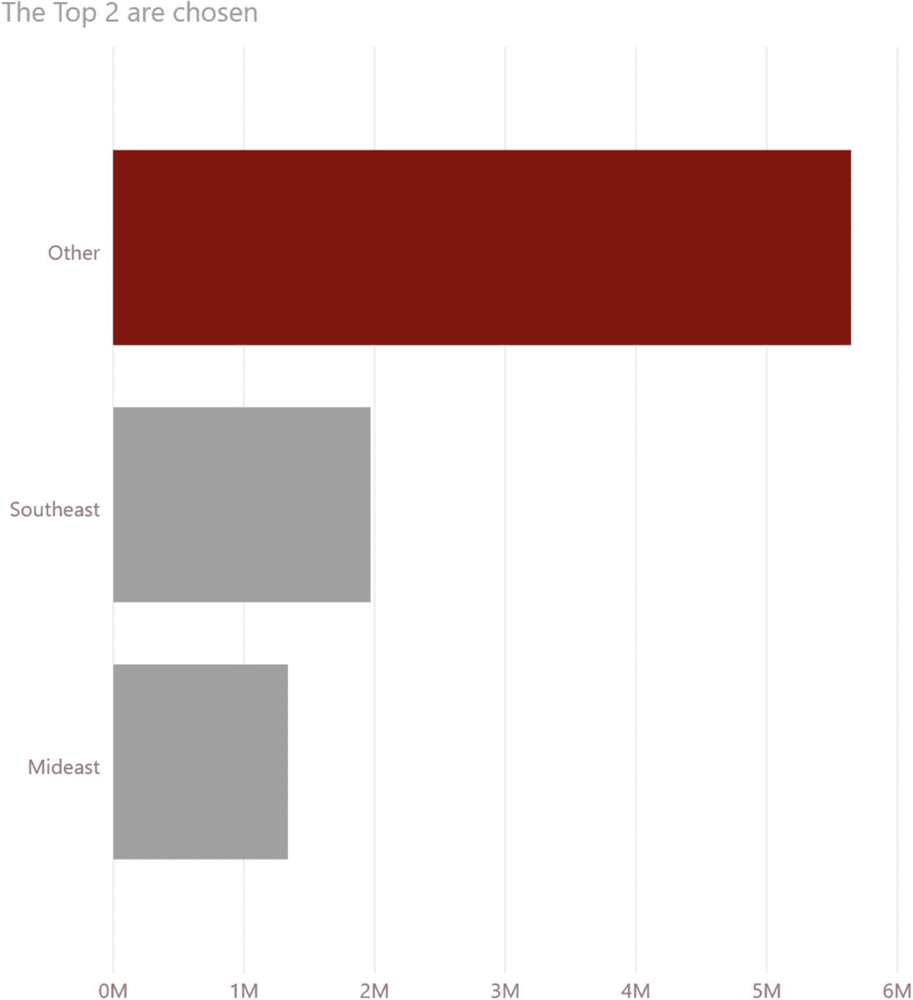

**图 8-13**  
预期结果

该度量值的定义如代码清单 8-7 所示。本章的其余部分将更详细地解释各个部分。

由于该度量值依赖于一个使用了迭代函数 `RANX` 的度量值，因此该度量值将在代码清单 8-6 中展示。

```
_dynamic content SUMX =
var NoOfParameter = [No of Sales Territories Value]
var SelectedSalesTerritories = VALUES('Dimension City'[Sales Territory])
var tableWithRank =
FILTER(
ADDCOLUMNS(
SelectedSalesTerritories
,"rank",[_Rank]
)
,[rank]  "Other"
, CALCULATE([Total Quantity], 'Dimension City'[Sales Territory] = thisCategory)
, measureValueOther
)
)
return
SUMX(
FILTER(
tableToIterate
,'Sales Territory and other - unrelated'[Sales Territory] in VALUES('Sales Territory and other - unrelated'[Sales Territory])
)
,[theValue]
)
```

**代码清单 8-7**  
最终解决方案 – 使用 `SUMX`

```
_Rank =
RANKX(
ALLSELECTED('Dimension City'[Sales Territory])
, CALCULATE([Total Quantity])
,
, DESC
)
```

**代码清单 8-6**  
最终解决方案 – 排名

### 变量定义

```
var NoOfParameter = [No of Sales Territories Value]
```

这行代码非常简单。它将度量值 `[No of Sales Territories Value]` 的值存储起来。该值代表参数切片器的值，用于筛选一个表，使其仅包含与报表页用户选择的“前 N 项”相对应的销售区域。

### 变量定义

```
var SelectedSalesTerritories = VALUES('Dimension City'[Sales Territory])
```

这行代码也非常简单，但却极其重要。这行代码考虑了已经筛选过的销售区域。将 `VALUES` 与来自事实表相关表的 `Sales Territory` 列引用一起使用，可以确保只考虑当前筛选上下文内的销售区域。如果你从可用的切片器“州省”或“销售区域”中进行不同选择，这一点就显而易见。这两个切片器都使用了相关表中的列。图 8-14 展示了在当前筛选上下文中，筛选后的销售区域是如何被考虑的。

#### 注意

你必须意识到，“州省”切片器仅用于“减少”可用的销售区域。其值的影响未被考虑。

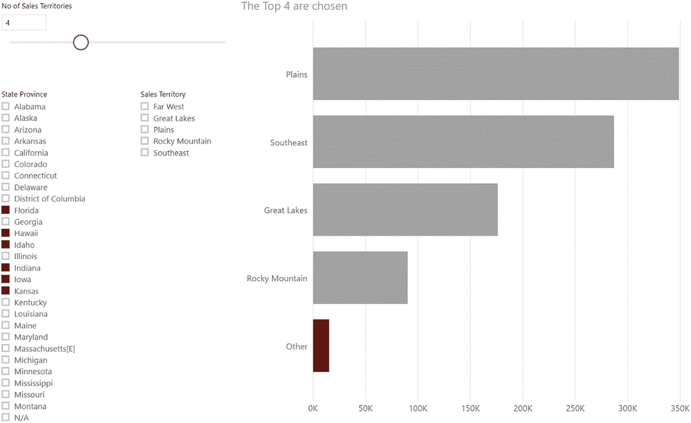

**图 8-14**  
不相关表 – 筛选后的销售区域

### 变量定义

```
var tableWithRank =
FILTER(
ADDCOLUMNS(
SelectedSalesTerritories
,"rank",[_Rank]
)
,[rank] <= NoOfParameter
)
```

将需要被视为“前 N 项”的销售区域存储到一个专用表变量中，其排名小于或等于所选参数值。由于 `ADDCOLUMNS` 是表迭代函数之一，它可以用于通过度量值 `_Rank` 为销售区域分配排名。生成的表根据参数值进行筛选。此时，存储到变量 `tableWithRank` 中的表包含两列：

*   `Sales Territory` – 到原始表 `Dimension City` 的数据沿袭仍然存在。
*   `rank` – 基于度量值 `[_rank]` 的列，允许按参数值进行筛选。

### 变量定义

```
var topNTable =
SELECTCOLUMNS(tableWithRank,"axisvalue",[Sales Territory])
```

将需要被考虑的销售区域存储到一个单独的表中。此表现在只包含一列，但到原始列的数据沿袭并未中断。

### 变量定义

```
var tableOther = EXCEPT(DISTINCT(SelectedSalesTerritories), topNTable)
```

提取出已被选中但不满足“前 N 项”阈值的销售区域，并将它们存储到一个专用变量中。

### 变量定义

```
var measureValueOther = CALCULATE([Total Quantity],tableOther)
```

存储“其他”销售区域的值。在计算 `Quantity` 之前，使用表变量 `tableOther` 应用筛选条件。

### 变量定义

```
var tableToIterate =
ADDCOLUMNS(
UNION(
INTERSECT(DISTINCT('Sales Territory and other - unrelated'),topNTable)
,ROW("axisvalue","Other")
)
,"theValue"
,var thisCategory = [Sales Territory]
return
IF(thisCategory  "Other"
,CALCULATE([Total Quantity], 'Dimension City'[Sales Territory] = thisCategory)
,measureValueOther
)
)
```

存储将要在 `SUMX` 函数中使用的表。使用 `INTERSECT` 创建一个仅包含存在于表变量 `topNTable` 中的销售区域的表。该表与使用 DAX 函数 `ROW` 创建的单行表合并。两个表 `topNTable` 和这个单行表通过 `UNION` 函数合并。此表现在引用了不相关表。

`Quantity` 将通过使用当前行值（`Sales Territory` 列）作为对相关 `Dimension City` 表的筛选条件来计算并存储在 `theValue` 列中，但这次该表仅包含与原始筛选上下文中可用的销售区域相对应的销售区域。仅当销售区域的值不等于 `Other` 时才会进行此计算。如果值等于 `Other`，则使用之前存储的值（变量 `measureValueOther`）。

最后，以下几行代码：

```
SUMX(
FILTER(tableToIterate
,'Sales Territory and other - unrelated'[Sales Territory] in VALUES('Sales Territory and other - unrelated'[Sales Territory]))
,[theValue]
)
```

遍历由 `FILTER` 语句返回的表。基本上，`SUMX` 被用来遍历一个表以映射一个值。这类似于代码清单 8-5 中演示的映射。为了避免最终表中存在的所有行对柱形图坐标轴上使用的所有值进行求和，使用了 `FILTER` 函数，而来自视觉对象的筛选条件（隐式筛选条件）通过使用 `VALUES` 函数被“注入”到公式中。`FILTER` 函数确保被遍历的表仅包含单行数据。


### 使用工具提示对“其他”成员进行排序

根据作为 Top N 条件提供的数值，代表剩余销售区域的动态计算值“其他”成员会出现在顶部、中间或底部。这完全取决于参数值所选定的销售区域数量。这种行为可能正是报表用户所期望的。但也可能存在一种情况，即代表“其他”的坐标轴值必须始终出现在条形图的底部。

这可以通过定义一个简单的度量值来实现（与上一个相比更为简单）。度量值 `vizAid sort rank` 用于确保坐标轴值“其他”始终出现在图表底部。清单 8-8 展示了该度量值的 DAX 语句。

```
vizAid sort rank =
var NoOfParameter = [No of Sales Territories Value]
var tableSelectedSalesTerritories = VALUES('Dimension City'[Sales Territory])
var tableWithRanks =
FILTER(
ADDCOLUMNS(
tableSelectedSalesTerritories
,"rank",[_Rank]
)
,[rank]  NoOfParameter, NoOfParameter + 1, BLANK()))
)
return
sumx(
FILTER(
TableToSort
,[axis] in VALUES('Sales Territory and other - unrelated'[Sales Territory])
)
,[rank]
)
清单 8-8
最终解决方案 – 排序
```

清单 8-8 中的大部分 DAX 代码已经解释过。因此，这里仅提供一个简短的总结：

-   将 Top N 参数值存储到一个变量中。
-   存储当前筛选上下文中存在的已选销售区域。
-   将 Top N 销售区域存储到一个表中。
-   通过使用 `UNION(…, ROW(…))` 创建一个包含“其他”坐标轴行的表。为确保坐标轴值“其他”始终显示在底部，将变量 `NoOfParameter` 的值加一。
-   将筛选后的表映射到对应的坐标轴值。

基本上，定义度量值本身并不困难，困难的是应用该度量值以实现对条形图的正确排序。因此，我们必须知道，坐标轴值的排序也可以由用作工具提示的度量值来控制。图 8-15 展示了如何配置排序。

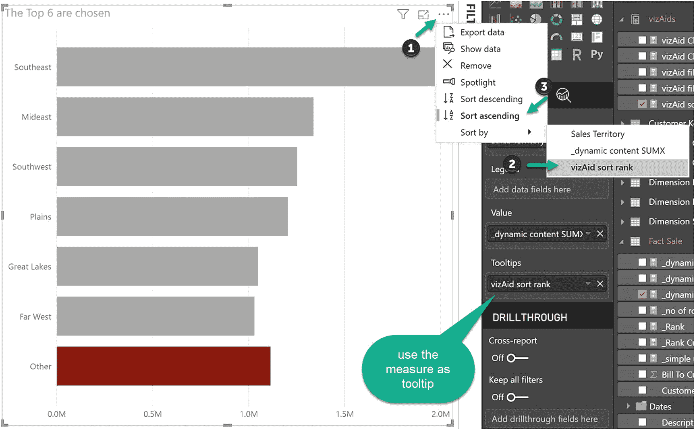

**图 8-15** – 非相关表 – 通过工具提示排序

该度量值必须分配给条形图的工具提示。然后，需要相应地配置视觉对象的排序选项。

### 使用切片器进行动态度量值选择

除了将剩余列值动态分组到名为“其他”的坐标轴值之外，另一个非常常见的需求是使用切片器选择来应用度量值。

#### 任务

创建一个报表页面，该页面提供一个下拉菜单，用于选择度量值，该度量值将应用于报表页面上的所有视觉对象。

上述任务的实现将在报表页面“USING SUMX – final”中进行演示。

### 说明

本节内容参考了 Power BI 文件“CH08 – unrelated tables.pbix”中的报表页面“Using SUMX – final”。

与上一章中使用的包含销售区域的非相关表类似，此解决方案从创建一个非相关表开始。这次，该表仅包含用户可选择的度量值（参见清单 8-9）。

```
Measure Table =
UNION(
ROW("Slicer" , "Profit")
, ROW("Slicer" , "Quantity")
)
清单 8-9
非相关度量值表
```

除了非相关表，还需要创建一个度量值。该度量值的定义如清单 8-10 所示。

```
Measure Table SelectedValue =
var theSelectedMeasure = SELECTEDVALUE('Measure Table'[Slicer], "Default")
return
SWITCH(theSelectedMeasure
, "Profit" , [Total Profit]
, "Quantity" , [Total Quantity]
, [Total Quantity]
)
清单 8-10
选中的度量值
```

根据从切片器中选择的值，度量值将相应地计算。如果从切片器中未选择任何值或选择了多个值，则计算默认使用度量值 `Total Quantity`。

由于度量值 `_dynamic content SUMX` 使用排名度量值 `_Rank` 来相应地选择销售区域，因此也有必要调整现有的度量值。为了进行比较，定义了第二个排名度量值。清单 8-11 展示了该度量值的定义。

```
_Rank final =
RANKX(
ALLSELECTED('Dimension City'[Sales Territory])
, CALCULATE([Measure Table SelectedValue])
,
, DESC
)
清单 8-11
最终解决方案 – Rank final
```

度量值 `_Rank final` 引用了度量值 `Measure Table Selected Value`。此引用确保从切片器选择的度量值将在当前筛选上下文中进行计算。

### 说明

实际上，切片器选择并非真正“选择”了一个度量值；而是度量值“响应”了切片器的选择。

上述度量值（清单 8-10 和 8-11）被用于清单 8-12 所示的度量值 `_dynamic content SUMX final` 中。由于该度量值基本上是前面已详细解释过的度量值的副本，因此此处仅突出显示使用上述度量值的行。

```
_dynamic content SUMX final =
var NoOfParameter = [No of Sales Territories Value]
var SelectedSalesTerritories = VALUES('Dimension City'[Sales Territory])
var tableWithRank =
FILTER(
ADDCOLUMNS(
SelectedSalesTerritories
, "rank",[_Rank final]
)
, [rank]  "Other"
, CALCULATE([Measure Table SelectedValue] , 'Dimension City'[Sales Territory] = thisCategory)
, measureValueOther
)
)
return
SUMX(
FILTER(
tableToIterate
, 'Sales Territory and other - unrelated'[Sales Territory] in VALUES('Sales Territory and other - unrelated'[Sales Territory])
)
, [theValue]
)
清单 8-12
最终解决方案 – 最终度量值
```

### 警告

我们必须始终牢记，每个有助于使报表更易于用户使用的功能都是有代价的，那就是**性能**！因此，我们必须谨慎地实现这些功能。

## 颜色：使用颜色强调数据的含义

微软已宣布 DAX 可用于操作视觉对象的每个属性。通过使用 DAX 更改视觉对象属性的能力，将为报表设计增添巨大威力。这很简单，因为视觉属性有助于强调报表的内容。由于该功能的实现将跨越几个 Power BI Desktop 版本，因此这里无法涵盖所有可能性。部分视觉属性已在之前的章节中使用过。因此，本章仅专注于实现一个热力图，该热力图允许为特定产品使用自定义颜色。相关公告可在此处找到：[`https://docs.microsoft.com/en-us/business-applications-release-notes/April19/business-intelligence/power-bi-desktop/expression-based-formatting`](https://docs.microsoft.com/en-us/business-applications-release-notes/April19/business-intelligence/power-bi-desktop/expression-based-formatting).

### 说明

在本节中，将使用 Power BI 文件“CH08 – color gradients.pbix”。

#### 任务

创建一个表格热力图，为每个产品使用配置的颜色；如果未配置颜色，则使用默认颜色。颜色必须在渐变刻度上可视化，其中较高的百分比值将导致较深的颜色，意味着值 100% 将显示配置的产品颜色。


### 成果：DIY 热力图（更复杂的热力图）

本章将介绍一些关于色彩理论、将十六进制值转换为 RGB 值（以及反向转换）的内容，同时也会涉及一些 DAX。本章会从成果入手，揭示结合使用 Power BI 和 DAX 能实现什么。图 8-15 将展示热力图的第一印象。

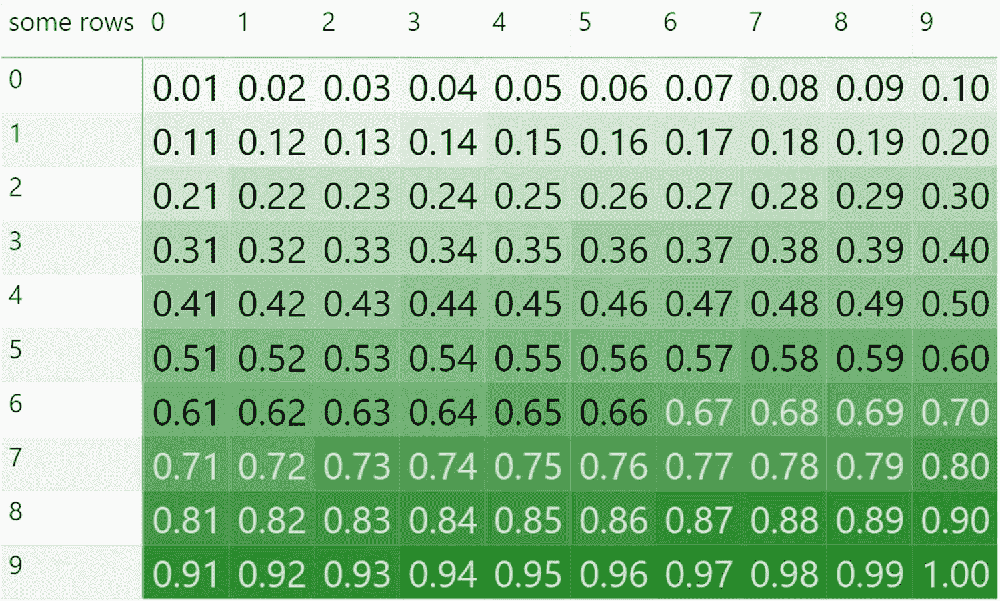

**图 8-16** 颜色渐变——第一印象

很可能（非常非常有可能）图 8-16 展示的只是一个带有不同灰度阴影的图表。只需打开 pbix 文件 `CH08 – color gradient.pbix`，选择报表页 `Matrix visual`，然后从切片器中选择一个产品即可。

#### 注意
所用数据模型可能不符合您对数据模型的期望。请将此 pbix 文件视为开发热力图的一个草图本。在后续章节中，将详细解释每个表。

注意：后续所有章节都将使用 `factored color background` 度量中的代码行。

### 色彩理论简介

由于本书是关于 DAX 的，而非色彩理论，因此仅用到了最少量的必要信息。

#### 十六进制颜色与 RGB

通常，颜色信息使用十六进制值编码，例如，十六进制代码 `#b34529` 编码了一种红褐色等。要开始使用颜色，有许多在线资源可用，例如 [`www.w3schools.com/colors/colors_picker.asp`](http://www.w3schools.com/colors/colors_picker.asp)。

请注意，如果缺乏信息设计经验，上述网站并不能帮助你创建出色的报表。不过，了解前述十六进制代码中每两个字符代表 RGB 色轮中的一种颜色，这一点很有用：

- `B3` ➔ R(红) ➔ R: 179
- `45` ➔ G(绿) ➔ G: 69
- `29` ➔ B(蓝) ➔ B: 49

以下 DAX 语句行展示了如何将给定的十六进制代码转换为 RGB 分量：

```
var startcolor = --"#f45f42"
IF(HASONEVALUE('Dimension Product'[Dim Product])
,FIRSTNONBLANK('Dimension Product'[Report Color],0)
,"#808080"
)
var thepercentagevalue = CALCULATE([simple measure])
var startR = mid(startcolor, 2,2)
var startG = mid(startcolor, 4,2)
var startB = mid(startcolor, 6,2)
var resultR =
var poweroneStartR = LOOKUPVALUE('hex2dec'[dec],hex2dec[hex],left(startR,1))
var powerzeroStartR = LOOKUPVALUE('hex2dec'[dec],hex2dec[hex],right(startR,1))
var intStartR = poweroneStartR * POWER(16,1) + powerzeroStartR * power(16, 0)
return intStartR
```

上述代码行执行的操作如下：

1. 获取为给定产品配置的颜色。如果未配置颜色或未筛选产品，则使用默认颜色 `#808080`。
2. R(红)部分被存储到变量 `startR` 中……
3. 计算整数值并存储到变量 `resultR` 中。为了计算整数值，使用 `hex2dec` 表来查找由十六进制值 0-9 和 A-F 解码出的整数值。

步骤 2 对 G 和 B 部分重复执行。
步骤 3 对 G 和 B 部分重复执行，即使在前面的 DAX 代码行中只显示了 R(红)部分也是如此。

图 8-17 展示了 `Dimension Product` 表的内容。

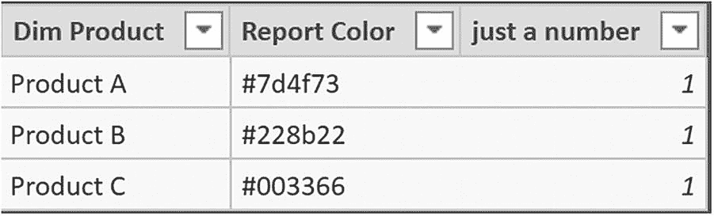

**图 8-17** 颜色渐变—— `Dimension Product` 表

`Dimension Product` 表的内容是通过使用 `输入数据` 功能创建的。这使得你可以使用企业标识中的默认颜色轻松测试热力图。只需打开 Power Query，选择 `Dimension Product` 表，点击齿轮图标，然后更改颜色即可。请使用 `#` 作为第一个字符，并确保输入的是有效颜色（`#zzzzzzz` 不是有效颜色）。图 8-18 展示了如何调整已配置的产品颜色。

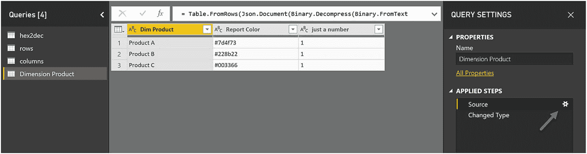

**图 8-18** 颜色渐变——更改产品颜色

#### 颜色分解

颜色分解对于创建基色（即从 `Dimension Product` 表中获取的颜色）的渐变色是必要的。以下代码行展示了 R(红)部分的实现过程：

```
var factoredColorR =
var factorizedR = ROUND((resultR - 255) * thepercentagevalue + 255,0)
var intR = factorizedR
var divR = intR/16
var hexPowerR1 = LOOKUPVALUE('hex2dec'[hex],hex2dec[dec],TRUNC(divR))
var hexPowerR0 = LOOKUPVALUE('hex2dec'[hex],hex2dec[dec],round((divR-TRUNC(divR)),0))
return CONCATENATE(hexPowerR1,hexPowerR0)
```

上述算法源自维基百科文章 [`www.rapidtables.com/convert/color/rgb-to-hsl.html`](http://www.rapidtables.com/convert/color/rgb-to-hsl.html)（提供理论基础）和文章 [`www.rapidtables.com/convert/color/rgb-to-hsl.html`](http://www.rapidtables.com/convert/color/rgb-to-hsl.html)（更侧重于实践）。

最后，使用下面这行简单的代码将三个变量拼接在一起：

```
"#" & factoredColorR & factoredColorG & factoredColorB
```

度量 `thepercentagevalue` 被传递给此度量，并根据 `thepercentagevalue` 的值来“分解”基色。

## 结语

本章要展示的是：DAX 可以用来开发甚至很复杂的算法。与 `Quantity * Price` 的计算相比，颜色分解是一个复杂得多的算法。

此外，表、列和行在复杂算法的开发以及 DAX 语句的扩展/测试中，将发挥更重要的作用。关于这些表的更详细用法，请参见第 14 章“扩展您的模型”。

