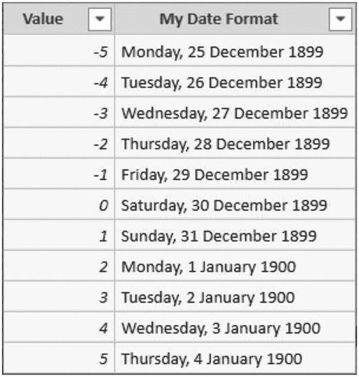

# 9. 时间智能


## 引言

早在 1582 年，教皇格里高利十三世引入格里高利历法以更新之前使用的儒略历时，他心中可并没有考虑商业智能报告。这套古怪的历法仍然包含：

- 天数不等的月份——28、29、30 和 31 天
- 与历法年份或月份不对齐的 7 天星期模式
- 闰年

新历法的主要目的是阻止复活节每年偏离春分时间，而非通过将日期对齐成易于比较的区块，来提供一种简洁统一的归类方法。

新系统改变了闰年的计算方式。从每四年在二月增加一天，变为仅当年份能被四整除时才增加额外一天，除非该年份也能被 100 整除——但如果该年份还能被 400 整除，则无论前条规则如何，仍然增加一天。这听起来合理且容易记住吗？我敢肯定，这套系统是由某个拥有*项目经理*头衔的人设计的。

这套历法并未受到普遍欢迎。1752 年在英国，街头挤满了抗议新历法的暴乱者。一些历史学家认为，暴乱者是清教徒，他们将这套历法视为天主教的阴谋，但我怀疑这更多是因为他们预见到，这套历法将对后代的数据建模者造成怎样的混乱。

当然，一个更为合理的解决方案是引入一套基于 10 天一周的十进制系统，一年定为 100 天（或 10 周）。预期寿命将在一夜之间增长三倍以上，这是任何医学突破（如疫苗的发现或卫生条件的改善）在漫长历史中都难以企及的高度。

此外，一旦人类停止纷争，集中精力掌握真正的太空旅行和探索，*Seamark 历法*（十进制）的出现就不可避免了。像月份和季度这样令人困惑的结构，在这套大幅改进的历法中将没有立足之地。

在那之前，我们只能凑合着使用充满古怪之处的格里高利历法。为了让数据建模和使用`DAX`的工作更轻松，该语言提供了一系列函数，帮助以某种合理组织现代历法的方式，对天数进行组织、分类和分组。

关于`DAX`中的日期，一个有用的小知识是：它们在`DAX`引擎内部是以整数形式存储的。为了说明这一点，请考虑清单 9-1 中的以下计算表，其结果显示在图 9-1 中。

清单 9-1 中的计算生成一个介于负五和正五之间的数字列表，步长为 1。这一系列数字从第一列克隆到第二列，然后经过格式化以日期格式显示。

```
日期表 =
ADDCOLUMNS(
GENERATESERIES(-5,5),
"我的日期格式",FORMAT([值],"长日期")
)
清单 9-1
计算表展示了以整数和日期格式显示的相同数字
```



图 9-1 显示了清单 9-1 中代码的输出结果

请注意，第六行中的零值被分配为 1899 年 12 月 30 日星期六，而该日期前后的日历天数仅仅是相对于这个基准日期的正负差值。

底层的数值-693,593 代表公元 1 年 1 月 1 日。根据`DAX`对格里高利历法的解释，这一天是星期一，这为支持星期一而非星期日应被视为日历周真正起始的观点提供了论据。☺

### 注释

1899 年 12 月 30 日之前的日期（负序列号）并非官方支持，因为某些`DAX`日期/时间函数/操作在这些较早日期上不起作用。

如果你尝试将`DateTime`值操作到公元 1 年 1 月 1 日之前，`DAX`中的计算会抛出错误，但它允许你在基准日期上增加近 300 万天，从而到达 9999 年 12 月 31 日。9999 年 12 月 31 日恰好是星期五，这对一场可能非常盛大的派对来说是个理想的日子。不过，请记住，在此日期之前，基于十进制系统的 Seamark 历法很可能早已开始使用。

介于-657,435 和 2,958,465 之间的每个日期都被分配了有用的属性，例如年份、月份、星期名称等，这些属性为基于时间的报告提供了多种对天数进行分组的方式。

