# 时间智能

所有这些与时间智能有什么关系？我认为，记住这一点很有用：`DAX`中的日期被视为数字，而日期表只是连续天数行构成的序列，绝不允许出现空档。

假设你需要开发一个计算，该计算报告 2020 年每个日历月某个指标的值，并且对于每个月，还要报告该指标值与上个月同指标之间的差值。哦，除此之外，还要显示一个年初至今的累计总数，该总数根据每个月最后一天的值进行计算。

第一个挑战是确定哪些整数（日期）属于 2020 年。将逻辑应用于已知的基准日期零（1899 年 12 月 30 日），并考虑闰年，你希望计算出所需日期介于 43,831（2020 年 1 月 1 日）和 44,196（2020 年 12 月 31 日）之间。但愿这第一个计算的输出是一个包含 366 天并带有额外列的表，这些列展示了每个日期可以如何被分组。至少有一列显示每一行属于哪个月份。

在不使用时间智能的情况下，用`DAX`编写这种原始计算是可能的，但这很可能需要大量代码，并且非常容易出错。在需要处理期间比较和累计总额这些额外需求之前，必须编写出这个复杂的代码。

对于 2020 年，二月需要特别小心，因为它今年多了一天。当需要计算上一个月的值，而当前月份是 2020 年 3 月时，该度量需要考虑与二月相关的所有 29 天，而不是其他年份的 28 天。

同样，这可以通过大量复杂的`DAX`来实现，但幸运的是，一系列时间智能函数及时出现，通过引入那些原生理解格里高利历法及其所有古怪特性的函数，帮助降低了这种复杂性。

## 日期表

时间智能函数能够正常工作的一个关键因素是数据模型中存在一个`日期表`。我处理过的绝大多数数据模型都需要能够按时间维度表示和报告度量值，因此它们需要至少一个表作为`日期表`来运行。

`日期表`为时间智能函数提供了运行平台；然而，这些函数对所使用的任何`日期表`都做了以下假设。

一个`日期表`必须满足：

- 包含一个使用`DATE`或`DATETIME`数据类型的列

- 上述列中的值是唯一的

- 值在最早和最晚日期之间是连续的，且没有间隔

虽然也可以使用不符合上述全部三条规则的`日期表`配合 DAX 时间智能函数，但由于这些假设从未经过验证且不会生成错误，因此任何结果都是不可靠的。

`日期表`可以通过 DAX、查询编辑器构建，也可以从 Power BI Desktop 外部获取。理想情况下，你的组织应该拥有一个良好管理的数据实体存储库，例如一个易于访问的数据湖或数据仓库，其中包含预先构建好的日期数据集。

一个`日期表`不应只包含单个列，而应包含许多附加列，这些列有助于将单个日期归类到有用的分组中，例如年份、月份、工作日、节假日等。

互联网上提供了一些优秀的免费示例，展示了如何在 DAX 中构建`日期表`。这些示例通常以`CALENDAR`或`CALENDARAUTO`等核心函数开头，这些函数允许你手动指定日期范围的开始/结束日期，或者根据模型中的数据自动获取这些值。

输出结果是一个符合本章前面所述三条规则的表。代码清单 9-2 展示了一个包含单个`DateTime`列的计算表，该列从 2010 年 1 月 1 日开始，到 2020 年 12 月 31 日结束。该表包含 4,018 行数据，没有间隔或重复。代码清单 9-2 的输出示例如图 9-2 所示。

可以通过使用`ADDCOLUMNS`函数扩展计算，或使用功能区上的“新建列”按钮，向此表中添加其他列。

```
Dates =
CALENDAR(
DATE(2010, 1, 1) ,
DATE(2020,12,31)
)
```

代码清单 9-2
使用 `CALENDAR` 函数在 DAX 中构建的日期表

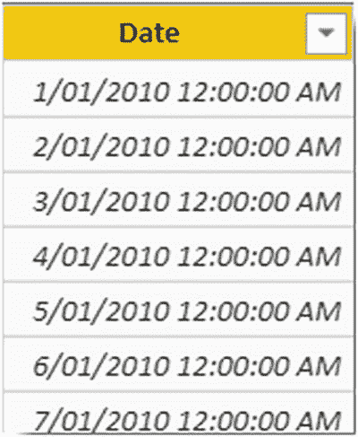

图 9-2 展示了代码清单 9-2 中计算表输出的前七行数据

一旦数据模型拥有了`日期表`，该`日期表`就可以链接到其他包含待按日期度量和聚合数据的表。用于定义关系的列可以是`DateTime`或其他数据类型。然而，DAX 时间智能函数需要使用`日期表`中数据类型为`DateTime`的列。

> **注意**
> 始终检查用于与`日期表`建立关系的列中的数据是否包含除午夜零点以外的时间元素（如时、分、秒）。这些行会被时间智能计算忽略，并且这可能不会立即显现出来。

一个`日期表`与模型中的另一个表之间可以定义多个关系。在一个数据模型中也允许存在多个`日期表`。

### 自动日期/时间表

Power BI Desktop 带有一个功能，可以为新数据模型自动添加`日期表`。此功能的工作原理是：对于在数据模型中检测到的每个使用`Date`或`DateTime`数据类型的列，都会自动创建一个隐藏的表。

如果你有一个包含五个表的数据模型，并且这些表中共有十个列使用了`Date`数据类型，那么 Power BI Desktop 会向该模型添加十个隐藏的`日期表`。Power BI Desktop 还会在模型中你的表的日期列与自动创建的隐藏`日期表`之间定义一个关系。

对于不想自行管理`日期表`的数据建模新手用户来说，这个自动创建的`日期表`可能是一个很方便的功能。而更习惯于时间智能概念的高级用户则倾向于禁用此功能，并自行添加/管理`日期表`。

每个自动创建的`日期表`都包含七个列和一个层次结构。这些表在连接到 Power BI Desktop 数据模型的外部工具（如 DAX Studio 和 SSMS）中可见。

这七个列如下：

| 日期 | `[DateTime]` | |
| --- | --- | --- |
| 日 | `[Integer]` | {1–31} |
| 月 | `[Text]` | {一月–十二月} |
| 月编号 | `[Integer]` | {1–12} |
| 季度 | `[Text]` | {Qtr1–Qtr4} |
| 季度编号 | `[Integer]` | {1–4} |
| 年份 | `[Integer]` | |

自动`日期表`中生成的单一层次结构是 `[年份] \ [季度] \ [月] \ [日]`。

当此功能启用且一个日期（或`DateTime`）列被添加到可视化字段时，该层次结构会出现在字段框中。可以删除层次结构的单个级别（例如`季度`），同时仍然保留向上/向下钻取的功能。

许多快速度量依赖于此功能启用。

在 DAX 中，可以使用完全限定表示法的特定第三级别。这种表示法的形式为 `'<你的表名>'[你的日期列].[日期]`，其中点号后的最终引用可以替换为自动`DateTime`表中的七个列中的任何一个。

鉴于这是一本关于高级 DAX 的书，你可能会像我处理每个新模型时一样，直接进入选项和设置，找到当前文件的数据加载部分，并取消选中“自动日期/时间”复选框。一旦取消选中，该特定`pbix`文件的所有隐藏表都会消失。

### 时间智能函数：基本模式

如果你读过第 5 章“DAX 中的筛选”，你会知道可以使用 DAX 表表达式作为筛选器。同一章还介绍了解除（覆盖）由切片器选择、轴、行和列标题值等项目设置的显式筛选器的概念。

我喜欢将时间智能函数视为一组智能且具有时间感知能力的日期表，它们被用作筛选器，帮助识别核心聚合函数（`SUM`、`COUNT`、`AVERAGE` 等）应纳入计算的正确行。

DAX 中几乎所有的时间智能函数都接受一个参数，该参数必须是一个日期列。此参数应是对日期表中使用了 `Date`（或 `DateTime`）数据类型的列的引用。

时间智能函数返回一个单列日期表，该表由调用函数使用，用于筛选并识别应纳入计算的行。时间智能函数通常由 `<filter>` 参数中的 `CALCULATE` 函数调用。表中包含的日期指示 `CALCULATE` 函数应该使用哪些行。

考虑一个如图 9-3 所示的经典星型架构模型，它使用了 Wide World Importers 数据集中的两个表：`Dimension Date` 和 `Fact Sale`。这两个表之间通过 `Dimension Date` 表中的 `[Date]` 列与 `Fact Sale` 表中的 `Invoice Date Key` 列定义了一个关系。

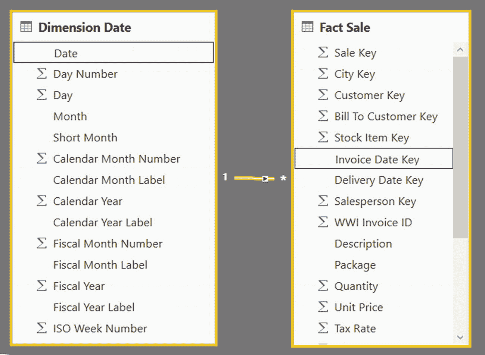

图 9-3 展示了一个使用 Wide World Importers 数据的两表数据模型

将清单 9-3 中的计算列添加到日期表，是演示时间智能函数如何工作的一种方法。在此示例中，该列被添加到 `Dimension Date` 表中。

# DAX 时间智能函数调试与理解

## 调试计算列基础

首先，我们来创建一个基础的调试计算列，如清单 9-3 所示。这个计算列将帮助我们理解时间智能函数的内部行为。

```
TI Function Debug Column =
VAR MyFunct = PREVIOUSMONTH('Dimension Date'[Date])
RETURN
COMBINEVALUES(
", ",
"Min Date=" & FORMAT(MINX(MyFunct,[Date]),"YYYY-MM-dd"),
"Max Date=" & FORMAT(MAXX(MyFunct,[Date]),"YYYY-MM-dd"),
"Rowcount=" & COUNTROWS(MyFunct)
)
```

**清单 9-3** 一个添加到基础日期表的计算列，该日期表使用 `CALENDAR` 函数在 DAX 中构建

当将清单 9-3 中的计算作为列添加到日期表，并将 `MyFunct` 变量使用的时间智能函数调整为我们感兴趣的任意 DAX 时间智能函数时，可以在数据视图中查看该列中基于文本的输出，从而更好地理解所选函数的特性。

![图 9-4 显示了该计算列的输出以及每一行对应的日期。在此示例中，使用的时间智能函数是 `PREVIOUSMONTH` 函数，传递给它的日期列来自同一表的 `[Date]` 列。](img/471413_1_En_9_Fig4_HTML.jpg)

**图 9-4** 显示了使用清单 9-3 中计算列的筛选后日期表的五行数据

在每一行中，`PREVIOUSMONTH` 函数都会接收到日期表中的一个单一值。对于图 9-4 中最上面一行，实际上传递给函数的值是 2013 年 3 月 26 日；而对于最下面一行，传递给 `PREVIOUSMONTH` 函数的是 2013 年 3 月 31 日这个单一值。

在清单 9-3 的示例中，`PREVIOUSMONTH` 函数始终输出一个包含 28 行的表表达式，这些行被赋值给 `MyFunct` 变量。该表表达式中最早的日期是 2013 年 2 月 1 日，最新的日期是 2 月 28 日。

由计算列生成的文本有助于描述给定时间智能函数根据输入产生的表表达式中的日期。我们可以在计算列中将 `PREVIOUSMONTH` 函数替换为其他时间智能函数，从而提供一种调试方式，并理解每个函数会考虑哪些日期。

## 度量值中的函数效果

现在，考虑使用 `PREVIOUSMONTH` 时间智能函数向同一数据模型添加以下两个计算度量值（或计算列）。

```
Sum of Quantity = SUM('Fact Sale'[Quantity])
Sum of Quantity Prev Month =
CALCULATE(
[Sum of Quantity],
PREVIOUSMONTH('Dimension Date'[Date])
)
```

**清单 9-4** 两个有助于突出显示 `PREVIOUSMONTH` 函数效果的计算

在矩阵视觉对象中使用清单 9-4 中的计算度量值，并将其展开到单个日期，我们可以看到 `PREVIOUSMONTH` 函数对最终值的影响。

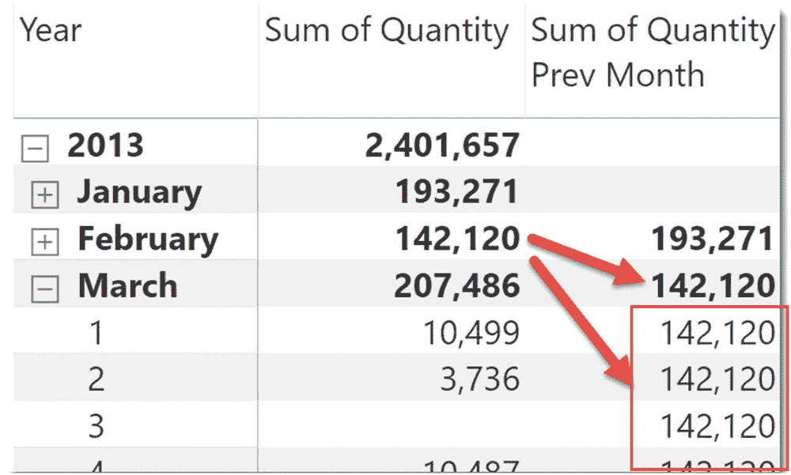

**图 9-5** 显示了矩阵视觉对象中清单 9-4 的度量值

图 9-5 中的右侧列显示，即使行展开到单个日期，其数值仍然代表整个上一个月的值。这是因为 `PREVIOUSMONTH` 函数生成的表表达式返回了上个月的每一天，而并未尝试筛选到单个日期以匹配该行所在的当前日期。如果需求如此，则应使用不同的时间智能函数。

根据其产生的输出，`PREVIOUSMONTH` 函数也可以被称为 `ENTIREPREVIOUSMONTH`（整个上个月）。

另外需要注意的一点是，2013 年 3 月 3 日的 `[Sum of Quantity]` 列中的空白值，在右侧列中仍然返回了一个值。该空白值表示 `Fact Sale` 表中不存在 `Invoice Date` 为 2013 年 3 月 3 日的记录。

这个空白单元格凸显了拥有一个符合日期表原则的日期表的价值。尽管度量值表中不存在 2013 年 3 月 3 日的数据，但日期表从未出现空白，因此它仍然可以传递一个值给 `PREVIOUSMONTH` 函数，从而为该行推导出一个结果。

## 使用 DATEADD 进行调试

现在考虑一个略微修改的需求：显示一个代表上个月同一天值的值。`PREVIOUSMONTH` 函数返回上个月的所有日期，但此需求希望针对特定某一天。

可以尝试的一个时间智能函数是 `DATEADD` 函数。为了测试 `DATEADD` 的行为，我们将更新清单 9-3 中使用的调试列，用 `DATEADD` 替换 `PREVIOUSMONTH`。

新的调试计算列如清单 9-5 所示。与清单 9-3 中的相同代码相比，此计算所做的唯一更改是，该计算列现在使用 `DATEADD` 函数（而非 `PREVIOUSMONTH`）来给 `MyFunct` 变量赋值。

```
TI Function Debug Column =
VAR MyFunct = DATEADD('Dimension Date'[Date],-1,MONTH)
RETURN
COMBINEVALUES(
", ",
"Min Date=" & FORMAT(MINX(MyFunct,[Date]),"YYYY-MM-dd"),
"Max Date=" & FORMAT(MAXX(MyFunct,[Date]),"YYYY-MM-dd"),
"Rowcount=" & COUNTROWS(MyFunct)
)
```

**清单 9-5** 更新后的调试计算列，现使用 `DATEADD` 函数

清单 9-5 中更新后代码的结果样本如图 9-6 所示。这些结果深入揭示了从 `DATEADD` 时间智能函数返回的表表达式中的数据情况。在每种情况下，显示的 `Rowcount`（行计数）现在都只有 1。因此，最小日期和最大日期始终彼此相等。

另外，请注意底部四行中，`DATEADD` 时间智能函数如何处理 2013 年 2 月不存在的 2013 年 3 月重叠天数。2013 年 2 月只有 28 天，而 2013 年 3 月有 31 天。因此，对于 3 月中大于 2 月最大日期的那些天，时间智能函数会返回一个与 2 月最后一天对齐的表表达式。

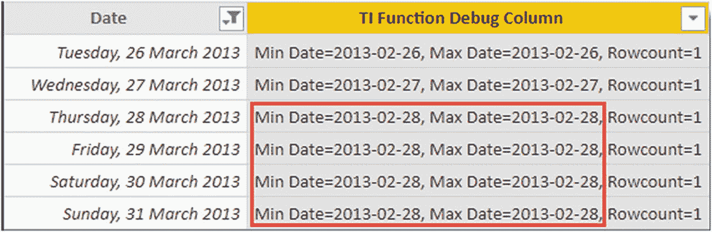

图 9-6 显示了在维度日期表中经过筛选的行集上，使用代码清单 9-6 中的计算列的输出结果

代码清单 9-6 中的 `[上月数量总和]` 度量值使用了代码清单 9-4 中的代码，并进行了更新，使用 `DATEADD` 函数替代了 `PREVIOUSMONTH` 函数。展开后的矩阵的更新结果如图 9-7 所示。

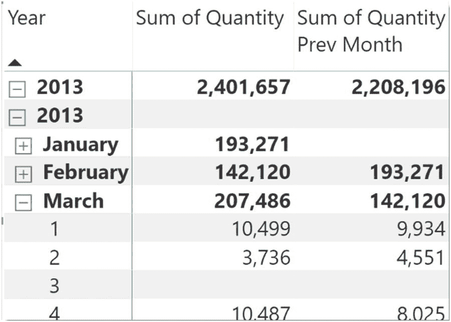

图 9-7 显示了在维度日期表中经过筛选的行集上，使用代码清单 9-6 中的计算列的输出结果

```
上月数量总和 =
CALCULATE(
[数量总和],
DATEADD('维度日期 (2)'[日期],-1,MONTH)
)
```

代码清单 9-6 一个已更新为使用 `DATEADD` 函数的计算度量值

右侧列中显示的值（针对向下展开到各个日期的行）现在变成了小得多的数字。这些值代表的是上个月的同一天，而不是整个上个月。

在代表整个 3 月的行中，`DATEADD` 返回了 2 月的正确值 142,120。尽管在显示天数的层级中（3 月 29 日至 31 日），月末的某些具体日期会被重复显示，但 `DATEADD` 函数内部的逻辑会解决这个问题，从而为月度数值返回准确的数据。

如果不使用时间智能函数和日期表，等效的 DAX 代码将会复杂得多，并且容易出错。

## 使用计算度量值进行调试

用于创建计算列的相同调试代码，也可以作为计算度量值的基础，来描述由任何给定时间智能函数返回的表表达式中的数据。

请考虑代码清单 9-7 中的以下计算，它创建了一个名为 `[DATEADD -1]` 的计算度量值。当此度量值被添加到使用来自 `'维度日期'` 表的日期层次结构的矩阵视觉对象中时，结果显示如图 9-8 所示。

```
DATEADD -1 =
VAR MyFunct = DATEADD('维度日期'[日期],-1,MONTH)
RETURN
COMBINEVALUES(
", ",
"最小日期=" & FORMAT(MINX(MyFunct,[日期]),"YYYY-MM-dd"),
"最大日期=" & FORMAT(MAXX(MyFunct,[日期]),"YYYY-MM-dd"),
"行数=" & COUNTROWS(MyFunct)
)
```

代码清单 9-7 一个使用由 `DATEADD` 函数生成的表表达式的计算度量值

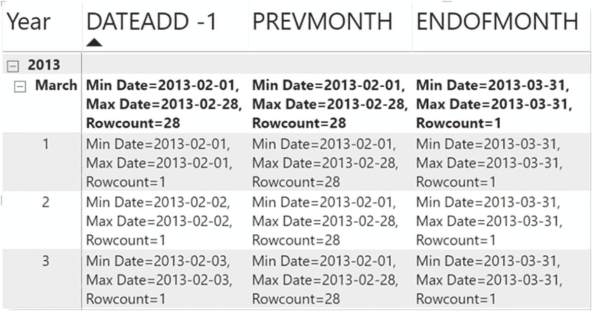

图 9-8 显示了矩阵视觉对象中三个相似度量值的输出结果。

图 9-8 中的矩阵还显示了另外两个计算度量值。这些额外的度量值使用了代码清单 9-7 中的相同代码，但进行了调整，使其名称与所使用的时间智能函数相匹配。

这些额外度量值的前两行如代码清单 9-8 所示，图 9-8 中显示的结果则以文本形式描述了每个计算中存储在 `MyFunct` 变量里的表表达式的内容（针对每个日期或月份）。

`ENDOFMONTH` 度量值始终显示 `行数` 为 1，并且您可以从最小日期和最大日期值中准确判断出当前上下文中的每个日期是什么。

```
上月 =
VAR MyFunct = PREVIOUSMONTH('维度日期'[日期])

月末 =
VAR MyFunct = ENDOFMONTH('维度日期'[日期])

代码清单 9-8
图 9-8 中显示的两个额外计算度量值的初始代码片段
```

与计算列方法相比，计算度量值的优势在于它考虑了在同一视觉对象中使用时其他度量值所具有的筛选上下文。

很难记住诸如 `PREVIOUSYEAR` 和 `SAMEPERIODLASTYEAR` 这些听起来相似函数在筛选方面的具体作用，而使用这种技术进行调试有助于阐明每个函数的用途。

该技术对于 `DATESMTD` 和 `DATESQTD` 之类的函数尤其有用，在这些函数中，你会看到轴上使用的每个日期都会产生不同的结果。

### 使用计算表进行调试

另一种帮助理解时间智能函数返回结果的方法是，将每个函数的表表达式输出用作新的计算表。然后，可以在数据视图屏幕中查看函数的输出。这种方法不考虑视觉对象中活动的筛选上下文，但提供了一种快速查看每个函数返回结果的方式。

请考虑代码清单 9-9 中的以下两个计算表。

```
DATESBETWEEN 作为表 =
DATESBETWEEN(
'维度日期'[日期],
DATE(2013,3,3),
DATE(2013,3,9)
)
DATESINPERIOD 作为表 =
DATESINPERIOD(
'维度日期'[日期],
DATE(2013,3,3),
7,
DAY
)
代码清单 9-9
将时间智能函数用作计算表的计算
```

代码清单 9-9 中显示的两个示例都生成了相同的表。代码清单 9-9 中的时间智能函数使用了略有不同的语法，但输出了相同的结果。这些函数更可能用于那些考虑度量值内部筛选上下文的动态变量；然而，两者都返回一个单列表，该表的行数足以满足作为参数传递的值。代码清单 9-9 代码的完整结果如图 9-9 所示。

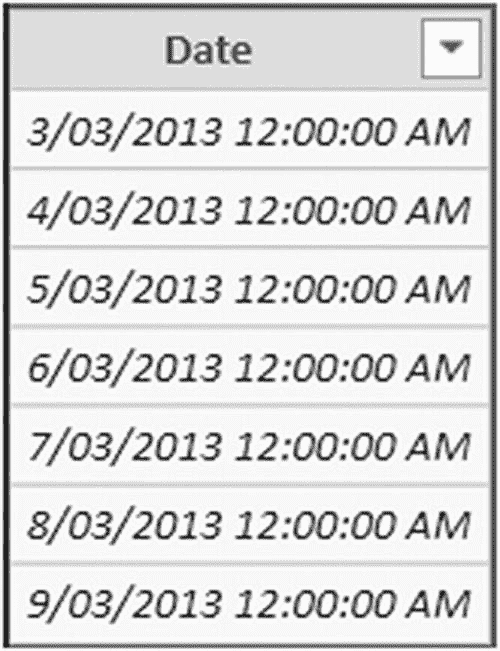

图 9-9 来自代码清单 9-9 中计算表的输出

其他时间智能函数也可以以相同的方式使用，并有助于通过表格来验证你对每个函数输出的理解。

## 原始函数与复合函数

在大约 35 个时间智能函数中，有一部分被视为复合函数，因为它们总是在内部被重写为其他时间智能函数。

这十二个复合函数是：

-   `DatesMTD`
-   `DatesQTD`
-   `DatesYTD`
-   `TotalMTD`
-   `TotalQTD`
-   `TotalYTD`
-   `OpeningBalanceMonth`
-   `OpeningBalanceQuarter`
-   `OpeningBalanceYear`
-   `ClosingBalanceMonth`
-   `ClosingBalanceQuarter`
-   `ClosingBalanceYear`

复合函数是由其他时间智能函数构成的。例如，`TOTALMTD` 函数会被 DAX 引擎转换为清单 9-10 中所示的底部代码段。

```
TOTALMTD (
    SUM ('Fact Sale'[Quantity]),
    'Dimension Date'[Date]
)
// 被转换为：
CALCULATE(
    SUM ('Fact Sale'[Quantity]),
    DATESBETWEEN(
        'Dimension Date'[Date],
        STARTOFMONTH(
            LASTDATE('Dimension Date'[Date])
        ),
        LASTDATE('Dimension Date'[Date])
    )
)
清单 9-10
展示复合函数 TOTALMTD，以及它被 DAX 引擎转换后的形式
```

两个表达式都返回相同的结果以及相同的逻辑和物理查询计划。

图 9-10 展示了清单 9-10 中两个 DAX 表达式的逻辑计划。

`Sum VertiPaq` 操作符在第 1 步按预期对 `'Fact Sale'[Quantity]` 列进行操作，并且在第 2 步有一个同级的操作符节点 `DatesBetween`，它会下钻到其子节点，直至其他时间智能函数，例如 `StartOfMonth` 和 `LastDate`。该逻辑计划的结构与清单 9-10 中 DAX 代码转换后的形式非常相似。

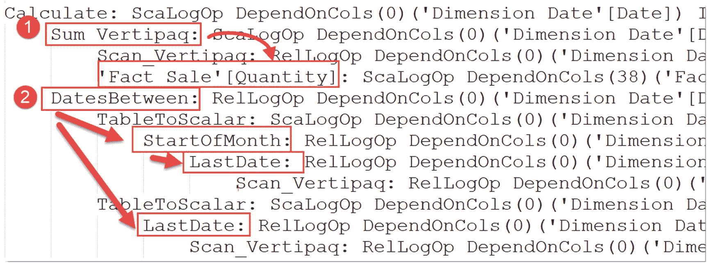

图 9-10

展示清单 9-10 中两个 DAX 表达式的逻辑计划片段。来自清单 9-10 中计算表的输出

其他复合时间智能函数的映射关系如下。

```
ClosingBalanceMonth(
    ,
    ,
    
)
// 被转换为：
Calculate(
    ,
    EndOfMonth(),
    
)
清单 9-13
包含转换方式的复合时间智能函数 CLOSINGBALANCEMONTH
```

```
OpeningBalanceMonth(
    ,
    ,
    
)
// 被转换为：
Calculate(
    ,
    PreviousDay(
        StartOfMonth()
    ),
    filter
)
清单 9-12
包含转换方式的复合时间智能函数 OPENINGBALANCEMONTH
```

```
TotalMTD(
    ,
    ,
    
)
// 被转换为：
Calculate(
    ,
    DatesMTD(),
    
)
清单 9-11
包含转换方式的复合时间智能函数 TotalMTD
```

清单 9-11、9-12 和 9-13 中所示的复合函数都与按月计算相关。对于专注于其他时间段（季度和年度）的复合函数，将文本 `Month` 的任何出现替换为相应的替代词（`Quarter` 或 `Year`）。因此，`EndOfMonth` 变为 `EndOfQuarter`，或 `EndOfMonth` 变为 `EndOfYear`。

请注意，清单 9-11 中的 `TotalMTD` 复合函数使用了另一个名为 `DatesMTD` 的复合函数。

其余的时间智能函数被视为原始函数，它们更有可能在逻辑计划中拥有特定的操作符，以便在内部处理公历中一些更复杂的特殊问题。

## 财务日历

在业务模型中，将数据与财务或会计年度的日期对齐是一个相当标准的需求，即每年起始日不是 1 月 1 日的日历。通常，一个数据模型应该能够为最终用户提供选择使用财务年度还是传统日历年的灵活性。

### `<year_end_date>` 参数

一些时间智能函数提供了一种方法来帮助将报告指标与传统的 1 月 1 日开始的年历之外的日历对齐。这些时间智能函数有一个可选参数，允许提供 `<year_end_date>` 值。提供此选项的函数大多是处理“年”的时间智能函数，并且函数名中包含特定的文本 `YEAR` 或 `YTD`。

-   `CLOSINGBALANCE*YEAR*`
-   `DATES*YTD*`
-   `ENDOF*YEAR*`
-   `NEXT*YEAR*`
-   `OPENINGBALANCE*YEAR*`
-   `PREVIOUS*YEAR*`
-   `STARTOF*YEAR*`
-   `TOTAL*YTD*`

`SAMEPERIODLASTYEAR` 函数不提供此选项，并且也不需要它来满足该函数的主要意图。

# 时间智能函数与财务报告

## 财务函数与年份结束日期

上面列出的每个函数都提供了一个可选的 `<year_end_date>` 参数，该参数允许您指定一个格式为 `D/M` 的字符串，其中 `M` 代表一年的数字月份，`D` 是该月的数字日期。这种语法意味着，如果您希望财务年度每年在 7 月 1 日重置，则应将此值硬编码为 `30/6`，以指定您的年份在 6 月 30 日结束。

清单 9-14 中的示例展示了相同的 `[Sum of Quantity]` 度量值被三次添加到一张表中：一次单独添加，然后两次使用 `TOTALYTD` 函数添加。

`TOTALYTD` 函数提供数据的累积总计。默认情况下，累计总计始终在 1 月 1 日重置并重新开始。仅当提供了额外的 `<year_end_date>` 参数时，运行总计才会重新开始。

```dax
DEFINE MEASURE
'Fact Sale'[Sum of Quantity] =
    FORMAT(SUM('Fact Sale'[Quantity]),"#,###")
EVALUATE
ADDCOLUMNS(
    VALUES('Dimension Date'[calendar month label]),

    "Sum of Quantity",
    [Sum of Quantity] ,

    "Calender YTD" ,
    TOTALYTD(
        [Sum of Quantity],
        'Dimension Date'[Date]
    ),

    "Fiscal YTD" ,
    TOTALYTD(
        [Sum of Quantity],
        'Dimension Date'[Date],
        "31/1"
    )
)
```
清单 9-14 展示 `<year_end_date>` 参数对 `TOTALYTD` 函数效果的 DAX 查询

清单 9-14 中查询的结果显示在图 9-11 中。第一列按时间顺序显示月份值，第二列显示核心度量值的数值。提供第二列是为了显示每个月的单独值，而不是累计值。

`[Calendar YTD]` 列展示了使用默认方式（每年 1 月 1 日重置）的 `TOTALYTD` 函数。此效果可以在红色高亮框中看到，该框中的数值 216,337 与 `[Sum of Quantity]` 列中显示的数值相同。216,337 也是该列中最小的数值。在该列的红色高亮框下方，各行会根据相应的 `[Sum of Quantity]` 值递增。

最后一列展示了当提供可选参数 `<year_end_date>` 时 `TOTALYTD` 函数的输出。在这种情况下，提供了 `31/1` 这个值，表示每年的 1 月 31 日。该列中的一个红色高亮框突出显示了 2013 年 2 月的数值 182,103。该数值下方的各行每个月都会按 `[Sum of Quantity]` 列中显示的数值递增。

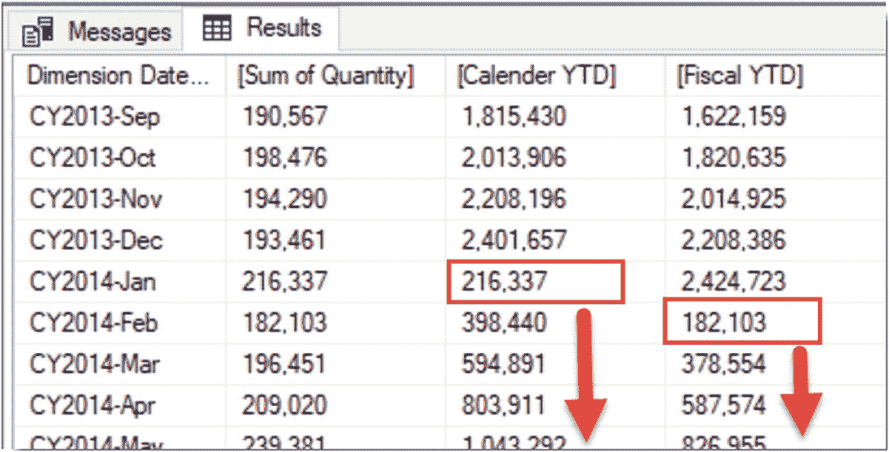
图 9-11

其他接受此可选参数的时间智能函数都以相同的方式工作。只需提供文本来定义“重置”日期，该函数即可按预期工作。

### 测试财务函数

一种推荐的使用 `<year_end_date>` 参数进行调试/测试计算的方法，是结合表示单个日期的列（而非月份、季度或年份），在可视化对象中检查这些计算是否在正确的日期重置。

清单 9-14 中的前几行代码可以通过将 `ADDCOLUMNS` 函数的第一个参数修改为与清单 9-15 中所示代码一致，从而改为基于日期的粒度。

```dax
EVALUATE
ADDCOLUMNS(
--VALUES('Dimension Date'[calendar month label]),
VALUES('Dimension Date'[date]),
...
```
清单 9-15 基于清单 9-14 修改的 DAX 查询，现在按日期而非月份分组

在清单 9-15 中，原始的 `VALUES` 行已被注释掉，并新增了一行同样使用了 `VALUES` 函数的代码，但这次使用的是基于日期的列以获得更细的粒度。结果集现在变得更长，但使您能够在行中滚动，以检查 `[Fiscal YTD]` 在每个边界处是否正确重置。

为什么需要调试？语法中存在一些并非显而易见的细微差别，并且如果处理不当，不一定会抛出错误。

假设将值 `“1/36”` 作为 `<year_end_date>` 参数提供。从技术上讲，这个值意味着您建议会计年度在一个不存在的日期（1 月 36 日）结束。

当传递诸如 `“1/36”` 这样的值时，DAX 查询仍然成功执行且不会抛出错误。使用该值的结果如图 9-12 所示，您可以在最后一列看到新年从 1 月 2 日开始。目前尚不清楚为什么 `<year_end_date>` 值为 `“1/36”` 会被如此解析。使用这种方法进行调试有助于确认函数的行为，并确保使用的是您期望的日期。一旦计算使用诸如月份这样的粒度进行聚合，错误的结果就很难被察觉。


图 9-12

DAX 查询引擎接受多种格式的 `<year_end_date>` 参数，并在报错之前尝试解析它认为您想要表达的意思。

*   `“3/1”` – 重置于 1 月 4 日
*   `“1/3”` – 重置于 2 月 2 日
*   `“13/1”` – 重置于 1 月 14 日
*   `“1/13”` – 重置于 1 月 14 日（与 `“13/1”` 相同）
*   `“13 1”` – 重置于 1 月 14 日
*   `“13-1”` – 重置于 1 月 14 日
*   `“70-1”` – 重置于 1 月 2 日（什么鬼？）

如您所见，在 DAX 查询引擎生成错误之前，可以使用多种分隔符。

与时间智能函数相关的另一个语法怪癖是参数的位置。根据官方文档，`TOTALYTD` 函数的语法是：

```
TOTALYTD(<expression>,<dates>[,<filter>][,<year_end_date>])
```

其中，必填的 `<expression>` 和 `<dates>` 参数分别占据位置 1 和 2。`<year_end_date>` 参数实际位于第四个位置，而清单 9-14 中使用的示例代码却在第三个位置传递了字符串值来控制它。

DAX 查询引擎足够智能，能够识别出这样一种情况：当传递的是文本值而非筛选器时，它知道第三个参数旨在定义 `<year_end_date>`。

## 替代方法

到目前为止涵盖的时间智能函数并非提供替代日历（如财务日历）的唯一方法。另一种方法是在日期表中添加额外的列，以定义每个实际日期应归属的会计年度、季度或月份。

万国进口商（WWI）数据中的“维度日期”表提供了一个很好的示例，可用于在设计数据模型以提供这种灵活性时参考。WWI 数据中的财务列包括：

*   会计年度
*   会计年度标签
*   会计月份号
*   会计月份标签

WWI 数据中的“维度日期”表被硬编码为每年 11 月 1 日重置。这种模式可以扩展，包括一对用于会计季度的列，以定义基于文本的标签列，例如 `“FQ2014-1”`，并添加一个数字列来管理排序行为。

通常，采用组合方法来管理财务日历是有帮助的，该方法同时使用日期表中的物理列和能够定义年末日期的时间智能函数中的计算。

使用内置的时间智能函数来管理财务日历并非必需，但它们的设计初衷是为了更轻松地实现大多数基于时间的场景。

## 基于周的报告

我热衷于按周分组的方式，因为我喜欢将指标按周汇总并对齐，这样可以使比较更具可比性。每周的天数是固定的，而不像月份那样由 28 到 31 天混合组成。

我们处理的大部分数据与工作周的节奏有着直接或间接的关系。某些零售数据可能在周末达到高峰，在工作日则处于低谷。其他类型的销售或利用率数据可能在周末衰减，但在工作日内保持一致的规律。

当将一个有五个周末的 31 天大月直接与另一个只有 28 天和四个周末的小月进行比较时，使用月份来比较指标可能会掩盖趋势。

一个按月绘制的指标图表可能会显示销售额较上月有所增长，而使用相同数据但基于周的坐标轴则可能更准确地显示出潜在的下降趋势。

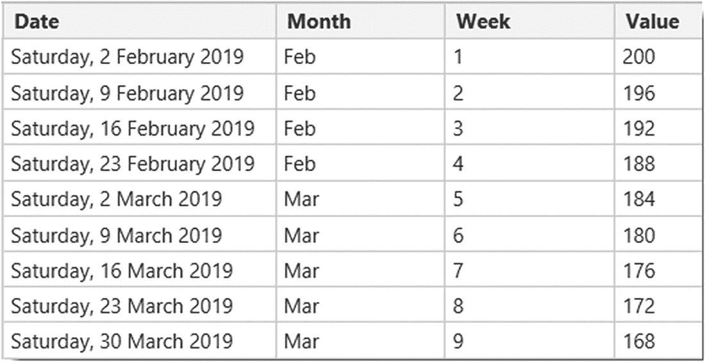
**图 9-13**

# 数据模型中的时间智能：按周分组

图 9-13 展示了一个基于 2019 年 2 月和 3 月构建的模拟数据集。二月只有四个周末，而三月有五个。在数据集中的九个周末里，第一个周末的数值为 200，随后每个星期精确地递减 4。数据集里九个星期中的最后一个周末数值仅为 168。数据中存在一个明确且人为设置的下降趋势。

图 9-14 中左侧的折线图使用日历月作为坐标轴，显示出数据呈上升趋势，而右侧使用周作为坐标轴的折线图则显示出下降趋势。

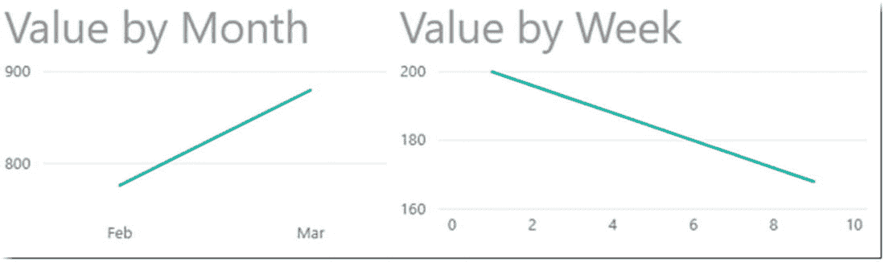

**图 9-14** 展示了使用相同数据却呈现不同趋势的两张折线图。

如果用户通过层次结构向下钻取到更细的粒度，比如具体到某一天，那么左侧折线图中的下降趋势就会变得明显，但这并不能保证。

解决方法当然是使用饼图。图 9-15 再次绘制了来自图 9-13 的数据，但这次使用了饼图。

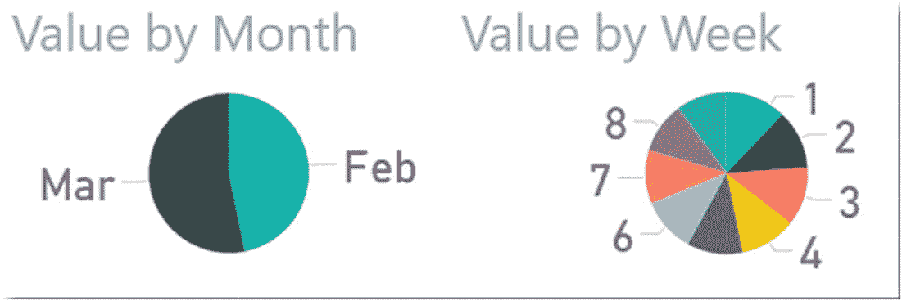

**图 9-15** 展示了绘制图 9-13 数据集的两种饼图。

现在这两个图表不再互相矛盾。左边的饼图按月划分，再次显示二月份略有增长，而右边的饼图按周划分，与左边饼图所暗示的趋势不再存在强烈分歧。这些视觉图表唯一可以做的改进就是增加 3D 效果。

当然，这只是开个玩笑！（开玩笑有助于提升士气。）这个例子属于那种只有那种也帮助设计了本章第一页描述的格里高利历的项目经理才能推荐出来的解决方案。以一种迂回的方式，它也凸显了为什么饼图是趋势分析的一个糟糕选择。☺

玩笑归玩笑（我并不是真的建议以这种方式使用饼图），按周分组具有很多优势，并且将其纳入您的数据模型中是很有用的。好消息是，这并非要在周和月之间做出非此即彼的选择。基于 DAX 的数据模型可以支持按年/月/日以及按年/周/日来对数据进行切片和切块。只需注意不要在同一张图表中混合使用它们，并始终为您的受众使用合适的层级结构。

我如何使用 DAX 为我的数据模型添加基于周的时间智能？幸运的是，这相对容易，DAX 提供了一些有用的基于日期的函数来提供帮助。这些函数是：

- `WEEKDAY`
- `WEEKNUM`

这两个函数都返回一个数字，可用于在任何日期表中形成其他基于 DAX 的列的基础。

## `WEEKDAY` 函数

`WEEKDAY` 函数接受一个日期列或标量日期值，并根据 `<return_type>` 返回一个介于 0 和 7 之间的数字。`<return_type>` 参数只能取值 1、2 或 3；以下清单 9-16 中的代码展示了它们之间的区别。

### 语法

```
WEEKDAY ( <date> , <return_type> )
```

### 输出

整数

```dax
WEEKDAY Date Table =
ADDCOLUMNS(
    CALENDAR( DATE( 2019, 1, 1) , DATE( 2019, 1, 20) ) ,
    "Return Type 1" , WEEKDAY( [Date] , 1 ) ,
    "Return Type 2" , WEEKDAY( [Date] , 2 ) ,
    "Return Type 3" , WEEKDAY( [Date] , 3 )
)
```

**清单 9-16** 一个计算表，旨在展示 `WEEKDAY` 函数的三种不同返回值类型选项。

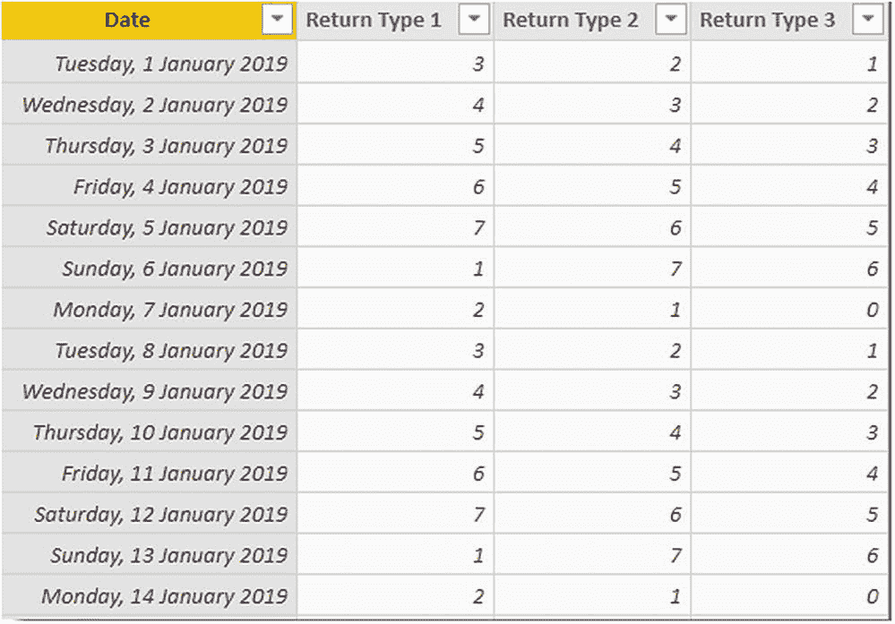

**图 9-16** 展示了清单 9-16 中计算表的数据视图。

在图 9-16 中，第二列 `[Return Type 1]` 的数字范围是 1 到 7，其中 1 代表星期日，2 代表星期一，依此类推。第一列包含了对星期几名称的描述。

在第三列 `[Return Type 2]` 中，数字范围同样是 1 到 7，但此时 1 代表星期一，2 代表星期二，依此类推。

最后一列 `[Return Type 3]` 使用 0-6 作为数字范围，其中 0 代表星期一。

几年前，我为一家公司做过一些工作，他们喜欢将每周的周期从星期六开始。通过调整清单 9-16 中所示的代码，并添加一个如清单 9-17 所示的偏移量，可以满足此类类似需求。

```dax
WEEKDAY Date Table =
ADDCOLUMNS(
    CALENDAR( DATE( 2019, 1, 1) , DATE( 2019, 1, 20) ) ,
    "Return Type 2" , WEEKDAY( [Date] +2 , 2 ) ,
    "Return Type 3" , WEEKDAY( [Date] +2 , 3 )
)
```

**清单 9-17** 一个经过调整的计算表，使用偏移量来适配周起始日不是星期一或星期日的情况。

清单 9-17 中更新后的代码为 `[Return Type 2]` 提供了从 1 到 7 的基于 1 的数字范围，或为 `[Return Type 3]` 提供了从 0 到 6 的基于 0 的数字范围。

然后，此计算的结果可用于从 `[Date]` 列中减去天数，从而在日期表中提供一个 `[Week Starting]`（周开始）列。清单 9-18 中展示了一个示例。

清单 9-18 中的代码展示了一个示例计算表，它使用 `WEEKDAY` 函数为数据模型生成 `[Week Starting]` 和 `[Week Ending]`（周结束）列。此示例假设每周从星期一开始，但可以进行相应调整，以便每周分组可以从一周中的任何一天开始。图 9-17 展示了清单 9-18 中代码的部分结果示例。

```dax
WEEKDAY Date Table =
ADDCOLUMNS(
    CALENDAR( DATE( 2019, 1, 1) , DATE( 2019, 1, 20) ) ,
    "Week Starting" , [Date] - WEEKDAY( [Date] , 2 ) ,
    "Week Ending"   , [Date] - WEEKDAY( [Date] , 2 ) + 7
)
```

**清单 9-18** 一种使用计算表向日期表添加基于周的分组的方法。

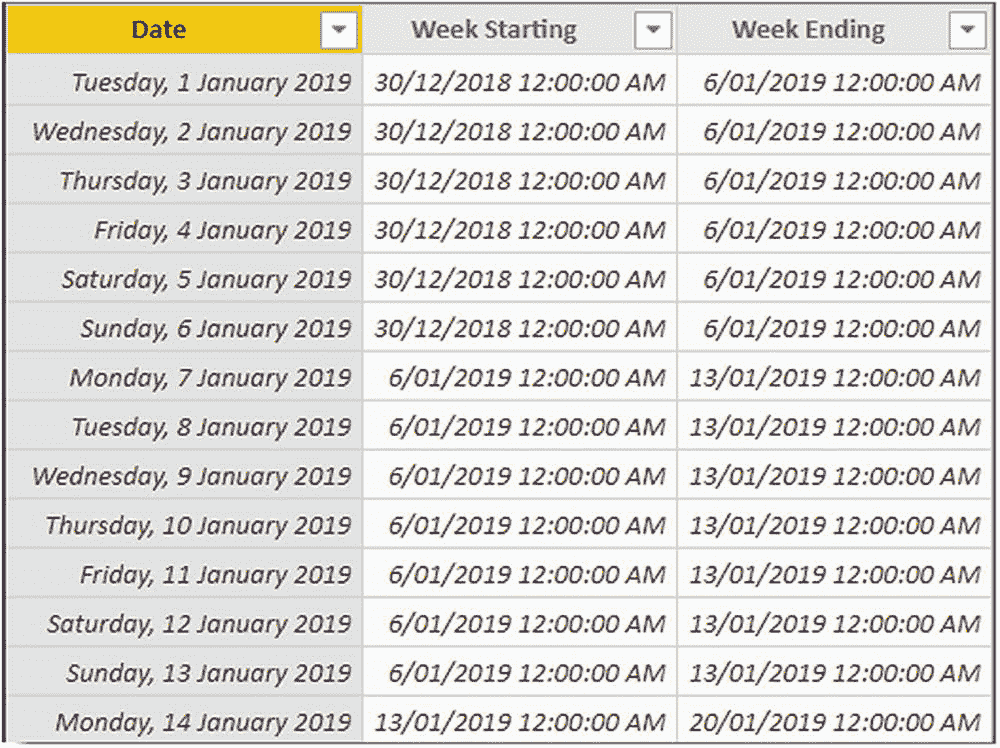

**图 9-17** 数据视图中清单 9-17 计算的部分输出示例。

将 `[Week Starting]` 和 `[Week Ending]` 列添加到日期表后，任何使用相关子表中数据的度量值都可以自动分组并排序到 7 天的桶中，便于比较。这两列使用的数据类型都是日期（`Date`）数据类型，因此无需额外添加用于排序的列。

## `WEEKNUM` 函数

在处理周桶时，另一个需要考虑的有用 DAX 函数是 `WEEKNUM` 函数。该函数具有与 `WEEKDAY` 相同的参数签名，并且也返回一个介于 1 和 53 之间的整数值。当函数返回 1 时，表示该日期被认为处于该年的第一周。

### 语法

```
WEEKNUM ( <date> , <return_type> )
```

### 输出

整数

`WEEKNUM` 函数的各种输出值通过清单 9-19 中的计算表进行了演示。

```dax
WEEKNUM Date Table =
ADDCOLUMNS(
    CALENDAR( DATE( 2019, 12, 25) , DATE( 2020, 1, 15) )
    , "Return Type 1"  , WEEKNUM([Date],   1)
    , "Return Type 2"  , WEEKNUM([Date],   2)
    , "Return Type 21" , WEEKNUM([Date],  21)
    , "Return Type 11" , WEEKNUM([Date],  11)
    , "Return Type 12" , WEEKNUM([Date],  12)
    , "Return Type 13" , WEEKNUM([Date],  13)
    , "Return Type 14" , WEEKNUM([Date],  14)
    , "Return Type 15" , WEEKNUM([Date],  15)
    , "Return Type 16" , WEEKNUM([Date],  16)
    , "Return Type 17" , WEEKNUM([Date],  17)
)
```

**清单 9-19** 一个使用不同 `<return_type>` 值构建的计算表。

清单 9-19 所示代码的部分输出示例可以在图 9-19 中看到。添加了红色条以显示第一周开始和结束的范围。

在 Power BI Desktop 的 DAX 编辑器（2019 年 1 月版本）中，DAX 智能提示似乎只提供了 `<return_types> 1` 和 `2`；然而，系统也接受 `<return_type>` 的其他值，并提供了替代选项，包括能够定义从不同日期开始算作一周。

需要为 `<return_types>` 参数强调的一个重要方面是，大多数选项会截断第 1 周，使其始终从 1 月 1 日开始。

我更喜欢 `<return_type> = 21`，它仍然为第 1 周返回一个 7 天的桶，即使这意味着桶中的某些早期天数按技术规定属于上一个日历年。

在处理周数据时，确保使用相同天数进行比较可能比尝试将周周期与日历年的开始对齐更为关键。图 9-18 中的大多数列都显示了一个被缩短的第 1 周。

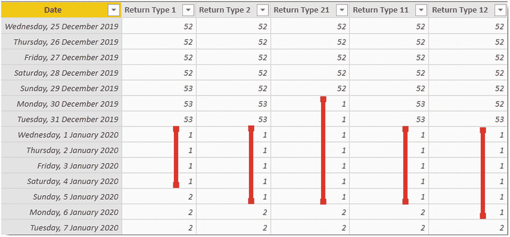
`图 9-18`展示了由清单 9-19 中的代码生成的输出示例。

`WEEKNUM` 函数非常适合用于构建日期表中的列，这些列可用于跨年份比较周数。添加 `[Week Number (Year)]`（周数（年份））列有助于理顺两端的跨年日期。

清单 9-20 中的代码展示了一个建议的计算列，将其添加到日期表中可以跨年份比较周数。

```dax
Week Number = WEEKNUM( [Date],  21)
```

`清单 9-20`一个用于比较周数的有用计算列。

清单 9-20 中计算列的默认行为是每周从星期一开始。如果希望从其他天开始，请在 `[Date]` 后添加 `+n`，例如，如果您偏好星期日，调整后应为 `WEEKNUM( [Date] + 1, 21)`。

另一个需要添加到日期表的计算列有助于进行区分，如清单 9-21 所示，它将每个 `[Week Number]` 值分配到适当的年份，而不会丢失任何跨年的日期。

```dax
Week Number (Year) =
VAR MyWeekNumber = 'Dimension Date'[Week Number]
VAR MyDate = 'Dimension Date'[Date]
VAR MyDates =
FILTER(
'Dimension Date',
[Date] > MyDate - 6 &&
[Date] < MyDate + 6 &&
[Week Number] = MyWeekNumber
)
RETURN
IF(
MyWeekNumber = 1,
MAXX(MyDates,[Calendar Year]),
MINX(MyDates,[Calendar Year])
)
```

`清单 9-21`清单 9-20 中代码的配套列，用于帮助将周数分配到适当的年份。

当 `[Week Number (year)]` 列用于图例，并且 `[Week number]` 列用于折线图的轴时，就可以使用跨年份且共享相同周起始日和周结束日的同类 7 天桶来展示指标。