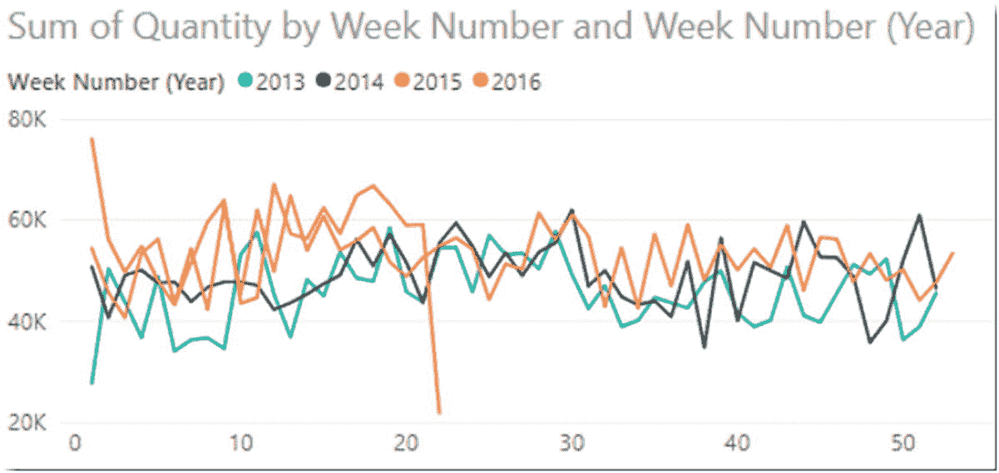

# 第 9 章：高级日期计算

在跨年份比较周度区间时，确保区间使用相同的星期几作为起始/结束点，通常比试图按日历日对齐 7 天周期更为重要。因此，你可能不希望将 2019 年 3 月 10 日开始的七天周期与其他年份 3 月 10 日开始的七天周期进行比较。

图 9-19 显示了一个折线图，x 轴为`[周编号]`列，图例使用了`[周编号（年份）]`列。折线图上的每个数据点可以在不同年份之间进行垂直比较，以帮助理解各年份之间的变化。

**图 9-19** 展示了跨年份使用`WEEKNUM`的折线图

## 总结

DAX 是一种功能强大的语言，完全能够处理各种日期场景和需求。数据建模引擎借助了超过 20 年的开发经验、实际应用以及来自各类用户和组织的反馈。

DAX 可用于创建动态度量值，以帮助发现数据中的见解，也可用于创建表格，帮助将数据分组并组织成易于比较且有意义的区间。

DAX 可用于为数据模型创建日期表，但这并不意味着你应始终使用 DAX 来创建日期表。在 Power Query 中或从 Power BI Desktop 上游源构建的日期表同样有效，有时甚至更好，因为它们可能已包含针对组织高度定制且一致的列。

快速上网搜索能提供许多关于如何构建基于 DAX 的日期表的建议。SQLBI 的 Marco Russo 和 Alberto Ferrari 提供的任何模式都是极佳的起点。

时间智能函数在很大程度上有助于解决由不太友好的公历引起的各种奇怪问题，并且如果使用得当，可以减少构建有用报表所需的编码量和时间。

本章展示了 DAX 时间智能函数通常返回日期表，这些表可以被其他接受表作为筛选器的 DAX 函数使用。时间智能表提供了合适的取消阻塞语义，并具有复杂的内部代码，可显著减少你所需的代码量。

本章还介绍了一些关于如何使用`WEEKDAY`和`WEEKNUM`函数管理周度时间区间的建议，包括调试建议。`WEEKDAY`和`WEEKNUM`函数也为添加动态列（如`[距今天数周]`）提供了基础，该列将每个周度区间计数为正整数或负整数，从而允许报表被筛选，仅显示`[距今天数周]`在 1 到 13 之间的值。这种方法意味着报表始终显示最近 13 周，无需最终用户交互。