# 10. 寻找缺失的数据

## 引言

DAX 最明显的应用领域之一是计算基于现有数据的度量值，例如，计算返回随时间累积值的度量值。一个可能在使用 DAX 时不会首先想到的领域是发现缺失的数据。“缺失的数据”——诚然——听起来有些模糊；因此，需要更详细地解释。这些缺失的数据之一，例如，是停止购买的客户。

本章将介绍如何找到这些缺失的数据，首先从识别停止购买的客户的简单介绍开始。然后介绍如何识别事件之间的间隔、计算间隔数量以及确定每个间隔的长度。

最后，区分了计算前一个值（这里基本上没有缺失，因此是容易的部分）和查找最后一行，此时突然出现了缺失的索引。

## 月亏与月盈

这背后的问题是：“哪些客户在上一个期间购买了商品，但在当前期间没有再次购买？”如果将其可视化，这就会变得清晰得多。为此，图 10-1 显示了基础情形，后续图表展示了如何回答这个问题。


**图 10-1** 非回头客户基础情形

图 10-1 中的左侧圆圈表示过去曾购买过的客户。右侧圆圈则表示在当前期间有购买的客户。对于“哪些客户在当前期间没有购买，但在过去期间有购买？”这一问题的概念性答案，如图 10-2 所示。

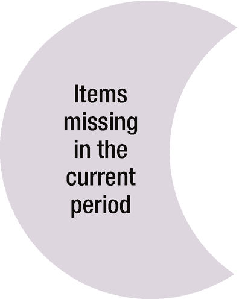

**图 10-2** 非回头客户（月亏）

为简化表述，我们将代表在当前期间未购买的客户的圆圈形状称为*月亏*。这意味着过去有比今天更多的客户（项目）。相反的问题“哪些客户刚刚在当前期间购买了商品，但在上一期间没有？”也可以用同样的方式可视化。图 10-3 展示了*月盈*，或者更简单地说，*新客户*，即那些在当前期间有购买但在上一期间没有购买的客户。


**图 10-3** 新客户（月盈）

要回答上述两个问题，需要识别两组客户：

- 上一个期间的客户
- 当前期间的客户

根据两组客户的组合方式，可以识别出非回头客户，也可以识别出新客户。下一节将展示如何回答这两个问题。

#### 注意

本节引用的 pbix 文件为`CH 10 Waning and Waxing moon`。

### 新客户：月盈

本章展示如何计算与上个月相比在当前月份中没有购买过的客户数量。

为确定在过去期间未购买的客户数量，使用了以下度量值（参见列表 10-1）。

```dax
No of New Customer =
var theseCustomers = VALUES('Fact Sale'[Customer Key])
var theMonthBefore = SELECTEDVALUE('Dimension Date'[RunningMonthIndex]) - 1
var theseCustomerBeforeCurrentMonth =
CALCULATETABLE(VALUES('Fact Sale'[Customer Key]),FILTER(ALL('Dimension Date'[RunningMonthIndex]),'Dimension Date'[RunningMonthIndex] = theMonthBefore ),ALL('Dimension Date'))
return
COUNTROWS(EXCEPT(theseCustomers,theseCustomerBeforeCurrentMonth))
```

**列表 10-1** `No of New Customer`

这个度量值背后的思路相当简单：只需找出所有在当前期间之前的各个期间有购买的客户。这些客户存储在表变量`theseCustomerBeforeCurrentMonth`中。所有在当前期间有购买的客户存储在变量`theseCustomers`中。使用`EXCEPT`，可以很容易地找出所有在之前所有期间都没有购买的客户。

### 缺失的客户：月亏

要找出在当前期间未购买的客户数量，可以使用与计算新客户数量相同的度量值。只是有一个小变动：传递给`EXCEPT`函数的表的顺序被颠倒了。


## 至少一次，或者每次：一致性衡量指标

通常，随着时间的推移保持一致性被视为一件好事，尤其是当积极体验能与这段时间相关联时。检测一致性的缺失，或者更妙的是，在一致性开始消失时就察觉它，有助于避免产生负面体验。

为简化起见，一致性定义如下：在过去的 6 个月中，客户必须至少购买过四次商品。如果客户在过去两个月内没有任何购买行为，一致性就面临风险。图 10-4 展示了一致性各种状态示意图。

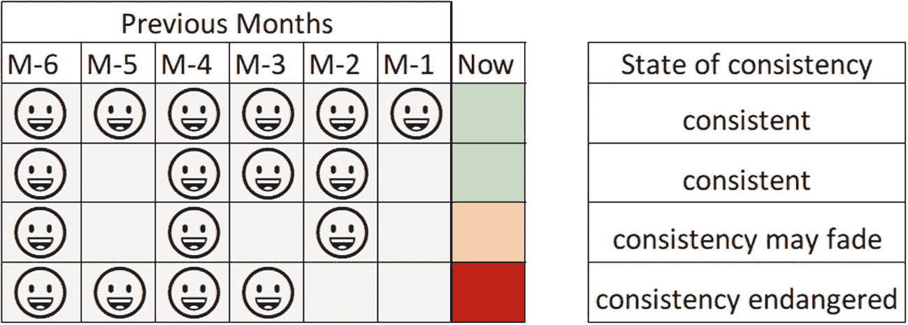

**图 10-4** 一致性状态

清单 10-2 展示了度量值 `State of consistency`。

```
State of Consistency =
var DateMax = MAX('Dimension Date'[Date])
// 上个月末
var DateEndOfPrevMonth =
EOMONTH(
DATE(YEAR(DateMax) , MONTH(DateMax) - 1, 1) ,0)
// 过去 6 个月
var DateStartOfRange =
DATE(YEAR(DateMax) , MONTH(DateMax) - 6, 1)
var filtertableconsistencyrange =
DATESBETWEEN(
'Dimension Date'[Date]
, DateStartOfRange
, DateEndOfPrevMonth
)
var consistencymayfade =
IF(
COUNTROWS(
CALCULATETABLE(
SUMMARIZE(
'Fact Sale'
, 'Dimension Date'[Calendar Month Number]
)
, filtertableconsistencyrange
)
)
< 4 , 1 , BLANK()
)
// 过去 2 个月
var DateStartOfRangeEndangerd =
DATE(YEAR(DateMax) , MONTH(DateMax) - 2, 1)
var filtertableconsistencyendangered =
DATESBETWEEN(
'Dimension Date'[Date]
, DateStartOfRangeEndangerd
, DateEndOfPrevMonth
)
var consistencyendangerd =
IF(
COUNTROWS(
CALCULATETABLE(
SUMMARIZE(
'Fact Sale'
, 'Dimension Date'[Calendar Month Number]
)
, filtertableconsistencyendangered
)
)
< 2 , 1 , BLANK()
)
return
IF(consistencyendangerd = 1 , 3 , IF(consistencymayfade = 2 , 2 , 1))
```

**清单 10-2** 一致性状态

其工作原理如下：

-   确定一个筛选表 `filtertableconsistencyrange`，它包含过去 6 个月的所有日期。
-   如果被该筛选表筛选后的 `Fact Sale` 表中可用的月份数少于 4，则返回值 1，并存储在变量 `consistencymayfade` 中。
-   确定一个筛选表 `consistencyendangerd`，它包含过去 2 个月的所有日期。
-   如果被该筛选表筛选后的 `Fact Sale` 表中可用的月份数少于 2，则返回值 1，并存储在变量 `consistencyendangerd` 中。
-   最后，返回一个数值：3 表示“一致性面临风险”状态，2 表示“可能消失”状态，1 表示“一致”状态。

度量值 `State of consistency` 被用在清单 10-3 所示的度量值 `State of consistency – Customer` 中。

```
State of Consistency - Customer =
MAXX(
VALUES('Dimension Customer'[Customer Key])
, [State of Consistency]
)
```

**清单 10-3** 客户一致性状态

度量值 `State of Consistency` 遍历每个客户，并返回度量值 `State of Consistency` 的最大值。这使得当在像矩阵可视化（如图 10-5 所示）这样的层次结构视图中使用该度量值时，能够将状态“向上冒泡”。图 10-5 中展示的矩阵可视化可在“在过去每个月份均未购买”报表页上找到。

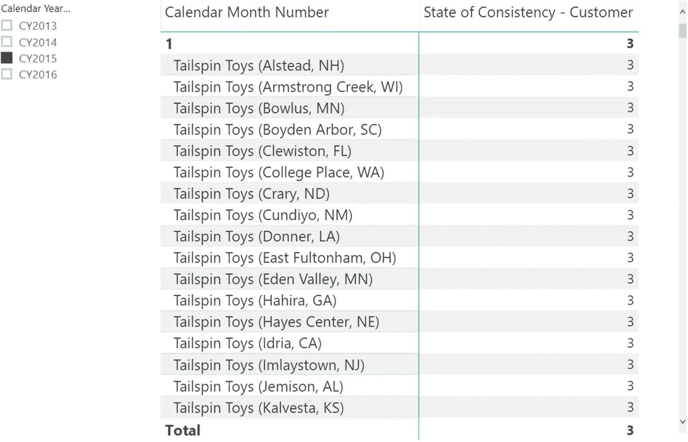

**图 10-5** 一致性状态 – 向上冒泡

仅仅进行简单计数的度量值，如果以一种更具创意的方式使用，例如，基于计数的行来推导状态，也能提供巨大的洞察。

### 事件序列或事件缺失

在某些情况下，了解缺失的事件被视为有价值的信息。有时，这些信息比测量到的信息（即有数据可查的信息）更有价值。例如，缺失的事件可以看作缺失的订单。因此，不仅要分析可用的信息，还要分析那些未发生的事件。了解客户不活跃的持续时间，可以引发防止客户流失的行动。

这里只考虑与日期相关的序列，由于如果这些序列用整数值而不是日期或日期时间数据类型来表示，序列的计算通常会简单得多，因此我们将这些整数值添加到日历表中。由于日历表从 2013 年 1 月 1 日开始，到 2016 年 12 月 31 日结束，针对前面的文本，一个例子就是为月份创建一个整数。这意味着 2013 年 1 月的所有日期都将被索引为数字 1，2014 年 1 月的所有日期被索引为数字 13，最后，2016 年 12 月的所有日期被索引为值 48。

清单 10-4 显示了在 `Dimension Date` 表中创建计算列的 DAX 语句。

```
RunningMonthIndex =
var minYear = YEAR(MIN('Dimension Date'[Date]))
var thisYear = YEAR('Dimension Date'[Date])
return
(thisYear - minYear) * 12 + MONTH('Dimension Date'[Date])
```

**清单 10-4** `RunningMonthIndex`

该 DAX 语句内部的基本逻辑是：

-   使用 `YEAR(MIN(...))` 确定日历表中的起始日期，提取起始年份，并将该值存储在变量 `minYear` 中。
-   从当前行的日期列中提取年份，并将该值存储在变量 `thisYear` 中。
-   使用简单的数学计算得出表示月份的整数索引。

使用月份只是为了简化。根据业务类型、销售的产品或许多其他原因，考虑最合适的时间范围可能是一项非常复杂的任务，但也可能更具启发性。当不能预期每个客户或每个产品都以相同的频率销售时，这些考量是必要的。


### 说明

本部分参考的是 pbix 文件 `“CH 10 Waning and Waxing moon.”`

清单 `10-5` 展示了度量值 `SEQ – length of gap`。

```
SEQ - length of gap =
var maxRunningMonthIndex =
CALCULATE(
MAX('Dimension Date'[RunningMonthIndex])
, ALL('Dimension Date')
)
var abt =
ADDCOLUMNS(
ADDCOLUMNS(
SUMMARIZE(
'Fact Sale'
,'Dimension Customer'[Customer Key]
,'Dimension Date'[RunningMonthIndex]
)
, "nxtMonth" ,
var thisRunningMonth = 'Dimension Date'[RunningMonthIndex]
var nxtRunningMonthFromFact =
CALCULATE(
FIRSTNONBLANK('Dimension Date'[RunningMonthIndex],[Total quantity])
, ALL('Dimension Date')
, 'Dimension Date'[RunningMonthIndex] > thisRunningMonth
)
return
IF(NOT(ISBLANK(nxtRunningMonthFromFact)) , nxtRunningMonthFromFact , maxRunningMonthIndex)
)
,"length of gap",
var l = [nxtMonth]-[RunningMonthIndex] - 1
return
IF(l = 0 , BLANK() , l)
)
return
SUMX(
abt
, [length of gap]
)
清单 10-5
序列 – 间隔长度
```

具体逻辑如下：首先创建一个汇总表，其中包含 `Customer Key` 和 `RunningMonthIndex` 列的所有有效组合（即存在于 `Fact Sale` 表中的组合）。

这是通过以下 DAX 实现的：

```
SUMMARIZE(
'Fact Sale'
, 'Dimension Customer'[Customer Key]
, 'Dimension Date'[RunningMonthIndex]
)
```

使用 `ADDCOLUMNS` 为表添加 `nxtMonth` 列。该列通过 `FIRSTNONBLANK` 查找下一个月份索引。必须使用 `CALCULATE` 将 `ADDCOLUMNS` 引入的现有行上下文转换到新的筛选上下文中，并将 ` Customer Key` 列的值添加到新的筛选上下文。这是通过以下 DAX 完成的：

```
CALCULATE(
FIRSTNONBLANK(
'Dimension Date'[RunningMonthIndex]
, [Total quantity]
)
, ALL('Dimension Date')
, 'Dimension Date'[RunningMonthIndex] > thisRunningMonth
)
```

结果存储在变量 `nxtRunningMonthFromFact` 中。此步骤是为了避免出现负值。如果不存在下一个值，则在本例中，将使用最新的索引。

然后，通过简单的数学计算，得出下一个月与当前月之间的差值；这将返回以月为单位的间隔长度。

最后，结合迭代器函数 `SUMX` 使用该表，该函数将计算所有间隔的总和。

第二个度量值 `SEQ – no of gaps` 的基本逻辑相同，唯一区别在于它统计的是间隔数量。

图 `10-6` 显示了一个简单表格。

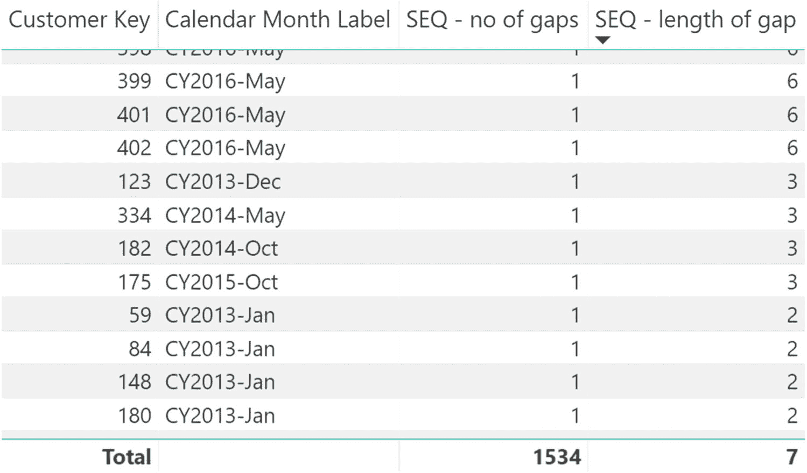

图 10-6  
SEQ 表

这两个度量值都可以看作是分析缺失事件的开端。

## 缺失的索引

寻找前一行的任务与上述类似但又有所不同。需要解决的问题是找到前一行。即使这听起来与寻找前一个值相似，但实际并非如此。在大型数据集中找到前一行并非易事。为此，有必要先解释一下两者的区别。

DAX 经常与其他查询语言（如 SQL 或 MDX）进行比较。在有些比较中，DAX 性能更优，而在另一些比较中则不然。DAX 不提供与 T-SQL 窗口函数（如 `ROW_NUMBER`、`LAG` 或 `LEAD`）类似的功能。这些函数功能强大，可以对一组行进行编号（这与提供排名不同）。`LAG` 和 `LEAD` 允许在行之间进行导航，例如，查找前一行或后一行。

有时，需要在更复杂的度量值中计算前一个值，例如，计算同比 (YoY) 比较。

有时，需要找到前一行，例如，为了确定逐行的变化。

尽管这两个任务看起来相似，但它们并不相同。必须能够区分这两个任务。因此，接下来的两节将更详细地解释这些任务。

### 前一个值

如果能够从给定的上下文中确定前一个值，那么这就属于前一个值问题。

图 `10-7` 将展示其含义。

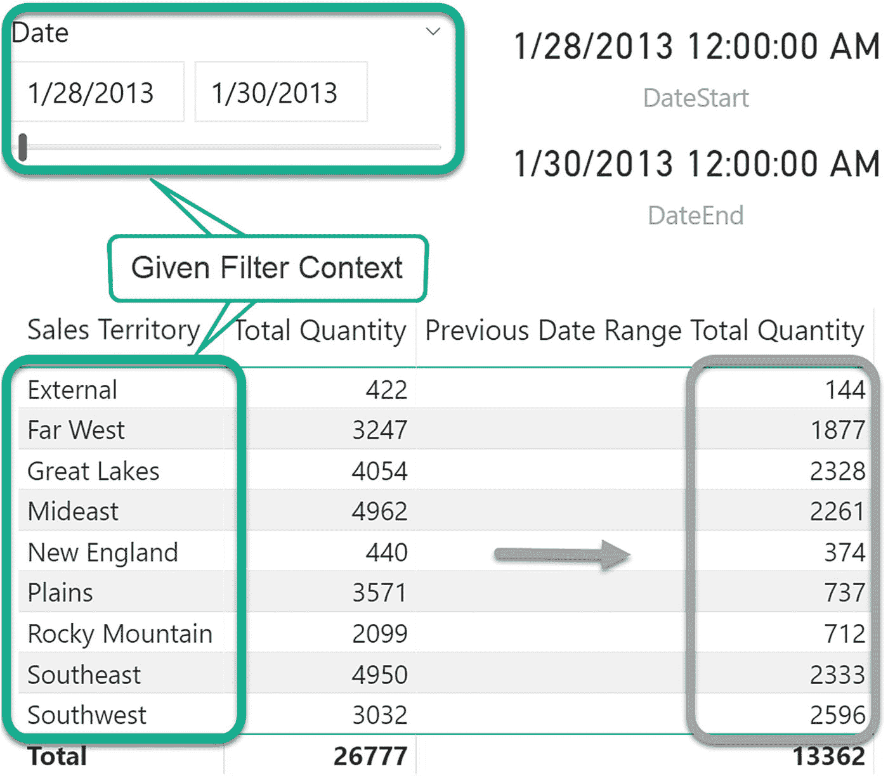

图 10-7  
前一个值

清单 `10-6` 展示了如何从给定的筛选上下文中推导出筛选前一个日期范围所需的日期范围。

```
Previous Date Range Total Quantity =
var DateRangeStart = [DateStart]
var DateRangeLength = DATEDIFF([DateStart] , [DateEnd] , DAY)
var PrevDateRangeEnd = DateRangeStart - 1
var PrevDateRangeStart = PrevDateRangeEnd - DateRangeLength
var PrevDateRange = DATESBETWEEN('Dimension Date'[Date] ,  PrevDateRangeStart , PrevDateRangeEnd)
return
CALCULATE(
[Total Quantity]
, PrevDateRange
)
清单 10-6
前一个日期范围的总数量
```

筛选表 `PreDateRange` 的内容无需任何额外的表扫描即可确定，只需“调整”给定的筛选上下文即可。

### 前一行

确定前一行的问题将通过表格 `Fact Sale`（参见图 `10-8`）中的 `Sale Key` 列进行演示。

### 警告
如果你使用的是附带的 pbix 文件 `“CH 10 – Finding whats not there.pbix”`，请确保已选择 `Customer Key`。

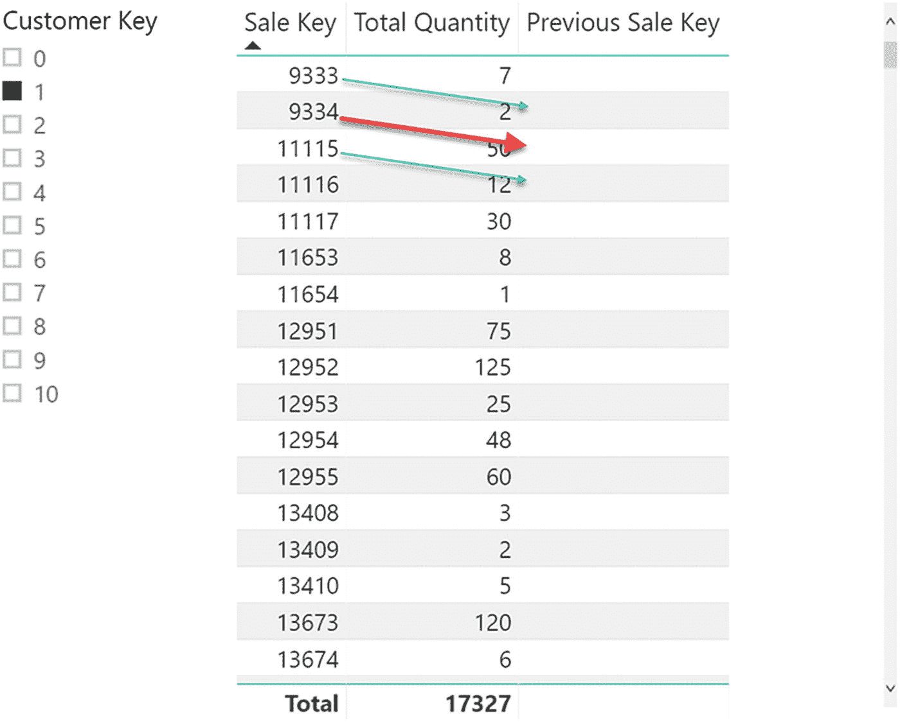

图 10-8  
前一行

一种简单的方法是直接通过当前 `Sale Key` 减 1 来确定前一行：

`PreviousRow(SaleKey: 9334) = 9334 – 1 = 9333`

其复杂性在图 `10-9` 中表现得更加明显。

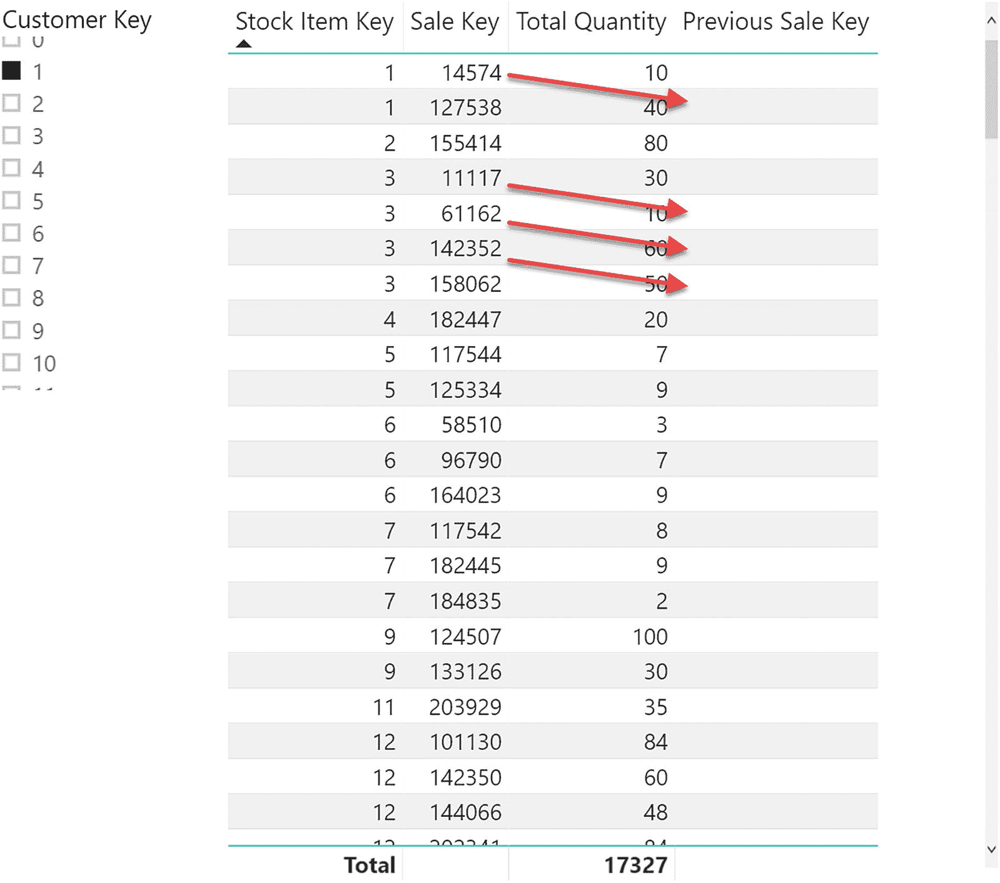

图 10-9  
前一行 – 更复杂的情况

图 `10-9` 显示，除了 `Customer Key` 列的值之外，还必须考虑 `Stock Item Key` 列的值才能确定前一行。

#### 查找前一行：使用 DAX

要使用 DAX 查找前一行，有必要理解完成该任务需要执行哪些步骤。

在这个例子中，使用表 `Fact Sale` 中的 `Sale Key` 列，因为这些值可用于标识每一行。

由于这不是一个简单的方法，所使用的解决方案还考虑了 `Customer Key`。图 `10-10` 显示了一个概念性的小表格，以帮助理解这些步骤。

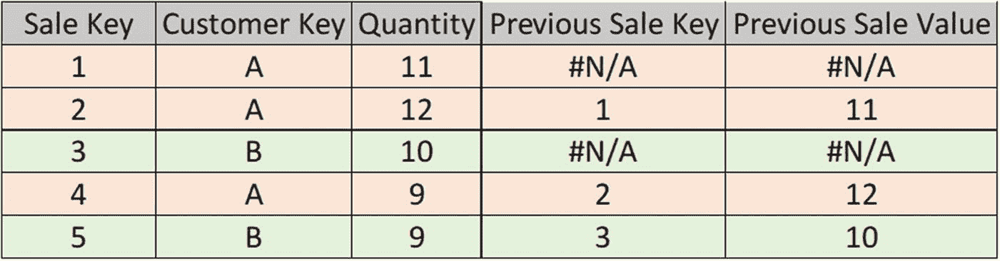

图 10-10  
前一行 – 概念

*   创建一个用于迭代的表。
    在当前的筛选上下文中，`Customer Key` 和 `Sale Key` 的可用的组合。
*   确定前一个 `Sale Key`。
    前一个 `Sale Key` 是当前 `Sale Key` 之前的最接近的 `Sale Key`。
    将使用当前迭代中的当前 `Sale Key` 来查找所有小于当前 `Sale Key` 的 Sale Key。当前 `Sale Key` 之前最接近的 `Sale Key` 是所有小于当前 `Sale Key` 的 `Sale Key` 中的 `MAX(‘…’[Sale Key])`。
*   检索前一个值。
    使用前一个 `Sale Key` 来筛选 `Fact Sale` 表，从而检索前一个值。


#### 注意

在将 10-7 清单中的度量值“上一笔销售价值”添加到 Power BI 文件“CH 10 查找不存在的项.pbix”的报告页“上一行”的表中之前，请确保`客户密钥`切片器仅选择了单个`客户密钥`。

下一个清单，即 10-7，展示了一个用于查找上一行的“仅限 DAX”解决方案。其强制性要求是存在一个唯一标识符，以便能够找到上一行。

```
previous sale value =
var t =
ADDCOLUMNS(
FILTER(
SUMMARIZE(
'Fact Sale'
, 'Dimension Customer'[Customer Key]
, 'Fact Sale'[Sale Key]
)
, [Customer Key]  0 // 客户密钥 0（未知）不予考虑
)
, "thePrevQuantity" ,
var currentSaleKey = [Sale Key]
var prevsalekey =
MAXX(
FILTER(
CALCULATETABLE(
VALUES('Fact Sale'[Sale Key])
, ALL('Fact Sale'[Sale Key])
)
, 'Fact Sale'[Sale Key] < currentSaleKey
)
, 'Fact Sale'[Sale Key]
)
var prevQuantity =
CALCULATE(
[Total Quantity]
, 'Fact Sale'[Sale Key] =  prevsalekey
)
return prevQuantity
)
return
SUMX(
t
, [thePrevQuantity]
)
清单 10-7
上一笔销售价值
```

以上清单将在下面进行更详细的解释。

首先，所有可用的（在当前筛选上下文中的）`客户密钥`和`销售密钥`组合将通过以下 DAX 进行汇总：

```
SUMMARIZE(
'Fact Sale'
, 'Dimension Customer'[Customer Key]
, 'Fact Sale'[Sale Key]
)
```

除此之外，还使用`FILTER`来排除`客户密钥`为 0 的情况，因为此密钥代表“未知”客户。

`ADDCOLUMNS`向表中添加了`thePrevQuantity`列。需要注意的是，`ADDCOLUMNS`是表迭代器函数之一。这意味着用于计算`thePrevQuantity`的表达式是在行上下文中求值的，该行上下文由`客户密钥`和`销售密钥`列决定。

此 DAX

```
CALCULATETABLE(
VALUES('Fact Sale'[Sale Key])
, ALL('Fact Sale'[Sale Key])
)
```

将当前`客户密钥`和`销售密钥`的组合，扩展为当前筛选上下文中当前`客户密钥`的所有销售密钥。这是因为`CALCULATETABLE`执行了以下操作：

-   将现有的筛选上下文克隆到一个新的筛选上下文中。
-   将当前行上下文添加到新的筛选上下文中（针对每次迭代），同时阻止现有筛选（已存在于克隆的筛选上下文中）；可以这样理解：`客户密钥`和`销售密钥`列上的现有筛选被行上下文的列所替代。
-   在旧的筛选上下文中评估筛选表达式`ALL(...)`，并“替换”新筛选上下文中`销售密钥`列上已存在的筛选。
-   在新上下文中评估第一个参数`VALUES('Fact Sale'[Sale Key])`。

此步骤的结果如图 10-11 所示。

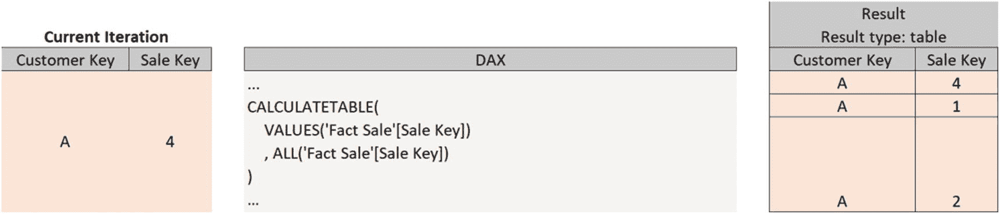

图 10-11

上一行 – 概念 – 展开

然后，对上一步得到的结果表进行筛选，只保留销售密钥小于当前销售密钥（存储在变量`currentSaleKey`中）的所有行。结果如图 10-12 所示。

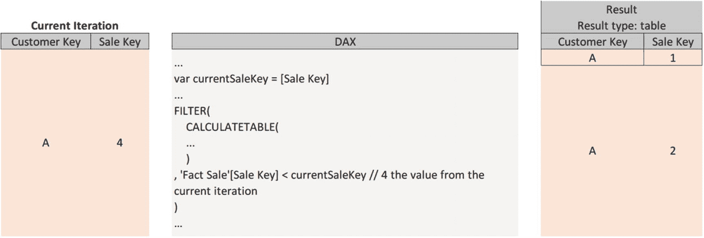

图 10-12

上一行 – 概念 – 筛选

`MAXX`用于在由`FILTER(...)`返回的筛选表对象中查找最大值。这将返回上一个`销售密钥`。`MAXX`返回的标量值存储在变量`prevsalekey`中。最后，使用此变量检索上一个销售密钥的数量。

### 查找上一行：使用建模方法

解决上一行问题的另一种方法是基于建模的方法，即使用一个已包含上一行值的附加表。此表必须在数据模型外部创建，例如，使用 Power Query 或——甚至更好——在源系统内部创建。这种方法有助于解决大数据集的性能问题。创建此表可能具有挑战性，但有助于克服大数据集的性能问题。该 pbix 文件包含表“`Fact Sale – Previous Value`”，该表已在 SQL Server 内部使用 10-8 清单中的 SQL 语句创建。强烈建议将此附加表对数据模型的最终用户“隐藏”，以避免混淆。

```
select
f.[Customer Key]
, f.[Sale Key]
, f.[quantity]
, LAG(f.[Sale Key] , 1) over(partition by f.[Customer Key] order by f.[Sale Key] asc) as prevsaleeky
, LAG(f.[Quantity] , 1) over(partition by f.[Customer Key] order by f.[Sale Key] asc) as prevquantity
from
Fact.Sale as f
清单 10-8
使用 LAG 查找上一值的 T-SQL.sql
```

然后，通过使用`销售密钥`列在表`Fact Sale`和`Fact Sale – Previous Sale`之间建立关系，将此附加表集成到数据模型中。由于这些列在任一表中都是唯一的，Power BI 会创建一个基数为“一对一 (1:1)”的关系。有必要将基数更改为“一对多 (1:*)”，并将表`Fact Sale`放在“一”侧，以充分利用筛选传播的速度。此关系如图 10-13 所示。

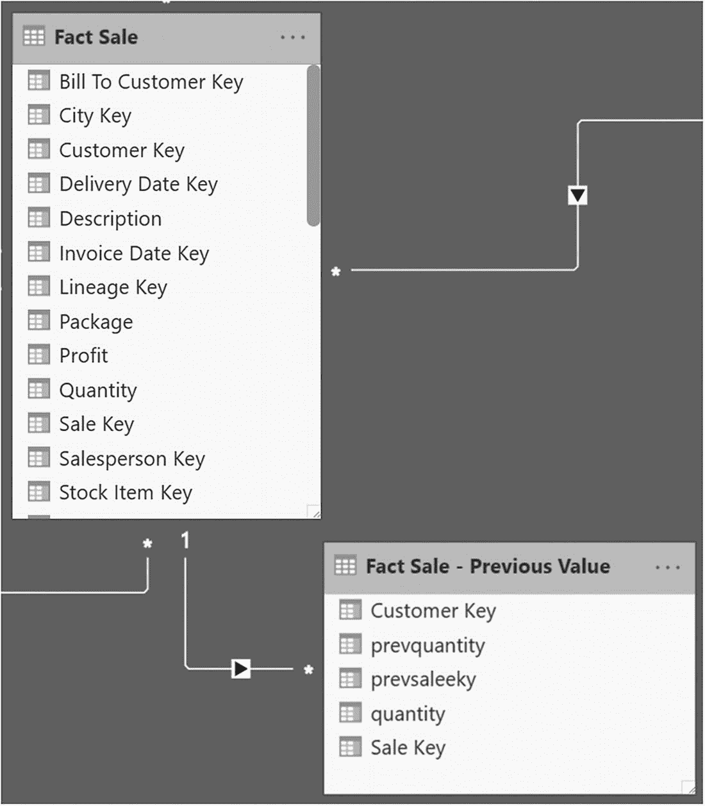

图 10-13

上一行，基于事实表 – 关系

可以使用如 10-9 清单所示那样简单的度量值来计算上一行的值。

```
上一笔销售价值 - 基于事实表 =
SUM('Fact Sale - Previous Value'[prevquantity])
清单 10-9
上一笔销售价值 – 基于事实表
```

使用建模方法具有巨大的性能优势。接下来的两个图表展示了这种性能优势。图 10-14 显示了使用仅限 DAX 的方法计算`客户密钥` 2 及`客户密钥` 2–200 的上一行值的查询持续时间。图 10-15 显示了相同的情况，但使用了附加事实表`Fact Sale – Previous Value`。

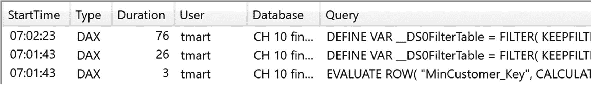

图 10-15

上一行值，基于事实表

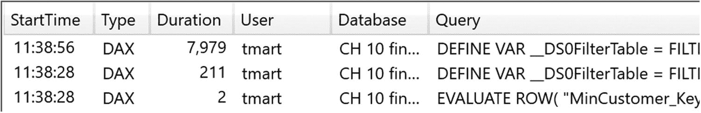

图 10-14

上一行值，仅限 DAX

在两个图表中，最底部的查询用于填充`客户密钥`切片器；1 毫秒的微小差异可以忽略不计。

中间的那条线显示了`客户密钥` 2 的上一行值的计算，即使这种差异看起来不大，因为两个查询都不到一秒就返回了答案。

但最顶部查询之间的差异是巨大的。使用“仅限 DAX”的方法计算`客户密钥` 2–200 的上一行值需要**近 8 秒钟**。

而利用附加事实表的简单度量值在**不到 80 毫秒**内就返回了结果。这是一个巨大的性能提升。


#### 注意

使用额外的事实表也有其缺点。由于该附加表与事实表具有相同的粒度，它自然会消耗额外的内存。创建额外的事实表也可能需要比前文中的 SQL 语句复杂得多的语句，因为确定先前的 `Sale Key` 可能涉及比本例中使用的简单方法多得多的逻辑。

对于如何处理前一行问题，并没有明确的答案，但希望这能证明，一个复杂且缓慢的 DAX 语句（或许）可以通过利用数据库引擎的所有底层能力（数据建模和 DAX）来简化。

