# 11. 行级安全性

## 简介

在某些时候，您可能会遇到这样的需求：创建一个报告，该报告需要根据查看报告的当前登录用户，提供特定的结果。一种场景是，不同的团队成员需要一个报告，该报告显示他们各自负责的项目的低层级细节，但阻止他们看到同一团队中其他成员的相同细节层。另一种场景可能是向组织外部的多个群体提供报告，确保访问报告的人只能看到他们应该看到的信息。

一种解决方案是创建数据模型的主副本，并根据需要制作尽可能多的克隆来满足所需的信息孤岛数量。每个克隆可以填充特定于某个用户或组织的数据，然后，每个报告仅提供给应该有权访问的用户。这种方法降低了数据泄露的风险。

然而，一旦数据孤岛数量超过少数几个，这种方法就会变得复杂且难以管理。当需要对模型中已有的计算进行修改或添加新的计算时，每个数据模型都需要被修改、测试、上传等等。使用这种方法需要注意的其他问题包括：数据刷新调度、模型大小，以及管理每个数据模型中控制仅导入适当数据的唯一代码。

幸运的是，还有一种替代方案：行级安全性 (`RLS`)。`RLS` 允许您将所有相关数据纳入一个数据模型中，并提供一个安全且健壮的过滤层来管理谁能看到什么。行级安全性的概念并不新鲜。`SQL Server Analysis Services` 数据库长期以来一直提供行级安全性的概念，其多维和表格版本都提供了此类功能。

`Power BI Desktop` 和 `Power BI Web` 服务使用 `SSAS` 数据库的表格版本，微软理解并重视此功能对于组织管理其数据的关键性。

在单个数据模型上配置 `RLS` 后，不同的用户可以访问同一个模型，但可以安全地防止他们看到不应该看到的数据。使用 `RLS` 的一些优势在于，当添加新的计算或更新现有计算时，只需在一个地方进行更改。管理单个模型在数据刷新、网关和大小调整等方面会变得容易得多。

通过 `RLS`，可以定义规则，以多种不同的方式过滤数据。可以授予供应商访问数据模型的权限，以查看其产品的库存和销售数据，但不能查看同一模型中其他供应商或整个表（例如员工或财务数据）的数据。在多门店环境中，特定门店内的个人可以使用带有 `RLS` 的数据模型访问报告，并下钻到非常低级别的细节，以查看其门店的业绩，同时也可以看到其他门店的汇总信息，这些信息提供了有用的比较基准。其他门店的个人可以同时访问具有相同约束的同一数据模型。

组织内的员工可能需要访问模型中的特定数据，但不能访问敏感数据（财务、薪资）。其他人可能需要访问高级别的汇总数据，但被阻止下钻到可能暴露他们无需访问的敏感或个人身份信息的层级。而使用同一模型的其他人员则需要酌情全面访问细节。

`RLS` 非常灵活，足以满足您可能遇到的任何需求。`RLS` 规则的局限性未必是技术性的，更多的是在涉及大量复杂规则时的可管理性和可维护性——尤其是在规则冲突或重叠的情况下。

好消息是，用于配置 `RLS` 的规则都基于 `DAX`。`RLS` 规则被定义为 `DAX` 筛选表达式，可以像 `[Country] = "USA"` 一样简单，也可以像一个复杂、多层的语句系列，最终解析为布尔值 `true` 或 `false`，以决定应过滤掉或保留哪些行。

将 `RLS` 筛选表达式视为一个 `T-SQL` `WHERE` 子句，该子句被添加到报告中的每个查询和每个视觉对象中。另一种思考 `RLS` 的方式是将其视为一个多过程过程。如果定义了 `RLS`，第一遍是将 `RLS` 规则应用于表，只有通过第一遍 `RLS` 的行才对来自报告的查询可见。

### 角色

`Power BI` 中的 `RLS` 是基于角色的。如果您想使用 `RLS`，则必须在模型中至少定义一个角色。您可以根据需要创建任意数量的角色。角色可以量身定制，以适应单个用户、组或其他非特定用户的实体。角色可以是部门性的、区域性的，甚至基于时间的。

`Power BI Desktop` 允许您创建角色，但不管理谁被分配到哪个角色。将用户分配到角色的工作是在 `Power BI Web` 服务中完成的。分配用户到角色的活动可以由与为每个角色配置规则的人完全不同的人执行和管理。

在 `Power BI Desktop` 中，要添加或编辑角色，请单击功能区“建模”选项卡“安全”部分中的“管理角色”按钮。图 11-1 显示了功能区中的“管理角色”按钮。

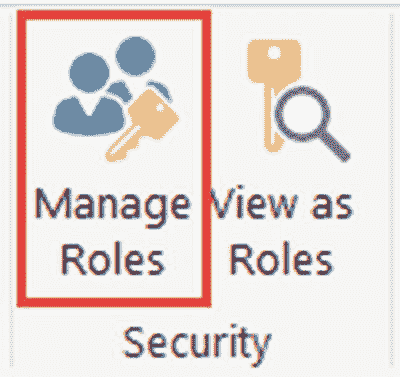

**图 11-1** 显示用于访问 `RLS` 角色的“管理角色”按钮

单击“管理角色”按钮会弹出一个对话框窗口，其中列出了数据模型中当前定义的每个角色。图 11-2 中显示的“管理角色”对话框的三个元素是：角色、表和筛选器。

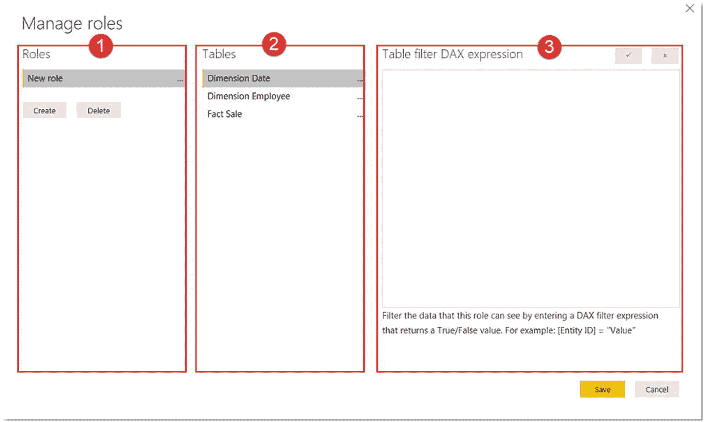

**图 11-2** `Power BI Desktop` 中的“管理角色”对话框窗口

1.  角色

2.  表

3.  筛选器

### 角色

第 1 步中的“角色”部分显示了当前定义的角色列表。此部分提供了创建新角色或删除现有角色的按钮。单击角色列表中的角色名称会更新“表”和“筛选器”部分中的信息，以显示特定于该高亮角色的详细信息。一次只能高亮一个角色。

角色名称右侧的省略号提供了重命名或克隆现有角色的功能。

### 表

在“角色”部分旁边是一个列表，显示了数据模型中的每个表。“表”面板如图 11-2 的步骤 2 所示。点击右侧的省略号，表名会打开一个上下文菜单，初始提供“添加筛选器”或“清除表筛选器”选项。展开“添加筛选器”选项会列出表中的每个列，点击任一列会在“筛选器”部分创建或扩展 `DAX` 筛选表达式。

一旦某个表至少定义了一个筛选器，该表省略号旁边就会出现一个筛选器图标，表示现在已存在筛选器。点击表名会更新“筛选器”部分中的文本，以显示该表当前的 `DAX` 筛选表达式。如果在上下文菜单中点击了列名，该列名会出现在“筛选器”窗口中，并附带示例运算符和值，以帮助指导正确的语法。

点击`'Dimension Date'`表中的`[Date]`列，会在“筛选器”部分填充一条建议的 `DAX` 筛选表达式。该建议会考虑所选待筛选列的列数据类型，并为数值列和文本列提供不同的建议。图 11-3 中展示了一个示例。

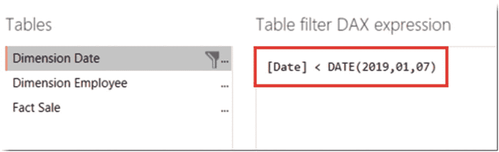

图 11-3

`'Dimension Date'`表上的 `RLS DAX` 筛选表达式示例

### 筛选器

“管理角色”对话框的最后一部分是“筛选器”部分，如图 11-2 的步骤 3 所示。“筛选器”部分提供了一个面板，显示用于对所选表/角色筛选行的当前 `DAX` 表达式。窗口中的文本可以直接编辑，并且作为一个完整的表达式，它必须计算为布尔值 `true` 或 `false`。

子查询可以在 `RLS` 筛选语句中使用，本章稍后的“使用子查询的动态 `RLS`”一节中提供了一些示例。

对于一个给定的角色，可以在多个表上定义筛选器，这意味着单个角色可以拥有类似以下的筛选器定义：

*   `Geography[Country] IN {"USA","Canada"}`

*   `Date[Calendar Year] >= 2020`

*   `Employee[Department] = "Sales"`

在上述角色的筛选器定义中，三个表都应用了筛选器。`Geography` 表中的每一行都会根据一条规则进行评估，该规则规定`'Geography'`表中`[Country]`列的值必须匹配“USA”或“Canada”。注意使用了 `DAX` `IN`函数来允许多选。

`Date` 表也有一条规则，用于筛选掉 2020 年之前的年份。最后，`Employee` 表会被筛选，以便仅返回`[Department]`列中值为“Sales”的行。

假设该示例中的每个表都是星型模式中的一个维度表，位于与某些事实表的一对多关系的一端。这些规则会自动沿着一对多关系向下传播，并应用于下游表。规则不必定义在定义关系的列上。

“筛选器”部分的右上角还提供了两个按钮，如图 11-4 所示。勾选按钮会验证编辑器窗口中的 `DAX`，以确保其返回布尔值，并检查可能在 `RLS` 筛选语句中无效的代码。

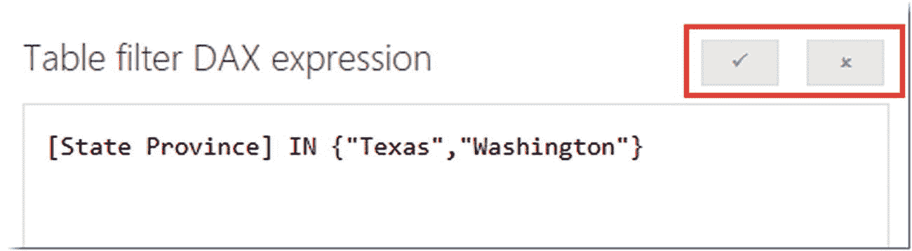

图 11-4

用于检查或清除 `RLS` 筛选规则的按钮

带有叉号的按钮会清除当前所选表所在窗口中的所有测试。

## 测试角色

与任何开发形式一样，测试你的更改以确保它们按预期运行至关重要。`Power BI Desktop` 提供了一种有用的方法来测试 `RLS` 角色，从而尽早发现问题。如果模型中的数据是敏感的，且某些人员绝不应看到，那么 `RLS` 尤为重要。

功能区中“管理角色”按钮旁边是“以角色身份查看”按钮。点击它会打开一个对话框，让你选择已使用“管理角色”屏幕定义的任何角色的名称。该按钮如图 11-5 所示。

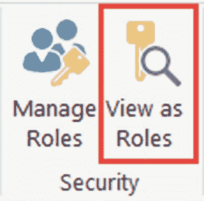

图 11-5 建模选项卡中“安全性”部分的“以角色身份查看”按钮

假设一个名为“测试角色 1”的单独角色是在数据模型中使用 Wide World Importers 数据集中的`'Dimension City'`、`'Dimension Date'`和`'Fact Sale'`表定义的。`'Dimension City'`和`'Fact Sale'`之间使用`[City Key]`列存在标准的一对多关系，而`'Dimension Date'`表使用`[Invoice Date Key]`列连接到`'Fact Sale'`表。图 11-6 显示了当前示例的关系视图。

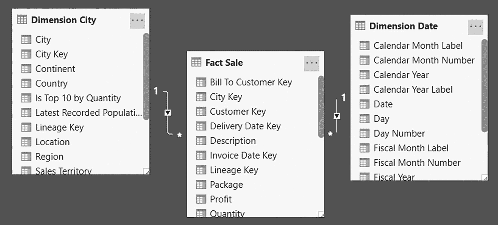

图 11-6 测试示例的关系视图

“测试角色 1”角色应用了以下 RLS 筛选规则：

*   `'Dimension City'[State Province] IN {"Texas","Washington"}`
*   `'Dimension Date'[Calendar Year] = 2015`

`'Dimension Date'`和`'Fact Sale'`表之间的关系使用`[Invoice Date Key]`列。在此示例中，这两个表之间只有一个关系，并且该关系被配置为活动关系。RLS 筛选规则仅通过活动关系向下传播，因此额外的*非活动*关系对于 RLS 来说毫无意义。

为了建立测试的基准线，使用清单 11-1 中的代码创建的`[Sum of Quantity]`计算度量值被添加到一个空白的报表页面上，且没有其他筛选器。结果值 8，950，628 在图 11-7 的可视化对象中显示。

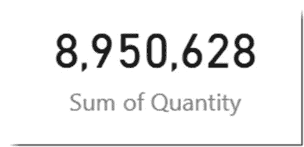

图 11-7 `[Sum of Quantity]`计算度量值的未筛选结果

```
Sum of Quantity = SUM('Fact Sale'[Quantity])
```

清单 11-1：一个用于帮助测试 RLS 的基本计算度量值

要测试“测试角色 1”角色，请点击建模选项卡中“安全性”部分的“以角色身份查看”按钮。点击此按钮会弹出一个对话框，其中包含如图 11-8 所示的选项。勾选“测试角色 1”旁边的复选框，然后点击“确定”按钮。在此对话框中，点击“无”旁边的复选框是一种清除 RLS 筛选器的方法。

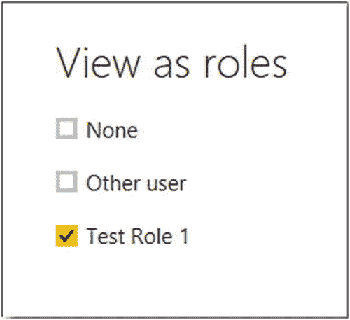

图 11-8 “以角色身份查看”对话框窗口

图 11-7 中使用计算度量值的未筛选可视化对象现在显示了一个不同的值。图 11-9 中显示的 244，520 这个值考虑了 RLS，并受到在`'Dimension City'`和`'Dimension Date'`表上定义的规则的筛选。报表中没有其他筛选器直接应用于`'Fact Sale'`表。

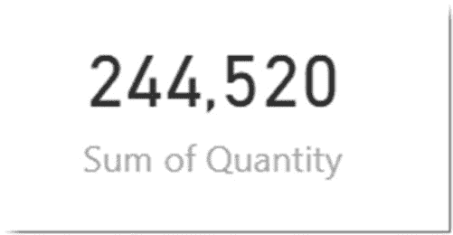

图 11-9 使用 RLS 时`[Sum of Quantity]`计算度量值的未筛选结果

Power BI Desktop 的“报表”和“数据”视图现在会在功能区下方显示一个黄色条带，其中包含一条消息，提示您“现在以以下角色查看报表：Test Role 1”。此警告消息如图 11-10 所示。单击此警告消息上的按钮可移除 RLS 筛选。

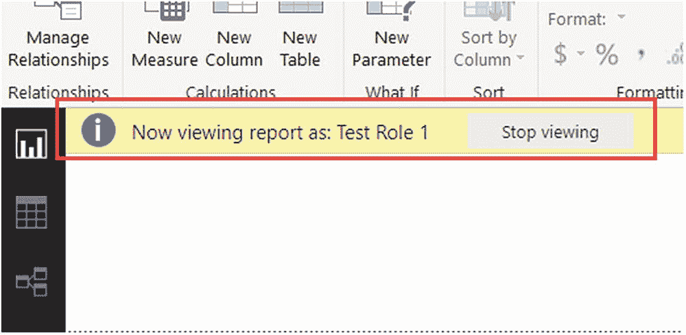

`图 11-10` `[Sum of Quantity]` 计算度量值的未筛选结果

另一种查看测试的方法是通过 Power BI Desktop 的“数据”视图窗口。“数据”视图仅显示满足活动角色 RLS 筛选要求的行。当没有测试任何角色时，“数据”视图会显示每个表中的所有行。当测试某个 RLS 角色时，行数会更新以反映 RLS 筛选。表 11-1 显示了“Test Role 1”对“数据”视图中可见数据的影响。由于此特定测试未对`Dimension Employee`表应用任何筛选，因此该表没有变化。

`表 11-1` RLS 角色对数据模型中表行数的影响

| 表名 | 无 RLS 时的行数 | 使用 RLS 测试时的行数 |
| --- | --- | --- |
| Dimension City | 116,295 | 10,427 |
| Dimension Date | 1,461 | 365 |
| Dimension Employee | 213 | 213 |
| Fact Sale | 228,265 | 6,378 |

快速检查`Fact Sale`表的方法是排序`Invoice Date Key`列，并检查顶部和底部的边界值是否仍符合 2015 年这一筛选要求，即属于 2015 日历年的数据。

RLS 筛选不仅适用于计算度量值或可视化对象；筛选发生在数据模型的更高级别，因此即使在“数据”视图中可见的数据也会受到限制。

### 测试多个角色

当您的数据模型中使用了动态 RLS 并且您有多个角色时，已发布数据集的用户可能存在于多个角色中。为了在 Power BI Desktop 中对此进行测试，请在“以角色身份查看”对话框中启用多个复选框，如图 11-11 所示。

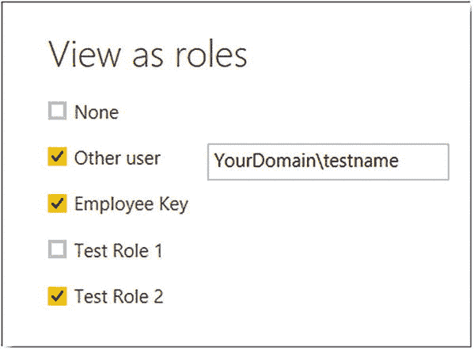

`图 11-11` “以角色身份查看”对话框显示选中了多个角色

请注意，Power BI Desktop 将不同角色之间的规则视为 OR（或）关系，而非 AND（与）关系。

请考虑以下场景。

“Test Role 1”角色定义了以下 RLS 筛选规则：

*   `Dimension City`[State Province] = “Texas”

“Test Role 2”角色定义了以下 RLS 筛选规则：

*   `Dimension Date`[Calendar Year] = 2015

当仅选择“Test Role 1”时，`Fact Sale`表中的数据会被筛选为仅显示属于“Texas”的行。

当仅选择“Test Role 2”时，`Fact Sale`表中的数据会被筛选为仅显示属于 2015 年的行。

然而，当同时选中“Test Role 1”和“Test Role 2”时，`Fact Sale`表中的行可以属于“Texas”或者 2015 年。属于其他`State Province`的行也会出现，但仅限于 2015 年的数据。

此效果可以在图 11-12 中看到，该图使用了一个矩阵可视化对象，其列是`Calendar Year`，行是`State Province`。此视图是在使用“以角色身份查看”对话框同时选中“Test Role 1”和“Test Role 2”时捕获的。

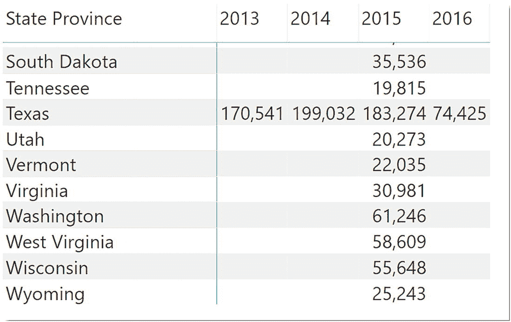

`图 11-12` 一个矩阵可视化对象，展示了多个角色如何被视为 OR 关系而非 AND 关系

图 11-12 显示的结果也会在 Power BI Web 服务中体现，并且在设计具有多个 RLS 角色的数据模型时，理解这一点至关重要。请记住，在 Power BI Web 服务中，一个用户帐户可以被分配给多个角色。

## 活动关系与 RLS

使用前面的示例，让我们看看当更改`Dimension Date`和`Fact Sale`表之间活动关系所涉及的列时会发生什么。当前关系将`Fact Sale`表中的`Invoice Date Key`列与`Dimension Date`表中的`Date`列链接起来。

让我们更新关系，改为使用`Fact Sale`表中的`Delivery Date Key`列，并查看“报表”和“数据”视图会发生什么变化。为“Test Role 1”角色定义的 RLS 筛选规则保持不变。

报表视图中的可视化对象现在显示了一个与之前看到的不同的值。图 11-13 中显示的新值是 243,923，而之前是 244,520。这反映了 RLS 筛选现在应用于 `Dimension Date` 表，并向下传播到 `Fact Sale` 表中不同的行集。

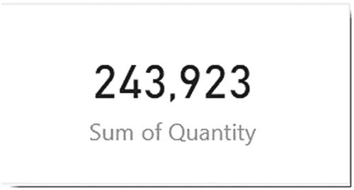
**图 11-13** 关系更改后计算度量值的更新值

## DAX 查询计划

让我们使用第 13 章“查询计划”中推荐的跟踪事件，查看上述示例的一些 DAX 分析器事件。

推荐的跟踪事件是：

*   查询事件

    *   Query End

*   查询处理

    *   DAX Query Plan

    *   VertiPaq SE Query Cache Match

    *   VertiPaq SE Query End

在 SSMS 分析器中启用这些事件并使用空缓存时，刷新图 11-9 中所示的可视化对象时会捕获以下事件。

### 逻辑计划

逻辑计划的简化版本如代码清单 11-2 所示，其中没有任何关于 RLS 应用的任何筛选规则的线索或引用。逻辑计划建议对 `Fact Sale'[Quantity]` 列执行 `Sum_VertiPaq` 操作。

```
AddColumns:
Sum_Vertipaq:
Scan_Vertipaq: Fact Sale'[Quantity]
'Fact Sale'[Quantity]:
```

**代码清单 11-2** 使用 RLS 角色测试计算度量值时捕获的逻辑计划简化版本

### 物理计划

代码清单 11-3 中显示的物理计划不包含任何根据该角色的 RLS 筛选规则进行筛选的操作符或指令。与代码清单 11-2 中的逻辑计划一样，无论是否应用 RLS 筛选，物理计划都是您所期望看到的。

```
AddColumns:
SingletonTable:
SpoolLookup: LogOp=Sum_Vertipaq
ProjectionSpool>:
Cache: IterPhyOp
```

**代码清单 11-3** 使用 RLS 角色测试计算度量值时捕获的物理计划简化版本

### DAX Query End

Query End 事件携带了 Power BI Desktop 为获取可视化对象所需结果而向数据模型中的数据库发出的实际 DAX 查询。该 DAX 如代码清单 11-4 所示，与逻辑计划和物理计划一样，它没有引用根据正在测试的活动 RLS 角色进行的筛选。即使关闭 RLS 测试，也会产生完全相同的 DAX Query End 事件。

```
EVALUATE
ROW(
"Sum_of_Quantity", 'Fact Sale'[Sum of Quantity]
)
```

**代码清单 11-4** 计算度量值的 DAX Query End 文本

### VertiPaq 扫描

最后需要检查的事件是与查询存储引擎（SE）相关的事件。行级安全（RLS）过滤规则会在这里的 SE 事件中出现。图 11-14 展示了一个 `WHERE` 子句被添加到了由 SE 事件生成的伪 T-SQL 查询中。

当关闭 RLS 角色测试时，`WHERE` 子句会从该事件中消失。

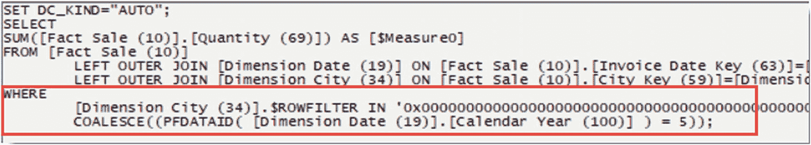
**图 11-14** – 正在测试的计算度量值的存储引擎查询

如图 11-14 所示，存在一个 `WHERE` 子句，它包含两行。`WHERE` 子句中的第一行与 'Dimension City' 表上的筛选器有关。这一行 `WHERE` 子句中的文本使用了 `IN` 谓词，并且非常长。滚动到该文本的最右侧，可以看到“[总计 1818 个单位，未全部显示]”。DAX 查询引擎会将应用于 [State Province] 的 RLS 筛选规则转换为特定值，用于筛选 'Dimension City' 表中的内部 rowid 列。

`WHERE` 子句中的第二行与 'Dimension Date' 表有关，并且再次在谓词中使用 `IN` 运算符来指定对 2015 年内在字典值的筛选。

捕获到的 VertiPaq SE 事件还显示了当多个 RLS 角色同时生效时的扫描行为。伪 T-SQL 揭示了一个 `WHERE` 子句，它使用 `OR` 运算符（而不是 `AND` 运算符）连接一系列规则。`VertiPaq SE Query End` 是一个有用的跟踪事件，用于精确了解 DAX 查询引擎正在从底层数据库中请求哪些数据。

### 查询计划总结

总而言之，RLS 应用于存储层，而不是通过对 Power BI Desktop（或 Web 服务）生成的 DAX 查询进行修改，也不是通过对在“数据”视图中生成数据的查询进行修改。

## 动态行级安全

本章前面的示例都对列筛选使用了硬编码值。迟早，你会遇到需要动态应用 RLS 规则的需求。一个典型的例子是考虑查看报表的用户的用户名。

Wide World Importers 数据集有一个 'Dimension Employee' 表，其中包含 20 个不同的 [Employee ID] 值。假设你有一个锁定报表的需求，使其只显示属于已登录用户的数据。解决此问题的一种方法是创建 20 个 RLS 角色，每个角色都有一个硬编码规则，例如 `[WWI Employee ID] = 1`，然后在数据集发布到 Power BI Web 服务后，将相应的个人分配到该角色。

这种方法很耗时，并且在配置 Web 服务时存在出错的风险，并且意味着当员工入职和离职时需要管理角色。

幸运的是，有更好的方法可以通过实现动态 RLS 来解决。有几个有用的 DAX 函数可以帮助检测当前用户，从而实现动态 RLS。这些函数是：

- `USERNAME()`

- `USERPRINCIPALNAME()`

这些函数返回的文本包含当前查看报表的用户的登录详细信息。在 RLS 筛选器中使用的 DAX 表达式可以使用这些函数，与预填充的已知 UserName（或 UserPrincipalName）值表中的列进行比较。如果测试找到匹配项，则该表以及任何下游相关表都会被筛选，以仅显示该用户名对应的行。

一种方法是预填充一个全新的表，或者向现有表中添加一列，其值可能匹配这些函数的输出。因此，你首先需要查看每个函数生成的输出。测试此输出的最简单方法是将清单 11-5 中的计算度量值添加到数据模型中，然后放在显示文本的报表视觉对象中。

```
动态 RLS 测试 =
COMBINEVALUES(
", " ,
"USERNAME() = " & USERNAME() ,
"USERPRINCIPALNAME() = " & USERPRINCIPALNAME()
)
```

**代码清单 11-5** – 用于显示 `USERNAME()` 和 `USERPRINCIPALNAME()` 函数输出的计算度量值

当 `[Dynamic RLS test]` 计算度量值被添加到 Power BI Desktop 的报表画布时，你可能会看到每个函数都输出一个使用 *domain\username* 模式的值。

将同一个报表发布到 Web 服务并在登录 Web 服务后检查显示的值非常重要。此时该值应该不同，并且更可能是一种类似于 *username@yourcompanydomain.com* 的模式。这个示例是在数据模型中预填充表以使用 RLS 筛选器进行筛选时需要使用的模式，而不是 *domain\username* 模式。

下一步是将这些用户名添加到你的数据模型中。为了使用 Wide World Importers 数据集满足此要求，请将清单 11-6 中的计算列添加到 'Dimension Employee' 表中。

```
用户主体名称 =
REPLACE('Dimension Employee'[Employee]," ",".") &
"@wideworldimporters.com"
```

**代码清单 11-6** – 添加一个值以用作动态 RLS 筛选器的计算列

清单 11-6 中的代码生成一个新列，该列创建一个旨在匹配 `USERPRINCIPALNAME()` 函数在 Power BI Web 服务中的输出。此计算列中显示的模式并非适用于每个组织，因此需要根据实际情况进行调整。图 11-15 显示了一个使用清单 11-6 代码的示例表。

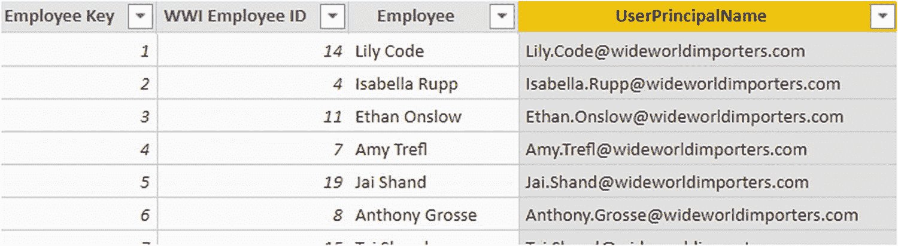
**图 11-15** – 'Dimension Employee' 表，包含清单 11-6 中的计算列

接下来，需要在数据模型中创建一个新的 RLS 角色，该角色对 `‘Dimension Employee’` 表应用筛选器。在图 11-16 中，添加了一个名为 `“Dynamic RLS Role”` 的新角色和一个简单的 DAX 表达式。

带方括号的 `[UserPrincipalName]` 文本引用了高亮显示的 `‘Dimension Employee’` 表中的一列，而文本右侧带圆括号的 `UserPrincipalName()` 则引用了 DAX 函数。

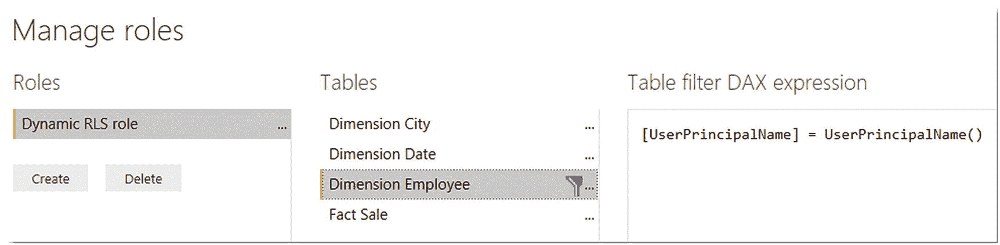

**图 11-16** 一个基本的 RLS 角色，旨在通过 `USERPRINCIPALNAME` 函数筛选 `‘Dimension Employee’` 表

可使用 `View as Roles` 功能测试新角色，并且可以使用此功能模拟任何用户。图 11-17 显示了为测试而配置的 `View as Roles` 对话框。在此对话框中，同时选中了 `“Other user”` 和 `“Dynamic RLS role”`。

当选中 `“Other user”` 旁边的复选框时，会出现一个文本框，允许您输入一些文本。您在此处输入的文本将同时在 Power BI Desktop 中的 `USERNAME` 和 `USERPRINCIPALNAME` 函数中生效。

能够在 `“Other user”` 旁边输入任意文本，使您可以在 Power BI Desktop 模式下模拟任何用户。

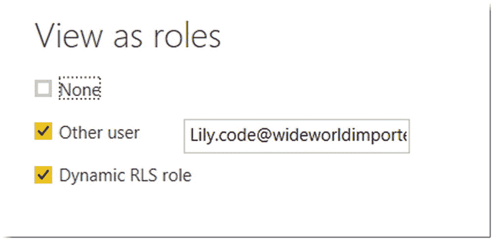

**图 11-17** 为测试动态 RLS 而配置的 `View as Roles` 对话框

在图 11-17 中，`“Other user”` 设置为 `Lily.code@wideworldimporters.com`，并且 `“Other user”` 和 `“Dynamic RLS role”` 选项都被勾选，这意味着它们在 Power BI Desktop 中都变为活动状态。

两个角色都激活的效果可以在报表和数据视图中看到。在数据视图中，`‘Dimension Employee’` 表现在只显示 18 行，这 18 行中新的 `[UserPrincipalName]` 列与在 `View as Roles` 对话框中输入的值相匹配。

`‘Fact Sale’` 表现在只显示 22,642 行，而不是应用 RLS 之前的 228,265 行。`‘Fact Sale’` 中可见的行被限制为仅属于员工 Lily Code 的行。

任何报表页上的所有视觉对象现在都会自动筛选为仅显示这些行。不会对任何计算的度量值或列进行修改。

这种方法的好处是，当有新用户添加到 `‘Dimension Employee’` 表时，除了将他们添加到相应的应用工作区之外，无需对 Power BI 报表进行任何操作，新用户就能使用筛选功能访问该报表。

### 在 Power BI Web 服务中进行测试

现在，该报表已准备好发布到 Power BI Web 服务。理想情况下，您可以将报表发布到应用工作区。一旦报表存在于应用工作区中，您可以导航到该应用工作区的“数据集”区域，并点击单击省略号后出现的上下文菜单中的“安全性”选项，如图 11-18 所示。

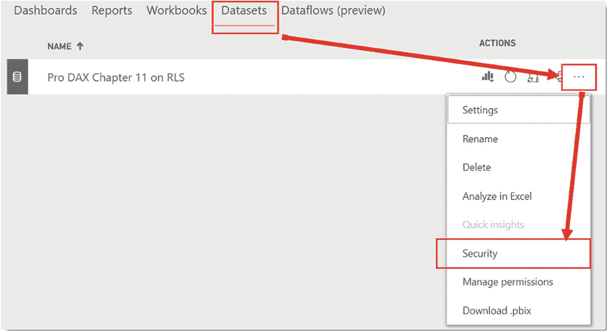

**图 11-18** Power BI Web 服务中应用工作区的“数据集”屏幕

“安全性”选项会加载所选数据集的行级安全性屏幕，如图 11-19 所示。此屏幕允许您在 Web 服务中为数据集配置 RLS。点击角色名称旁边的省略号，您可以测试该报表。

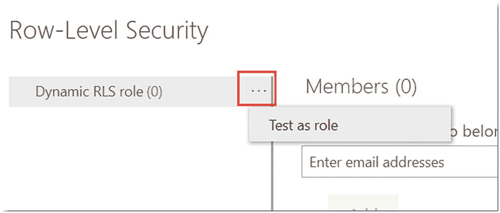

**图 11-19** 如何在 Power BI Web 服务中调用 `Test as role` 功能

一旦您在 Web 服务中调用 `Test as role` 功能，报表便会显示出来，此时 RLS 处于激活状态，并且已设置为根据您的凭据进行筛选。此功能如图 11-20 所示。报表顶部会出现一个蓝色栏，允许您通过点击 `“Back to Row-Level Security”` 箭头来关闭测试。

点击 `“Now viewing as: ”` 文本可以打开一个对话框，允许您输入另一个用户进行测试。当您在文本框中输入时，租户中有效的用户会出现，让您可以选择合适的用户。此功能在检查每个用户看到的内容时非常有用，尤其是当跨多个角色的筛选规则开始变得复杂时。

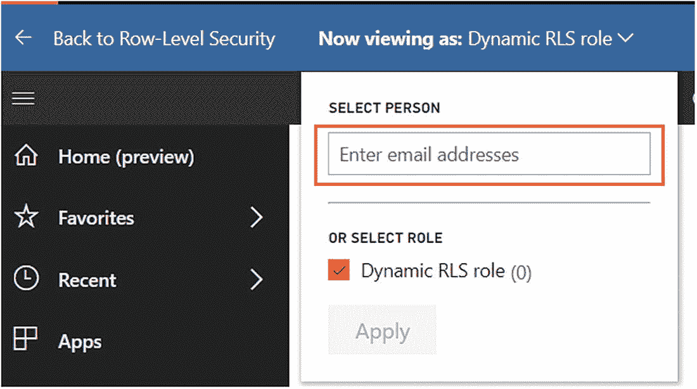

**图 11-20** 使用不同用户进行测试

测试完成后，您可以点击蓝色栏中的 `“Back to Row-Level Security”` 文本，导航回数据集的行级安全性配置窗口。

### 使用子查询的动态 RLS

`USERPRINCIPALNAME` 函数非常适合将数据筛选到特定用户。有时，在其他场景下，可以使用动态 RLS 角色来最小化所需角色的总数。

子查询可以在 RLS 筛选器中替代硬编码值。

只要 RLS 筛选表达式能解析为布尔值 true 或 false，就可以包含大多数 DAX 表达式。图 11-21 的筛选器面板中显示的示例展示了一个使用 `MAXX` 函数的筛选器。

`IN` 运算符可以与任何返回单列表的 DAX 函数（如 `SELECTCOLUMNS`、`TOPN` 或 `VALUES`）结合使用。`VALUES` 函数可以包裹一个筛选器以提供额外的灵活性。

`TOPN` 不会计算相关表中的值，因此，尝试根据相关 `‘Fact Sale’` 表中的列，将 `‘Dimension City’` 表限制为仅显示前十个 `[State Province]` 值的查询无法生效。

这个限制很可能是因为 RLS 筛选在存储引擎级别的实现方式，它无法使用不同的表进行筛选。这些场景可以通过在数据建模中，在 `‘Dimension City’` 表中预先计算一个列来解决，该列将 `[Is Top 10 State Province By Quantity]` 显示为 1 或 0。一旦添加了此类列，就可以在 RLS 筛选器中快速有效地使用它。

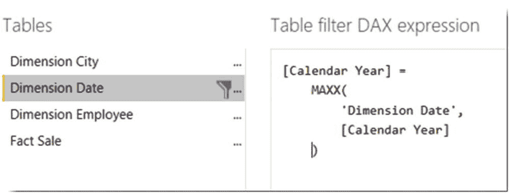

**图 11-21** 作为 RLS 筛选器一部分使用的子查询

添加到包含图 11-21 中所建议筛选器的任何角色的用户，其数据都会被限制为仅包含最近一年，除非他们也被包含在其他角色中，在这种情况下，他们还可以看到其他角色所允许的数据。

如果向 `‘Dimension Date’` 表中添加了代表更新的 `[Calendar Year]` 数据，RLS 会将新的筛选状态动态应用于分配给该角色的所有用户，而无需任何直接的配置更改。

### 将用户分配到角色

一旦在数据模型中定义了至少一个角色，并且将报表发布到 Web 服务后，就可以将用户或组分配到角色，从而使他们在查看报表时受到行级安全性（RLS）筛选的影响。

要将用户或组分配到某个角色，请在应用工作区中找到数据集，单击省略号，然后选择`安全`选项，如图 11-22 所示。

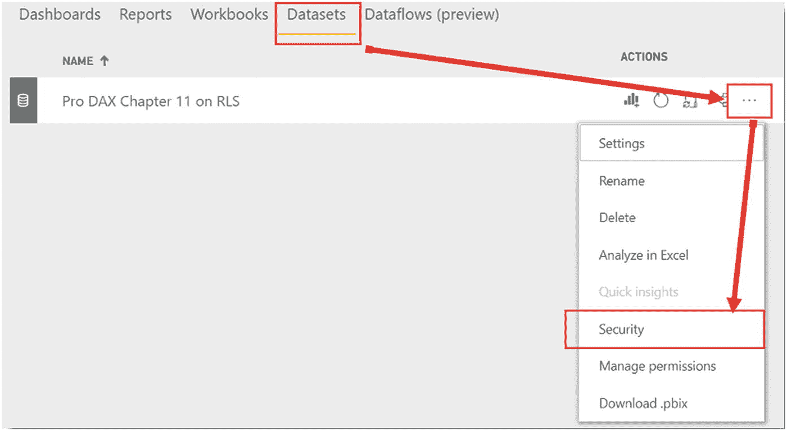

**图 11-22** 在应用工作区中访问数据集的`安全`选项

单击`安全`选项会加载行级安全配置屏幕，其中显示模型中定义的所有角色列表。在此视图中无法修改每个角色的筛选规则，只能在 Power BI Desktop 中进行更改。

图 11-23 显示的是行级安全屏幕，您可以在其中为每个角色添加/删除用户或组。完成更改后，单击保存按钮以提交更新。

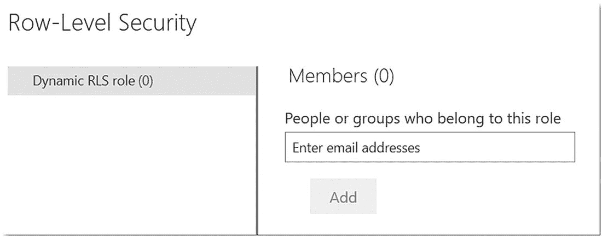

**图 11-23** 用于 RLS 的添加/删除用户或组屏幕

# 开始在文本框中输入时，系统会显示属于该租户的有效用户列表，方便您选择正确的用户（或组）。Azure Active Directory 组也可以分配到角色，如果您的 Power BI 租户连接到了一个维护良好的 Azure Active Directory，这将大大减少管理工作。

## 注意

如果用户是应用工作区的管理员，则 RLS 筛选会被忽略。RLS 仅适用于只读成员。

# RLS 总结

行级安全是企业数据建模中一个常用且往往至关重要的功能。它足够灵活，能够满足许多场景的需求。RLS 可能会加快报表速度，但同样地，复杂的筛选规则也可能导致性能下降。RLS 可以应用于现有报表，并且不需要更新实际的计算过程即可生效。

本章向您展示了 RLS 是基于角色的，其筛选规则是使用 `Power BI Desktop` 定义和管理的。一旦 `pbix` 文件发布到 `Web` 服务，就需要一个单独的过程来将用户（或组）分配到角色。

角色的筛选规则可能会变得复杂，因此本章还展示了如何在 `Power BI Desktop` 和 `Web` 服务中测试 RLS。

角色可以是动态的，这有助于减少每当用户开始或更改内部角色时自动更新 `pbix` 文件的需求。可以使用查询来满足复杂的需求。

用户可以同时存在于多个角色中，在这种情况下，用户会看到其有资格查看的每个角色的所有有效数据。