# 12. DAX Studio

## 简介

首先，DAX Studio 是`那个`工具，也许是为数不多能帮助优化度量值性能的工具，它甚至有助于提升整个报表或特定报表页面的整体性能。

虽然它至关重要，但我们不能忘记 DAX Studio 是完全免费的。DAX Studio 背后的团队为其投入了巨大的精力。因此，如果在性能优化过程中某件事导致您需要重启 DAX Studio，甚至不止一次，请保持冷静，并记住如果没有 DAX Studio，您可能根本无从开始优化过程。同样重要的是，DAX Studio 绝非一个充满缺陷的工具，但它也只是由凡人编写的软件，这意味着偶尔可能发生一些小状况。

DAX Studio 可从此处下载：

[`www.sqlbi.com/tools/dax-studio/`](http://www.sqlbi.com/tools/dax-studio/)

源代码可在此处获取：

[`https://github.com/DaxStudio/DaxStudio`](https://github.com/DaxStudio/DaxStudio)

完整文档在此处：

[`https://daxstudio.org/`](https://daxstudio.org/)

无论何时您遇到 Darren Gosbell 或来自 `sqlbi.com` 的各位（Marco Russo 和 Alberto Ferrari），请去告诉他们，DAX Studio 在您理解和掌握 DAX 的道路上一直是一个多么优秀的伙伴。即使 DAX 的内部运作机制看起来复杂或神秘，也请毫不犹豫地创建一个仅包含一个视觉对象的报表页面来探究其原理；也许某天您会发现视觉对象使用的某个 `DAX` 函数当前并未在文档中说明。

## 预期效果

您可能看过很多视频，人们使用 DAX Studio 来解决报表和 `DAX` 语句的性能问题。请注意，并不是 DAX Studio 独自解决了所有这些性能问题，而是用户解决了问题。DAX Studio 会提供巨大的帮助，因为它有助于发现问题的本质并找出性能瓶颈。

## 空白报表页

使用 DAX Studio 的原因有很多：

*   优化报表页面的整体性能
*   优化特定度量值的性能
*   探寻幕后发生的情况

但无论具体原因是什么，一切始于一个空白报表页。这样做是因为报表页面上每个可见的视觉对象都会创建自己的 `DAX` 查询。因此，有必要从一个空白报表页开始处理 `pbix` 文件，因为这样不会创建任何查询。将 DAX Studio 连接到打开的 Power BI 文件，启用`所有查询`跟踪标志，然后，如果 DAX Studio 已设置好，切换到该报表页面。

## 连接到 Power BI Desktop 文件

由于 Power BI Desktop 发展迅速，DAX Studio 的开发也同样迅速。因此，您可能会发现截图存在细微差异，但由于这不是官方文档，我们已尽量使用最新版本进行截图。

尽管如此，要连接到一个 `pbix` 文件，该文件必须处于打开状态。在连接到 `pbix` 文件之前，该文件必须已打开。请确保文件是从一个空白报表页开始的。如果报表并非始于空白页，请切换到一个空白页，或创建一个。保存文件，关闭 Power BI Desktop，然后再次打开该文件。

#### 注意

使用的 Power BI 文件是 `CH12 – a simple report – large.pbix`。

请确保报表以 `空白页` 报表页面处于活动状态启动。

如果 `DAX Studio` 要求建立连接，它可以连接到各种类型的表格数据模型，但由于此处涉及的是 Power BI Desktop，请选择文件 `CH12 – a simple report – large.pbix`，如图 12-1 所示。

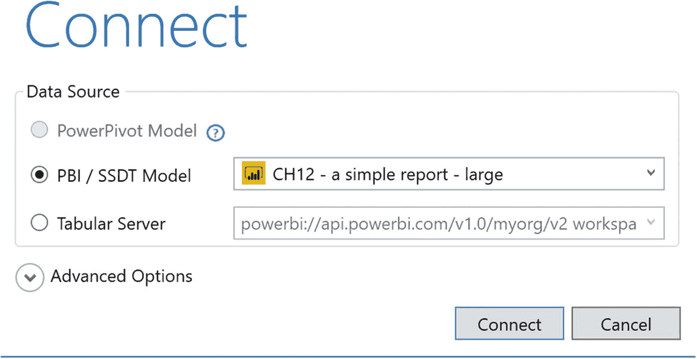

图 12-1 连接到 `pbix`

图 12-2 将简要说明成功连接后你会看到的内容。

| 我在这里 | 简要说明 |
| --- | --- |
|  | 数据模型。 |
|  | 可用视图：`Metadata` – 提供数据模型的洞察。 `Functions` – 可用的 DAX 函数列表。 `DMV` – 动态管理视图列表。请注意，并非所有 DMV 都能与 Power BI Desktop 文件内的数据模型结合使用。 |
|  | 选项卡：此表格将提供 DAX 查询的不同视角。 |
|  | 在 Power BI Desktop 内部运行的 Analysis Services 引擎实例的服务器名称。此服务器名称也可用于连接 SQL Server Management Studio 到这个数据库。使用 SQL Server Profiler，它还可以用来追踪 Power BI 报表内部发生的情况。 |
|  | 当前为空的部分，允许编写/修改 DAX 语句。这是编辑器窗口。 |

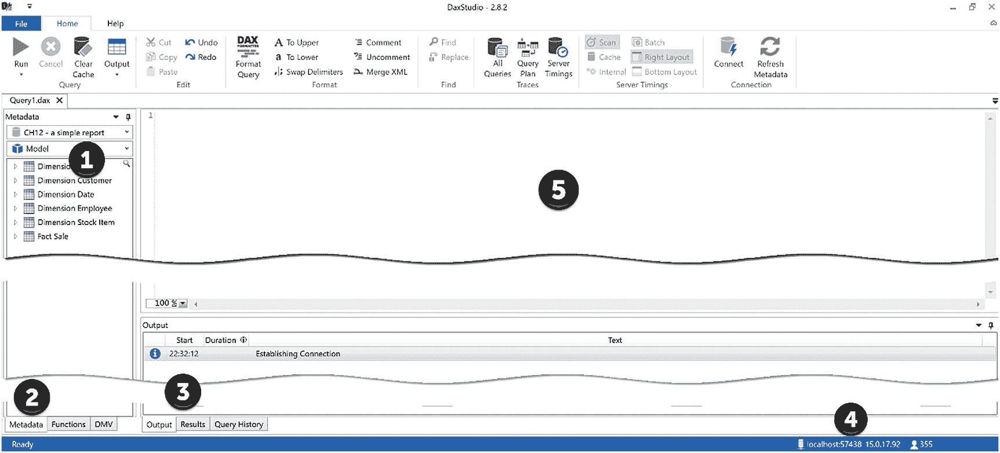

图 12-2 首次接触

## 探究我的报表内部发生了什么

在 `DAX Studio` 连接到 Power BI 报表（更准确地说，连接到 Analysis Services 引擎）后，就可以开始探究报表内部发生了什么。为此，需要激活 `所有查询` 追踪。点击菜单栏中的 `所有查询` 图标即可激活此追踪。

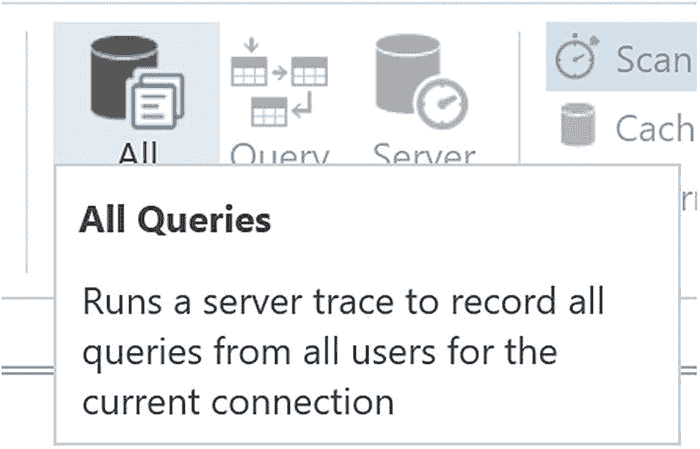

追踪的激活状态可视化地展示出来，因为图标现在已高亮显示。此追踪类型的激活状态也会显示在 `输出` 选项卡中（图 12-3）。

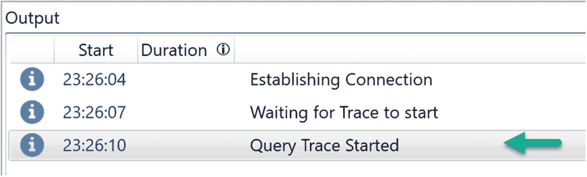

图 12-3 `所有查询` 追踪已激活

### 简单视觉对象

为了捕获报表页面激活时执行的查询，请激活 `简单视觉对象` 报表页面。

激活报表页面后，DAX 查询将出现在 `DAX Studio` 中（图 12-4）。

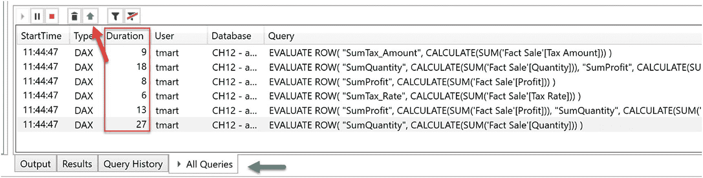

图 12-4 每个视觉对象都有自己的查询

使用 `全部复制` 图标可以将所有追踪结果复制到编辑器窗口中（图 12-5）。

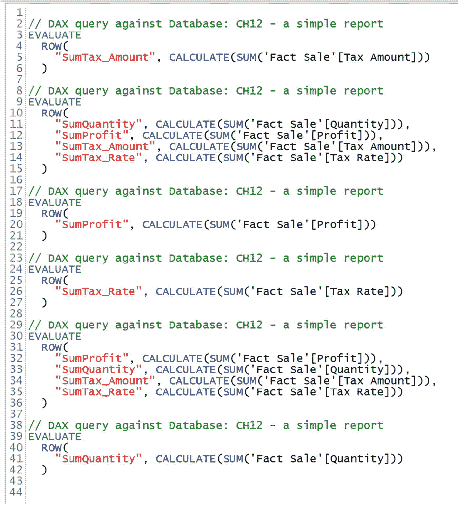

图 12-5 追踪结果 - 简单视觉对象

目前，关键要点如下：

- 每个视觉对象都由其查询填充数据。
- 每个查询都返回一个表格，即使是被用来填充卡片视觉对象的查询也是如此。

### Power BI 报表页面和筛选器窗格

在 2018 年 11 月，产品团队为 Power BI Desktop 引入了新的筛选器体验。除了通过放置切片器来重新获得宝贵的屏幕空间之外，筛选器窗格的另一个基本功能几乎悄无声息地随之而来。如前所述，每个可见的视觉对象都会生成自己的 DAX 查询。添加到新筛选器窗格中的列在报表启动时不会被计算。

清单 12-1 显示了当激活 `简单视觉对象 – 切片器` 报表页面时生成的 DAX 查询。

```dax
清单 12-1: 激活‘简单视觉对象 – 切片器’时生成的 DAX 查询
```

# DAX 查询与筛选器窗格

## 清单 12-1 与切片器查询

清单 12-1 包含一个用于填充报表页面上切片器的 DAX 查询。该 DAX 查询在此清单中已高亮显示。

如果从 `简单视觉对象 – 筛选器窗格` 报表页面捕获 DAX 查询，需要注意的是，不会执行任何 DAX 语句来填充切片器，或者更准确地说，填充添加到筛选器窗格页面级部分的筛选器。

图 12-6 显示已从筛选器中选中了一个值。

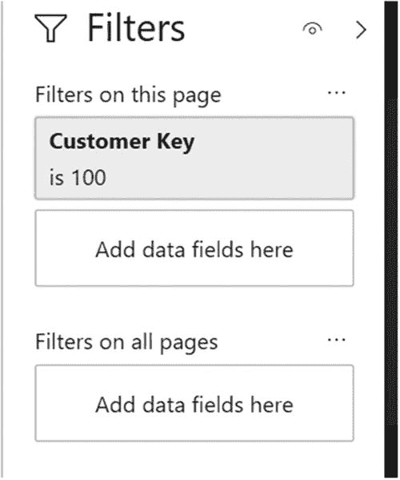

图 12-6 选中了值的筛选器窗格

如果从报表页面捕获查询，并且选中的值是 `Customer Key is 100`，那么需要注意的是，只会创建/执行六个查询。清单 12-2 仅显示了这六个查询中的一个。

```
DEFINE VAR __DS0FilterTable =
TREATAS({"100"}, 'Dimension Customer'[Customer Key])
EVALUATE
SUMMARIZECOLUMNS(
__DS0FilterTable,
"SumTax_Amount", IGNORE(CALCULATE(SUM('Fact Sale'[Tax Amount])))
)
```

清单 12-2：DAX 查询 – 报表页面 “Simple Visuals – filter pane selected value.dax”

需要注意到的重要事项是：它并没有执行查询来填充切片器，而是仅给每个查询添加了一个很小的字符串，该字符串定义了一个筛选器表，并在查询中用于检索视觉对象的数据。定义筛选器表的行已被高亮显示（粗体）。

### 提示

将切片器移到筛选器窗格！你实际使用它的频率可能远低于你的想象。这可以极大地提高报表/报表页面的整体性能。

### 报表级与页面级筛选器：提示与警告

通常情况下，数据模型会包含一些不应在报表页面或整个报表中使用的数据。因此，可以通过定义 **页面级筛选器** 或 **报表级筛选器** 来排除列中的特定值。图 12-7 展示了两个被排除的销售区域；该图引用的是名为“报表与页面级筛选器”的报表页面。

#### 注意事项

此前的所有截图和列表均未考虑报表级筛选器；因此，若要跟随本节内容进行学习，必须添加该筛选器。

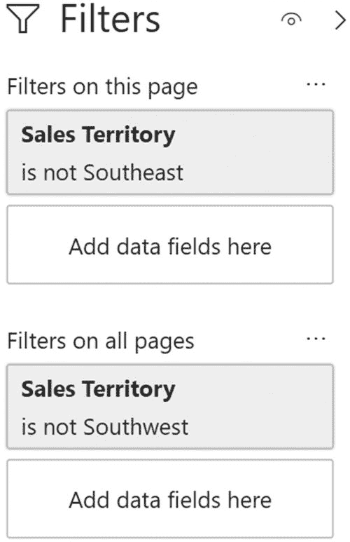

**图 12-7** – 报表级与页面级筛选器

列表 12-3 展示了通过启用“报表与页面级筛选器”报表页面所创建的所有查询。该列表包含为填充报表页面上的视觉对象而执行的全部四个查询。

```
// DAX query against Database: CH12 - a simple report
DEFINE VAR __DS0FilterTable =
FILTER(
    KEEPFILTERS(VALUES('Dimension City'[Sales Territory])),
    AND(
        'Dimension City'[Sales Territory] <> "Southeast",
        'Dimension City'[Sales Territory] <> "Southwest"
    )
)
EVALUATE
SUMMARIZECOLUMNS(
    __DS0FilterTable,
    "Quantity___All_Sales_Territories", IGNORE('Fact Sale'[Quantity - All Sales Territories])
)
// DAX query against Database: CH12 - a simple report
DEFINE VAR __DS0FilterTable =
FILTER(
    KEEPFILTERS(VALUES('Dimension City'[Sales Territory])),
    AND(
        'Dimension City'[Sales Territory] <> "Southeast",
        'Dimension City'[Sales Territory] <> "Southwest"
    )
)
EVALUATE
SUMMARIZECOLUMNS(
    __DS0FilterTable,
    "Quantity___Values_Sales_Territories_", IGNORE('Fact Sale'[Quantity - Values(Sales Territories)])
)
// DAX query against Database: CH12 - a simple report
DEFINE VAR __DS0FilterTable =
FILTER(
    KEEPFILTERS(VALUES('Dimension City'[Sales Territory])),
    AND(
        'Dimension City'[Sales Territory] <> "Southeast",
        'Dimension City'[Sales Territory] <> "Southwest"
    )
)
EVALUATE
TOPN(
    502,
    SUMMARIZECOLUMNS(
        ROLLUPADDISSUBTOTAL('Dimension City'[Sales Territory], "IsGrandTotalRowTotal"),
        __DS0FilterTable,
        "Total_Quantity", 'Fact Sale'[Total Quantity],
        "quantity_divided_by_all", 'Fact Sale'[quantity divided by all],
        "quantity_divided_by_allselected", 'Fact Sale'[quantity divided by allselected],
        "quantity_divided_by_values", 'Fact Sale'[quantity divided by values]
    ),
    [IsGrandTotalRowTotal],
    0,
    'Dimension City'[Sales Territory],
)
ORDER BY
    [IsGrandTotalRowTotal] DESC, 'Dimension City'[Sales Territory]
// DAX query against Database: CH12 - a simple report
DEFINE VAR __DS0FilterTable =
FILTER(
    KEEPFILTERS(VALUES('Dimension City'[Sales Territory])),
    AND(
        'Dimension City'[Sales Territory] <> "Southeast",
        'Dimension City'[Sales Territory] <> "Southwest"
    )
)
EVALUATE
SUMMARIZECOLUMNS(
    __DS0FilterTable,
    "Quantity___ALLSELECTED_Sales_Territory_", IGNORE('Fact Sale'[Quantity - ALLSELECTED(Sales Territory)])
)
```

`列表 12-3` – `DAX queries – "report and page level filter.dax"`

页面级筛选器（`销售区域不是 Southeast`）和报表级筛选器（`销售区域不是 Southwest`）被合并到同一个筛选表`__DS0FilterTable`中。这一合并操作通过以下代码行实现：

```
DEFINE VAR __DS0FilterTable =
FILTER(
    KEEPFILTERS(VALUES('Dimension City'[Sales Territory])),
    AND(
        'Dimension City'[Sales Territory] <> "Southeast",
        'Dimension City'[Sales Territory] <> "Southwest"
    )
)
```

这里需要注意：在定义变量之前必须使用`DEFINE`关键字；定义部分以下一个`EVALUATE`语句结束。该筛选表包含当前筛选上下文中`'Dimension City'[Sales Territory]`列的所有值，但排除了由页面级和报表级筛选器排除的值。这个筛选表会被用于每个查询中。

### 警告

每当使用`ALL`函数时，被页面级或报表级筛选器排除的值将被重新包含进来。因此，当使用报表级筛选器排除或指定一个或多个值时，请花点时间考虑在数据加载期间将这些元素从数据集中移除。在报表级和页面级筛选器与`ALL`函数结合使用时，容易出错。换句话说，`ALL`函数不会考虑报表级或页面级筛选器。

### 时间智能：自动日期/时间

每当 DAX Studio 连接到`pbix`文件时，它不仅会显示显而易见的表，还会显示一些系统表。这些系统表在图 12-8 中已高亮显示。

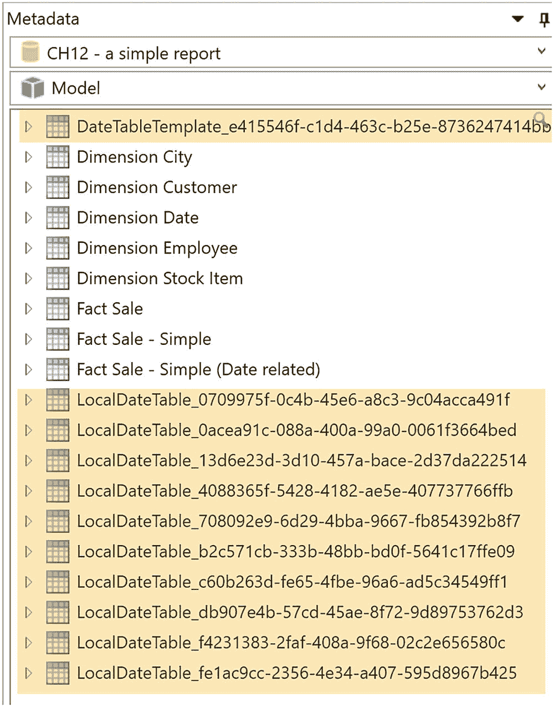

`图 12-8` – 日期列与日期表

目前，Power BI 会为每个数据类型为`date`或`datetime`的列自动创建专用的日期表。如果一张表中有两个日期列，则会创建两个表。如果在另一张表中还有另外两个此类数据类型的列，则又会创建两个日期表。这种功能通常被认为是一种不良“习惯”，原因如下：

- 内存消耗

- 数据模型的加载时间

内存消耗可以忽略不计，因为 Power BI Desktop 内部的数据模型仅占用大约 834 MB 的 RAM。

模型的加载和刷新时间则更为重要，尤其是当数据模型中包含大量日期或日期时间列时。尽管这些系统生成的表不会造成任何损害，但众所周知的最佳实践是不要依赖这些系统日期表。

与专用的日历表相比，这些表似乎有一个优势：每当在视觉对象上使用日期列时，它们允许使用日期层级结构。该层级结构是在`DateTableTemplate`中定义的，但也可以在专用的日历表中定义层级结构。

要禁用这些系统日期表的创建，需要禁用“自动日期/时间”设置，如图 12-9 所示。

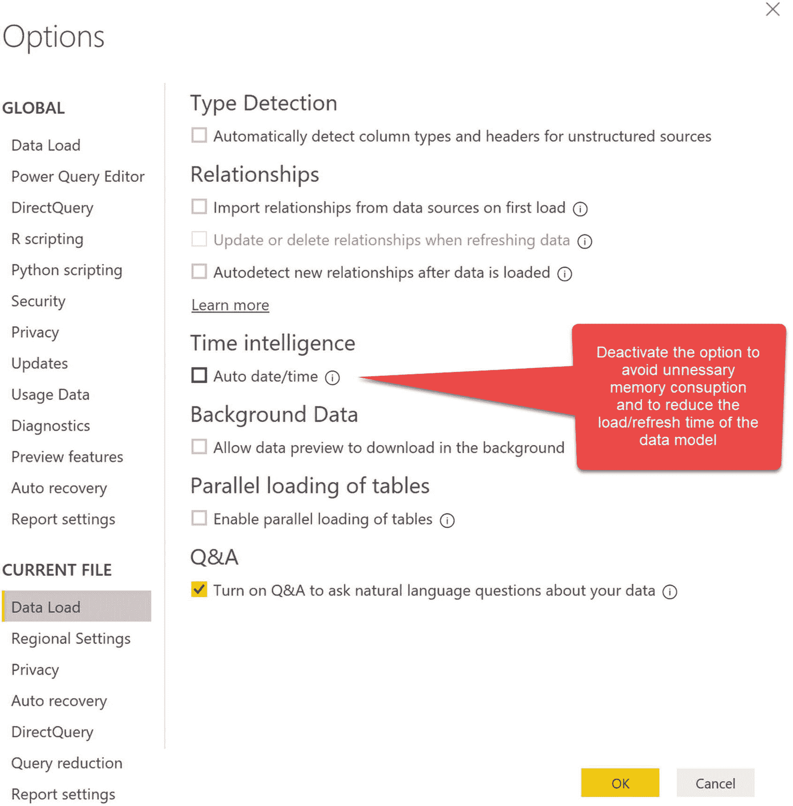

`图 12-9` – 时间智能 – 自动日期/时间

## DAX Studio 中的 DAX 查询编辑器

### 注意

从现在开始，将使用`CH12 – a simple report.pbix`。

在开始优化 DAX 语句之前，有必要先熟悉编辑器。因此，请打开`CH12 – a simple report.pbix`文件，并确保它以“Blank page”报表页启动；如果不是这样，请选择此页面，保存文件，然后重新打开。

当文件以"Blank page"页面激活状态打开后，启动`DAX Studio`，连接到 Power BI Desktop 文件，并激活`All Queries`跟踪。

在左侧的`Metadata`选项卡中，标记度量值`Quantity – All Sales Territories`并打开其上下文菜单。如图 12-10 所示。

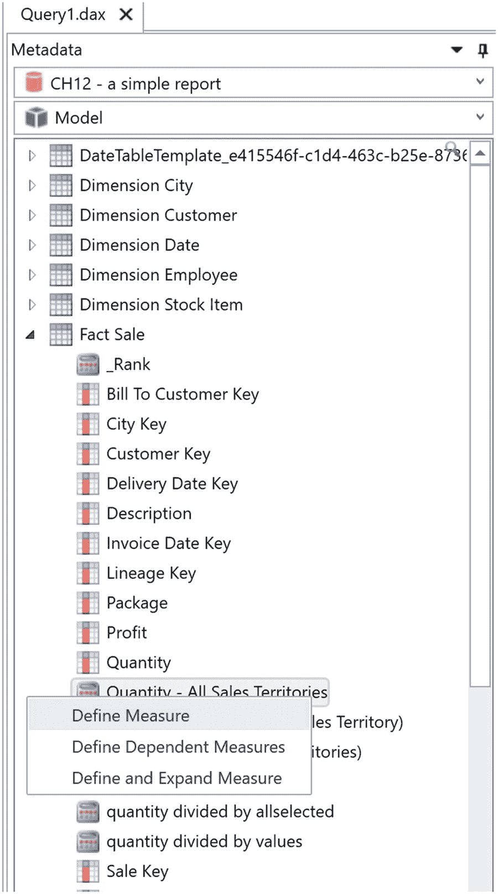

图 12-10

`DAX Studio`编辑器 – 度量值上下文菜单

这三个命令的工作原理如下：

| 命令 | 动作 |
| --- | --- |
| `Define Measure` | 将度量值的定义复制到编辑器中 – 结果：`DEFINE MEASURE 'Fact Sale'[Quantity - All Sales Territories] = CALCULATE([Total Quantity], ALL('Dimension City'[Sales Territory]))` |
| `Define Dependent Measures` | 将度量值的定义复制到编辑器中 – 结果：`DEFINE ---- MODEL MEASURES BEGIN ---- MEASURE 'Fact Sale'[Total Quantity] = CALCULATE(SUM('Fact Sale'[Quantity])) ---- MODEL MEASURES END ---- MEASURE 'Fact Sale'[Quantity - All Sales Territories] = CALCULATE([Total Quantity], ALL('Dimension City'[Sales Territory]))` |
| `Define and Expand Measure` | 创建一个单独度量值，其中所有依赖的度量值都被展开 – 结果：`DEFINE MEASURE 'Fact Sale'[Quantity - All Sales Territories] = CALCULATE(CALCULATE(CALCULATE(SUM('Fact Sale'[Quantity]))), ALL('Dimension City'[Sales Territory]))` |

### 使用度量值定义

从`Metadata`选项卡中，为`Fact Sale`表中的度量值`quantity divide by all`选择上下文菜单中的"Define Dependent Measures"。如图 12-11 所示。

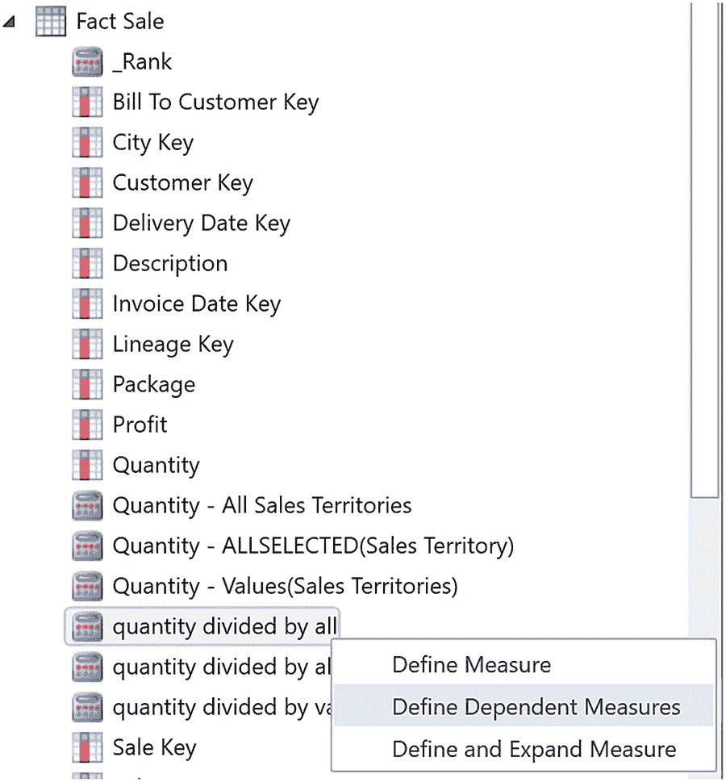

图 12-11

`DAX Studio`编辑器 – 定义依赖度量值

图 12-12 显示了此操作在查询编辑器中的结果。

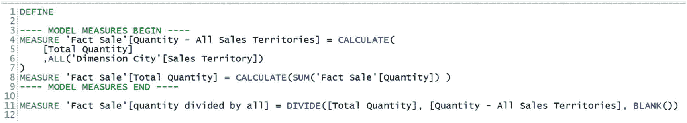

图 12-12

`DAX Studio`编辑器 – 依赖度量值

这一点至关重要：

### 注意

`DEFINE` 引入度量值的定义阶段。关键字 `MEASURE` 开始度量值定义。

如果你想知道为什么使用表名作为前缀，这对应于度量值分配到的表。在 Power BI 中引用度量值时，不要使用表名。这会混淆 DAX 语句的读者。

## 查询性能

查询性能优化通常旨在减少计算度量值所需的时间。创建能返回预期正确结果的 DAX 语句需要时间，而创建能以极速返回正确结果的 DAX 语句则需要更多时间。这不能仅仅通过阅读一本书来实现。当然，这可能会有所帮助，但没有实践和更多的实践，更不用说实践的重要性，是不可能掌握 DAX 的。

为了更好地理解发生了什么，有必要了解如何使用`DAX Studio`跟踪性能；有必要捕获一个查询。因此，请打开 pbix 文件"CH12 – a simple report.pbix"，并确保文件以"Blank page"报表页打开。将`DAX Studio`连接到该文件并启用`All Queries`跟踪。

然后激活报表页"open events – unrelated"。我们感兴趣的是清单 12-4 中所示的 DAX 语句。

```
EVALUATE
TOPN(
502,
SUMMARIZECOLUMNS(
ROLLUPADDISSUBTOTAL('Dimension Date unrelates'[Calendar Month Label], "IsGrandTotalRowTotal"),
"events_in_progress___not_so_fast", 'Fact Sale'[events in progress - not so fast]
),
[IsGrandTotalRowTotal],
0,
'Dimension Date unrelates'[Calendar Month Label],
)
ORDER BY
[IsGrandTotalRowTotal] DESC, 'Dimension Date unrelates'[Calendar Month Label]
清单 12-4
DAX 查询 – "event not so fast.dax"
```

目前，完全理解正在发生的事情并不那么重要。但是，通过双击查询选择"large"查询（持续时间），`DAX Studio`将如图 12-13 所示。

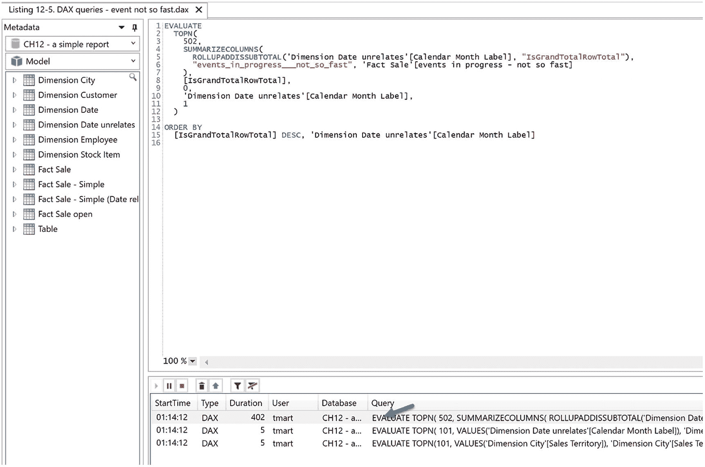

图 12-13

事件 – 准备服务器计时

将感兴趣的查询捕获到查询编辑器后，可以切换跟踪。第一个跟踪将是`Server Timings`（参见图 12-14）。要激活此跟踪，需要先停用"All Queries"跟踪。

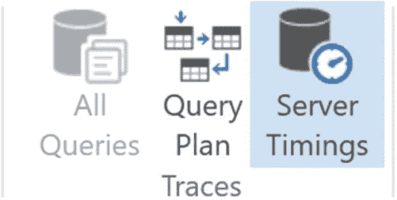

图 12-14

事件 – 服务器计时

激活`Server Timings`跟踪后，`Server Timings`输出窗口将变为可用（图 12-15）。

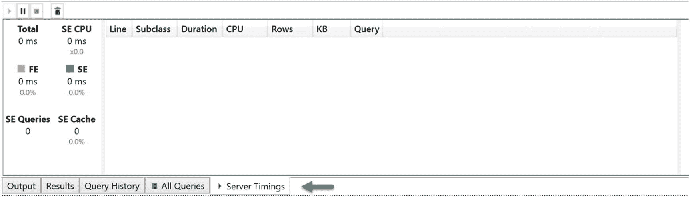

图 12-15

事件 – 服务器计时输出

有必要理解每次运行所测量的性能计数器。这些是常用的性能计数器：

*   `Total` – 总查询持续时间（毫秒）
*   `FE`（公式引擎） – 使用公式引擎所花费的时间
*   `SE`（存储引擎） – 使用存储引擎所花费的时间

必须记住，存储引擎是快速引擎。这意味着在公式引擎中花费的时间越多，查询优化（即 DAX 优化）就变得越重要。

更详细的描述可以在这里找到：`https://daxstudio.org/documentation/features/server-timings-trace/`。