# 13. 查询计划

## 查询计划简介

`DAX` 引擎的一项便捷功能是能够访问名为“查询计划”的有用信息。查询计划可以深入了解 `DAX` 引擎如何执行其任务，以交付任何给定 `DAX` 查询所请求的结果。

一个现实中的类比可能是提供完成某个特定项目所需任务的分解。如果项目是建造一个鸟屋，可以在开始前生成一个项目计划，并在执行特定测试后随时更新。

一个用于建造鸟屋的伪查询计划可能如下所示：

```
用设计工具组装零件。
寻找理想鸟屋的蓝图。
在互联网上搜索想法。
获取所需的零件。
开车去五金店采购材料。
支付材料费用。
从工坊取回所需工具。
拿锤子。
拿锯子。
拿钉子。
拿卷尺。
```

在这个示例中，计划中的每一行都代表整个项目的一个子任务。项目的最终步骤列在最顶行，缩进程度最小。任务的顺序不一定是自上而下的。有三个同级节点专门对应寻找蓝图、获取零件和工具的任务。这三个同级节点都有一系列子任务，这些子任务与紧接其下的具体步骤相关，缩进有助于突出显示每个子任务在节点内的顺序和关系。

查询计划在尝试调试或优化性能缓慢的查询时尤其有用。如果你用过 `T-SQL`，可能对这个概念并不陌生，因为使用 `SQL Server` 数据库引擎时也能获得类似的查询计划。当你执行 `T-SQL` 查询时，可以选择将查询计划与查询结果一起返回。可以在 `SSMS` 工具中将 `T-SQL` 查询计划视为返回结果所采用方法的图形化描述。

`T-SQL` 版本的查询计划提供了每个子步骤的分解，并包含有用的信息，例如每个步骤所花费的时间、是否使用了索引、每个子步骤输入或输出的行数等。

`DAX` 版本的查询计划是基于文本的，并使用多行和缩进进行格式化，以提供基本的树形结构。计划中的每一行都代表整个查询中的一个操作。任何能够针对 `Analysis Services` 数据模型启动并运行跟踪的客户端工具都可以使用查询计划。缩进和等效的制表符间距用于突出显示同级节点与子任务。

### 有关查询计划的更多信息

在 `DAX` 中，每个查询会生成三个计划。但只有两个计划作为跟踪事件公开。这三个计划是：

- 查询表达式树

- 逻辑计划

- 物理计划

查询表达式树是 `DAX` 表达式的直接树形映射，不会作为探查器事件出现在数据库跟踪中。查询表达式树会被转换并简化为逻辑计划树。`DAX` 引擎可能会在构建物理计划树之前部分执行逻辑树。物理计划被执行，以从数据库返回最终数据集。

在针对数据库运行跟踪时，“查询计划”事件始终返回两个查询计划。一个是逻辑计划，另一个是物理计划。逻辑计划可以帮助你了解高级函数使用的原始操作。可以使用逻辑计划识别函数是其他操作的语法糖快捷键的场景。

物理计划有助于突出显示查询中公式引擎导致性能问题的区域。

### 如何查找

可用于访问查询计划的两个免费工具是 `DAX Studio` 和 `SQL Server Management Studio (SSMS)`。这两个工具都可以针对 `SQL Server Analysis Services (SSAS)` 数据库的实例运行探查器跟踪。`Power BI Desktop` 是一个 `SSAS` 数据库实例。

探查器跟踪可捕获数据库引擎内发生的事件。事件形式多样，且并非总是与用户生成的查询相关。在针对数据模型启动跟踪时，只需选择特定感兴趣的事件；否则，跟踪会产生大量信息，难以聚焦到有用的细节上。

一旦跟踪启动，可以暂停或停止它。捕获的事件可以保存为 `TRC` 文件，以供后续查看。

使用 `SSMS` 运行跟踪的第一步是连接到目标数据模型。如图 13-1 所示，连接时需要提供数据模型的端口号。有几种方法可以确定 `Power BI Desktop` 实例的本地端口号。查找端口号最简单的方法之一是使用 `DAX Studio` 连接到你想要运行跟踪的数据模型。图 13-1 中显示的端口号是 `localhost:50086`，在为跟踪连接到数据模型时，需要完整添加此信息。

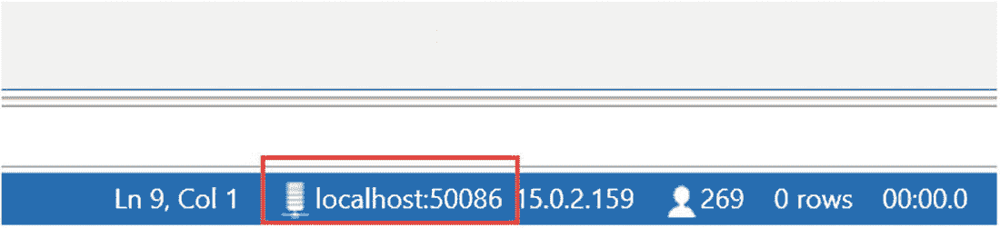

*图 13-1* – 显示 `Power BI Desktop` 实例的端口号

可以从 `SSMS` 的“工具”菜单中启动探查器工具，方法是点击“`SQL Server Profiler`”选项。也可以从操作系统菜单中直接启动该工具，只需在搜索区域中搜索“`SQL Server Profiler`”即可。探查器工具启动后，会出现一个类似图 13-2 的对话框，要求提供如何连接到数据模型的信息。

对于本地机器上的 `Power BI Desktop`，“服务器类型”下拉框应始终设置为“`Analysis Services`”。“服务器名称”文本框中需要包含文本 `localhost:` 以及你要连接的实例的当前端口号。每次重新启动 `Power BI Desktop` 时，此端口号都会发生变化。

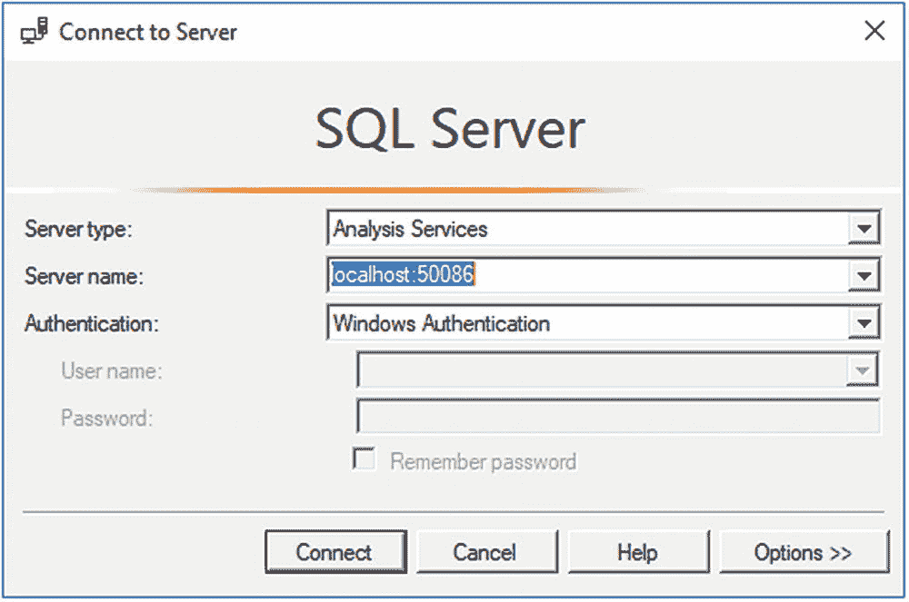

*图 13-2* – 显示探查器工具的连接对话框

### 说明

在 Power BI Web 服务中开启 XMLA 端点后，你可以将 Profiler 工具直接连接到云中已发布的数据模型。

一旦 Profiler 工具成功连接到一个数据模型，就可以通过`文件`菜单中的`新建跟踪`选项启动新跟踪。点击`新建跟踪`会打开一个跟踪属性窗口。该窗口中的`事件选择`选项卡会列出跟踪运行期间报告的事件。建议选择以下事件进行基本跟踪：

- 查询事件

    - `Query End`

- 查询处理

    - `DAX Query Plan`

    - `VertiPaq SE Query Cache Match`

    - `VertiPaq SE Query End`

Alberto Ferrari 在 2012 年撰写的一篇题为“理解 DAX 查询计划”的白皮书中指出，这些事件是捕获 Analysis Services 数据库跟踪时的理想事件。我同意这些事件是极好的起点，只有在更高级的场景下才应添加其他事件类型。这两个查询事件仅适用于导入的表。DirectQuery 表则有不同的事件。

图 13-3 展示了按推荐事件配置后的跟踪属性窗口。

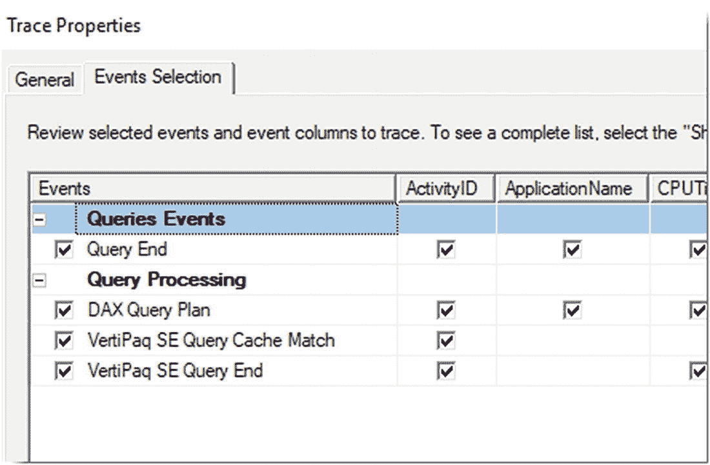

**图 13-3** – SSMS Profiler 推荐的跟踪属性事件

事件定义完成后，点击跟踪属性窗口中的`运行`按钮即可启动跟踪。此后，任何针对数据模型的查询都会向显示跟踪活动的窗口添加多个跟踪事件。跟踪窗口包含 Power BI Desktop 报表画布区域中的用户活动，以及使用 SSMS 或 DAX Studio 直接针对数据模型发出的 DAX 查询。

可以重新排列跟踪窗口中的列，以便将有用的列分组到窗口的左侧。以下是一些方便移动到列顺序左侧的列：

- `EventClass`

- `EventSubclass`

- `Duration`

- `CPUTime`

### 说明

跟踪事件可以保存为跟踪模板，以便在将来调试时快速检索事件集。

## 基本计划（我的第一个计划）

使用一个简单的 DAX 查询来介绍 DAX 查询计划的结构和基本布局，以帮助将计划提供的信息量保持在最低限度。清单 13-1 中显示的查询非常简单，旨在清晰明了，而非反映更真实的场景。

```
EVALUATE
ROW(
"My Column Name",
1 + 1
)
```

**清单 13-1** – 用于生成简单查询计划的基本 DAX 查询

图 13-4 显示了 SSMS 中的查询以及使用清单 13-1 中的查询预期的结果“2”。

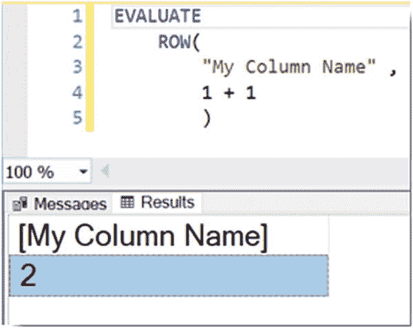

**图 13-4** – 使用 SSMS 的基本 DAX 查询及结果

当清单 13-1 中的查询在启用了跟踪的数据模型上运行时，会报告以下三个事件。其中两个事件是 `DAX Query Plan`，第三个是 `Query End` 事件。`EventSubClass` 列中的详细信息显示了两个 `DAX Query Plan` 事件中哪个是逻辑计划，哪个是物理计划。

当选中单个 `DAX Query Plan` 行时，跟踪窗口的底部会显示每个查询计划的完整详细信息。相同的信息也会显示在 `TextData` 列中。

### 逻辑计划（我的第一个计划）

逻辑计划中每一行的结构都遵循相同的模式。第一个冒号之前的第一个文本项是运算符名称。第一个冒号之后的所有文本代表运算符属性，其中运算符属性的第一项显示运算符类型。

如表 13-1 所示，逻辑计划运算符类型只有两种。`ScaLogOp` 类型始终返回单个值。`RelLogOp` 类型通常处理涉及多列且这些列不总是在同一张表上的操作。`RelLogOp` 运算符类型通常可以有使用 `ScaLogOp` 运算符类型的子步骤。`ScaLogOp` 运算符类型也可以将 `RelLogOp` 作为子步骤。

**表 13-1** – 逻辑计划的运算符类型

| 运算符类型 | 描述 |
| --- | --- |
| `ScaLogOp` | 标量逻辑运算符 – 返回单个值（文本、数字、布尔值等） |
| `RelLogOp` | 关系逻辑运算符 – 返回值表 |

**表 13-2** – 物理计划的运算符类型

| 运算符类型 | 描述 |
| --- | --- |
| `LookupPhyOp` | 查找物理运算符 – 以当前行为输入，返回单个标量值 |
| `IterPhyOp` | 迭代器物理运算符 – 返回一行序列 – 可选的以当前行作为输入 |

### 说明

最常用的 `RelLogOp` 之一来自 `Values('Table'[Column])`，这是一个单列。`ScaLogOp` 和 `RelLogOp` 之间的区别在于前者返回值，后者返回表，无论涉及的列数和物理表数量如何。

清单 13-1 中的查询生成的逻辑计划如清单 13-2 所示。

```
AddColumns: RelLogOp DependOnCols()() 0-0 RequiredCols(0)("[My Column Name])
Constant: ScaLogOp DependOnCols()() Integer DominantValue=2
```

**清单 13-2** – 为清单 13-1 中的查询返回的逻辑计划

在清单 13-2 所示的示例中，逻辑计划由两行组成。每行中的第一个文本项是运算符名称。第一行中，运算符名称是 `AddColumns`，第二行中，运算符名称是 `Constant`。这些代表了 DAX 为满足查询的每个方面而使用的基础原始函数。

第一行的运算符类型是 `RelLogOp`。该运算符类型与 `AddColumns` 的运算符名称相结合，表明它们属于清单 13-1 查询中的 `ROW()` 函数，并且与返回最终表的工作相关。

第二行的运算符类型 `ScaLogOp`，与 `Constant` 的运算符名称相结合，表明这一行与简单的数学运算相关。

该查询没有引用数据模型中的任何表或列，因此跟踪中不会报告与存储引擎相关的事件。

运算符属性中的其他文本提供了与每个运算符相关的额外详细信息。

### 物理计划（我的第一个计划）

物理计划的结构与逻辑计划相同。每行中的第一个文本代表运算符名称。物理计划中有许多运算符，它们提供了线索，表明使用了哪个内部 DAX 函数来满足查询的每个方面。表 13-2 显示了物理计划的主要运算符类型。

第一个分号后的文本与该行的运算符属性有关，分号后的第一项声明了该运算符的运算符类型。物理计划只能有两种类型的运算符。

清单 13-1 中的查询生成的物理计划如清单 13-3 所示。

```
AddColumns: IterPhyOp LogOp=AddColumns IterCols(0)("[My Column Name])
SingletonTable: IterPhyOp LogOp=AddColumns
Constant: LookupPhyOp LogOp=Constant Integer 2
```

**清单 13-3** – 为清单 13-1 中的查询返回的物理计划

此物理计划有三行。顶行代表查询的最终输出。查询有两个处于同一级别的子节点。`SingletonTable` 运算符的类型为 `IterPhyOp`，这意味着它可能返回一系列行。计划的第三行，即底行，告诉我们该运算符是 `Constant`，类型为 `LookupPhyOp`，这意味着它返回单个值。该行的附加属性指定该值为 2（1+1 的结果），并且 `Constant` 的数据类型为 Integer。

### 查询时间

#### 注意

DAX 查询计划事件类型不会报告事件探查器跟踪中的持续时间值。

逻辑计划和物理计划事件都不会报告持续时间，这意味着仅凭这些事件并不总能用于调试长时间运行的查询。通常，将 DAX 查询计划*与*其他事件相结合有助于隔离和识别性能不佳的查询背后的原因。

### 清除缓存

调试 DAX 查询性能时，一个关键提示是需要在查询之间清除 DAX 引擎缓存，以便进行公平的比较。在不清除缓存的情况下连续运行相同的查询，可能会因后续执行利用了缓存结果而导致持续时间值出现偏差。

xVelocity 引擎保存了一个小型缓存，可以通过在事件探查器跟踪中包含 *VertiPaq SE Query Cache Match* 事件来观察。理想情况下，在进行性能测试时，您不应看到此事件发生。此事件表明查询利用了先前同一查询的执行结果。

清除缓存需要向数据模型传递一个 XMLA 查询。可以在 SSMS 或 DAX Studio 中执行该 XMLA 查询。

#### 使用 SSMS

要使用 SSMS 清除数据模型缓存，请启动一个新的 XMLA 查询类型，并连接到相关的数据模型。通过单击“新建查询”菜单项中的 XMLA 按钮（如图 13-5 所示）来启动一个新的 XMLA 查询类型会话。

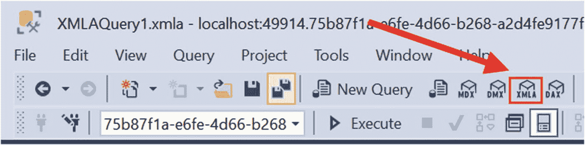

**图 13-5** 使用 SSMS 菜单启动到数据模型的 XMLA 连接

XMLA 命令可以从任何查询类型（MDX、DMX、XMLA 和 DAX）中应用；但是，在 DAX 或 MDX 连接窗口中使用时，可以在 `ClearCache` 块和 DAX `EVALUATE` 语句之间插入 `GO` 语句，以同时批处理并运行多个 DAX 语句。图 13-8 显示了一个在 SSMS 中使用 `GO` 语句的代码示例。

使用 `GO` 和 `ClearCache` 语句分隔多个 DAX 查询是在同一批次中执行相似查询以进行调试和诊断的绝佳方法。此技术还有助于防止意外忘记清除缓存，并避免因错误的性能结果而分心。图 13-8 显示了一个与 DAX 查询结合使用的 `ClearCache` 命令示例。请确保在批处理中的每个 DAX 语句之前添加一个 XMLA `ClearCache` 语句。

一旦成功建立 XMLA 连接，就可以发出图 13-6 中的 `ClearCache` 查询。请注意，`DatabaseID` 元素内的值需要更新以反映每个数据模型。不要使用图 13-6 中显示的 `DatabaseID`。如果数据模型是 Power BI Desktop 文件，则该值可能是一个由字母、数字和连字符组成的 GUID 样式的字符串，每次关闭并重新打开 `.pbix` 文件时该字符串都会发生变化。

SSMS 对象资源管理器在对象层次结构树中显示数据库的名称。在 SSMS 中按 `F8` 键可显示对象资源管理器窗口。

用于 `DatabaseID` 的值需要精确匹配，如果从 SSMS 对象资源管理器中拖拽该值，则可能需要移除开头/结尾的一些方括号。

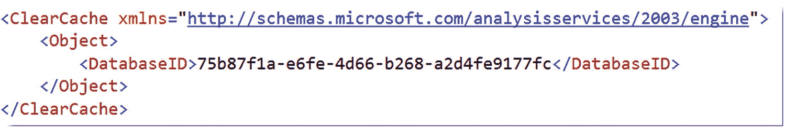

**图 13-6** 用于清除数据模型缓存的 XMLA 查询

一旦清除缓存查询运行成功，您应该会看到类似于图 13-7 的结果。如果清除缓存查询失败，请仔细阅读错误消息，但很可能是由不正确的 `DatabaseID` 引起的。

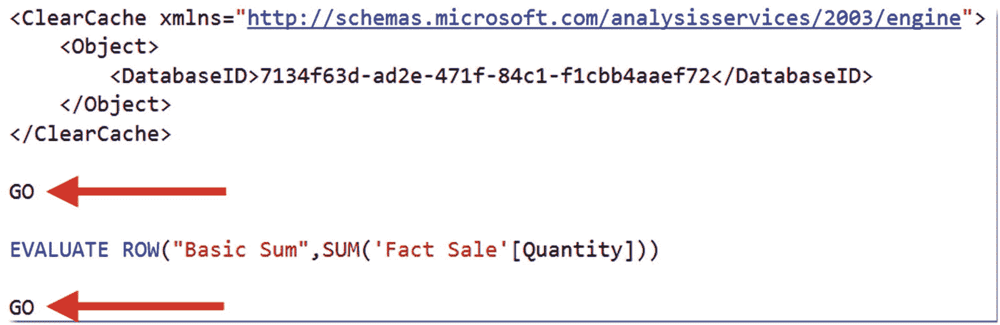

**图 13-8** 在 SSMS DAX 查询窗口中使用 `GO` 关键字批处理多条语句

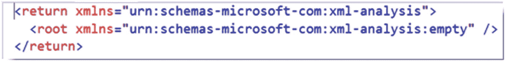

**图 13-7** 成功清除缓存的 XMLA 查询结果

### 我的下一个查询

下一个查询扩展了前面的示例，但将硬编码的常量替换为使用存储引擎的一些 DAX。更新后的查询是对 `Quantity` 列的简单 `SUM`，如清单 13-4 所示。此未筛选的代码生成一个值为 8,950,628 的单个值。

## EVALUATE

```
ROW (
"Sum of Quantity",
SUM('Fact Sale'[Quantity])
)
```
Listing 13-4
A Simple DAX query showing the SUM over the entire Quantity column

## 逻辑计划

清单 13-4 中查询的四行逻辑计划如图 13-9 所示。

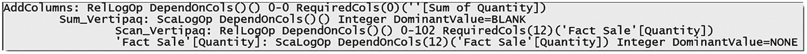

图 13-9
清单 13-4 中查询的逻辑计划

逻辑计划的顶行与清单 13-2 中的示例相比没有变化。此顶行与最终输出相关，并表示查询中使用的 `ROW` 函数。

计划中的其余行与查询中使用的 `SUM` 函数相关。第二行运算符名称为 `Sum_VertiPaq`，类型为 `ScaLogOp`。所有逻辑 `ScaLogOp` 类型都共有的运算符属性包括 `DependsOnCols`、`DataType` 和 `DominantValue` 属性。

### DependsOnCols

`DependsOnCols` 属性显示两对括号，且对于 `ScaLogOp` 和 `RelLogOp` 来说格式相同。这些括号有时可能为空，如当前逻辑计划中的第 2 行所示。当这些括号被填充数值时，第一对括号显示一个逗号分隔的数字列表，这些数字与数据模型中的内部列 ID 相关。此编号与模型中的列 ID 无关，它仅是在当前查询中唯一标识某个列实例的数字。第二对括号显示相同列的完全限定文本版本。

列数字有助于识别查询中同一列的多个引用。例如，在累计总计计算中，内部循环和外部循环对同一列进行不同追踪时，就会出现这种情况。

括号并不总是被填充，有时会显示为 `()()`，表示不依赖任何列。

### 列范围（仅适用于 RelLogOp）

仅针对 `RelLogOp` 操作，在 `DependsOnCols` 属性之后可能会显示一个额外的数字范围。该数字指代一个列范围，这些列确定了查询下一部分所需的最小列集合。如果查询不涉及关系，则计划中可能不会出现此范围。

列范围的格式为 `*<起始列 ID> - <结束列 ID>*`。在图 13-9 所示的示例中，为 `RegLogOp` 指定的列范围是相当宽的 `0–102`。在 `RequiredCols` 运算符属性中，该列范围被缩小到特定列。`RequiredCols` 运算符可能来自 `DependsOnCols` 或列范围。

### RequiredCols（仅适用于 RegLogOp）

`RequiredCols` 运算符属性指定了满足操作所需的实际列。其模式与 `DependsOnCols` 运算符属性类似，也包含两对括号。第一对括号包含一个逗号分隔的数字列表，表示内部列标识符；第二对括号显示列的完全限定名称，包括表名和列名。

### DataType（仅适用于 ScaLogOp）

在 `DependsOnCols` 属性之后，会列出六种数据类型之一，以显示返回值的类型。该值也可以为空。当前示例中的两个 `ScaLogOp` 操作都使用了整数数据类型。

### DominantValue（仅适用于 ScaLogOp）

标量逻辑运算符的最后一个属性是 `DominantValue` 属性，它表示计划可以将列识别或过滤为特定值或少量值。此属性可设置为 `NONE`，否则可能显示特定值。当属性设置为特定值时，DAX 引擎可能会选择一个比设置为 `NONE` 时快得多的计划。在分析逻辑计划时，此属性值是一个有用的参考指标。

## 物理计划

清单 13-4 中的查询生成一个五行物理计划，如图 13-10 所示。

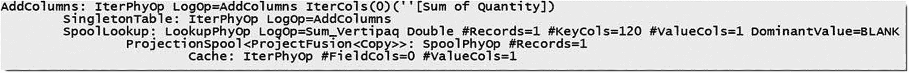

图 13-10
清单 13-4 中查询的物理计划

第一行是最外层操作，使用 `AddColumns` 运算符输出最终结果。第二行引用的操作使用了 `IterPhyOp` 类型，即使此查询只返回单行数据。如果查询设计为返回更多行，`AddColumns` 运算符也不会改变。

第三行表示对存储引擎的调用，对于此计划，它解释了引擎如何满足执行求和的要求。此运算符的 `LogOp` 属性指定了使用 `Sum_VertiPaq` 运算符。`Sum_VertiPaq` 运算符类型对性能而言是个好消息，意味着在存储引擎读取数据的同时，即可完成生成所需值的工作。公式引擎无需额外工作即可产生正确结果。

最后两个运算符提供了与 `SpoolLookup` 运算符相关的子节点的一些细节。

物理计划中一个重要的运算符属性是 `#Records` 运算符属性。该属性提供了关于操作处理的假脱机中行数的信息。有时该值可能远高于预期，这表明有机会在查询中重新组织筛选，以帮助减少冗余和不必要的工作量。

## VertiPaq 运算符

在使用 DAX 查询计划来帮助提升性能时，逻辑计划和物理计划中需要关注的关键运算符是 VertiPaq 运算符。

VertiPaq 运算符与 VertiPaq 引擎协同工作以检索数据，某些操作可以在从数据库检索数据的*过程中*进行，从而显著提升查询的整体性能。VertiPaq 操作还可以在多线程环境中并行运行，从而带来潜在的性能提升。

任何无法由 VertiPaq 运算符完成的工作都会传递给单线程的公式引擎来处理。在从数据库检索数据的同时，能够处理的数据越多，性能结果就越好。

```
Scan_Vertipaq
GroupBy_Vertipaq
Filter_Vertipaq
Sum_Vertipaq
Min_Vertipaq
Max_Vertipaq
Count_Vertipaq
DistinctCount_Vertipaq
Average_Vertipaq
Stdev.S_Vertipaq
Stdev.P_Vertipaq
Var.S_Vertipaq
Var.P_Vertipaq
```
清单 13-5
VertiPaq 逻辑运算符的部分列表

图 13-9 中的查询计划在第 2 行显示使用了 `Sum_VertiPaq` 运算符。该运算符表示，当从 VertiPaq 引擎检索数据时，`[Quantity]` 列中的值可以相加，这意味着读取操作完成后数值即可用。公式引擎无需执行额外的处理来满足此查询。

`Sum_VertiPaq` 操作属性也出现在图 13-10 第 3 行的物理计划中，其键值对为 `LogOp = Sum_VertiPaq`。

### VertiPaq 查询事件

建议添加到 Profiler 跟踪中的两个事件是 `VertiPaq SE Query Cache Match` 和 `VertiPaq SE Query End` 事件。查看这些事件时，它们会显示类似 T-SQL 的伪查询，并为调试提供有用的反馈。这些事件还会在 Profiler 跟踪输出中报告每个存储引擎查询的持续时间值。该持续时间值表示每次存储引擎扫描所花费的时间（以毫秒为单位）。这些事件专门报告与查询 VertiPaq 存储引擎相关的任何活动。

每个存储引擎查询会捕获两个 Profiler 事件。两者的文本相似，但 `EventSubClass` 略有不同。

图 13-11 显示了已添加这两个事件的“跟踪属性”窗口。这两个事件位于“查询处理”部分。

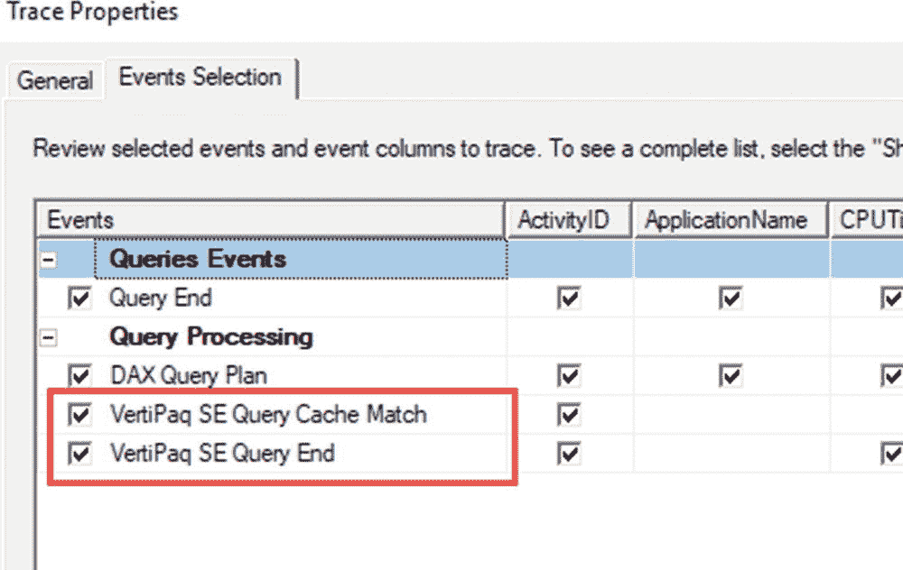

图 13-11 – 用于跟踪 VertiPaq 存储引擎查询的 Profiler 事件

考虑以下清单 13-6 中的 DAX 查询，该查询使用 `'Dimension Date'` 表构建一个唯一日期列表，然后使用 `ADDCOLUMNS` 函数为每个日期附加一个 SUM 值。

```
EVALUATE
ADDCOLUMNS(
VALUES('Dimension Date'[Date]) ,
"Quantity Per Day",
SUM('Fact Sale'[Quantity])
)
```

清单 13-6 – 用于演示 DAX Profiler 事件的查询

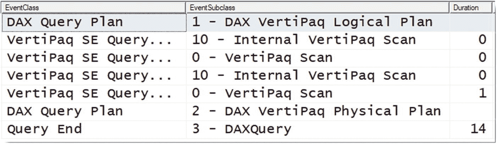

图 13-12 – 清单 13-6 中查询的 Profiler 跟踪

图 13-12 中的 Profiler 跟踪总共显示了七行。最上面一行的 `EventClass` 为 `DAX Query Plan`，与逻辑计划相关。清单 13-7 中显示了该逻辑计划的简化版本。

逻辑计划表明查询期间发生了两次 VertiPaq 扫描。这些扫描在逻辑计划的第 2 行和第 4 行中被引用，每行都以文本 `Scan_VertiPaq` 开头。需要两个 VertiPaq 操作，首先是从 `'Dimension Date'` 表生成一个唯一日期值列表，第二次扫描处理来自 `'Fact Sale'` 表的 `Quantity` 列，属于 `Sum_VertiPaq` 操作。

第三行的运算符名称是 `Sum_VertiPaq`，这意味着在从底层模型中检索数据的同时，可以执行值的相加过程。

```
AddColumns: RelLogOp ([Date], [Quantity Per Day])
Scan_Vertipaq: RelLogOp ('Dimension Date'[Date])
Sum_Vertipaq: ScaLogOp
Scan_Vertipaq: RelLogOp ('Fact Sale'[Quantity])
'Fact Sale'[Quantity]: ScaLogOp ([Quantity])
```

### 清单 13-7
清单 13-6 中查询的简化逻辑计划

图 13-11 中的 Profiler 跟踪在 `VertiPaq SE Query End` EventClass 中显示了四个事件。这些事件代表两次 VertiPaq 扫描，因为一次扫描将生成两个事件。

图 13-11 中 Profiler 跟踪的第六行显示了第二个 `DAX Query Plan` 事件。此事件的 `EventSubClass` 为 `2 – DAX VertiPaq Physical Plan`，代表查询的物理计划。清单 13-8 显示了物理计划的简化版本，省略了一些文本，但仍保留了意图。

```
AddColumns: IterPhyOp (0,1)([Date],[Quantity Per Day])
Spool_Iterator: IterPhyOp LogOp=Scan_Vertipaq [Date]
ProjectionSpool: SpoolPhyOp #Records=1461
Cache: IterPhyOp
SpoolLookup: LookupPhyOp LogOp=Sum_Vertipaq
ProjectionSpool: SpoolPhyOp #Records=1
Cache: IterPhyOp
```

### 清单 13-8
清单 13-6 中查询的简化物理计划

物理计划中最外层的操作是第一行，与 DAX 查询中的 `ADDCOLUMNS` 函数相关。此操作的物理运算符类型为 `IterPhyOp`，它启动一个对 `[Date]` 列的迭代器。`#Records=1461` 运算符属性指定了要迭代的项数为 1,461 个，并使用 `Scan_VertiPaq` 的逻辑操作。

第五行表示一个 `SpoolLookup` 操作。此情况下的物理操作类型是 `LookupPhyOp`，它返回单个标量值，并使用 `Sum_VertiPaq` 的逻辑操作。这一行是负责累加 `'Fact Sale'[Quantity]` 列中所有值的操作。

对物理计划的粗略解释是：对 `'Dimension Date'` 表中找到的每个唯一日期值执行一个循环，然后对于找到的每个日期，找到单个值，该值是 `'Fact Sale'` 表中 `[Quantity]` 列的总和。日期处理的顺序并不重要。没有一个日期的输出依赖于另一个日期。该任务可以分解为多个并行的流，结果仍然相同。

Profiler 跟踪中的最后一行是 `Query End` EventClass，它提供了有用的持续时间（以毫秒为单位）数据。

清单 13-6 中查询的结果如图 13-13 所示。您可能会注意到 `[Quantity Per Day]` 列中的值没有变化；相反，它对于每一行都反复反映 `'Fact Sale'` 表中 `Quantity` 列的总体总和。这种省略是故意的，本章后面的“上下文转换”部分将展示如何使用查询计划来识别和修复此问题。

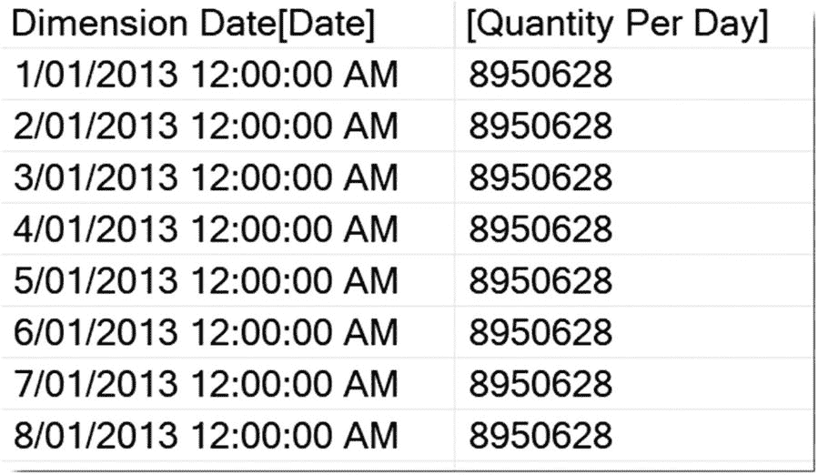

### 图 13-13
显示清单 13-6 中查询的结果

## 计划优化

如本章前文所述，当查询运行时，会发生几件事情，包括生成逻辑计划和物理计划，以帮助确定产生所需结果的最佳方法。

`DAX 查询优化器`会生成一个逻辑计划，并尝试找到它认为最高效的方法来完成任务。这种优化意味着，以多种方式编写的查询最终可能会产生相同的计划，因此也具有相同的性能特征。

请考虑清单 13-9 中以下三个 *不同的* 查询，它们都产生相同的结果。所有三个 `DAX` 查询前面都有一个 `ClearCache` 块，为简洁起见，本例中将其缩写。

```
GO
EVALUATE
ROW(
"Basic SUM",
SUM('Fact Sale'[Quantity])
)
GO

GO
EVALUATE
ROW(
"Calculate SUM",
CALCULATE(SUM('Fact Sale'[Quantity]))
)
GO

GO
EVALUATE
ROW(
"SumX SUM",
SUMX('Fact Sale','Fact Sale'[Quantity])
)
```

### 清单 13-9
三个具有相同逻辑计划和物理计划的不同 DAX 查询

简化的逻辑计划（三个查询相同）显示在清单 13-10 中，并突出显示查询使用了 `Sum_VertiPaq` 运算符，从而获得了最佳性能。三个查询的逻辑计划相同这一事实也突显了，在简单情况下，`SUMX` 函数与 `SUM` 函数没有区别，或者说 `SUM` 函数等同于 `SUMX` 函数。

对于使用 `CALCULATE` 函数的中间查询，`DAX 查询优化器`也没有使用 `Calculate` 逻辑运算符。优化器已确定，由于没有提供筛选器，因此可以构建一个更简单、更快速的计划。如果将筛选器参数传递给 `CALCULATE` 函数，则会生成不同的逻辑计划和物理计划。

```
AddColumns: RelLogOp
Sum_Vertipaq: ScaLogOp
Scan_Vertipaq: RelLogOp 'Fact Sale'[Quantity]
'Fact Sale'[Quantity]: ScaLogOp
```

### 清单 13-10
清单 13-9 中所有三个 DAX 查询的简化逻辑计划

如果代码的某些部分是冗余的，`DAX 查询优化器`会从逻辑计划（以及物理计划）中消除这些逻辑分支。这种情况可能发生在 `IF` 函数只有一种输出（`THEN`/`ELSE`）时。冗余操作会从计划中被删除。

如果检测到冗余代码，`DAX 查询优化器`会从逻辑计划（以及物理计划）中消除这些逻辑分支。当条件语句（如 `IF`/`ELSE`）仅可能有一种输出时，就可能出现这种情况。冗余操作会从计划中被删除。

## 流程控制

### 简单的 IF 语句

查询优化器会创建一个只包含被认为完成查询所必需的代码路径的逻辑计划。如果 `DAX` 查询包含一个具有两种可能结果的 `IF` 函数，优化器会在最终确定逻辑计划之前检查这两个路径是否都会被用到。

考虑清单 13-11 中的以下查询，它包含一个带有无法到达代码的 `IF` 函数。无法到达的代码是 `IF` 语句的 `ELSE` 部分，其中包含一个使用 `'Fact Sale'[Profit]` 列的 `SUM` 函数。

```
DEFINE
VAR varTest = "Quantity"
EVALUATE
ADDCOLUMNS(
VALUES('Dimension Date'[Calendar Year]) ,
"IF Test" ,
IF (
varTest = "Quantity" ,
SUM('Fact Sale'[Quantity]) ,
SUM('Fact Sale'[Profit]))     --<= 冗余
)
```

### 清单 13-11
一个 ELSE 分支永远无法到达的 IF 语句

```
varTest: Constant: ScaLogOp VarName=varTest
AddColumns: RelLogOp
Scan_Vertipaq: RelLogOp [Calendar Year]
Integer->Double: ScaLogOp DependOnCols [Calendar Year]
Sum_Vertipaq: ScaLogOp MeasureRef=[Sum Quantity]
Scan_Vertipaq: RelLogOp
'Fact Sale'[Quantity]: ScaLogOp [Quantity]
```

### 清单 13-12
清单 13-11 中 DAX 查询的简化逻辑计划

清单 13-12 中清晰的逻辑计划显示了两次 VertiPaq 扫描。第一次 VertiPaq 扫描与 `VALUES` 函数相关，用于获取 `[Calendar Year]` 列中的唯一值列表。只返回了四个值。

然后，对于这些值中的每一个，使用 `Sum_VertiPaq` 运算符进行第二次 VertiPaq 扫描，查询 `[Quantity]` 列。逻辑计划中没有引用 `'Fact Sale'[Profit]` 列，尽管该列在 `DAX` 查询中被直接引用。该列之所以从逻辑计划中缺失，是因为查询优化器已确定 `IF` 语句的 `ELSE` 路径永远无法到达。

如果修改清单 13-11 中的 `DAX` 查询，使得分配给 `varTest` 变量的值不是 `'Quantity'`，`DAX查询优化器`将生成相同的计划，只是将 `[Quantity]` 列替换为 `[Profit]` 列。

逻辑计划中一个有趣之处是沿途从 `Integer` 到 `Double` 的转换。此转换明确与设置为 `Integer` 数据类型的 `'Fact Sale'[Quantity]` 列有关，逻辑计划确定需要执行一个操作，将其转换为小数（`Double`）作为查询的一部分。

### 复杂的 IF 语句

如果 `IF` 函数的两个代码路径在 `DAX` 查询中都有效，则优化器会将额外的操作包含到逻辑计划中以覆盖这两个路径。清单 13-13 显示了一个略微修改的查询，该查询旨在当年份等于 2015 年时返回与其它年份不同的度量值。此查询的目的是展示当 `IF` 函数的 `THEN` 和 `ELSE` 路径都有效时，查询优化器如何构建逻辑计划。

```
AddColumns: RelLogOp
Scan_Vertipaq: RelLogOp [Calendar Year])
If: ScaLogOp 'Dimension Date'[Calendar Year]
'Dimension Date'[Calendar Year] = 2015: ScaLogOp
PredicateCheck: RelLogOp
ScalarVarProxy: ScaLogOp
PredicateCheck: RelLogOp
ScalarVarProxy: ScaLogOp
Sum_Vertipaq: ScaLogOp MeasureRef=[Sum Quantity]
Scan_Vertipaq: RelLogOp
'Fact Sale'[Quantity]: ScaLogOp
Sum_Vertipaq: ScaLogOp MeasureRef=[Sum Profit]
Scan_Vertipaq: RelLogOp
'Fact Sale'[Profit]: ScaLogOp
清单 13-14
清单 13-13 中 DAX 查询的简化逻辑计划
```

```
DEFINE
MEASURE 'Fact Sale'[Sum Quantity]
= SUM('Fact Sale'[Quantity])
MEASURE 'Fact Sale'[Sum Profit]
= SUM('Fact Sale'[Profit])
EVALUATE
ADDCOLUMNS(
VALUES('Dimension Date'[Calendar Year]) ,
"IF Test" ,
IF (
[Calendar Year] = 2015 ,
[Sum Quantity]  ,    --<= Then
[Sum Profit]    --<= Else
)
)
清单 13-13
具有两个有效代码路径的复杂 IF 函数
```

清单 13-14 中显示的逻辑计划与清单 13-12 中显示的逻辑计划之间的区别在于，前者包含了一个 `IF` 运算符，该运算符包含多个子节点以覆盖不同的代码分支。该逻辑计划还表明，执行了三次存储引擎扫描，一次扫描专注于检索 `[Calendar Year]` 列中的值列表，而另外两次则根据 `IF` 语句的条件分支，使用 `Sum_VertiPaq` 操作类型来高速处理数字。

#### SWITCH 语句

如果清单 13-13 中的 DAX 查询被修改为使用 `SWITCH` 函数替代 `IF` 函数，查询优化器将生成相同的计划。

然而，在使用 `SWITCH` 函数时需要警惕一点：在某些情况下，即使看似只有一个分支是可能的，代码路径的所有分支仍然会被计算。当报表使用度量值表为用户提供动态体验（允许他们从切片器中选择指标）时，可能会发生这种不期望的情况。考虑清单 13-15 中 DAX 计算度量值的示例，该度量值将 `UserSelection` 变量赋值为在名为 `'Measure Table'` 的表中的某一列切片器上所做的选择。

这里的期望是，当用户进行单一选择时，`SWITCH` 语句仅调用特定度量值，并且在计算过程中三个度量值中只有一个需要被计算。

```
SWITCH Measure =
VAR UserSelection = SELECTEDVALUE('Measure Table'[Column1])
RETURN
SWITCH(
TRUE() ,
UserSelection = "Measure 1" , [Test Measure 1],
UserSelection = "Measure 2" , [Test Measure 2],
[Test Measure 3]
)
清单 13-15
动态度量值中 SWITCH 语句的示例
```

### CALCULATE 语句

下一部分聚焦于查询计划中与 `CALCULATE` 函数使用相关的有趣方面。第一部分重点介绍如何在查询计划中发现上下文转换，第二部分则提供一个有趣的示例，展示如何通过重写一个性能较差的查询以使用 `CALCULATE` 函数来获得显著的性能提升。

#### 上下文转换

考虑清单 13-16 中的查询，它返回一个结果，其中每个 `[Calendar Year]` 对应一行，并有一个额外的列显示 `'Fact Sale'[Quantity]` 列的总和。在此示例中，`[Quantity Per Year]` 列中的值是重复的相同值，并未考虑第一列同一行中显示的日历年份。清单 13-16 中代码的完整结果如图 13-14 所示。

```
EVALUATE
ADDCOLUMNS(
VALUES('Dimension Date'[Calendar Year]) ,
"Quantity Per year",
SUMX('Fact Sale','Fact Sale'[Quantity])
)
清单 13-16
无上下文转换的简单 SUMX 计算
```

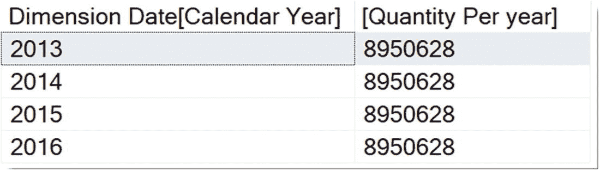

*图 13-14 – 显示清单 13-16 中查询的结果集*

现在考虑对清单 13-16 中同一个查询进行略微修改后的版本。新查询在清单 13-17 中，唯一的区别是在 `SUMX` 函数外层添加了一个 `CALCULATE` 函数。查询未做其他修改，也未向 `CALCULATE` 函数添加任何筛选参数。

此修改使得上下文转换得以发生，这意味着当前行的行级筛选器将转换到由 `CALCULATE` 语句创建的新上下文中。

```
EVALUATE
ADDCOLUMNS(
VALUES('Dimension Date'[Calendar Year]) ,
"Quantity Per year" ,
CALCULATE(
SUMX('Fact Sale','Fact Sale'[Quantity])
)
)
清单 13-17
发生上下文转换的简单 SUMX 计算
```

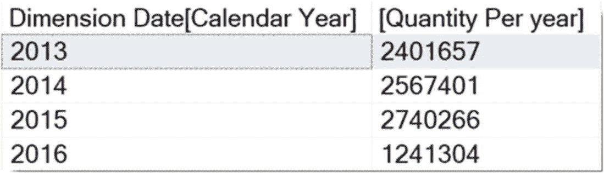

*图 13-15 – 显示清单 13-17 中查询的结果集*

清单 13-18 展示了清单 13-16 中未使用 `CALCULATE` 函数的查询的简化逻辑计划。为便于直接比较，清单 13-19 展示了清单 13-17 中使用了 `CALCULATE` 函数的修改后查询的简化逻辑计划。图 13-15 显示了清单 13-17 中代码的完整结果。

```
AddColumns: RelLogOp
Scan_Vertipaq: RelLogOp
Sum_Vertipaq: ScaLogOp
↳ DependOnCols(0)([Calendar Year])
Scan_Vertipaq: RelLogOp
↳ DependOnCols(0)([Calendar Year])
↳ 1-110
↳ RequiredCols(0, 13)
↳([Calendar Year], [Quantity])
'Fact Sale'[Quantity]: ScaLogOp
清单 13-19
清单 13-17 中查询的简化逻辑计划（带 CALCULATE）
```

```
AddColumns`: RelLogOp`
`Scan_Vertipaq`: RelLogOp`
`Sum_Vertipaq`: ScaLogOp`
↳ `DependOnCols()()`
`Scan_Vertipaq`: RelLogOp`
↳ `DependOnCols()()`
↳ 1-110`
↳ `RequiredCols(13)('Fact Sale'[Quantity])`
`'Fact Sale'[Quantity]`: ScaLogOp`
清单 13-18`
清单 13-16 中查询的简化逻辑计划（无 `CALCULATE`）
```

对于清单 13-16（无 `CALCULATE`）和清单 13-17（有 `CALCULATE`）中展示的两个简化计划，为了简洁起见，移除了非必要且相同的运算符属性。

两个计划都有五个操作，因此有五行。`↳` 字符用于标识为了可读性而引入的换行。

这两个计划之间的关键区别在于，未使用 `CALCULATE` 函数的查询中，名为 `DependsOnCols` 的运算符属性未填充列值。

然而，在使用 `CALCULATE` 的版本中，`DependsOnCols` 运算符属性提供了两次扫描之间的链接。在两个查询中，都执行了两次 VertiPaq 扫描；但是，`Sum_VertiPaq` 操作考虑了相关的 `[Calendar Year]`。

两个查询的物理计划非常相似，除了计划中与 `Sum_VertiPaq` 逻辑操作相关的一行，该行包含一个 `LookupCols` 属性，该属性在两次扫描之间建立了链接。

在性能方面，这两个查询在拥有 228,265 行的 `'Fact Sale'` 表上表现出相似的性能特征，但在数据集大得多的情况下可能会有所不同。

### 运行总计

继续以 `CALCULATE` 函数为例，另一个有趣且能突出查询计划用途的例子是累计总计计算。清单 13-20 展示了两个以不同方式编写但产生相同结果的 DAX 查询。

```
GO
EVALUATE
ADDCOLUMNS(
VALUES('Dimension Date'[Date]),
"Running total of Quantity" ,
CALCULATE(
SUMX(
'Fact Sale',
'Fact Sale'[Quantity]
),
'Dimension Date'[Date]
)
GO
EVALUATE
ADDCOLUMNS(
VALUES('Dimension Date'[Date]),
"Running total of Quantity" ,
SUMX(
FILTER(
'Fact Sale',
'Fact Sale'[Invoice Date Key]<=
↳ EARLIER('Dimension Date'[Date])
),
'Fact Sale'[Quantity]
)
)
```

该批次中的两个查询都使用了 `SUMX` 函数结合 `ADDCOLUMNS` 函数，来添加一列显示由 `VALUES` 函数返回的每一天的累计总计。

两个查询都返回相同的 1,461 行结果集。它们使用的筛选条件也相同；然而，筛选条件的位置和方法对每种方法的性能特征产生了巨大影响。

清单 13-20 示例中的第一个查询使用 `CALCULATE` 函数来执行核心的 `SUMX` 函数，并将筛选逻辑分离到 `CALCULATE` 函数的筛选参数中，而第二个查询则在 `SUMX` 表达式内部使用了 `FILTER` 函数。

两个查询都执行了两次 VertiPaq 存储引擎扫描。第一次 VertiPaq 扫描与 `VALUES` 函数相关，用于确定结果集中唯一日期的数量，另一次 VertiPaq 扫描则使用了 `[Quantity]` 列。

第一个查询使用了 `CALCULATE` 函数，其完成时间可靠地低于 1 秒。第二个查询将筛选逻辑嵌入到 `SUMX` 表达式内部，其完成时间在 20 到 30 秒之间。对于两个看起来非常相似的查询而言，这种性能差异是巨大的。

这两个查询的查询计划揭示了两者差异的线索，其简化版本的两个逻辑计划分别展示在清单 13-21 和清单 13-22 中。

```
AddColumns: RelLogOp
Scan_Vertipaq: RelLogOp
SumX: ScaLogOp DependOnCols(0)
Filter: RelLogOp DependOnCols(0)
Scan_Vertipaq: RelLogOp
LessThanOrEqualTo: ScaLogOp
'Fact Sale'[Invoice Date Key]: ScaLogOp
'Dimension Date'[Date]: ScaLogOp
'Fact Sale'[Quantity]: ScaLogOp
```

```
AddColumns: RelLogOp
Scan_Vertipaq: RelLogOp
Calculate: ScaLogOp
Sum_Vertipaq: ScaLogOp
Scan_Vertipaq: RelLogOp
'Fact Sale'[Quantity]: ScaLogOp
Filter: RelLogOp DependOnCols(0)
Scan_Vertipaq: RelLogOp
LessThanOrEqualTo: ScaLogOp
'Dimension Date'[Date]: ScaLogOp
'Dimension Date'[Date]: ScaLogOp
```

重申一次，为了提高可读性，我们已经移除了逻辑计划中的干扰和重复内容，对其进行了简化。两个计划之间的巨大差异在于，清单 13-21 中的第一个计划（即速度更快的查询）使用了 `Sum_VertiPaq` 运算符，这意味着 `SUMX` 函数可以在读取数据时在存储引擎中执行其工作。该操作可能通过多线程并行发生。在此处使用 `Sum_VertiPaq` 也解释了为什么总体查询时间比 VertiPaq SE 扫描事件报告的时间要稍长一些。

清单 13-22 中的第二个逻辑计划使用了 `SumX` 运算符（第 3 行），而不是 `Sum_VertiPaq` 运算符。`SumX` 运算符不作为存储引擎执行工作的一部分，它必须等待所有数据被检索完之后，才能使用单线程方法继续执行以满足需求。

图 13-16 中的“Duration”列显示了每个查询的持续时间概况。请注意，第二个查询中的其中一个 VertiPaq SE 查询持续时间较长，为 58 毫秒。持续时间较长是因为该扫描注入了一个额外的行标识符列，公式引擎中的 `SumX` 操作需要此列来完成工作。

如果从查询结束事件相关的持续时间中减去 VertiPaq SE 查询事件的持续时间，你会得到一个近似值，该值表示为了满足查询而在公式引擎中花费的时间。

图 13-16 展示了清单 13-20 中两个查询的分析器跟踪详细信息。标记为 1 的顶部七个行块与使用 `CALCULATE` 函数的较快查询有关。此查询所花费的总时间显示在查询结束事件的“Duration”列中，为 580 毫秒。

标记为 2 的底部七个行块与不使用 `CALCULATE` 函数的较慢查询有关。此查询耗时 23 秒（23,251 毫秒）完成，并且其大部分工作在公式引擎中执行。

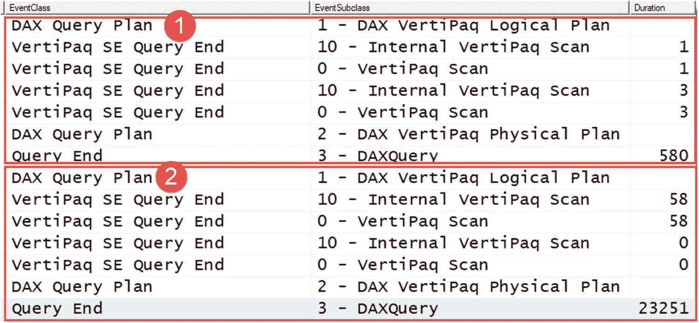

### DAX Studio

美观（且免费）的 DAX Studio 是编写 DAX 查询时的绝佳伴侣，它包含的众多出色功能（如图 13-17 所示）包括：

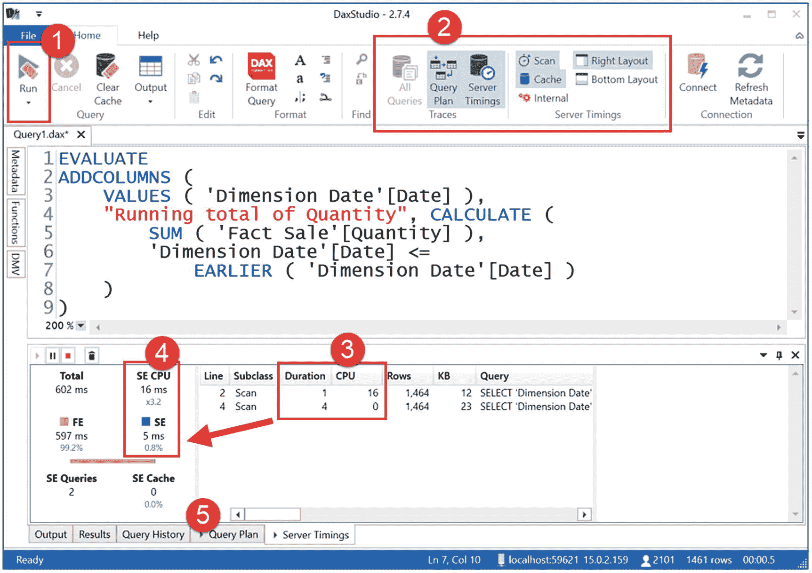

1.  在每次运行前自动执行 `ClearCache` 的能力
2.  开关查询计划和服务器计时（包括扫描和缓存计时）
3.  任何存储引擎工作的持续时间和 CPU 计时（每扫描一行）
4.  SE 活动的总计，可用于推导公式引擎时间
5.  用于显示查询结果、逻辑和物理计划以及计时详细信息的选项卡

在图 13-17 中标记为 5 的“查询计划”选项卡，当功能区中的“查询计划”选项（标记为 2 处）被启用时，提供对逻辑和物理查询计划的访问。此屏幕显示从查询窗口执行的特定查询的详细信息。如果在运行中启用了“清除缓存”选项，这些详细信息包括物理计划顶部的额外行。

### 总结

本章向你介绍了 DAX 查询计划，以及如何利用它来帮助理解特定查询运行缓慢的原因。

查询计划与存储引擎分析器事件相结合，可以为各种 DAX 查询的性能特征提供有用的见解。

在研究计划时，请查找各种 VertiPaq 运算符（例如 `Sum_VertiPaq`）的存在。当 DAX 引擎在纯 VertiPaq 模式下运行时，其运行速度最快。

在查看物理计划时，请查看筛选器和节点的顺序和位置，并尝试以不同的方式重写查询以比较计划。在针对性能优化查询时，`#Records` 运算符属性也是一个非常有用的指标。

在为性能进行调试时，始终要清除缓存！

仅提供的持续时间数字是针对 DAX 查询结束事件和 VertiPaq SE 事件的。

如需进一步阅读，我推荐 Alberto Ferrari 在 2013 年撰写的一篇优秀白皮书，名为《理解 DAX 查询计划》，以及 Jeffrey Wang（DAX 之父）在其网站`mdxdax.blogspot.com`上撰写的任何相关主题的文章。