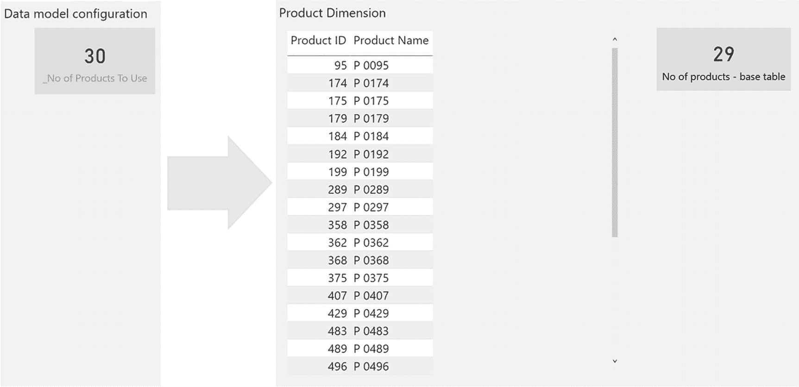
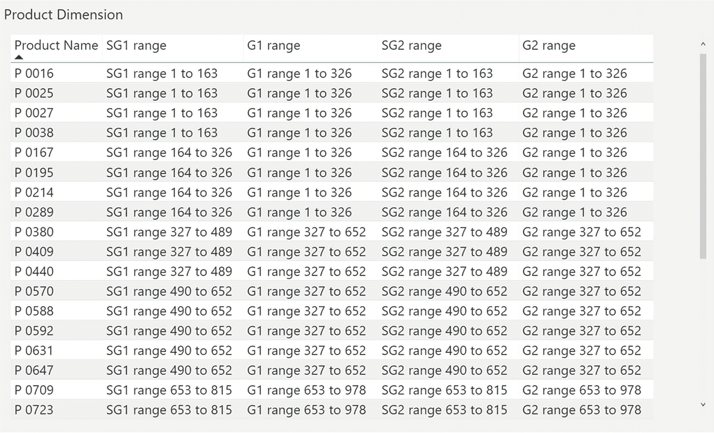
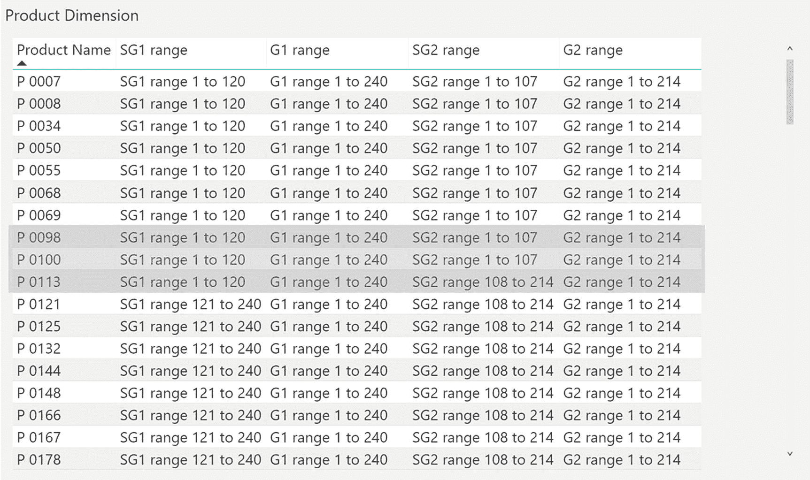
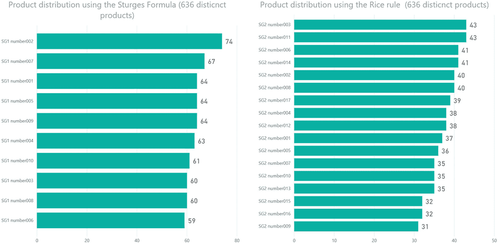
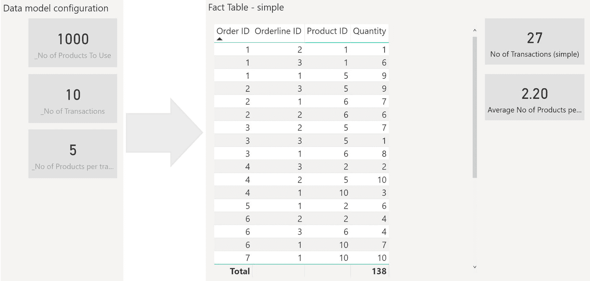
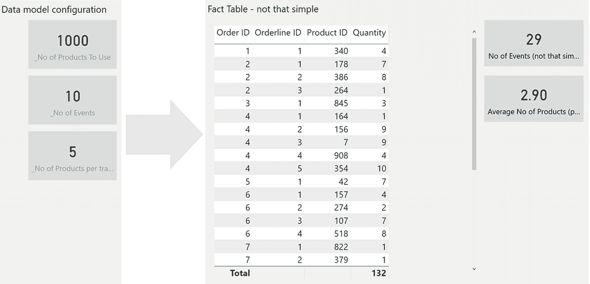

# 14. 扩展模型规模


## 引言

编写 DAX 语句有两种应用场景。第一种是针对特定数据集回答具体问题。第二种是为通用性问题寻找答案，这类解决方案将使我们未来能更快地解答类似问题。

因此，后一种解决方案也被称为模式。乍看之下，不使用现有模式或不开发新模式似乎很愚蠢。但当然，有时事情没那么简单，因为可能没有时间开发模式，甚至没有时间快速上网搜索现有模式并直接将其适配到特定问题。这听起来很奇怪，但开发模式只有在充分了解系统细节（至少部分细节）时才有可能，特别是不同情况会如何影响系统中所有组件的复杂运作。培养这些技能代价高昂（从时间角度来看）。诚然，立即找到问题答案的体验也很棒；有时必须即刻找到解决方案，因为今天下午演示中最重要视觉元素所展示的图表并未显示正确（或至少是预期的）数值。这种"救火式"的 DAX 开发在情感和智力层面都可能带来乐趣和回报。但正如所有真正的消防员所知，这其中存在风险。幸运的是，"救火式" DAX 开发的风险仅此而已：无法在规定时间内找到解决方案。当消防员进入未知建筑时，必须寻找一些类似的类比。为此，让我们把未知建筑想象成 Power BI 数据模型。消防员不知道不同的房间（表）是如何通过门（关系）连接的，也不清楚这些门是单向的还是可以双向使用（交叉筛选方向等于一对多或双向）。

本章将介绍如何通过提供将小数据模型扩展为大数据模型的技术，来帮助您成为更出色的"消防员"。数据模型的扩展将在 DAX 中完成；这意味着准备可扩展的数据模型也能训练对 DAX 的整体理解，当然还包括 DAX 与数据模型之间的交互。

从小数据模型入手，可以轻松审视结果并使用心算验证 DAX 语句。对较小数据集进行扩展，可以检验 DAX 语句的适用性。DAX 语句的适用性可与消防员的身心素质相类比。正如本书中多次提到的，存储引擎是 VertiPaq 引擎中能够极快执行 DAX 语句特定部分的组件，而公式引擎则可以计算复杂语句。两个组件的协同利用对度量值的成功至关重要，特别是当度量值要应用于大数据模型时。

#### 注意

小数据模型的扩展并不意味着创建跨越数 PB 的大数据数据集。扩展是指将数据模型从数十或数百行扩展到数千或数百万行。

## 有偏差的数据

如今，使用有偏差的数据集并不可取，至少当数据集源于草率的实验时不应如此。为了更好地理解有偏差数据，想象一下：为了预测一款即将上市的新产品能否成功而进行了一项调查。如果这款产品是专为老年人设计某些额外功能的智能手机，你必须确保调查对象不只是附近高中的孩子，因为这些孩子并非目标群体，他们对功能的评价会有偏差。

然而，创建一个完全由随机算法生成的数据集也不是好主意。这是因为数据会因以下原因产生"偏差"：

*   某些产品更受客户青睐，因此它们在销售数据集中出现得更频繁。
*   由于法律限制，某些产品无法销往某些市场；因此，如果数据集上进行地理空间相关分析，这些产品将不会出现在数据集中。
*   某些产品不会贯穿整个时间段出现，因为它们在后续时间点才发布，或者因其产品生命周期结束而消失。

用于开发度量值的数据集产生偏差的原因有很多。主要原因很简单：由算法创建的有偏差数据集比完全随机化的数据集更接近真实世界的数据集。

## 维度表和事实表

维度表和事实表是数据模型的核心；如果这些表不包含相关数据，任何 DAX 语句都无法计算出哪怕最简单的度量值。设计一个包含示例数据的可扩展数据模型是一项艰巨的任务。因此，必须记住模型必须简单，简单到可以进行心算，但又足够复杂，以便在不同情况下验证度量值的结果，即在不同视觉对象中使用度量值，这些视觉对象中的隐式筛选器会影响聚合的行数。假设一个度量值在任意时间点计算总数量，而不考虑任何其他维度（除了日历维度），那么有必要测试该度量值在使用不同表中的列（例如客户表中的列）筛选事实表时是否返回相同的值。

关于不同类型维度表和事实表的优秀参考书是克里斯托弗·亚当森的《星型模式：完全参考手册》。这本书可用于创建代表各种业务流程的多种数据模型。

本章的重点不是为特定业务流程创建完整的数据模型。这里仅涉及创建一些可用于测试度量值正确性以及度量值在更大数据集上性能的表。

示例数据模型由一个配置表创建，而该配置表本身当然是使用 DAX 语句定义的。清单 14-1 显示了定义此配置表的 DAX 语句。

```
Sample Data Configuration =
UNION(
ROW("Parameter Name" , "No Of Products to use", "Parameter Value" , 1000)
, ROW("Parameter Name" , "No Of Events", "Parameter Value" , 10)
, ROW("Parameter Name" , "No of Products per events (max)" , "Paramter Value" , 5)
, ROW("Parameter Name" , "No of days ahead" , "Paramter Value" , 10)
)
```

**清单 14-1** 配置表

不同的参数存储在一个表中，可根据需要扩展该表。

### 维度表

忽略任何与业务相关的内容，维度表可简化为以下要素：

*   单行唯一标识一个业务对象，例如，一个产品。
*   属性用于描述该业务对象，例如，产品颜色。

#### 注意

本章使用 Power BI 文件 "CH14 – the sample model.pbix"。此 `pbix` 文件使用 Excel 文件 "Dimension Template.xlsx" 作为数据源。请注意，此文件中的数据（甚至包含在数据模型中的部分）不会在最终数据模型中使用，即与此模型没有建立关系。

由于此 `pbix` 文件使用 Excel 文件作为数据源，因此该 Excel 文件的路径被配置为一个参数，可以非常快速地更改以适配您的文件位置。查询参数是一个旧功能（如果对于一个像 Power BI 这样年轻的产品来说这能称之为旧功能的话）。以下是查询参数公告的链接：[`https://powerbi.microsoft.com/en-us/blog/deep-dive-into-query-parameters-and-power-bi-templates/`](https://powerbi.microsoft.com/en-us/blog/deep-dive-into-query-parameters-and-power-bi-templates/)。


#### Excel 源文件 “Dimension Template.xlsx”

如果你好奇为什么使用 Excel 源文件仅仅是为了存储一些信息，而为什么不直接用 DAX 来存储像产品颜色这样简单的内容，答案很直接：与调整 DAX 代码来存储诸如颜色名称等海量文字信息相比，将 Excel 文件适配到某些特定需求要方便得多。

#### 维度基表

在创建示例数据模型时，必须确保维度表不包含任何重复的标识符。代码清单 14-2 展示了创建并填充 `Dimension Product – base table`（维度产品 - 基表）的 DAX 语句；该代码清单仅创建了一个包含 ID 列和名称列的基表。需要留意的是，所创建的维度不一定是产品维度。类似的 DAX 代码也可用于创建客户维度。

```
Dimension Product - base table =
var NoOfProductsToUse = [_No of Products To Use] --由于使用了 DISTINCT，重复行会被剔除，因此你可能得不到确切的数字
var NoOfProductsAvailable = COUNTROWS('Dimension Template')
var ZeroPadding = CEILING(LOG10(NoOfProductsAvailable),1)
var p0_productbasetable = DISTINCT(
SELECTCOLUMNS(
ADDCOLUMNS(
GENERATESERIES(1 , NoOfProductsToUse , 1)
, "Product ID" , RANDBETWEEN(1 , NoOfProductsAvailable)
)
, "Product ID" , [Product ID]
, "Product Name" , "P " & RIGHT(REPT("0" , ZeroPadding) &  [Product ID], LEN(NoOfProductsAvailable))
)
)
return
p0_productbasetable
代码清单 14-2
产品维度 – 基表
```

该 DAX 语句创建了一个表，表中创建的行数取决于度量值 `NoOfProductsToUse`（要使用的产品数量）。此度量值通过使用 DAX 函数 `GENERATESERIES`（生成序列）来控制将创建多少行，即多少个产品。

在此阶段，维度表仅包含两列：

- `Product ID`（产品 ID）
- `Product Name`（产品名称）

`Product ID` 是一个整数值。`Product ID` 通过使用 DAX 函数 `RANDBETWEEN`（随机介于）创建。`RANDBETWEEN` 从给定的整数范围（可重复）中执行随机抽取。由 `RANDBETWEEN(1 , NoOfProductsAvailable)` 定义的范围内每个值被抽中的概率相同。不幸的是，这也意味着第二次抽取可能再次选中对应的整数值。由于需要创建一个代表 `Product ID` 的唯一整数值列表，因此还需要使用 `DISTINCT`（去重）作为创建基表的最外层函数。DAX 函数 `SELECTCOLUMNS`（选择列）用于选择 `Product ID` 列（一个随机整数值），同时也创建 `Product Name`（一个简单的文本拼接，主要用于创建一个字符串值）。`SELECTCOLUMNS` 的另一个用途是省略由 `GENERATESERIES` 自动创建的列值。当你开始使用并更改可用参数时，你将会遇到参数 `No Of Products to use`（要使用的产品数量）与实际创建的产品行数不匹配的情况，如图 14-1 所示。



*图 14-1 – 意外情况*

#### 注意

在本章中，将使用 ID，因为如果在可视化对象上使用，数字数据类型会自动使用 `SUM` 聚合。为此，请确保将聚合调整为“不汇总”。

预期结果是：通过使用代码清单 14-3 中的度量值，`Dimension Product – base table` 表中使用的产品数量将等于 30。

```
No of products - base table =
COUNTROWS('Dimension Product - base table')
代码清单 14-3
产品数量 – 基表
```

有时度量值并不会返回已配置的结果。

必须始终牢记，所使用的产品是随机选择的。因此，如前所述，可能会出现一个 `Product ID` 被“抽取”多次的情况。使用函数 `DISTINCT` 将纠正这个“错误”。正因如此，两个度量值可能会显示不同的结果。

#### 通过分箱和分组创建层次结构

除了创建示例数据之外，还需要创建层次结构。这仅仅是因为层次结构将维度的唯一值分组为若干区块。产品将被分组为产品子类别，而产品子类别将被分组为产品类别。

创建层次结构可能是一件繁琐的工作。为了省去这种繁琐且易出错的工作，这里使用一种算法来创建层次结构。通过算法对 ID 进行分组可以分解为两个部分：

- 确定组（分箱）的数量。
- 将 ID 分配给某个组。

由于业务对象通常被分组成多个层次结构，因此使用了两种不同的算法。有关所用算法的更多信息，可在此处找到：[`https://en.wikipedia.org/wiki/Histogram`](https://en.wikipedia.org/wiki/Histogram)。

由于使用何种算法并不那么重要，这里使用了较为简单的算法：

- 斯特奇斯公式
- 赖斯法则

代码清单 14-4 显示了创建 `Product Dimension – hierarchy`（产品维度 - 层次结构）表的完整 DAX 语句。该表包含两个层次结构：

- `Product ID` ➤ SG1 …（子组 1） ➤ G1 …（组 1）
- `Product ID` ➤ SG2 …（子组 2） ➤ G2 …（组 2）

关键部分已突出显示，并在代码清单之后进行更详细的解释。


```dax
Dimension Product - hierarchy =
var NoOfProductsToUse = [_No of Products To Use] -- 由于使用了 DISTINCT，重复行会被消除，因此你可能不会得到精确的数字
var NoOfProductsAvailable = COUNTROWS('Dimension Template')
var ZeroPadding = CEILING(LOG10(NoOfProductsAvailable),1)
var p0_productbasetable = DISTINCT(
SELECTCOLUMNS(
ADDCOLUMNS(
GENERATESERIES(1 , NoOfProductsToUse , 1)
, "Product ID" , RANDBETWEEN(1 , NoOfProductsAvailable)
)
, "Product ID" , [Product ID]
, "Product Name" , "P " & RIGHT(REPT("0" , ZeroPadding) &  [Product ID], LEN(NoOfProductsAvailable))
)
)
/* ***************************************************************** */
/* 用于创建层级结构的通用信息 */
var NoOfRowsBaseTable = COUNTROWS(p0_productbasetable)
var MaxMinRange = MAXX(p0_productbasetable,[Product ID]) - MINX(p0_productbasetable,[Product ID])
/* ***************************************************************** */
/* 使用 Sturges 公式确定分组宽度 */
var noOfGroupsSturges = ROUND(LOG(NoOfRowsBaseTable,2),0)+1
var subgroupWidthSturges = CEILING((MaxMinRange/noOfGroupsSturges),1)
var groupWidthSturges = subgroupWidthSturges * 2
/* ***************************************************************** */
/* 使用 Rice 规则确定分组宽度 */
var noOfGroupsRice = ROUND(2 * POWER(COUNTROWS(p0_productbasetable),1/3),0)
var subgroupWidthRice = CEILING((MaxMinRange/noOfGroupsRice),1)
var groupWidthRice = subgroupWidthRice * 2
var p1_productsWithHiearchy =
ADDCOLUMNS(
p0_productbasetable
,
/* 用于创建组数的公式取自：https://en.wikipedia.org/wiki/Histogram */
/* ************************************************************* */
/* 使用 Sturges 公式确定分组宽度 */
"SG1 range"
,
var groupNumber = CEILING([Product ID] / subgroupWidthSturges,1)
return
"SG1 range " & 1+(groupNumber-1) * subgroupWidthSturges & " to "  & FLOOR(groupNumber * subgroupWidthSturges,1)
, "SG1 number"
,
"SG1 number" & RIGHT(REPT("0", 3) & CEILING([Product ID] / subgroupWidthSturges,1),3)
,"G1 range"
,
var groupNumber = CEILING([Product ID] / groupWidthSturges,1)
return
"G1 range " & 1+(groupNumber-1) * groupWidthSturges & " to "  & FLOOR(groupNumber * groupWidthSturges,1)
, "G1 number"
,
"G1 number " & RIGHT(REPT("0", 3) & CEILING([Product ID] / groupWidthSturges,1),3)
/* ********************************************************* */
/* 使用 Rice 公式确定分组宽度 */
,"SG2 range"
,
var groupNumber = CEILING([Product ID] / subgroupWidthRice,1)
return
"SG2 range " & 1+(groupNumber-1) * subgroupWidthRice & " to "  & FLOOR(groupNumber * subgroupWidthRice,1)
, "SG2 number"
,
"SG2 number" & RIGHT(REPT("0", 3) & CEILING([Product ID] / subgroupWidthRice,1),3)
,"G2 range"
,
var groupNumber = CEILING([Product ID] / groupWidthRice,1)
return
"G2 range " & 1+(groupNumber-1) * groupWidthRice & " to "  & FLOOR(groupNumber * groupWidthRice,1)
, "G2 number"
,
"G2 number " & RIGHT(REPT("0", 3) & CEILING([Product ID] / groupWidthRice,1),3)
)
return
p1_productsWithHiearchy
```
**清单 14-4** 产品维度 – 层级结构

清单 14-4 中的代码行可归结为三个部分。这些部分用于存储将在表迭代函数 `ADDCOLUMNS` 内使用的值，该函数用于向产品维度基表添加列。第一部分存储了关于基表的通用信息。两种算法都使用相同的这些信息。

```dax
***************************************************************** */
/* 用于创建层级结构分箱的通用信息 */
var NoOfRowsBaseTable = COUNTROWS(p0_productbasetable)
var MaxMinRange = MAXX(p0_productbasetable,[Product ID]) - MINX(p0_productbasetable,[Product ID])
```

存储的值是：

*   基表中的行数。
*   产品 ID 的范围。该范围可以通过公式 `MAX(list) – MIN(list)` 计算得出。

由于这个列表（即 `Product ID` 列）包含在一个“虚拟”表中，因此必须使用表迭代函数 `MAXX` 和 `MINX`。

这两种算法都使用上述两个值来确定箱数和每个箱的宽度。下一部分仅描述基于 Sturges 公式的计算：

```dax
/* 使用 Sturges 公式确定分组宽度 */
var noOfGroupsSturges = ROUND(LOG(NoOfRowsBaseTable,2),0)+1
var subgroupWidthSturges = CEILING((MaxMinRange/noOfGroupsSturges),1)
var groupWidthSturges = subgroupWidthSturges * 2
```

上述几行代码使用 Sturges 公式计算箱数。该值存储到变量 `noOfGroupsSturges` 中。每个分组的宽度被计算出来并存储到变量 `subgroupWidthSturges` 中。即使每个分组的宽度相同，这也不意味着宽度的计算没有考虑 ID 的分布情况。

在上述部分之后，还有一个小任务：需要使用已定义的变量来创建代表层级结构的附加列。接下来的几行展示了这些变量如何被用于将要创建的八列中的仅两列，因为这些行会通过使用不同的变量进行微小更改后，在其他所有列上重复：

```dax
"SG1 range"
,
var groupNumber = CEILING([Product ID] / subgroupWidthSturges,1)
return
"SG1 range " & 1+(groupNumber-1) * subgroupWidthSturges & " to "  & FLOOR(groupNumber * subgroupWidthSturges,1)
, "SG1 number"
,
"SG1 number" & RIGHT(REPT("0", 3) & CEILING([Product ID] / subgroupWidthSturges,1),3)
```

列 `SG1 range` 包含基于 Sturges 公式的子分组层级结构；通过添加该特定范围内 ID 的下限和上限，使用文本连接来提供关于产品 ID 的附加信息。其过程如下：

*   使用 `CEILING` 将基表中当前行的 `Product ID` 的分组编号存储到变量 `groupNumber` 中。
*   将下限与上限以及前缀和单词“to”连接起来，以提高可读性。

图 14-2 展示了使用参数 `No Of Products to use` = 30 创建的产品维度 – 层级结构表的若干列。



**图 14-2** 小型产品维度 – 层级结构

> **注意：** 由于创建此表内容时使用了随机值，该图可能与您看到的结果不符。

如果您仔细观察，会意识到 `SG1/G1` 和 `SG2/G2` 这两个层级结构是相同的。这是因为在处理较小数据量时，这两种算法具有相似性，如上例所示。

图 14-3 显示的是同一个表，但这次是使用参数 `No Of Products to use` = 100 创建的。



**图 14-3** 较大型产品维度 – 层级结构

如果使用更多的产品来创建一个大型维度表（请注意，在此示例中，“大型”并不意味着数百万行），两种算法的差异将变得更加明显。图 14-4 展示了使用参数 `No Of Products to use` = 1000 时的产品 ID 分配情况。



**图 14-4** 大型产品维度 – 层级结构分布


好的，作为高级文档工程师和翻译员，我将根据您提供的注意事项和示例，将给定的英文文本翻译成中文。


#### 其他维度属性

创建层次结构对于全面测试度量值至关重要。然而，构成层次结构的属性并非唯一会被使用的属性。例如，像产品颜色这样简单的东西也是一个非常重要的属性。当然，也可以将任何其他属性作为产品表中的附加列来使用。未用于形成层次结构的属性（列）是判断度量值是否返回正确值的得力助手，因为从这类属性中选择一个值会过滤掉产品数量。这对于任何试图提取见解，且层次结构在其中扮演重要角色的计算都可能产生巨大影响。虽然听起来很简单，但有时在测试度量值时，这些简单的事情反而会被忽略。

因此，本章将介绍如何添加一个像颜色这样的简单属性到表 `Product Dimension – color`。该表基于 `Product Dimension – base table` 表创建。这仅仅是为了简便。在本章的末尾，会提供一个最终列表的参考，它结合了所有不同的方面，形成一个单一的 DAX 语句，以创建最终的维度表。

列表 14-5 展示了如何将颜色属性添加到维度表。同样，重要的部分会突出显示，并在列表之后进行更详细的解释。

```
Dimension Product - color =
var NoOfProductsToUse = [_No of Products To Use] --由于使用了 DISTINCT，重复行将被消除，因此你可能不会得到完全相同的数字
var NoOfProductsAvailable = COUNTROWS('Dimension Template')
var ZeroPadding = CEILING(LOG10(NoOfProductsAvailable),1)
/* ***************************************************************** */
/* 非层次结构属性 */
var NoOfroductColors = COUNTROWS('Product_Color')
var path_Colors = CONCATENATEX(TOPN(NoOfroductColors,'Product_Color',[Attribute1_ID]),[Attribute1_Name],"|")
var p0_productbasetable = DISTINCT(
SELECTCOLUMNS(
ADDCOLUMNS(
GENERATESERIES(1 , NoOfProductsToUse , 1)
, "Product ID" , RANDBETWEEN(1 , NoOfProductsAvailable)
)
, "Product ID" , [Product ID]
, "Product Name" , "P " & RIGHT(REPT("0" , ZeroPadding) &  [Product ID], LEN(NoOfProductsAvailable))
)
)
var p2_productcolor =
ADDCOLUMNS(
p0_productbasetable
,/* 这是产品颜色 */
"Color"
,
var randomvalue = RANDBETWEEN(1,NoOfroductColors)
return
PATHITEM(path_Colors ,randomvalue, TEXT)
)
return
p2_productcolor
列表 14-5
产品维度 - 颜色
```

这几行代码

```
/* 非层次结构属性 */
var NoOfroductColors = COUNTROWS('Product_Color')
var path_Colors = CONCATENATEX(TOPN(NoOfroductColors,'Product_Color',[Attribute1_ID]),[Attribute1_Name],"|")
```

的工作方式如下：

*   颜色数量被存储到变量 `NoOfProductColors` 中。
*   `TOPN` 返回一个按 `Attribute1_ID` 列排序的表。然后使用该表，通过 `Attribute1_Name` 列创建所有颜色名称的字符串。使用分隔符 `"|"` 可以调用所有 `PATH` 函数，如 `PATHITEM`。

这几行代码

```
var randomvalue = RANDBETWEEN(1,NoOfroductColors)
return
PATHITEM(path_Colors ,randomvalue, TEXT)
```

创建了：

*   一个使用 `RANDBETWEEN` 生成的随机整数。该整数被存储到变量 `randomvalue` 中。
*   `PATHITEM` 函数允许从一个由 `"|"` 分隔项目的字符串中检索项目（即颜色）。

如前所述，列表 14-6 将创建完整的维度表 `Product Dimension – final`。

```
Dimension Product - final =
var NoOfProductsToUse = [_No of Products To Use] --由于使用了 DISTINCT，重复行将被消除，因此你可能不会得到完全相同的数字
var NoOfProductsAvailable = COUNTROWS('Dimension Template')
var ZeroPadding = CEILING(LOG10(NoOfProductsAvailable),1)
var p0_productbasetable = DISTINCT(
SELECTCOLUMNS(
ADDCOLUMNS(
GENERATESERIES(1 , NoOfProductsToUse , 1)
, "Product ID" , RANDBETWEEN(1 , NoOfProductsAvailable)
)
, "Product ID" , [Product ID]
, "Product Name" , "P " & RIGHT(REPT("0" , ZeroPadding) &  [Product ID], LEN(NoOfProductsAvailable))
)
)
/* ***************************************************************** */
/* 用于创建层次结构的分箱通用信息 */
var NoOfRowsBaseTable = COUNTROWS(p0_productbasetable)
var MaxMinRange = MAXX(p0_productbasetable,[Product ID]) - MINX(p0_productbasetable,[Product ID])
/* ***************************************************************** */
/* 使用斯特吉斯公式确定分箱宽度 */
var noOfGroupsSturges = ROUND(LOG(NoOfRowsBaseTable,2),0)+1
var subgroupWidthSturges = CEILING((MaxMinRange/noOfGroupsSturges),1)
var groupWidthSturges = subgroupWidthSturges * 2
/* ***************************************************************** */
/* 使用斯特吉斯公式确定分箱宽度 */
var noOfGroupsRice = ROUND(2 * POWER(COUNTROWS(p0_productbasetable),1/3),0)
var subgroupWidthRice = CEILING((MaxMinRange/noOfGroupsRice),1)
var groupWidthRice = subgroupWidthRice * 2
/* ***************************************************************** */
/* 非层次结构属性 */
var NoOfroductColors = COUNTROWS('Product_Color')
var path_Colors = CONCATENATEX(TOPN(NoOfroductColors,'Product_Color',[Attribute1_ID]),[Attribute1_Name],"|")
var p1_productsWithHiearchy =
ADDCOLUMNS(
p0_productbasetable
,
/* 创建组数的公式来自： https://en.wikipedia.org/wiki/Histogram */
/* ************************************************************* */
/* 使用斯特吉斯公式确定分箱宽度 */
"SG1 range"
,
var groupNumber = CEILING([Product ID] / subgroupWidthSturges,1)
return
"SG1 range " & 1+(groupNumber-1) * subgroupWidthSturges & " to "  & FLOOR(groupNumber * subgroupWidthSturges,1)
, "SG1 number"
,
"SG1 number" & RIGHT(REPT("0", 3) & CEILING([Product ID] / subgroupWidthSturges,1),3)
,"G1 range"
,
var groupNumber = CEILING([Product ID] / groupWidthSturges,1)
return
"G1 range " & 1+(groupNumber-1) * groupWidthSturges & " to "  & FLOOR(groupNumber * groupWidthSturges,1)
, "G1 number"
,
"G1 number " & RIGHT(REPT("0", 3) & CEILING([Product ID] / groupWidthSturges,1),3)
/* ********************************************************* */
/* 使用赖斯公式确定分箱宽度 */
,"SG2 range"
,
var groupNumber = CEILING([Product ID] / subgroupWidthRice,1)
return
"SG2 range " & 1+(groupNumber-1) * subgroupWidthRice & " to "  & FLOOR(groupNumber * subgroupWidthRice,1)
, "SG2 number"
,
"SG2 number" & RIGHT(REPT("0", 3) & CEILING([Product ID] / subgroupWidthRice,1),3)
,"G2 range"
,
var groupNumber = CEILING([Product ID] / groupWidthRice,1)
return
"G2 range " & 1+(groupNumber-1) * groupWidthRice & " to "  & FLOOR(groupNumber * groupWidthRice,1)
, "G2 number"
,
"G2 number " & RIGHT(REPT("0", 3) & CEILING([Product ID] / groupWidthRice,1),3)
)
var p2_final =
ADDCOLUMNS(
p1_productsWithHiearchy
,/* 这是产品颜色 */
"Color"
,
var randomvalue = RANDBETWEEN(1,NoOfroductColors)
return
PATHITEM(path_Colors ,randomvalue, TEXT)
)
return
p2_final
列表 14-6
产品维度 - 最终版
```

### 事实表

事实表核心上是存储事件度量值的。在创建可扩展数据模型时，这个简单的事实本身就存在其难度。因此，本章将创建两个典型的事实表。


#### 订单与订单行

假设一个事件是一次销售，即某人（客户）正在购买某物（产品）。这个简单的假设引出了许多我们必须回答的问题。其中一些问题如下：

- 在一个事件中，一个产品可以被销售多次吗？
  - 简单的答案是“可以”。度量会记录产品和数量，但在某些情况下，一个事件会多次记录同一个产品，例如在超市购买商品。根据零售商的不同，所有产品会被分别扫描，但有时收银员只扫描一次产品，如果购买多个相同产品，则手动输入数量。当然，世事难料，同一个产品可能会从其他产品下面冒出来，然后被再次扫描。

我们必须决定哪些情况是可能的。由于我们是从可用产品列表中随机抽取，我们决定单个事件只记录一次产品，但很明显，产品有可能被购买多次。

清单 14-7 展示了一个符合上述定义的非常简单的事实表。

```
Fact - simple =
var ProductsPath = CONCATENATEX(TOPN([_No of Products per transaction (max)], 'Dimension Product - hierarchy','Dimension Product - hierarchy'[Product ID],ASC),[Product ID],"|")
return
ADDCOLUMNS(
GENERATE(
SELECTCOLUMNS(
GENERATESERIES(1 , [_No of Events] , 1 )
, "Order ID" , [Value]
)
,var noofproductspertransaction = RANDBETWEEN(1 , [_No of Products per transaction (max)])
return
DISTINCT(
SELECTCOLUMNS(
ADDCOLUMNS(
GENERATESERIES(1 ,  noofproductspertransaction)
, "Product ID" , PATHITEM(ProductsPath , RANDBETWEEN(1 , PATHLENGTH(ProductsPath)) , INTEGER)
)
, "Orderline ID" , [Value]
, "Product ID" , [Product ID]
)
)
)
,"Quantity" , RANDBETWEEN(1 , 10)
)
清单 14-7
事实表 – 简单版
```

清单 14-7 中的操作如下：

- 一个有序的产品列表被存储在变量 `ProductsPath` 中。这个列表再次通过使用带有特殊分隔符“|”的函数 `CONCATENATEX` 创建。
- 函数 `GENERATE` 组合了由 `GENERATESERIES` 创建的两个嵌套表，其中外部的 `GENERATESERIES` 代表事件（订单），内部的代表订单行。
- `DISTINCT` 用于避免同一个产品在单个订单中出现多次。
- 从给定的产品列表中，选择一个随机数字，其中产品的最大数量受限于度量值 `[_No of Products per transaction (max)]`。

图 14-5 展示了表 `Fact – simple` 以及数据模型的配置。



图 14-5

事实表 – 简单版

清单 14-8 展示了用于配置示例数据模型以生成上图的语句。

```
Sample Data Configuration =
UNION(
ROW("Parameter Name" , "No Of Products to use", "Parameter Value" , 1000)
, ROW("Parameter Name" , "No Of Events", "Parameter Value" , 10)
, ROW("Parameter Name" , "No of Products per event (max)" , "Paramter Value" , 5)
)
清单 14-8
示例数据配置 – 事实表简单版
```

数据模型配置为使用所有可用产品（1000 个），但每个事件最多只包含 5 个产品。仔细观察可以发现，每个事件都是从同一个产品池中抽取。这并非预期效果（至少在本例中不是）。这个效果是因为 `ProductsPath` 是在 `GENERATE` 外部定义的，并且紧挨着它创建了一个始终包含 `TOPN` 个产品 ID 的列表。清单 14-9 使用了已知组件的不同组合。重要的部分已高亮显示，并在清单下方进行更详细的解释。

```
Fact - not that simple =
var noOfAvailableProducts = COUNTROWS('Dimension Product - final')
var ListOfAvaliableProducts = CONCATENATEX(VALUES('Dimension Product - final'[Product ID]),[Product ID],"|")
return
ADDCOLUMNS(
GENERATE(
SELECTCOLUMNS(
GENERATESERIES(1 , [_No of Events] , 1 )
, "Order ID" , [Value]
)
,var noofproductspertransaction = RANDBETWEEN(1 , [_No of Products per event (max)])
return
DISTINCT(
SELECTCOLUMNS(
ADDCOLUMNS(
GENERATESERIES(1 ,  noofproductspertransaction)
, "Product ID" , PATHITEM(ListOfAvaliableProducts , RANDBETWEEN(1 , PATHLENGTH(ListOfAvaliableProducts)) , INTEGER)
)
, "Orderline ID" , [Value]
, "Product ID" , [Product ID]
)
)
)
,"Quantity" , RANDBETWEEN(1 , 10)
)
清单 14-9
事实表 – 没那么简单版
```

代码行

```
var ListOfAvaliableProducts = CONCATENATEX(VALUES('Dimension Product - final'[Product ID]),[Product ID],"|")
```

只是创建了一个字符串，该字符串可以再次被 `PATH` 函数使用。

代码行

```
PATHITEM(ListOfAvaliableProducts , RANDBETWEEN(1 , PATHLENGTH(ListOfAvaliableProducts)) , INTEGER)
```

从存储在变量 `ListOfAvaliableProducts` 中的字符串里随机抽取一个项目，但由于使用了特定的分隔符，它可以通过 `PATHITEM` 函数进行搜索。

图 14-6 展示了使用表 `Fact – not that simple` 生成的报表。



图 14-6

事实表 – 没那么简单版

#### 不同日期

日期对于几乎所有的分析都至关重要。因此，我们将为这个模型添加一个非常简单的日历表。

清单 14-10 展示了如何使用 DAX 创建这个日历表。

```
Calendar table =
ADDCOLUMNS(
CALENDAR(
DATE(2018 , 1 , 1)
, DATE(2019 , 12 , 31)
)
, "Year-Month" , FORMAT([Date] , "YYYYMM")
, "Year", FORMAT([Date] , "YYYY")
)
清单 14-10
基础日历表
```


#### 注意事项

日历表被标记为日期表，且已禁用`自动日期/时间`选项（`选项和设置` ➤ `选项` ➤ `当前文件` ➤ `数据加载`）。

此处将重点为每个事件创建不同的日期。这些日期将是：

- **订单日期** – 从日历表中随机选取的日期。
- **交货日期** – 该日期将在订单日期之后随机增加天数，最大天数将通过`示例数据配置`表进行配置。

创建交货日期时须考虑日历表的结束日期。

清单 14-11 展示了如何创建一个与日期相关的表，并将其集成到清单 14-9 的语句中。

```
Fact - with Dates =
var noOfAvailableProducts = COUNTROWS('Dimension Product - final')
var ListOfAvaliableProducts = CONCATENATEX(VALUES('Dimension Product - final'[Product ID]),[Product ID],"|")
var maxDate = MAX('Calendar table'[Date])
var maxDaysAhead = [_No of days ahead]
var maxDateRandom = maxdate - [_No of days ahead]
var c0_base = FILTER(ALL('Calendar table'[Date]) , [Date] <= maxDateRandom)
var NoOfAvailableDays = COUNTROWS(c0_base)
var c0_base_path = CONCATENATEX(TOPN(NoOfAvailableDays , c0_base, [Date] , ASC) , [Date], "|")
var t_OrderID =
SELECTCOLUMNS(
ADDCOLUMNS(
GENERATESERIES(1 , [_No of Events] , 1 )
, "Order date" , DATEVALUE(PATHITEM(c0_base_path , RANDBETWEEN(1 , NoOfAvailableDays), TEXT))
)
, "Order ID" , [Value]
, "Order date" , [Order date]
, "Delivery date" , [Order date] + RANDBETWEEN(1 , maxDaysAhead)
)
return
ADDCOLUMNS(
GENERATE(
t_OrderID
,var noofproductspertransaction = RANDBETWEEN(1 , [_No of Products per events (max)])
return
DISTINCT(
SELECTCOLUMNS(
ADDCOLUMNS(
GENERATESERIES(1 ,  noofproductspertransaction)
, "Product ID" , PATHITEM(ListOfAvaliableProducts , RANDBETWEEN(1 , PATHLENGTH(ListOfAvaliableProducts)) , INTEGER)
)
, "Orderline ID" , [Value]
, "Product ID" , [Product ID]
)
)
)
,"Quantity" , RANDBETWEEN(1 , 10)
)
清单 14-11
事实表 – 包含日期
```

该语句将用于抽取随机日期。每个事件都会生成一个订单日期和一个交货日期。交货日期取决于参数`maxDaysAhead`，当然也取决于所有可用日期。可用最晚日期的计算方式如下：

```
var maxDateRandom = maxdate - [_No of days ahead]
```

此计算确保交货日期不会超出日历表的最大日期。

可用日期将存储到表变量`c0_base`中。这些可用日期将被转换为一个有序列表。该列表存储在变量`c0_base_path`中。

## 结语

创建示例数据不仅有助于测试度量的性能，也有助于理解问题。有时，度量可能无法返回预期结果。

保持冷静，继续使用 DAX。

### 索引

#### A

`ALL` 和 `ALLEXCEPT` 函数

#### B

中断沿袭

#### C

`CALCULATE` 函数 上下文转换 DAX 计算 Studio 逻辑计划 探查器跟踪 运行总计结果 `SUMX` 计算 日历 方法 `<year_end_date>` 输出值 测试 `TOTALYTD` 函数 `YEAR`/`YTD` 复合函数 *vs.* 原始函数 `CLOSINGBALANCEMONTH` 逻辑计划 `OPENINGBALANCEMONTH` `TOTALMTD` 类型

#### D

数据建模的筛选器方面 (*另见* 筛选器传播) Power BI 项目 关系 基础函数 累计月份数 累计值 编辑对话框 开始菜单 矩阵值 单表方案 数量 ytd relationships.pbix table.pbix 时间智能 单表 Auto-Exist DAX 语句 度量 查询 已发送 报表 重写代码 行视图 单表 星型架构 错误期望 雪花架构 星型架构方法 DAX 机制 上下文转换 数据库 计算列 度量 对象 关系 示意图表 VertiPaq 显式筛选器 五指死拳 隐式筛选器 聚合函数 B3/红筛选器 `CALCULATE` 函数 `Filtertable` 矩阵 `Matrix` 视觉对象 表 页面级筛选器 简单表 值 `SUMMARIZECOLUMNS` 函数 表值 矩阵 法则/原则 Power BI Desktop 数据建模技术 表格数据模型 细微差异 DAX Studio `CALCULATE` 函数 空报表页 期望 large.pbix 含义 Power BI Desktop 文件 Power BI 报表 `ALL` 函数的激活 自动日期/时间 筛选器窗格 级别筛选器和报表页 报表页 跟踪结果 视觉对象 查询编辑器 命令 依赖度量 度量上下文菜单 度量定义 性能

#### E

计算上下文 聚合函数 `CALCULATE` 函数 筛选器和行 (*另见* 筛选器和行上下文) 度量 简单度量 单值 表值 类型 VertiPaq 引擎

#### F, G, H

伪造沿袭 维度日期表 `EVALUATE` 语句 修复断开的沿袭 修改 `MyYearFilter` 变量 `TREATAS` 的结果 `DATATABLE` 函数 `FILTER` 方法 函数 语法 筛选器和行上下文 温和方法 聚合函数 缺失列 并列表 `SUMX` 表迭代器函数 奇怪观察 上下文转换 迭代器求和的一小部分 矩阵视觉对象 度量结果 SQL 语句 `SUM` 函数 筛选方法 布尔语句 扩展虚拟列 事实销售表 关系 视图表 解锁概念 形式 层级 `COUNTROWS` 函数 事实销售表 解锁 (*另见* 解锁筛选器) 表 (*另见* 表筛选) 筛选器传播 概念 `CROSSFILTER` 函数 DAX and xmSQL 一对多关系 关系基数 `EmployeeFirstName` 详情 多对多关系 一对一关系 `RELATED` 函数 强关系 `SUMMARIZE` 函数 `Schema.pbix` 存储引擎 xmSQL 修复断开的沿袭 流程控制 复杂 `IF` 函数 `IF` 语句 `ELSE` 分支 逻辑计划 `VALUES` 函数 `SWITCH` 语句

#### I, J, K

迭代器函数 平均值 优势 `AVERAGEX` 函数 `EARLIER` 函数 展开的行 循环和值 嵌套语句 目标 伪逻辑 代码计算 常见用例 数据集 调试计算 `CONCATENATEX` 函数 数据模型 MDX `SCOPE` 等效 排名计算输出 `SCOPE` 函数 `SUMX` 函数 表视觉对象 排名 更新版本 `GENERATESERIES` 函数 列表 循环流程控制 查询 `SUMX` 函数

#### L

沿袭 断开选项 组件 概念 `COUNTROWS` 函数 定义 伪造 (*另见* 伪造沿袭) 筛选表 物理表 重命名列 行上下文 `SUMMARIZECOLUMNS` 函数 表表达式 VertiPaq 扫描详情

#### M, N, O, P

度量 算法 平均数量 `CALCULATE` 函数 创建 动态分箱 筛选 `DISTINCTCOUNT` 函数 模式 违规规则 截图 阈值 用例 违反规则 measures.pbix 总数量 结果行 汇总表 概念可视化 `CURRENTGROUP` 函数 动态分箱 `GROUPBY` *vs.* `SUMMARIZE` 嵌套排名 原因 `SUMMARIZE` 函数 总数量 度量，布尔表达式 缺失索引 `LAG` 和 `LEAD` 上一个值问题 行 `ADDCOLUMNS` `CALCULATETABLE` 复杂键概念 DAX 模型 筛选概念 建模方法 上一个销售值 关系图 需求表 事实销售表 客户和销售键

#### Q

查询性能计数器 事件 输出 报表页 服务器计时 查询计划 基本计划 `CALCULATE` 函数 上下文转换 DAX Studio 运行总计 列顺序 连接对话框 设计工具 特征 流程控制 逻辑计划 `DataType (ScaLogOp)` `DependsOnCols` `DominantValue (ScaLogOp)` 运算符类型 查询 `RelLogOp` `RequiredCols` 结构 优化 物理计划 运算符类型 查询 `SpoolLookup` 运算符 结构 次数 探查器工具的端口号 查询表达式树 推荐事件 SSMS and SSAS 数据库 SSMS 数据模型 跟踪属性窗口 未筛选代码 VertiPaq (*另见* VertiPaq 运算符)


#### R

报表需求的颜色渐变因子分解热力图、十六进制颜色码和 RGB 网站数据驱动工具格式化度量条件格式对话框动态可视化标题填充颜色流程图标题 vizAid 图表度量表内容创建主页`pbix`文件截图表格（*参见*无关表）行级别安全性（RLS）活动角色分配用户复杂规则 DAX 查询计划概念逻辑计划物理计划查询结束事件跟踪事件 VertiPaq 扫描动态事件数据模型数据集屏幕维度员工表函数 Power BI Web 服务子查询测试`USERNAME`和`USERPRINCIPALNAME`函数视图对话框配置多商店环境角色筛选器管理对话框窗口建模选项卡角色部分表格测试建模选项卡多个角色的效果关系视图报表和数据视图视图对话框窗口的未筛选结果

#### S

可扩展数据建模有偏差的数据集维度表和事实表属性基表分箱和分组组件配置表不同类型维度表 Excel 源文件层次结构事实表存储日历表不同日期订单和订单行模式事件序列/缺失`ADDCOLUMNS` DAX 语句间隙长度`RunningMonthIndex``SEQ`表 SQL Server Analysis Services 多维模型（SSAS MD）SQL Server Management Studio（SSMS）

#### T

表格筛选单列表格`CALCULATE`函数扩展虚拟列沿袭多列表格多个表格`MyFilterTable`变量时间智能自动日期/时间表日历（*参见*日历）日期表调试代码度量表定义函数计算列`CALCULATE`函数`DATEADD`函数维度日期表`PREVIOUSMONTH`Wide World Importers 数据整数与日期格式原始函数与复合函数的输出不规则日历基于周（*参见*基于周的报告）

#### U

解除筛选`ALLEXCEPT`函数`ALL`函数`ALLSELECTED`注意事项`COUNTROWS`函数维度日期表事实销售表函数矩阵可视化`PREVIOUSYEAR`和`PARALLELPERIOD`函数返回百分比差异源代码表更新后的筛选上下文无关表 DAX 代码动态度量选择预期结果`FILTER`函数筛选后的销售区域流程图基本规则映射排名排序`SUMX`函数`tableWithRank`变量非预期结果变量定义

#### V

VertiPaq 运算符逻辑运算符查询事件`ADDCOLUMNS`函数物理计划探查器事件探查器跟踪结果简化逻辑计划`SpoolLookup`操作

#### W、X、Y、Z

月亏与月盈状态一致性冒泡客户代码度量映射月盈（*参见*月盈）月亏流失客户非回头客户基本情况底层基本情况月盈新客户非回头客户基本情况底层基本情况基于周的报告图表绘制折线图饼图`WEEKDAY`函数`WEEKNUM`函数
