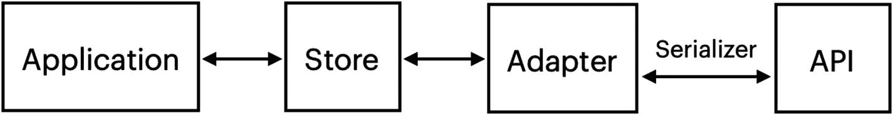

# 1. Ember Data 概述

本章旨在提供 Ember Data 的架构概述和基本总结。如果你以前没有使用过 Ember Data，我建议你先阅读 Ember 指南^(⁵) 中关于 Ember Data 的章节以熟悉它。本章将为理解 Ember Data 中所有组件如何协同工作奠定基础，以便你能够开始对其进行自定义，使其适配你的 API。

## 架构概览

Ember Data 的架构可通过下图来展示。



左侧是应用程序，它与存储（`store`）进行交互。默认情况下，路由和控制器可以访问存储，例如：

```javascript
import Route from '@ember/routing/route';
export default class ContactsRoute extends Route {
model() {
return this.store.findAll('contact');
}
}
```

存储也可以注入到应用程序的其他部分，例如组件：

```javascript
import Component from '@glimmer/component';
import { tracked } from '@glimmer/tracking';
import { inject as service } from '@ember/service';
export default class ContactsListComponent extends Component {
@service store;
@tracked contacts;
constructor() {
super(...arguments);
this.store.findAll('contact').then((contacts) => {
this.contacts = contacts;
});
}
}
```

### 存储（Store）

存储是 `Store` 类的一个实例，它是一个服务，充当数据访问层和应用程序中记录（模型实例）的缓存。它负责在客户端实例化模型，并通过 API 保存数据。存储还可以从 API 请求数据，并将这些数据转换为丰富的客户端模型，这些模型被称为记录。随后，这些记录会被缓存以备后续检索。

存储还实现了一个身份映射，以防止应用程序中出现同一记录的多个引用。例如，假设我们发起两个请求。第一个请求是获取联系人列表，该列表包含一个 `id` 为 1 的联系人。应用程序其他地方的第二个请求也针对 `id` 为 1 的联系人。这意味着内存中存在两个 `id` 为 1 的联系人对象。手动保持这些重复的联系人对象同步通常会导致数据架构不佳，且缺乏可扩展性和可重用性。通过身份映射，存储将跟踪一个 `id` 为 1 的单一 `contact` 记录。如果多个 AJAX 请求返回了 `id` 为 1 的联系人，例如 `GET /contacts` 和 `GET /contacts/1`，数据将被映射到存储中的单个 `contact` 记录。通过身份映射，无论你请求多少次，存储都会保持对象身份并返回相同的记录。

### 适配器（Adapter）

存储将如何与 API 交互的具体细节委托给适配器。这里使用了适配器设计模式。可以把适配器模式想象成出国旅行时处理电源插座的情况。如果你有一个三脚电源插头，它无法插入两孔墙上的插座。相反，你需要使用一个旅行适配器，将现有的三脚插头配置转换为符合你访问国家的插座规格。这里思路相同，但你不是用适配器去适配电源插座，而是用适配器去适配你的 API。你的后端可以是一个基于 HTTP 或 WebSocket 协议的 API，甚至是像 Local Storage 或 IndexedDB 这样的浏览器存储技术。通过在适配器中隔离数据来源的具体细节，使其与应用程序的其他部分解耦，如果将来应用程序与后端通信的方式发生变化，只需要修改适配器，而无需修改整个应用程序。

### 序列化器（Serializer）

位于适配器和 API 之间的是序列化器。序列化器有两项工作。首先，它用于格式化发送到服务器的数据，这也被称为*序列化*。其次，序列化器用于格式化从服务器接收的数据，这被称为*规范化*。正如我们在本书后面会看到的，Ember Data 提供了三种不同的序列化器，它们可以被扩展以适应任何 API。

现在，我们对 Ember Data 的核心组件有了很好的了解，接下来让我们看一个示例。

### 模型属性和转换器（Transforms）

要开始使用 Ember Data，我们首先需要考虑应用程序中的底层数据，并将其表示为模型。例如，一个猫咪应用程序可能有 `cat`、`home` 和 `owner` 模型。我们可以使用 Ember CLI 来生成一个 `cat` 模型类：

```
ember generate model cat
```

这将生成以下模型类：

*app/models/cat.js*

```javascript
import Model from '@ember-data/model';
export default class CatModel extends Model {}
```

接下来，我们可以通过属性定义模型的模式，并使用转换器指定它们的类型。转换器允许我们在属性被设置为记录上的属性或发送回服务器之前，转换来自服务器的属性。以下是 `cat` 模型使用四个内置转换器（`string`、`number`、`boolean` 和 `date`）的示例：

*app/models/cat.js*

```javascript
import Model, { attr } from '@ember-data/model';
export default class CatModel extends Model {
@attr('string') name;
@attr('number') age;
@attr('boolean') adopted;
@attr('date') birthday;
}
```

这些内置转换器列于表 1-1 中。

**表 1-1** 内置转换器

| 转换器名称 | 用法 |

| --- | --- |

| String | `attr('string')` |

| Number | `attr('number')` |

| Boolean | `attr('boolean')` |

| Date | `attr('date')` |

当模型被创建时，属性会被强制转换为对应的 `attr()` 装饰器调用中指定的类型。例如，假设从服务器接收到一个 `cat` 资源，如下所示：

```json
{
"id": 1,
"name": "Frisky",
"age": "10",
"adopted": "true",
"birthday": "2005-11-05T13:15:30Z",
"color": "white"
}
```

在 `cat` 记录上，`name` 属性将被设置为字符串，`age` 属性会被强制转换为数字 10，`adopted` 属性会被强制转换为布尔值 `true`，而 `birthday` 属性会被强制转换为一个 `Date` 对象。最后，由于 `color` 属性未在模型类中指定，因此它不会被设置在 `cat` 记录上。

在幕后，每个 `attr()` 装饰器调用都映射到一个特定的、继承自 `Transform` 的转换器类。如果我们不向 `attr()` 传递任何参数，则该值将原样传递。这在我们将在第 8 章——处理嵌套数据和内嵌记录中看到时非常有用。

内置转换器大部分是不言自明的。`string` 转换器会使用原生的 `String` 构造函数将值强制转换为字符串。`number` 转换器会使用原生的 `Number` 构造函数将值强制转换为数字。如果该属性不是数字，则返回 `null`。`boolean` 转换器不仅转换布尔值，而且字符串 "true"、"t" 或 "1"（不区分大小写）以及数字 1 都会被强制转换为 `true`，其他所有内容都会被强制转换为 `false`。`date` 转换器会使用原生的 `Date` 构造函数构建一个 `Date` 对象。当日期属性被序列化时，例如在保存记录时，该日期将通过 `Date.prototype.toISOString()` 转换为 ISO 8601 格式（YYYY-MM-DDTHH:mm:ss.sssZ）。

## API

在继续深入之前，我们先在 Node.js 中用 Express 创建一个符合 JSON:API 规范的 API，它返回硬编码数据。如果你不熟悉 JSON:API，别担心。我们将在第 3 章 *API 响应格式与序列化器* 中详细讲解，但如果你想提前了解，可以查阅 JSON:API 规范文档。

创建一个包含 `server.js` 文件的 `api` 文件夹：

```bash
mkdir api
cd api
touch server.js
```

在 `server.js` 中填入以下内容：


## 接下来，安装依赖并运行 API

```javascript
const express = require('express');
const cors = require('cors');
const app = express();
app.use(cors());
app.get('/api/v1/cats', (request, response) => {
  response.json({
    data: [
      {
        type: 'cats',
        id: 1,
        attributes: {
          name: 'Frisky',
          age: 10,
          adopted: true,
          birthday: '2005-11-05T13:15:30Z'
        },
        relationships: {
          home: {
            data: { type: 'homes', id: 1 }
          }
        }
      }
    ]
  });
});
app.get('/api/v1/homes/:id', (request, response) => {
  response.json({
    data: {
      type: 'homes',
      id: request.params.id,
      attributes: {
        street: '123 Purrfect Avenue'
      }
    }
  });
});
app.listen(8000, () => {
  console.log('Listening on port 8000');
});
```

接下来，安装依赖并运行 API：

```
npm install
node server.js
```

如果你访问 `http://localhost:8000/api/v1/cats`，应该会看到一个 JSON 格式的猫咪列表。

## 使用 Store

现在我们已经有了一个正在运行的 API，并且设置好了 `cat` 模型，接下来开始与 store 交互以从 API 获取数据。如前所述，store 会自动注入到路由中。假设我们有一个路径为 `/cats` 的路由：

`app/routes/cats.js`

```javascript
import Route from '@ember/routing/route';
export default class CatsRoute extends Route {
  model() {
    return this.store.findAll('cat');
  }
}
```

我们使用路由的 `model` 钩子，通过 store 的 `findAll()` 方法从服务器获取一组 `cat` 资源。这只是 store 提供的方法之一，其他常见方法包括表 1-2 中列出的那些。

**表 1-2** 常用的 Store 方法

| Store 方法 | 描述 |
| --- | --- |
| `findRecord()` | 根据给定类型和 ID 查找单条记录，返回一个 promise |
| `peekRecord()` | 在 store 中同步查找给定类型和 ID 的记录 |
| `peekAll()` | 返回 store 中给定类型的所有记录 |
| `createRecord()` | 创建模型的新实例并将其放入 store |

如果运行应用程序并导航到 `/cats`，我们会在控制台中看到错误，提示找不到 `http://localhost:4200/cats`。这是因为我们还没有告诉 Ember Data API 的主机地址。接下来，我们通过创建一个适配器来解决这个问题。

## 适配器

Ember Data 允许我们创建一个可在整个应用程序中使用的适配器。这被称为 `application` 适配器，可以通过以下命令生成：

```
ember generate adapter application
```

或者，我们也可以为特定模型创建适配器：

```
ember generate adapter cat
```

如果存在针对特定模型的适配器，Ember Data 在处理该模型时会优先使用它，而不是 `application` 适配器。否则，将使用 `application` 适配器。在这个例子中，我们不需要模型特定适配器的灵活性，所以只需创建一个包含 `host` 和 `namespace` 属性的 `application` 适配器：

`app/adapters/application.js`

```javascript
import JSONAPIAdapter from '@ember-data/adapter/json-api';
export default class ApplicationAdapter extends JSONAPIAdapter {
  host = 'http://localhost:8000';
  namespace = 'api/v1';
}
```

经过这样的改动，Ember Data 现在可以成功访问我们的 API 了！剩下的渲染 `cat` 记录的工作就交给你了。

Ember Data 默认使用 JSON:API 格式的适配器和序列化器。这就是为什么即使我们没有创建序列化器，应用程序也能正常工作的原因。我们将在后续章节中学习如何创建和扩展序列化器。

基础知识部分差不多要结束了。我们还需要处理关系。

## 关系

模型可以与其他模型建立关系。我们来看一个非常常见的关系：一对多。

一只猫咪，如果幸运的话，会拥有一个家。假设我们想从 `cat` 记录中获取 `home` 记录。我们可以使用 `belongsTo()` 来指定这种关系：

`app/models/cat.js`

```javascript
import Model, { belongsTo } from '@ember-data/model';
export default class CatModel extends Model {
  // ...
  @belongsTo('home') home;
}
```

假设我们有一条 `home` 记录，并且想从这条 `home` 记录中获取该家庭的所有 `cats`。这是一对多关系的另一面。我们可以使用 `hasMany()` 来指定这种关系，因为一个 `home` 可以拥有一个或多个 `cats`：

`app/models/home.js`

```javascript
import Model, { hasMany } from '@ember-data/model';
export default class HomeModel extends Model {
  @hasMany('cat') cats;
}
```

Ember Data 允许我们在模型上以同步和异步两种方式定义关系。默认情况下，模型关系是异步的。当访问异步关系时，如果相关记录尚未在 store 中，Ember Data 会触发 fetch 并返回一个 promise，该 promise 解析后会得到相关记录。如果记录已经在 store 中，也会返回一个解析为相关记录的 promise。

尝试渲染猫咪家庭所在的街道地址，看看会发生什么。如果这样做，你会注意到会向我们在 `server.js` 中定义的 `/api/v1/homes/:id` 端点发送一个 GET 请求。

如前所述，关系也可以声明为同步的。当访问同步关系时，如果相关记录已经在 store 中，将直接返回该记录。如果记录不在 store 中，则会抛出错误。为了实际看到这一点，将 `cat` 模型上的 `home` 关系改为同步：

`app/models/cat.js`

```javascript
import Model, { belongsTo } from '@ember-data/model';
export default class CatModel extends Model {
  // ...
  @belongsTo('home', { async: false }) home;
}
```

接下来，尝试渲染 `cat.home.street`，你会得到以下错误：

```
Error
You looked up the 'home' relationship on a 'cat' with id 1 but some of the associated records were not loaded. Either make sure they are all loaded together with the parent record, or specify that the relationship is async (belongsTo({ async: true }))
```

选择异步关系还是同步关系取决于你的应用程序和 API。就个人而言，我倾向于尽可能使用同步关系，我发现这是最清晰直接的方式。

我们已经涵盖了模型关系的基础知识，但尚未讨论 API 应如何返回关系数据。我们将在第 3 章 *API 响应格式与序列化器* 中进一步探讨。

## 总结


我们通过一个简单的示例，演示了如何获取资源集合（尽管该集合只包含一个 `cat` 资源）。这个示例并未涵盖所有常见的数据操作，但你可以查阅 Ember 指南，了解更多关于 Ember Data 的基础知识，例如创建、更新和删除数据。接下来，让我们进入下一章，深入探讨适配器。