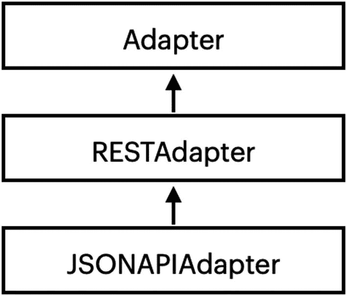

# 2. 通过适配器与 API 通信

在上一章中，我们了解了 Ember Data 的架构。我们简要讨论了适配器的作用，以及它如何负责确定如何向 API 发出请求。在本章中，我们将深入了解适配器并了解其工作原理，以便在后续章节中对其进行自定义。

适配器负责确定如何向 API 发出请求。这包括根据模型名称确定完整的 URL，并使用诸如 `$.ajax`、`fetch` 或 `XMLHttpRequest` 之类的 AJAX 技术发出 HTTP 请求。如果你希望将所有数据存储在本地存储中，或通过 WebSockets 与后端数据存储进行通信，这也将是适配器的职责。

我们在上一章中看到，我们可以使用 `host` 和 `namespace` 属性告诉适配器关于我们 API 的信息：

```
app/adapters/application.js
import JSONAPIAdapter from '@ember-data/adapter/json-api';
export default class ApplicationAdapter extends JSONAPIAdapter {
host = 'http://localhost:8000';
namespace = 'api/v1';
}
```

Ember Data 内置了两个适配器：`RESTAdapter` 和 `JSONAPIAdapter`。从下图可以看出，`RESTAdapter` 继承自基础的 `Adapter` 类，而 `JSONAPIAdapter` 继承自 `RESTAdapter`。



`Adapter` 类是一个抽象类，为编写自定义适配器提供了基础，我们将在第 5 章“从头编写适配器和序列化器”中实践。为了扩展适配器，理解它们默认的工作方式非常重要。让我们先看看 `RESTAdapter`，然后了解它与 `JSONAPIAdapter` 的不同之处。

## `RESTAdapter`

`RESTAdapter` 遵循常见的 REST 惯例。以下是常见 API 操作及其在适配器上映射的方法列表：

表 2-1

| **方法** | **URL** | **适配器方法** | **描述** |
| --- | --- | --- | --- |
| GET | `/api/cats` | `findAll()` | 返回 cat 资源集合 |
| GET | `/api/cats/:id` | `findRecord()` | 返回单个 cat 资源 |
| POST | `/api/cats` | `createRecord()` | 创建 cat 资源 |
| PUT | `/api/cats/:id` | `updateRecord()` | 更新 cat 资源 |
| DELETE | `/api/cats/:id` | `deleteRecord()` | 删除 cat 资源 |
| GET | `/api/cats?color=black` | `query()` | 返回资源集合 |
| GET | `/api/cats?color=black` | `queryRecord()` | 返回单个资源 |

请注意，适配器方法名称与你可能熟悉的 store 方法名称非常相似。如果你熟悉 store 的公共方法，那么你对会调用哪些适配器方法会有相当好的了解，这在扩展适配器时会很有用。

表 2-2

| **适配器方法** | **调用者** |
| --- | --- |
| `findAll()` | `store.findAll()` |
| `findRecord()` | `store.findRecord()` |
| `createRecord()` | `model.save()` |
| `updateRecord()` | `model.save()`（如果模型有 ID） |
| `deleteRecord()` | `model.destroyRecord()` |
| `query()` | `store.query()` |
| `queryRecord()` | `store.queryRecord()` |

这些适配器方法中的每一个都按照前面概述的 REST 惯例发出请求，并返回一个 promise。

前面的资源类型 `cat` 只是一个单词。如果资源类型包含两个单词，API 路径将采用驼峰式命名。例如，如果我们的模型叫做 `kitty-cat`，则请求的 URL 路径将是 `/kittyCats`。

## `JSONAPIAdapter`

Ember Data 通过 `JSONAPIAdapter` 原生支持 JSON:API 规范^(⁸)。如果你不熟悉 JSON:API，它是关于如何使用 JSON 构建 API 以通过遵循共享约定提高团队生产力的规范。此适配器继承自 `RESTAdapter`，因此有很多相似之处。让我们看看不同之处：

1.  **Accept 和 Content-Type 头部**

在所有请求中，`JSONAPIAdapter` 将 `Accept` 头部设置为 `application/vnd.api+json`，而不是 `application/json`。`Accept` 头部由客户端用于指定将接受的内容类型。`application/vnd.api+json` 是媒体类型，也被称为 MIME 类型或内容类型，用于 JSON:API。`vnd` 表示特定于供应商的 MIME 类型。当数据被发送到服务器时（例如在创建或更新记录时，即 POST、PUT 和 PATCH 请求），`Content-Type` 头部也会设置为 `application/vnd.api+json`，这告诉服务器有效载荷包含 JSON:API 文档，以便服务器可以相应地解析它。

2.  **带连字符的 URL**

在 JSON:API 中，URL 中的资源类型使用连字符。因此，`JSONAPIAdapter` 重写了 `pathForType()` 适配器方法，使得资源路径使用连字符，而不是像 `RESTAdapter` 中那样使用驼峰式命名。例如，`findAll()` 会触发一个对 `/api/kitty-cats` 的 GET 请求，而不是 `/api/kittyCats`。

3.  **使用 PATCH 代替 PUT**

当更新记录时，使用 PATCH 方法而不是 PUT。为什么用 PATCH？JSON:API 规范指出，HTTP 规范不允许使用 PUT 来*部分更新*资源。PUT 本意是用于完全*替换*资源。对于部分更新，应使用 PATCH。过去，PATCH 在 HTTP 客户端中支持不佳，但现在大多数客户端都支持它，如果不支持，也有变通方法。每当我们在客户端更新记录并调用 `save()` 时，都会发出 PATCH 请求。

4.  **加载关联关系**

默认情况下，Ember Data 会尝试单独加载相关资源。例如，如果一只猫有三个玩具，并且我们尝试访问这只猫的玩具，则会为每个玩具发出一个单独的请求。如果这只猫有很多玩具，这可能会导致相当多的请求，这可能不是最高效的解决方案。Ember Data 提供了一个选项，可以将这些请求合并为一个请求，这就是 `RESTAdapter` 和 `JSONAPIAdapter` 的区别之处。

想象一下，我们获取了一只猫并收到以下 JSON:API 响应。暂时不必过于担心这种格式，我们将在第 3 章“API 响应格式和序列化器”中详细讨论：

```
{
"data": [
{
"type": "cats",
"id": 1,
"attributes": {
"name": "Frisky",
"age": 10,
"adopted": true,
"birthday": "2005-11-05T13:15:30Z"
},
"relationships": {
"toys": {
"data": [
{
"id": 1,
"type": "toys"
},
{
"id": 2,
"type": "toys"
},
{
"id": 3,
"type": "toys"
}
]
}
}
}
]
}
```

此有效载荷包含一个 `id` 为 1 的单个 `cat` 资源，并且这只猫有三个玩具，其 id 分别为 1、2 和 3。该有效载荷不包含玩具的实际数据。它只是告诉我们这只猫有玩具以及它们的 id。如果需要这些数据，我们必须请求它们。

例如，假设我们想在模板中显示这只猫的每个玩具：

```
{{#each cat.toys as |toy|}}
{{toy.name}}
{{/each}}
```

显示每个玩具将导致发出以下请求：

- GET `http://localhost:8000/api/v1/toys/1`
- GET `http://localhost:8000/api/v1/toys/2`
- GET `http://localhost:8000/api/v1/toys/3`

你可以随意使用以下代码更新 `server.js` 以使这些请求成功：

```
app.get('/api/v1/toys/:id', (request, response) => {
const { id } = request.params;
response.json({
data: {
type: 'toys',
id,
attributes: {
name: `Toy ${id}`
}
}
});
});
```

我们可以通过 `coalesceFindRequests` 选项将这些请求分组到一起。


```
import JSONAPIAdapter from '@ember-data/adapter/json-api';
export default class ApplicationAdapter extends JSONAPIAdapter {
host = 'http://localhost:8000';
namespace = 'api/v1';
coalesceFindRequests = true;
}
```

当使用 `JSONAPIAdapter` 时，将 `coalesceFindRequests` 设置为 `true` 将产生如下请求：

```
GET http://localhost:8000/api/v1/toys?filter[id]=1,2,3
```

如果我们使用的是 `RESTAdapter`，将 `coalesceFindRequests` 赋值为 `true` 则会生成如下请求：

```
GET http://localhost:8000/api/v1/toys?ids[]=1&ids[]=2&ids[]=3
```

注意到查询字符串参数结构的差异了吗？JSON:API 使用 `filter[attribute]` 格式的查询字符串参数进行过滤，其中方括号内的值是我们想要过滤的属性。过滤值是逗号分隔的列表。关于过滤的更多信息，请查阅 JSON:API 规范。^(⁹)

## `ActiveModelAdapter`

同样值得一提的还有 `ActiveModelAdapter`。它曾是 Ember Data 的内置组件，但在 Ember Data 2.x 中被移除，现在可以以插件形式安装。

该适配器同样继承自 `RESTAdapter`，两者非常相似。主要区别在于，该适配器的资源路径使用下划线而非驼峰命名法，例如 `/api/kitty_cats`。

如需安装此插件，请运行以下命令：

```
ember install active-model-adapter
```

然后，导入适配器并进行继承：

```
app/adapters/application.js
import ActiveModelAdapter from 'active-model-adapter';
export default class ApplicationAdapter extends ActiveModelAdapter {
// 自定义配置
}
```

## 后台重载

后台重载是指存储中的记录会先被返回给调用者，但会在后台发起请求以检查是否有新数据。这样，存储中的记录就不会过时。如果我们想控制这一行为，适配器中有几个方法可供我们覆盖。这些方法已在基础 `Adapter` 类中实现：

表 2-3

| 方法 | 返回值 | 描述 |
| --- | --- | --- |
| `shouldBackgroundReloadAll()` | `true` | 在 `findAll` 返回缓存的记录数组后，重新加载该记录数组 |
| --- | --- | --- |
| `shouldBackgroundReloadRecord()` | `true` | 在 `findRecord` 返回缓存的记录后，重新加载该记录 |
| --- | --- | --- |
| `shouldReloadAll()` | `false` | 当调用 `store.findAll` 时重新加载所有记录 |
| --- | --- | --- |
| `shouldReloadRecord()` | `false` | 当调用 `store.findRecord` 时重新加载该记录 |

这些方法仅返回一个布尔值。`shouldReloadAll()` 和 `shouldReloadRecord()` 的优先级高于 `shouldBackgroundReloadAll()` 和 `shouldBackgroundReloadRecord()`。例如，如果 `shouldReloadRecord()` 返回 `true`，那么每当调用 `store.findRecord()` 时，记录都会从服务器重新加载，因此进行后台重载就没有意义了。只有当存储要返回缓存的记录或缓存的记录数组时，后台重载方法才会被存储检查。

## 总结

在本章中，我们了解到适配器负责向 API 发起请求，并且 Ember Data 内置提供了两个适配器。现在我们已经了解了内置适配器的工作原理，接下来让我们看看如何使用序列化器处理发往服务器和从服务器接收的数据格式化。

脚注 1 2

