# 2. 使用 Power BI Desktop 发现和加载基于文件的数据

## 文件源

通过网络、互联网或电子邮件发送文件已成为我们大多数人的第二天性。只要你获得的文件符合当前一些广泛认可的标准（稍后你将了解更多），将它们加载到 Power BI Desktop 中应该不会有什么困难。

作为数据混搭过程的第一步，本章将向你展示如何查找和加载来自各种基于文件的源的数据。这些数据类型通常是那些你可以在共享网络驱动器上找到、从互联网下载、作为电子邮件附件接收或复制到计算机本地驱动器中的数据。本章示例中使用的文件可在 Apress 网站上获取。如果你已按照附录 A 中的下载说明操作，那么这些文件将位于 `C:\PowerBIDesktopSamples` 文件夹中。

Power BI Desktop 当前可以读取并从中加载数据的文件源如下表 2-1 所示。

### 表 2-1

| 文件源 | 说明 |
| --- | --- |
| Excel | 允许你读取 Microsoft Excel 文件（版本 97 到 2019）并加载工作表、命名区域和表格。 |
| CSV | 允许你加载符合 CSV（逗号分隔值）格式的文本文件。 |
| XML | 允许你从 XML 文件加载数据。 |
| 文本 | 允许你使用各种列分隔符加载文本文件。 |
| 文件夹 | 允许你加载文件夹中所有文件的信息。 |
| SharePoint 文件夹 | 允许你列出 SharePoint 文件夹中的文件。 |
| Access 数据库 | 允许你连接到网络上的 Microsoft Access 文件并加载查询和表格。 |
| JSON | 帮助你从 JSON 文件加载数据。 |
| PDF | 允许你预览 PDF 文件并加载文档中任何表格的数据。 |

在本章中，我们将探讨如何从以下来源导入数据：
* CSV 文件
* 文本文件
* XML 文件
* Excel 文件
* Excel 中的 Power View、Power Query 和 Power Pivot 元素
* Access 数据库
* PDF 文件

更高级的技术（例如导入整个文件夹的文本或 Excel 文件的内容，或导入复杂的 XML 文件和 JSON 文件）将在第 10 章中描述。我更倾向于将这些内容分开处理，因为它们需要更高级的数据转换技术知识——而你需要先学习这些基础知识。

> **注意：** 我知道 Power BI Desktop 将 MS Access 视为数据库而不是“文件”数据类型。虽然我完全同意这种分类，但我仍然倾向于将 Access 视为基于文件的数据源，因为所有数据都驻留在一个可以复制和通过电子邮件发送的单个文件中，而不是存储在远程服务器的数据库中。因此，我们将在本章中介绍 MS Access，而不是在下一章中讨论企业数据源。

## 从文件加载数据

现在，是时候开始了解 Power BI Desktop 的“重活儿”部分，以及如何使用它从各种不同源加载数据了。我将从最简单的例子开始——从一个文本文件加载数据，这就像在初学者斜坡上滑行（或者像我们英国说的“育儿”斜坡）。然后，鉴于可用数据源种类繁多，并且为了使过程结构更清晰，我们将从大多数工作场所中常见的几个基于文件的数据源加载数据。这些数据源是你在第 7 章到第 10 章中学习调整和“混搭”的基础。这些数据也可以成为你将在第 14 – 24 章中创建的许多仪表板元素的基础。

### CSV 文件

场景如下：你获得了一个包含数据列表的 CSV 文件。现在，你希望将其加载到 Power BI Desktop 中，以便查看数据并考虑需要做什么（如果有的话）才能使其可用。

首先，你需要了解要加载的数据。如果你使用文本编辑器（如记事本）打开源文件 `C:\PowerBIDesktopSamples\Countries.csv`，就可以查看其内容。你在图 2-1 中可以看到的内容如下。

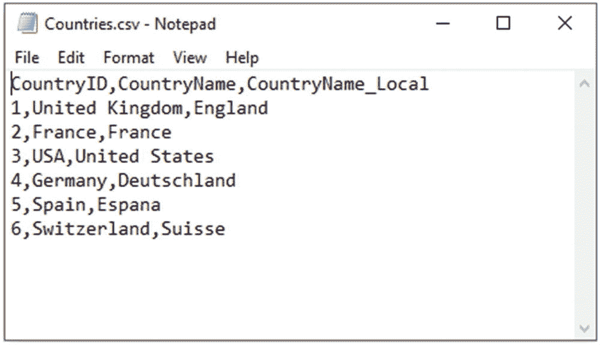

以下步骤说明了将此类文件的内容加载到 Power BI Desktop 中所需要做的工作：

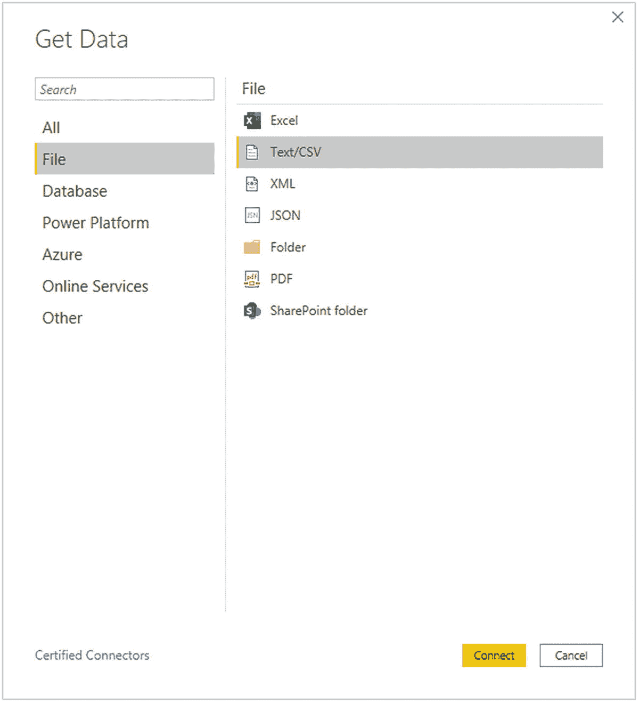

1. 打开 Power BI Desktop 并关闭启动屏幕。
2. 在 Power BI Desktop 的“开始”功能区中，单击 `获取数据` 按钮（而不是显示菜单选项的小三角形）。
3. 单击左侧的 `文件`。你将看到类似图 2-2 的内容（`获取数据` 对话框）。
4. 在对话框右侧单击 `Text/CSV`。
5. 单击 `连接`。将出现 `打开` 对话框。
6. 导航到包含要加载文件的文件夹，并选择该文件（本例中为 `C:\PowerBIDesktopSamples\Countries.csv`）。
7. 单击 `打开`。将出现一个对话框，显示文件的初始内容，如图 2-3 所示。

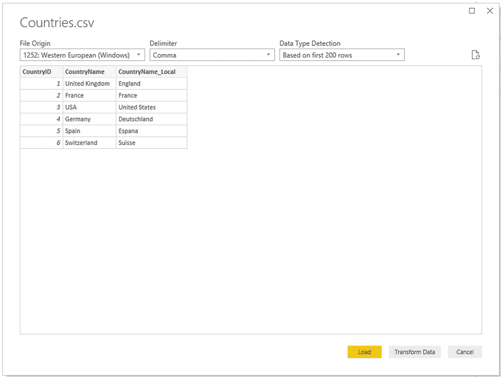

8. 单击 `转换数据` 按钮。Power BI Desktop 查询窗口出现，其中包含 CSV 文件内容的样本——如果文件不是太大，也可能包含整个文件。你可以在图 2-4 中看到这一点。

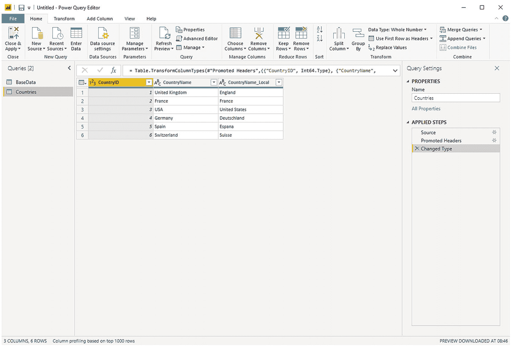

9. 单击 Power BI Desktop 查询窗口中的 `关闭并应用` 按钮（你可以在图 2-4 的左上角看到它）。Power BI Desktop 查询编辑器将关闭，并将焦点返回到 Power BI Desktop 窗口，在那里你可以看到“国家/地区”数据集显示在屏幕右侧的“字段”列表中。

到此为止，暂时就完成了。你只需点击几次，就将文件加载到了 Power BI Desktop 中，它已准备好用于仪表板和报表。在后续章节中，你将学习如何塑造这些数据。然而，现在，让我们继续看看其他一些基于文件的数据源。

# 什么是 CSV 文件？

在继续介绍其他文件类型之前，我需要先对 CSV 文件做一些说明。关于“真正的”CSV 文件，其实存在技术规范，但我不会用那些细节来烦你。更重要的是，许多生成 CSV 文件的程序并不总是严格遵循这个定义。关键在于，Power BI Desktop 能够处理符合以下条件的文本文件：

- 拥有 `*.csv` 扩展名（它会默认使用此扩展名来应用正确的处理方式）。
- 使用逗号分隔行中的各个元素。同样，这也是一个默认设置，可以通过在图 2-3 所示的对话框中选择一个分隔符来覆盖。
- 以换行符、回车符或换行符/回车符结尾。
- 可以选择性地包含用于封装字段的双引号。这些双引号将在数据加载过程中被剥离。如果存在双引号，它们不必出现在每个字段中，甚至不必出现在字段中的每条记录里（字段中的双引号偶尔可能不一致）。
- 可以包含“不规则”记录，即那些不包含标准记录中所有元素的行。但是，第一行（无论是否包含标题）必须涵盖列表中所有后续记录中的每一个元素。简单来说，任何其他记录都可以比第一行短，但不能比它长。
- 除了数据本身之外，不包含任何其他内容。如果文件包含不属于数据的页眉行或页脚行，那么 Power BI Desktop 将无法直接加载该数据集。对于这个非常常见的问题，有一些变通方法；其中一个方法在第 8 章中给出。

> **注意**
>
> 访问 CSV 文件的另一种方式是单击 `获取数据` > `文件`，然后在 `获取数据` 对话框中选择 `文本/CSV`。

## 文本文件

如果您按照上一节中的步骤加载了 CSV 文件，那么您会发现加载文本文件的过程几乎完全相同。这并不奇怪。两者都是文本文件，并且都应包含一个单一的数据列表。以下是核心区别：

- 文本文件可以使用逗号以外的字符来分隔列表中的元素。您可以在定义加载步骤时指定分隔符。
- 文本文件通常应具有 `.txt` 扩展名（不过，这个设置也可以被覆盖）。
- 文本文件必须格式完美；也就是说，每条记录（行）必须与其他所有记录具有相同数量的元素。
- 同样地，如果您希望首次加载数据时完美无缺，文本文件也不能包含数据集以外的任何内容。
- 如果文本文件遇到问题，它应该将数据作为单个列导入，然后您可以尝试将其拆分为多个列，如第 8 章所述。

现在，以下是将文本文件加载到 Power BI Desktop 中的步骤：

1.  在 Power BI Desktop 的功能区中，单击 `获取数据` > `文本/CSV`。将显示 `打开` 对话框。
2.  导航到包含该文件的文件夹并选择该文件（在此示例中为 `C:\PowerBIDesktopSamples\CountryList.txt`）。
3.  单击 `打开`。将显示一个对话框，展示文件的初始内容（此对话框与您在图 2-3 中看到的 CSV 文件对话框基本相同）。当然，您也可以双击文件名而不是单击 `打开`。
4.  单击 `取消` 按钮（因为快速查看文件内容后，您决定并不真正需要它）。

> **注意**
>
> 由于基于文本的文件（包括 CSV 文件）是常见的数据来源，您几乎总能在 `开始` 功能区的 `获取数据` 按钮中，通过单击小三角形访问的弹出菜单中直接看到 `文本/CSV` 选项。如果该选项不可见，您可以像之前一样选择 `获取数据` > `文件`，然后选择 `文本/CSV`。

Power BI Desktop 非常聪明的一点是，它能够对文本文件的结构进行非常准确的猜测；也就是说，它几乎总能猜出字段分隔符（将列表中每个元素与其他元素隔开的字符）。因此，它不仅会将列表拆分成列，还会避免导入列分隔符。如果它猜错了，也不用担心。您将在第 8 章中学习如何修正这个问题。

查看文件内容然后决定不使用它，正是您在使用 Power BI Desktop 时会发现的*数据发现*过程的一部分。本练习的目的在于向您展示，快速查看潜在数据源并决定是否将其导入数据模型是多么容易。此外，直接在 Power BI Desktop 的 `加载` 对话框中查看大型文本或 CSV 文件的前几行，可能比在文本编辑器中打开整个文件更容易。

> **提示**
>
> 尽管显而易见，但值得一提的是，您可以在对话框中按 `Enter` 键接受默认选项，按 `Esc` 键取消对话框。

### 文本和 CSV 选项

您可以在图 2-3 中看到，在加载文本或 CSV 文件时可以调整的选项并不多。大多数情况下，Power BI Desktop 会为您猜出正确的设置。但是，有时您可能需要稍微调整这些参数。可能修改的选项包括：

- 文件源
- 分隔符
- 数据类型检测

#### 文件源

此选项定义了文件存储时使用的字符编码。不同的字符集可以处理不同范围的字符，例如重音符号和其他变音符号。通常，Power BI Desktop 能够正确解释此信息，只有在极少数情况下才需要选择不同的字符集（文件源）。

#### 分隔符

Power BI Desktop 会尝试猜测文本或 CSV 文件中用于分隔数据“列”的特殊字符。如果您希望覆盖所选的分隔符，可以选择以下选项：

- 冒号
- 逗号
- 等号
- 分号
- 空格
- 制表符

您还可以决定输入自定义分隔符，例如竖线（`|`）字符，甚至指定每个字段具有固定宽度。选择这两个选项中的任何一个都会显示另一个输入字段，您可以在其中键入所需的分隔符或所需的固定长度。

#### 数据类型检测

Power BI Desktop 会对文本或 CSV 文件中使用的数据编码和数据类型进行有根据的猜测。默认情况下，为了节省时间，它只读取前 200 条记录。但是，您可以从以下三个选项中选择任意一个：

- 读取前 200 行
- 读取整个文件
- 不进行数据类型检测

> **注意**
>
> 请注意，完整读取一个大型文件可能需要相当长的时间。然而，如果没有准确的数据类型检测，您可能会在加载的数据中看到一些奇怪的字符。

## 简单的 XML 文件

`XML`（可扩展标记语言）是 IT 系统之间传输数据的一种标准方式。因此，你很可能有一天会加载一个 `XML` 文件。尽管 `XML` 文件只是文本，但它是以非常特定的方式格式化的文本，如果你在记事本等文本编辑器中打开一个 `XML` 文件，就能看到这一点。请执行以下步骤来加载一个 `XML` 文件：

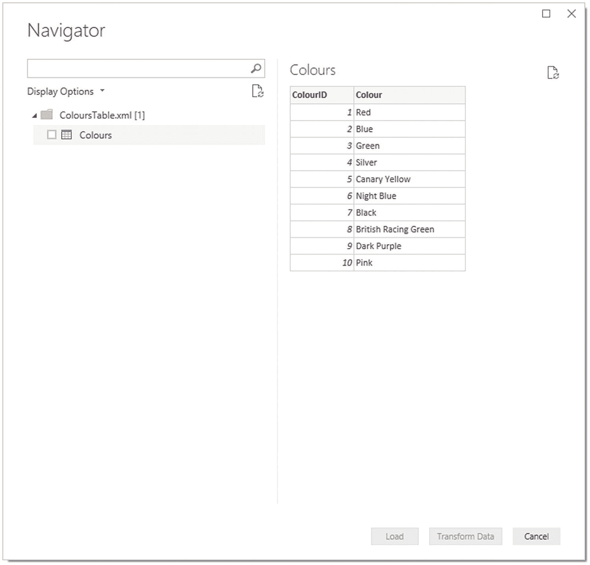

图 2-5 加载 `XML` 文件前的导航器对话框

1.  在 Power BI Desktop 的功能区中，点击 `获取数据` 按钮上的小三角形，然后在出现的菜单中点击 `更多`。接下来，在 `获取数据` 对话框中，选择 `文件` 和 `XML`。
2.  点击 `连接`。`打开` 对话框将会出现。
3.  导航到包含该文件的文件夹，并选择文件（本例中为 `C:\PowerBIDesktopSamples\ColoursTable.xml`）。
4.  点击 `打开`。`导航器` 对话框将会打开。
5.  点击 `导航器` 对话框左侧窗格中的 `Colours` 数据集。`XML` 文件这一部分的内容将显示在 `导航器` 对话框的右侧，如图 2-5 所示。
6.  点击左侧 `Colours` 数据集左侧的复选框。`加载` 和 `编辑` 按钮将变为可用状态。
7.  点击 `转换数据` 按钮。Power BI Desktop 数据窗口将显示 `XML` 文件的内容。
8.  点击 Power BI Desktop 数据窗口中的 `关闭并应用` 按钮。你将看到 `Colours` 数据集出现在屏幕右侧的 `字段` 列表中。

`XML` 文件的实际内部格式可能极其复杂。有时一个 `XML` 文件只包含一个数据集；有时它会包含多个独立的数据集。在其他情况下，它可能包含一个数据集，而其记录中包含需要你通过展开元素层级来处理的嵌套数据层。你将在第 10 章中看到 `导航器` 对话框如何处理 `XML` 数据的嵌套层级——在你学到一些必要的数据转换技巧之后。

> 注意：某些类型的数据源允许你同时加载多组数据。`XML` 文件（与 `CSV` 和文本文件不同）可以包含多个独立的数据集。你可以通过选中要加载的每个数据集左侧的复选框，来从 `XML` 文件中同时加载多个数据集。

## Excel 文件

你很可能已经是 Excel 的重度用户，拥有许多包含大量数据的电子表格，希望能在 Power BI Desktop 中对这些数据进行整理、分析和展示。那么，让我们来看看如何从一个 Excel 文件中同时加载多个工作表。

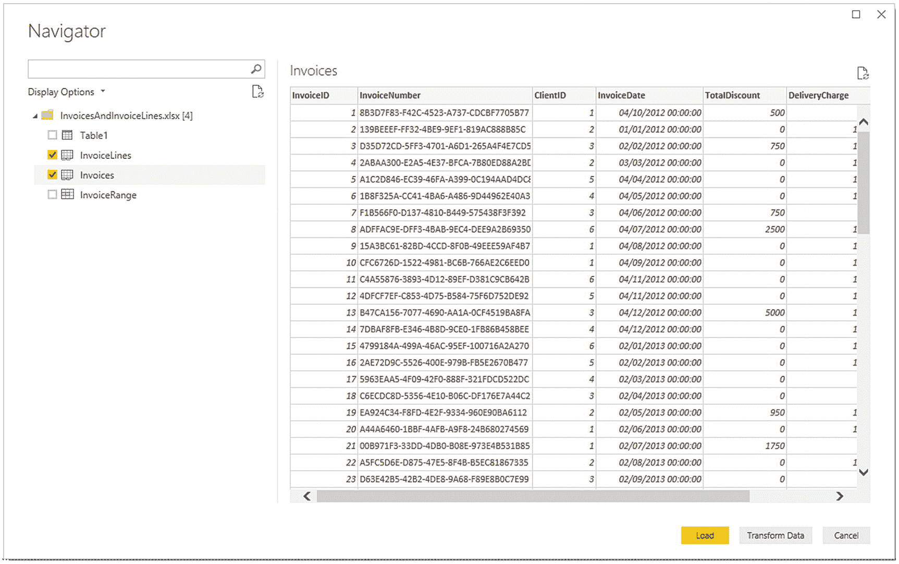

图 2-6 从 Excel 工作簿加载数据前的导航器对话框

## 从 Excel 导入数据

1. 在 Power BI Desktop 的 **开始** 功能区中，点击 **Excel**。或者，点击 **获取数据** 按钮底部的小三角形，然后点击 **Excel**。**打开** 对话框将会出现。

2. 导航到包含你想要查看的文件的目录（本例中为 `C:\PowerBIDesktopSamples`）。

3. 选择源文件（本例中为 `InvoicesAndInvoiceLines.xlsx`），然后点击 **打开**。**导航器** 对话框将会出现，显示工作簿文件中的工作表、表格和区域。

4. 点击 **导航器** 对话框左侧列出的一个数据集。所选电子表格的前几行将显示在对话框的右侧，以展示所选数据集中的数据样式。

5. 点击左侧 `Invoices` 和 `InvoiceLines` 数据集左侧的复选框。**导航器** 对话框将如图 2-6 所示。

6. 点击 **加载**。选中的工作表将被加载到 Power BI Desktop 数据模型中，并出现在 **报告** 窗口的 **字段** 列表中。

从这个简单的例子可以看出，让 Power BI Desktop 读取 Excel 数据并不困难。你也可以在加载数据之前，在 Power BI Desktop 查询编辑器中对数据进行编辑，但由于这些数据看起来已经干净且可直接使用，我更倾向于直接将其加载到 Power BI Desktop 中（或者更准确地说，是加载到 Power BI Desktop 数据模型中）。此外，你还看到 Power BI Desktop 可以从单个数据源同时加载多个数据集。不过，你可能仍然对在这个过程中看到的一些事情感到疑惑，因此这里有一些预先的说明：

**导航器** 对话框会显示：

- 工作表（图 2-6 中的 `Invoices` 和 `InvoiceLines`）

- 命名区域（图 2-6 中的 `InvoiceRange`）

- 命名表格（图 2-6 中的 `Table1`）

这些元素在 **导航器** 对话框中各自由不同的图标表示。有时，这些图标实际上可能指向同一份数据的重复引用，因此你应尽量使用最精确的数据源。例如，我建议使用命名表格或区域名称，而不是工作表源，因为后者很容易包含“噪音”数据（即来自你不关心的行和列之外的数据），这会使加载过程变得比实际需要的更复杂——甚至导致加载失败。事实上，除非工作表已经以简单的表格格式准备好并结构化，以便加载到 Power BI Desktop 中，否则你的数据模型中最终可能会包含多余的数据。

然而，真正酷的是，你可以从单个 Excel 工作簿中同时加载任意数量的工作表、表格或区域。你不需要单独加载每个源数据集。

> 注意：如果数据连接处于活动状态并且已将数据返回到工作簿，Power BI Desktop 将列出并使用源 Excel 工作簿中指向外部数据源（例如 SQL Server、Oracle 或 SQL Server Analysis Services）的数据连接。一旦与 Power BI Desktop 建立了链接，你就可以删除源 Excel 工作簿中的数据表本身——但仍可通过源工作簿中的数据连接将数据加载到 Power BI Desktop 中。

Power BI Desktop *不会*考虑 Excel 数据表上的任何数据筛选器，而是会加载源表中的所有数据。因此，如果你想对源数据进行子集划分，则必须在 Power BI Desktop 中重新应用任何筛选器（你将在第 6 章中了解更多相关信息）。

在这个阶段，有几个重要的点你需要了解：

- 多个工作表、表格或命名区域可以在单次加载操作中从同一个工作簿（即 Excel 文件）中导入。但是，你需要为每个单独的 Excel 文件定义单独的加载操作。

- 可以同时加载多个结构相同的 Excel 文件。这将在第 10 章中解释。

### 导入 Excel 和 Power View 项目

实际上，Power BI Desktop 并非 Power BI 的首个版本；它使用的数据模型已经存在多年，而可视化画布的早期版本则以名为 Power View 的 Excel 加载项形式存在。因此，您可能已经是使用 Power View for Excel 的资深专家，不希望放弃这项工作——或者您可能拥有使用 Excel 中的 Power Pivot 构建的现有数据模型，并希望将其迁移到 Power BI Desktop 中。

幸运的是，微软团队已经考虑到了这一点，因此您可以极其轻松地将您在 Excel 中的所有成果（Power View 仪表板、Power Pivot 数据模型和 DAX 度量值）迁移到 Power BI Desktop 中。具体操作方法如下：

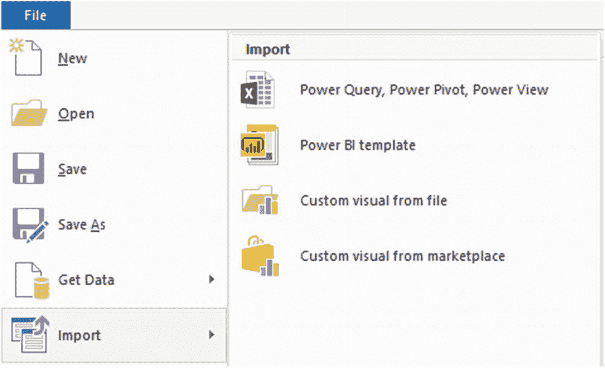

**图 2-7** – 从 Excel 导入现有的 Power View 或 Power Pivot 项目

1. 打开一个新的空白 Power BI Desktop 文件。

2. 在 **文件** 菜单中，选择 **导入 ➤ Power Query、Power Pivot、Power View**，如图 2-7 所示。

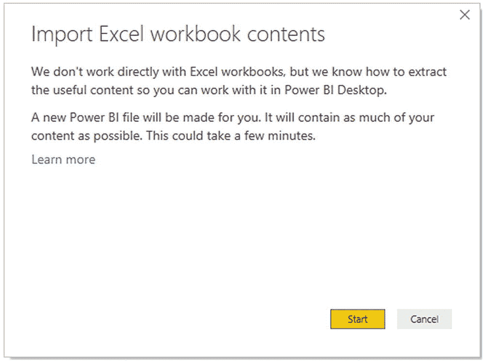

**图 2-8** – 从 Excel 导入 Power View 和 Power Pivot 元素

3. 出现 **Windows 打开** 对话框，您可以从中选择包含 Power View 或 Power Pivot 项目的现有 Excel 文件。在此示例中，您可以使用本章示例文件中的 `CarSalesForPowerBI.xlsx` 文件。

4. 单击 **打开**。将出现您在 2-8 中看到的警告对话框。

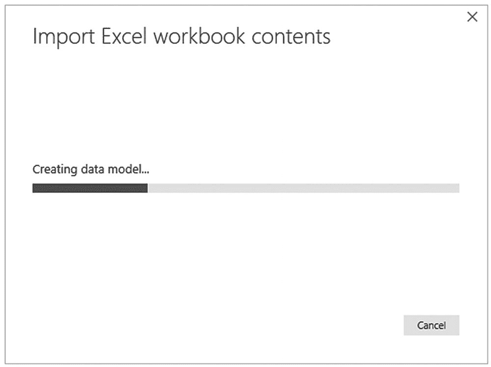

**图 2-9** – 从 Excel 导入 Power View 和 Power Pivot 元素

5. 单击 **开始**。Power BI Desktop 将导入任何兼容项目，并在导入过程中显示 **导入进度** 对话框（如图 2-9 所示）。

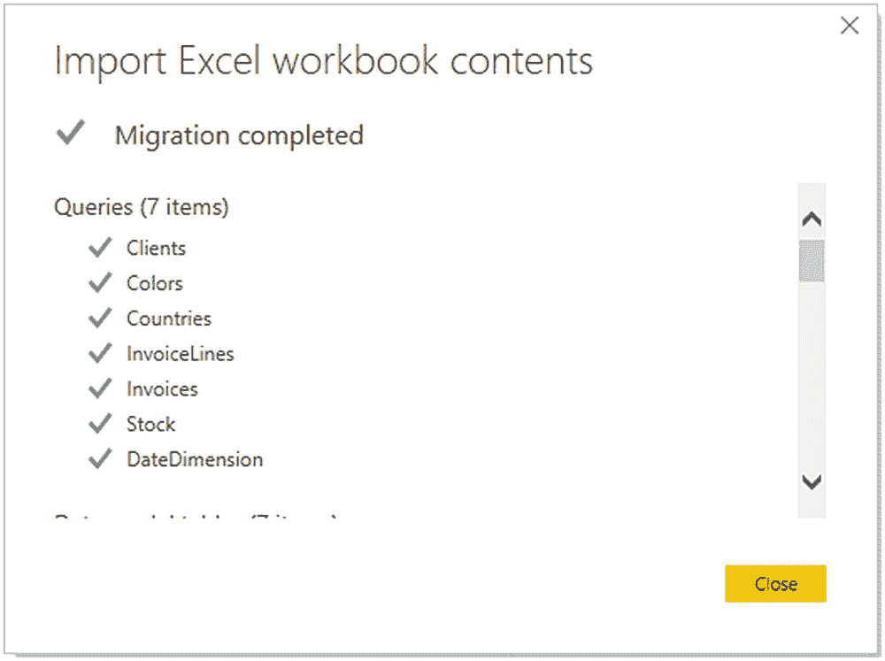

**图 2-10** – 导入摘要对话框

6. 导入过程成功完成后，Power BI Desktop 将显示您在 2-10 中看到的摘要对话框。

7. 单击 **关闭**。这些项目便成为 Power BI Desktop 报表。

在本书付印时，某些 Power View 可视化效果的一些方面尚未完美地导入到 Power BI Desktop 数据模型中。然而，由于这项技术正在快速发展，当您阅读本书时，这些细微的限制很可能已经得到解决。无论如何，我建议您查阅 Power BI 网站 ([`https://powerbi.microsoft.com`](https://powerbi.microsoft.com))，以获取关于将 Excel 对象转换为 Power BI Desktop 报表时任何剩余限制的最新详细信息。

### Microsoft Access 数据库

当今许多公司中另一个广泛使用的数据存储库是 Microsoft Access。它是一个强大的桌面关系数据库，可以包含数百个表，每个表包含数百万条记录。因此，我们需要了解如何从这一特定源加载数据。此外，Power BI Desktop 在处理 Access 数据时尤其有用，因为它允许您查看 Access 数据库的内容，甚至无需安装 Access 本身。

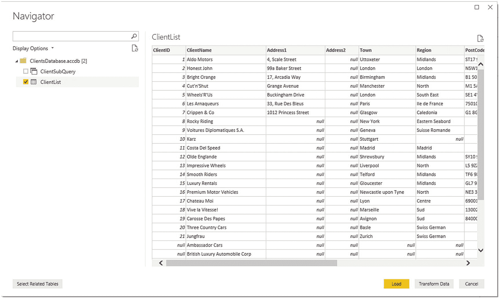

**图 2-11** – 从 Access 数据库加载数据前的导航器对话框

1. 在 Power BI Desktop 功能区中，单击 **获取数据 ➤ 数据库**，然后在 **获取数据** 对话框中选择 **Access 数据库**。

2. 单击 **连接**，然后导航到包含要加载数据的 MS Access 数据库（在此示例中为 `C:\PowerBIDesktopSamples\ClientsDatabase.accdb`）。

3. 选择 Access 文件并单击 **打开**。将出现 **导航器** 对话框；它会列出 Access 数据库中的所有表和查询。

4. 选中 `ClientList` 数据集的复选框。这将显示该表的内容，如图 2-11 所示。

5. 单击 **加载**。Power BI Desktop 窗口打开，并在 **报表** 窗口的 **字段** 列表中显示该表。

## 从文件导入数据

如果您仔细观察图 2-11 中导航器对话框的左侧，您会看到它显示了 `Access` 对象的两种不同图标：
- 数据表的表图标
- `Access` 查询的两个小窗口图标

这可以帮助您了解您正在 `Access` 数据库中查看的数据类型。

**注意**：`Power BI Desktop` *无法*查看 `Access` 中的链接表，只能查看导入的表或实际存在于 `Access` 数据库中的表。但是，它可以读取基于本地数据、链接数据或导入数据的查询。

### PDF 文件

`Power BI Desktop` 还可以从 PDF 文件导入表格数据。这做起来非常简单，令人惊叹。

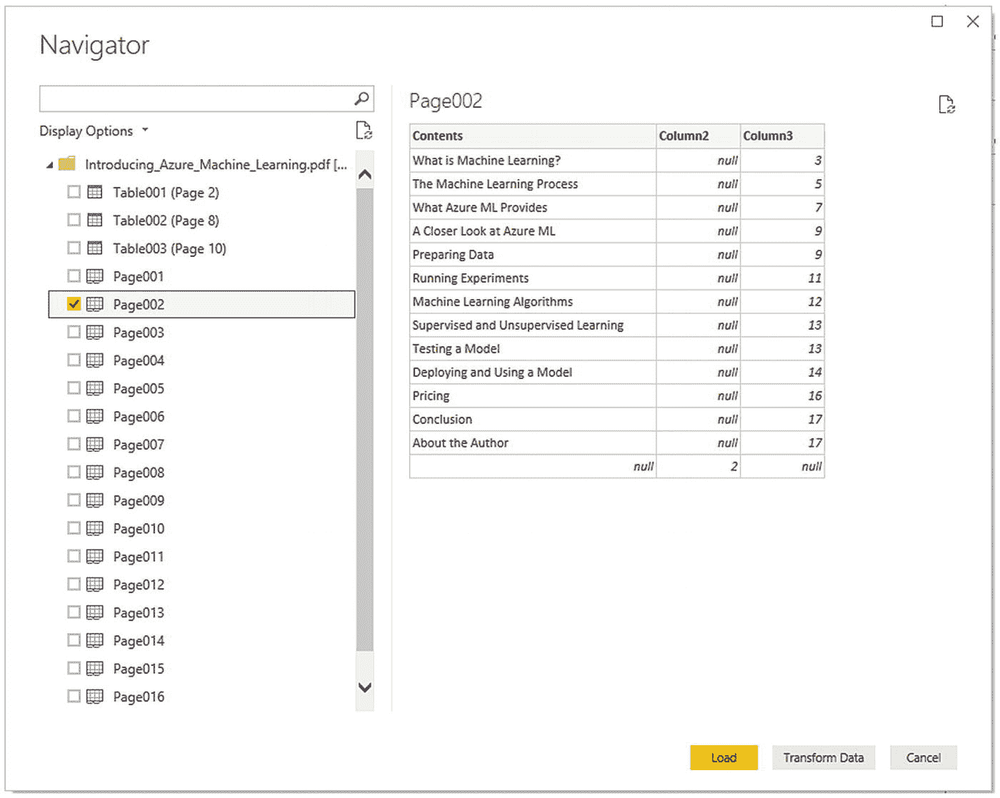

**图 2-12** – 显示 PDF 文档中的表格

1. 在 `Power BI Desktop` 功能区中，单击`获取数据 ➤ 文件`，然后在`获取数据`对话框中选择`PDF`。
2. 单击`连接`，然后导航到包含要加载数据的 PDF 文档（在此示例中，是一个关于机器学习的微软文档）。
3. 选择 PDF 文件并单击`确定`。将出现`导航器`对话框；它会列出 PDF 文档中的所有表格。
4. 勾选您要导入到 `Power BI Desktop` 的表的复选框。这将显示所选表的内容，如图 2-12 所示。
5. 单击`加载`。`Power BI Desktop` 窗口打开，并在`报表`窗口的`字段`列表中显示这些表及其列（作为字段）。

**注意**：您只能查看并因此导入 PDF 文档中的表格，无法导入文本段落。

我相信您能看出本章中出现的一种模式。实际上，当您继续学习到第 3 章从关系数据库加载表时，这种模式仍将持续。这个过程几乎总是：
1. 了解您想要查看的源数据类型
2. 找到可让您访问数据的源文件
3. 检查数据并选择要加载的元素

**注意**：您需要知道，`Power BI Desktop` 可能需要相当长的时间来读取 PDF 文件。因此，在选择了要从中加载数据的 PDF 文档后，请耐心等待`导航器`对话框出现。

### JSON 文件

`JSON` 文件与 `XML` 一样，是一种允许用户（和计算机）在系统之间发送复杂数据结构的文件格式。通常，`JSON` 文件需要稍作调整才能加载为 `Power BI Desktop` 可用的状态。因此，我们将在第 10 章中，在您掌握了第 7 章至第 9 章中必要的数据转换技术之后，再来研究如何加载和准备 `JSON` 文件。

### 结论

在本章中，你已经了解了如何运用这一强大的 Microsoft 商业智能工具集新增功能——`Power BI Desktop`，从各种基于文件的数据源中查找和加载数据。这些数据源可以是 `Access`、`Excel`（包括 `Power View`、`Power Query` 和 `Power Pivot` 元素）、`CSV`、`XML`、`PDF` 或 `text/CSV` 文件。

你已经看到，`Power BI Desktop` 无需任何其他应用程序，即可让你预览其能够读取的数据源内容样本。这使其成为一款出色的工具，可用于探查数据源并判断某个文件是否真正包含你需要的数据。事实上，`Power BI Desktop` 的 `Navigator` 可以帮助你筛选 `Excel` 或 `XML` 文件或 `Access` 数据库中的多个数据集，预览每个数据集，并只选择你想要加载的数据。当然，如果多个数据集都存储在同一个数据源中，它也可以一次性加载数十个数据集。

本章并未完整概述如何加载基于文件的数据源。因此，如果你需要加载复杂的 `XML` 文件或 `JSON` 文件，或者需要了解如何加载整个文件夹的内容（例如，`Excel` 文件中的所有工作表），你可以直接跳到第 10 章来学习这些技巧。

然而，基于文件的数据源只是冰山一角。`Power BI Desktop` 还可以从各种关系数据库和数据仓库中加载数据。我们将在下一章中探讨其中的一些。

