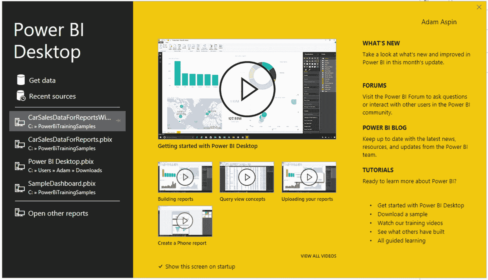
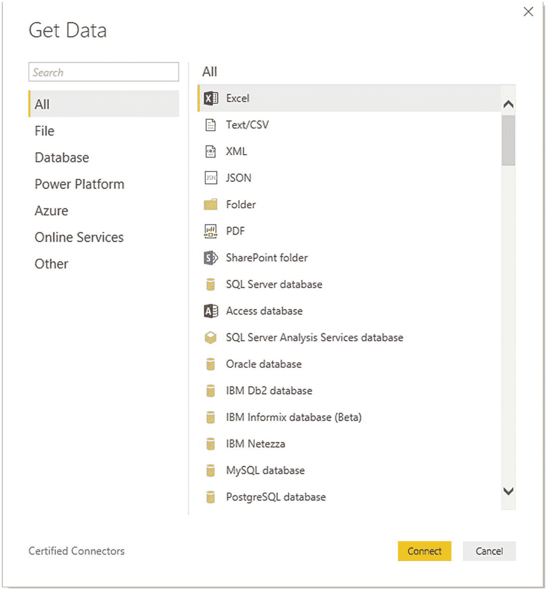
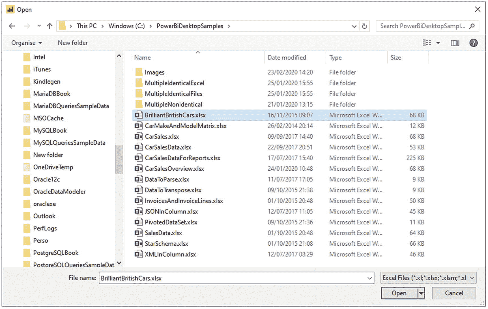
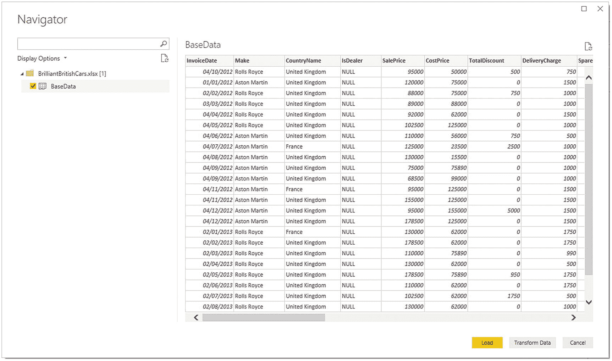
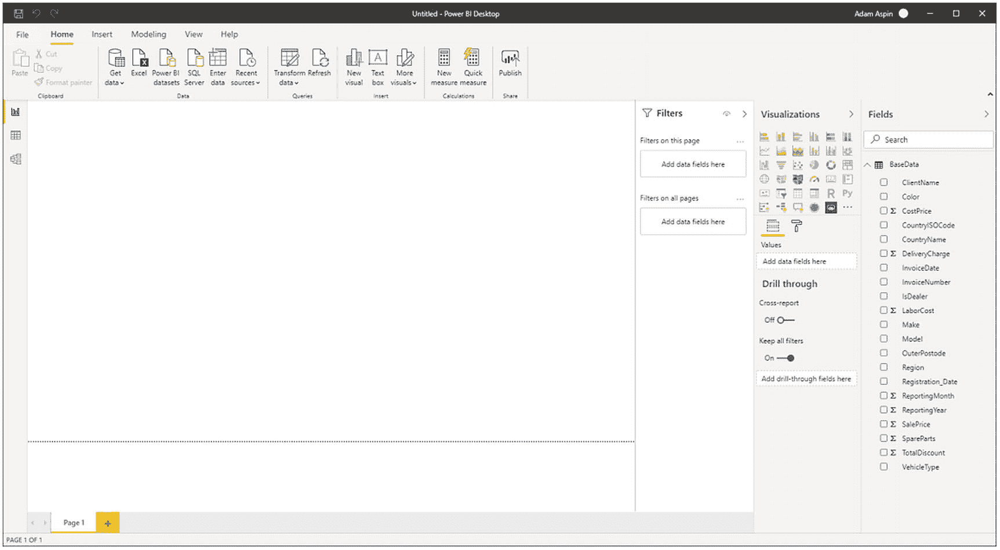
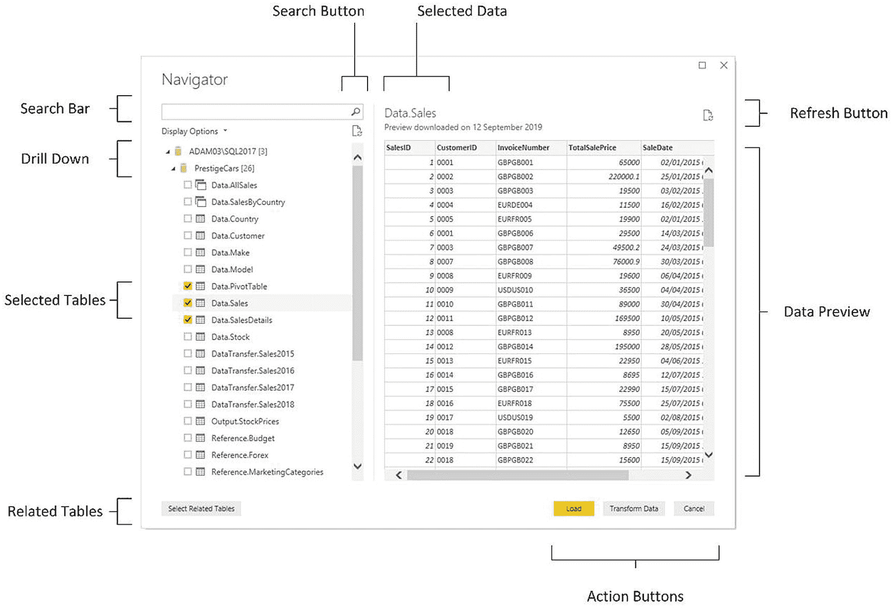
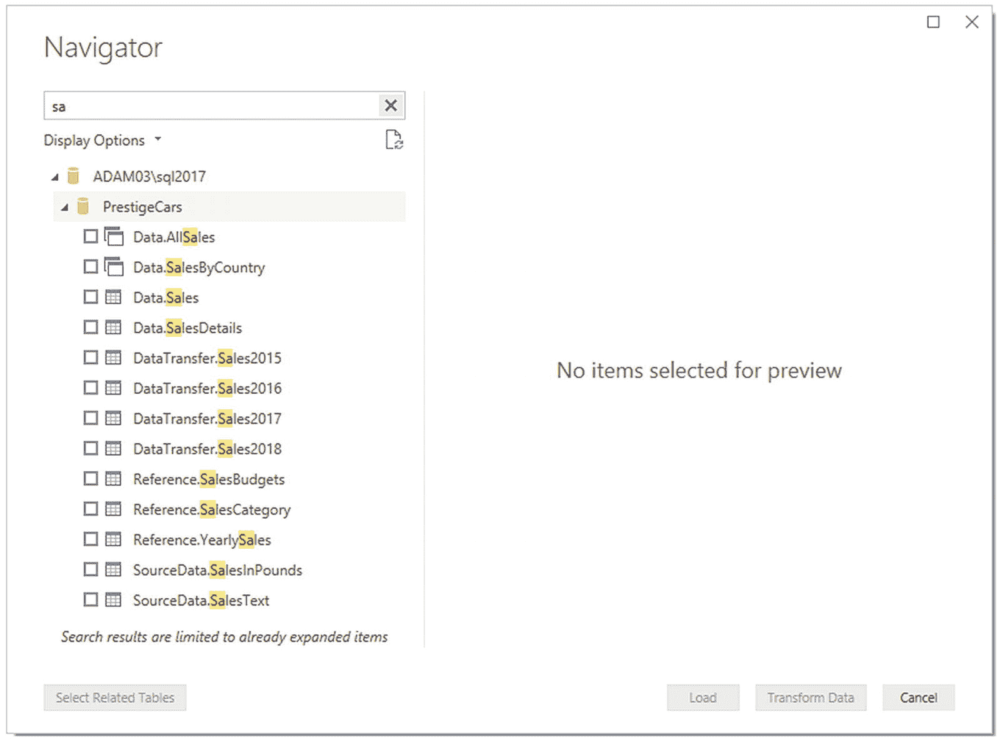

# 1. 使用 Power BI Desktop 发现与加载数据

在使用 Power BI Desktop 展示任何分析或发现新见解之前，您需要数据。您的数据源可能分布在许多地方，采用多种格式。尽管如此，您需要访问它们、查看它们、选择它们，并很可能在某种程度上重构或清理它们。在将数据塑造成一个连贯的模型（作为仪表板和报告的基础）之前，您可能还需要连接多个独立的数据源。令人惊叹的是，使用 Power BI Desktop，您无需借助任何其他工具或实用程序即可完成所有这些操作。

发现、加载、清理和修改源数据是 Power BI Desktop 真正大放异彩的众多领域之一。它让您能够完成以下任务：
- **数据发现**：查找并连接到包含潜在有用数据的各种数据源。这些数据既可以来自公共数据源，也可以来自私有数据源。这是第 1 章至第 6 章的主题。
- **数据加载**：选择您已检查过的数据并将其加载到 Power BI Desktop 中进行塑形。
- **数据修改**：修改已导入的每个数据集的结构，然后过滤并清理数据本身（我们将在第 7 章至第 10 章中详细讨论这一点）。
- **数据塑形**：连接数据集以创建一个清晰、统一且易于访问的数据模型。您将学习如何在第 13 章中完成此操作。

尽管我将这四个步骤描述为完全独立且顺序执行，但现实情况往往是将它们融合成一个单一的过程。确实，您可能会在许多情况下*在*数据加载到 Power BI Desktop*之后*才检查数据，或者*在*加载数据*之前*清理数据集。然而，核心目标始终不变：找到一些数据，然后将其加载到 Power BI Desktop 中，以便您进行调整、清理和塑形。

这个过程可以简单描述为“首先，捕捉你的数据”。在数据仓库领域，专家们称之为 `ETL`，即`Extract`（提取）、`Transform`（转换）和`Load`（加载）的缩写。尽管这个缩写词让人放心，但这个过程很少是一个通过清晰步骤顺利、有逻辑地推进的过程。现实情况往往要复杂得多。您可能会发现自己经常导入一些数据，清理它们，从另一个源导入更多数据，将第二个数据集与第一个数据集合并，删除一些行和列，然后重复这些操作以及许多其他操作多次。

在本章及接下来的几章中，我将尝试向您展示如何使用 Power BI Desktop 在实际操作中完成这个过程。我希望这能让构成 ETL 过程的各种步骤更加清晰。我只希望您能意识到，Power BI Desktop 所包含的一系列选项使其成为一个多面且功能强大的工具。科学之处在于知道*哪些*选项可以使用。艺术之处在于知道*何时*使用它们。

## 数据加载过程

首先，让我们快速概览一下将一些数据加载到 Power BI Desktop 中需要做什么。启动 Power BI Desktop 后，您会看到如图 1-1 所示的启动画面。

*图 1-1. 启动画面*

考虑到您正在使用一个以数据为核心的应用，在开始一个新的分析挑战时，第一步是查找并加载一些数据，这并不令人意外。因此，以下内容解释了您需要做什么（假设您已从 Apress 网站下载了本书附带的示例数据——这在附录 A 中有说明）：
1. 在启动画面中单击`获取数据`。`获取数据`对话框将会出现，如图 1-2 所示。
   
   *图 1-2. 获取数据对话框*
2. 在此对话框右侧所有可能的数据源列表中，单击`Excel`，然后单击`连接`。Windows`打开`对话框将会出现。
   
   *图 1-3. 从文件源加载数据时的 Windows 打开对话框*
3. 单击文件 `C:\PowerBiDesktopSamples\BrilliantBritishCars.xlsx`。Windows`打开`对话框将如图 1-3 所示。
   
   *图 1-4. 已选择数据的导航器对话框*
4. 单击`打开`按钮。`正在连接`对话框会显示一两秒钟，然后`导航器`对话框将会出现。
5. 您会看到 `BrilliantBritishCars.xlsx` 文件出现在`导航器`对话框的左侧，并且其中包含的任何工作簿、命名区域或数据表也会列出。单击左侧的 `BaseData` 工作表名称。该工作簿的内容将显示在`导航器`对话框右侧的数据窗格中。
6. 选中左侧 `BaseData` 工作表的复选框。`加载`和`转换数据`按钮将被激活。`导航器`对话框应如图 1-4 所示。
7. 单击`加载`。数据将从 Excel 文件加载到 Power BI Desktop 中。

您将看到 Power BI Desktop 报告窗口，如图 1-5 所示。这是您添加可视化对象以创建仪表板的画布。您可以看到 Excel 工作表中的所有列现在都成为 Power BI Desktop 应用程序右侧`字段`窗格中的字段。

*图 1-5. Power BI Desktop 中可用的数据*

我想加载这些数据只花了不到一分钟。然而，您现在在 Power BI Desktop 中拥有一个完全可操作的数据模型，可以随时为仪表板提供数据。但是，由于创建仪表板将在本书后面解释，我想暂停片刻，确切解释一下您到目前为止所看到的内容。当然，如果您急切地想往前冲，实际创建几个表格和图表，那么您随时可以跳到第 14 至 24 章。

> **注意**：`获取数据`对话框中包含了对认证连接器的引用。这些连接器由第三方开发，但由 Microsoft 认证和分发。

## 理解数据加载

到目前为止，您所看到的是对 Power BI Desktop 数据加载场景的极速浏览。实际上，这个过程可能像您刚才看到的那样极其简单，也可能相当复杂，例如连接、筛选和修改来自不同来源的多个数据集（您将在第 7 章至第 10 章中了解）。然而，在使用 Power BI Desktop 进行任何数据分析时，加载数据始终是第一步。

尽管如此，在这个简短的示例中，您仍然看到了数据加载过程的许多关键要素。这些要素包括：
- 访问 Power BI Desktop 可读取的任何源格式的数据
- 在将数据加载到 Power BI Desktop 之前，先初步查看数据

这里您没有看到的是，Power BI Desktop 如何在数据加载过程中添加一个中间步骤，允许您在 Power BI Desktop 查询编辑器中对源数据进行编辑。数据处理的这方面内容将在第 7 章至第 12 章中详细介绍。

### 导航器对话框

数据加载过程的一个关键方面是正确使用导航器对话框。您在图 1-4 中看到了这个对话框。当连接到许多（但并非全部）数据源时，会出现 `导航器` 窗口。它允许您：
- 快速查看数据源中可用的数据表
- 筛选单个数据源中可用的多个数据元素
- 查看各个表中的数据
- 选择一个或多个要加载到 Power BI Desktop 的数据表

根据您连接的数据源，您可能会在 `导航器` 窗口中看到少数几个数据表，或者成百上千个数据表。无论如何，您看到的是 Power BI Desktop 能够识别并确信可以导入的结构化数据集。您在 `导航器` 窗口中看到的内容的复杂程度同样取决于数据源。例如，如果您正在查看一个数据库服务器，那么您可能会从一个数据库列表开始，并且可能需要通过展开数据库来深入数据的树状结构，以列出可用的数据表和视图。

您使用 Power BI Desktop 越多，就越会频繁地使用导航器对话框。因此，尽早解释一些技巧和方法似乎是合适的，这些技巧和方法可以让您在深入探究潜在数据源时更加轻松。

让我们先仔细看看可用的选项。这些选项在图 1-6 中突出显示。

图 1-6  
导航器对话框

导航器对话框主要分为两部分：
- *左侧*：可用数据源的层次结构。这些可以包含单个数据集或多个数据集，可能组织在一个或多个文件夹中。
- *右侧*：选定元素中数据的预览。

导航器对话框的各种选项将在以下章节中说明。

#### 搜索数据集

您不可避免地会遇到这种情况：您正在连接的数据源包含数百个数据集。这在数据库中尤其常见。幸运的是，Power BI Desktop 允许您非常轻松地筛选显示的数据集。

图 1-7  
导航器对话框中的数据集搜索

1. 在导航器对话框中，单击"搜索"框内部。

2. 输入您想要隔离的数据集名称的一部分。

3. 单击"搜索"框右侧的放大镜图标。数据集列表将被筛选，只显示包含您输入文本的数据集。您可以在图 1-7 中看到这一点。

一旦您预览并选择了要使用的数据集，只需单击"搜索"框右侧的叉号。导航器将清除筛选条件，并显示数据源中的所有数据集。

## 显示选项

在导航器对话框中单击"显示选项"，会弹出一个包含两个选项的菜单：

- 仅选定的项目

- 启用数据预览

### 仅选定的项目

选择此选项将阻止任何您未选中的数据集出现在数据源窗格中。

### 启用数据预览

选择此选项将显示所选数据集中的一小部分数据。如果与源数据的连接速度较慢，您可以选择禁用数据预览。

## 刷新

如果需要，您可以刷新以下一项或全部两项：

- 源数据

- 数据预览

### 源数据刷新

单击搜索栏下的预览按钮将刷新源数据窗格中的源数据。

### 数据预览刷新

单击导航器对话框右上角的预览按钮将刷新右侧可见的预览数据。

### 选择相关表

单击"选择相关表"按钮仅对数据库源（例如 Microsoft SQL Server 或 Oracle）有效。如果源数据库设计正确，包含了表之间的联接，则此选项将自动选择与您已选择的任何表关联的所有表。

注意
在数据库源中，有些表可能关联到其他表，而这些表本身又关联到其他表。当您单击 `选择相关表` 时，并不会完全发现此连接层次结构。换句话说，您可能必须选择多个表并重复单击此按钮，才能选择所需的所有表。

您将在接下来的三章中看到有关导航器窗口的更多内容。

## 导航器数据预览

导航器数据预览窗格（右侧），顾名思义，是数据源中数据的预览。它提供：

- 您想要查看的任何数据集中的顶部少数记录的简要概览。由于您预览的数据可能有数百列宽、数百行深，因此在导航器数据预览内部可能会看到数据表的滚动条。但是请记住，您并不是在检查所有可用数据，而只是看到一小部分可用记录的样本。

- 数据表中可用列的列表。

Power BI Desktop 可以预览和加载来自多个不同来源的数据。事实上（正如您可以从"获取数据"对话框中的可能数据源列表中看到的），它可以读取大多数常用的企业数据源以及许多其他数据源。需要理解的重要一点是，无论数据源是什么，Power BI Desktop 都应用了一个通用的界面来处理数据加载这门艺术与科学。因此，无论您是在检查 SQL Server 还是 Oracle 数据库、XML 文件还是文本文件、网页还是大数据源，您将始终使用标准化的方法来检查和加载数据。这使得 Power BI Desktop 的数据体验变得无比简单——并且极其可靠。这意味着您无需花费过多时间担心数据源的技术细节，从而可以自由地专注于数据本身。

注意
导航器数据预览是一个出色的数据发现工具。无需加载任何数据，您就可以快速查看数据源及其包含的任何（可能）可以被 Power BI Desktop 加载的数据。然后您可以决定是否值得加载。这样，您就不会将时间浪费在可能对您的需求来说是多余的数据加载上。

## 修改数据

在 Power BI Desktop 中拥有一个或多个能够连接到数据源并将数据导入该环境的查询后，您就可以开始考虑下一步——转换数据，使其可供使用。根据您处理的数据源数量以及所需修改的程度，这项工作可能从简单到复杂不等。为了使过程结构化，我建议您尝试将任何步骤分解为以下主要流程：

- **塑造数据集**：这包括筛选记录以减小数据集大小，以及删除任何多余的列。还可能涉及通过拆分现有列、创建计算列甚至联接查询来添加您创建的列。

- **清理和修改数据**：这也被称为数据转换（即 ETL 中的 T）。它涵盖了将文本数据转换为大写和小写，以及（例如）删除非打印字符的过程。对数据进行四舍五入以及从日期数据中提取日期部分也是可能的（在众多其他可用的转换中）。

然而，目前只需了解，如果您需要，Power BI Desktop 可以完成以上所有操作。数据转换的详细说明将在第 7 章至第 12 章中阐述。

## 数据源

在本章的前面部分，您已经看到了如何快速轻松地将数据加载到 Power BI Desktop 中。现在是时候更广泛地了解 Power BI Desktop 可以接收和操作的数据类型了。

由于可能的数据源数量之巨乍看之下可能令人不知所措，Power BI Desktop 将潜在的数据源分为以下几类：

- **文件**：包括 Excel 文件、CSV（逗号分隔值）文件、文本文件、JSON 文件和 XML 文件。Power BI Desktop 甚至能加载整个文件夹内的所有文件。您将在下一章中发现其中的许多类型。

- **数据库**：当前工作场所和云中使用的综合关系数据库集合，包括（除其他外）MS Access、SQL Server 和 Oracle。本书付印时可用的完整列表在第 3 章中给出。

- **Power Platform**：这些来源涵盖了 Azure Power Platform 和 Azure 中 Power BI Service 提供的数据。您可以在第 6 章中了解它们如何与 Power BI Desktop 一起使用。

- **Azure**：此选项让您可以看到托管在微软云中的海量数据类型。这涵盖了从 SQL Server 到大数据源的各种数据格式。您可以在第 5 章中了解其中一些如何与 Power BI Desktop 一起使用。

- **在线服务**：这些来源的范围从 SharePoint 列表到 Salesforce、从 Dynamics 365 到 Facebook——以及许多、许多其他服务。其中一些将在第 5 章中进行探讨。

- **其他**：一个庞大且不断增长的数据源集合，从 Facebook 到 Microsoft Exchange。其中的一些将在本书前六章涉及在 Power BI Desktop 中访问数据的内容中提及。

可能的数据源列表时刻在变化，您需要知道，如果您想要所有可用数据源的详尽列表，您必须查看您正在使用的 Power BI Desktop 版本。事实上，我预计当您阅读本书时，可能又会新增好几种数据源。

您还可以列出任何可用本地磁盘、网络共享甚至云中文件夹的内容，并利用此功能一次性导入多个文件。类似地（如果您拥有必要的权限），您可以列出您所连接的数据库服务器上的可用数据库和数据。通过这种方式，Power BI Desktop 不仅能够提供数据，还能提供元数据——即关于数据的数据——这可以帮助您快速浏览潜在的数据源，并只选择您真正需要的那些。

不幸的是，Power BI Desktop 能够读取数据的数据源范围之广，使得我们无法在有限的几个章节中详细检查每一个细节。因此，我们将在本章及接下来的几章中快速浏览一些最常用的数据源。幸运的是，Power BI Desktop 能读取的大多数数据源都以类似的方式使用。这是因为 Power BI Desktop 界面出色地使那些晦涩的连接细节尽可能不引人注目。因此，即使您面对的是这些章节中未描述的数据源，您仍然会看到可以应用于 Power BI Desktop 几乎任何数据源的各种技术。

注意：Power BI Desktop 可以访问的数据源列表在不断增加。因此，当您阅读本书时，您可能会发现比本章及接下来几章所描述的更多的数据源。

## 结论

在本章中，您已经了解了 Power BI Desktop 如何连接到各种数据源中的任何一个。您已经了解到，只要您知道要加载哪种数据——并且 Power BI Desktop 有可用的连接器接入这些数据——您就可以预览并加载数据。

现在是时候更深入地研究您可以与 Power BI Desktop 一起使用的各种数据源的细节了。下一章将通过介绍许多您可以用来创建分析仪表板的基于文件的数据类型，来开启您的旅程。