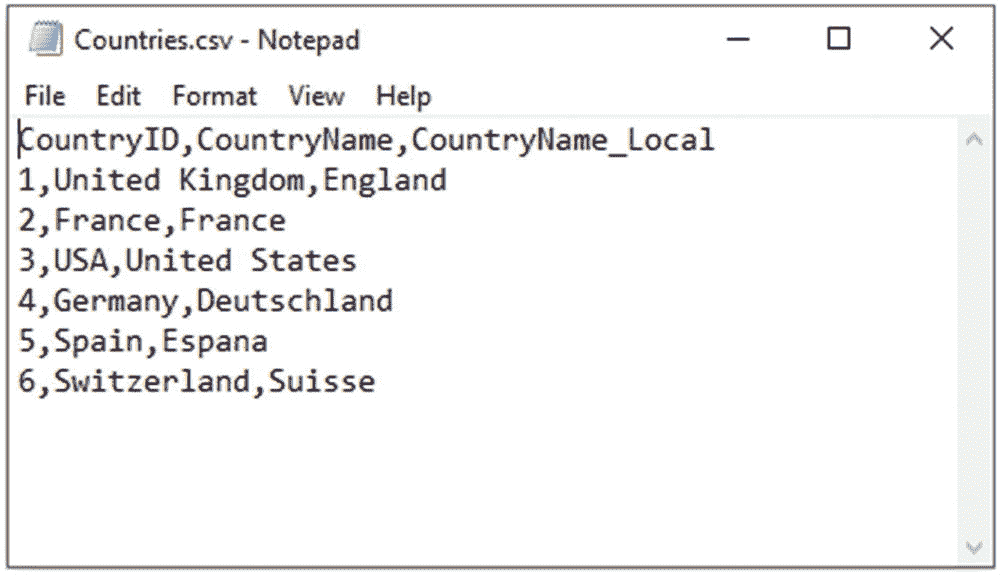
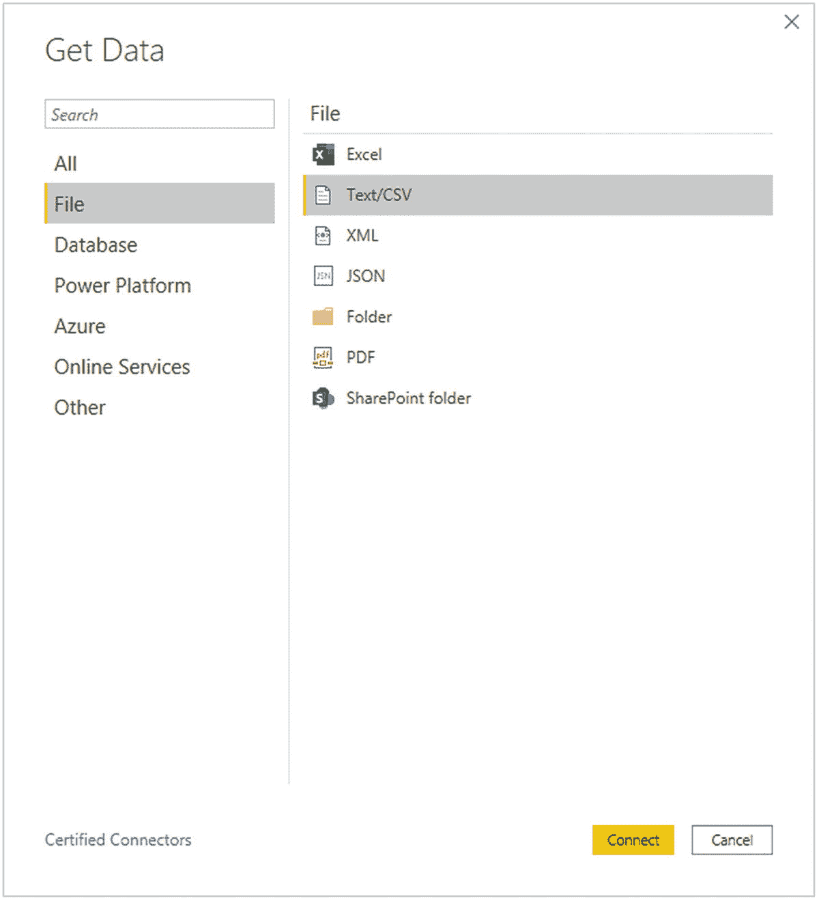
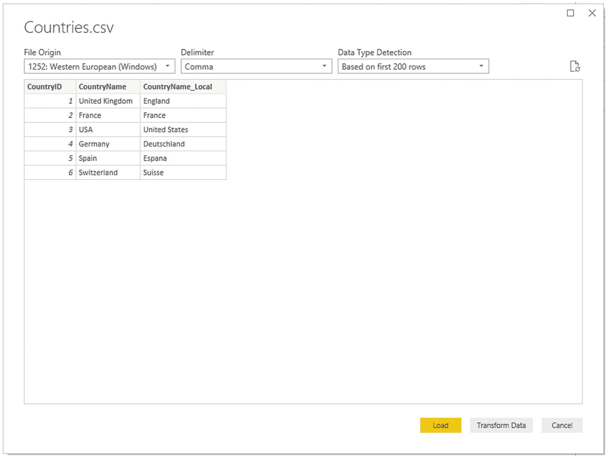
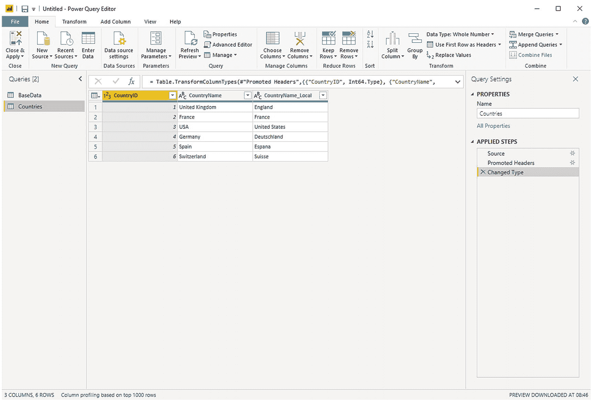

# 使用 Power BI Desktop 发现和加载基于文件的数据

##### 文件源

通过网络、互联网或电子邮件发送文件已成为我们大多数人的第二天性。只要你获得的文件符合当前一些广泛认可的标准（稍后你将了解更多），将它们加载到 Power BI Desktop 中应该不会有什么困难。

作为数据混搭过程的第一步，本章将向你展示如何查找和加载来自各种基于文件的源的数据。这些数据类型通常是那些你可以在共享网络驱动器上找到、从互联网下载、作为电子邮件附件接收或复制到计算机本地驱动器中的数据。本章示例中使用的文件可在 Apress 网站上获取。如果你已按照附录 A 中的下载说明操作，那么这些文件将位于 `C:\PowerBIDesktopSamples` 文件夹中。

Power BI Desktop 当前可以读取并从中加载数据的文件源如下表 2-1 所示。

表 2-1

文件源

| 文件源 | 说明 |
| --- | --- |
| Excel | 允许你读取 Microsoft Excel 文件（版本 97 到 2019）并加载工作表、命名区域和表格。 |
| CSV | 允许你加载符合 CSV（逗号分隔值）格式的文本文件。 |
| XML | 允许你从 XML 文件加载数据。 |
| 文本 | 允许你使用各种列分隔符加载文本文件。 |
| 文件夹 | 允许你加载文件夹中所有文件的信息。 |
| SharePoint 文件夹 | 允许你列出 SharePoint 文件夹中的文件。 |
| Access 数据库 | 允许你连接到网络上的 Microsoft Access 文件并加载查询和表格。 |
| JSON | 帮助你从 JSON 文件加载数据。 |
| PDF | 允许你预览 PDF 文件并加载文档中任何表格的数据。 |

在本章中，我们将探讨如何从以下来源导入数据：

*   CSV 文件
*   文本文件
*   XML 文件
*   Excel 文件
*   Excel 中的 Power View、Power Query 和 Power Pivot 元素
*   Access 数据库
*   PDF 文件

更高级的技术（例如导入整个文件夹的文本或 Excel 文件的内容，或导入复杂的 XML 文件和 JSON 文件）将在第 10 章中描述。我更倾向于将这些内容分开处理，因为它们需要更高级的数据转换技术知识——而你需要先学习这些基础知识。

> **注意：** 我知道 Power BI Desktop 将 MS Access 视为数据库而不是“文件”数据类型。虽然我完全同意这种分类，但我仍然倾向于将 Access 视为基于文件的数据源，因为所有数据都驻留在一个可以复制和通过电子邮件发送的单个文件中，而不是存储在远程服务器的数据库中。因此，我们将在本章中介绍 MS Access，而不是在下一章中讨论企业数据源。

### 从文件加载数据

现在，是时候开始了解 Power BI Desktop 的“重活儿”部分，以及如何使用它从各种不同源加载数据了。我将从最简单的例子开始——从一个文本文件加载数据，这就像在初学者斜坡上滑行（或者像我们英国说的“育儿”斜坡）。然后，鉴于可用数据源种类繁多，并且为了使过程结构更清晰，我们将从大多数工作场所中常见的几个基于文件的数据源加载数据。这些数据源是你在第 7 章到第 10 章中学习调整和“混搭”的基础。这些数据也可以成为你将在第 14 – 24 章中创建的许多仪表板元素的基础。

#### CSV 文件

场景如下：你获得了一个包含数据列表的 CSV 文件。现在，你希望将其加载到 Power BI Desktop 中，以便查看数据并考虑需要做什么（如果有的话）才能使其可用。

首先，你需要了解要加载的数据。如果你使用文本编辑器（如记事本）打开源文件 `C:\PowerBIDesktopSamples\Countries.csv`，就可以查看其内容。你在图 2-1 中可以看到的内容如下。

图 2-1

`Countries.csv` 文件的内容

以下步骤说明了将此类文件的内容加载到 Power BI Desktop 中所需要做的工作：

图 2-2

Power BI Desktop 中的文件数据连接器

1. 打开 Power BI Desktop 并关闭启动屏幕。

2. 在 Power BI Desktop 的“开始”功能区中，单击 `获取数据` 按钮（而不是显示菜单选项的小三角形）。

3. 单击左侧的 `文件`。你将看到类似图 2-2 的内容（`获取数据` 对话框）。

图 2-3

Power BI Desktop 文件对话框

4. 在对话框右侧单击 `Text/CSV`。

5. 单击 `连接`。将出现 `打开` 对话框。

6. 导航到包含要加载文件的文件夹，并选择该文件（本例中为 `C:\PowerBIDesktopSamples\Countries.csv`）。

7. 单击 `打开`。将出现一个对话框，显示文件的初始内容，如图 2-3 所示。

图 2-4

已加载 CSV 文件内容的 Power BI Desktop 查询窗口

8. 单击 `转换数据` 按钮。Power BI Desktop 查询窗口出现，其中包含 CSV 文件内容的样本——如果文件不是太大，也可能包含整个文件。你可以在图 2-4 中看到这一点。

9. 单击 Power BI Desktop 查询窗口中的 `关闭并应用` 按钮（你可以在图 2-4 的左上角看到它）。Power BI Desktop 查询编辑器将关闭，并将焦点返回到 Power BI Desktop 窗口，在那里你可以看到“国家/地区”数据集显示在屏幕右侧的“字段”列表中。

到此为止，暂时就完成了。你只需点击几次，就将文件加载到了 Power BI Desktop 中，它已准备好用于仪表板和报表。在后续章节中，你将学习如何塑造这些数据。然而，现在，让我们继续看看其他一些基于文件的数据源。

