# 6. 从其他数据源加载数据

## 其他数据源

目前，Power BI 连接器可用的数据源有数十种。显然，不可能逐一解释如何使用它们。无论如何，可用数据源列表逐月增长——因此这是一项徒劳的任务。为了快速结束我们对可用源数据的浏览，本章将介绍：

- Power BI 数据集
- Power BI 数据流
- R 转换
- Python 转换
- 通用数据模型
- ODBC 数据
- OLE DB 数据
- 添加自己的自由格式表

如果你已按照附录 A 中的下载说明操作，本章使用的所有文件都将位于 `C:\PowerBIDesktopSamples` 文件夹中。

## Power BI 数据集

Power BI 数据集是为最终用户设计的完整数据模型，已在 Microsoft 的云平台 Power BI 服务中提供。通常，Power BI 数据集经过精心设计，仅包含你所需的数据。它们几乎总是受到企业数据管理员的严格控制。

**注意：** 只有拥有 Power BI 账户并已获得数据集创建者授予的访问权限，你才能访问 Power BI 数据集。如有疑问，请咨询你所在组织的 IT 部门。

如果你已知组织中存在可用的 Power BI 数据集，你可以连接到这些数据集，并将其用作仪表板和报告的基础，操作如下：

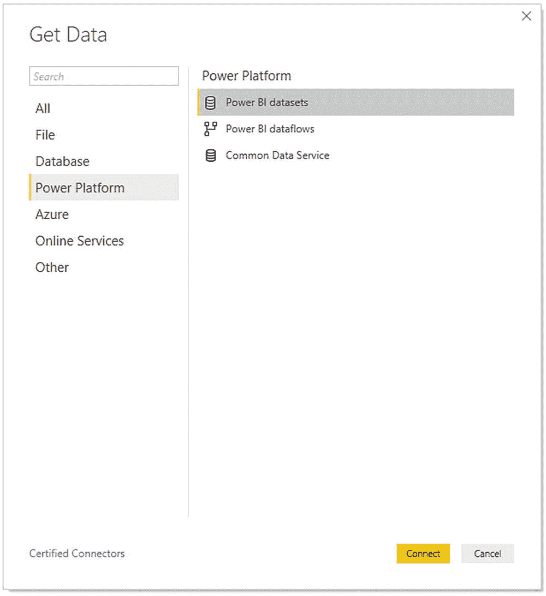

**图 6-1** Power BI 数据集的`获取数据`对话框

1. 在 Power BI Desktop 的“开始”功能区中，单击`获取数据`按钮。
2. 单击左侧的`Power Platform`，然后选择右侧的`Power BI 数据集`。`获取数据`对话框将如图 6-1 所示。

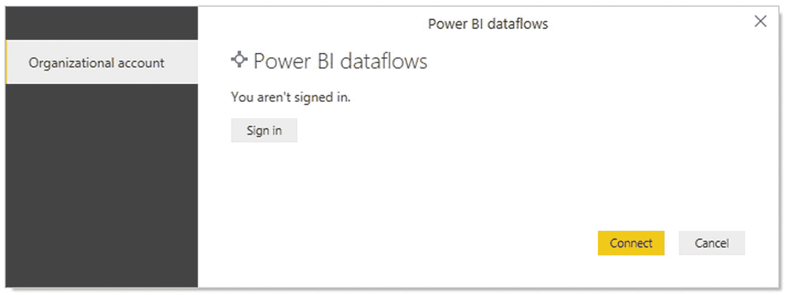

**图 6-2** Power BI 数据流和数据集的连接对话框

1. 登录到 Power BI 服务（如果你尚未登录）。你可以在图 6-2 中看到登录提示。

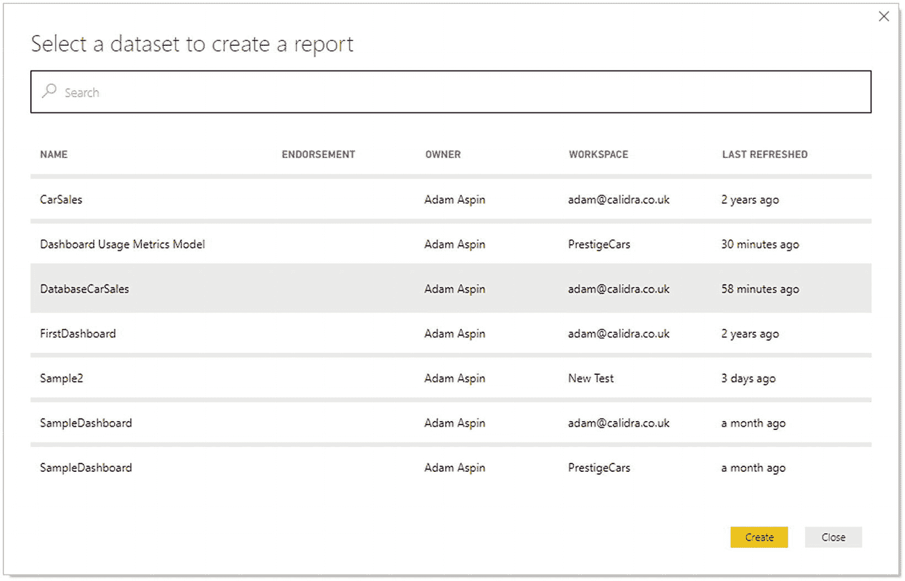

**图 6-3** Power BI 服务中的可用数据集

1. 登录后，单击`连接`。你将看到所有当前可用数据集的列表，如图 6-3 所示。当然，你只会看到专门为你提供的数据集。
2. 单击`创建`。数据集中的表和字段将显示在 Power BI Desktop 的`字段`窗格中。

现在，你可以使用 Power BI 数据集中的数据作为报告和仪表板的基础。

你需要知道，一旦建立了与 Power BI 服务实时连接的连接，除了使用数据构建仪表板和报告之外，你能做的事情非常有限。更具体地说，你无法使用第 7 章至第 10 章中介绍的任何技术来转换数据。如果你尝试修改数据结构，将会看到如图 6-4 所示的对话框。

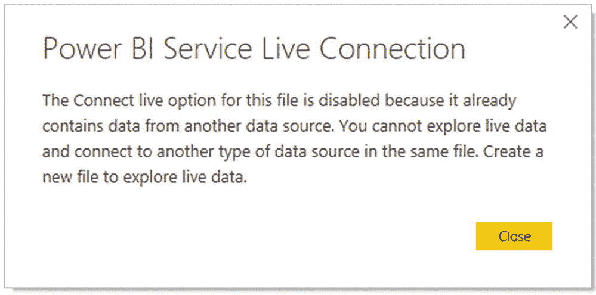

**图 6-4** Power BI 服务实时连接对话框

**注意：** 如果你面对的是庞大的可用数据集列表，请记住，可以通过在`数据集`对话框顶部的搜索字段中输入数据集名称中包含的几个字符来筛选列表。只需删除输入的字符即可显示完整列表。

## Power BI 数据流

Power BI 数据流是数据摄取和转换过程的输出。它们总是返回一个或多个数据表。与 Power BI 数据集的情况一样，Power BI 数据流通常设计为仅包含你所需的数据，并且几乎总是受到企业数据管理员的严格控制。

如果你已获得使用 Power BI 数据流中数据的权限，可以通过以下方式连接：

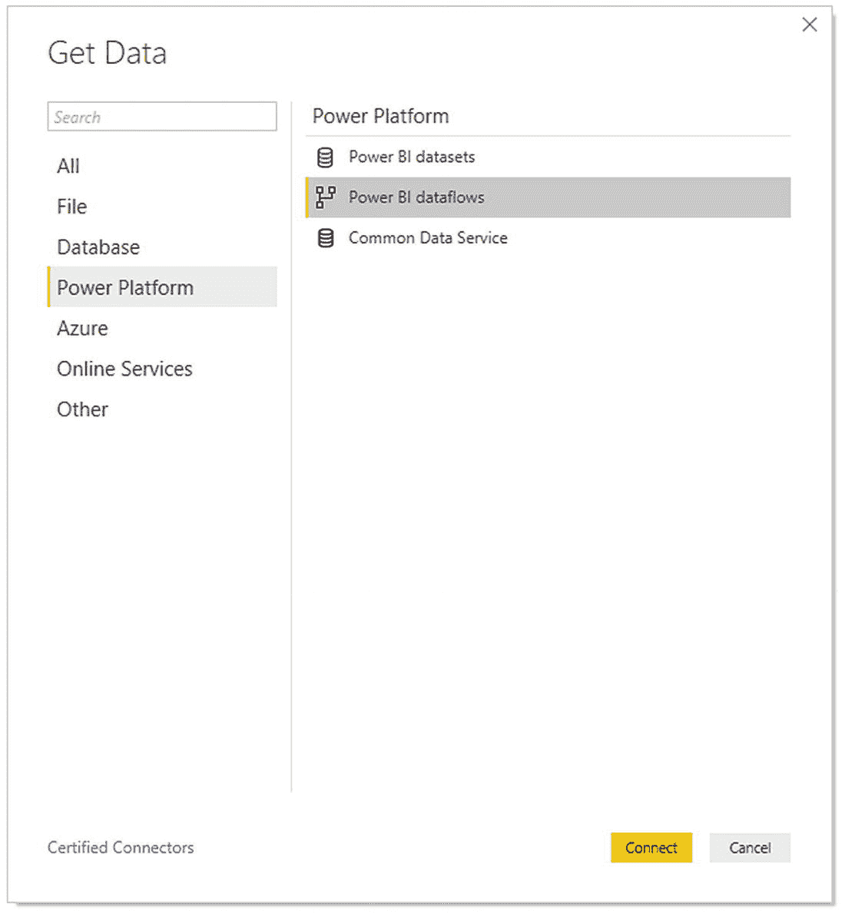

**图 6-5** Power BI 数据集的`获取数据`对话框

1. 在 Power BI Desktop 的“开始”功能区中，单击`获取数据`按钮。
2. 单击左侧的`Power Platform`，然后选择右侧的`Power BI 数据流`。`获取数据`对话框将如图 6-5 所示。
3. 登录到 Power BI 服务（如果你尚未登录）。
4. 单击`连接`。你将在`导航器`中看到所有当前可用数据流的列表。当然，你只会看到专门为你提供的数据流。
5. 展开包含你要连接的数据集元素的数据集文件夹。
6. 选择你所需的一个或多个数据流。
7. 单击`加载`。数据流中的表和字段将显示在 Power BI Desktop 的`字段`窗格中。

现在，你可以使用 Power BI 数据流中的数据作为报告和仪表板的基础。

## R 语言转换

尽管 Power BI Desktop 在准备仪表板和报告所需的数据方面功能极其强大（你将在第 7 章至第 10 章中了解更多），但有时你可能更倾向于使用其他工具来执行一些高度特定的数据准备工作。

其中一个工具就是 R 语言。R 是一个用于统计分析和数据科学的开源平台。如果你有 R 语言的使用经验，并希望将其与 Power BI 结合使用，可以尝试以下操作：

**注意：** 若要用 R 语言脚本准备要加载到 Power BI 中的数据，你首先需要在计算机上安装 R。你可以在以下网址找到 R：[`https://mran.revolutionanalytics.com/download`](https://mran.revolutionanalytics.com/download)。

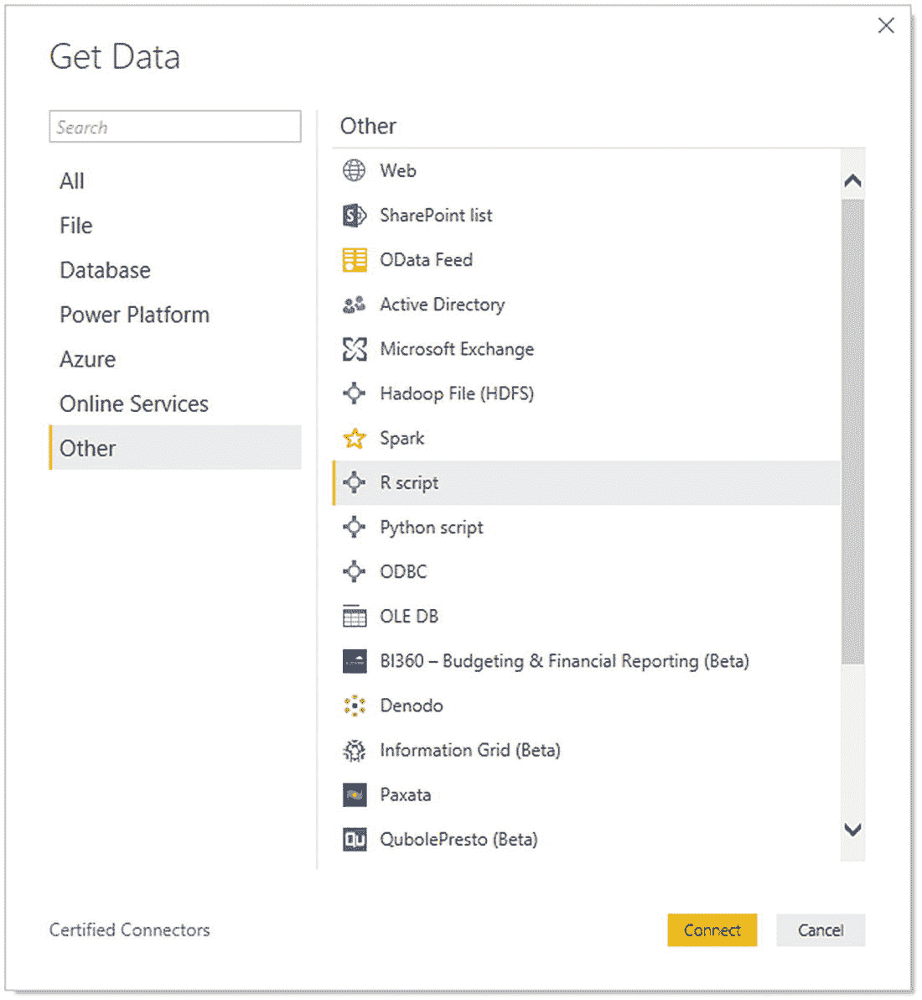

**图 6-6** 选择使用 R 脚本时的`获取数据`对话框

1. 在 Power BI Desktop 的“开始”功能区中，单击`获取数据`按钮。
2. 单击左侧的`其他`，然后选择右侧的`R 脚本`。`获取数据`对话框将如图 6-6 所示。

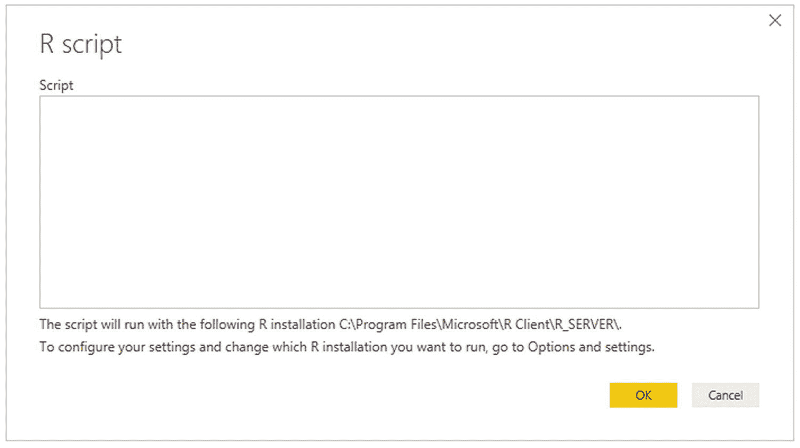

**图 6-7** R 脚本对话框

1. 单击`连接`。将出现 R 脚本对话框，你可以在其中粘贴连接数据并对其进行预处理的脚本。你可以在图 6-7 中看到此对话框。
2. 单击`确定`。数据流中的表和字段将显示在 Power BI Desktop 的`字段`窗格中。

R 语言是一个庞大的主题，我无意在此书中尝试解释如何使用它的哪怕一小部分。我只是想让 R 语言的实践者知道，他们可以利用自己已有的知识，并将其应用于 Power BI 服务。

**注意：** R 脚本对话框绝对*不是*一个 R 集成开发环境。因此，你可能需要一个 R IDE 来准备和测试脚本，然后再将其粘贴到 R 脚本对话框中。

# Python Transformations

如果 Python 是你进行数据分析、数据转换和人工智能的首选语言，那么你也可以将现有的 Python 知识应用于为 Power BI 仪表板准备数据。

**注意**：要在 Power BI 中使用 Python，你需要在计算机上安装自己喜欢的 Python 版本和 IDE。

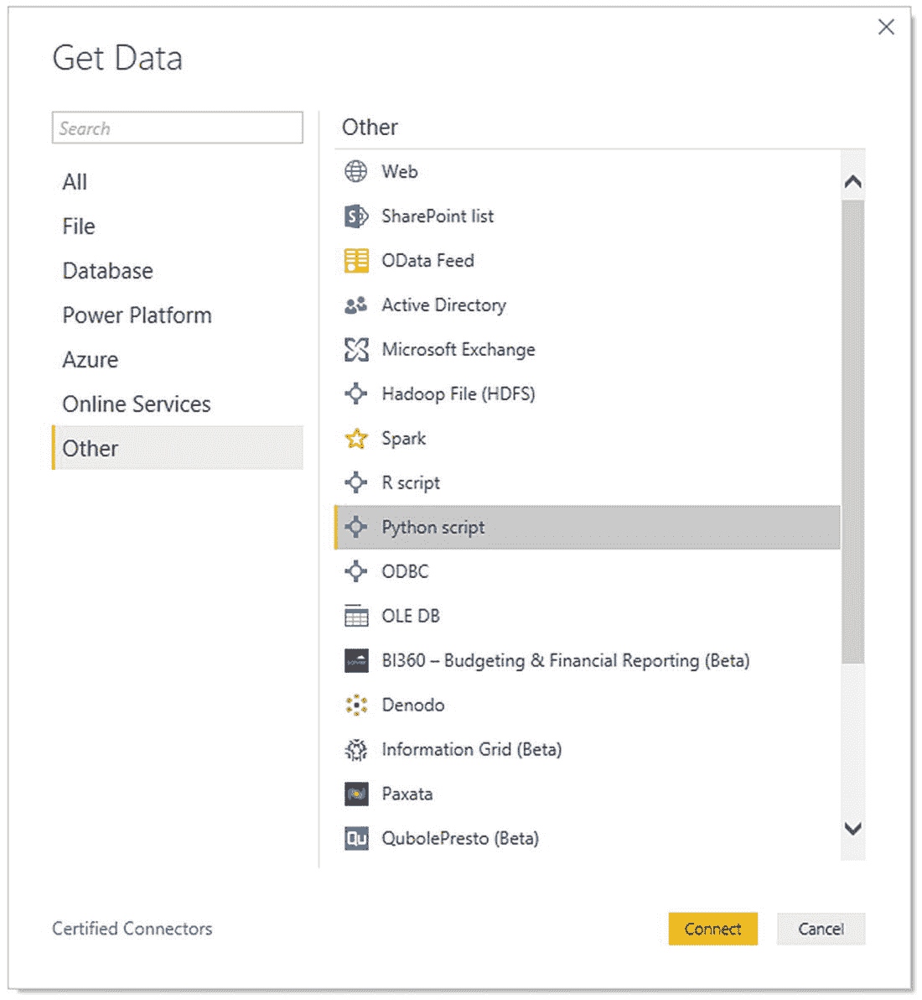
*图 6-8 选择使用 Python 脚本时的“获取数据”对话框*

1. 在 Power BI Desktop 的“开始”功能区中，单击“获取数据”按钮。
2. 单击左侧的“其他”，然后选择右侧的“Python 脚本”。“获取数据”对话框将如图 6-8 所示。
3. 单击“连接”。将出现“Python 脚本”对话框，你可以在其中粘贴之前在 Python IDE 中准备好的脚本，该脚本用于连接数据并进行预处理。你可以在图 6-9 中看到此对话框。

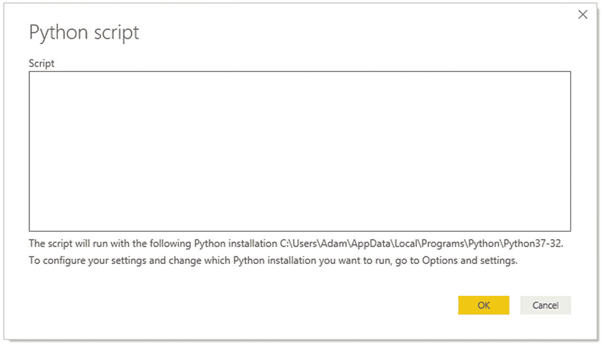
*图 6-9 “Python 脚本”对话框*

4. 单击“确定”。数据流中的表和字段将出现在 Power BI Desktop 的“字段”窗格中。

**注意**：我无意在此书中尝试解释如何使用 Python。我只是想让 Python 用户知道，他们可以利用现有知识并将其用于 Power BI。

## Common Data Model

如果你使用的是存储在 Microsoft Common Data Model（通用数据模型，它是 Common Data Service 的一部分）中的数据，那么你可以极其轻松地连接到这些数据——正如你可能期望的那样。

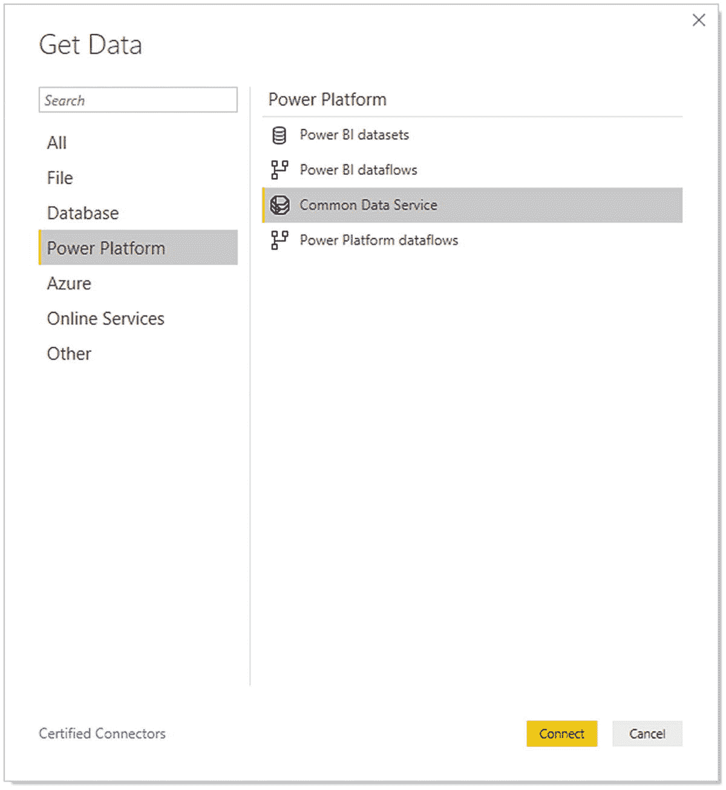
*图 6-10 连接到 Common Data Service*

1. 在“开始”功能区中，单击“获取数据” ➤ “更多”。
2. 选择左侧的“Power Platform”和右侧的“Common Data Service”。对话框应如图 6-10 所示。
3. 单击“连接”，并在“Common Data Service”对话框中输入你的服务器 URL。此对话框应类似于图 6-11。
4. 单击“确定”。将出现“导航器”，你可以在其中选择要连接的数据实体。

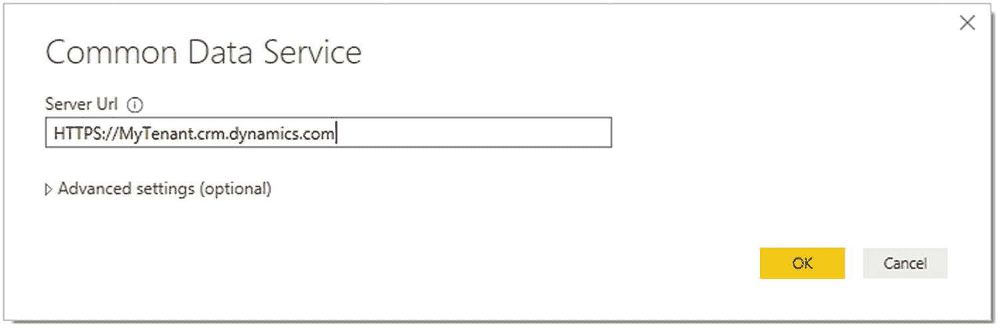
*图 6-11 “Common Data Service”对话框*

由于 Common Data Service 本质上是一个数据库，我建议你回头参考第 3 章，了解在 Power BI Desktop 中使用数据库源的详细信息。

# ODBC Sources

如本章和前一章所示，Power BI Desktop 可以连接到广泛的数据源。然而，总有一些数据库应用程序没有内置到 Power BI Desktop 中的特定连接器。

这时，一个名为 Open Database Connectivity（开放数据库连接，简称 ODBC）的通用解决方案就派上用场了。ODBC 是一种连接数据源的标准方式，大多数数据源都是数据库或结构类似于数据库的。简单来说，如果存在针对你要连接的应用程序的 ODBC 驱动程序，你就可以将数据从该应用程序加载到 Power BI Desktop 中。

已经有数百个 ODBC 驱动程序被编写出来。有些是免费提供的，其他的则需要你购买许可证。它们适用于从大多数个人电脑上常见的应用程序到小众产品的广泛领域。

尽管 ODBC 被设计为一种访问应用程序数据的标准方式，但每个 ODBC 驱动程序与其他驱动程序都略有不同。因此，你可能需要花一点时间来了解你要连接的应用程序所附带的驱动程序的界面特性。

在本节中，我们将使用 FileMaker Pro 作为数据源。这个产品是一个桌面和服务器数据库系统，已经存在了相当长的时间。然而，目前没有针对它的特定 Power BI Desktop 连接器。好消息是 FileMaker Pro *确实*有 ODBC 驱动程序。因此，我们将使用 ODBC 从 Power BI Desktop 连接到 FileMaker Pro。

我必须补充一点，我不期望你为了进行此练习而安装一份 FileMaker Pro（即使是试用版）及其配套的 ODBC 驱动程序。然而，我想解释的是，你如何使用 ODBC 连接到存在 ODBC 驱动程序的广泛数据源。所以，如果你愿意，可以随意下载并安装 FileMaker Pro 及其 ODBC 驱动程序，但你需要参考 FileMaker Pro 的文档来了解如何做到这一点。

假设你有一个符合 ODBC 标准的数据源，并且有一个适用于该数据源的工作正常的 ODBC 驱动程序，以下是使用 ODBC 将数据加载到 Power BI Desktop 中的方法：

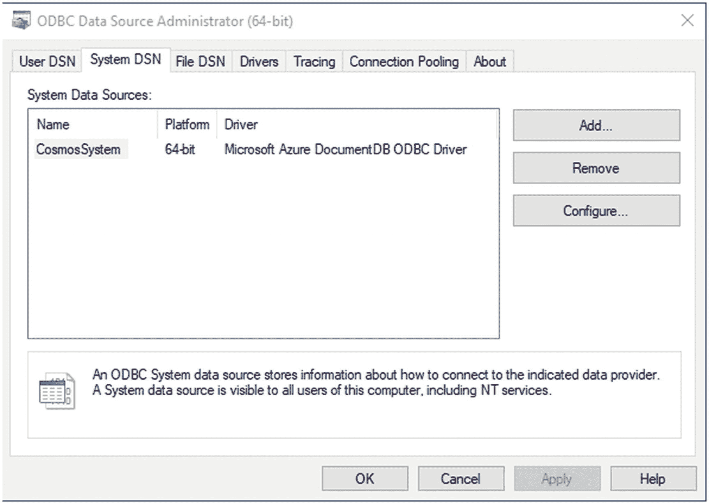

*图 6-12 ODBC 数据源管理员*

1.  运行 `ODBC Data Source Administrator`（ODBC 数据源管理器）应用程序。它通常位于 `C:\ProgramData\Microsoft\Windows\Start Menu\Programs\Administrative Tools` 文件夹中。如果你使用的是 64 位 Power BI Desktop，请务必使用 64 位版本；如果你使用的是 32 位 Power BI Desktop，请使用 32 位版本。
2.  单击“系统 DSN”选项卡。你应该会看到如图 6-12 所示的对话框。
3.  单击“添加”。你将看到计算机上当前安装的所有 ODBC 驱动程序的列表。它应该类似于图 6-13 中所示的对话框。

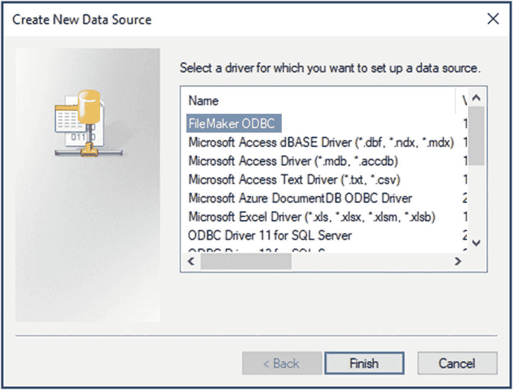

*图 6-13 已安装的 ODBC 驱动程序列表*

4.  选择与你要连接的数据源相对应的 ODBC 驱动程序（在此示例中为 `FileMaker ODBC`）。如果你看不到该 ODBC 驱动程序，则需要安装或重新安装该驱动程序。
5.  单击“完成”。将出现你选择的特定 ODBC 驱动程序的配置对话框。如果你使用的是 FileMaker Pro，该对话框将如图 6-14 所示。

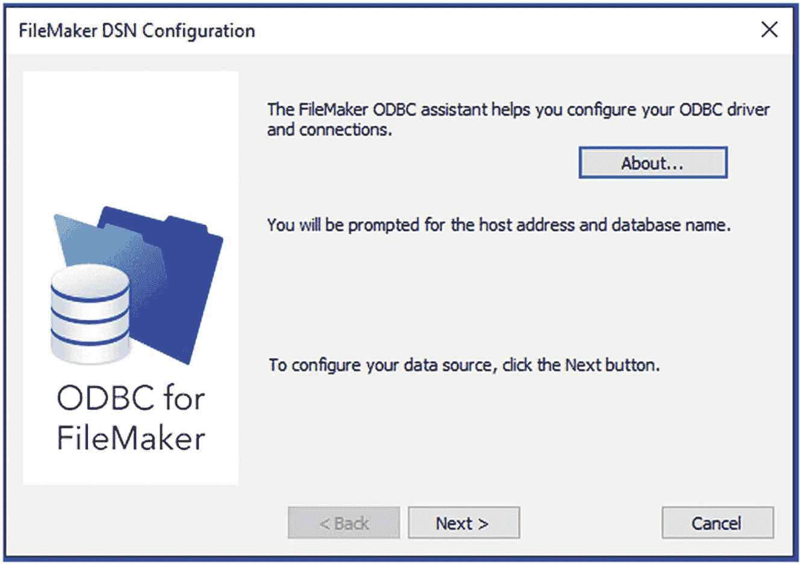

*图 6-14 FileMaker Pro ODBC 配置助手*

6.  在 FileMaker Pro 的配置对话框中，为连接设置一个名称（DSN 名称）。此对话框应类似于图 6-15。

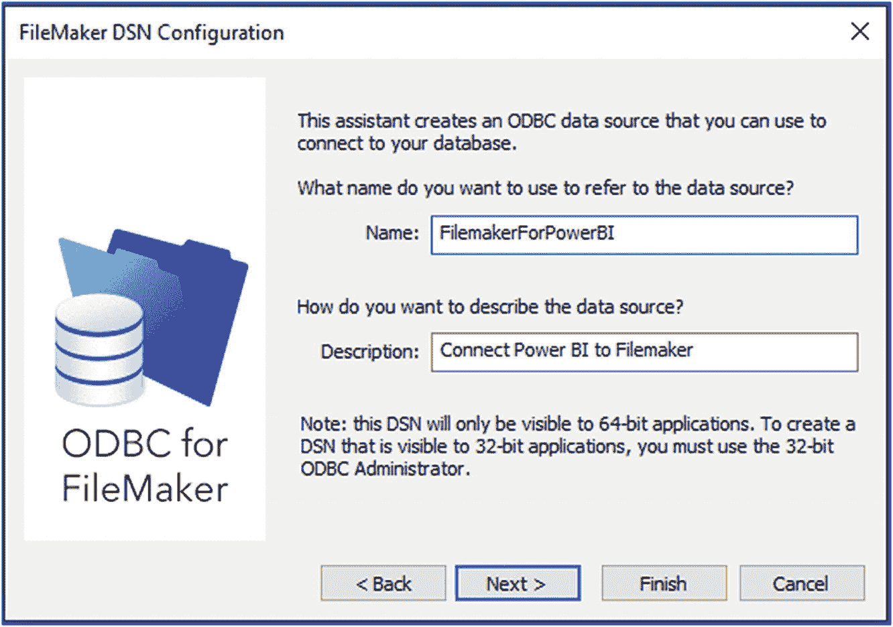

*图 6-15 为 FileMaker Pro 命名 ODBC 连接*

7.  单击“下一步”，然后为此特定 ODBC 连接输入名称和描述。该对话框应类似图 6-15 所示。

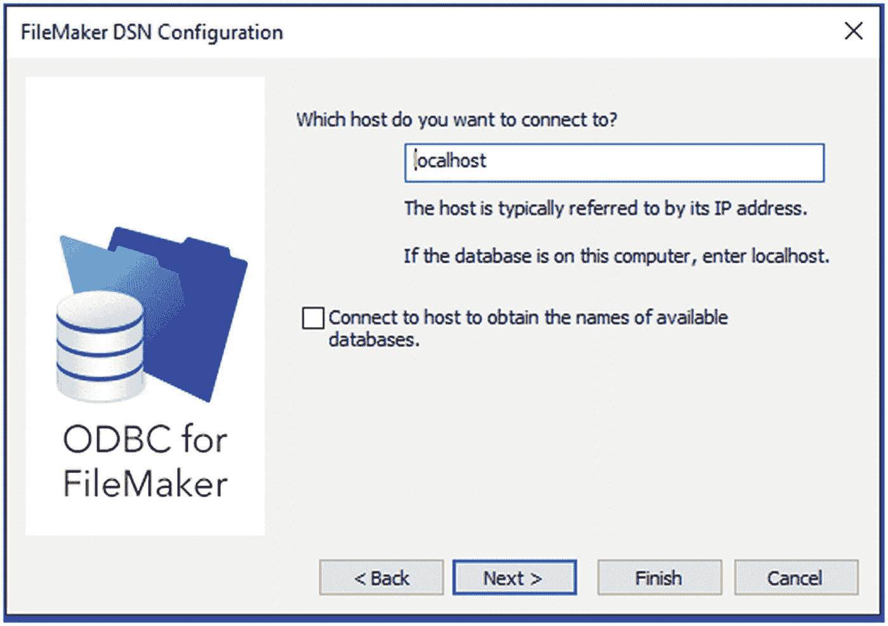

图 6-16 指定 ODBC 数据的主机

8.  单击“下一步”，如果您在本地计算机上使用 FileMaker 试用版，请输入 `localhost` 作为主机名。否则，请输入 FileMaker 服务器的 IP 地址。您将看到如图 6-16 所示的对话框。

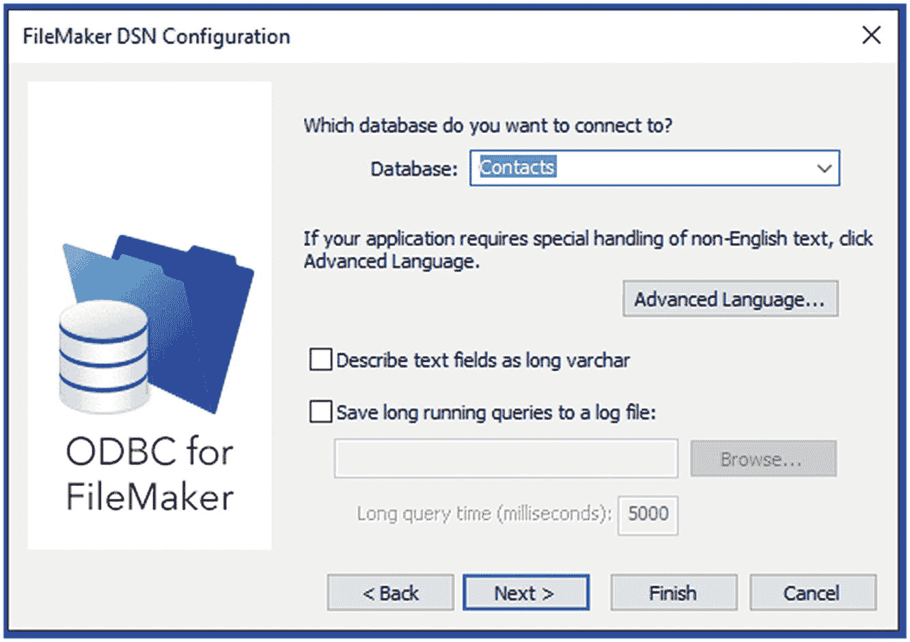

图 6-17 指定 ODBC 数据的数据库

9.  单击“下一步”，然后在 FileMaker Pro 中选择您要连接的数据库。您将看到如图 6-17 所示的对话框（如果您*没有*使用 FileMaker Pro——请记住，这些对话框可能因特定的 ODBC 驱动程序而异）。

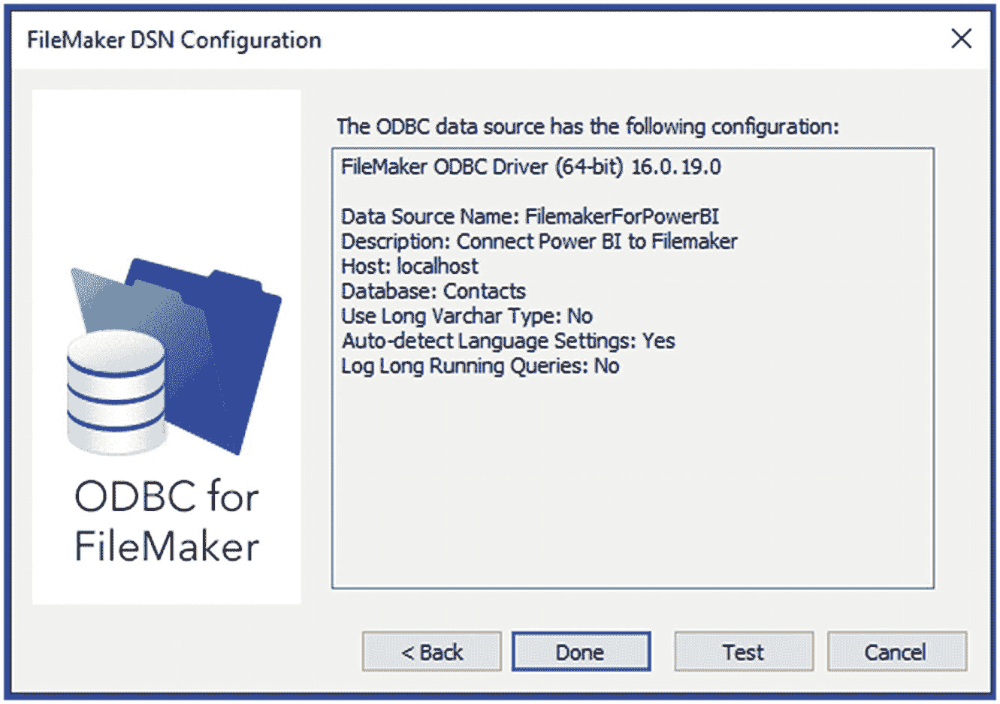

图 6-18 ODBC 连接确认对话框

10. 单击“下一步”。ODBC 配置对话框将恢复连接的规格。它可能类似于图 6-18 所示。

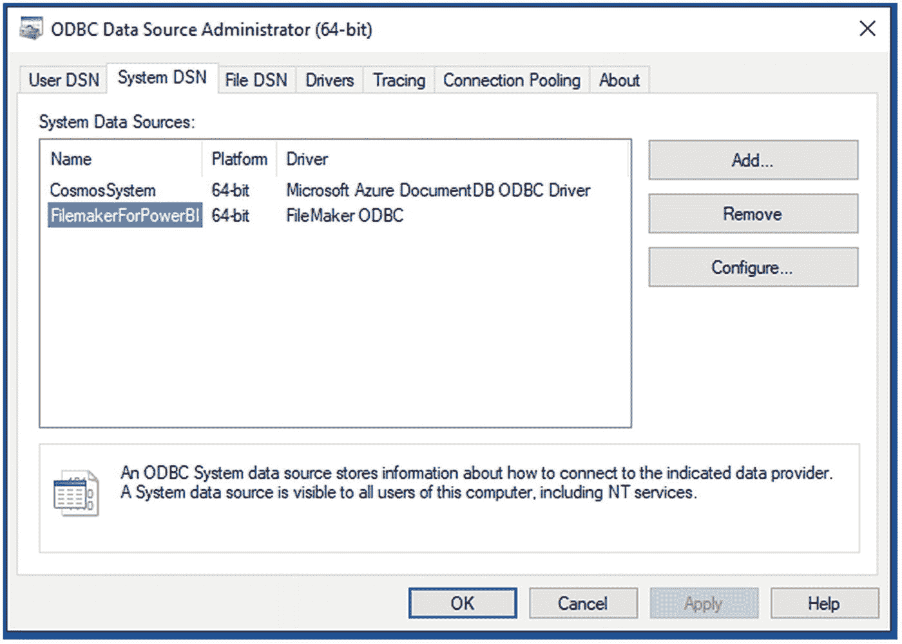

图 6-19 已配置 ODBC 驱动程序的 ODBC 数据源管理员对话框

11. 单击“完成”。您将返回到 ODBC 数据源管理员，在那里您将看到刚刚创建的系统 DSN。ODBC 数据源管理员对话框应类似于图 6-19 所示。

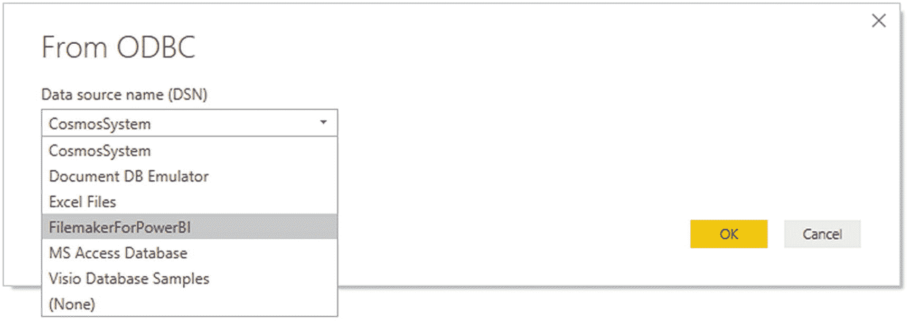

图 6-20 用于选择 ODBC 数据源的 Power BI Desktop 的“从 ODBC”对话框

12. 单击“确定”。这将关闭 ODBC 数据源管理员对话框。
13. 启动 Power BI Desktop。
14. 单击“获取数据” ➤ “更多” ➤ “其他”。
15. 从右侧可用的数据源中选择 **ODBC**。
16. 单击“连接”。“从 ODBC”对话框将出现。
17. 展开可用的 DSN 列表。“从 ODBC”对话框将类似于图 6-20 所示。

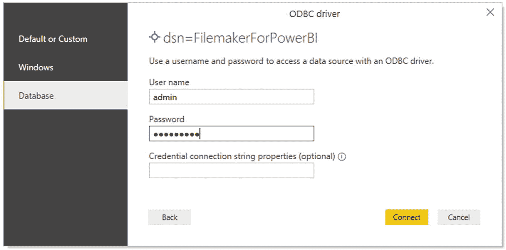

图 6-21 ODBC 驱动程序安全对话框

18. 选择您之前创建的 DSN（本例中为 `FilemakerForPowerBI`）。
19. 单击“确定”。凭据对话框将出现。
20. 选择 Windows 集成安全性，或单击左侧的“数据库”，然后输入有权使用 ODBC 驱动程序连接的用户名。凭据对话框将类似于图 6-21 所示。

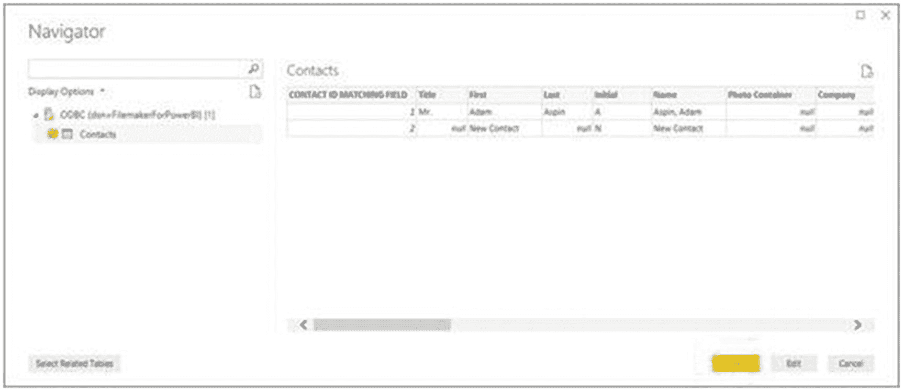

图 6-22 使用 ODBC 数据源时的导航器对话框

21. 单击“连接”。您将在导航器窗口中看到 ODBC 数据源中可用的数据。
22. 选择要加载到 Power BI Desktop 中的表。您可以在图 6-22 中看到所选表中包含的数据。
23. 单击“加载”以将数据从 ODBC 数据源加载到 Power BI Desktop。

我意识到这个过程一开始可能显得有些繁琐。但请记住，您很可能只需设置一次 ODBC 连接。之后，您可以随时使用它来连接源数据。

您需要知道，每一个 ODBC 驱动程序都是不同的。因此，在第 5 步到第 10 步中出现的对话框，其外观会根据您配置的不同 ODBC 驱动程序而略有差异。不过，关键元素始终是相同的。它们是：

*   命名 DSN
*   指定数据的主机计算机
*   定义数据存储库（或数据库）

# 关于 ODBC 连接与 Power BI Desktop

关于创建和使用 ODBC 连接将数据加载到 Power BI Desktop（或任何其他目标应用程序）中，其实还有很多内容可以写。然而，如果您需要了解更多关于这种特定技术的信息，我不得不将您引荐到丰富的可用资源，无论是印刷版还是在线版。微软文档是一个很好的起点，它解释了系统 DSN、用户 DSN 和文件 DSN 之间的区别，并描述了您可能需要了解的许多关键元素。

> **注意：** FileMaker Pro 必须处于打开和/或运行状态，ODBC 连接才能工作。其他 ODBC 源可能有其特定的注意事项。

最后一点，我只能敦促您获取计划用于 Power BI Desktop 的 ODBC 驱动程序的所有相关文档。事实上，如果您使用的是通过 ODBC 驱动程序的企业数据源，则可能有企业资源可以为您配置 ODBC。

## OLE DB 数据源

`OLE DB`（对象链接与嵌入数据库的缩写）在技术层面上是一种名为应用程序编程接口（`API`）的技术。通俗来说，它是一种以通用方式连接数据库源的技术。

因此，与 `ODBC` 类似，你可以使用 `OLE DB` 连接到数据源（通常是数据库，但也可能是其他数据源）。事实上，即使存在其他连接方法，你也会发现 `OLE DB` 是一种连接数据库的有用方式。

所以，无论你打算如何使用 `OLE DB`，了解它的工作原理都非常值得。在本示例中，我将使用 `OLE DB` 连接到 SQL Server 以及你在本章开头首次看到的示例数据库。

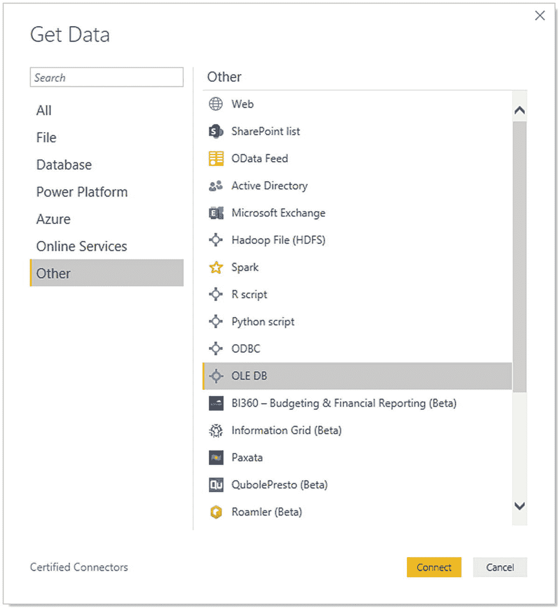

图 6-23

启动 OLE DB 连接

1. 打开一个新的 Power BI Desktop 应用程序。

2. 在 Power BI Desktop 功能区中，点击 `获取数据` 按钮。

3. 点击左侧的 `其他`，然后点击右侧的 `OLE DB`。对话框将如图 6-23 所示。

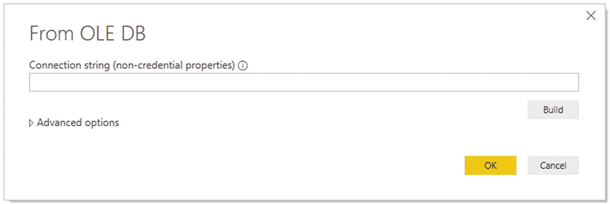

图 6-24

“来自 OLE DB”对话框

4. 点击 `连接`。`来自 OLE DB` 对话框将出现，如图 6-24 所示。

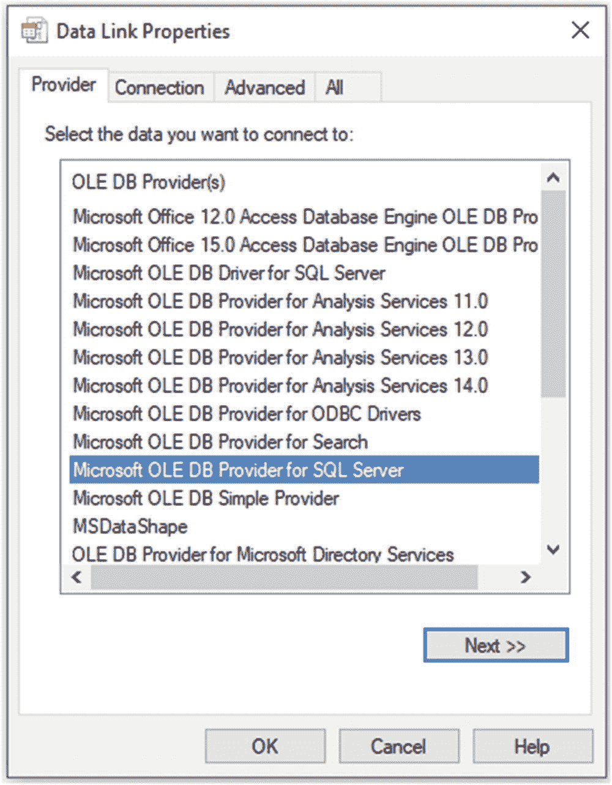

图 6-25

OLE DB 数据链接属性对话框

5. 如果你有一个完整可用的连接字符串，请将其输入到 `连接字符串` 文本框中。

6. 如果你没有连接字符串，请点击 `生成` 按钮。将显示 `OLE DB 数据链接属性` 对话框，如图 6-25 所示。

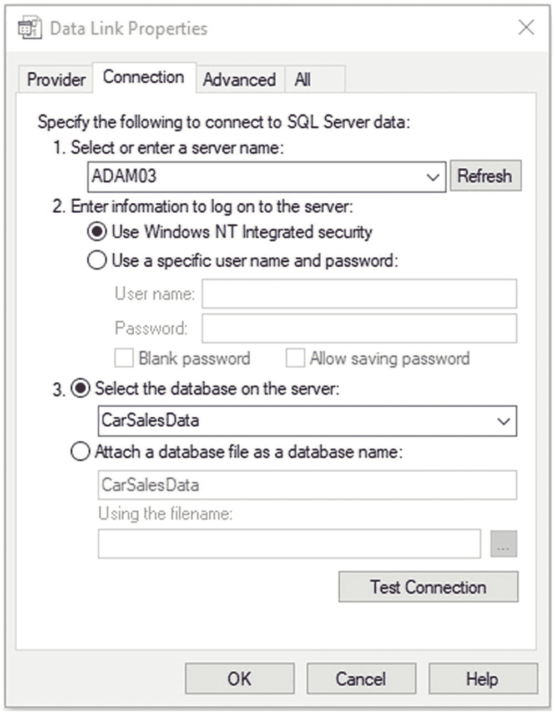

图 6-26

OLE DB 数据链接属性对话框的“连接”属性页

7. 选择你想要使用的 OLE DB 数据提供程序。在本示例中，它将选择 `Microsoft OLE DB Provider for SQL Server`。

8. 点击 `下一步`。`OLE DB 数据链接属性` 对话框的 `连接` 属性窗格将出现。

9. 从 `选择或输入服务器名称` 弹出菜单中选择一个可用的 SQL Server（或输入其名称）。

10. 选择安全类型，如果你选择使用特定用户名而不是 Windows NT 集成安全性，则输入用户名和密码。

11. 从 `选择服务器上的数据库` 弹出菜单中选择源数据库。对话框将类似于图 6-26 所示。


图 6-27

测试连接警报

12. 点击 `测试连接` 按钮以确保连接有效。你应该会看到如图 6-27 中的消息。

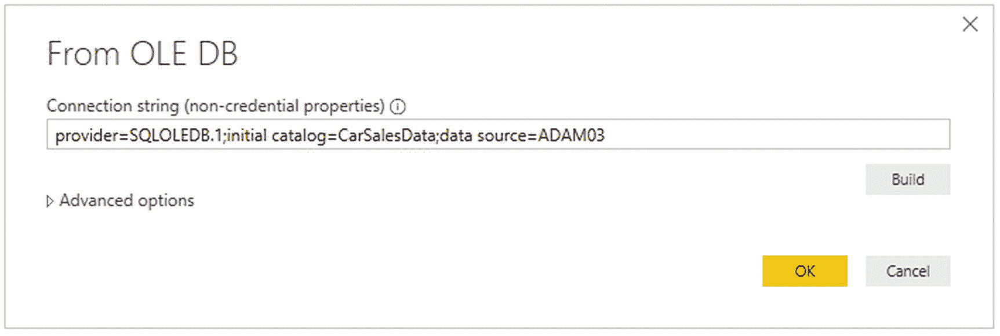

图 6-28

包含有效连接字符串的“来自 OLE DB”对话框

13. 点击 `确定`。Power BI Desktop 将构建连接字符串并将其插入到 `来自 OLE DB` 对话框中，如图 6-28 所示。

14. 点击 `确定`。`导航器` 窗口将出现，并显示相应的数据。

15. 选择源表，然后点击 `加载` 将数据加载到 Power BI Desktop 中。

**注意：** 如果是首次连接到 OLE DB 源，系统可能会要求你输入用户名和密码，这与本章前面的示例情况相同。

你需要知道，OLE DB 连接要求在运行 Power BI Desktop 的计算机上安装了 OLE DB 驱动程序（或 `提供程序`）。然而，真正有趣的是，OLE DB 连接可以简化为一个简单的连接字符串。因此，如果你需要与其他用户共享该连接，在许多情况下，你只需通过电子邮件将连接字符串发送给他们即可。然后你的同事可以直接将该连接字符串粘贴到 Power BI Desktop 的 `来自 OLE DB` 对话框中。换句话说（以此示例为模型），你可以简单地发送以下文本给同事：

```
provider=SQLOLEDB.1;initial catalog=CarSalesData;data source=ADAM03\SQLSERVER2016
```

他们可以通过将此字符串粘贴到 `来自 OLE DB` 对话框中来连接到指定的数据库。

使用 OLE DB 连接还有其他优势。具体来说，你（或你的 IT 部门）可以在连接字符串中提供高级别的配置，以加快或改善对数据的访问。例如，可以通过指定用于报表的镜像服务器来减轻主服务器的压力。在这个层面上，技术细节将取决于 OLE DB 数据源以及所使用的驱动程序，因此超出了本书的讨论范围。

### 刷新数据

从数据库和数据仓库加载数据仅意味着将源数据的快照复制到 Power BI Desktop 中。如果源数据被更新、扩展或删除，那么你需要获取最新版本的数据，以便你的分析能够反映数据的当前状态。

基本上，你有两个选项可以做到这一点：

- 刷新你已定义的所有数据源中的所有源数据。

- 单独刷新一个或多个表。

#### 在 Power BI Desktop 内存模型中刷新整个数据

只有一种方法可以确保你的所有数据都是最新的。刷新整个数据可能需要更长的时间，但你可以确信你的 Power BI Desktop 文件包含来自你所连接的所有来源的最新可用数据。

执行完全刷新：

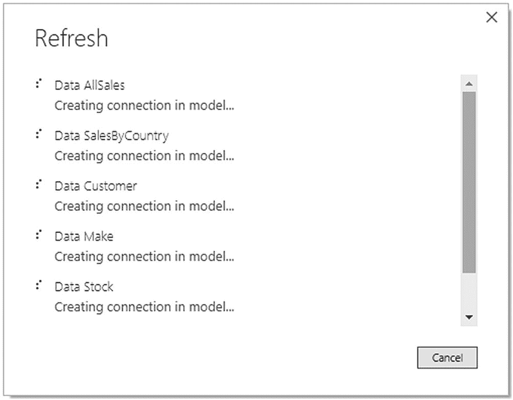

图 6-29

“刷新”对话框

1. 在 `主页` 功能区中，点击 `刷新` 按钮。`刷新` 对话框将出现，显示当前正在刷新的所有数据源。此对话框将类似于图 6-29 所示。

**注意：** 如果源数据量很大或网络连接速度较慢，完整的数据刷新可能需要相当长的时间。

#### 刷新单个表

如果你确定只需要刷新 Power BI Desktop 数据模型中的一个或多个表，那么你可以选择单独刷新这些表。操作步骤如下：

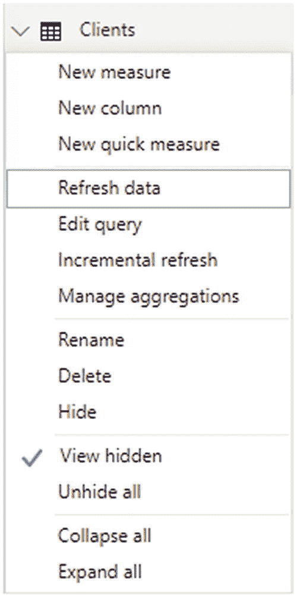

图 6-30

刷新单个表

1. 在 `字段` 窗格中，右键单击你想要刷新的表。

2. 在上下文菜单中选择 `刷新数据`。如图 6-30 所示。

`刷新` 对话框将出现（可能只是短暂显示），该表的现有数据将被最新数据替换。

## 添加你自己的数据

你可能并非总能拥有所需的所有数据。当需要向已加载到 `Power BI Desktop` 的数据集中添加产品列表、人员组或任何类型数据时，你可能会面临这种情况。

微软开发团队已经认识到这一需求，并提供了一个简单的解决方案：你可以创建自己的数据表，以完善 `Power BI` 内存数据模型中的数据集集合。然后，你可以随时即时输入所需的任何额外数据。

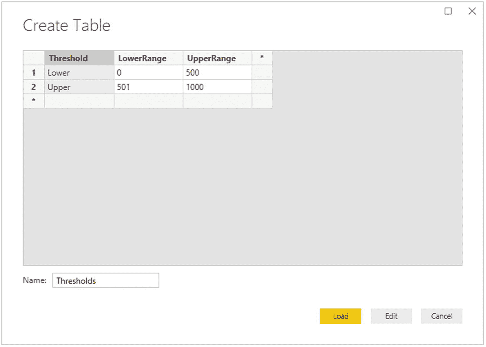

图 6-31

`创建表` 对话框

1. 在 `Power BI Desktop` 的 `开始` 功能区中，单击 `输入数据`。将会弹出 `创建表` 对话框。

2. 单击 `Column1` 右侧的星号以添加列。

3.  双击任意列名称并输入新名称来重命名该列。

4.  输入或粘贴所需的数据。对话框将如图 6-31 所示。

5.  在对话框底部的 `名称` 字段中为表格输入一个名称。

6.  单击 `加载` 将数据加载到 `Power BI` 内存数据模型中。新创建的表将出现在 `字段` 窗格中。

`创建表` 对话框中的编辑功能极其简单。你可以删除、剪切、复制和粘贴数据和列，但仅此而已。然而，当你需要向模型中添加一些最后时刻的数据时，此选项可能非常有用。

**注意**

这是一个极其简单的过程，专为少量数据设计。如果你需要的不仅仅是少量的行和列，那么更好的做法是在 Excel 中创建数据，然后再将其加载到 `Power BI Desktop` 中。

尽管简单，但仍需了解以下几点才能充分利用此选项：

-   右键单击表格网格中的任何行或列会显示一个上下文菜单，你可以在其中选择插入或删除行和列。
-   `输入数据` 选项也适用于 `查询编辑器`。
-   创建后，可以在 `查询编辑器` 中像修改任何其他数据源一样修改该表。
-   创建后，数据会被“硬编码”到 `Power BI Desktop` 中。


## 结论

在本章中，你了解了如何连接到一系列数据源——无论是在 Azure 中还是在你自己的计算机或网络上。你了解到你所在组织现有的 `Power BI Service` 可以包含你可以连接的预准备数据流和数据集。你还学会了可以使用 `Microsoft 通用数据模型` 作为 `Power BI` 报表和仪表板的基础。之后，你学会了如何利用你的 `R` 和 `Python` 知识，使用这两种语言为 `Power BI` 准备数据。

最后，你了解到可以使用两个标准的数据访问连接器——`ODBC` 和 `OLE DB`——来连接到尚未内置 `Power BI` 连接器的数据源。然后，如果其他所有方法都失败了，你可以根据需要创建自己的数据表。

本章结束了这六章的系列内容，该系列向你介绍了可以与 `Power BI Desktop` 一起使用的众多且多样的数据源。在这些章节中，你了解了如何从一些更常用的可用源中加载数据。好消息是 `Power BI Desktop` 可以读取来自数十种更多源的数据。坏消息是，要详细讨论所有这些源需要一整本书的篇幅。

因此，我不会在本书中描述任何其他数据源。这是因为，既然你已经了解了构成 `Power BI Desktop` 加载数据时极其标准化方法的核心技术，你可能无需从我这里获取更多信息就能加载任何可能的数据类型。如果你需要关于其他数据源的任何具体信息，最合适的求助渠道是 `Microsoft Power BI` 网站。目前该网站位于 [https://powerbi.microsoft.com/](https://powerbi.microsoft.com/)。

既然你现在能够找到、访问并将所需数据加载到 `Power BI Desktop` 中，那么是时候进入下一步了。这意味着要对数据集进行清理和重组，以便它们适合你的分析需求。处理这些挑战将是接下来六章的主题。


