# 3. 从数据库和数据仓库加载数据

目前，世界上绝大多数企业数据都驻留在关系数据库、数据仓库以及本地或云端的数据仓库一体机中。`Power BI Desktop` 能够连接到全球大多数主流数据库和数据仓库。不仅如此，它还可以连接到许多目前可用的小众或更专业的数据源。本章将演示如何使用 `Power BI Desktop` 从其中若干个数据源中提取数据，为你的分析工作提供动力。事实上，你会发现，一旦学会了如何连接一两个数据库，你就几乎学会了如何使用它们全部，这要归功于 `Power BI Desktop` 为数据提取带来的标准化界面和方法。

然而，你需要了解，本章中的示例并未使用 `Apress` 网站上提供的示例数据。在本章中，我将让你加载自己的数据，或者使用数据库本身可以安装的示例数据。

**注意：** 这也许是显而易见的，但连接到数据库意味着该数据库必须已正确安装并运行，并且你已拥有访问权限。确实，你可能还需要在运行 `Power BI Desktop` 的电脑上安装特定的客户端软件。本章不会解释如何安装或使用所提及的任何数据库（或客户端软件）。为此，你需要查阅相关的数据库文档。

## 关系数据库

能够访问存储在关系数据库中的数据，对于当今许多商业智能工作至关重要。由于企业级关系数据库仍然存储着世界上大部分数据，你确实需要知道如何挖掘其中蕴含的庞大信息宝藏。坏消息是，存在很多很多数据库，每个都有其独特性和古怪之处。好消息是，一旦你学会了从其中一种数据库加载数据，你就可以合理地期望能够使用任何一种数据库。

在实际应用中，连接到企业数据可能需要你拥有登录名，并且通常需要密码才能连接（除非数据库能够识别你的 `Windows` 登录信息，或者已经实施了单点登录解决方案）。我想，你还需要拥有读取包含数据的表和视图的权限。因此，此处介绍的技术可能只是简单的一环。困难的部分在于说服企业数据的守护者，让他们相信你确实需要这些数据，并且应该被允许查看它们。

`Power BI Desktop` 当前能够连接、预览并从中加载数据的数据库如表 3-1 所示。

**表 3-1** 数据库源

| 数据库 | 说明 |
| --- | --- |
| `SQL Server` 数据库 | 允许你连接到本地 Microsoft SQL Server 数据库，并从所有你有权访问的数据表和视图中导入记录。 |
| `Access` 数据库 | 允许你连接到网络上的 Microsoft Access 文件，并加载查询和表（我们在上一章中探讨过这些内容）。 |
| `SQL Server Analysis Services` 数据库 | 允许你连接到 SQL Server Analysis Services（`SSAS`）数据仓库。这可以是联机分析处理（`OLAP`）多维数据集，也可以是内存中的表格数据仓库。 |
| `Oracle` 数据库 | 允许你连接到 Oracle 数据库，并从所有你有权访问的数据表和视图中导入记录。这通常需要安装客户端软件。 |
| `IBM DB2` 数据库 | 允许你连接到 IBM DB2 数据库，并从所有你有权访问的数据表和视图中导入记录。这通常需要安装额外的软件。 |
| `IBM Informix` 数据库 | 允许你连接到 IBM Informix 数据库，并从所有你有权访问的数据表和视图中导入记录。这通常需要安装额外的软件。 |
| `IBM Netezza` | 允许你连接到 IBM Netezza 数据仓库设备，并从所有你有权访问的数据表中导入记录。这通常需要安装额外的软件。 |
| `MySQL` 数据库 | 允许你连接到 MySQL 数据库，并从所有你有权访问的数据表和视图中导入记录。 |
| `PostgreSQL` 数据库 | 允许你连接到 PostgreSQL 数据库，并从所有你有权访问的数据表和视图中导入记录。这通常需要安装额外的软件。 |
| `Sybase` 数据库 | 允许你连接到 Sybase 数据库，并从所有你有权访问的数据表和视图中导入记录。 |
| `Teradata` 数据库 | 允许你连接到 Teradata 数据库，并从所有你有权访问的数据表和视图中导入记录。这通常需要安装额外的软件。 |
| `SAP HANA` 数据库 | 允许你连接到 SAP HANA 内存数据库，并从所有你有权限访问的对象中导入记录。这通常需要安装额外的软件。 |
| `SAP Business Warehouse Application Server` | 允许你连接到 SAP Business Warehouse。这通常需要安装客户端软件。 |
| `SAP Business Warehouse Message Server` | 允许你连接到 SAP Business Warehouse。这通常需要安装客户端软件。 |
| `Amazon Redshift` | 允许你连接到 Amazon Redshift 数据库，并从所有你有权访问的数据表和视图中导入记录。 |
| `Impala` | 允许你连接到 Impala 数据库，并从所有你有权访问的数据表和视图中导入记录。 |
| `Google Big Query` | 允许你访问 Google Big Query 数据存储库。 |
| `Essbase` | 允许你连接到 Essbase 多维数据集。 |
| `Snowflake` | 允许你连接到云端 Snowflake 数据仓库。 |
| `Exasol` | 允许你连接到 Exasol 数据存储库。 |

目前还有许多其他可用的数据库连接器。由于完整列表会占据好几页篇幅，我建议你在 `Get Data`（获取数据）对话框中向下滚动列表，查看你正在使用的数据库是否有适用于 Power BI 的连接器。

> **注意：** 随着可从 `Power BI Desktop` 连接的数据库和数据仓库源列表持续发展，当你阅读本书时，此列表很可能会新增若干项。

除了针对特定数据库的连接外，`Power BI Desktop` 还包含通用连接器，可帮助你从可用数据库列表中未专门列出的数据库中读取数据。这些通用连接器在表 `3-2` 中进行了说明。

**表 3-2** 通用数据库访问

| 源 | 说明 |
| --- | --- |
| `ODBC` 数据源 | 允许你通过开放式数据库连接（`Open Database Connectivity`）连接到数据库或数据源。 |
| `OLE DB` 数据源 | 允许你通过对象链接与嵌入数据库（`Object Linking and Embedding, Database`）连接到数据库或数据源。 |

请注意，这些通用连接器并非适用于所有数据库。但是，它们应适用于你已经获取、安装并配置了有效 `ODBC` 或 `OLE DB` 驱动程序的数据库。你可以在第 `6` 章了解有关此内容的更多信息。

> **注意：** 尽管 `Power BI Desktop` 将 `Microsoft Access` 归类为关系数据库，但我更倾向于将其视为基于文件的源。因此，MS Access 数据已在上一章中讨论过。

## SQL Server

在此，我将以微软企业级关系型数据库——`SQL Server`——为例，向您展示如何从数据库中将数据加载到 `Power BI Desktop` 中。这种设置的首要优点是，您可能无需安装任何软件即可访问 `SQL Server`（但情况并非总是如此，因此请与您的 IT 部门沟通）。第二个优点是，这些技术与 `Oracle`、`DB2` 以及其他 `Power BI Desktop` 可连接的数据库所使用的技术非常相似。此外，您可以一次性从数据库中加载多个表或视图。要在（您的 `SQL Server` 数据库上）实际操作，请执行以下步骤：

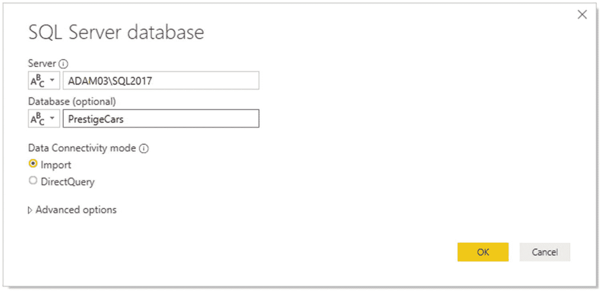

**图 3-1** `Microsoft SQL Server` 数据库对话框

1. 打开一个新的 `Power BI Desktop` 应用程序。

2. 在 `Power BI Desktop` 的“开始”功能区中，点击 `SQL Server`。或者，点击“获取数据”按钮底部的小三角形，然后点击 `SQL Server`。将出现 `SQL Server 数据库` 对话框。

3. 在 `服务器` 文本框中输入服务器名称。这将是您 `SQL Server` 的名称，或者您的组织使用的某个 `SQL Server` 资源的名称。

4. 输入数据库名称。

5. 点击 `导入` 按钮。对话框将如图 3-1 所示（当然，其中会显示您的服务器和数据库名称）。

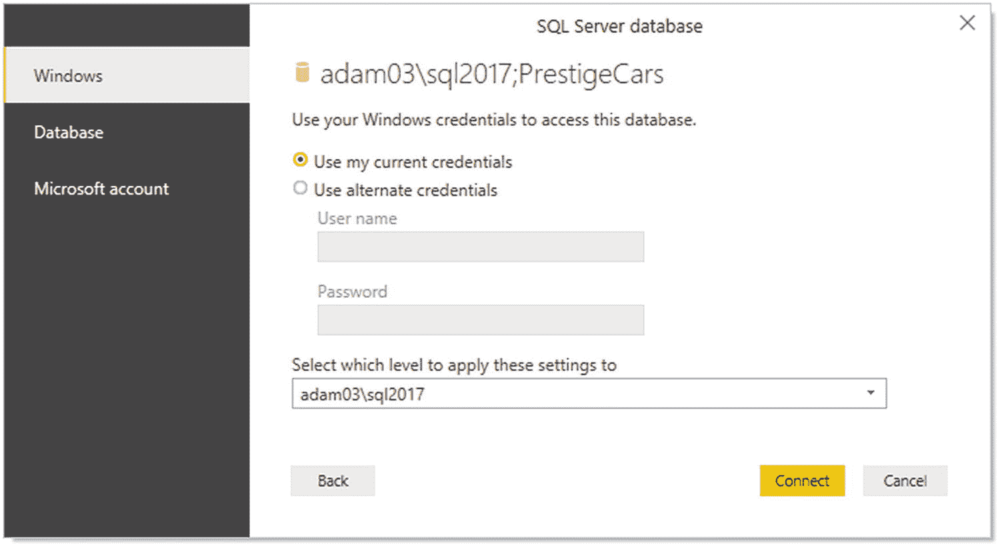

**图 3-2** 凭据数据库对话框

6. 点击 `确定`。将出现 `SQL Server 数据库` 对话框。假设您已获授权使用您的 `Windows` 登录名连接数据库，请保持选中“使用我的当前凭据”，如图 3-2 所示。

# 连接到 SQL Server 并加载数据

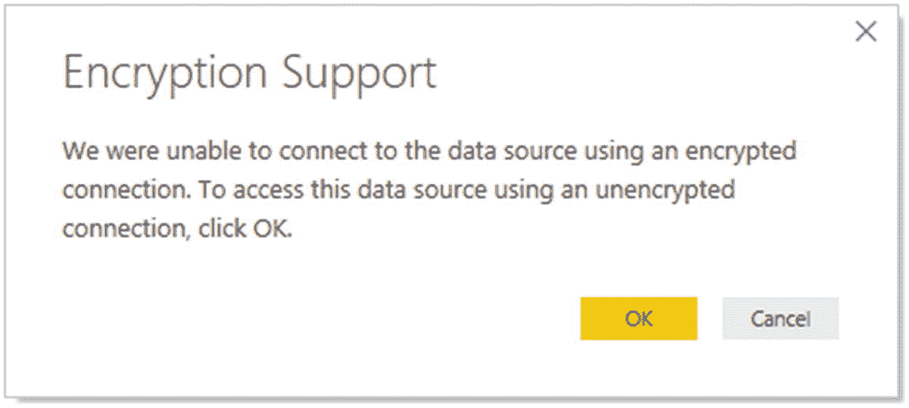

**图 3-3** 加密支持对话框

7. 点击`连接`。可能会出现`加密支持`对话框，警告您连接未加密，如图 3-3 所示。

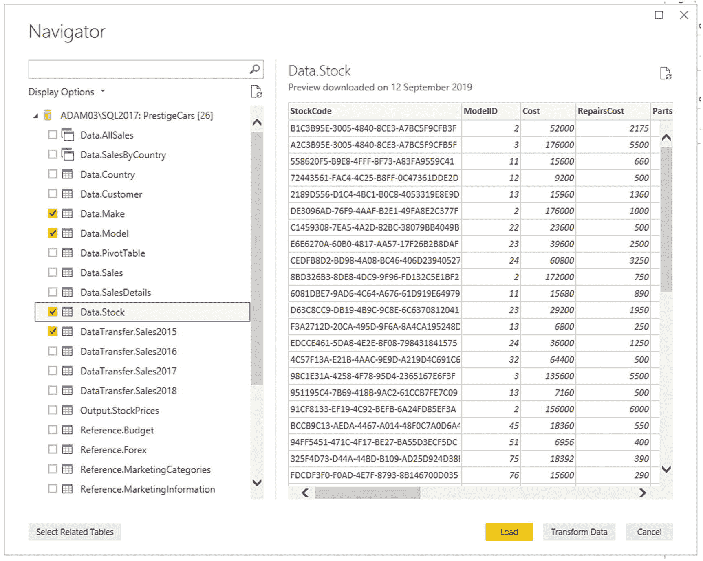

**图 3-4** 选择多项时的导航器对话框

8. 点击`确定`。`Power BI Desktop`将连接到服务器并显示`导航器`对话框，其中包含您有权限在所选服务器上查看的数据库中的所有表和视图。在某些情况下，您可能会看到一个对话框，提示数据源不支持加密。如果您对未加密的连接感到满意，请点击该对话框上的`确定`按钮。

9. 勾选您要加载的表的复选框。最近选定的数据集的数据会显示在`导航器`对话框的右侧，如图 3-4 所示。

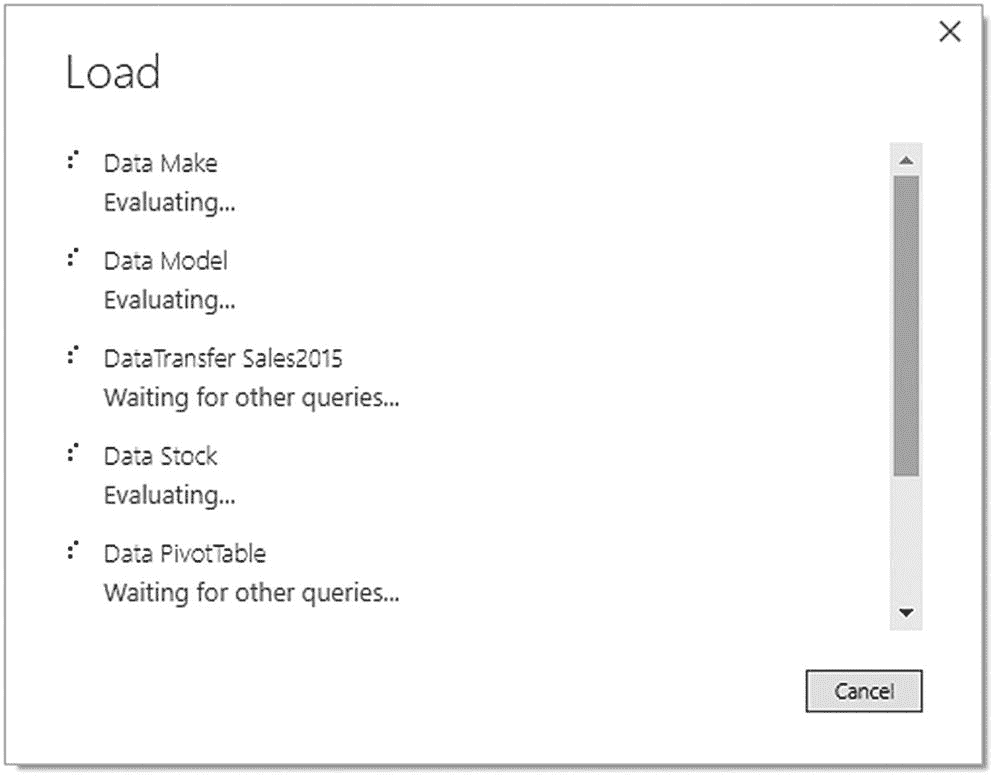

**图 3-5** 显示数据加载进度的加载对话框

10. 点击`加载`。

11. 在加载数据期间，`Power BI Desktop`将显示`加载`对话框，并显示每个选定表的加载进度。您可以在图 3-5 中看到这一点。

12. 当您点击`确定`后，`Power BI Desktop`窗口将打开，并在`报表`窗口的`字段`列表中显示您选定的表。

> **提示**
>
> 在选择多个表或视图时，您只能在`导航器`对话框中看到单个数据源的内容。但是，您只需点击表或视图的名称，即可预览任何选定的数据源（甚至任何未选定的数据源）的内容。这不会影响您要加载到`Power BI Desktop`中的选定表和视图的选择。

由于这与上一章中从 Access 加载数据的方式非常相似，我想您现在已经开始掌握如何使用数据库源了。再次强调，`导航器`对话框是一种简单高效的选择要在报表和仪表板中使用的数据集的方式。

> **注意**
>
> 如果您愿意，可以输入服务器 IP 地址来代替服务器名称。如果同一台服务器上有多个 SQL Server 实例，则需要添加一个反斜杠和实例名称。此类详细信息可从企业数据库管理员（DBA）处获取。

### 自动加载相关表

关系型数据库几乎总是由许多相互依赖的表组成的复杂结构。事实上，您通常需要加载多个表才能获取所需的所有数据。

要知道选择哪些表并不总是那么容易。`Power BI Desktop`试图通过自动检测源数据库中表之间存在的链接来帮助您；这样，您可以快速隔离那些被设计为协同工作的表集合。

要查看一组相关的表，请执行以下操作：

1. 按照上一节所述连接到源数据库。
2. 在`导航器`对话框中，点击包含您需要的数据的表。
3. 点击“选择相关表”按钮。

数据库中与您在`导航器`对话框中选择的表相关联的任何表都会被选中。当然，您可以取消选择任何您不需要的表。更重要的是，您可以点击选定表的名称来查看其内容。

> **注意**
>
> 有时您需要依次选择多个表并点击“选择相关表”，以确保`Power BI Desktop`会选择支持您分析所需的所有表。

### 数据库选项

关系型数据库的世界——幸运或不幸的是——比文件或 MS Access 的世界稍微复杂一些。因此，关于将数据库用作数据源，特别是如何连接到数据库，有一些说明需要补充。

首先，让我们介绍与服务器的初始连接。相关选项在表 3-3 中进行了解释。

**表 3-3** 数据库连接选项

| 选项 | 说明 |
| :--- | :--- |
| 服务器 | 您无法通过浏览找到服务器，需要键入或粘贴服务器名称。如果服务器有实例名称，则需要输入服务器和实例。如果您在企业环境中工作，您的 IT 部门可以提供此信息。 |
| 数据库 | 如果您知道数据库名称，则可以在此处输入（或粘贴）。这可以限制`导航器`对话框中可用表的数量，并使查找正确的表或视图更容易。 |
| SQL 语句 | 您可以输入一段有效的 T-SQL 代码片段（或一个存储过程，或一个表值函数），用于从数据库返回数据。 |

这些选项可能需要稍加解释。那么，让我们逐一分析。

#### 服务器连接

你必须清楚知晓要连接的数据库的确切连接字符串，这一点至关重要。连接字符串可能包含以下内容：

- 数据库服务器名称。
- 数据库服务器名称、反斜杠和实例名称（如有）。
- 数据库服务器 IP 地址。
- 数据库服务器 IP 地址、反斜杠和实例名称（如有）。
- 如果 SQL Server 实例使用自定义端口，则必须在服务器名称末尾添加逗号和端口号。这不可避免地需要咨询企业数据库管理员。
- 如果你在自己的电脑上运行单个 SQL Server 实例，则可以使用名称`localhost`（或一个点）来指代本地服务器。

> **注意：** 数据库实例是一个独立的 SQL Server 服务，与同一物理或虚拟服务器上的其他服务并行运行。要成功连接，你始终需要同时提供服务器和此实例名称（如有）。你也可以根据需要指定超时时间。

大多数 SQL Server 实例托管着许多数据库。有时这些数据库可能成百上千。有时你不可避免地会忘记要连接到哪个数据库。幸运的是，Power BI Desktop 允许你浏览有权访问的服务器上的数据库。为此，请执行以下操作：

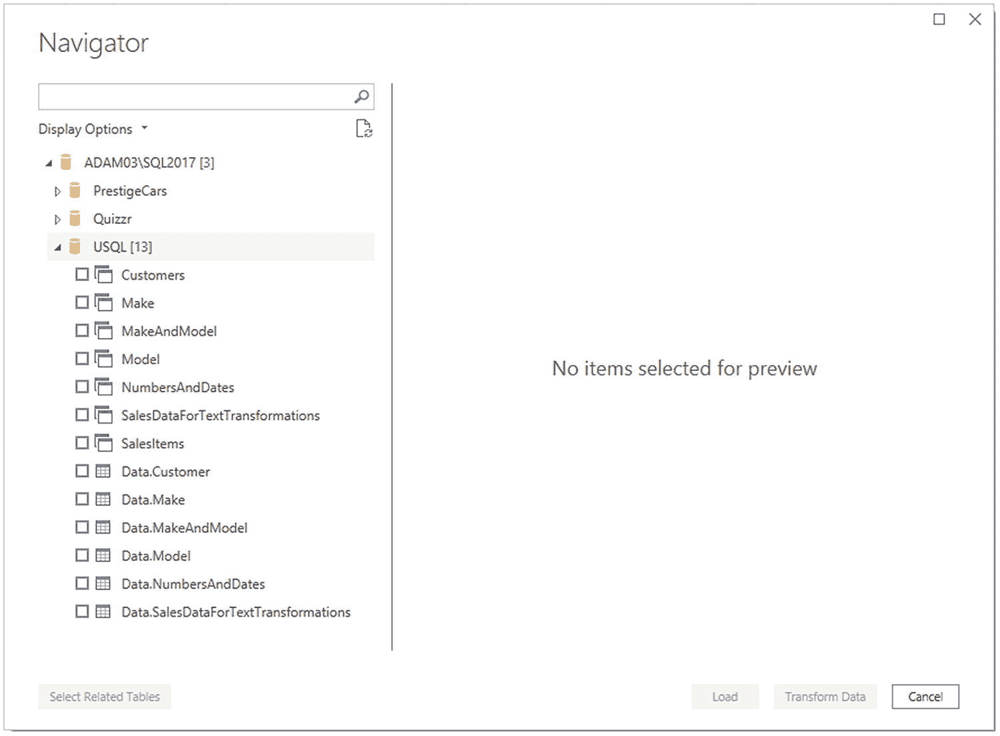

**图 3-6** — 选择数据库时的导航器对话框

1. 在 Power BI Desktop 功能区中，单击 `Get Data` 按钮底部的小三角，然后单击 `SQL Server`。将显示 SQL Server 数据库对话框。
2. 在 `Server` 文本框中输入服务器名称，然后单击 `OK`。*不要*输入数据库名称。导航器窗口打开并显示所有可用的数据库，如图 3-6 所示。当然，实际内容取决于你正在连接的服务器。

从图 3-6 中可以看到，如果单击数据库左侧的小三角，则可以看到在此数据库中你可以访问的所有表和视图。虽然这在查找你想要的表或视图时可能意味着有过多选择，但这仍然是一种提醒你所需数据集名称的便捷方式。

> **提示：** 你在企业服务器上实际能看到的数据库取决于你被授予的权限。如果你看不到某个数据库，则需要与数据库管理员沟通以解决任何权限问题。

#### 在导航器中搜索数据库、表和视图

如果你被导航器对话框左侧面板中出现的海量表或视图弄得不知所措，则可以使用导航器的内置搜索功能来帮助缩小潜在数据源的范围。

##### 搜索数据库

要隔离特定的数据库，请执行以下操作：

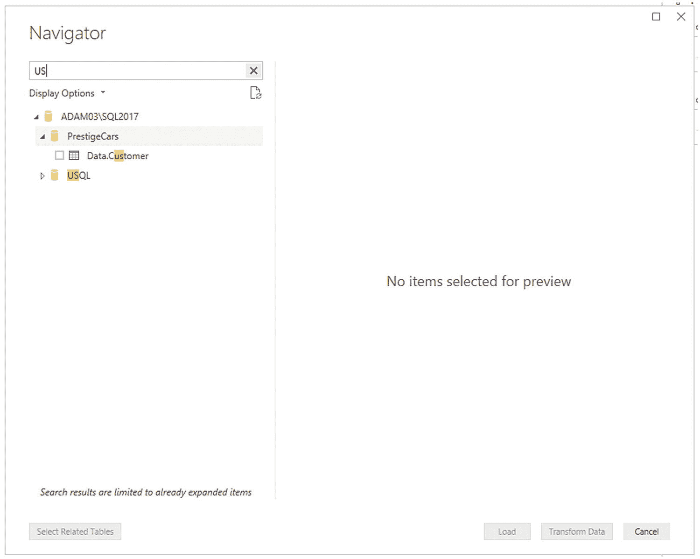

**图 3-7** — 使用导航器搜索功能查找数据库

1. 执行前面“SQL Server”部分中的步骤 1 和 2，*不*指定数据库连接到 SQL Server 实例。
2. 在导航器对话框的 `Search` 框中，输入你确定在要查找的表或视图名称中包含的少量字符。例如，在我的服务器上输入 `US` 会得到如图 3-7 所示的结果。

##### 搜索表

如果你正在搜索表，请执行以下操作：

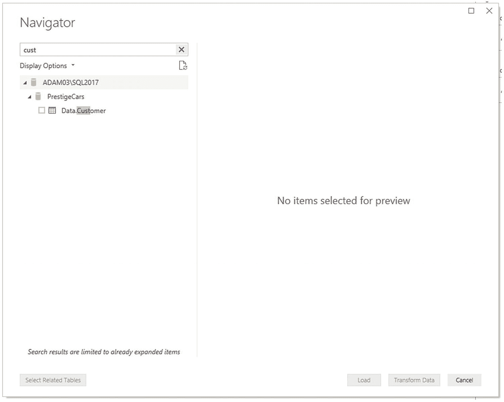

**图 3-8** — 使用导航器搜索功能查找表

1. 展开要搜索特定表的任何数据库。
2. 在导航器对话框的 `Search` 框中，输入你确定在要查找的表或视图名称中包含的少量字符。例如，在我的服务器上输入 `cust` 会得到如图 3-8 所示的结果。

搜索对象时，你可以输入大写或小写文本（在大多数 SQL Server 安装中），并且该文本可以出现在表或视图名称的任何位置——不限于名称的开头。每输入一个字符，潜在匹配项的列表就会越来越短。一旦找到你要找的数据集，只需按照前面所述继续操作即可将数据加载到 Power BI Desktop 中。

如果你的搜索没有返回任何视图中你期望的表子集，只需单击 `Search` 框右侧的叉号即可。这会取消搜索并显示所有可用的表，同时清除 `Search` 框。

## 数据库安全

请记住，数据库的设计是极其安全的。因此，你只能看到授权你访问的服务器、数据库、表和视图。你可能需要与 IT 部门沟通，以确保你拥有所需的权限；否则，你要查找的表可能就在数据库中，但对你来说仍是不可见的。

> **提示：** 如果首次尝试连接到 SQL Server 时遇到连接错误，只需单击 `Edit` 按钮返回 Microsoft SQL 数据库对话框并更正任何错误。这可以避免从头开始。

如果你不确定是否看到了数据库中的所有表和视图，请单击 `Search` 框右下角的小图标（看起来像带有两个绿色循环箭头的小页面）。这是 `Refresh` 按钮，用于刷新与数据库的连接并显示你有权查看的所有表和视图。最后，值得注意的是，筛选表功能也可应用于 Excel 表、工作表和命名区域。这再次证明了统一的导航器界面如何有助于最大限度地减少掌握 Power BI Desktop 时的学习曲线。

> **注意：** SQL Server 数据库也可以使用 `DirectQuery` 选项进行访问。此技术将在下一章解释。

### 使用 SQL 语句

如果使用关系型数据库（如 SQL Server）作为数据源有什么缺点的话，那就是数据库中存储的数据量——即使只在一个表中——也可能庞大到令人望而生畏。幸运的是，在加载数据之前，你可以利用 SQL Server 的所有资源来筛选 Power BI Desktop 所使用的数据。这样一来，你就不必在开始分析数据之前，冒着被海量信息淹没的风险加载整个数据表了。

以下是可用于扩展 SQL Server 与 Power BI Desktop 之间协作的 SQL Server 技术：

*   `SQL SELECT` 语句
*   存储过程
*   表值函数

不可否认，这些都是相当技术性的解决方案。事实上，如果你不是数据库专家，你很可能需要 IT 部门的帮助才能使用这些选项来访问服务器中的数据。尽管如此，还是值得快速了解一下这些技术，以备现在或将来使用。

以上任何选项都可以从 SQL Server 数据库对话框中应用。以下是一个使用 `SELECT` 语句从数据库表中筛选数据的示例：

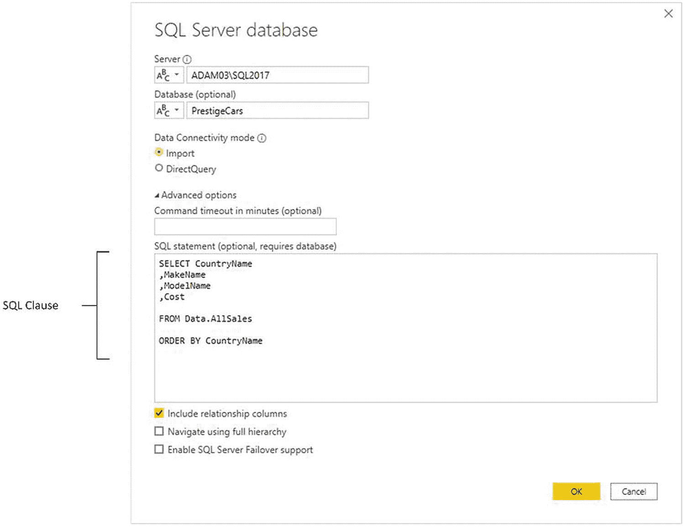

**图 3-9** 使用 SQL 选择数据库数据

1.  在 Power BI Desktop 功能区的“`获取数据`”按钮底部，点击小三角形，然后点击“`SQL Server`”。将会出现“SQL Server 数据库”对话框。
2.  输入服务器名称和数据库名称。
3.  点击“`高级选项`”左侧的三角形。这将打开一个文本框，你可以在其中输入 SQL 命令。
4.  输入你想要应用的 SQL 命令。在本例中，命令为 `SELECT CountryName, MakeName, ModelName, Cost FROM Data.AllSales ORDER BY CountryName`。对话框将如图 3-9 所示。

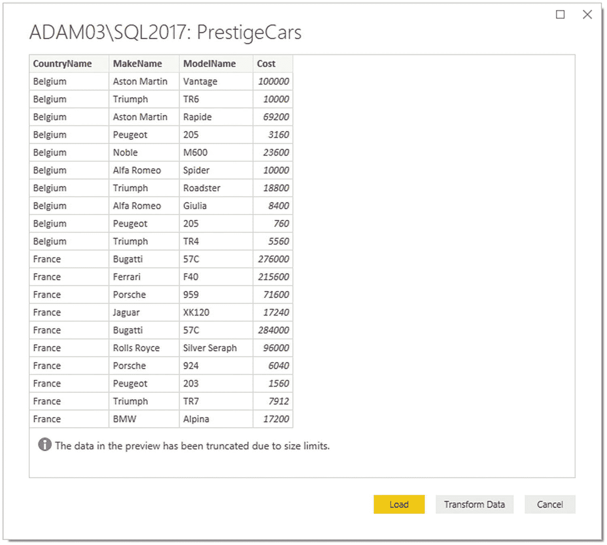

**图 3-10** 使用 SQL 语句选项选择的数据库数据

5.  点击“`确定`”。可能会出现“`凭据`”和“`加密`”对话框。最终会像图 3-10 那样，在一个对话框中显示相应数据的样本。
6.  点击“`加载`”或“`转换数据`”以继续数据加载过程。或者，你也可以点击“`取消`”并开始另一个不同的数据加载。

**提示：** 在输入自定义 SQL 语句时（或者在使用存储过程时，如下一节所述），最好在步骤 3 中指定数据库名称。如果你未提供数据库名称，则必须在 SQL 查询中使用由三部分组成的表示法。也就是说，你必须在查询中使用的*每个*表名的架构和表名之前，加上数据库名称和一个句点。

### SQL Server 中的存储过程

使用存储过程或函数从 SQL Server 返回数据时，也遵循相同的原则。你将始终使用“`SQL 语句`”选项来输入将返回数据的命令。只需记住，要调用 SQL Server 存储过程或函数，你需要在“Microsoft SQL 数据库”对话框中输入以下元素：

*   **服务器**：`<你的服务器名称>`
*   **数据库**：`<数据库名称>`
*   **SQL 语句**：`EXECUTE`（或 `EXEC`）`<输入架构（如果有的话，后跟句点）和存储过程名称，后跟任何参数>`

这样，无论是你自己还是你的 IT 部门，都可以创建复杂且安全的方式，允许将公司数据库中的数据读入 Power BI Desktop。

为了实际演示，以下是一个使用 SQL Server 存储过程仅返回可用数据子集的示例。该存储过程名为 `pr_DisplayUKClientData`，应用方式如下：

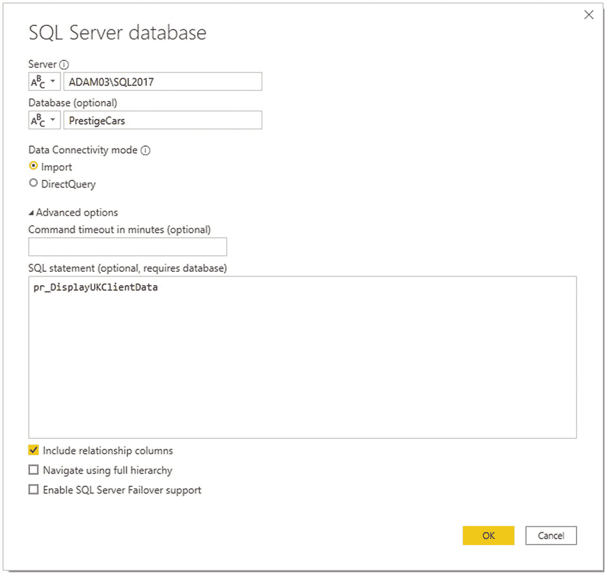

**图 3-11** 使用 SQL 选择数据库数据

1.  在 Power BI Desktop 功能区的“`获取数据`”按钮底部，点击小三角形，然后点击“`SQL Server`”。将会出现“SQL Server 数据库”对话框。
2.  输入服务器名称和数据库名称。
3.  点击“`高级选项`”左侧的三角形。这将打开一个文本框，你可以在其中输入 SQL 命令。
4.  输入你想要应用的 SQL 命令。在本例中，命令为 `EXECUTE dbo.pr_DisplayUKClientData`。对话框将如图 3-11 所示。
5.  点击“`确定`”。相应数据的样本将返回到“`导航器`”。
6.  点击“`加载`”或“`编辑`”以继续数据加载过程。或者，你也可以点击“`取消`”并开始另一个不同的数据加载。

此示例中返回的数据仅是由存储过程从可用数据中选出的一个子集。你需要知道，存储过程可以对源数据执行多种任务。这些任务可以包括选择、排序和清理数据。

存储过程通常需要在过程名称之后添加*参数*。在 Power BI 中执行存储过程时，这是完全允许的。示例如下：

```
EXECUTE dbo.pr_DisplayUKClientData 2020
```

需要记住——并传达给 IT 部门——的关键点是，Power BI 期望的 SQL 是源数据库所使用的 SQL 方言。因此，对于 SQL Server 来说，这意味着使用 T-SQL。实际上，这个 SQL 语句成为了一条“直通”查询，由底层数据库直接解释。

**注意：** SQL 语句或存储过程只能以*单个表*的形式返回数据。不可否认，这个表可能包含来自源数据库中多个底层表或视图的数据，但筛选源数据将阻止 Power BI Desktop 将来自多个表的数据作为单独的查询加载。因此，你可能需要创建多个查询，而不是单个加载查询，才能从数据源中一组连贯的表中获取数据。

## Oracle 数据库

当今企业市场中活跃着许许多多的数据库供应商。其中最具主导地位的供应商，大概非 Oracle 莫属。虽然我此前使用了 Microsoft 数据源来开启对如何使用 `Power BI Desktop` 连接数据库的探索之旅，但如果不解释如何访问其他供应商的数据库，那将是我的失职。

所以，现在是时候向您展示 `Power BI Desktop` 究竟有多么开放了。它并不局限于 Microsoft 数据源——远非如此。事实上，使用其他供应商的数据库作为分析报告的数据源同样简单。举个例子，让我们看看如何将 Oracle 数据加载到 `Power BI Desktop` 中。

安装和配置 Oracle 数据库可不是一项简单的任务。因此，我不会提供 Oracle 示例数据库，而是留给您自行探索：要么去发现一个您可以连接的企业数据库，要么，更推荐的做法是，查阅许多讲解如何设置自己的 Oracle 数据库并安装可用示例数据的优秀资源。

请注意，连接到 Oracle 需要在运行 `Power BI Desktop` 的计算机上安装 Oracle 客户端软件。这本身也可能配置起来很复杂。因此，如果您计划将 Oracle 数据与 `Power BI Desktop` 一起使用，可能需要向企业 IT 资源寻求帮助。

如果您足够勇敢，可以使用以下 URL 查找 Oracle 客户端软件。对于 32 位版本的 `Power BI Desktop`，您可以尝试使用以下链接下载并安装 32 位 Oracle 客户端：

```
www.oracle.com/technetwork/topics/dotnet/utilsoft-086879.html
```

对于 64 位版本的 `Power BI Desktop`，请使用以下链接下载并安装 64 位 Oracle 客户端：

```
（注：原文此处链接信息缺失）
```

```
www.oracle.com/technetwork/database/windows/downloads/index-090165.html

在本书付印时，这两个链接均有效。

如果您需要检查正在使用的 `Power BI Desktop` 版本（32 位或 64 位），请单击`文件` ➤`帮助` ➤`关于`。您将看到一个对话框，告知您正在使用的版本。

因此，假设您有一个可用的 Oracle 数据库（并且知道服务器名称或 SID 以及有效的用户名和密码），以下步骤将展示如何从该特定源加载数据到 `Power BI Desktop` 中。在此示例中，我将使用通常随示例数据库一起安装的标准 Oracle 示例数据。

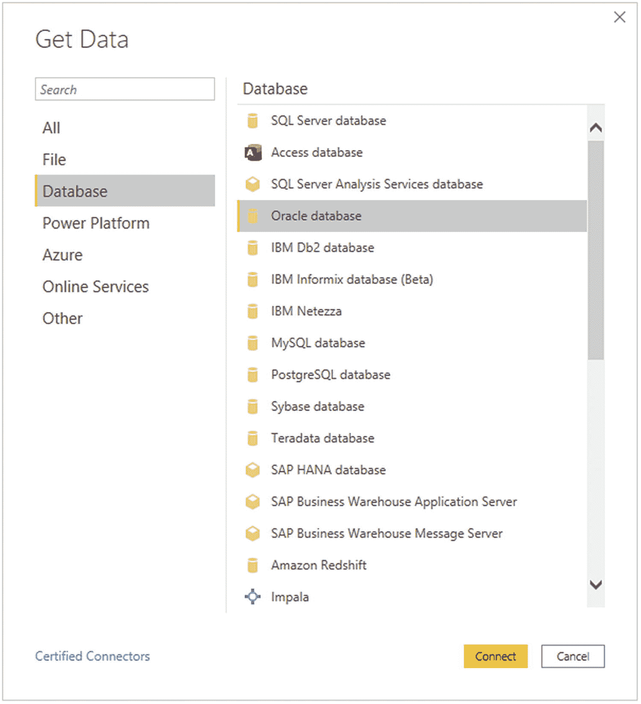
**图 3-12** 连接到 Oracle 数据库

1. 打开一个新的 `Power BI Desktop` 应用程序。

2. 在 `Power BI Desktop` 的“开始”功能区中，单击`获取数据`。

3. 在`获取数据`对话框中，单击左侧的`数据库`。

4. 单击右侧的`Oracle 数据库`。对话框将如图 3-12 所示。

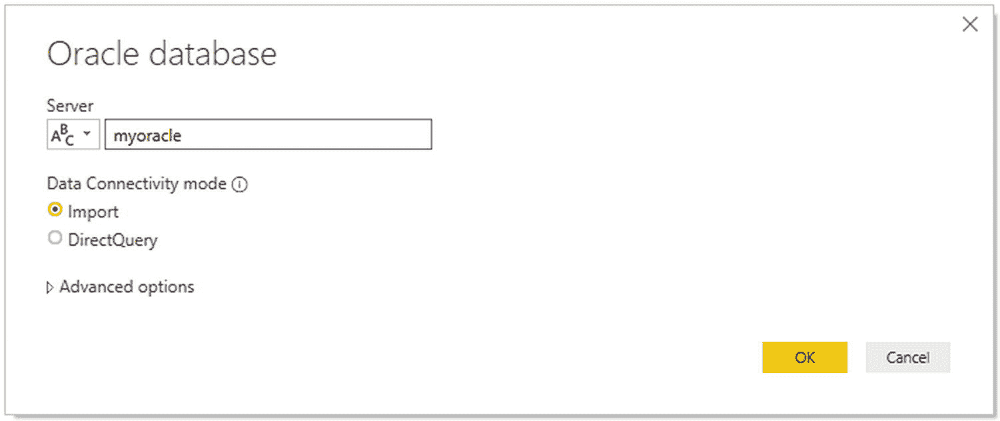
**图 3-13** Oracle 数据库对话框

5. 单击`连接`。将出现 Oracle 数据库对话框。

6. 在`服务器`文本框中输入服务器名称。这将是您的 Oracle 服务器或您的组织使用的某个 Oracle 服务器资源的名称。

7. 单击`导入`按钮。对话框将如图 3-13 所示。

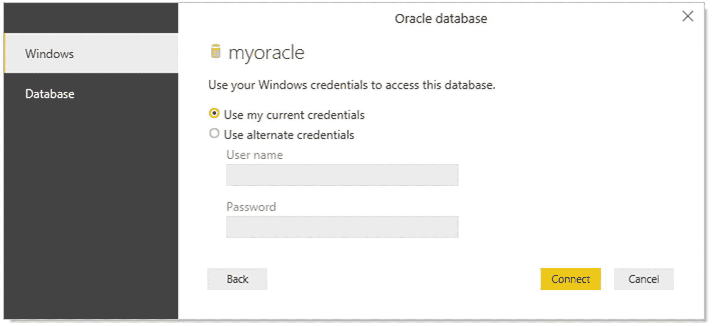
**图 3-14** Oracle 数据库安全对话框

8. 单击`确定`。将出现 Oracle 数据库安全对话框。假设您未被授权使用 Windows 登录名连接到数据库，请单击对话框左侧的`数据库`。

9. 输入允许您登录 Oracle 的用户名和密码。您可以在图 3-14 中看到此对话框。

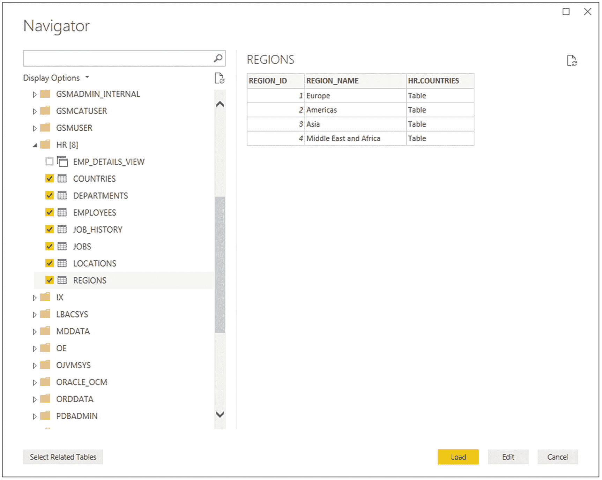
**图 3-15** 使用 Oracle 数据的导航器对话框

10. 单击`连接`。`Power BI Desktop` 将连接到服务器，并显示`导航器`对话框，其中包含您在所选服务器上拥有权限查看的所有表与视图。在某些情况下，您可能会看到一个对话框，提示数据源不支持加密。如果您接受未加密的连接，请单击此对话框的`确定`按钮。

11. 展开`HR`文件夹。这是一个标准 Oracle 示例模式，可能已安装在您的 Oracle 实例上。如果没有，您将必须选择另一个模式。勾选您感兴趣的表对应的复选框。最近选择的表的数据会显示在`导航器`对话框的右侧，如图 3-15 所示。

12. 单击`加载`。当您单击`确定`后，`Power BI Desktop` 窗口将打开，并在`报表`窗口的`字段`列表中显示您选择的表。如果您已经按照本章前面的示例从 `SQL Server` 加载了数据，您可能会发现这两种技术有很多共同之处。事实上，使用 `Power BI Desktop` 的一大优点就是，从不同数据源加载数据遵循大致相似的方法，并使用许多相同的步骤和对话框。对于数据库来说尤其如此，无论是什么数据库，其步骤几乎完全相同。

当然，没有两个数据库是完全相同的。因此，您可以连接到 Oracle 实例（或服务器），但不能像在 `SQL Server`（或 Sybase，例如）中那样选择数据库。同样地，Oracle 使用模式来划分和组织数据表，而 `SQL Server` 则使用数据库。尽管如此，`Power BI Desktop 导航器` 总是将数据组织成文件夹层次结构，以便您能够清晰、简单且直观地查看数据结构，无论底层数据库是什么。

> **注意：** 也可以使用 `DirectQuery` 选项访问 Oracle 数据库。此技术将在下一章中解释。

### 其他关系型数据库

本章开头的表 3-1 列出了本书付印时 Power BI Desktop 可以连接的关系型数据库。可以想见，自本书出版以来，该列表可能已经有所增加。但好消息是，你很可能不需要更多信息就能连接到任何可用作数据源的数据库。简而言之，如果你知道如何连接其中一个，那么你很可能也能连接其余任何一个。

因此，我不会用大量篇幅来重复介绍如何从十几个或更多关系型数据库中获取数据，这些说明实际上大同小异。相反，我建议你直接尝试使用本章为 Oracle 和 SQL Server 学到的技术进行连接。

不过请注意，要连接到关系型数据库，你必然需要了解以下详细信息：

- 服务器名称
- 数据库名称（可能）
- 有效的用户名（取决于已实施的安全策略）
- 你所连接用户的有效密码（这也取决于已实施的安全策略）

然而，如果你拥有这些要素，就没什么能阻止你使用一系列企业数据源作为使用 Power BI Desktop 进行分析的基础。当然，你需要拥有所有必要的权限才能访问数据库及其包含的数据。

另外值得一提的是，连接 DB2、MySQL、PostgreSQL、Sybase、IBM Informix、IBM Netezza、SAP HANA 或 Teradata，不仅需要数据库管理员授予你必要的权限，还需要你的电脑上已安装连接软件（称为驱动程序或提供程序）。鉴于这些要求的“企业”性质，直接与你的 IT 部门沟通，以便在你的企业 IT 环境中完成此设置可能会有所帮助。

一种判断连接特定数据库所需的软件是否已安装的方法是，从“获取数据”对话框的可用列表中选择该数据库。如果驱动程序未安装，你将看到类似图 3-16 所示的警告。

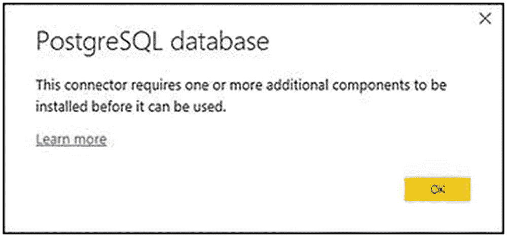
**图 3-16** 缺失驱动程序警报

点击“了解更多”链接将带你进入缺失驱动程序的下载页面。但请注意，在某些情况下，配置数据提供程序不仅需要专业知识，还需要在安装驱动程序的计算机上拥有访问权限。

### Microsoft SQL Server Analysis Services 数据源

Analysis Services 数据库是一种数据仓库技术，可以包含为支持决策而优化的大量数据。SSAS 多维数据集（这些数据库也被称为此名称）由事实（度量值或值）和维度（描述性属性）组成。

实际上——并向数据仓库纯粹主义者致歉——SSAS 多维数据集本质上就是一个巨大的数据透视表。所以，如果你在 Excel 中使用过数据透视表，那么你就已经准备好使用 Power BI Desktop 中的数据仓库源了。

**注意：** 在本节中，我将解释如何访问*多维*（基于磁盘的）SSAS 数据仓库。我将在下一节解释*表格型* SSAS。

如果你的工作区使用 Analysis Services 数据库，可以通过执行以下步骤进行访问：

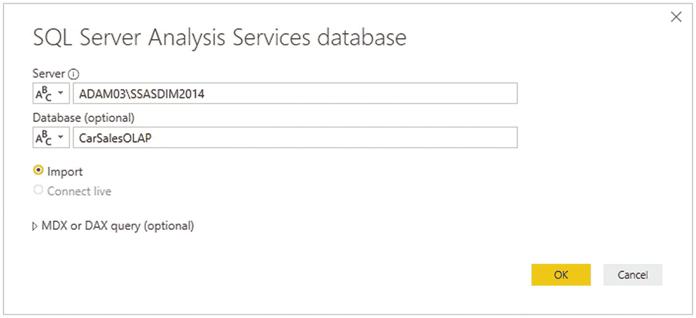
**图 3-17** 连接到 SSAS（多维）数据库

1. 在 `Power BI Desktop` 功能区中，单击`获取数据` ➤`更多`。在“获取数据”对话框左侧单击`数据库`，然后在“获取数据”对话框中选择`SQL Server Analysis Services 数据库`。

2. 单击`连接`。将出现“SQL Server Analysis Services 数据库”对话框。

3. 输入 `Analysis Services` 服务器名称和数据库（或“多维数据集”）名称。我在此处使用的数据库名为 `CarSalesOLAP`；你需要指定你自己的 SSAS 数据库名称。无论如何，你需要使用你自己的 SSAS 服务器名称。对话框将类似于图 3-17 所示。


**图 3-18** SQL Server Analysis Services 凭据对话框
```

## SSAS 多维数据集连接与操作

1.  单击 `确定`。如果这是你第一次连接到该多维数据集，将出现“访问 SQL Server Analysis Services”对话框，以便你可以定义用于连接到 Analysis Services 数据库的凭据，如图 3-18 所示。

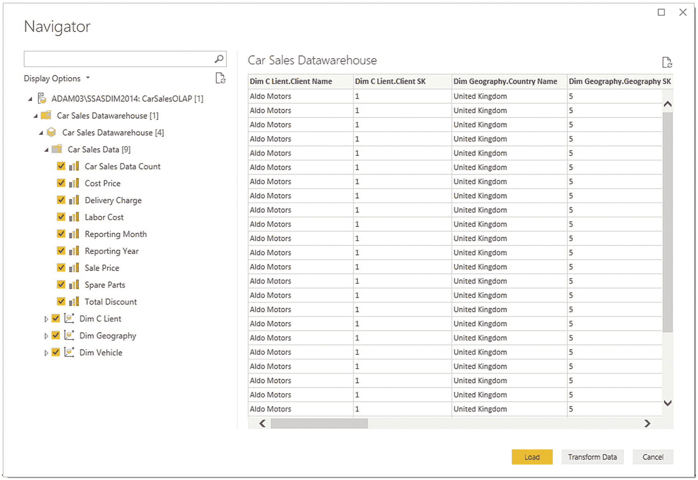

图 3-19：从 SSAS 多维数据集中选择属性和度量值

2.  接受或更改凭据，然后单击 `连接`。将出现“导航器”对话框。

3.  展开对话框左侧窗格中的文件夹。这样，你就可以查看数据仓库中包含的所有事实表和维度。

4.  选择要加载的事实表、维度，甚至仅选择维度元素和度量值。对话框将类似于图 3-19。

5.  单击 `加载`。Power BI Desktop 窗口将打开，并在“报表”窗口的“字段”列表中显示你选择的度量值和属性。

**注意**

如果在第 3 步中没有输入多维数据集（数据库）名称，那么“导航器”对话框将显示 SSAS 服务器上所有可用的多维数据集。在此处，你可以深入查看你感兴趣的多维数据集以查询所需数据。

SSAS 多维数据集可能非常庞大。它们可能包含数十个维度、许多事实表以及数以千计的度量值和属性。理解多维数据集及其工作原理超出了本书的范围。尽管如此，重要的是要理解，对于 Power BI Desktop 而言，多维数据集只是另一种数据源。这意味着你可以极具选择性地加载多维数据集的元素到 Power BI Desktop，并且只加载分析所需的元素。你可以加载整个维度，也可以只加载几个属性，就像你可以加载整个事实表或只加载选定的度量值一样。

**注意**

你可以通过展开“SQL Server Analysis Services 数据库”对话框中的 `MDX` 或 `DAX` 查询（可选）项来过滤从 SSAS 多维数据集加载的数据。然后，你可以在单击 `确定` 之前，在出现的框中输入 `MDX` 查询。请注意，“经典”（基于磁盘的）SSAS 多维数据集使用以 `MDX` 编写的查询——这是一种被认为不易学习的专业语言。好消息是，如果 Analysis Services 专家正确设置了多维数据集，你可以在“查询编辑器”中看到 SSAS 显示文件夹。

## Analysis Services 多维数据集工具

Analysis Services 数据源允许你以其他数据源不具备的方式调整源元素的选择。本质上，你拥有两个额外的选项：

- `添加项目`
- `折叠列`

### 添加项目

使用 SSAS 数据源时，你可以随时添加在初始连接时忘记或认为不需要的任何属性或度量值。

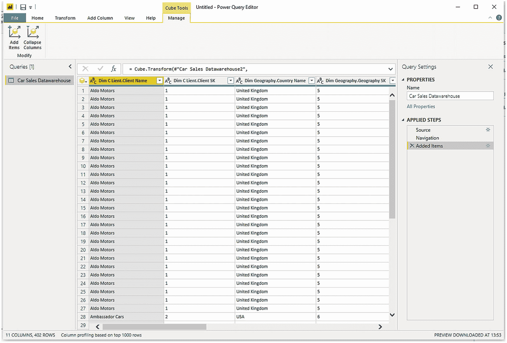

图 3-20：多维数据集工具

1.  在 Power BI Desktop 中，单击 `Edit Queries` 按钮。将显示 Power BI Desktop 查询编辑器窗口。假设只有一个查询，将出现“管理”功能区，如图 3-20 所示。否则，请单击你之前建立的 SSAS 查询。

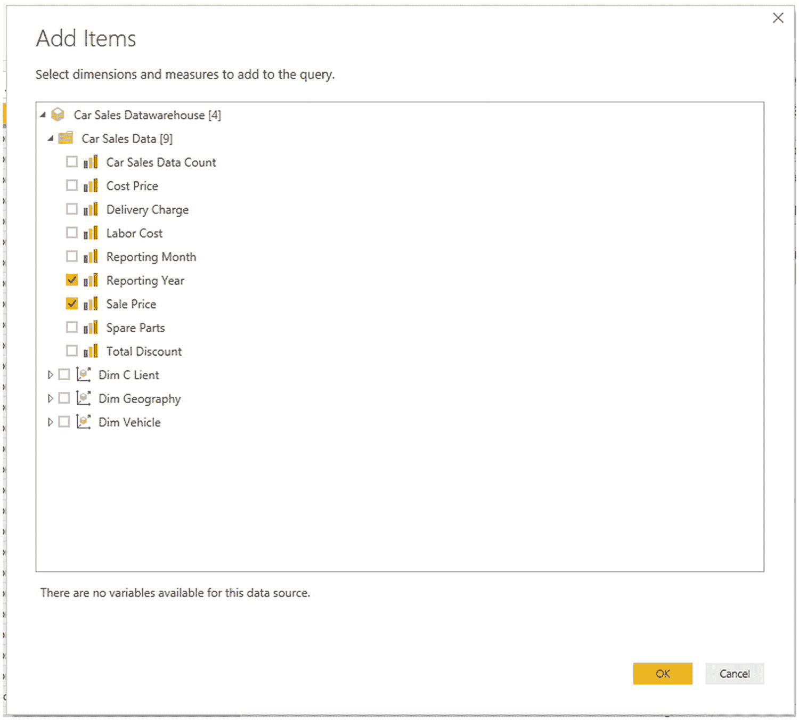

图 3-21：`Add Items` 对话框

2.  在“管理”功能区中，单击 `Add Items` 按钮。将出现 `Add Items` 对话框。

3.  展开任意度量值组，并选择你要添加的所有度量值和属性，如图 3-21 所示。

4.  单击 `OK`。

5.  在 Power BI Desktop 查询编辑器中，激活“开始”功能区，并单击 `Close & Apply`。

你所做的任何更改都会反映在数据中，所选度量值和属性将作为新列添加到数据集右侧。

> **注意：** Power BI Desktop 查询不会检测你添加的新度量值和属性是否已存在于数据集中。因此，如果你第二次添加某个元素，它将在查询中出现两次。

### 折叠列

执行以下操作可从数据源中移除不再需要的任何列（这可以加速数据刷新）：

1.  在“查询”窗格中，单击你之前建立的 SSAS 查询。（此连接的示例数据将显示在“查询”窗口中央——这是查询编辑器窗口的另一个名称。）将出现“管理”功能区。

2.  在“管理”功能区中，单击 `Collapse Columns` 按钮。

这些列将从与 SSAS 多维数据集的连接中移除，因此也会从 Power BI Desktop 窗口右侧的“字段”列表中移除。它们也会从使用这些列的任何可视化对象中移除。

> **注意：** 从 Power BI Desktop 查询中移除列可能会对报表和仪表板产生严重的多米诺骨牌效应。因此，在移除它们时需要非常小心。

## SSAS 表格数据仓库

上一节向你展示了如何连接到“经典”SQL Server Analysis Services 多维数据集。然而，现在有两种类型的 SQL Server Analysis Services 数据仓库：

- “传统”维度多维数据集
- “较新”的表格数据仓库

随着越来越多的数据仓库（至少是基于 Microsoft 技术的数据仓库）使用较新的表格技术构建，花点时间了解如何将 Power BI Desktop 与这些数据源结合使用是值得的。实际上，连接到这两种数据仓库源所遵循的步骤几乎相同。然而，由于 Power BI 正迅速成为查询表格数据仓库的首选工具，花几分钟学习如何连接到 SSAS 表格（常简称为 SSAS 表格）无疑是值得的。

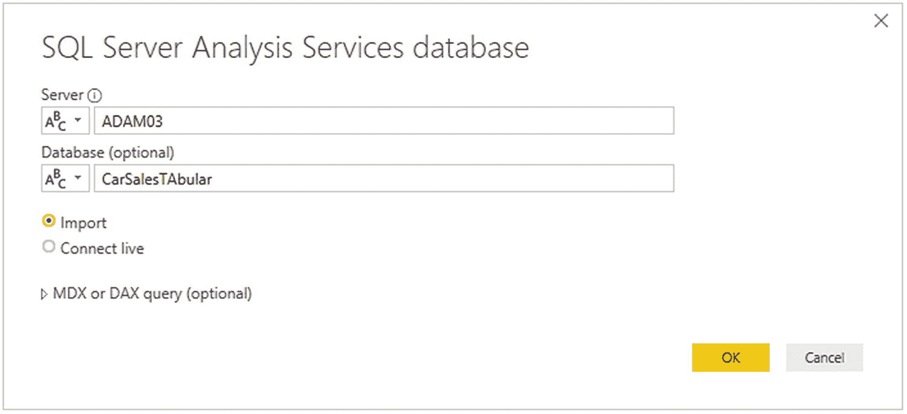

图 3-22：连接到 SSAS（多维）数据库

1.  在 Power BI Desktop 功能区中，依次单击 `Get Data` > `More` > `Database`，然后在 `Get Data` 对话框中选择 `SQL Server Analysis Services database`。

2.  单击 `Connect`。将出现 `SQL Server Analysis Services database` 对话框。

3.  输入 Analysis Services 服务器名称和表格数据库名称（我们通常不称这些为多维数据集）。此处，数据库是我电脑上的 `CarSalesTabular`；你需要指定你自己的表格数据库名称。无论如何，你都需要使用自己 SSAS 服务器的名称。

4.  单击 `Import`。

5.  对话框将如图 3-22 所示。

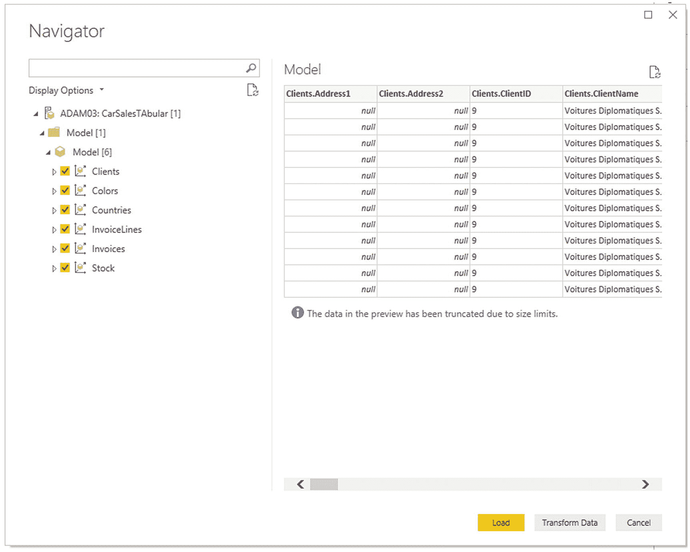

图 3-23：从 SSAS 表格数据源中选择属性和度量值

6.  单击 `OK`。如果这是你第一次连接到该表格仓库，将出现 `Access SQL Server Analysis Services` 对话框，以便你定义用于连接到 Analysis Services 数据库的凭据；你需要接受或修改凭据，然后单击 `Connect`。将出现导航器对话框。

7.  展开对话框左侧窗格中的文件夹。这样，你就可以看到数据仓库中包含的所有表。这些表的组织结构可能与“经典”SSAS 数据仓库中的事实和维度相同，也可能不同。

8.  选择要加载的表。对话框将类似于图 3-23。

9.  单击 `Load`。Power BI Desktop 窗口将打开，并在“报表”窗口的“字段”列表中显示你选择的度量值和属性。

> **提示：** 你可以通过在 `SQL Server Analysis Services database` 对话框中展开 `MDX` 或 `DAX` 查询（可选）项来筛选从 SSAS 表格数据库加载的数据。然后，在单击 `OK` 之前，你可以在出现的框中输入 `DAX` 查询。SSAS 表格数据库使用以 `DAX` 编写的查询，而 `DAX` 正是 Power BI 自身用于筛选和计算数据的语言。

## 导入或实时连接

到目前为止，在本章中，我建议你在从 Microsoft SQL Server 数据库和数据仓库获取数据时使用 `Import` 选项。这是因为另一种选项，即 `Connect Live`（用于 SSAS 数据源）和 `DirectQuery`（用于数据库源），是 Power BI Desktop 中如此重要的一部分，以至于我倾向于将其作为单独一章的主题。你将在下一章中了解如何使用这项影响深远且令人印象深刻的技术。

### 修改连接

# Power BI Desktop 数据连接管理

如果你在结构化的开发环境中工作，甚至只是在旧版本或非实时服务器上的数据集中测试仪表板，有时你可能希望从当前数据源切换到另一个数据源。`Power BI Desktop` 允许你执行此操作。但是，仅当`源数据和目标数据的结构完全相同`时，切换数据源才能成功。实际上，这意味着服务器和数据库的名称可以不同，但表和字段的名称必须相同。

要查看实际操作，你可以执行以下操作：

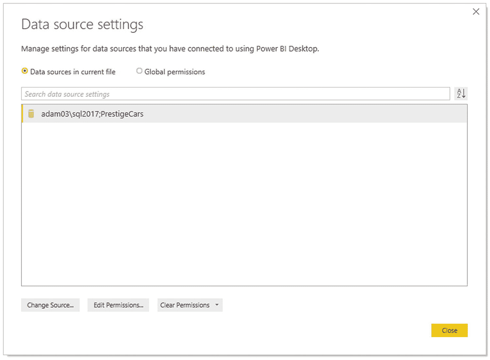

1. 在现有的 `Power BI Desktop` 文件中，单击 `主页` 功能区中 `编辑查询` 按钮右下角的小三角形，然后选择 `数据源设置`。将显示 `数据源设置` 对话框。图 3-24 显示了你在本章开头看到的 `SQL Server` 连接的此对话框。

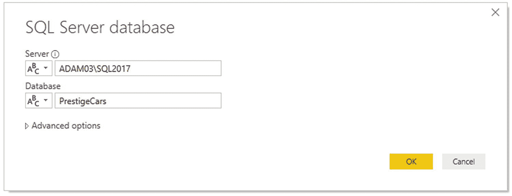

2. 单击要修改的连接。
3. 单击 `更改源`。将显示最初允许你指定数据源的对话框（在此示例中为 `SQL Server` 数据库连接对话框）。你可以在图 3-25 中看到此对话框。
4. 指定不同的服务器和/或数据库作为数据源。
5. 单击 `确定`。你将返回到 `数据源设置` 对话框。
6. 单击 `关闭`。
7. 单击屏幕顶部 `Power BI Desktop` 功能区下方出现的 `应用更改` 按钮。

> **注意**
>
> 如果这是你第一次建立与此新服务器和数据库的连接，则必须指定要使用的凭据。

假设新数据源包含相同的表名和结构，现有数据将被你指定的新数据源中的数据替换。

我必须再次强调，此技术仅在底层数据库元数据在两台服务器上`完全相同`时才能生效。如果数据结构不同，你将看到类似于图 3-26 所示的错误对话框。

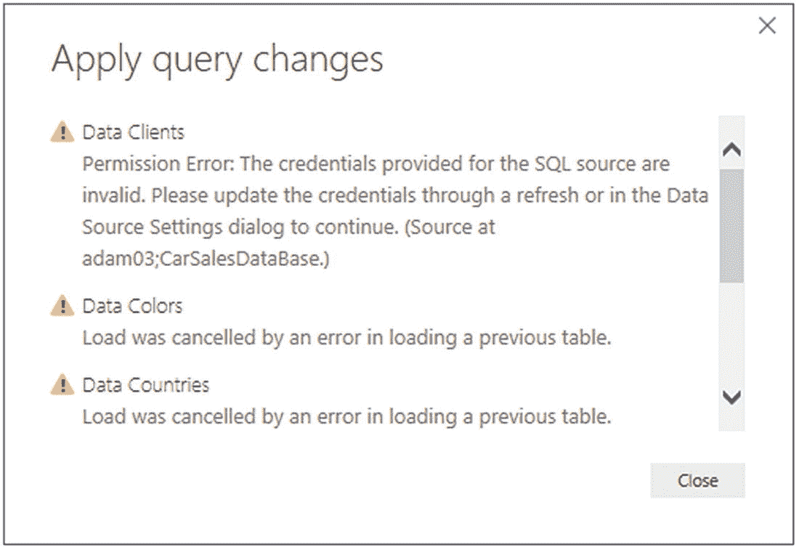

在这种情况下，你可能需要使用新数据源重新构建一个新的 `Power BI Desktop` 文件。这可能意味着从旧版本中重新创建或复制任何数据混搭和公式（以及实际的可视化效果）到新文件中。

## 更改权限

在处理数据库和数据仓库时，遇到权限问题是非常常见的。可能是你设置了一个数据库连接，但后续需要更改密码。同时，`Power BI Desktop` 中存储的密码是旧版本。因此，当你尝试更新仪表板时，会遇到阻碍。

幸运的是（至少假设你知道新密码），你可以在 `Power BI Desktop` 中更新存储的凭据。例如，假设你想更新 `Oracle` 密码。操作步骤如下：

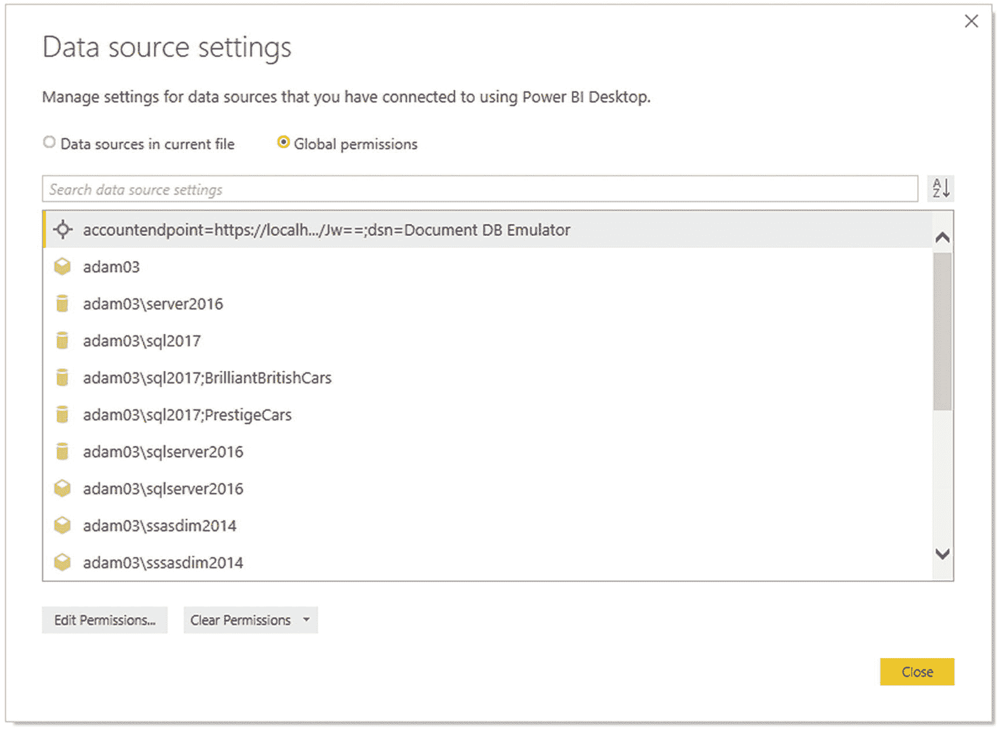

1. 在现有的 `Power BI Desktop` 文件中，单击 `主页` 功能区中 `编辑查询` 按钮右下角的小三角形，然后选择 `数据源设置`。
2. 单击对话框顶部的 `全局权限` 单选按钮。将显示 `数据源设置` 对话框。图 3-27 显示了在我的电脑上当前 `Power BI Desktop` 连接的此对话框。

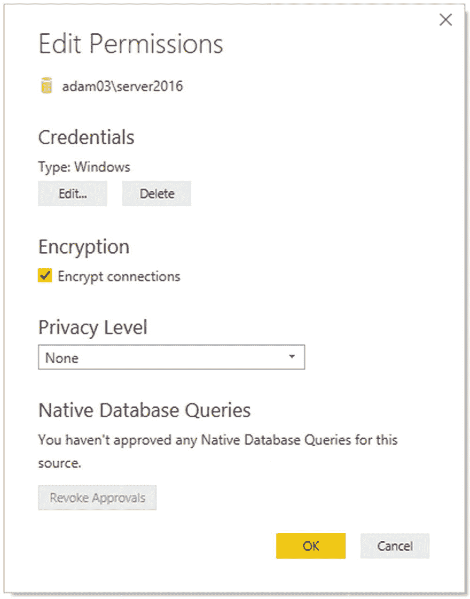

3. 单击要更改的连接名称（此示例中为 `ADAM03\SQLSERVER2016`）。
4. 单击 `编辑权限` 按钮。将显示 `编辑权限` 对话框，如图 3-28 所示。
5. 单击 `编辑`。将显示连接权限对话框（在解释如何连接到 `Oracle` 数据库的部分中，图 3-14 之前已显示）。
6. 修改密码（如果需要，甚至修改用户名）。
7. 单击 `保存`。这将返回到 `编辑权限` 对话框。
8. 单击 `确定`。你将返回到 `数据源设置` 对话框。
9. 单击 `关闭` 返回 `Power BI Desktop`。

现在，你可以使用刚刚输入的新权限刷新数据。

## 其他数据库连接

`Power BI Desktop` 并不限制你只能使用预定义的数据源集。只要你的源数据库配备了通用的数据提供程序之一——`ODBC` 或 `OLE DB`——那么 `Power BI Desktop` 几乎肯定也能访问这些数据源。你将在第 5 章中了解这些内容。

## 结论

在本章中，你了解了如何将 `Power BI Desktop` 连接到当前存在的众多数据库和数据仓库中的一部分。此外，你还了解到 `Power BI Desktop` “开箱即用”地配备了连接到企业环境中当前存在的大多数数据库。

此外，企业数据源可能会不断演变和变化。你还了解了 `Power BI Desktop` 如何允许你使用最新的访问详细信息更新最初为连接指定的权限。你甚至了解了如何在数据源之间切换，以及如何选择性地和全局性地更新数据。

尽管企业数据库在存储和构建大量信息方面非常有用，但它们也存在一个小缺点：将数据从数据库加载到 `Power BI Desktop` 内存数据模型所需的时间。微软的开发团队显然意识到了这个潜在的缺点，并提出了一个解决方案，称为 `DirectQuery`（或 `Connect Live`），你可以在下一章中了解如何实现它。