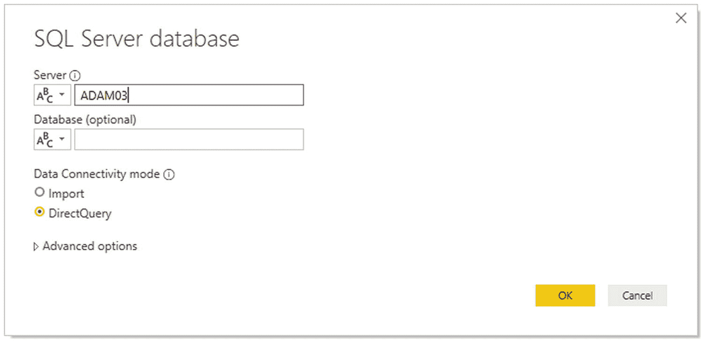
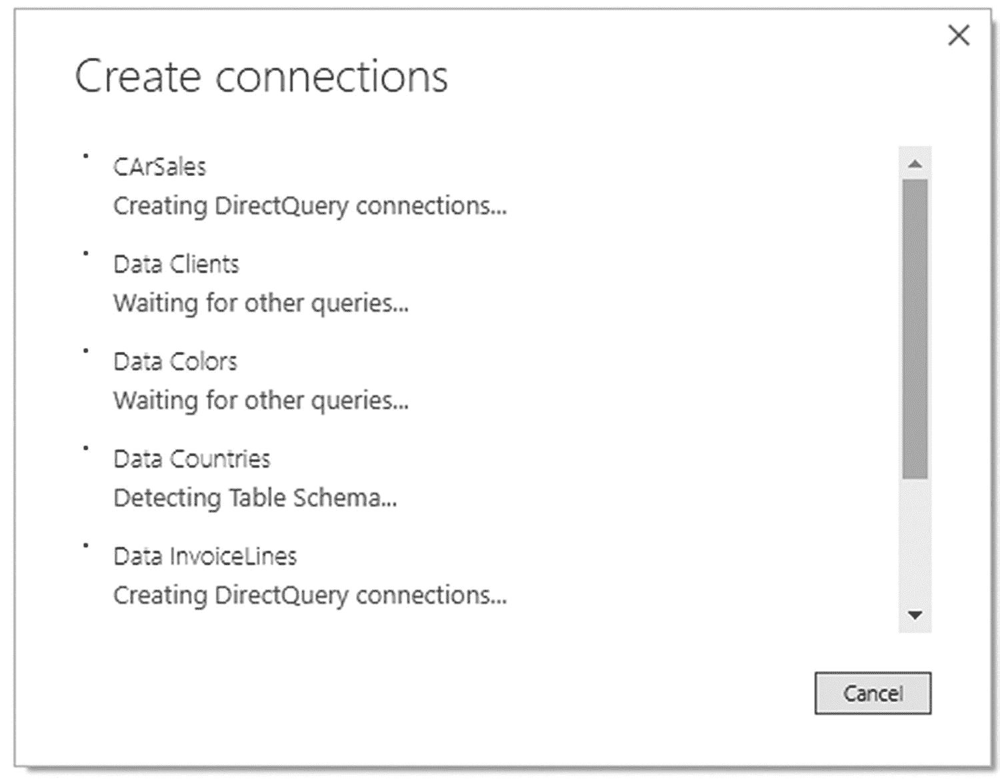
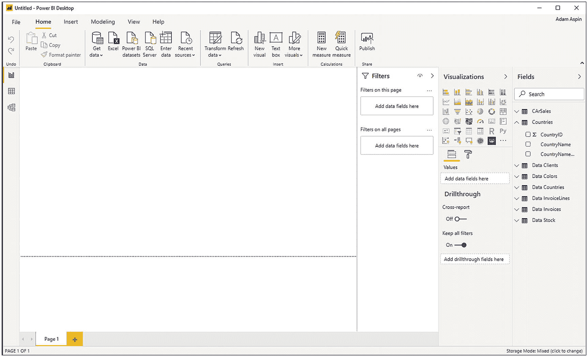
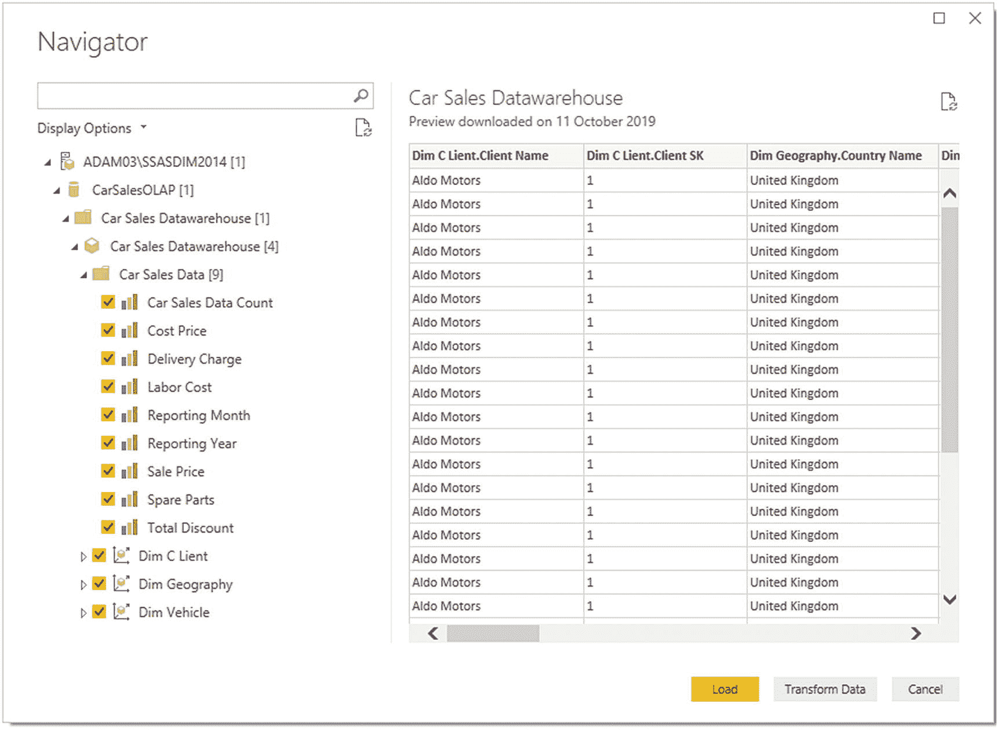
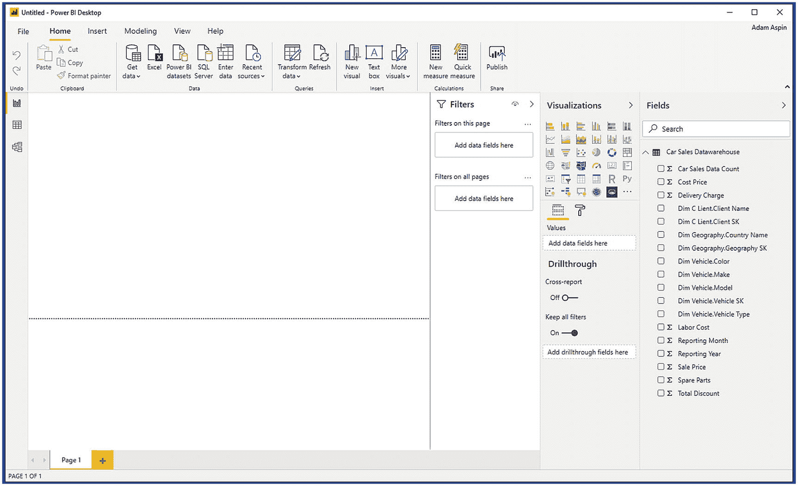
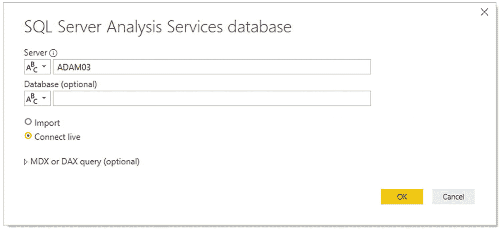
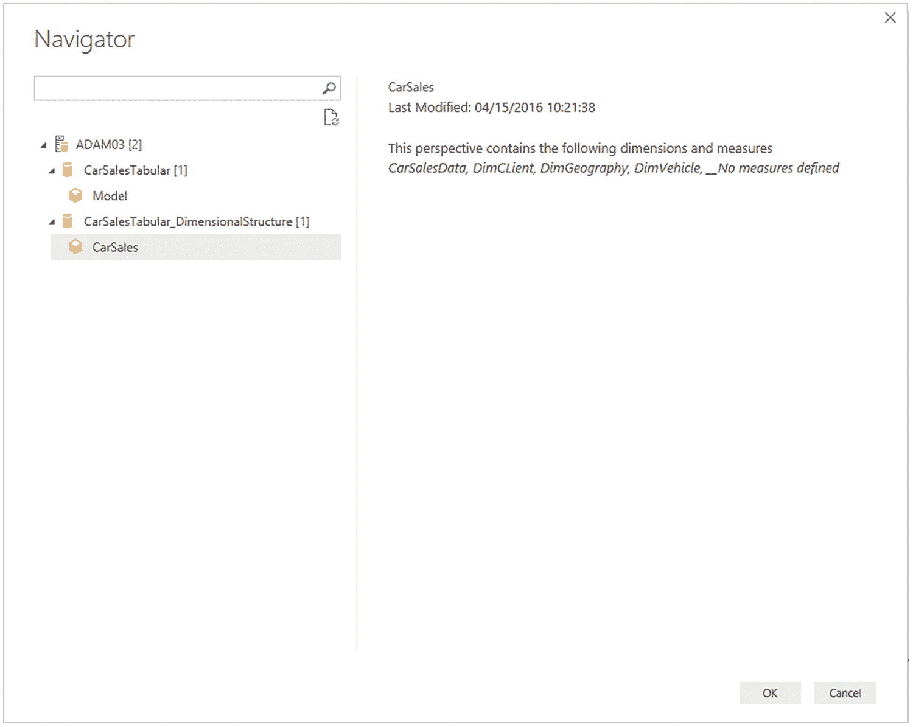
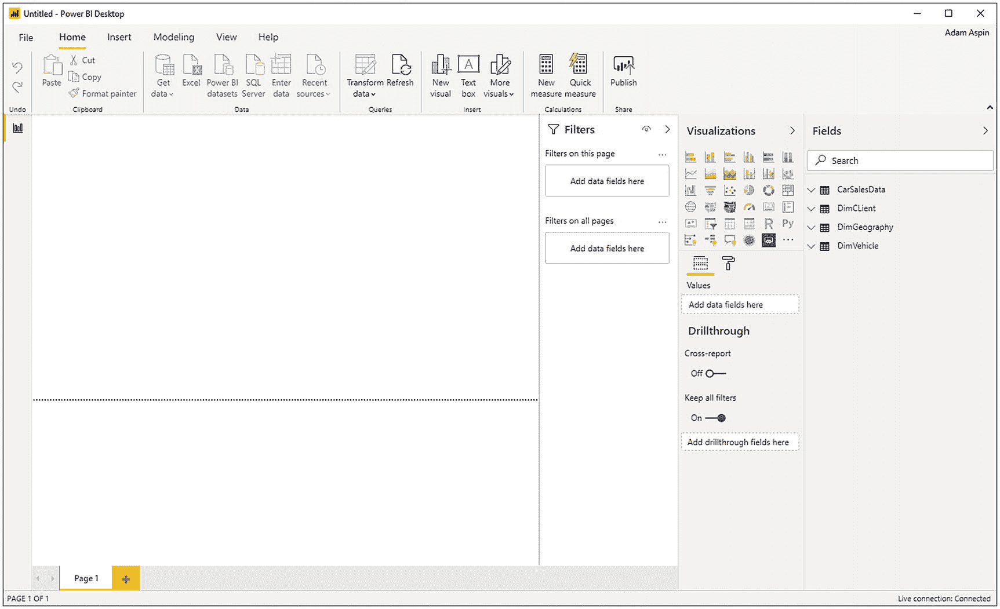

# 4. DirectQuery 和 Connect Live

前一章向你展示了如何从一系列数据库和数据仓库源访问数据。正如你所看到的，这个过程既简单又高效。然而，在获取数据的过程中有一个阶段可能会花费一些时间，尤其是在处理大型数据集时。这就是“加载”阶段，在该阶段中，来自源系统的数据被传输到 Power BI Desktop 的内存模型中并进行压缩。

Power BI 开发团队显然深入研究了这个问题，并提出了一个可能影响深远的解决方案：直接连接到数据源，避免下载数据。这种技术称为 `DirectQuery`。值得注意的是，微软现在将直接连接到 SQL Server Analysis Services 称为 “Connect Live”。不过，我仍会将其视为 `DirectQuery` 技术方法的一部分。

在本章中，我们将探讨何时可以在 Power BI Desktop 中使用 `DirectQuery`，以及使用这些数据连接方法的优点（当然，也包括任何缺点）。

## DirectQuery 与 Connect Live

首先，您需要了解 `DirectQuery`（以及 `Connect Live`）目前仅适用于 `Power BI Desktop` 可连接的少数几个数据源。在撰写本文时，这些数据源包括：

- `SQL Server` 数据库
- `SQL Server Analysis Services`（“经典”`SSAS` 和表格模型）
- `Oracle` 数据库
- `Teradata` 数据库
- `PostgreSQL`
- `SAP HANA`
- `SAP Business Warehouse Message Server`
- `SAP Business Warehouse Server`
- `Azure SQL Database`
- `Azure SQL Data Warehouse`（现称 `Azure Synapse Analytics`）
- `Amazon Redshift`
- `AtScale` 多维数据集
- `Azure HDInsight Spark`
- `Denodo`
- `Exasol`
- `Essbase`
- `HDInsight Interactive Query`
- `Impala`
- `Snowflake`
- `Spark`

`DirectQuery` 与更传统的数据加载方式有以下不同：

- 您无需将数据加载到 `Power BI Desktop` 中，而是直接从数据库服务器使用数据。
- 由于您未将数据副本加载到 `Power BI Desktop` 中，因此*无法*脱机工作。您需要能够连接到源数据库或数据仓库才能使用数据。
- 连接到源数据库或数据仓库（以及随之而来的数据可用性）通常非常迅速，即便不是瞬时完成。
- 数据是根据您创建的每个新视觉对象的需求专门提取的。
- 您可以使用源数据库或数据仓库中的所有数据。
- 每次应用切片器或筛选器时，数据都会刷新。
- （现在）如果您使用 `DirectQuery`，则可以连接到任何其他数据源。这意味着您可以混合使用来自 `DirectQuery` 源的数据和已加载到 `Power BI Desktop` 中的数据。
- 它允许您基于非常大的数据集构建可视化效果，而如果采用先导入所有数据的方式，这通常是不可行的。

有多个非常充分的理由可以解释为什么您可能想要使用 `DirectQuery`：

- 它提供了增强的安全性，因为数据仅通过云端传输，不会存储在企业外部。
- 您可以确保始终看到最新数据。
- 它支持近乎实时的报告。
- 由于没有大量的刷新操作，因此避免了加载非常大的数据集。
- 安全规则在底层源中定义，该源使用当前用户的凭据或网关中定义的用户连接到数据源。
- 可以尊重数据主权。
- 它可以在正确的粒度上应用数据仓库（`SSAS`/`SAP`）度量。

## Microsoft SQL Server 数据

作为 `DirectQuery` 应用的第一个示例，我将使用 `Microsoft SQL Server` 数据库作为数据源。步骤如下：

图 4-1：`Microsoft SQL Server` 数据库对话框

1.  打开一个新的 `Power BI Desktop` 应用程序。
2.  在 `Power BI Desktop` 功能区中，单击 `获取数据` 按钮底部的小三角形，然后单击 `SQL Server`。将出现 `SQL Server` 数据库对话框。
3.  在 `服务器` 文本框中输入服务器名称。这将是您的 `SQL Server` 名称或您的组织使用的某个 `SQL Server` 资源的名称。
4.  输入数据库名称；如果您使用示例数据，则将是 `CarSalesData`。
5.  选择 `DirectQuery` 按钮。该对话框将如图 4-1 所示。

图 4-2：创建 `DirectQuery` 连接

6.  单击 `确定`。将出现凭据对话框。定义您想要使用的凭据类型，就像在第 3 章中所做的那样。
7.  单击 `连接`。`Power BI Desktop` 将连接到服务器并显示 `导航器` 对话框，其中包含您所选择服务器上拥有权限查看的所有表及视图。在某些情况下，您可能会看到一个对话框，提示数据源不支持加密。如果您对未加密的连接感到满意，请单击此对话框的 `确定` 按钮。
8.  选中 `Clients`、`Colors`、`Countries`、`Invoices`、`InvoiceLines` 和 `Stock` 表的复选框。最近选中的数据会出现在 `导航器` 对话框的右侧。
9.  单击 `加载`。`Power BI Desktop` 将显示正在建立连接的源表列表。您可以在图 4-2 中看到这一点。

图 4-3：使用直接连接的 `Power BI Desktop`

10. `Power BI Desktop` 窗口将打开，并在 `报告` 窗口的 `字段` 列表中显示您选择的表。您可以在图 4-3 中看到这一点。

这个过程与您在上一章第一部分看到的过程非常相似，以至于您有理由问：“那么区别在哪里？”嗯，确实存在一些差异，但这些差异非常细微，几乎难以察觉：

-   没有数据加载阶段。当您在步骤 9 中单击 `加载` 时，`Power BI Desktop` 窗口几乎是瞬间出现的。这就是为什么步骤 9 中短暂出现的对话框显示的是“创建连接”而非“加载数据”。
-   当您创建 `Power BI Desktop` 视觉对象时，它们填充数据并显示所需的时间会稍长一些。
-   稍微专业一点地说，`Power BI Desktop` 在此所做的是仅从源系统查询 *元数据*。由于元数据无非是数据和数据结构的描述（或“关于数据的数据”），因此该过程极其快速，因为从服务器发送回 `Power BI Desktop` 的信息非常少。这就是最初建立 `DirectQuery` 连接如此之快的原因。

决定使用 `DirectQuery` 时，您采用了与数据存储不同的逻辑。您没有将所有选定的源数据复制到 `Power BI Desktop`，而是将数据保留在原处（本例中为 `SQL Server`），只导入描述数据的数据——即元数据。因此，您无需在分析之前将所有数据加载到 `Power BI Desktop` 中，而是可以按需仅访问所需的数据。尽管如此，您仍可以将这些数据作为数据混合和建模的基础，相关操作在第 7 章至第 12 章中有描述。因此，您可以像在分析前将所有源数据加载到 `Power BI Desktop` 中一样，添加计算并调整数据（至少有一些限制）。

决定使用 `DirectQuery`，本质上意味着您接受了一种权衡。使用 `DirectQuery` 意味着：

- 您将通过**不**将数据加载到 `Power BI Desktop` 的内存模型中而赢得时间。
- 在 `Power BI Desktop` 中打开报表并选择“刷新”将更新模型中的字段以反映元数据更改。
- 每次创建、修改或筛选 `Power BI Desktop` 视觉对象时，您都会查询数据源——但**仅**针对您正在创建或修改的特定视觉对象所需的**数据子集**。
- 刷新数据时，您将**不会**像导入数据时那样将所有数据重新加载到内存中。`Power BI Desktop` 只会查询数据库以获取**实际需要**显示您所创建视觉对象的数据。
- 使用 `DirectQuery` 时，数据切片可能需要更长时间，因为所有 `Power BI Desktop` 视觉对象都会被重新查询。
- 您将在第 7 章至第 12 章中发现的一些数据混合技术无法使用。幸运的是，这种情况相当罕见。
- 当最近请求过处理请求所需的数据时，`Power BI Desktop` 会使用最近的数据来减少显示可视化所需的时间。但是，从“开始”功能区选择“刷新”将确保所有可视化都使用当前数据刷新。

然而，如果您拥有大量干净且连贯的源数据——例如来自企业数据仓库的数据，其中为使数据可靠且可用而进行的“繁重工作”已经完成——那么 `DirectQuery` 确实可以加速您的数据分析。并且您绝对确信自己看到的是当前数据。

> **注意**
> 您同样可以使用 `T-SQL` 查询或 `SQL Server` 存储过程通过 `DirectQuery` 连接返回数据。只需在第 5 步（见图 4-1）展开连接对话框的“高级选项”部分，然后按照上一章从 `SQL Server` 加载数据的描述，输入或粘贴要执行的 `SQL` 文本即可。

为了呈现一个平衡的视角（尽管衷心赞赏 `DirectQuery` 的实用性），我必须承认这种连接类型有一些您需要了解的缺点：

- （至少目前）您无法在“高级选项”中将存储过程指定为数据源。
- 所有表必须来自单个数据库，除非您使用混合模型（混合 `DirectQuery` 和加载到内存中的数据），该功能于 2019 年 7 月引入 `Power BI Desktop`。
- 刷新视觉对象所需的时间取决于数据源响应查询并返回结果所需的时间。
- 使用 `DirectQuery` 时，您最多只能向 `Power BI Desktop` 返回一百万条记录。幸运的是，这个阈值是行数限制，而不是源数据的限制。因此，如果您正在聚合一个十亿条记录的数据源，但只返回 999,999 条汇总记录，则查询可以正常工作。
- 关系筛选（您将在第 13 章中看到）仅能单向工作。
- 使用 `DirectQuery` 时，真正复杂的 `DAX` 查询根本无法工作。强制复杂查询工作的唯一解决方案是切换回将源数据加载到内存数据模型中。
- 选择“文件” ➤ “选项和设置” ➤ “选项” ➤ “DirectQuery”，然后选择“允许 DirectQuery 模式下的无限制度量值”，将阻止 `Power BI Desktop` 对 `DAX` 表达式应用内置限制。然而，这可能会使某些查询变得极慢，因为从 `DAX` 到 `SQL` 的转换并不总是高效。
- `DAX` 时间智能功能不适用于 `DirectQuery`。
- `Power BI Service` 中的某些功能（如“快速见解”）不适用于使用 `DirectQuery` 的数据集。
- `SQL` 查询的复杂度有限。
- 日期/时间支持仅精确到一秒。
- 计算列仅限于行内，即它们只能引用同一表中其他列的值，不能使用任何聚合函数。
- 不支持计算表。
- 无法使用聚类功能自动查找组。

最后，从积极的角度来看，`DirectQuery` 确实具有以下优点：

- 使用 `DirectQuery` 创建的报表当然可以发布到 `Power BI Service`。
- `Power BI Desktop` 中数据集大小的 1GB 限制不适用于 `DirectQuery` 连接。

> **注意**
> 如果 `Power BI Desktop` 最近从服务器请求了可视化所需的数据，它将使用已缓存的现有数据，以避免对源服务器造成过大压力，并提升用户体验。因此，如果您希望确保查看的是最新信息，并且怀疑源中的数据最近已更新，则需要刷新数据。

## SQL Server Analysis Services 维度数据

另一种可以使用 `DirectQuery`（微软称之为“实时连接”的变体）的数据源是 SQL Server Analysis Services 维度数据仓库，也称为“经典 `SSAS`”。尽管与经典 `SSAS` 维度数据仓库的实时连接与将数据从 `SSAS` 加载到 Power BI Desktop 非常相似，但存在一些差异，可能会让你更倾向于使用这种方法。

**注意：** 仅当使用 SQL Server 2012 SP1 CU4 或更高版本时，与表格数据仓库的实时连接才能正常工作。在此情况下，除非你使用的是 SQL Server 2016（此时可使用标准版），否则你必须拥有企业版或商业智能版。

设置与经典 `SSAS` 的实时连接需要以下步骤：

**图 4-4** 实时连接到表格数据库

1.  在 Power BI Desktop 功能区中，点击 **获取数据** > **更多** > **数据库**，然后在 **获取数据** 对话框中选择 **SQL Server Analysis Services 数据库**。
2.  点击 **连接**。此时将出现 **SQL Server Analysis Services 数据库** 对话框。
3.  如果你知道 Analysis Services 服务器名称和数据库（或“多维数据集”）名称，请输入它们。在此示例中，数据库名为 `CarSalesOLAP`；当然，你需要指定自己的 `SSAS` 数据库名称。在所有情况下，你都需要使用自己的 `SSAS` 服务器名称。
4.  选择 **实时连接** 按钮。
5.  点击 **确定**。如果这是你第一次连接到该多维数据集，则会出现 **访问 SQL Server Analysis Services** 对话框，以便你定义用于连接到 Analysis Services 数据库的凭据。
6.  接受或更改凭据，然后点击 **连接**。将出现 **导航器** 对话框。
7.  从 `SSAS` 数据库中点击你想要连接的多维数据集，深入查看多维数据集元素，并选择你感兴趣的度量和维度。对话框将类似于图 4-4。

**图 4-5** 使用实时连接的 Power BI Desktop

1.  点击 **确定**。Power BI Desktop 窗口将打开，并在 **报表** 窗口的 **字段** 列表中显示你选择的事实表和维度。它可能看起来类似于图 4-5。

因此，尽管此方法与你在上一章中看到的将数据从经典 `SSAS` 加载到 Power BI Desktop 的过程大体相似，但它仍然体现出一个根本区别：

-   你无法从表格数据源中选择要使用的表。然而，Analysis Services 多维数据集的基础结构是可见的，就像在 Excel 中一样。这包括对 `SSAS` 多维数据集中存在的文件夹层次结构的可见性。

所以，总体而言，实时连接意味着源数据*必须*已准备好并以正确的结构化形式供你将其作为 Power BI Desktop 分析报表的基础。你*不能*在 Power BI Desktop 中对数据或数据结构进行更改，也不能添加任何计算。

如果你在实时连接和将数据加载到 Power BI Desktop 之间犹豫不决，可能还需要考虑以下几点：

-   你将无法使用在第 7 章到第 12 章中学到的任何数据混合功能。
-   你不能使用 `MDX` 来选择要在 Power BI Desktop 中使用的数据。因此，实时连接是一种“全有或全无”的选项。
-   你的多维数据集中的某些功能在 Power BI Desktop 的实时连接中要么不能完全支持，要么根本不支持。

然而，同样地，直接连接也引入了另一个关键因素，那就是极致的速度。由于 `SSAS` 数据仓库可能非常庞大，因此不将海量数据加载到 Power BI Desktop 中可以节省大量时间。不仅如此，那些因太大而无法加载到 Power BI Desktop 的数据仓库现在可以通过直接连接进行访问。此外，你的 Power BI Desktop 视觉对象将只从 `SSAS` 数据源返回它们确切需要的数据，这与上一节中 SQL Server 数据库的情况相同。所有繁重的工作都由服务器完成，从而使 Power BI Desktop（以及你）可以专注于分析和展示。

## Microsoft SQL Server Analysis Services 表格模型数据源

现在，我们来看看如何使用 Microsoft SQL Server Analysis Services 表格模型数据仓库作为实时连接的数据源。SQL Server Analysis Services 表格模型数据库是另一种用于数据仓库的技术。它与传统维度数据仓库的不同之处在于，它完全存储在服务器内存中，因此使用起来通常非常快。

要建立与 SSAS 表格模型数据源的实时连接：

**图 4-6** 连接到 SSAS（多维）数据库

1. 在 Power BI Desktop 功能区中，依次点击 `获取数据` ➤ `更多` ➤ `数据库`，然后在 `获取数据` 对话框中选择 `SQL Server Analysis Services 数据库`。
2. 点击 `连接`。此时将出现 `SQL Server Analysis Services 数据库` 对话框。
3. 输入 Analysis Services 服务器名称和表格模型数据库名称（我一般不称其为多维数据集）。我正在使用的数据库是 `CarSalesTabular`；您必须指定您自己的表格模型数据库名称以及您自己的 SSAS 服务器名称。
4. 选择 `实时连接` 按钮。对话框将如图 4-6 所示。

**图 4-7** 从 SSAS 表格模型源中选择属性和度量值

1. 点击 `确定`。如果这是您第一次连接到该表格模型数据源，则会出现 `访问 SQL Server Analysis Services` 对话框，以便您定义用于连接到 Analysis Services 数据库的凭据。您需要在此接受或修改凭据，然后点击 `连接`。此时将出现 `导航器` 对话框。
2. 点击您希望连接的透视（在此示例中为 `Model`）。对话框将类似图 4-7。

**图 4-8** 与 SSAS 表格模型数据仓库的 DirectQuery 连接

1. 点击 `确定`。Power BI Desktop 窗口将打开，并在报表窗口的 `字段` 列表中显示您选择的表。您可以在图 4-8 中看到这一点。

此过程与您在上一节中建立的 DirectQuery 连接非常相似。尽管如此，还是存在一些进一步的差异：

* Power BI Desktop 窗口左上角不再提供 `关系` 图标。
* 您将在第 6 章至第 12 章中学到的任何数据混搭功能均不可用。
* 您无法从表格模型数据源中选择要使用的表。

实际上，这三点暗示了您在步骤 4 中点击 `实时连接` 时所接受的更深层次的权衡。您所同意的是将数据源用作数据的*完整且最终的模型*。实际上，您在按数据“原样”使用 Power BI Desktop 作为其前端。

然而，对于您这样的数据分析师和仪表板创建者来说，这种权衡充满了积极因素。您现在可以：

* 无需经历必须选择数十个表（并有可能遗漏几个关键数据源）的复杂过程，就能查看数据仓库中的所有数据（或者至少是您被授权查看的数据）。
* 访问由专家设计的数据模型，所有表之间的关系都在源端定义。
* 获取最新数据——您在 Power BI Desktop 中看到的是表格模型数据仓库中的当前数据。仅当数据在源端刷新时，您才需要刷新 Power BI Desktop。
* 使用表格模型数据仓库中预定义的层次结构和计算。
* *以闪电般的速度访问数据，因为源数据存储在宿主服务器的内存中*，而不是磁盘上（传统关系数据库即是如此）。

最后一点是真正需要强调的。您不仅通过不将数据副本加载到 Power BI Desktop 的内存数据模型中而节省了时间，而且还*直接在服务器本身上访问内存中的数据*，从而避免了在磁盘上缓慢搜索数据的需求。总体结果是，您可以难以置信地快速访问大量干净、结构化且聚合的数据。总而言之，将 SQL Server 表格模型数据仓库与 Power BI Desktop 相结合，旨在显著加快和简化数据分析。

值得注意的是，对于与 Analysis Services 表格模型数据仓库的实时连接，并没有真正的 Power BI Desktop 查询编辑器访问权限。如果您单击 `编辑查询` 按钮，您将只会看到 Analysis Services 数据库的连接对话框。

**注意**

当您设置与表格模型数据源的实时连接时，*不能*通过在 `SQL Server Analysis Services 数据库` 对话框中展开 `MDX 或 DAX 查询（可选）` 项并输入 DAX 查询来筛选从 SSAS 多维数据集加载的数据。

## 与非 Microsoft 数据库的 DirectQuery

在本章中，我们一直专注于使用 Microsoft 数据源来建立与源数据的 DirectQuery 连接。幸运的是，微软已将此技术扩展到其他几种企业数据源。

同样幸运的是，使用 DirectQuery 连接到（例如）Oracle 数据库或 SAP HANA 数据仓库，与从这些（或其他）数据库和数据仓库源将数据加载到 Power BI Desktop 一样简单。因此，我不再占用篇幅重新解释该技术。如果源是数据库，则选择 `DirectQuery`；如果源是数据仓库，则可以选择 `实时连接`。DirectQuery 允许您指定一条 SQL 语句来选择数据，而实时连接将显示数据仓库中的所有对象。就是这么简单。

## DirectQuery 与内存表

Microsoft SQL Server 数据库最近新增了内存表功能。这些表被 Power BI Desktop 等工具视为标准表，但它们存在于服务器的内存中（而非将数据存储在磁盘上）。这使得从内存表中访问数据变得极快。再加上这些表在许多情况下还能使用 SSAS 表格数据仓库所使用的压缩技术，那么从分析的角度来看，你几乎可以说是两全其美：

- 数据存储在经典关系结构中，并可即时更新
- 为分析优化了结构（数据按列而非按行存储，且同时具备压缩和内存特性）

此处并非详述这项技术所能带来的全部优势。然而，由于它具有潜在的颠覆性，因此有必要向你展示如何将最新版本的 SQL Server（即 2016 及更高版本）用作分析数据的直接来源。由于这本质上是本章初始部分的重复，我将不再展示相同的操作截图。

1.  打开一个新的 Power BI Desktop 应用程序。
2.  在 Power BI Desktop 功能区中，点击 `获取数据` 按钮底部的小三角形，然后点击 `SQL Server`。将会出现 SQL Server 数据库对话框。
3.  在 `服务器` 文本框中输入服务器名称。这将是你的 SQL Server 名称，或者你的组织使用的某个 SQL Server 资源名称。
4.  输入数据库名称；在我的电脑上，它是 `CarSalesMemoryBased`。
5.  选择 `DirectQuery` 按钮。
6.  点击 `确定`。将会出现 `访问 SQL Server 数据库` 对话框。按照上一章的做法，定义你想要使用的凭据类型。
7.  点击 `连接`。Power BI Desktop 将连接到服务器，并显示 `导航器` 对话框，其中包含你拥有查看权限的数据库中所有表和视图。
8.  勾选 `Clients`、`Colors`、`Countries`、`Invoices`、`InvoiceLines` 和 `Stock` 表的复选框。最新选中表的数据会显示在 `导航器` 对话框的右侧。
9.  点击 `加载`。Power BI Desktop 窗口将打开，并在 `报表` 窗口的 `字段` 列表中显示你选择的表。

是的，这个过程与“常规”的 DirectQuery 连接完全相同。只有在创建或修改视觉对象时，你才会返回数据。但在这里，数据同样存储在服务器的内存中，所有繁重的工作都由服务器处理。然而（与使用实时连接到表格数据仓库不同），你可以扩展数据模型、隐藏或添加更多列，并创建复杂的计算。在很多情况下，这简直可以称得上是所有可能方案中最佳的选择。

## DirectQuery 与数据刷新

你在上一章中了解了如何从数据库和数据仓库刷新数据。如果你使用的是 DirectQuery，则通常仅在源数据发生更改时才需要刷新数据。这是因为每次创建或修改视觉对象，或者筛选报表、页面或视觉对象（或者应用切片器）时，受更改影响的任何视觉对象的数据都会被刷新。

因此，只有在你确定源数据已更新时，才需要点击 `刷新` 按钮。例如，底层数据库或数据仓库可能会在夜间（甚至每小时）重新处理一次。在这种情况下，一旦你知道服务器上的数据已更新，就应该点击 `刷新` 按钮，这样你就可以绝对确保在报表中使用的是最新的可用数据。

对于 DirectQuery 连接到数据库的情况，你可能只想刷新选定的表。在这种情况下，你只需在 `字段` 列表中右键点击表名，然后为每个要更新的表选择 `刷新` 即可。

在使用 DirectQuery 时，Microsoft 提供了以下需要注意的提示。幸运的是，它们可能不会影响 DirectQuery 的大多数标准用例：

-   避免在查询编辑器中使用复杂查询。
-   将度量值限制为简单的聚合。
-   避免在计算列上建立关系。
-   避免在 `uniqueidentifier` 列上建立关系（Power BI Desktop 中没有 `uniqueidentifier` 数据类型），这样可以避免数据类型的强制转换。
-   避免使用计算列和更改数据类型。
-   假定参照完整性——以获取内部联接。
-   不要在查询编辑器中使用相对数据筛选。

## 结论

本章篇幅不长，但扩展了你将数据库和数据仓库用作 Power BI 分析数据源的能力。你了解了可以选择不将数据加载到 Power BI Desktop 的内存数据模型中，而是直接连接到源数据存储库。此外，你还了解到设置直接连接的方法与在 Power BI Desktop 中设置标准数据加载的方法几乎完全相同。

DirectQuery 允许你避免潜在的大规模数据传输。这可以节省大量时间，并且还保证你看到的是最新的数据。因此，虽然设计和筛选视觉对象可能需要稍长一点时间，但每次你仅使用了你恰恰需要的确切数据。有时，这可能是分析 TB 级数据仓库中数据的唯一可行方法。

当与服务器上的内存数据存储（在内存表或表格数据仓库中）结合使用时，此技术可以使 Power BI Desktop 成为分析庞大且复杂的企业数据源的近乎完美的前端工具。

然而，企业数据库和数据仓库并非唯一存在的大规模数据源。如今，越来越多的数据存储在云端。访问云端和基于网络的数据将是下一章的主题。

