# 7. 构建导入的数据结构

在前六章中，你了解了查找并将数据加载（或连接）到`Power BI Desktop`数据模型中的一些方法。这毫无疑问是你遵循提取、转换和加载数据的任何流程的第一步。然而，这绝对只是一个开始。一旦数据进入`Power BI Desktop`，你需要知道如何以多种方式调整它以符合你的需求。这是因为并非所有数据都可以立即使用。很多时候，你需要对数据进行一些初步处理，使其在`Power BI Desktop`中更易于使用。调整源数据通常被称为`数据转换`，这是本章以及接下来三章的主题。

`Power BI Desktop`提供的转换范围广泛且多样。学习应用`Power BI Desktop`提供的技术，使你能够按照数据原本的样子获取数据，对其进行清理，并将其作为一系列连贯且结构化的数据表推回到`Power BI Desktop`数据模型中。只有这样，数据才能用于创建引人注目的仪表板和报表。

由于`Power BI Desktop`提供的数据转换选项范围太广（至少在开始时）很容易让人不知所措，我将可能的修改分为四类。这些分类是我个人的，仅仅是为了便于理解而提出的建议：

- `数据转换`：包括删除列和行、重命名列以及筛选数据。
- `数据修改`：涵盖更改数据集行和列中的实际数据。
- `扩展数据集`：包括添加更多列，可能将现有列展开为更多列或行，以及添加计算。
- `合并数据集`：涉及将多个（可能来自不同数据源的）独立数据集组合成单个数据集。

本章将向你介绍核心的数据转换技术，你可以应用这些技术来塑造已加载的每个单独数据集。这些转换包括：

- 重命名、删除和重新排序列
- 删除行组或行集
- 对数据集进行去重
- 对数据进行排序
- 通过筛选数据来排除记录
- 对记录进行分组

在下一章中，你将学习如何清理和修改数据。在第9章中，你将了解如何对列进行子集化以提取某列中的部分数据、计算列、合并来自不同查询的数据，以及添加包含不同类型计算的更多列，同时你还将了解数据透视和逆透视。第10章将解释如何处理复杂的源结构。因此，如果你在本章中找不到想要的内容，那么答案很可能会在接下来的三章中找到。

在本章中，我还将使用一组你可以在Apress网站上找到的示例文件。如果你已按照附录A中的说明操作，那么这些文件位于`C:\PowerBiDesktopSamples`文件夹中。

## Power BI Desktop查询

在第一章中，您已经了解了如何将源数据直接加载到Power BI Desktop中，并立即用于创建仪表板。显然，这种方法的前提是您使用的数据结构完美、干净且无错误。当数据来自“企业级”数据源（例如数据仓库，通常存储于关系、维度或多维表格数据库中）时，这些源数据几乎总是正确的，并且可以直接在报表和仪表板中使用。但当您面对多个未经IT部门预先清洗和准备的异构数据源时，情况往往并非如此。日常现实是，您可能必须对用于Power BI Desktop仪表板的大量源数据进行清洗和转换。

好消息是，过去需要昂贵服务器和工业级软件才能实现的数据转换，如今完全免费。没错，Power BI Desktop附带了一个出色的ETL（提取、转换和加载）工具，足以媲美许多价值数十万美元的应用程序。

Power BI Desktop的数据转换是通过`查询`来执行的。正如您在之前章节中所见，您无需修改源数据。如果数据已准备好，可以直接加载。然而，如果您需要清洗数据，则可以在连接数据与将其加载到Power BI Desktop数据模型之间添加一个中间步骤。这个中间步骤使用Power BI Desktop查询编辑器来调整源数据。

那么，如何应用查询来转换数据呢？您有两种选择：

- 先从单个或多个源加载数据，之后再对其进行转换。
- 在加载前，对查询中的每个源数据元素进行编辑。

Power BI Desktop非常灵活。它不会强迫您选择其中一种方法，然后将您束缚在决策的后果中。您可以先加载数据，然后在意识到需要调整时，切换到查询编辑器进行修改，再返回创建仪表板。或者，您也可以先专注于数据，在开始构建报表前，尽可能将其打磨得完美无瑕。选择权完全在您手中。

为了说明这一点，让我们来看看这两种工作方式。

> **注意**：为了避免显得迂腐或老套，我建议您在创建非常复杂的转换时做好记录，因为在完全没有文档记录的情况下，后续返回解决方案进行调整可能会非常痛苦。

### 加载后编辑数据

在第一章中，您已经了解了如何将Excel工作簿`CarSales.xlsx`直接加载到Power BI Desktop数据模型中，用于创建初始仪表板。现在，假设您想要对已加载的数据结构做一些更改。具体来说，您想要重命名`CostPrice`列。您要修改的文件是`C:\PowerBiDesktopSamples`目录下的`CH07Example1.pbix`文件。

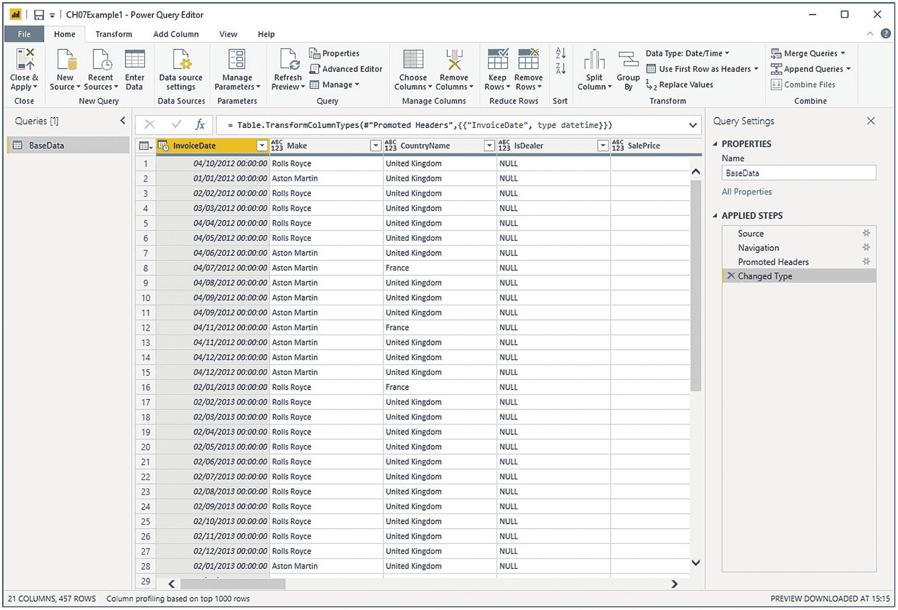  
**图 7-1** — Power BI Desktop查询编辑器

1. 启动Power BI Desktop。
2. 打开示例文件`C:\PowerBiDesktopSamples\Example1.pbix`。请注意，在此示例中，您是在修改一个现有的Power BI Desktop文件及其现有数据输入流程，而并非在加载新数据。查看“字段”列表，注意有一个名为`CostPrice`的字段。
3. 在Power BI Desktop的“开始”功能区中，单击`转换数据`按钮。Power BI Desktop查询编辑器将打开并以表格形式显示源数据。窗口将如图7-1所示。

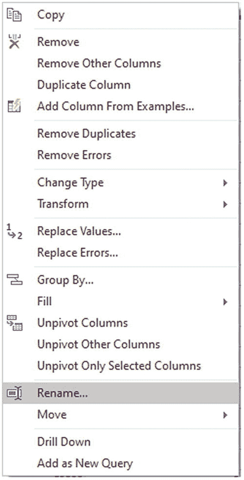  
**图 7-2** — 查询编辑器中的列上下文菜单

4. 右键单击`CostPrice`列的标题。该列将被选中，标题将变为黄色。
5. 从上下文菜单中选择`重命名`。您可以在图7-2中看到此上下文菜单。
6. 输入`VehicleCost`并按Enter键。列标题将更改为`VehicleCost`。
7. 在Power BI Desktop查询编辑器的“开始”功能区中，单击`关闭并应用`按钮。Power BI Desktop查询编辑器将关闭，并返回到Power BI Desktop窗口。在仪表板中使用到`CostPrice`的地方，都将被`VehicleCost`替换。这在“字段”列表以及所有使用此字段的可视化对象中都是可见的。

我希望这个简单的示例能让您明白，转换源数据是一个快速且轻松的过程。您使用的技术——重命名列——只是可用于转换数据的数十种可能技术中的一种。然而，这里要记住的核心思想并非特定的转换方法。您需要记住的是，支撑仪表板的数据始终存在，并且只需点击一下即可访问。随时，您都可以通过单击Power BI Desktop窗口中的`转换数据`按钮，“切换”到数据并进行修改。您所做的任何修改并确认后，都会立即在仪表板和报表中更新。

> **注意**：或者，如果您愿意，也可以直接在报表或数据视图中编辑任何可见表背后的查询，只需右键单击“查询”窗格中的表名（或单击省略号），然后从上下文菜单中选择`编辑查询`即可。

### 加载前转换数据

有时，您可能更倾向于在加载数据之前对数据进行处理。这是您在第一章中创建简单仪表板时所使用方法的一个变体。请执行以下步骤，以便在数据*出现*在Power BI Desktop窗口*之前*转换您正在导入的数据：

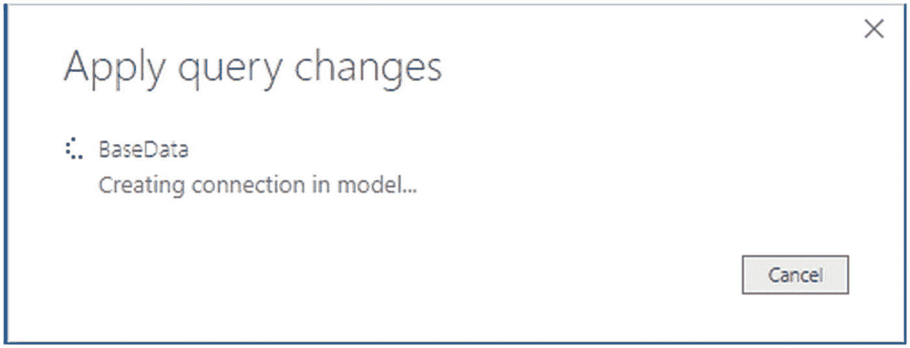  
**图 7-3** — “应用查询更改”对话框

1. 打开一个新的Power BI Desktop窗口。
2. 在Power BI Desktop的“开始”功能区中，单击`获取数据`按钮上的小三角形。
3. 在菜单中选择`Excel`，然后打开Excel文件`C:\PowerBiDesktopSamples\CarSales.xlsx`。
4. 在“导航器”窗口中，选择`BaseData`工作表。
5. 单击`转换数据`按钮（*而非*`加载`按钮）。
6. Power BI Desktop查询编辑器将打开并以表格形式显示源数据。
7. 重复上一个示例中的步骤4到6，重命名`CostPrice`列。

8. 在 Power BI Desktop 查询编辑器的“开始”功能区中，单击`关闭并应用`按钮。Power BI Desktop 查询编辑器将关闭，并返回到 Power BI Desktop 窗口。在数据加载期间，您会看到“应用查询更改”对话框，如图 7-3 所示。

这一次，您是在将数据集加载到 Power BI Desktop 数据模型`之前`对数据进行了简单的修改。数据修改技术完全相同。直接加载数据与通过查询窗口绕行的唯一区别，在于在“导航器”对话框中点击的是`编辑`而不是`加载`。这意味着数据只有在您在 Power BI Desktop 查询编辑器中完成对源数据的所有修改后，才会被加载。

## 是查询还是加载？

Power BI Desktop 始终让你可以选择将数据直接加载到其数据模型中，或者通过 Power BI Desktop 查询绕一个有价值的弯子。你选择哪条路径完全取决于你自己，也显然取决于每种情况。不过，在面临使用不熟悉数据的新仪表板挑战时，你可能需要考虑以下基本原则：

-   你是否确信数据已经可以直接使用？也就是说，数据是否干净且结构良好？如果是，那么你可以尝试将其直接加载到 Power BI Desktop 数据模型中。

-   你是否面临需要组合并塑造成连贯结构的多个数据源？如果是这种情况，那么你真的需要使用 Power BI Desktop 查询编辑器来转换数据。

-   数据是否来自企业数据仓库？这可能存储在关系数据库、SQL Server Analysis Services 多维数据集，甚至是内存中的表格数据仓库中。由于这些数据源几乎总是数百甚至数千小时清理、准备和结构化数据工作的成果，你很可能可以直接将它们加载到数据模型中。

-   数据是否需要预先聚合和过滤？考虑使用 Power BI Desktop 查询编辑器。

-   你是否可能为了更方便管理数据而需要更改字段名称？直接加载数据到数据模型然后在那里更改它们可能更简单。

-   你是否面临需要添加到“核心”数据表中的大量查找表？那么 Power BI Desktop 查询编辑器就是你的好帮手。

-   数据是否包含许多多余或错误的元素？那么，首先使用 Power BI Desktop 查询编辑器移除这些元素。

-   数据是否需要合理化并标准化以使其更易于处理？在这种情况下，成功的路径是通过 Power BI Desktop 查询编辑器。

-   数据源是否极其庞大？如果是这种情况，你可以先在查询编辑器中编辑和过滤数据来节省时间。这是因为查询编辑器只加载数据的`样本`供你调整。只有当你确认所有修改并关闭查询编辑器时，才会加载整个数据集。

这些问题只是粗略的指导原则。但它们可以帮助你在使用 Power BI Desktop 时指明正确的方向。不可避免地，你使用这个应用程序越多，你就越能培养出帮助你做出正确决策的反应和直觉。但请记住，Power BI Desktop 是用来提供帮助的，即使是直接加载的数据集也是基于查询的。因此，你总是可以先加载数据，然后稍后在需要时决定调整查询结构。或者，在查询窗口中编辑数据可以是在将数据加载到数据模型之前仔细查看数据的一个绝佳机会——而且只需额外点击几下。

所以，请随意采用你觉得满意的工作方式。Power BI Desktop 会轻松且近乎无形地适应你的风格，让你能够如此流畅地在数据和仪表板之间切换，以至于它很可能会变成你的第二天性。

本章的其余部分将带你了解一些你需要知道的用于清理和塑形数据的核心技巧。然而，在深入了解所有细节之前，让我们先从高层快速概览一下 Power BI Desktop 查询编辑器及其布局方式。

### Power BI Desktop 查询编辑器

你所有的数据转换都将在 Power BI Desktop 查询编辑器中进行。它是一个与创建仪表板的窗口分离的窗口，并且具有略有不同的布局。

Power BI Desktop 查询编辑器由六个主要元素组成：

-   四个功能区：主页、转换、添加列和视图。在执行特定类型的数据转换时，还有其他功能区可用。

-   包含所有已添加到 Power BI Desktop 文件中的查询的“查询”列表窗格。

-   “数据”窗口，你可以在其中看到选定查询的数据样本。

-   “查询设置”窗格，其中包含用于转换数据的步骤列表。

-   数据上方的公式栏，显示执行所选转换步骤的代码（使用 Power BI “M” 语言编写，你将在第 12 章中更详细地了解）。

-   状态栏（位于窗口底部），指示有用信息，例如查询表中的行数和列数，以及数据集下载的日期。

这些元素的标注如图 7-4 所示。

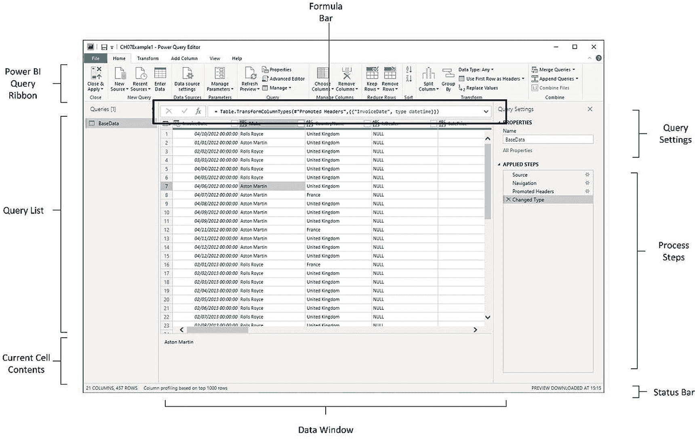

图 7-4

Power BI Desktop 查询编辑器详解

#### 已应用步骤列表

数据转换本质上是一个顺序过程。因此，查询窗口会存储你在清理和塑形源数据时所做的每一次修改。构成数据转换过程的各种元素都列在查询编辑器的“查询设置”窗格的“已应用步骤”列表中。

Power BI Desktop 查询编辑器不对数据转换过程中的步骤进行编号，但它肯定会记住每一个步骤。它们从“已应用步骤”列表的顶部开始（几乎总是以“源”步骤开头），并且可以扩展到数十个单独的步骤，这些步骤追溯你数据的演变过程，直到将其加载到数据模型中。如果需要，你可以将查询编辑器视为一种“宏记录器”。

此外，当你单击“已应用步骤”列表中的每个步骤时，“数据”窗口中的数据会发生变化，以反映每次转换的结果，为你提供应用于数据集的所有修改的完整且可见的轨迹。

“已应用步骤”列表为本章和下一章中涵盖的每个数据修改选项都赋予了一个独特的步骤名称。由于了解每个功能实际实现的效果可能很重要，我将始终提醒你注意 Power BI Desktop 查询应用的标准名称。

#### Power BI Desktop 查询编辑器功能区

Power BI Desktop 查询编辑器（至少在 2020 年 2 月版本中）使用四个核心功能区。它们对于你在本章中学习的内容至关重要。如下所示：

-   主页功能区

-   转换功能区

-   添加列功能区

-   视图功能区

我并不是说你需要记住这些功能区中所有按钮的功能。我希望的是，你能够利用下面这些对查询编辑器功能区按钮的简要描述，来了解 Power BI Desktop 在数据转换领域的强大功能。因此，如果你有初始数据集不符合你的需求，你可以查看 Power BI Desktop 提供的资源以及它们如何提供帮助。一旦你找到执行所需操作的功能，就可以跳转到相关章节，了解如何应用该功能的完整细节。

##### “开始”功能区

由于我们将大量使用 `Power BI Desktop` 查询编辑器的“开始”功能区来转换数据，因此了解其功能非常重要。我在图 7-5 和表 7-1 中解释了各种选项。

**表 7-1** 查询编辑器“开始”功能区选项

| 选项 | 说明 |
| --- | --- |
| `关闭并应用` | 完成处理步骤；保存并关闭查询。 |
| `新建源` | 允许你发现新的数据源并将其添加到现有查询集。 |
| `最近使用的源` | 列出你最近使用过的所有数据源。 |
| `输入数据` | 允许你在自定义表中添加自己的特定数据。 |
| `数据源设置` | 允许你管理和编辑已连接的数据源的设置。 |
| `管理参数` | 允许你查看和修改为此 `Power BI Desktop` 文件定义的任何参数。这些将在第 11 章中解释。 |
| `刷新预览` | 刷新预览数据。 |
| `属性` | 显示核心查询属性。 |
| `高级编辑器` | 显示“M”语言编辑器。这在第 12 章中解释。 |
| `管理` | 允许你删除、复制或引用查询。 |
| `选择列` | 允许你从源数据中所有可用的列中选择要保留的列。 |
| `删除列` | 允许你删除一个或多个列。 |
| `保留行` | 保留表格顶部的指定行数。 |
| `删除行` | 从数据表顶部删除指定数量的行。 |
| `排序` | 使用所选列作为排序键对表格进行排序。 |
| `拆分列` | 在指定的分隔符处或指定的字符数后，将一列拆分为一列或多列。 |
| `分组依据` | 使用指定的列集对表格进行分组，并聚合此分组中的任何数值列。 |
| `数据类型` | 将所选数据类型应用于该列。 |
| `将第一行用作标题` | 将第一行用作列标题。 |
| `替换值` | 对一列或多列中的数据执行查找和替换操作。此操作仅影响列中的完整数据。 |
| `合并查询` | 将第二个查询表联接到当前查询结果，并将第二个查询中的数据聚合或添加到第一个查询中。这在第 9 章中解释。 |
| `追加查询` | 将另一个查询的数据添加到当前 `Power BI Desktop` 文件中的当前查询。这在第 12 章中解释。 |
| `合并文件` | 将一系列结构相似的文本文件中的数据添加到一个表中。这在第 10 章中解释。 |

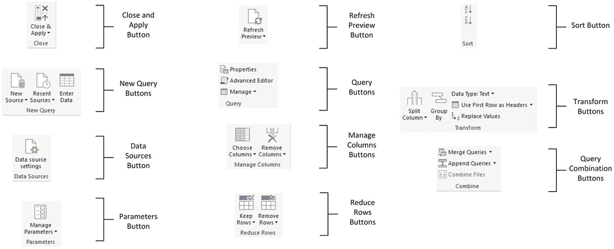

**图 7-5** 查询编辑器“开始”功能区

## “转换”功能区

顾名思义，“转换”功能区包含大量可帮助你转换数据的功能。图 7-6 和表 7-2 解释了其中包含的各种选项。

**表 7-2** 查询编辑器“转换”功能区选项

| 选项 | 说明 |
| --- | --- |
| `分组依据` | 使用指定的列集对表格进行分组；聚合此分组中的任何数值列。 |
| `将第一行用作标题` | 将第一行用作列标题。 |
| `转置` | 将列转换为行，将行转换为列。 |
| `反转行` | 以相反顺序显示源数据，将最后几行显示在窗口顶部。 |
| `对行进行计数` | 计算表格中的行数，并用行计数替换数据。 |
| `数据类型` | 将所选数据类型应用于该列。 |
| `检测数据类型` | 检测要应用于多个列的正确数据类型。 |
| `重命名` | 重命名列。 |
| `替换值` | 在列内执行查找和替换操作，将指定值替换为另一个值。 |
| `填充` | 将上方或下方单元格中的数据复制到列中的空单元格。 |
| `透视列` | 使用所选列中的数据作为列标题创建一组新列。 |
| `逆透视列` | 取一组列中的值并逆透视数据，使用列标题作为描述性元素创建新列。 |
| `移动` | 移动列。 |
| `转换为列表` | 将列的内容转换为列表。例如，这可用作查询参数。你将在第 11 章中学习这一点。 |
| `拆分列` | 在指定的分隔符处或指定的字符数后，将一列拆分为一列或多列。 |
| `格式` | 修改列中数据的文本格式（大写、小写、首字母大写）或删除尾随空格。 |
| `合并列` | 将多列中的数据放置到单列中，并可选择添加分隔符字符。 |
| `提取` | 使用当前数据的定义子集替换列中的数据。你可以指定从列开头或结尾保留的字符数，设置从指定字符开始的字符范围，甚至列出列中的字符数。 |
| `分析` | 根据列中元素的内容创建 XML 或 JSON 文档。 |
| `统计信息` | 返回列中所有值的 `总和`、`平均值`、`最大值`、`最小值`、`中间值`、`标准偏差`、`计数` 或 `非重复计数`。 |
| `标准` | 使用你指定的值对列中的每个单元格执行基本的数学计算（加、减、除、乘、整数除或返回余数）。 |
| `科学` | 对列中的每个单元格执行基本的科学计算（平方、立方、`n`次方、平方根、指数、对数或阶乘）。 |
| `三角学` | 使用你指定的值对列中的每个单元格执行基本的三角计算（`正弦`、`余弦`、`正切`、`反正弦`、`反余弦` 或 `反正切`）。 |
| `舍入` | 将列中的值舍入到下一个整数（向上或向下）或按指定的因子舍入。 |
| `信息` | 将列中的值替换为简单信息：`是奇数`、`是偶数` 或 `正/负`。 |
| `日期` | 从列中的日期值中提取一个元素（日、月、年等）。 |
| `时间` | 从列中的日期/时间或时间值中提取一个元素（小时、分钟、秒等）。 |
| `持续时间` | 根据可以解释为天、小时、分钟等的值计算持续时间。 |
| `展开` | 将另一个查询中（结构相同的）数据添加到当前查询。 |
| `聚合` | 计算另一个查询中数值列的总和或乘积，并将结果添加到当前查询。 |
| `提取值` | 将列的内容的值提取为单个文本值。 |
| `脚本` | 运行来自“R”或 Python 等语言的脚本。 |

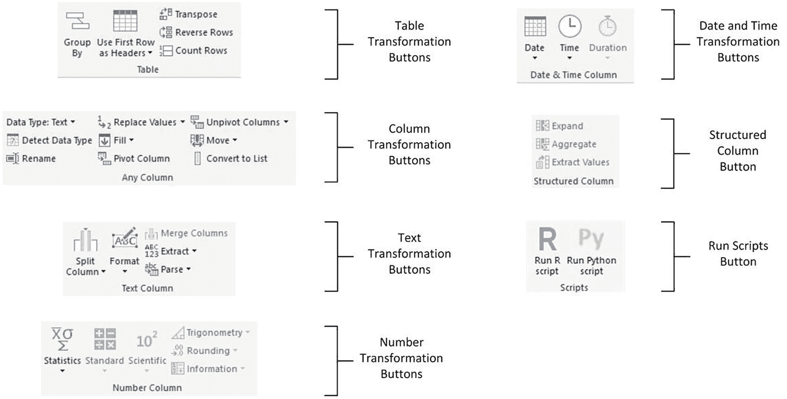

**图 7-6** 查询编辑器“转换”功能区

## “添加列”功能区

“添加列”功能区不仅能添加列，还包含将列拆分为多列，以及基于现有列添加包含日期和计算结果的列等功能。它所包含的各种选项在图 7-7 和表 7-3 中进行了说明。

**表 7-3** 查询编辑器“添加列”功能区选项

| 选项 | 说明 |
| --- | --- |
| `来自示例的列` | 允许您使用一个或多个列作为示例来创建新列。 |
| `自定义列` | 使用公式添加新列以创建列的内容。 |
| `调用自定义函数` | 将“M”语言函数应用于每一行。 |
| `条件列` | 添加一个新列，该列根据条件从选定列中添加值。 |
| `索引列` | 在新列中添加一个序列号，以唯一标识每一行。 |
| `重复列` | 创建当前列的副本。 |
| `格式` | 修改新列中数据的文本格式（大写、小写、首字母大写）或删除尾随空格。 |
| `合并列` | 将多列中的数据合并到单个列中，并可以添加可选的分隔符。 |
| `提取` | 使用当前数据的一个已定义子集创建新列。您可以指定从列的开头或结尾保留的字符数，设置从指定字符开始的字符范围，甚至可以列出列中的字符数。 |
| `分析` | 基于列中的`XML`或`JSON`创建新列。 |
| `统计信息` | 创建一个新列，返回该列中所有值的`总和`、`平均值`、`最大值`、`最小值`、`中位数`、`标准差`、`计数`或`非重复值计数`。 |
| `标准` | 创建一个新列，使用您指定的值应用于列中的每个单元格，返回基本的数学计算结果（加、减、除、乘、整数除或返回余数）。 |
| `科学` | 创建一个新列，对列中的每个单元格返回基本的科学计算结果（平方、立方、`n`次幂、平方根、指数、对数或阶乘）。 |
| `三角函数` | 创建一个新列，使用您指定的值应用于列中的每个单元格，返回基本的三角计算结果（正弦、余弦、正切、反正弦、反余弦或反正切）。 |
| `舍入` | 将新列中的值舍入到下一个整数（向上或向下）或舍入到指定倍数。 |
| `信息` | 将列中的值替换为简单信息：`是奇数`、`是偶数`或`正数/负数`。 |
| `日期` | 从新列中的日期值中提取一个元素（日、月、年等）。 |
| `时间` | 从新列中的日期/时间或时间值中提取一个元素（小时、分钟、秒等）。 |
| `持续时间` | 从新列中可解释为天、小时、分钟和秒的持续时间的值计算持续时间。 |

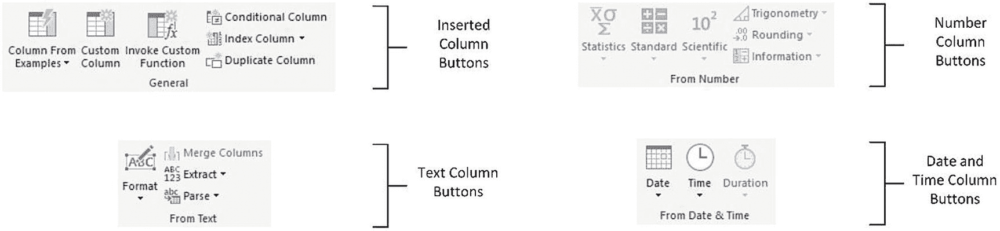

**图 7-7** 查询编辑器“`添加列`”功能区

## “视图”功能区

“视图”功能区允许您更改某些查询编辑器设置，并查看底层的数据转换代码。它所包含的各种选项将在下一章中进行说明。

### 数据集整形

现在，您正在查看已加载到 Power BI Desktop 中的数据表。为便于讨论，我们假设这是示例数据目录中的 `C:\PowerBiDesktopSamples\Example1.pbix` 文件，并且您已单击“转换数据”按钮以显示 Power BI Desktop 查询编辑器。您能对现在可见的 `BaseData` 数据集做些什么呢？是时候了解一些可用于整形初始数据集的核心技术了。这些技术包括：

*   重命名列
*   对列重新排序
*   删除列
*   合并列
*   删除记录
*   删除重复记录
*   筛选数据集

我将这些技术归为一组，因为它们会影响数据的初始大小和形状。此外，如果您从一开始就排除不需要的行和列，这不仅是良好的实践，通常对作为数据建模者的您来说也更容易。我还发现，如果列从一开始就逻辑地排列并具有易于理解的名称，那么理解数据集也会更容易。总而言之，从长远来看，这将使数据处理工作更加轻松。

#### 重命名列

尽管我们在本章开头几页快速了解了重命名列，但让我们再次更详细地探讨这项技术。我承认，重命名列实际上并没有修改数据表的形式。然而，在处理数据时，我认为让所有数据清晰可辨至关重要。这意味着要为每一列应用有意义的列名。因此，我认为这种修改是数据整形的基础，也是导入源数据时一项必不可少的最佳实践。

要重命名列：

1.  单击要重命名的列内部。
2.  单击“转换”以激活“转换”功能区。
3.  单击“重命名”按钮。列名将被高亮显示。
4.  输入新名称或编辑现有名称。
5.  按 `Enter` 键或单击列标题外部。

该列现在将有一个新标题。右侧的“应用的步骤”列表现在将包含另一个步骤：“已重命名的列”。此步骤将被高亮显示。

**注意**：作为使用“转换”功能区的替代方法，您可以右键单击列标题并选择“重命名”。

#### 对列重新排序

Power BI Desktop 会按照数据源中定义的方式加载数据。因此，列顺序完全取决于源数据（或者，如果使用了源数据库，则取决于 `SQL` 查询，如第 3 章所述）。但是，此列顺序并非一成不变，如果重新排序列有助于您理解和处理数据，您可以这样做。要更改列顺序，请执行以下操作：

1.  单击要移动的列的标题。

2. 将列向左或向右拖拽到其新位置。当您执行此操作时，您会看到列标题在列标题之间横向滑动，并且一条较粗的灰色线将指示释放鼠标按钮后列将放置的位置。“`已重新排序的列`”将出现在“`应用的步骤`”列表中。

图 7-8 演示了此操作。

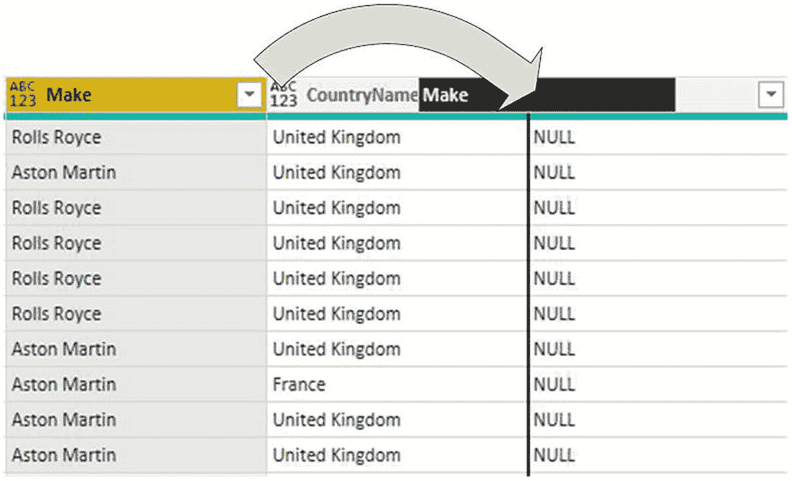

**图 7-8** 对列重新排序

如果您的查询包含几十列，甚至几百列，您可能会发现拖拽列既缓慢又费力。同样，如果列非常宽，则可能难以向左或向右“微移”列。在这些情况下，Power BI Desktop 可以通过“`转换`”功能区中的“`移动`”按钮为您提供帮助。单击此按钮将为您提供表 7-4 中概述的菜单选项。

**表 7-4** “`移动`”按钮选项

| 选项 | 说明 |
| --- | --- |
| `向左` | 将当前选定的列向左移动到其紧邻左侧列的左侧。 |
| `向右` | 将当前选定的列向右移动到其紧邻右侧列的右侧。 |
| `移至开头` | 将当前选定的列移动到查询中所有列的左侧。 |
| `移至末尾` | 将当前选定的列移动到查询中所有列的右侧。 |

“`移动`”命令也适用于您通过 `Ctrl`+单击和/或 `Shift`+单击选择的一组列。实际上，如果需要，您可以移动一组不连续的列。

**注意**：您需要在单击“`移动`”按钮之前选择一个列（或一组列）。如果没有选择，那么在首次使用“`移动`”时，Power BI Desktop 查询会选择该列，但不会移动它。

#### 删除列

那么如何删除一列或一系列列呢？操作如下：

1. 单击要删除的列内部，或者如果要一次性删除多列，请按住 `Ctrl` 键并单击要删除的列标题。
2. 在“开始”功能区中，单击“删除列”按钮。所选列将被删除，并且“已删除列”将出现在“应用的步骤”列表的最末尾。

当处理你无法控制的导入数据集时，你可能会经常发现，大型数据表中你需要的只有几列。如果是这种情况，多次按住 `Ctrl` 并单击选择要删除的列很快就会让你感到厌烦。Power BI Desktop 提供了另一种方法。只需选择要保留的列，然后删除其他列。操作如下：

1. 按住 `Ctrl` 键并单击要保留的列标题。
2. 在“开始”功能区的“删除列”按钮上，单击小三角形。从菜单中选择“删除其他列”。所有未选中的列将被删除，并且“已删除其他列”将添加到“应用的步骤”列表中。

在选择要删除或保留的连续列范围时，你可以使用标准的 Windows `Shift` 键加单击技术，从要选择的列块中第一列选择到最后一列。

> **注意：** 这两种删除列的选项也可在上下文菜单中找到（如果你更喜欢的话）。删除列时，上下文菜单会显示“删除”（如果选择了多列，则显示“删除列”），如果你右键单击列标题，还会显示“删除其他列”。

#### 选择列

如果你不想在宽数据集中滚动，但又需要选择列子集作为报表基础，那么还有另一种方法可以定义你想要使用的字段集合。你可以像这样选择想要保留的列（并根据需要排除其他列）：

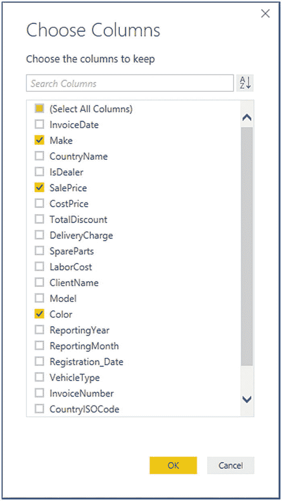

**图 7-9** – “选择列”对话框

1. 打开文件夹 `C:\PowerBiDesktopSamples` 中的示例文件 `CH07Example1.pbix`（如果尚未打开）。
2. 在“开始”功能区中，单击“转换数据”按钮。查询编辑器将打开。
3. 在查询编辑器的“开始”功能区中，单击“选择列”按钮。
4. 单击“（全选）”以取消选择数据集中的所有列。
5. 选择 `Make`、`Color` 和 `SalePrice` 列。“选择列”对话框将如图 7-9 所示。
6. 单击“确定”。查询编辑器将仅显示你选择的列。

“选择列”对话框附带了一些额外功能，在你选择要处理的列集时可能会很有用：

-   你可以通过单击“选择列”对话框右上角的“排序”图标（小 `A-Z`）并选择所需选项，按字母顺序对列列表进行排序（或者恢复到原始顺序）。
-   你可以通过在对话框顶部的“搜索列”字段中输入几个字符并按 `Enter` 键，来筛选显示的列列表。
-   “（全选）”选项可在选中和取消选中列表中所有列之间切换。

## 合并列

源数据并不总是完全符合你的期望（有时这还是一种轻描淡写的说法）。某些数据源可能将数据分散在多列中，而这些数据其实可以合并到一列中。因此，发现 Power BI Desktop 查询也可以执行此类操作，可能并不令人惊讶。操作如下：

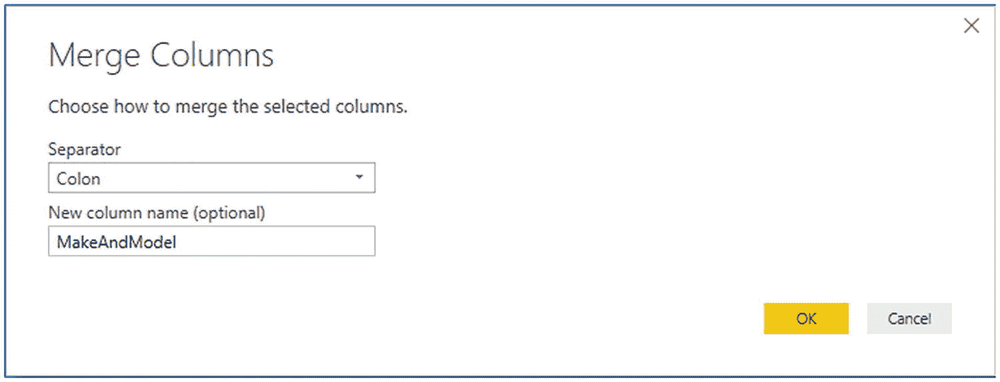

**图 7-10** – “合并列”对话框

1. 按住 `Ctrl` 键单击要合并的列标题（在本示例中为 `BaseData` 数据集中的 `Make` 和 `Model` 列）。
2. 在“转换”功能区中，单击“合并列”按钮。将显示“合并列”对话框。
3. 从“分隔符”弹出菜单中，选择一个可用的分隔符元素。在此示例中，我选择了“冒号”。
4. 输入将由原始两列创建的新列的名称（我将其命名为 `MakeAndModel`）。该对话框应如图 7-10 所示。

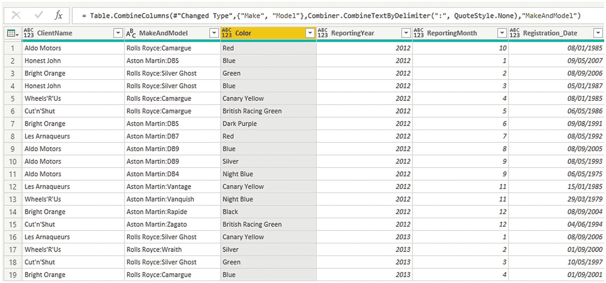

**图 7-11** – 合并列的结果

5. 单击“确定”。你选择的列将被来自所有列的数据替换，如图 7-11 所示。

关于此过程，我需要补充几点说明：

-   合并列时，你可以选择任意数量的列。
-   如果在“合并列”对话框中未为结果列指定名称，它将仅被重命名为“已合并”。你也可以稍后根据需要进行重命名。
-   选择列的顺序会影响数据的合并方式。因此，请始终先选择其数据必须出现在合并列最左侧的列，然后选择其数据应位于其次的列，依此类推。你无需按照列在数据集中最初出现的顺序进行选择。
-   如果你不想使用 Power BI Desktop 查询建议的任何标准分隔符，可以随时自定义。只需在“合并列”对话框的弹出菜单中选择“--自定义--”。对话框中会出现一个新框，你可以在其中输入选择的分隔符。如果你愿意，它甚至可以由多个字符组成。
-   从“转换”功能区合并列会删除所有选定的列，并将其替换为单个列。相同的选项也可从“添加列”功能区获得——但在此情况下，此操作会*添加*一个新列，并保留数据集中的原始列。

> **注意：** 如果你右键单击列标题，此选项也可在上下文菜单中找到。

可用的合并分隔符在表 7-5 中进行了描述。

**表 7-5** – 合并分隔符

| 选项 | 描述 |
| --- | --- |
| `冒号` | 使用冒号（`:`）作为分隔符。 |
| `逗号` | 使用逗号（`,`）作为分隔符。 |
| `等号` | 使用等号（`=`）作为分隔符。 |
| `分号` | 使用分号（`;`）作为分隔符。 |
| `空格` | 使用空格（` `）作为分隔符。 |
| `制表符` | 使用制表符作为分隔符。 |
| `自定义` | 允许你输入自定义分隔符。 |

> **提示：** 如果你愿意，也可以使用上下文菜单拆分、删除和复制列。请记住右键单击列标题以显示正确的上下文菜单。

#### 转到特定列

Power BI Desktop 可以加载包含数百列的数据集。由于在数十列之间左右滚动可能会让人感到有些沮丧，你可以随时跳转到特定列。

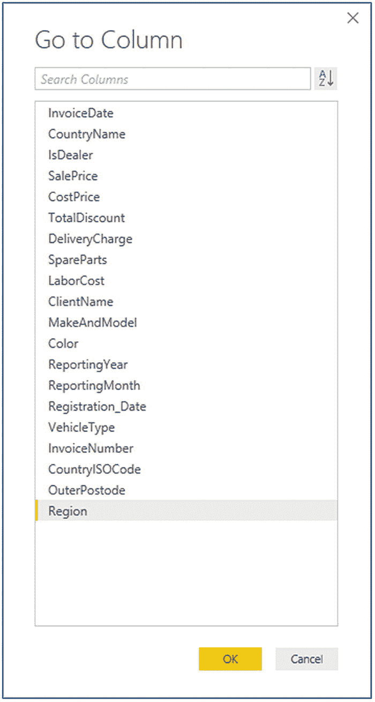

**图 7-12** – “转到列”对话框

1. 在查询编辑器的“开始”功能区中，单击“选择列”按钮底部的小三角形。选择“转到列”。将出现“转到列”对话框。
2. 选择要移动到的列。该对话框将如图 7-12 所示。
3. 单击“确定”。Power BI Desktop 将选中所选的列。

> **提示：** 如果你愿意，也可以双击“转到列”对话框中的列名以移动到所选列。

## 删除记录

你未必总需要使用加载到 Power BI Desktop 查询中的*所有*数据。原因可能有以下几种：

-   你正在初步查看数据，只需要一个样本来了解数据的大致情况。
-   数据包含某些你明确不需要且从一开始就能轻松识别的记录。
-   你正在测试数据清理，并希望使用较小的数据集来加速复杂数据提取和转换流程的开发。
-   你想分析一个精简数据集以推断结论并节省时间，将完整数据集的分析留待日后进行，甚至可能使用 `SQL Server Integration Services` 等更强大的工具集。

为了让你能够缩小数据集，Power BI Desktop 提供了两种开箱即用的基本方法：

-   保留特定行
-   删除特定行

你采用哪种技术必然取决于具体情况。如果通过包含的方式更容易指定要采样的行，那么保留特定行方法是最佳选择。反之，如果希望通过排除的方式操作，那么删除特定行方法则最为合适。下面我们逐一来看。

### 保留行

此方法允许你指定要继续使用的行。它基于以下三种选项之一的应用：

-   保留前 `*n*` 条记录。
-   保留后 `*n*` 条记录。
-   保留指定范围内的记录——即，每 `*y*` 条记录保留 `*n*` 条记录。

这些技术大多非常相似，因此我们首先假设你想保留示例文件 `C:\PowerBiDesktopSamples\Example1.pbix` 中的前 50 条记录。

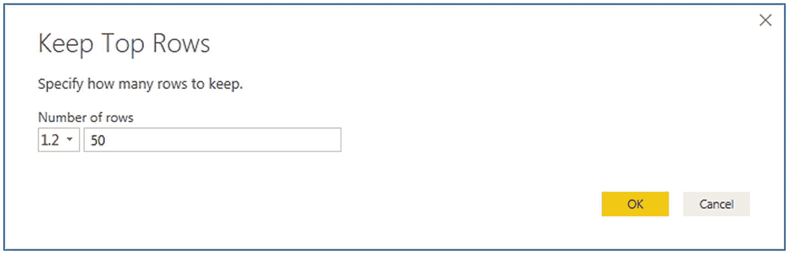

图 7-13 “保留前几行”对话框

1.  在 Power BI 查询编辑器的“开始”功能区中，单击 `保留行` 按钮。将出现一个菜单。
2.  选择 `保留前几行`。将显示“保留前几行”对话框。
3.  在“行数”框中输入 `50`，如图 7-13 所示。
4.  单击 `确定`。除前 50 条记录外，所有记录均被删除，并且“保留的首行”会添加到“应用的步骤”列表中。

要保留后 `*n*` 行，技术几乎相同。按照上一个示例的步骤操作，但在步骤 2 中选择 `保留后几行`。在这种情况下，“应用的步骤”列表将显示“保留的最后行”。

要保留一个范围内的行，你需要指定起始记录以及从该点开始要保留的记录数。例如，假设你想丢弃前 10 条记录，但保留接下来的 25 条。操作方法如下：

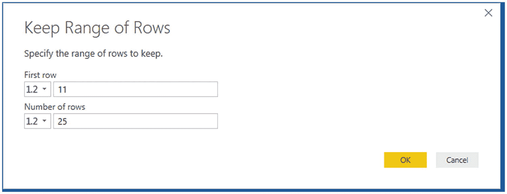

图 7-14 “保留行范围”对话框

1.  在“开始”功能区中，单击 `保留行` 按钮。
2.  选择 `保留行范围`。将显示“保留行范围”对话框。
3.  在“第一行”框中输入 `11`。
4.  在“行数”框中输入 `25`，如图 7-14 所示。
5.  单击 `确定`。除记录 1-10 以及从 36 到末尾的记录外，所有记录均被删除，并且“保留的行范围”会添加到“应用的步骤”列表中。

> **注意**  
> 你可能已经注意到，此对话框与许多其他对话框一样，在输入值的字段左侧包含一个弹出菜单。此弹出菜单允许你*参数化*该值。参数将在第 11 章中解释。

### 删除行

删除行与你刚刚使用的保留行过程几乎相同。由于删除前 `*n*` 行或后 `*n*` 行高度相似，此处不再赘述。你只需单击“开始”功能区中的 `删除行` 按钮，然后按照保留行的流程操作即可。在这种情况下，“应用的步骤”列表将显示“删除的前几行”或“删除的后几行”，并且行将被删除，当然不会保留在数据集中。

删除行方法确实有一个非常有用的选项，可以作为采样技术应用。它允许你每隔几行删除一条或多条记录，以生成源数据的子集。为此，你需要执行以下操作：

1.  在查询窗口的“开始”功能区中，单击 `删除行` 按钮。将出现一个菜单。
2.  选择 `删除隔行`。将显示“删除隔行”对话框。
3.  输入 `10` 作为要删除的起始行。
4.  输入 `2` 作为要删除的行数。
5.  输入 `10` 作为要保留的行数。

该对话框将如图 7-15 所示。

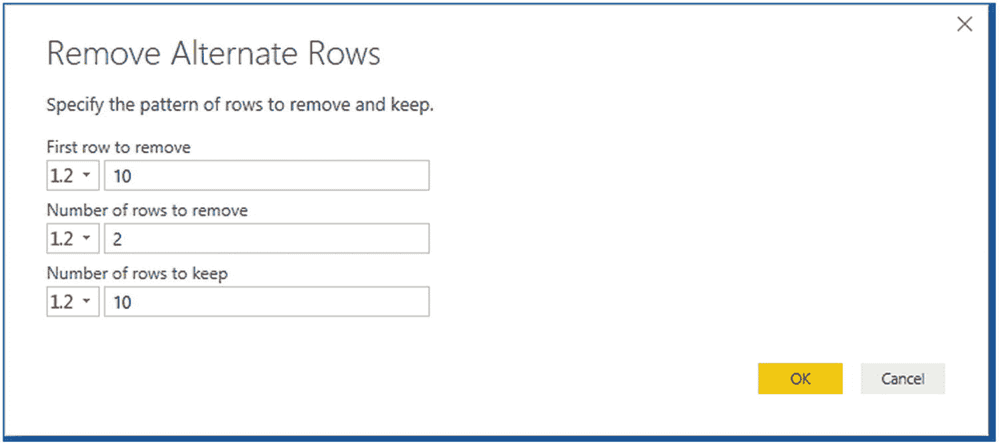

图 7-15 “删除隔行”对话框

1.  单击 `确定`。除匹配你在对话框中输入模式的记录外，所有记录均被删除。然后，“删除的隔行”会添加到“应用的步骤”列表中。

> **注意**  
> 如果你确实决心提取一个你认为能代表关键数据的样本，那么你始终可以在子集化之前对数据进行筛选，以排除任何异常值。筛选数据将在本章后面解释。

### 删除空行

如果你的源数据包含完全空白的行，可以按如下方式删除：

1.  在查询窗口的“开始”功能区中，单击 `删除行` 按钮。将出现一个菜单。
2.  选择 `删除空行`。

这将导致空行被删除。然后，“删除的空行”会添加到“应用的步骤”列表中。

### 删除重复记录

外部数据源可能并不像你期望的那样完美。糟糕数据最令人烦恼的特征之一就是存在重复项。这些重复项具有隐蔽性，因为它们会扭曲结果，而且并不总是可见。如果你怀疑数据表包含*严格*重复项（即两条或多条记录中的每个字段都相同），则可以按如下方式删除重复项：

1.  在表格的弹出菜单中（位于表格网格的左上角）单击 `删除重复项`。所有重复记录均被删除，并且“删除的重复项”会添加到“应用的步骤”列表中。

> **注意**  
> 我必须强调，此方法只会删除*完全*相同的记录，即重复行中每一列的每个元素都严格相同。如果两条记录仅有一个字符或数字不同，但其他所有内容都相同，那么 Power BI Desktop 查询编辑器*不会*将其视为重复项。或者，如果你想隔离并检查重复记录，则可以通过从表格的弹出菜单中选择 `保留重复项` 来仅显示完全相同的记录。

那么，如果你怀疑或确信正在处理的数据表包含重复项，有哪些实用的解决方案？这可能是一个真正的难题，但有一些基本的技术可以应用：

-   删除所有你确定在后续数据处理过程中不会使用的列。这样，Power BI Desktop 只需比较潜在重复记录中的关键数据。
-   按核心列对数据进行分组（本章后面会解释）。

> **注意**  
> 如你所见，Power BI Desktop 查询只需几次点击就能帮助你聚焦数据集中的关键元素。但需要注意的是，在从查询中排除数据时，务必小心*不要移除*有价值的数据——从而歪曲你的分析结果。

## 排序数据

尽管严格来说并不属于数据修改步骤，但在某些阶段对导入的表进行排序可能会是你想要做的操作，哪怕只是为了更清晰地了解正在处理的数据。请按以下步骤对数据进行排序：

1.  关闭 `CH07Example1.pbix` 文件（如果你确实一直在用该文件测试本章目前介绍的技术，请关闭），*不要*保存。
2.  打开 `C:\PowerBiDesktopSamples\Example1.pbix` 文件。请注意，你打开的是一个已有的 Power BI Desktop 文件，而*不是*在加载数据。
3.  单击 `转换数据` 以打开查询编辑器。
4.  在你希望作为排序依据的列内部单击。
5.  在“开始”功能区中单击 `升序排序`（`A/Z` 图标）或 `降序排序`（`Z/A` 图标）。

数据将按字母顺序（从小到大）或反向字母顺序（从大到小）进行排序。如果你想执行复杂的排序操作（例如，先按某一列排序，如果该列在多行中存在相同元素，再按另一列排序），只需依次对各列进行排序即可。Power BI Desktop 查询编辑器会在列标题右侧添加微小的 `1`、`2`、`3` 等数字，以指示排序顺序。你可以在图 7-16 中看到这一点，我*首先*按 `Make` 列排序，*最后*按 `Model` 列排序。

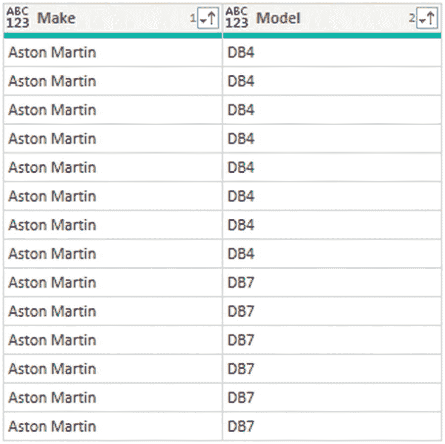

*图 7-16 – 对多列进行排序*

由于数据排序被视为数据修改过程的一部分，因此它也会以 `已排序行` 的形式出现在 `应用的步骤` 列表中。如果你仔细观察列标题，你会看到小的 `1` 和 `2`，它们指示排序优先级，以及指示列按升序排序的箭头。

> **注意：** 另一种排序数据的替代技术是单击列的弹出菜单（列标题右侧向下的三角形），然后从弹出菜单中选择 `升序排序` 或 `降序排序`。

### 反转行顺序

如果你发现正在查看的数据看起来上下颠倒（即底部行在顶部，反之亦然），你可以单击一下即可反转行顺序（如果你愿意的话）。为此，请执行以下操作：

在“转换”功能区中，单击 `反转行` 按钮。

整个数据集将被反转，原来的底部行现在将成为顶部行。

### 撤消排序操作

如果你随后决定不想保留已排序的数据，你可以随时撤消排序操作，具体操作如下：

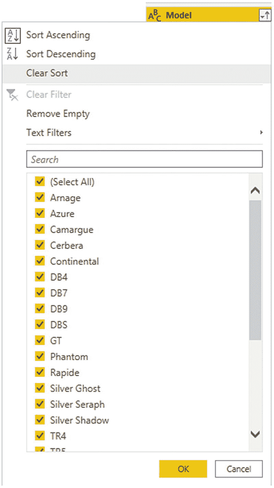

*图 7-17 – 移除排序操作*

1.  单击你用作排序依据的列名称右侧的排序图标。将出现上下文菜单，如图 7-17 所示。
2.  单击 `清除排序`。

你应用过的排序顺序将被移除，数据将恢复为其原始行顺序。

> **注意：** 如果你对数据集的多列进行了排序，你可以选择通过单击你*最先*用于排序数据的列来移除你应用的全部排序顺序。这将移除你应用于定义排序条件所用的*所有*列的排序顺序。如果你只是想撤消用于对记录集排序的一组列中最后一列的排序，那么你可以仅清除对该列的排序操作。

## 筛选数据

根据我的经验，限制数据集最常用的方法是对已加载的表使用筛选器。现在，我意识到你可能在使用 Excel 多年之后，或者在使用 Power Pivot 一段时间之后，才开始接触 Power BI Desktop，并且你即将看到的筛选技术很可能与你在这两种工具中使用过的技术非常相似。然而，由于在加载源数据时包含和排除适当记录至关重要，我宁愿详细解释 Power Query 筛选器，即使这意味着某些读者会产生强烈的似曾相识感。

以下是 Power BI Desktop 中筛选数据的两种基本方法：

* 从所选列的独特元素列表中选择一个或多个特定值。
* 定义要包含或排除的数据范围。

第一种选项适用于所有数据类型，无论是文本、数字还是日期/时间。第二种方法则根据你用于筛选数据的列的数据类型而变化。

### 选择特定值

选择数据列中存在的一个或多个值非常简单，操作如下（假设你仍在使用 Power BI Desktop 文件 `Example1.pbix` 并且处于查询编辑器中）：

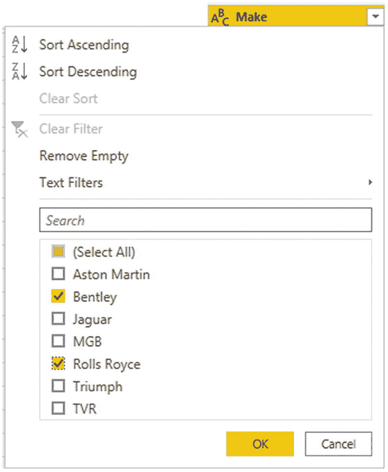

*图 7-18 – 一个筛选菜单*

1. 单击列的弹出菜单。（在此示例中，我使用了示例数据集中的 `Make` 列。）将出现筛选菜单。
2. 勾选所有你希望保留的元素，并取消勾选所有你希望排除的元素。在此示例中，我保留了 `Bentley` 和 `Rolls Royce`，如图 7-18 所示。
3. 单击 `确定`。`应用的步骤` 列表中将添加 `已筛选行`。

> **注意：** 你可以通过单击 `(全选)` 复选框来取消选择所有项目；再次选中此框可重新选择所有项目。因此，如果你只想保留少数几个元素，先取消选择所有元素，然后仅选择你希望保留的元素可能会更快。如果你想排除任何在你筛选的列中没有值的记录，请从筛选菜单中选择 `移除空值`。

### 在筛选列表中查找元素

在筛选列表中上下滚动可能会变得极其繁琐。将列表快速限制为可用元素的子集的一种方法是执行以下操作：

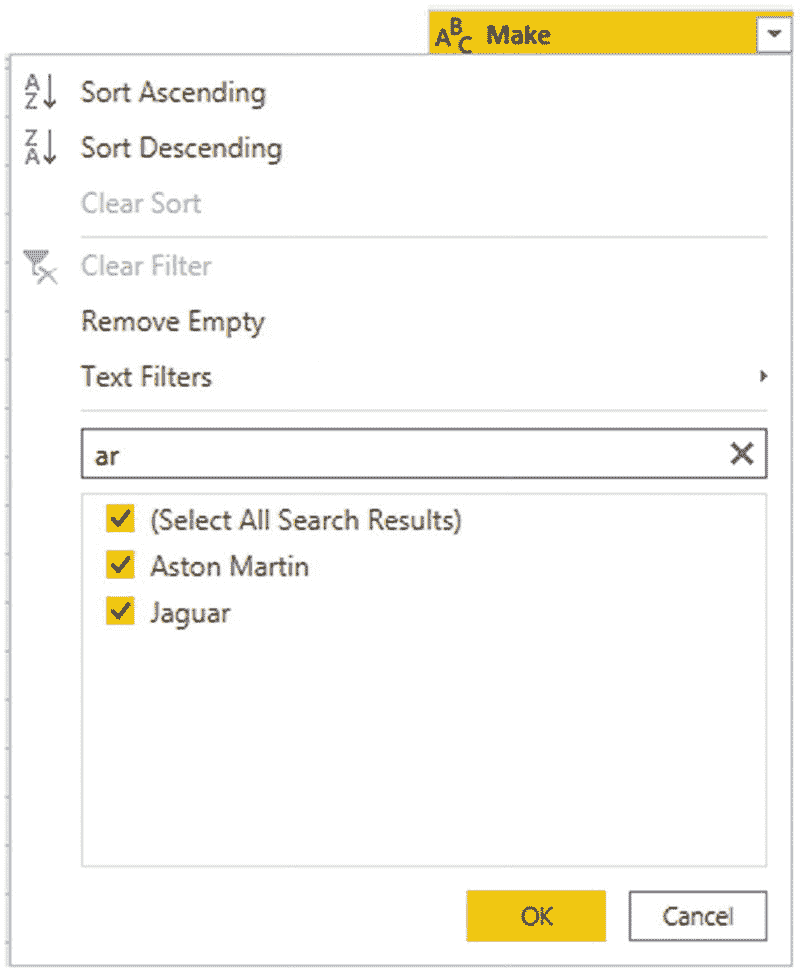

*图 7-19 – 搜索筛选菜单*

1. 单击列的弹出菜单。（在此示例中，我使用了示例数据集中的 `Model` 列。）将出现筛选菜单。
2. 在 `搜索` 框中输入一个字母或几个字母。列表会随着你输入的每个字母或数字而缩短。如果你输入 `ar`，则筛选弹出菜单将如图 7-19 所示。

要移除筛选器，你只需单击 `搜索` 框右侧出现的叉号即可。

### 筛选文本范围

如果某列包含文本，则你可以应用特定选项来筛选数据。这些选项位于任何基于文本的列的筛选弹出菜单中的 `text filters` 子菜单中。选项见表 7-6。

*表 7-6 – 文本筛选选项*

| 筛选选项 | 描述 |
| --- | --- |
| `等于` | 设置必须与单元格内容匹配的文本。 |
| `不等于` | 设置*不*应与单元格内容匹配的文本。 |
| `开头为` | 设置单元格内容左侧的文本。 |
| `开头不是` | 设置*不*应出现在单元格内容左侧的文本。 |
| `结尾为` | 设置单元格内容右侧的文本。 |
| `结尾不是` | 设置*不*应出现在单元格内容右侧的文本。 |
| `包含` | 允许你输入将成为单元格内容一部分的文本。 |
| `不包含` | 允许你输入*不*会成为单元格内容一部分的文本。 |

### 筛选数值范围

如果列中包含数字，则还可以应用特定的筛选选项来过滤数据。你可以在任何基于文本的列的筛选弹出菜单中的 `Number Filters` 子菜单中找到这些选项。具体选择见表 7-7。

*表 7-7 – 数值筛选选项*

| 筛选选项 | 描述 |
| --- | --- |
| `Equals` | 设置必须与单元格内容匹配的数字。 |
| `Does Not Equal` | 设置不得与单元格内容匹配的数字。 |
| `Greater Than` | 单元格内容必须大于此数字。 |
| `Greater Than Or Equal To` | 单元格内容必须大于或等于此数字。 |
| `Lesser Than` | 单元格内容必须小于此数字。 |
| `Lesser Than Or Equal To` | 单元格内容必须小于或等于此数字。 |
| `Between` | 单元格内容必须介于您指定的两个数字之间。 |

### 筛选日期和时间范围

如果列中包含日期或时间（或两者均有），则同样可以应用特定的筛选选项来过滤数据。你可以在任何基于文本的列的筛选弹出菜单中的 `Date/Time Filters` 子菜单中找到这些元素。具体选择见表 7-8。

*表 7-8 – 日期和时间筛选选项*

| 筛选元素 | 描述 |
| --- | --- |
| `Equals` | 筛选数据，仅包含所选日期的记录。 |
| `Before` | 筛选数据，仅包含截至所选日期的记录。 |
| `After` | 筛选数据，仅包含所选日期之后的记录。 |
| `Between` | 允许您设置一个上限和一个下限日期，以排除该范围之外的记录。 |
| `In the Next` | 允许您指定未来的天数、周数、月数、季度数或年数。 |
| `In the Previous` | 允许您指定截至当前日期为止的天数、周数、月数、季度数或年数。 |
| `Is Earliest` | 筛选数据，仅包含最早日期的记录。 |
| `Is Latest` | 筛选数据，仅包含最晚日期的记录。 |
| `Is Not Earliest` | 筛选数据，仅包含不包含最早日期的记录。 |
| `Is Not Latest` | 筛选数据，仅包含不包含最晚日期的记录。 |
| `Day ➤ Tomorrow` | 筛选数据，仅包含当前系统日期后一天的记录。 |
| `Day ➤ Today` | 筛选数据，仅包含当前系统日期的记录。 |
| `Day ➤ Yesterday` | 筛选数据，仅包含当前系统日期前一天的记录。 |
| `Week ➤ Next Week` | 筛选数据，仅包含下一个日历周的记录。 |
| `Week ➤ This Week` | 筛选数据，仅包含当前日历周的记录。 |
| `Week ➤ Last Week` | 筛选数据，仅包含上一个日历周的记录。 |
| `Month ➤ Next Month` | 筛选数据，仅包含下一个日历月的记录。 |
| `Month ➤ This Month` | 筛选数据，仅包含当前日历月的记录。 |
| `Month ➤ Last Month` | 筛选数据，仅包含上一个日历月的记录。 |
| `Month ➤ Month Name` | 筛选数据，仅包含指定日历月的记录。 |
| `Quarter ➤ Next Quarter` | 筛选数据，仅包含下一个季度的记录。 |
| `Quarter ➤ This Quarter` | 筛选数据，仅包含当前季度的记录。 |
| `Quarter ➤ Last Quarter` | 筛选数据，仅包含上一个季度的记录。 |
| `Quarter ➤ Quarter Name` | 筛选数据，仅包含指定季度的记录。 |
| `Year ➤ Next Year` | 筛选数据，仅包含下一年的记录。 |
| `Year ➤ This Year` | 筛选数据，仅包含今年的记录。 |
| `Year ➤ Last Year` | 筛选数据，仅包含上一年的记录。 |
| `Year ➤ Year To Date` | 筛选数据，仅包含年初至今日历年的记录。 |
| `Custom Filter` | 允许您为所选日期范围设置特定筛选。 |

### 应用数值筛选示例

无论应用何种类型的筛选，筛选数据的方法都非常相似。举一个简单的例子，以下是如何对售价应用数字筛选，以查找售价低于 £5,000.00 的车辆：

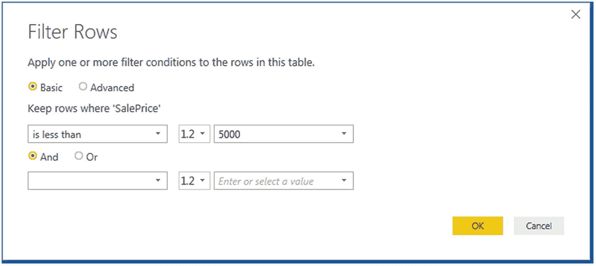

*图 7-20 – “筛选行”对话框*

1.  单击 `SalePrice` 列的弹出菜单。
2.  单击 `Number Filters`。将显示子菜单。
3.  选择 `Less Than`。将显示“筛选行”对话框。
4.  在 `is less than` 框旁边的框中输入 `5000`，如图 7-20 所示。

5. 单击 `OK`。数据集将仅显示符合您所定义筛选的行。

尽管应用起来非常简单，但筛选仍需要注意以下几点：
- 您可以在基本筛选器中组合最多两个元素。它们可以是互斥的（`AND` 筛选），也可以是替代的（`OR` 筛选）。
- 您可以在高级筛选器中组合多个元素——您将在下一节中学习。
- 输入数字时，`不应`应用任何格式。
- 您筛选的任何文本都不区分大小写。
- 如果选择了错误的筛选器，不必取消并重新开始。只需从“筛选行”对话框中左侧框的弹出菜单中选择正确的筛选类型即可。

**提示**

如果设置的筛选值排除了表中的所有记录，Power BI Desktop 将显示一个空表，仅显示“此表为空。”字样。您始终可以通过单击 `Applied Steps` 列表中 `Filtered Rows` 左侧的叉号来移除筛选。这将移除该步骤并将数据恢复至之前的状态。

#### 应用高级筛选器

当您需要对数据进行极其精确的筛选时，可以随时使用 Power BI Desktop 的高级筛选器。这些筛选器可以扩展筛选元素，使您能够以很高的详细程度包含或排除记录。具体步骤如下：

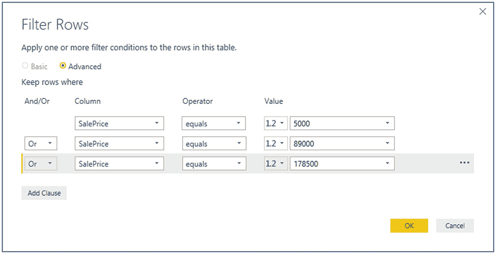

**图 7-21** 高级筛选器

1. 单击 `SalePrice` 列的弹出菜单。
2. 单击 `数字筛选器`。将显示子菜单。
3. 选择 `等于`。将显示 `筛选行` 对话框。
4. 单击 `高级`。
5. 在对话框中，为第一个筛选元素输入 `5000` 作为值。
6. 从弹出菜单中选择 `或` 作为第二个筛选元素的筛选类型。
7. 选择 `等于` 作为运算符。
8. 在对话框中，为第二个筛选器输入 `89000` 作为值。
9. 单击 `添加子句`。一个新的筛选元素将添加到对话框中现有元素的下方。
10. 选择 `等于` 作为运算符。
11. 在对话框中，为第三个筛选元素输入 `178500` 作为值。`筛选器` 对话框将如图 7-21 所示。
12. 单击 `确定`。只有包含您在 `筛选器` 对话框中输入数值的记录才会显示在 Power BI Desktop 查询编辑器中。

我想就筛选器主题发表几点评论作为结束：

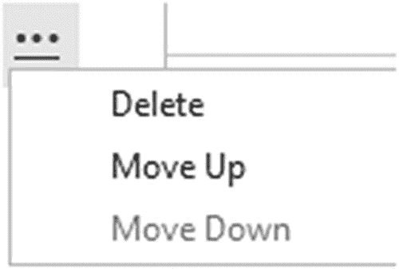

**图 7-22** 排序筛选器

- 在 `高级筛选器` 对话框中，您可以“混合搭配”列和运算符，以达到您想要的筛选结果。
- 如果需要，您还可以对筛选器的顺序进行排序。为此，只需单击某一筛选行内部，该行会以灰色背景显示（如图 7-21 中的第三个筛选器）。然后，单击该筛选行右侧的省略号，并从弹出菜单中选择 `上移` 或 `下移`。您可以在图 7-22 中看到这一操作。
- 若要删除一个筛选器，请单击该筛选行右侧的省略号，然后选择 `删除`。

**注意**：当处理非常大的数据集时，您可能会发现筛选器并非总能显示源数据中的所有可用值。这是因为 Power BI 查询编辑器只加载了数据的一个子样本。在这种情况下，您会在筛选器弹出菜单中看到一个警报和一个“加载更多”链接。单击此链接将强制 Power BI 重新加载一个更大的数据样本集。但是，内存限制可能会阻止它加载您需要的所有数据。在这种情况下，您应考虑修改源查询（如果可能），使其返回一个能够装入内存的代表性数据集。

### 分组记录

有时，您需要以极端的方式转换原始数据——即对数据进行分组。这与筛选数据、删除重复项或清理列内容截然不同。当您对数据进行分组时，您正在更改数据集的结构以“汇总”记录，操作如下：
- 定义将成为分组数据表中唯一元素的属性列。
- 指定对分组表中包含的任何数字列应用的聚合。

分组通常是一种极具选择性的操作。这不可避免，因为您选择用于分组的属性（即非数字）列越少，分组表中可能包含的记录就越少。然而，这始终取决于您正在处理的特定数据集，高效地分组数据通常需要技巧、实践以及老式的反复试验。

#### 简单分组

为了理解分组的工作原理——以及它如何从根本上改变数据集的结构——让我们来看一个行分组的简单示例：

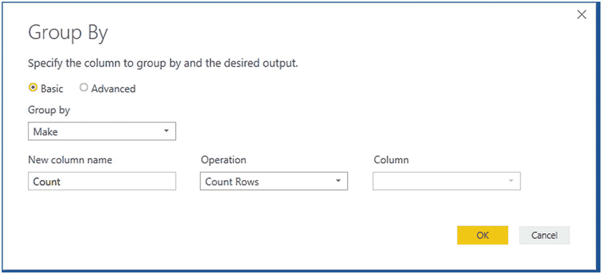

**图 7-23** 简单分组

1. 在示例文件 `CH07Example1.pbix`（位于查询编辑器中）中，单击 `Make` 列内部。
2. 在 `开始` 功能选项卡或 `转换` 功能选项卡中，单击 `分组依据` 按钮。`分组依据` 对话框将出现，如图 7-23 所示。

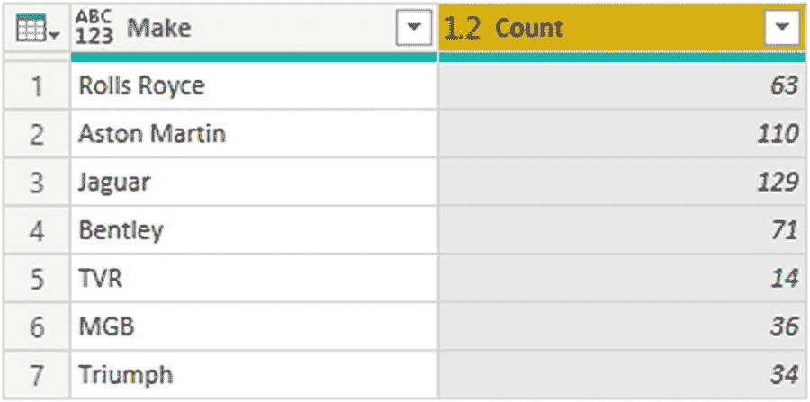

**图 7-24** 简单分组输出

3. 单击 `确定`。数据集现在将只包含车辆品牌列表以及每个品牌对应的记录数量。您可以在图 7-24 中看到这一点。

当您将分组应用于数据集时，Power BI Desktop 会向 `应用的步骤` 列表添加一个名为 `已分组行` 的步骤。

**注意**：取消分组操作的最佳方法是在 `应用的步骤` 列表中删除 `已分组行` 步骤。

尽管 Power BI Desktop 默认对行进行计数，但在分组数据时还可以应用其他几种操作。这些操作在表 7-9 中进行了概述。

**表 7-9** 分组时的聚合操作

| 聚合操作 | 描述 |
| --- | --- |
| `对行进行计数` | 计算记录的数量。 |
| `对非重复行进行计数` | 计算唯一记录的数量。 |
| `求和` | 返回数字列的总和。 |
| `平均值` | 返回数字列的平均值。 |
| `中位数` | 返回数字列的中位数。 |
| `最小值` | 返回数字列的最小值。 |
| `最大值` | 返回数字列的最大值。 |
| `所有行` | 为每个分组元素创建一个记录表。 |

#### 复杂分组

Power BI Desktop 可以通过创建更复杂的 `数据分组`，以更高级的方式帮助你塑造数据集。例如，你可以尝试以下操作，按`制造商`和`型号`进行分组，并添加显示`总销售额`和`平均成本`的列：

1. 打开示例文件 `C:\PowerBiDesktopSamples\Example1.pbix`。
2. 点击 `转换数据` 打开查询编辑器。
3. 选择以下列（通过按住 `Ctrl` 键并点击列标题）：
   1. `Make`（制造商）
   2. `Model`（型号）
4. 在"开始"功能区或"转换"功能区中，点击 `分组依据`。
5. 在 `新列名称` 框中，输入 `TotalSales`（总销售额）。
6. 选择 `求和` 作为操作。
7. 在 `列` 弹出列表中，选择 `SalePrice`（销售价格）作为源列。
8. 点击 `添加聚合` 按钮并重复操作，只是这次使用以下设置：
   - *新列名称*：`AverageCost`（平均成本）
   - *操作*：`平均值`
   - *列*：`CostPrice`（成本价格）

`分组依据` 对话框应如图 7-25 所示。

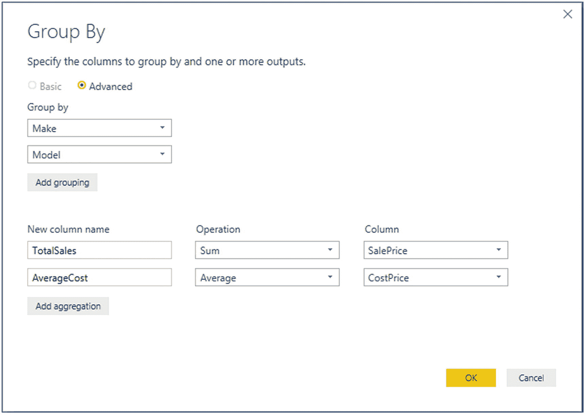

图 7-25：分组依据对话框

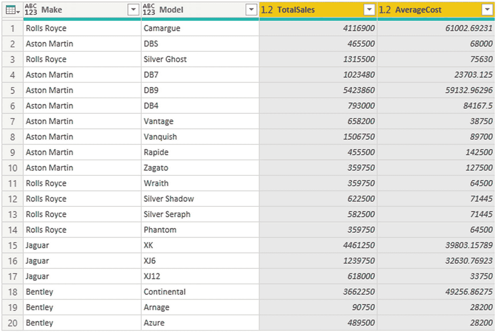

图 7-26：分组数据集

9. 点击 `确定`。除了在 `分组依据` 对话框中指定的列之外，所有其他列都将被移除，表格将按图 7-26 所示进行分组和聚合。`分组行` 将被添加到 `应用步骤` 列表中。我还按照 `制造商` 和 `型号` 列对表格进行了排序，以便更容易理解分组。

如果你创建了一个非常复杂的分组，然后发现需要更改列的顺序，也并非无能为力。你可以通过点击 `分组依据` 对话框中每个列定义右侧的省略号，并选择 `上移` 或 `下移`，来更改输出结果中列的顺序。`分组依据` 对话框中列的顺序，将是结果数据集中列的顺序（从左到右）。

**注意**：你不必按住 `Ctrl` 键来选择分组列。你可以通过点击 `添加聚合` 按钮，将列逐一添加到 `分组依据` 对话框中。同样，你也可以通过点击列名右侧的省略号并从弹出菜单中选择 `删除`，来移除分组列（或已添加和聚合的列）。

### 在查询编辑器中保存更改

正如你所期望的那样，你可以随时保存在使用 Power BI Desktop 查询编辑器时所做的任何更改。但是，你需要知道，当你点击功能区上方的`保存`图标（或点击`文件 ➤ 保存`）时，将出现一个对话框，你可以在图 7-27 中看到该选择。

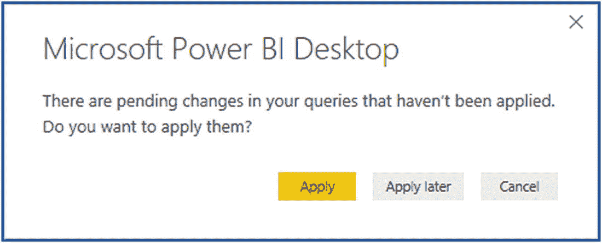

图 7-27：在查询编辑器中保存前应用待处理更改

此时，你需要决定是仅保存使用查询编辑器完成的工作，还是不仅要保存工作，还要用你已执行的数据转换所产生的最新版本数据来更新数据模型中的数据。

因此，你必须在以下两者之间进行选择：

- *立即应用*：应用更改并将数据加载到数据模型中。
- *稍后应用*：保存你的修改，但保持数据原样——并可能在以后更新数据。

### 退出查询编辑器

与刚刚描述的`保存`选项类似，你可以选择如何退出查询编辑器并返回 Power BI Desktop 中的报表和仪表板。默认选项（当你点击`关闭并应用`按钮时）是应用你对数据所做的所有更改，用新数据更新数据模型，然后返回 Power BI Desktop。

然而，你还有两个可能会有用的其他选项。这些选项出现在`关闭并应用`按钮的菜单中：

- *应用*：应用你对数据模型所做的更改。这可能涉及对`字段`列表中的字段进行更改。
- *关闭*：关闭查询编辑器，但不应用任何更改。

如果你选择不应用你所做的更改，那么你将看到图 7-28 中显示的通知。在某个时候，你必须通过点击报表画布上方通知中的`应用更改`按钮来更新数据模型，以确保你使用正确的数据来生成报表。

图 7-28：待处理更改通知

## 结论

本章带你踏上了使用 Power BI Desktop 转换数据集的道路。你了解了如何通过删除行和列来精简数据集。你还学习了如何通过选择交替的行组来从数据源中抽取数据子集。

此外，你还了解了如何选择要在报表中使用的列，如何在数据集中移动列，以及如何重命名列，以便以后在仪表板和报表中使用时数据易于理解。

然后，你学习了如何筛选和排序数据，以及如何删除重复项，以确保你的数据集只包含即将实现的可视化所需的精确行。最后，你学习了如何分组和聚合数据。

然而，必须承认，准备用于仪表板和报表的原始数据并不总是那么容易，并且可能需要一段时间才能做好。但是，Power BI Desktop 查询功能经过一点练习，就可以使这项任务变得非常简单。所以，既然你已经掌握了基础知识，是时候继续前进，探索更多的数据转换技术了。具体来说，你将了解如何转换并可能清理已导入的数据。这是下一章的主题。

