# 5. 从 Web 和云加载数据

在本章中，我们将审视可通过互联网获取的、快速增长且种类繁多的数据源中的一部分，你可以将它们用作 `Power BI Desktop` 的分析数据源。虽然你将在后续页面中看到的数据源可能极其多样化，但它们都有一个共同点：它们都存储在企业外部，并且可以通过互联网连接进行访问。

可用数据源的范围不断扩大，由众多供应商提供。查看所有当前数据源将需要一整本书的篇幅，因此我将向你展示如何访问当前提供的一些主流服务。一旦你学会了如何访问其中少数几个，你应该能够扩展这些基本技术，以访问几乎任何当前可由 `Power BI Desktop` 使用的 Web 和云服务。

`Power BI Desktop` 现在已牢固地确立为 Microsoft 宇宙的基本组成部分。由于 `PowerBI.com`（可用于存储和共享仪表板的云服务）是 `Microsoft Azure`（Microsoft 云）的一部分，因此 `Power BI Desktop` 开发人员不遗余力地确保 Power BI 成为 Azure 中托管解决方案的首选分析工具，这或许是不可避免的。为此，我将解释不少在 Azure 中托管数据的核心服务。

本章概述的几乎所有数据连接都需要访问特定的在线源。这些源中的大多数都是工业级的——并且不是免费的。但是，如果你的企业没有订阅这些服务，而你仍然希望试用它们，那么可以看看本章所述的大多数（如果不是全部）服务提供商提供的免费试用优惠。

## Web 与云服务

在深入探究可用的各类 Web 与云服务细节之前，我们先从宏观上初步了解这些服务究竟是什么。这些数据源包括（但不限于）：

- 网页

- 在线服务，例如 `Google Analytics`、`Salesforce` 或 `MS Dynamics 365`

- `Microsoft Azure`，涵盖在 Azure Blob 服务中托管文件、将数据存储在 Azure SQL 数据库或 Azure Synapse Analytics 中（甚至可在 Azure HDInsight 中读取大数据）

- `OData`，一种通用的互联网数据访问方法

### 网页

如果你需要收集网页浏览器中以表格形式呈现的某些数据，可以使用 `Power BI Desktop` 连接到相关页面的 URL，然后加载该页面中任意表格的全部数据。

### 在线服务

*在线服务*是一个统称，用于描述可通过互联网访问的数据。`Power BI Desktop` 可用的在线服务大多被称为“平台”。这些平台通常是（往往规模庞大的）软件和数据资源，它们要么仅限在线使用，要么曾部署在企业的内部系统中，如今已作为互联网上的服务提供。目前有数十种在线服务可供 `Power BI Desktop` 连接，而且可用服务的数量正以惊人的速度增长。表 5-1 列出了一些较常用的服务。

**表 5-1** 当前 `Power BI Desktop` 可用的在线服务

| 数据源 | 说明 |
| --- | --- |
| `Azure DevOps` | 访问 `Azure DevOps` 数据实体。 |
| `Salesforce Objects` | 允许访问 `Salesforce` 中的数据。 |
| `Salesforce Reports` | 允许访问构成内置 `Salesforce` 报告基础的预结构化数据对象（包括原生和自定义对象）。 |
| `Google Analytics` | 允许访问 Google 为跟踪网站流量而管理的数据。 |
| `Adobe Analytics` | 允许访问 `Adobe Analytics` 中跟踪的数据。 |
| `Facebook` | 访问 `Facebook` 数据。 |
| `SharePoint Online` | 连接 Microsoft `SharePoint` 的云托管版本。 |
| `Microsoft Exchange Online` | 连接 Microsoft `Exchange` 的云托管版本。 |
| `Dynamics 365 Online` | 连接 Microsoft `Dynamics 365` 的云托管版本——微软的 CRM 与 ERP 解决方案。 |
| `Dynamics 365 Business Central` | 连接 `Dynamics 365 Business Central`（在线版和本地部署版）。 |
| `Dynamics NAV` | 连接 Microsoft `Dynamics NAV`。 |
| `OData` | 尽管从技术上讲，`OData` 并非一个在线平台，但它无疑是一个在线数据源。这是一种标准化的方法，通过将 URL 作为入口点来连接不同的数据结构。 |
| `GitHub` | 连接 `GitHub`。 |
| `MailChimp` | 连接 `MailChimp`。 |

以上仅为 `Power BI Desktop` 可连接的众多在线服务中的一部分。建议你查阅列表，确认所需服务当前是否可用。

> **注意：** 鉴于可用在线服务的数量正在加速增长，到本书出版时，你可能会发现此处列出的远不止这些。此外，目前还有许多仍处于测试版阶段的在线服务。这意味着你可以试用它们，但它们尚未最终定版并获得全面支持。

### Microsoft Azure

Azure 是微软的云平台。`Power BI Desktop` 当前可连接、预览并从中加载数据的 Azure 数据源，如表 5-2 所示。

**表 5-2** Azure 数据源

| 数据源 | 说明 |
| --- | --- |
| `Microsoft Azure SQL database` | 允许连接到基于云的 Microsoft SQL Server 数据库，并从你有权访问的所有数据表和视图中导入记录。 |
| `Microsoft Azure SQL Data Warehouse`（现已更名为 `Azure Synapse Analytics`） | 允许连接微软基于云、可弹性伸缩的企业级数据仓库。 |
| `Azure Analysis Services database` | 连接 `Azure Analysis Services` 数据库。 |
| `Microsoft Azure Blob Storage` | 从基于云的非结构化数据存储中读取数据。 |
| `Microsoft Azure Table Storage` | 从 Microsoft Azure 表中读取数据。 |
| `Microsoft Azure Cosmos DB`（原名 `DocumentDB`） | 允许连接微软在 Azure 上托管的 NoSQL 数据库。 |
| `Microsoft Azure Data Lake Storage`（Gen1 和 Gen2） | 允许连接微软的原始数据云存储。 |
| `Microsoft Azure HDInsight` | 在 Microsoft Azure 环境中读取基于云的 Hadoop 文件。 |
| `Azure HDInsight Spark` | 允许连接微软云中的并行处理框架。 |
| `HDInsight Interactive Query` | 在 `HDInsight` 上运行交互式查询。 |

显然，随着 Azure 产品系列的扩展，微软正在为 `Power BI Desktop` 添加更多的 Azure 连接选项。

### 从网页加载数据

作为第一个极其简单的示例，我们来从一个网页中获取一些数据。由于我侧重于讲解方法而非数据本身，因此将使用一个与本书示例数据无关的网页。此处仅以此为例，简单介绍使用 `Power BI Desktop` 从网页加载数据的过程。

假设你已经启动了 `Power BI Desktop` 并关闭了启动画面：

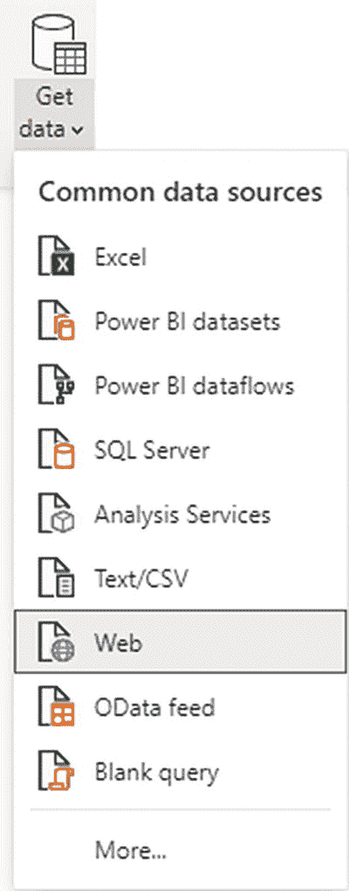

1. 点击“开始”功能区中“获取数据”按钮底部的倒三角。

2. 从出现的菜单中选择 `Web`，如图 5-1 所示。

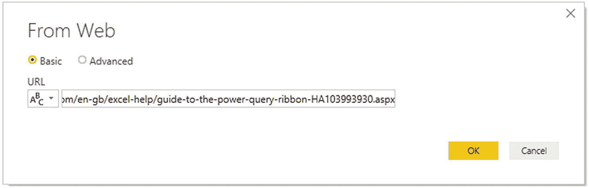

3. 输入以下 URL（这是一个针对 `Power BI Desktop` 的 Microsoft 帮助页面，包含几个数据表）：[`http://office.microsoft.com/en-gb/excel-help/guide-to-the-power-query-ribbon-HA103993930.aspx`](http://office.microsoft.com/en-gb/excel-help/guide-to-the-power-query-ribbon-HA103993930.aspx)。当然，我希望当你阅读本书时它仍然有效。如果你有一个想测试的 URL，也请随意尝试！对话框应类似图 5-2。

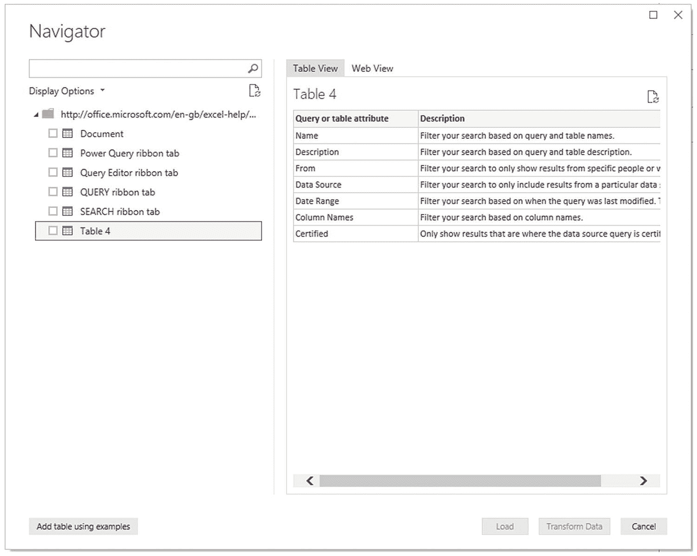

4. 点击 `OK`。`导航器`对话框将会出现。几秒钟后，当 `Power BI Desktop` 连接到网页时，将显示网页中可用数据表的列表。

#### 高级 Web 选项

在前一个示例的步骤 3 中，你可以选择`高级`按钮。如果这样做，`来自 Web`对话框将会展开，允许你通过添加 URL 部分来构建复杂的 URL。你可以在图 5-4 中看到一个示例。

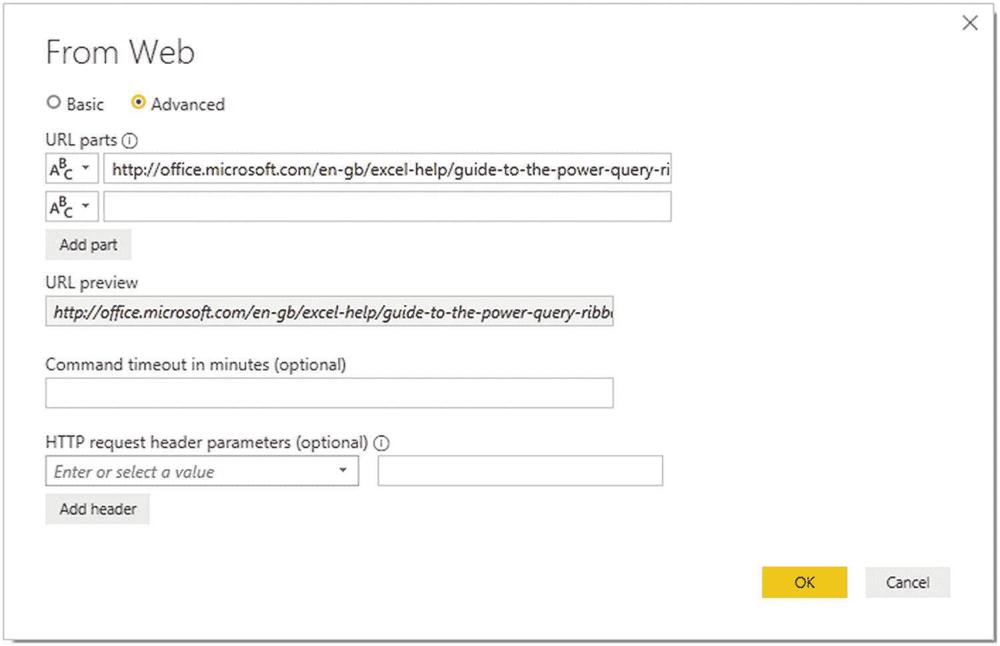
图 5-4 `来自 Web`对话框中的高级选项

单击`添加部分`按钮允许你定义多个 URL 部分。如有必要，你还可以指定提交 URL 时将使用的 HTTP 请求标头参数。某些网页可能需要这些参数。关于这些参数的讨论超出了本书的范围。

#### 表视图或 Web 视图

查看网页包含的表格并不总是找到正确数据的最自然的方式。这是因为你正在脱离上下文查看数据表。我的意思是，你无法看到它们在网页上的位置。毕竟，Web 是一种非常视觉化的媒介。

为了帮助你找到网页上正确的数据表，`查询编辑器`允许你在 Web 源的两种视图之间切换：

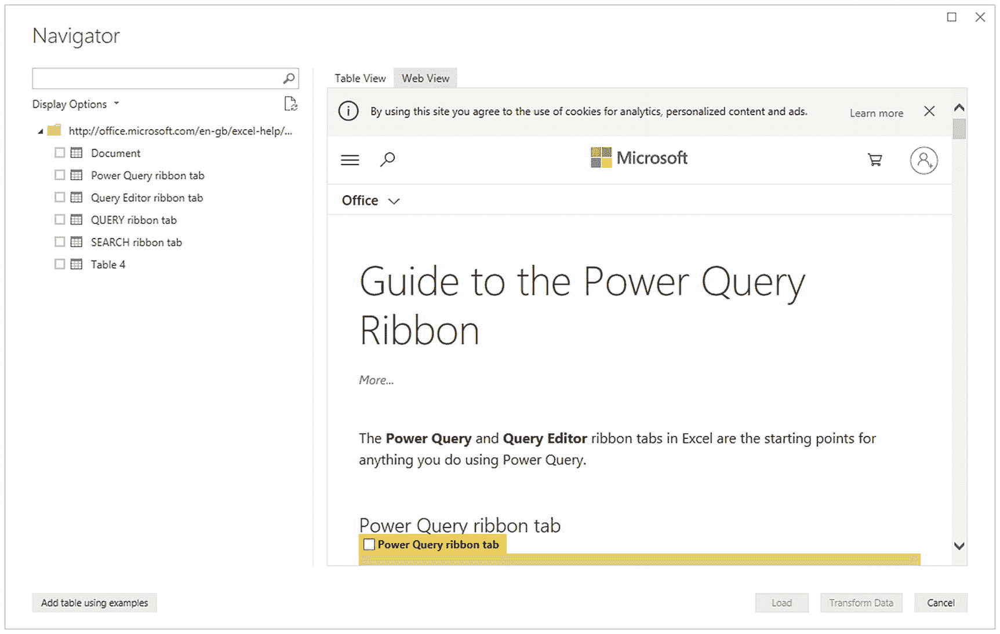
图 5-5 `导航器`对话框中的 Web 视图

*   `表视图`（你在图 5-3 中看到过）
*   `Web 视图`（你可以在图 5-5 中看到）

你可以通过单击`导航器`对话框顶部中央的`表视图`和`Web 视图`按钮来在这两种可视化网页的方式之间切换。当你切换到`Web 视图`时，你之前看到的同一个网页将如图 5-5 所示。

## Salesforce

Salesforce 是软件即服务（SaaS）领域的先驱之一——现在，毋庸置疑，也是领导者之一。因此，`Power BI Desktop`允许你连接到 Salesforce 并加载你有权限使用 Salesforce 账户查看的任何数据，这或许是不可避免的。

事实上，Salesforce 是一个如此广泛且完整的服务，因此你有两种可能的方法来访问你的数据：

*   对象
*   报告

简而言之，Salesforce 对象是包含你想要访问的信息的底层数据表。Salesforce 报告是从数据表中整理成更易访问的输出形式的数据。

> 提示：如果你没有公司 Salesforce 账户，但仍然想了解如何使用`Power BI Desktop`连接到 Salesforce 数据，你始终可以设置一个免费的 30 天试用账户。其网址是：[`www.salesforce.com/form/signup/freetrial-sales.jsp`](http://www.salesforce.com/form/signup/freetrial-sales.jsp)。

#### 从 Salesforce 对象加载数据

那么，假设你有一个有效的 Salesforce 账户，以下是如何将数据从 Salesforce 对象加载到`Power BI Desktop`中：

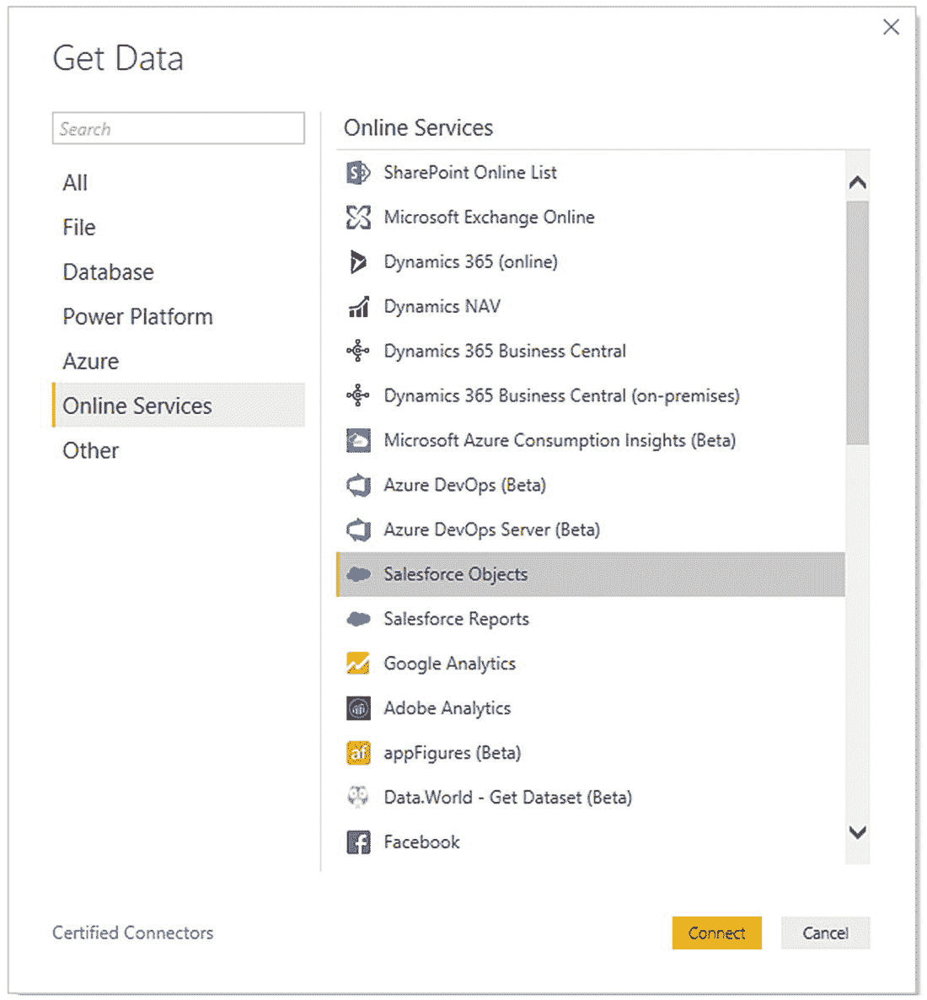
图 5-6 用于联机服务的`获取数据`对话框

1.  在`Power BI Desktop 主页`功能区中，单击`获取数据`按钮。
2.  单击左侧的`联机服务`，然后在右侧选择`Salesforce 对象`。`获取数据`对话框将如图 5-6 所示。

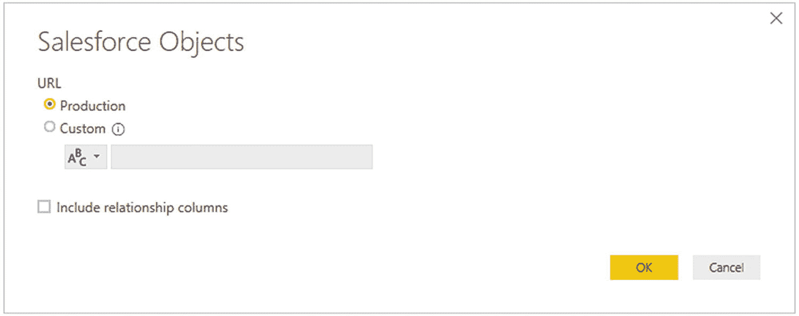
图 5-7 `Salesforce 对象`对话框

3.  单击`连接`。将出现`Salesforce 对象`对话框。它应该如图 5-7 所示。

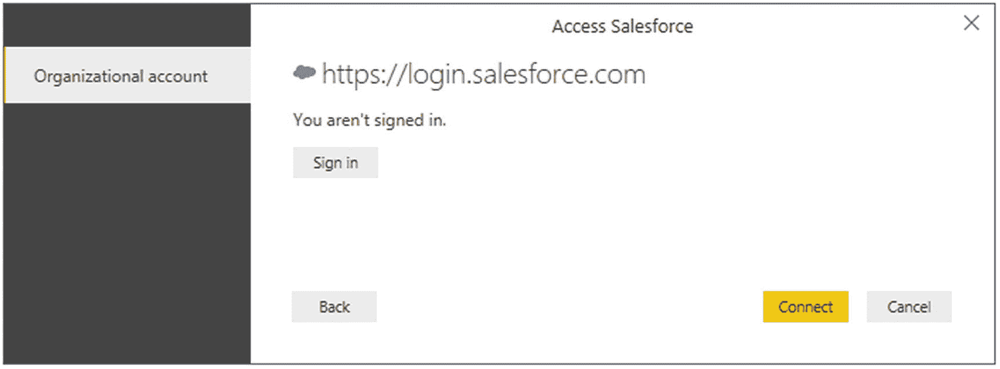
图 5-8 `访问 Salesforce`登录对话框

4.  选择`生产`按钮，然后单击`确定`。将出现`访问 Salesforce`登录对话框。它应该如图 5-8 所示。

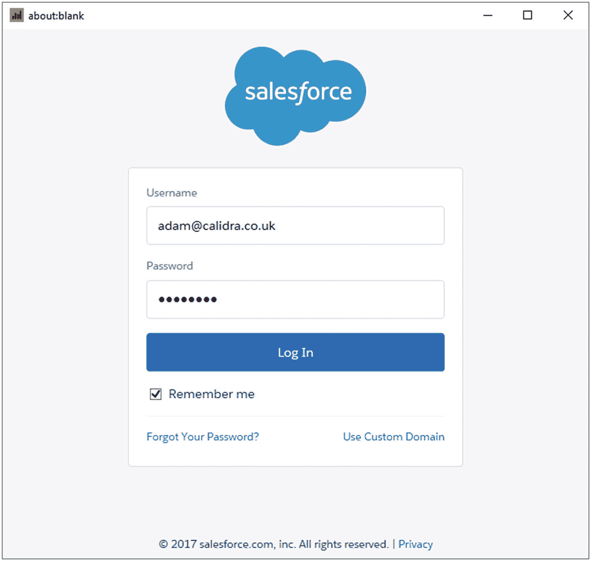
图 5-9 Salesforce 登录对话框

5.  除非你已经登录，否则请单击`登录`。将出现 Salesforce 登录对话框。
6.  输入你的 Salesforce 登录名和密码。该对话框应该类似于图 5-9 所示。

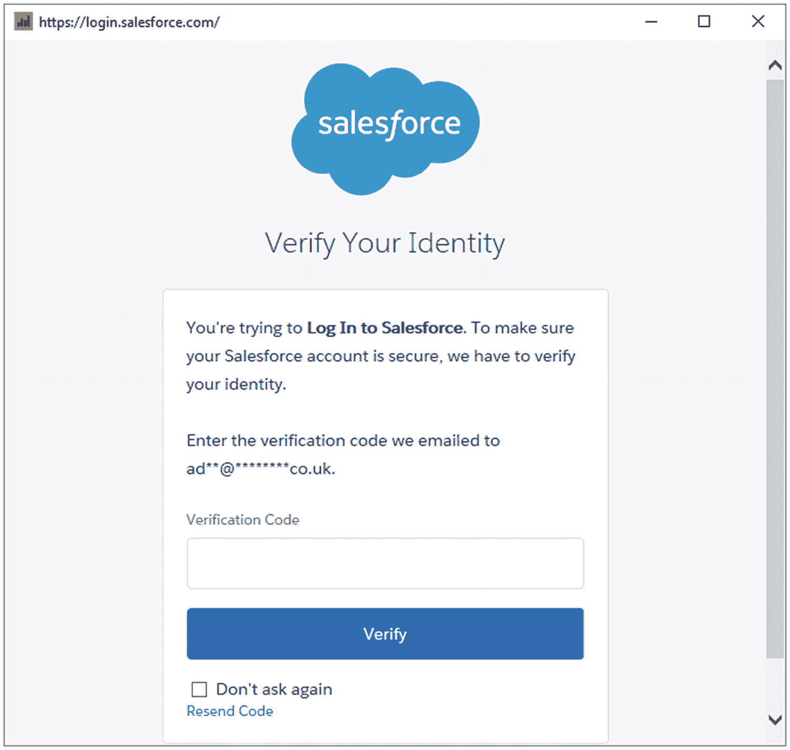
图 5-10 `Salesforce 验证您的身份`对话框

7.  如果这是你第一次从`Power BI Desktop`连接到 Salesforce（或者你已要求 Salesforce 在每次登录时都请求确认），系统将要求你验证身份。将出现`Salesforce 验证您的身份`对话框，如图 5-10 所示。

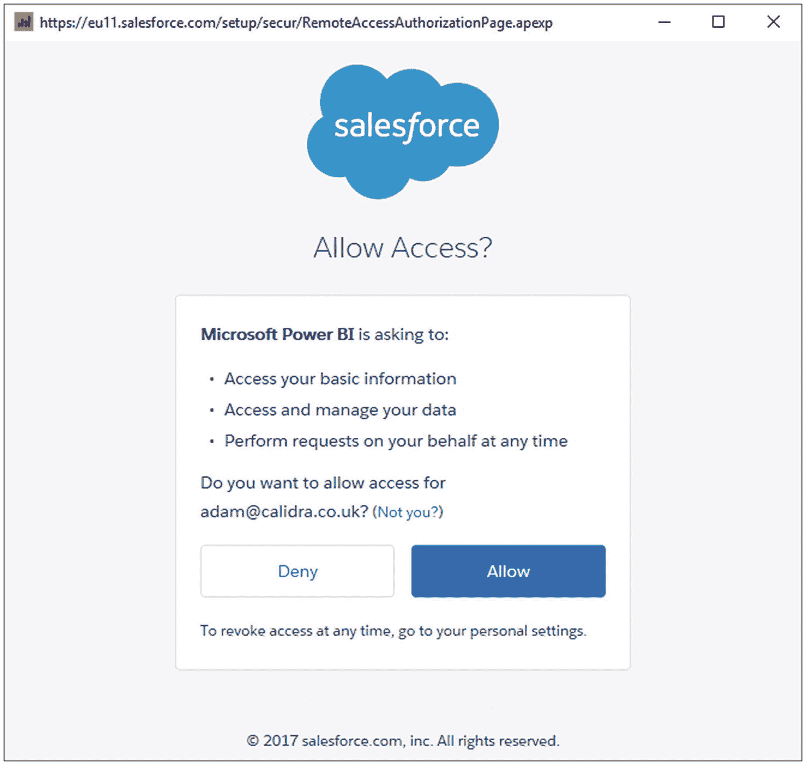
图 5-11 `Salesforce 允许访问`对话框

8.  单击`验证`。Salesforce 会将验证码发送到你用于登录 Salesforce 的电子邮件账户。
9.  在`验证码`字段中输入该代码，然后单击`确定`。你将看到`允许访问`对话框，如图 5-11 所示。

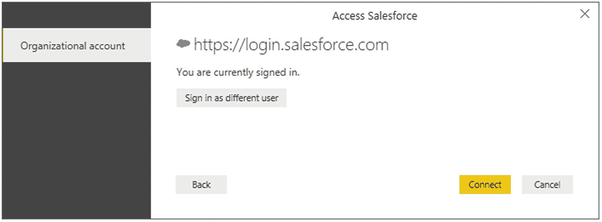
图 5-12 `访问 Salesforce`对话框

10. 单击`允许`。你将返回到`访问 Salesforce`对话框，但现在你已登录。你可以在图 5-12 中看到这一点。

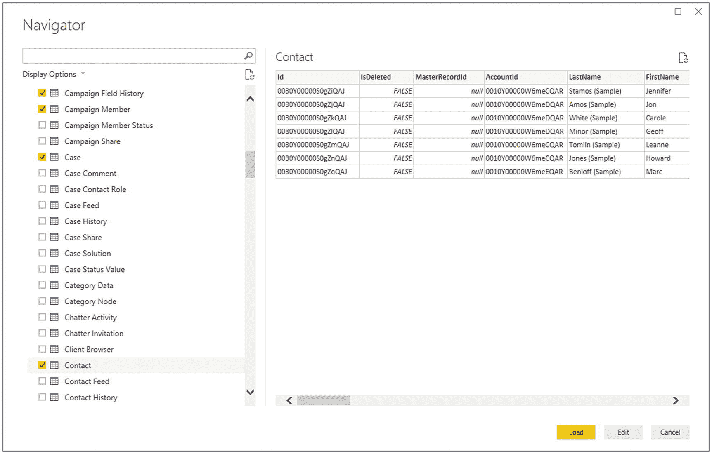
图 5-13 在导航器中查看的 Salesforce 对象

11. 单击`连接`。将出现`导航器`，显示你有权访问的 Salesforce 对象。你可以在图 5-13 中看到示例。
12. 选择你想要将其数据加载到`Power BI Desktop`中的对象，然后单击`加载`。数据将被加载到`Power BI Desktop`中，供你基于 Salesforce 数据创建仪表板和报告。

> 提示：为了避免每次使用 Salesforce 数据创建一组新的`Power BI Desktop`报告时都需要向 Salesforce 确认身份，你可以在 Salesforce 登录对话框中选中“记住我”，并在`Salesforce 验证您的身份`对话框中选中“不再询问”。

Salesforce 对象包含海量数据。然而，从`Power BI Desktop`的角度来看，这类似于访问数据库结构。这意味着你必须对底层数据的存储方式有一定的了解。如果你想了解 Salesforce 数据的结构方式，那么我建议你从目前位于 [`https://trailhead.salesforce.com/en/modules/data_modeling/units/objects_intro`](https://trailhead.salesforce.com/en/modules/data_modeling/units/objects_intro) 的 Salesforce 文档开始学习。

#### Salesforce 报表

如果你发现自己被 Salesforce 中可用的海量数据所淹没，你可以直接访问标准 Salesforce 报表背后的数据。这将避免你去学习底层数据结构。缺点是，你无法轻松扩展这些数据集。

要访问 Salesforce 报表数据，只需按照上一节概述的步骤操作即可。但是，在第 2 步中，不要选择 `Salesforce Objects`，而是选择 `Salesforce Reports`。在这种情况下，`Navigator` 对话框将类似于图 5-14 所示。

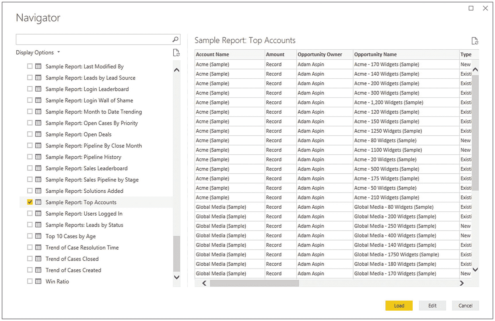
图 5-14 — 显示 Salesforce Reports 数据的 `Navigator` 对话框

在此处，你可以选择并加载来自 Salesforce 的、你想用于创建自己仪表板的报表数据。

## Microsoft Dynamics 365

另一个包含大量宝贵企业数据的在线服务是 Microsoft Dynamics 365。正如你所料，Power BI Desktop 可以轻松连接到诸如 Dynamics 之类的 Microsoft 在线源。操作步骤如下：

**提示：** 如果你没有公司 Microsoft Dynamics 365 在线账户，但仍想了解如何使用 Power BI Desktop 连接到 Microsoft Dynamics 365 数据，你始终可以设置一个免费的 30 天试用账户。其 URL 当前为 [`https://trials.dynamics.com/CustomerEngagement/ChangeSignup/`](https://trials.dynamics.com/CustomerEngagement/ChangeSignup/)。实际上，本示例就是使用一个免费的 30 天试用账户（该账户很可能在本书付印前很久就已过期）完成的。

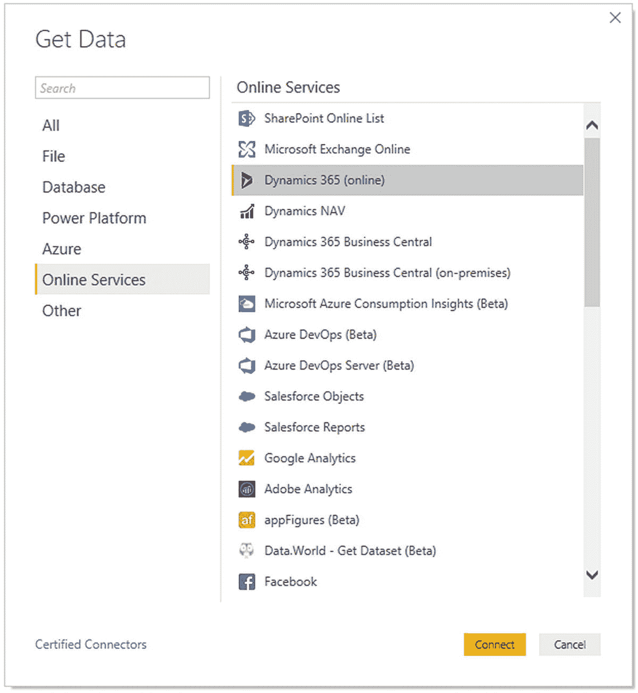
图 5-15 — Dynamics 365 的 `Get Data` 对话框

1. 在 Power BI Desktop 的“开始”功能区中，单击 `Get Data` 按钮。
2. 单击左侧的 `Online Services`，然后在右侧选择 `Dynamics 365 (online)`。`Get Data` 对话框将如图 5-15 所示。

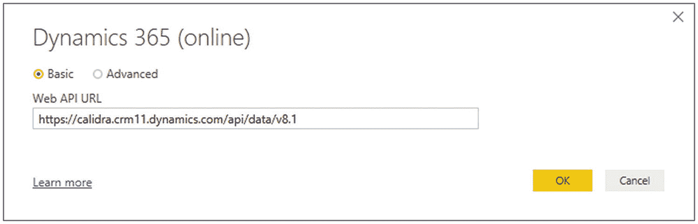
图 5-16 — `Dynamics 365 (online)` 对话框

3. 单击 `Connect`。将出现 `Dynamics 365 (online)` 对话框。
4. 输入你用于连接到 Dynamics 365 的 URL，并添加 `/api/data/v8.1`（至少，在本书付印时情况如此）。它可能类似于图 5-16 所示。但请注意，此 URL 会根据你所在的地理位置而变化。

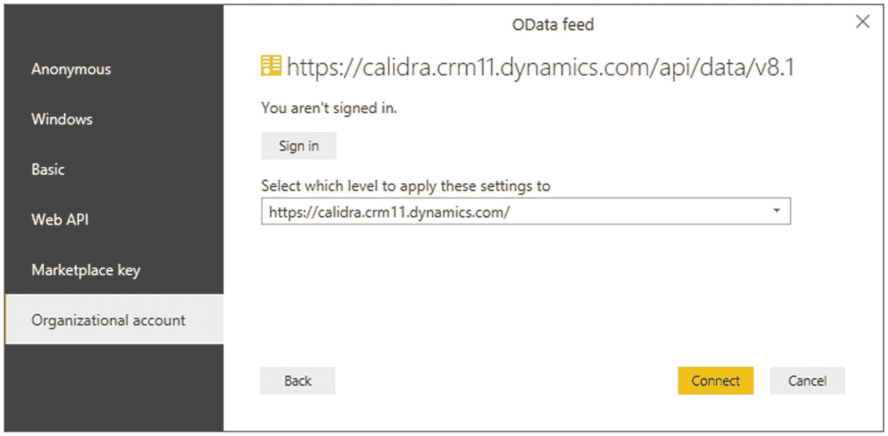
图 5-17 — Dynamics 365 的 OData 源对话框

5. 单击 `OK`。将出现 OData 源对话框。这是因为 Power BI 使用 OData 连接到 Dynamics 365 Online。
6. 选择 `Organizational account` 作为安全访问方法。OData 源对话框将如图 5-17 所示。

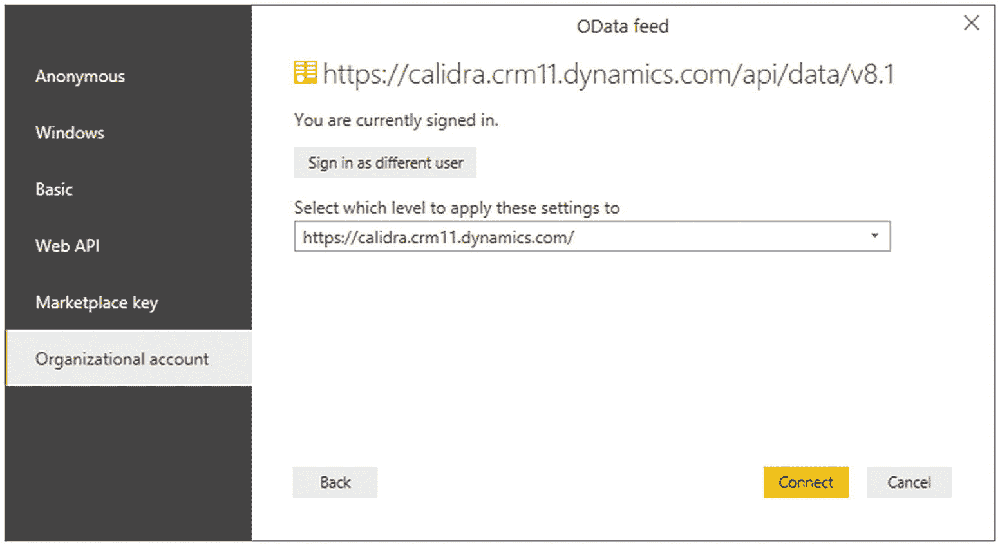
图 5-18 — 登录后的 OData 源对话框

7. 单击 `Sign in` 登录你的 Dynamics 365 账户，并按照 Microsoft 登录流程操作。完成后，OData 源对话框将类似于图 5-18 所示。

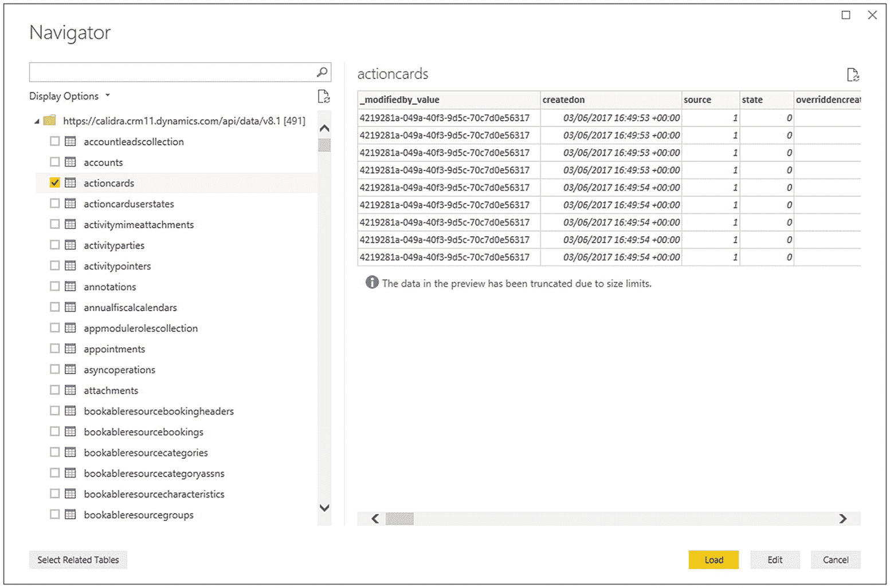
图 5-19 — Dynamics 365 的 `Navigator` 对话框

8. 单击 `Connect`。将出现 `Navigator` 对话框，显示你有权限连接的所有 Dynamics 对象。你可以在图 5-19 中看到一个示例。

**注意：** 在第 6 步中你看到，MS Dynamics 365 连接实际上是一个 OData 连接。OData 将在本章后续部分详细解释。

Dynamics 365 的表数量非常庞大——并且这个数量会根据你组织订阅的服务而有所不同。然而，实际上，你是在访问一个数据库结构。这意味着你必须对底层数据如何存储有一定的了解。如果你想了解 Dynamics 365 的表，我建议你先从 Microsoft 在线帮助手册开始，网址为 [`https://docs.microsoft.com/en-us/dynamics365/unified-operations/dev-itpro/data-entities/data-entities`](https://docs.microsoft.com/en-us/dynamics365/unified-operations/dev-itpro/data-entities/data-entities)。

## Google Analytics

假设你已经设置了一个有效的 Google Analytics 账户，你可以使用 Power BI Desktop 连接到你有权限访问的 Google Analytics 数据。要使此示例生效，你需要一个有效且可正常使用的 Google Analytics 账户。

**注意：** 要注册一个可用于测试 Power BI Desktop 的 Google Analytics 账户，请访问 [`www.google.com/analytics`](http://www.google.com/analytics)。

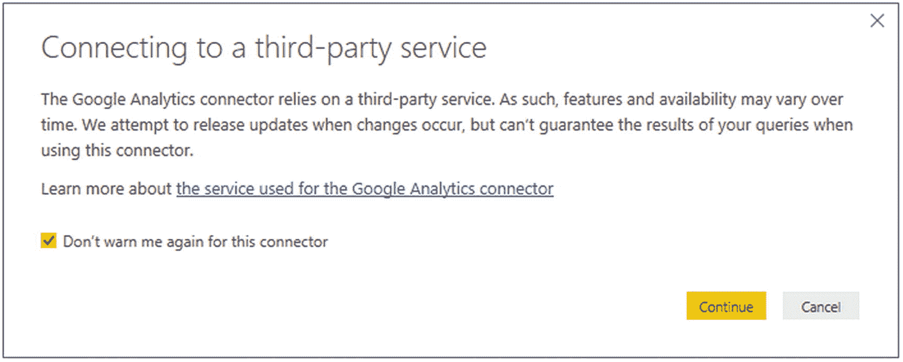
图 5-20 — 第三方服务连接器警报

1. 在 Power BI Desktop 的“开始”功能区中，单击 `Get Data` 按钮。
2. 单击左侧的 `Online Services`，然后在右侧选择 `Google Analytics`。`Connecting to a third-party service` 对话框将如图 5-20 所示。

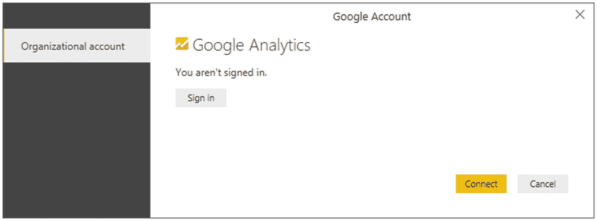
图 5-21 — Google Analytics 连接对话框

3. 单击 `Continue`。将出现 Google 账户对话框。当前它看起来像图 5-21 所示。

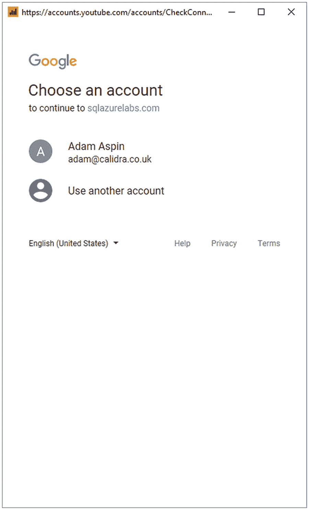
图 5-22 — Google Analytics 登录对话框

4. 单击 `Sign in`。将显示 Google 选择账户对话框。当前它看起来像图 5-22 中的图像。

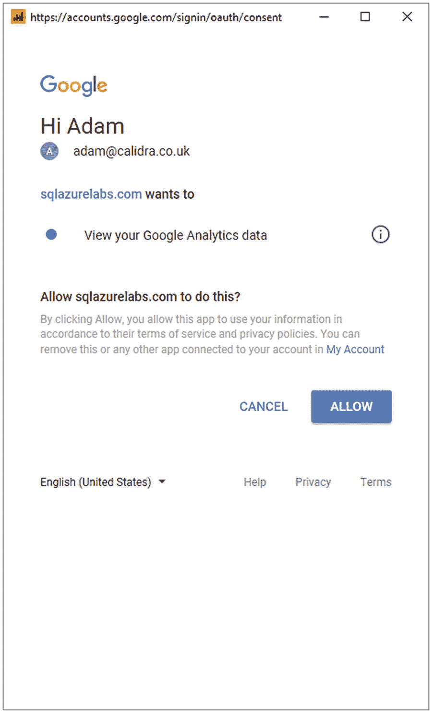
图 5-23 — Google Analytics 权限对话框

5. 单击要用于 Google Analytics 的现有账户。将出现 Google Analytics 权限对话框。当前它看起来像图 5-23 所示。

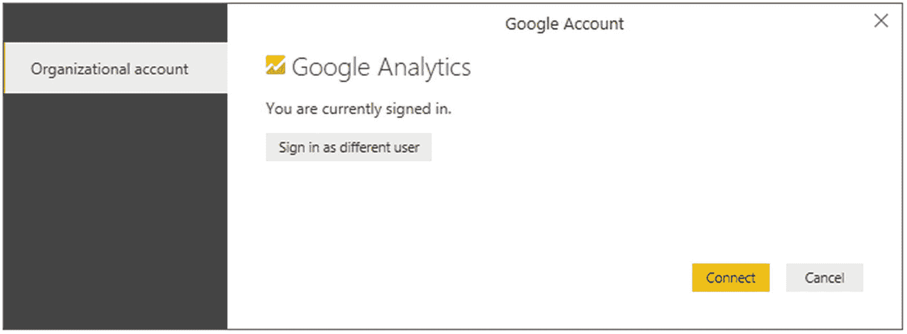
图 5-24 — 登录后的 Google Analytics 对话框

6. 单击 `Allow`。你将返回到 Google 账户对话框，但这次是已登录状态。你可以在图 5-24 中看到这一点。
7. 单击 `Connect`。将出现 `Navigator` 对话框，显示你可以在 Google Analytics 中连接的数据表。

## OData 源

# Power BI 数据源连接指南

OData 是开放数据协议（Open Data Protocol）的简称。该协议允许 Web 客户端发布和编辑被标识为 URL 的资源。通过 OData 连接的数据可以是表格形式，也可以是不同的结构。

OData 是一种连接基于 Web 的数据的通用方法。因此，每个 OData 源都可能与你之前使用过的其他源不同。事实上，在连接 Dynamics 365 时，你已经接触过 OData。

然而，有大量可用的 OData 源。有些是公开的，有些只有在你拥有适当权限时才能访问。但访问方法通常大同小异。下面是一个如何连接 Microsoft 免费提供的 OData 示例源的示例（至少在本书付印时是如此）：

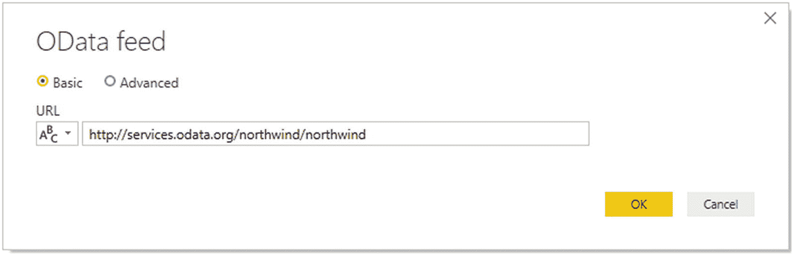

1.  在 Power BI Desktop 的“开始”功能区中，单击`获取数据`按钮底部的小三角形。或者，单击`获取数据`按钮，然后从`获取数据`对话框的左侧窗格中选择`其他`。
2.  从菜单中选择`OData 源`。将出现 OData 源对话框。
3.  输入用于连接 OData 源的 URL。在此示例中，我将使用一个 Microsoft 示例 OData 源，该源位于 [`http://services.odata.org/northwind/northwind.svc`](http://services.odata.org/northwind/northwind.svc)。对话框应如图 5-25 所示。
4.  单击`确定`。将显示导航器对话框，并显示使用指定 URL 可用的数据。

## OData 选项

OData 源对话框（与你之前在本章中看到的`从 Web`对话框非常相似）还包含一个`高级`按钮。选择此按钮将展开对话框，允许你向 URL 添加一个或多个 URL 部分。你可以在图 5-26 中看到这一点。

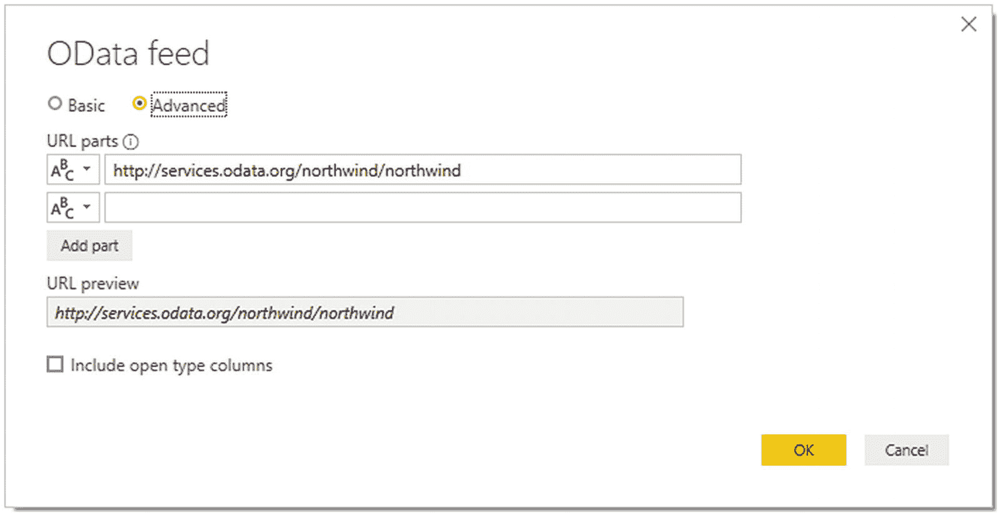

> **注意：** URL 部分可以在 Power BI Desktop 查询编辑器中进行参数化。我将在第 11 章中解释参数化。

## Azure SQL 数据库

SQL Server 不仅仅作为本地数据库存在。它也可以作为“平台即服务”（也称为 PaaS）使用。简单来说，这让你能够按需付费模式满足数据库需求，你可以在几分钟内在云中启动一个数据库服务器，然后根据需求进行扩展，而无需购买和维护硬件及软件。

连接到 Microsoft 的 PaaS 产品（称为 Azure SQL 数据库）非常简单。如果你有公司 Azure SQL 数据库的详细信息，可以使用它进行连接。如果没有，但想尝试将 Power BI Desktop 连接到 Azure SQL 数据库，你始终可以向 Microsoft 申请一个免费试用账户，并在几分钟内设置一个 Azure SQL 数据库。如果你选择这条路径，可以通过以下 URL 找到如何操作（包括加载你将在本节稍后连接到的示例数据）的说明：[`https://docs.microsoft.com/en-gb/azure/sql-database/sql-database-get-started-portal`](https://docs.microsoft.com/en-gb/azure/sql-database/sql-database-get-started-portal)。

> **提示：** 在创建用于测试目的的 Azure SQL 数据库时，请务必将源定义为`示例`。这将确保 MS 示例数据加载到你的测试数据库中。

要从 Power BI Desktop 连接到 Azure SQL 数据库：

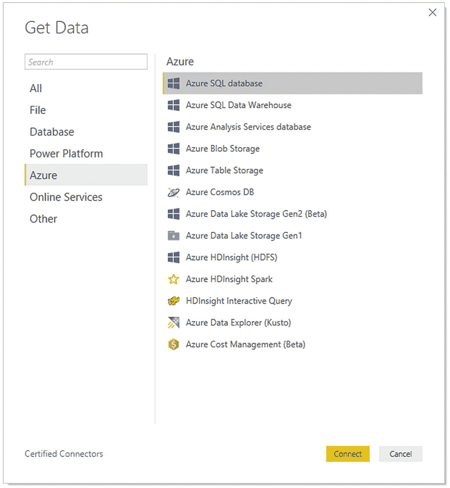

1.  打开一个新的 Power BI Desktop 应用程序。
2.  在 Power BI Desktop 功能区中，单击`获取数据`按钮底部的小三角形，然后单击`更多`。
3.  单击左侧列表中的`Azure`，然后单击右侧的`Azure SQL 数据库`。`获取数据`对话框将类似于图 5-27 所示。

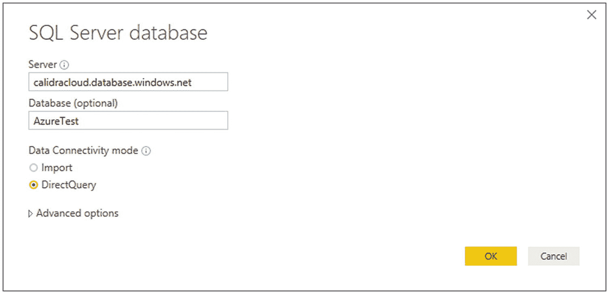

4.  单击`连接`。将出现 SQL Server 数据库对话框（毕竟，Azure SQL 数据库也是一个 SQL Server 数据库——只不过在云中）。
5.  输入你从 Microsoft Azure 管理门户获取（或由公司 DBA 提供）的 Azure SQL 数据库服务器名称。SQL Server 数据库对话框将类似于图 5-28 所示。

6.  单击`确定`。将出现凭据对话框。
7.  单击左侧的`数据库`，然后输入有效的用户名和密码。凭据对话框将类似于图 5-29 所示。

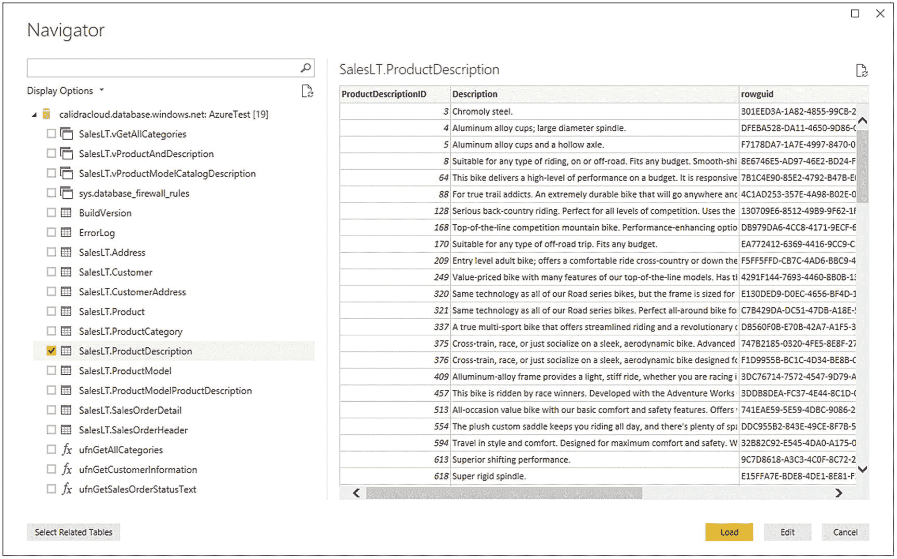

8.  单击`连接`。将出现导航器对话框，显示你在 Azure SQL Server 数据库中有权访问的数据库。如果你使用的是 Microsoft 为默认 Azure SQL 数据库提供的测试数据，此对话框将类似于图 5-30 所示。

> **注意：** 如果你要设置 Azure SQL 数据库，请确保包括防火墙规则，以允许从运行 Power BI Desktop 的计算机连接到 Azure SQL 数据库。

如果你按照第 3 章中的步骤连接到了本地 SQL Server 数据库，那么你可能会觉得这里使用的方法几乎完全相同。幸运的是，Power BI 开发团队努力使这两个过程尽可能相似。这包括：

- 确保`数据源`设置由 Power BI Desktop 存储，并且可以像更新本地数据库连接一样进行更新
- 允许你使用`DirectQuery`（你在第 4 章中了解到）或将数据导入 Power BI Desktop 的内存数据模型
- 使用与本地 SQL Server 相同的“高级”选项（编写你自己的`SELECT`查询或使用存储过程）

## Azure SQL 数据仓库 (Azure Synapse Analytics)

Azure 提供了多种可用的数据存储平台。其中特别适合 Power BI Desktop 的是 Azure SQL 数据仓库——现在被称为 Azure Synapse Analytics。这是一个托管在 Azure 中的 MPP（大规模并行处理）数据仓库。

我再次假设，除非你手头有企业级的 Azure Synapse Analytics 实例，否则你将使用 Azure 试用账户，并且已经使用 Microsoft 提供的示例数据配置了 Azure Synapse Analytics。设置一个测试数据仓库与准备数据库非常相似，如上一节开头的 URL 所述。同样，你需要正确设置防火墙规则（尽管如果你之前已经为 Azure SQL 数据库等设置了防火墙规则，这或许并非严格必要）。

假设你可以访问一个 Azure Synapse Analytics 实例：

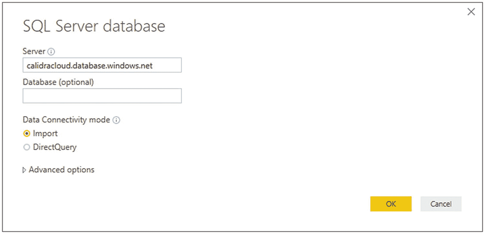

1.  打开一个新的 Power BI Desktop 应用程序。
2.  在 Power BI Desktop 功能区中，点击`获取数据`按钮底部的小三角形，然后点击`更多`。
3.  在左侧列表中点击`Azure`，然后在右侧点击`Azure SQL 数据仓库`。
4.  点击`连接`。将出现 SQL Server 数据库对话框。

# 连接到 Azure SQL 数据仓库

输入你从 Microsoft Azure 管理门户获取的（或者企业 DBA 提供给您的）Azure SQL 数据仓库服务器名称。`SQL Server` 数据库对话框将如图 5-31 所示。这是因为 `Azure Synapse Analytics` 本质上是一个 `SQL Server` 数据库。

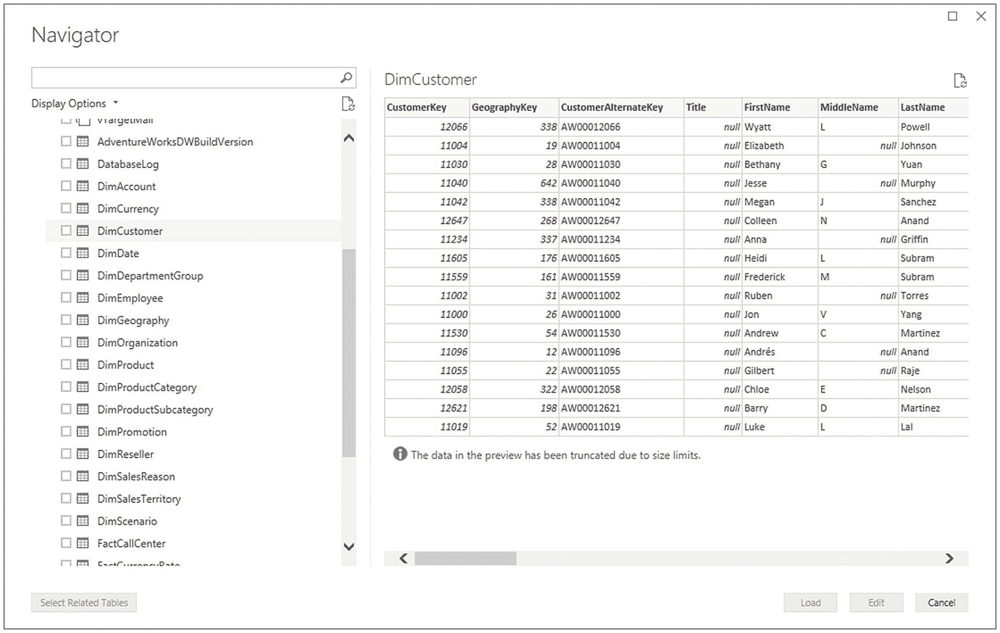

图 5-32 显示示例数据的 `Azure Synapse Analytics` 连接导航器对话框

5. 选择 `导入` 按钮，然后点击 `确定`。将出现凭据对话框。
6. 点击左侧的 `数据库`，输入有效的用户名和密码。
7. 点击 `连接`。将出现导航器对话框，显示你在 `Azure SQL Server` 数据库中有权限访问的数据库。如果你使用的是 Microsoft 提供的测试数据，该对话框将如图 5-32 所示。
8. 选择你需要的表，然后点击 `加载` 或 `编辑` 以返回 `Power BI Desktop` 并开始向报表添加视觉对象。

> **注意：** 不要因为指定服务器和数据库的对话框标题显示为“`SQL Server` 数据库”而感到困惑。这将正确地连接到 `Azure` 数据仓库。

与本地连接的情况一样，你可以选择实时连接（即使对话框称其为 `DirectQuery`），并在加载数据时展开 `高级选项` 字段以输入特定的 `SQL` 查询。

# 连接到 Azure 虚拟机上的 SQL Server

现在，越来越多的数据库由云服务提供商托管在企业环境之外。通过诸如 `Amazon`（提供适用于 `SQL Server` 的 `RDS`）或 `Microsoft`（在 `Azure` 中提供适用于 `SQL Server` 的虚拟机或 `VM`）等提供商，你现在可以将数据库部署在企业外部，并几乎可以从世界任何地方访问它们。

因此，为了扩展 `Power BI Desktop` 可用的数据源范围，我们现在将简要了解如何连接到 `Azure` 虚拟机上的 `SQL Server`。诚然，连接到 `Azure` 虚拟机上的 `SQL Server` 几乎与连接到企业环境中的 `SQL Server` 相同。但是，值得花点时间简要解释如何从云中的 `SQL Server` 实例将数据返回到 `Power BI Desktop`。

再次强调，如果你的企业环境中没有托管在 `Azure` 虚拟机上的 `SQL Server` 实例，你始终可以使用 `Azure` 试用账户来测试此过程。然而，我无法在此解释如何在虚拟机上设置 `SQL Server` 实例，因为这超出了本书的范围。不过，如果你需要，有许多可用资源可以解释如何执行此操作。

要连接到虚拟机上的 `SQL Server`：

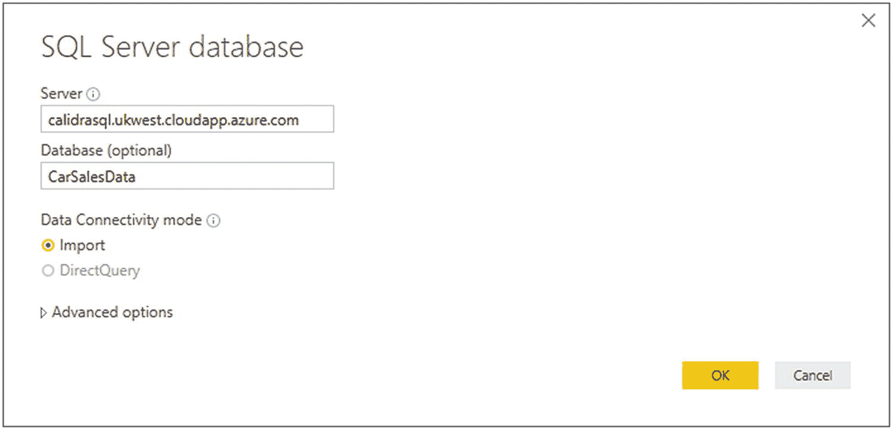

图 5-33 针对 `Azure VM` 的 `Microsoft SQL Server` 数据库对话框

1. 打开一个新的 `Power BI Desktop` 应用程序。
2. 在 `Power BI Desktop` 功能区中，点击 `获取数据` 按钮底部的小三角形，然后点击 `SQL Server`。将出现 `SQL Server` 数据库对话框。
3. 在 `服务器` 文本框中输入描述服务器的完整字符串。该字符串要么由企业 `DBA` 提供给你，要么，如果你使用的是自己的 `Azure` 账户，你可以在 `Azure` 管理门户中找到它。
4. 输入数据库名称；如果你已将本书附带的示例数据加载到虚拟机中的 `SQL Server` 实例中，则该名称为 `CarSalesData`。该对话框将如图 5-33 所示。

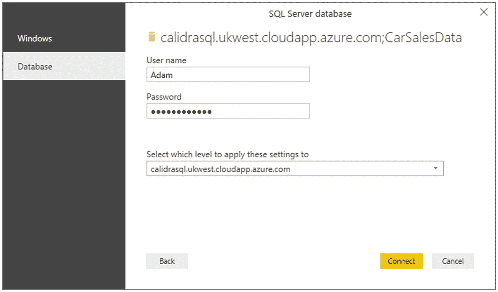

图 5-34 连接到虚拟机时的 `SQL Server` 数据库对话框

5. 点击 `确定`。将出现“访问 `SQL Server` 数据库”对话框。选择 `数据库` 作为安全模式，并输入用户名和密码，如图 5-34 所示。如果你使用的是自己的 `Azure` 账户，这些可以是你在设置虚拟机时指定的用户名和密码。
6. 如果你看到加密支持对话框，请点击 `确定`。将出现导航器对话框，列出你拥有权限查看的、由虚拟机托管的 `SQL Server` 上的所有表。

如你所见，这个过程与你之前在第 3 章中遵循的连接到 `SQL Server` 的过程几乎完全相同。尽管如此，我有几点需要提请你注意：

*   使用 `Azure VM` 的多部分名称作为服务器名称。
*   与连接到本地 `SQL Server` 实例的情况一样，你可以根据需要选择数据库。
*   如果 `VM` 指定了公共 `IP` 地址，你可以使用服务器的 `IP` 地址作为数据库名称。
*   安全性是一个宏大且独立的问题。在企业环境中，你*可能*能够使用 `Windows` 安全进行连接。但对于测试 `VM`，你几乎肯定必须使用数据库安全性。
*   与 `Azure` 中的情况一样，必须正确设置防火墙。

# Azure Blob 存储

本章我要向你介绍的最后一个 `Azure` 数据源是 `Azure Blob 存储`。从各方面来看，你可以将其视为云端的文件共享（就 `Power BI Desktop` 而言）。因此，如果需要访问以文件形式存储的数据，可以通过 `Azure Blob 存储` 进行连接。

同样，你需要拥有公司提供的 `Azure Blob 存储` 访问权限，或者一个 `Azure` 试用账户。无论哪种情况，你都需要将位于 `C:\PowerBiDesktopSamples\MultipleIdenticalFiles` 文件夹中的两个示例文件复制到 `Azure Blob 存储` 的一个容器中。关于如何下载示例文件，请参阅附录 A。

当源数据已存在于 `Azure Blob 存储` 中后，你可以执行以下步骤：

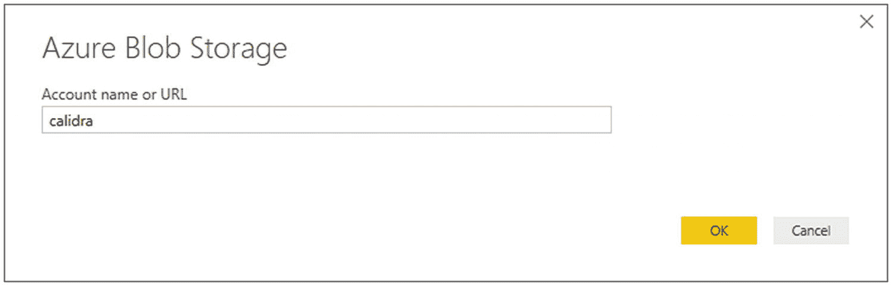

图 5-35 `Azure Blob 存储` 连接对话框

1.  打开一个新的 `Power BI Desktop` 应用程序。
2.  在 `Power BI Desktop` 功能区中，单击 `获取数据` 按钮底部的小三角形，然后单击 `更多`。
3.  单击左侧列表中的 `Azure`，然后点击右侧的 `Azure Blob 存储`。将显示 `Azure Blob 存储` 连接对话框。
4.  输入用于连接 `Azure Blob 存储` 的账户名称。`Azure Blob 存储` 对话框将如图 5-35 所示。如果你使用的是公司提供的 `Azure Blob 存储` 账户，系统管理员会提供此信息。在测试场景下，你可以通过打开 `存储帐户` 边栏选项卡并复制 `Blob 服务终结点`，在 `Azure` 管理门户中找到它。

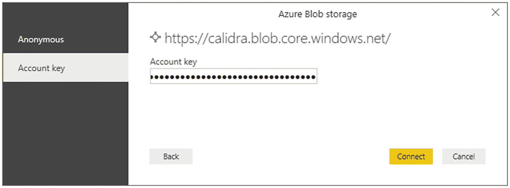

图 5-36 `Azure Blob 存储` 帐户密钥对话框

1.  单击 `确定`。将显示 `Azure Blob 存储` 帐户密钥对话框。
2.  在 `Azure` 管理门户中，复制一个帐户密钥。可通过单击 `存储帐户` 边栏选项卡，然后单击 `访问密钥`，在 `Azure` 管理门户中找到它们。如果系统管理员已向你发送了帐户密钥，请改用该密钥。
3.  将帐户密钥粘贴到 `Azure Blob 存储` 帐户密钥对话框中。该对话框将如图 5-36 所示。

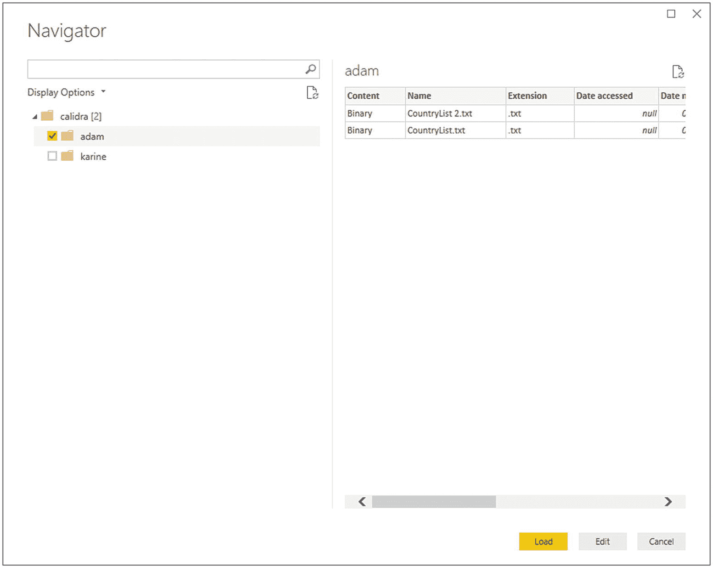

图 5-37 导航器对话框，显示 `Azure Blob 存储` 中的可用容器

1.  单击 `连接`。将显示导航器，列表中显示所选容器中的文件。你可以在图 5-37 中看到示例。
2.  单击 `加载`。`Azure` 中存储的文件列表将显示在 `Power BI Desktop` 中。

> **注意：** 需要特别指出的是，至少目前，从 `Azure` 返回的是可用文件列表。第 10 章将解释如何从部分或全部可用文件中选择和加载数据到 `Power BI Desktop`，以便用作分析基础。

# Azure 安全性

所有云服务提供商都极其重视安全性。正如本章所见，连接基于云的数据时，你通常需要输入某种形式的安全令牌和/或指定有效的用户名和密码。

你输入的所有安全信息都存储在 `Power BI Desktop` 存储设置中。可以按照你在第 3 章中学习到的更新或删除数据库安全信息的方法，来删除或修改这些信息。

# 结论

本章概述了如何检索通过互联网访问的数据。这些数据范围可能涵盖网页上的数据表，到巨大的`Azure Synapse Analytics`。或者，你可能需要基于`Salesforce`、`Google Analytics`或`MS Dynamics 365`数据创建仪表板。也许你的组织已决定将其数据中心迁移到云端，并使用`Azure SQL Server`或`Amazon Redshift`。无论哪种情况，`Power BI Desktop`都可以连接并访问这些服务和存储库中可用的数据。它甚至可以访问`Hadoop`中的大数据。

鉴于在线数据源数量庞大，本章只能触及这一巨大潜在数据存储库领域的皮毛。然而，由于`Power BI Desktop`严格遵循数据访问标准化，你应该能够将本章学到的知识应用于许多其他数据服务，无论是现有的还是未来的。