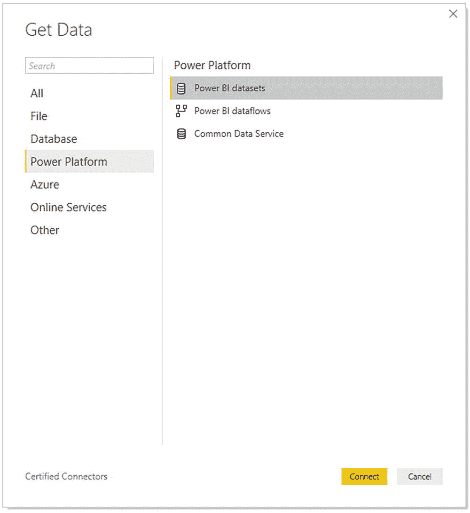
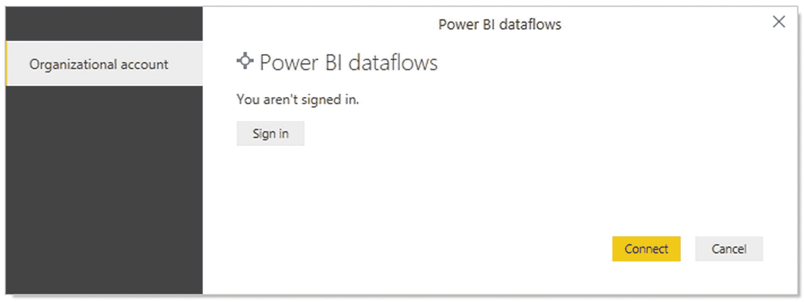
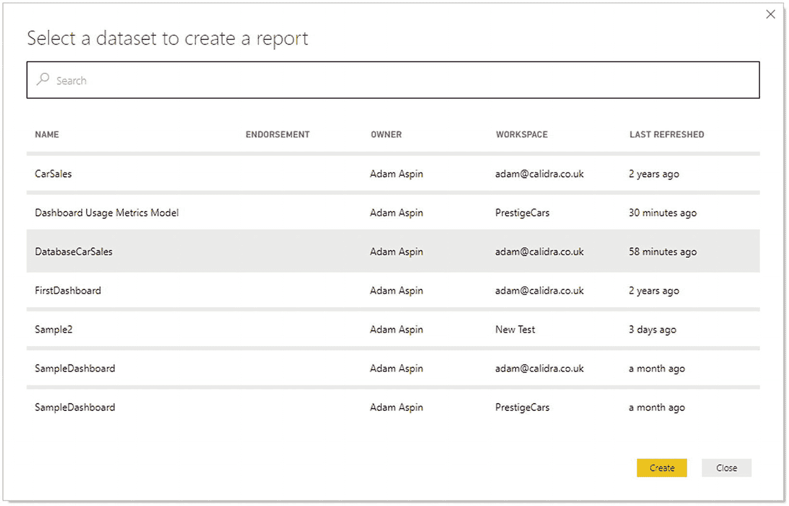
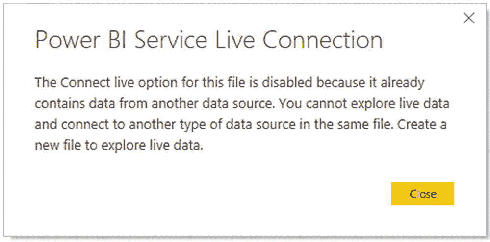
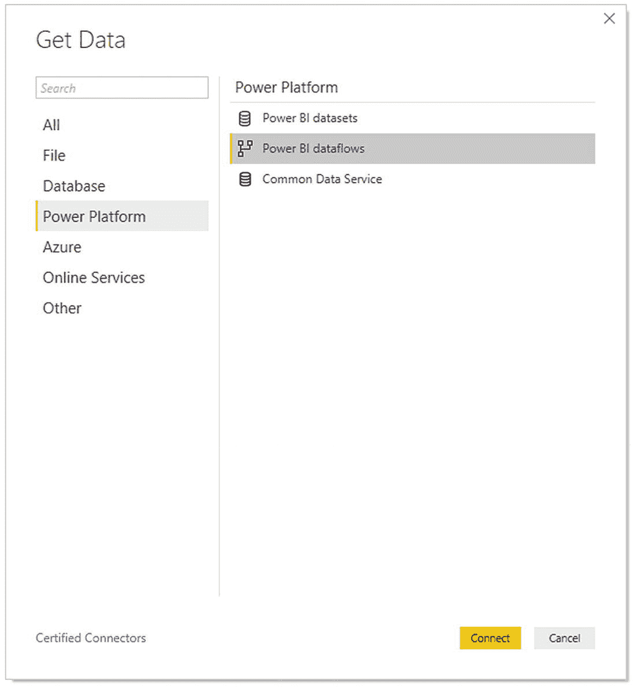
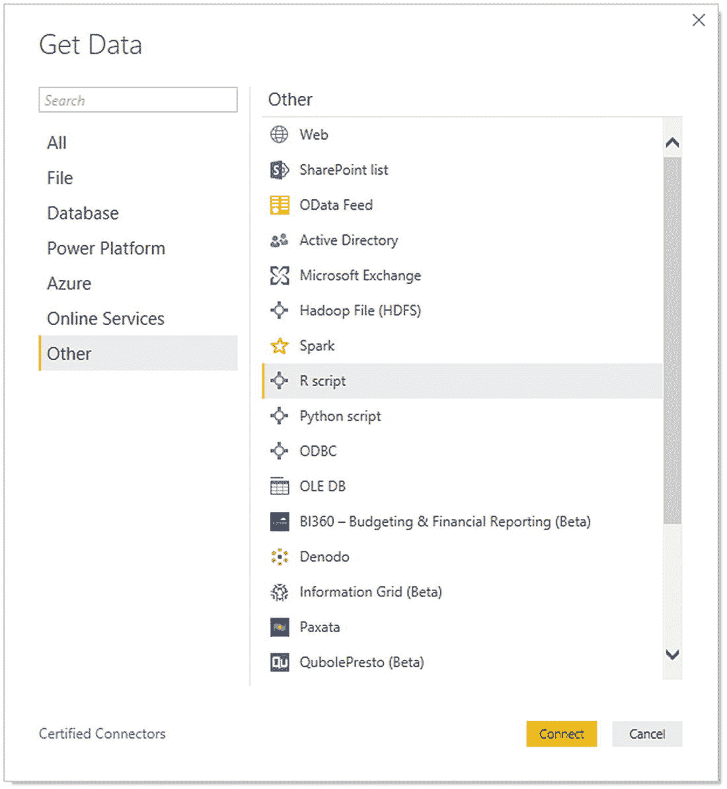
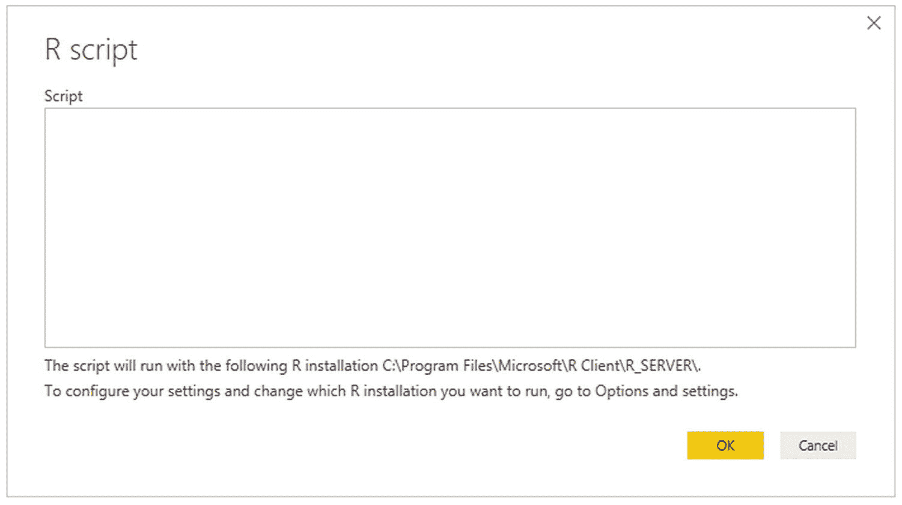

# 6. 从其他数据源加载数据

## 其他数据源

目前，Power BI 连接器可用的数据源有数十种。显然，不可能逐一解释如何使用它们。无论如何，可用数据源列表逐月增长——因此这是一项徒劳的任务。为了快速结束我们对可用源数据的浏览，本章将介绍：

- Power BI 数据集
- Power BI 数据流
- R 转换
- Python 转换
- 通用数据模型
- ODBC 数据
- OLE DB 数据
- 添加自己的自由格式表

如果你已按照附录 A 中的下载说明操作，本章使用的所有文件都将位于 `C:\PowerBIDesktopSamples` 文件夹中。

## Power BI 数据集

Power BI 数据集是为最终用户设计的完整数据模型，已在 Microsoft 的云平台 Power BI 服务中提供。通常，Power BI 数据集经过精心设计，仅包含你所需的数据。它们几乎总是受到企业数据管理员的严格控制。

**注意：** 只有拥有 Power BI 账户并已获得数据集创建者授予的访问权限，你才能访问 Power BI 数据集。如有疑问，请咨询你所在组织的 IT 部门。

如果你已知组织中存在可用的 Power BI 数据集，你可以连接到这些数据集，并将其用作仪表板和报告的基础，操作如下：

**图 6-1** Power BI 数据集的`获取数据`对话框

1.  在 Power BI Desktop 的“开始”功能区中，单击`获取数据`按钮。
2.  单击左侧的`Power Platform`，然后选择右侧的`Power BI 数据集`。`获取数据`对话框将如图 6-1 所示。

**图 6-2** Power BI 数据流和数据集的连接对话框

1.  登录到 Power BI 服务（如果你尚未登录）。你可以在图 6-2 中看到登录提示。

**图 6-3** Power BI 服务中的可用数据集

1.  登录后，单击`连接`。你将看到所有当前可用数据集的列表，如图 6-3 所示。当然，你只会看到专门为你提供的数据集。
2.  单击`创建`。数据集中的表和字段将显示在 Power BI Desktop 的`字段`窗格中。

现在，你可以使用 Power BI 数据集中的数据作为报告和仪表板的基础。

你需要知道，一旦建立了与 Power BI 服务实时连接的连接，除了使用数据构建仪表板和报告之外，你能做的事情非常有限。更具体地说，你无法使用第 7 章至第 10 章中介绍的任何技术来转换数据。如果你尝试修改数据结构，将会看到如图 6-4 所示的对话框。

**图 6-4** Power BI 服务实时连接对话框

**注意：** 如果你面对的是庞大的可用数据集列表，请记住，可以通过在`数据集`对话框顶部的搜索字段中输入数据集名称中包含的几个字符来筛选列表。只需删除输入的字符即可显示完整列表。

## Power BI 数据流

Power BI 数据流是数据摄取和转换过程的输出。它们总是返回一个或多个数据表。与 Power BI 数据集的情况一样，Power BI 数据流通常设计为仅包含你所需的数据，并且几乎总是受到企业数据管理员的严格控制。

如果你已获得使用 Power BI 数据流中数据的权限，可以通过以下方式连接：

**图 6-5** Power BI 数据集的`获取数据`对话框

1.  在 Power BI Desktop 的“开始”功能区中，单击`获取数据`按钮。
2.  单击左侧的`Power Platform`，然后选择右侧的`Power BI 数据流`。`获取数据`对话框将如图 6-5 所示。
3.  登录到 Power BI 服务（如果你尚未登录）。
4.  单击`连接`。你将在`导航器`中看到所有当前可用数据流的列表。当然，你只会看到专门为你提供的数据流。
5.  展开包含你要连接的数据集元素的数据集文件夹。
6.  选择你所需的一个或多个数据流。
7.  单击`加载`。数据流中的表和字段将显示在 Power BI Desktop 的`字段`窗格中。

现在，你可以使用 Power BI 数据流中的数据作为报告和仪表板的基础。

## R 语言转换

尽管 Power BI Desktop 在准备仪表板和报告所需的数据方面功能极其强大（你将在第 7 章至第 10 章中了解更多），但有时你可能更倾向于使用其他工具来执行一些高度特定的数据准备工作。

其中一个工具就是 R 语言。R 是一个用于统计分析和数据科学的开源平台。如果你有 R 语言的使用经验，并希望将其与 Power BI 结合使用，可以尝试以下操作：

**注意：** 若要用 R 语言脚本准备要加载到 Power BI 中的数据，你首先需要在计算机上安装 R。你可以在以下网址找到 R：[`https://mran.revolutionanalytics.com/download`](https://mran.revolutionanalytics.com/download)。

**图 6-6** 选择使用 R 脚本时的`获取数据`对话框

1.  在 Power BI Desktop 的“开始”功能区中，单击`获取数据`按钮。
2.  单击左侧的`其他`，然后选择右侧的`R 脚本`。`获取数据`对话框将如图 6-6 所示。

**图 6-7** R 脚本对话框

1.  单击`连接`。将出现 R 脚本对话框，你可以在其中粘贴连接数据并对其进行预处理的脚本。你可以在图 6-7 中看到此对话框。
2.  单击`确定`。数据流中的表和字段将显示在 Power BI Desktop 的`字段`窗格中。

R 语言是一个庞大的主题，我无意在此书中尝试解释如何使用它的哪怕一小部分。我只是想让 R 语言的实践者知道，他们可以利用自己已有的知识，并将其应用于 Power BI 服务。

**注意：** R 脚本对话框绝对*不是*一个 R 集成开发环境。因此，你可能需要一个 R IDE 来准备和测试脚本，然后再将其粘贴到 R 脚本对话框中。

