# 9. 重构数据

在前两章中，您学习了如何优化数据集，仅定义您真正需要的数据行和列。接着，您学习了如何清理和补全这些列所包含的数据。在本章中，您将学习如何在这些基础上继续构建，以交付能够被塑造成结构化和可用数据模型的数据。

在 Power BI Desktop 中，此类数据准备的通用术语称为*重构数据*。它涵盖以下内容：

*   合并查询：这涉及将两个查询关联起来，以便将两个数据源的数据显示为单个数据集。您将学习如何利用第二个查询中的多个列来扩展查询，以及如何聚合第二个查询中的数据并将其添加到初始数据集。您还将了解在合并查询时如何创建复杂的联接。

*   透视和逆透视数据：如果您需要将行中的数据显示为列（或反之），那么您可以使用 Power BI Desktop 查询编辑器来精确完成此操作。这意味着您可以确保您使用的所有表中的数据都符合标准化的表格结构，这种结构对于 Power BI 高效运行至关重要。

*   转置数据：这可能需要将列转换为行，反之亦然。

*   数据质量分析：这意味着使用 Power BI 查询编辑器来了解可用数据的质量。

这些技术可以——并且很可能——与您之前在第 7 章和第 8 章中看到的许多技术一起使用。毕竟，Power BI Desktop 查询的一大优势在于，它认识到数据转换是一项复杂的工作，因此不会强制规定任何严格的工作方式。事实上，它让您能够自由地尝试多种数据转换选项。所以请记住，在转换源数据时，您可以自由选择任何方法。唯一重要的是它能为您带来期望的结果。

## Power BI Desktop 查询编辑器视图功能区

到目前为止，我们主要关注 Power BI Desktop 查询编辑器的“开始”、“转换”和“添加列”功能区。这完全是因为这些功能区几乎涵盖了所有主要操作。然而，还有第四个必不可少的 Power BI Desktop 查询编辑器功能区——视图功能区。它所包含的按钮如图 9-1 所示，相关选项在表 9-1 中进行了说明。

**表 9-1** Power BI Desktop 视图功能区选项

| 选项 | 描述 |
| --- | --- |
| `查询设置` | 显示或隐藏 Power BI Desktop 窗口右侧的“查询设置”窗格。这包括“应用的步骤”列表。 |
| `公式栏` | 显示或隐藏包含转换步骤的 `M` 语言代码的公式栏。 |
| 等宽字体 | 以等宽字体显示预览。 |
| 显示空格 | 显示空格和换行符。 |
| 列质量 | 显示列质量特征。 |
| 列分布 | 显示列分布特征。 |
| 列概况 | 显示列概况特征。 |
| 转到列 | 允许您选择特定的列。 |
| 始终允许 | 允许在数据源和转换对话框中进行参数化。 |
| `高级编辑器` | 显示“高级编辑器”对话框，其中包含查询中所有步骤的代码。 |
| 查询依赖关系 | 显示查询链接和依赖关系的顺序。 |

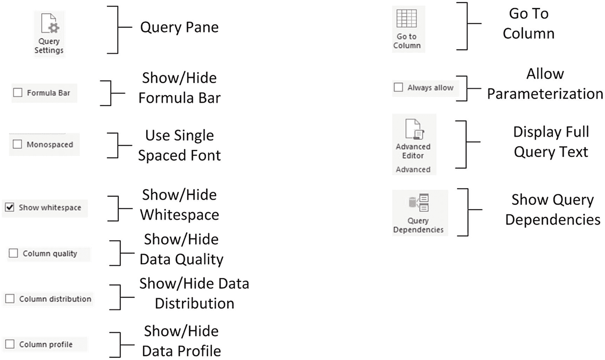

**图 9-1** Power BI Desktop 视图功能区

可能唯一不是立即自明的选项是`高级编辑器`按钮。它会将查询中所有转换的代码作为一个 `M` 语言脚本块显示。您将在第 12 章中了解更多相关信息。

**提示**

就我个人而言，我觉得在转换数据时，`查询设置`窗格和`公式栏`对于 Power BI Desktop 查询窗口来说过于重要，不能移除。因此，我倾向于让它们保持可见。不过，如果您需要屏幕空间，可以随时暂时隐藏它们。

## 合并数据

到目前为止，我们将每个单独的查询视为独立存在。当然，现实情况是，您经常需要将一个查询的输出与另一个查询的输出结合使用，以各种方式联接来自不同数据源的数据。假设一个查询的结果与另一个查询共享一个（或多个）公共字段，您可以将查询“联接”成一个单一的“扁平化”数据表。Power BI Desktop 将此称为合并操作，它使您能够，除其他事项外：

*   在另一个“参考”表中查找数据元素以添加查找数据。例如，您可能希望添加客户名称，而主表中仅存在客户参考编号。

*   聚合“明细”表（例如发票行）中的数据，并将合计值包含在更高粒度的表中，例如发票表。

同样，这个过程并不困难。唯一的基本因素是，您要合并的两个表或查询必须具有一个或多个共享字段，以便两个表能够连贯地匹配记录。让我们来看几个例子。

### 添加数据

首先，我们来尝试查找一些额外数据并将其添加到查询中：

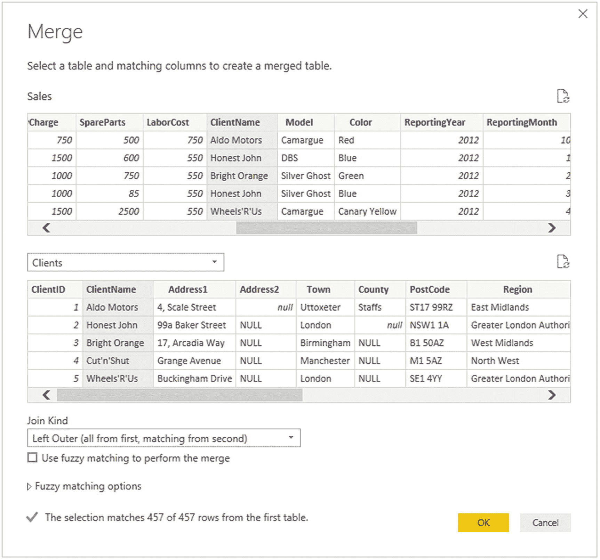

图 9-2：合并对话框

1.  在一个新的空白 Power BI Desktop 文件中，加载 `C:\PowerBiDesktopSamples\SalesData.xlsx` Excel 文件中的两个工作表。

2.  在“开始”功能区中点击“`转换数据`”按钮。

3.  在 Power BI Desktop 查询窗口的“查询”窗格中，点击名为“`Sales`”的查询。

4.  在“开始”功能区中点击“`合并查询`”按钮。此时将显示“合并”对话框。

5.  在对话框的上半部分（显示当前查询输出的概览处），向右滚动并点击“`ClientName`”列的标题。该列将被高亮显示。

6.  在上方表格下方的弹出菜单中，选择“`Clients`”查询。该查询的输出将显示在对话框的下半部分。

7.  在下方表格中，选择与你在步骤 5 中选择的列相对应的列（即联接列）的列标题。此处同样选择“`ClientName`”列。该列会在下方表格中被选中。系统可能会要求你为数据源设置隐私级别。如果是这样，请将其设置为“`Public`”。

8.  从“联接种类”弹出菜单中选择“`内部(仅限匹配行)`”。对话框将如图 9-2 所示。

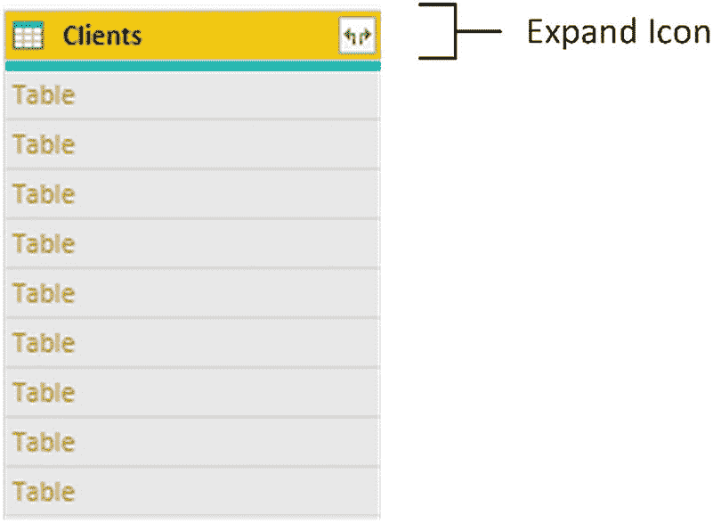

图 9-3：一个新的合并列

9.  点击“`确定`”。一个新列将被添加到现有数据表的右侧。该列被命名为“`Clients`”——代表被合并的表。

10. 向右滚动现有数据表。新列的每个单元格中都包含单词“`Table`”。此列看起来将类似于图 9-3。

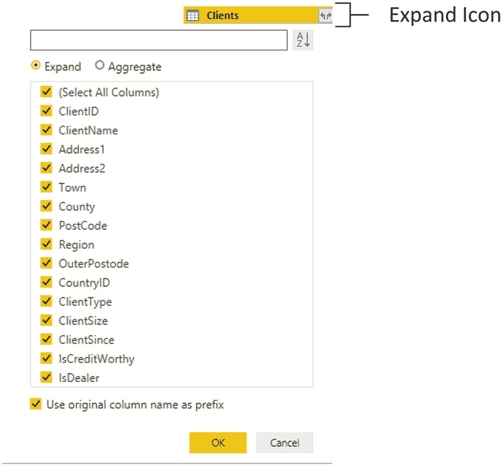

图 9-4：联接查询中可用的字段

11. 点击添加列的右侧的展开图标（该列应为你合并到源查询中的第二个查询的名称）。该数据表（或查询）中所有可用字段的弹出列表将显示出来，如图 9-4 所示。

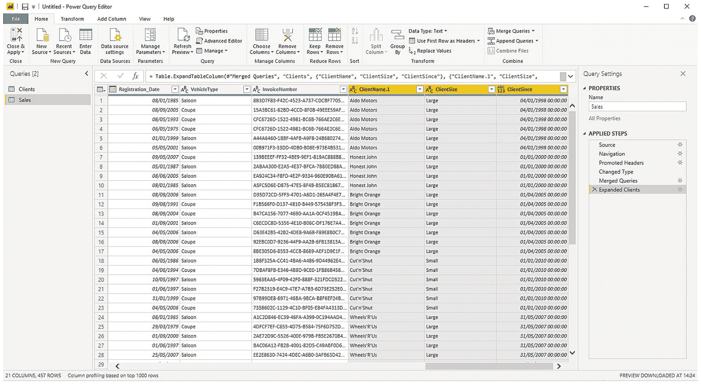

图 9-5：合并后的列输出

12. 确保选中“`展开`”单选按钮。

13. 取消选中“`(选择所有列)`”复选框，清除所有列的选择。

14. 选择以下列：
    - `ClientName`
    - `ClientSize`
    - `ClientSince`

15. 取消选中“`使用原始列名作为前缀`”。

16. 点击“`确定`”。来自链接表的选定列将合并到主表中，并且对参考表（“`新列`”）的链接将被移除。

17. 重命名已添加的列，然后应用并关闭查询。结果应如图 9-5 所示。

现在，你拥有一个包含来自两个链接数据源的数据的单一数据表。重新处理“`Sales`”查询也将重新处理依赖的“`clients`”查询，并导致最新版本的数据被重新加载到合并后的查询中。

**注意：** 你可能已经注意到，“合并”对话框指示了两个查询中有多少匹配的记录。这可以是一个有用的指示，表明你已选择了正确的列来联接这两个查询。

### 在合并操作期间聚合数据

如果你不只是查找参考数据，而是需要聚合来自单独表的数据，然后将结果添加到当前查询中，那么该过程大致相似。然而，这第二种方法旨在满足另一个完全不同的需求。之前，你看到的是当前查询中有许多记录映射到查找表中*单个*记录的情况。这第二种方法适用于当你的当前（或主）查询中有一条记录，而第二个查询中有*多条*链接记录的情况。因此，你需要聚合第二个表中的数据，以便将数据带入第一个表。这里有一个简单的例子，使用了来自 `C:\PowerBiDesktopSamples\CH09` 文件夹的一些示例数据：

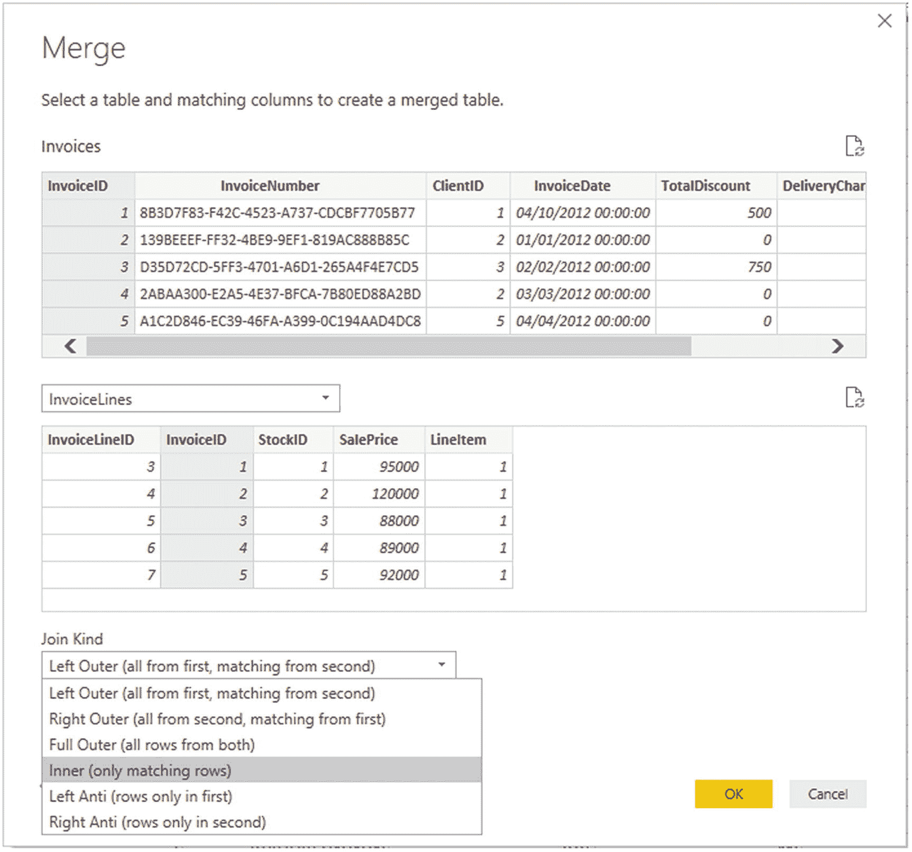

图 9-6：聚合数据时的合并对话框

1.  在一个新的 `Power BI Desktop` 文件中，从 `C:\PowerBiDesktopSamples` 文件夹中的 `InvoicesAndInvoiceLines.xlsx` Excel 源文件加载两个表。点击“`转换数据`”以在 `Power BI Desktop` 查询编辑器中查看它包含的两个工作表（`Invoices` 和 `InvoiceLines`）。这将创建两个查询。
2.  在左侧的“查询”窗格中，点击名为“`Invoices`”的查询。
3.  在“`开始`”功能区中，点击“`合并查询`”按钮。将打开“`合并`”对话框。你将在对话框的上半部分看到来自 `Invoices` 数据集的一些数据。
4.  点击“`InvoiceID`”列内的任意位置。该列被选中。
5.  在弹出菜单中，选择“`InvoiceLines`”查询。你将在对话框的下半部分看到来自 `InvoiceLines` 数据集的一些数据。
6.  点击下方表格中“`InvoiceID`”列内的任意位置。该列被选中。
7.  从“联接种类”弹出菜单中选择“`内部(仅限匹配行)`”。对话框将如图 9-6 所示。

图 9-7：来自合并数据集的可用字段
8.  点击“`确定`”。“`合并`”对话框将关闭，并在“`Invoices`”查询的右侧添加一个名为“`InvoiceLines`”的新列。
9.  向右滚动现有数据表。你将看到新列（名为“`InvoiceLines`”），其中的每个单元格都包含单词“`Table`”。
10. 点击新列标题右侧的展开图标（两个左右指向的箭头）。将显示 `InvoiceLines` 查询中所有可用字段的弹出列表。
11. 选择“`聚合`”单选按钮。
12. 选择“`SalePrice 的合计`”字段，并取消选中所有其他字段。
13. 取消选中“`使用原始列名作为前缀`”复选框。对话框将如图 9-7 所示。
14. 点击“`确定`”。

`Power BI Desktop` 将计算每张发票的总售价，并将其作为一个新列添加。当然，如果求和不是你想要的，你可以选择要应用的聚合类型（在点击“`确定`”之前）。要执行此操作，请将光标悬停在要聚总的列上（参见上一练习中的步骤 11），然后点击字段名右侧的弹出菜单。`Power BI Desktop` 将建议一组选项。可用的聚合选项如表 9-2 所述。

**表 9-2：合并聚合选项**

| 选项 | 说明 |
| --- | --- |
| `Sum` | 返回该字段的总值。 |
| `Average` | 返回该字段的平均值。 |
| `Median` | 返回该字段的中位数。 |
| `Minimum` | 返回该字段的最小值。 |
| `Maximum` | 返回该字段的最大值。 |
| `Count (All)` | 计算数据集中的所有记录数。 |
| `Count (Not Blank)` | 计算数据集中非空的记录数。 |

**提示：**
如果在步骤 1 中加载了数据而未编辑查询，只需点击 `Home` 功能区中的 `Transform Data` 按钮，即可切换到 `Query Editor`。

刚才所见的合并过程本身虽不复杂，却突然开启了许多新的可能性。这意味着你现在可以创建多个独立的查询，随后将它们结合使用，以扩展数据，从而能够准备相当复杂的数据集。

关于合并操作，我有几点需要说明：
- 在合并数据集时，只能使用之前在 `Power BI Desktop Query` 窗口中已创建的查询。因此，在尝试合并操作之前，请务必先连接所有所需的数据集。
- 刷新一个查询会导致合并到该查询中的任何其他查询也一并刷新。通过这种方式，你将始终从该过程中的所有查询获取最新的数据。

### 联接类型

在合并查询（无论目的是连接数据还是聚合值）时，你需要选择如何关联这两个查询。联接类型的选择会对生成的数据集产生深远影响。因此，了解可用的六种联接类型至关重要。这些类型描述于表 9-3 中。

**表 9-3** 联接类型

| 联接类型 | 说明 |
| --- | --- |
| 左外部 | 保留 `Merge` 对话框中上方数据集（即开始合并操作时处于活动状态的数据集）中的所有记录。保留第二个数据集中所有匹配的行（那些在联接列中具有共同值的行）。第二个数据集中的所有其他行将被丢弃。 |
| 右外部 | 保留 `Merge` 对话框中下方数据集（即开始合并操作时未处于活动状态的数据集）中的所有记录。保留上方数据集中所有匹配的行（那些在联接列中具有共同值的行）。上方数据集（即开始合并操作时处于活动状态的数据集）中的所有其他行将被丢弃。 |
| 完全外部 | 两个查询中的所有行都保留在结果数据集中。任何在联接字段中不具有共同值的记录，其某些列将包含空白。 |
| 内部 | 仅联接那些在所选联接列上完全匹配的查询。任一查询中在联接列上不具有共同值的行都将被丢弃。 |
| 左反 | 仅保留上方（第一个）查询中的行。 |
| 右反 | 仅保留下方（第二个）查询中的行。 |

**注意**：当你使用任何 *外部* 联接时，你保留了第二个查询中没有对应记录的行。因此，结果数据集中某些列会包含空值。

当展开作为合并数据集链接的列时，有几个有用的选项值得了解：
- 使用原始列名作为前缀
- 搜索要展开的列

#### 使用原始列名作为前缀

你可能会发现，来自已联接查询的某些列在两个源数据集中可能具有相同的名称。因此，你需要识别出哪些列来自哪个数据集。如果你保持选中“使用原始列名作为前缀”合并选项（这是默认设置）的复选框，任何合并的列都将包含源查询名称，以帮助你更准确地识别数据。

如果你发现这些较长的列名反而碍事，可以取消选中此复选框。这将使从第二个查询添加的列保留其原始名称。但是，由于 `Power BI Desktop` 不能接受重复的列名，任何新列的名称后面都会添加上 `.1`、`.2` 等后缀。

#### 搜索要展开的列

如果你正在将一个查询合并到另一个包含大量列的查询，那么滚动查找你想要包含的列可能会很费力。为了缩小搜索范围，你可以在 `Search columns to aggregate` 框中输入你要查找的列名称中的几个字符。你输入的字符越多，在 `Expansion` 弹出对话框中显示的匹配列就越少。

### 基于多列进行联接

在之前的示例中，你仅基于单个列联接了查询。虽然如果你处理的是来自结构清晰的源（如关系数据库）的数据时这可能可行，但在联接来自不同源的查询时，你可能需要扩展这一原则。幸运的是，`Power BI Desktop` 允许你在需要时基于 *多个* 列来联接查询。

举例来说，示例数据中包含一个我准备好的文件，作为如何基于超过一个列来联接查询的示例。此示例文件包含你在前几章中看到的来自多个源的数据。不过，它们已被建模为数据仓库星型模式。为了完成该模型，你需要将一个名为 `Geography` 的维度联接到一个名为 `Sales` 的事实表，以便将字段 `GeographySK` 添加到事实表中。然而，`Sales` 表和 `Geography` 表共享三个字段（`Country`、`Region` 和 `Town`），这些字段必须对应才能联接查询。以下内容说明了如何使用多个字段执行联接：

**图 9-8** 使用多列联接查询
1.  在一个新的 `Power BI Desktop` 文件中，单击 `Get Data`，选择 `Excel` 作为源，然后在位于 `C:\PowerBiDesktopSamples\StarSchema.xlsx` 的 Excel 文件中，选择两个工作表（`Geography` 和 `Sales`）。
2.  单击 `Transform Data` 以打开 `Query Editor`。如果你已经在 `Query Editor` 中，只需单击 `New Source`，选择 `Excel` 作为源数据类型，并加载这两个工作表。
3.  从 `Power BI Desktop Query` 窗口左侧的 `Queries` 窗格的现有查询列表中，选择 `Sales` 查询。
4.  在 `Home` 功能区中，单击 `Merge Queries` 按钮。将出现 `Merge` 对话框。
5.  在查询弹出列表中，选择 `Geography` 作为要联接到第一个（上方）查询的第二个查询。
6.  从 `Join Kind` 弹出列表中选择 `Inner`（仅匹配行）。
7.  在上方字段列表（取自 `Sales` 表）中，按住 `Ctrl` 键 *按此顺序* 依次单击 `CountryName` 和 `Region` 字段。每个列标题右侧将出现一个小数字，表示你选择列的顺序。
8.  在下方字段列表（取自 `Sales` 表）中，按住 `Ctrl` 键 *按此顺序* 依次单击 `CountryName` 和 `Region` 字段。每个列标题右侧将出现一个小数字，表示你选择列的顺序。

9.  在对话框底部的信息消息中，确认匹配行的数量合理。对话框看起来将类似于图 9-8。

10. 单击`OK`。

然后你可以继续重组数据。在此示例中，即是将`GeographySK`字段添加到`Sales`查询，然后从`Sales`查询中移除`Country`、`Region`和`Town`字段。

联接查询时可使用的列数没有实际限制。这完全取决于源数据的形态。然而，用于定义联接的每一列必须存在于两个数据集中，并且每一对列的数据类型必须相同（或相似）。

## 模糊匹配

模糊匹配允许你在合并操作中，通过使用模糊匹配逻辑来比较要连接的列中的值，而不是在数据中寻找精确匹配。

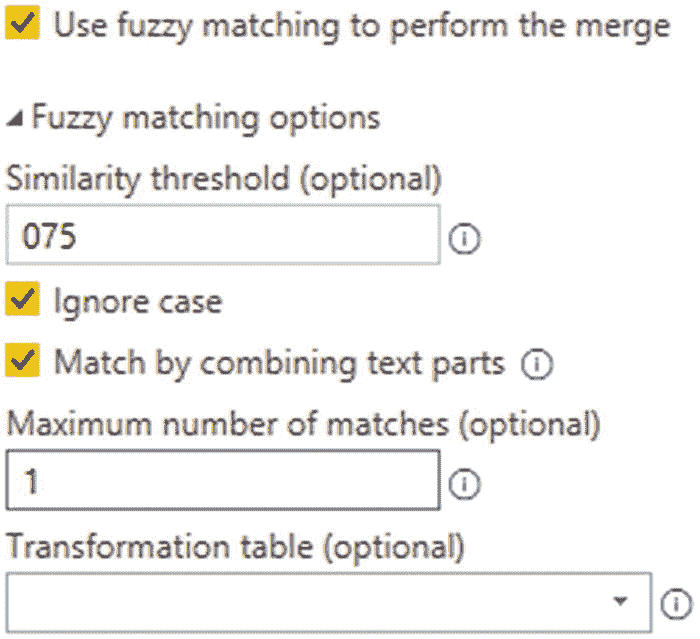

图 9-9 模糊匹配

1.  开始一个合并操作（像之前做的那样），选择要合并的两个表以及用于连接查询的列。
2.  在“合并”对话框中，勾选`使用模糊匹配执行合并`。
3.  设置相似度阈值。这定义了查询编辑器在跨两个查询寻找相似元素进行匹配时可以应用的“容差范围”。
4.  输入最大匹配数。对话框将如图 9-9 所示。

### 模糊匹配选项

有几个你可能想要应用的模糊匹配选项——而且在使用此技术时你肯定需要理解它们。这些选项在表 9-4 中进行了说明。

表 9-4 模糊匹配选项

| 选项 | 说明 |
| :--- | :--- |
| 相似度阈值 | 指示两个值需要有多相似才能匹配。最小值`0.00`会导致所有值相互匹配，最大值`1.00`则只允许精确匹配。默认值为`0.80`。 |
| 忽略大小写 | 忽略两列中的大写和小写字符。 |
| 忽略空格 | 忽略两列中的空白字符。 |
| 最大匹配数 | 设置为每个输入行返回的最大匹配行数。默认行为是返回所有匹配项。 |
| 转换表 | 允许用户指定另一个包含手动准备的映射表的查询，以便某些值可以在匹配过程中自动映射。 |

模糊匹配是一种极其强大的技术，可以帮助你连接来自不同来源的数据集。不过，你可能需要反复试验才能找到合并查询时要使用的合适选项。

### 作为新查询合并

在上述合并过程中，你将数据合并到了一个源表中。但是，有时你可能更希望保持源查询（或者你喜欢称其为源表）不变，并将合并操作的结果输出到一个新查询中。

要做到这一点，诀窍是不要点击`合并`按钮本身，而是点击`合并`按钮右侧的箭头，并选择`将查询合并为新查询`。你可以在图 9-10 中看到此选项。

图 9-10 将表合并为新查询

这将创建一个名为`合并`的新查询（你可以稍后重命名），并保持原始查询不变。

### 准备用于连接的数据集

在连接查询之前，你可能需要对现实世界的数据集进行一些预处理工作。更具体地说，你用于连接的任何列都必须具有相同的基本数据类型。简而言之，你需要将基于文本的列与其他基于文本的列连接，数字列与数字列连接，日期列与日期列连接。如果列的数据类型*不*相同，则在“合并”对话框中尝试连接列时，你会收到一条警告消息。

因此，在开始合并操作*之前*，先查看你将用于连接查询的列几乎总是一个好主意。记住，数据类型不必完全相同，只需相似即可。例如，十进制数类型可以映射到整数。

在尝试合并查询之前，你可能还需要清理用于连接的列中的数据。这可能包括：
- 删除基于文本的列中的尾随或前导空格
- 隔离列的一部分（无论是在原始列中还是作为新列）用于连接
- 验证连接列中使用了适当的数据类型

### 正确与错误的连接

不幸的是，合并查询是一种在理论上往往比实践中更容易的数据重组操作。如果源查询基于关系型甚至维度型数据库中的表，那么连接它们可能会相对容易，因为数据架构师（希望如此）会设计数据库表以允许它们被连接。但是，如果你要连接两个完全独立的查询，则可能会面临几个主要问题：
- 列不匹配。
- 列匹配，但结果是一个包含重复记录的庞大数据表。

让我们来看看这些可能的问题。

#### 列不匹配

如果列不匹配（即，你已经连接了数据但没有得到任何结果记录），那么你需要仔细检查你用于建立连接的那些列中的数据。你需要提出的问题如下：
- 两个查询中的值是否具有相同的数据类型？
- 这些值是否真的能够匹配——还是它们本身就不相同？
- 你是否使用了正确的列？
- 你是否使用了过多的列，从而指定了两个查询中都不存在的数据？

#### 列匹配，但结果是一个包含重复记录的庞大数据表

连接查询取决于在两个源查询中隔离出*唯一*的数据。有时，单个列包含的信息不足以建立一个能唯一标识查询中一行的唯一引用。

在这些情况下，你需要使用两个或更多列来连接查询——否则结果中会出现重复的行。因此，再次强调，你需要仔细查看数据，并决定可以用来正确连接查询的最小列数。

### 检查已连接的数据

连接数据表并不总是容易的。判断合并操作的结果是否会产生你预期的结果也不容易。因此，Power BI Desktop 查询提供了一种解决这类困境的方法。它可以帮助你更清晰地看到连接做了什么。更具体地说，它可以向你显示第一个查询中的每条记录，究竟是从第二个查询中连接了哪些行。

执行以下操作来查看实际效果：

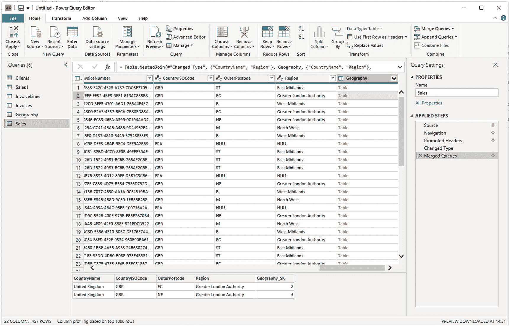

图 9-11 已连接的数据

1.  执行之前看到的示例中的步骤 1 到 10（“在多列上连接”一节）。
2.  在数据表中向右滚动。你将看到名为`Geography`的新列（如图 9-11 所示）。
3.  在你想要查看已连接数据的行中，点击单词`Table`的*右侧*。请注意，你*不能*点击单词`Table`本身。主查询的数据表下方将出现第二个表，其中包含针对该特定行从第二个查询连接过来的数据。图 9-11 展示了一个示例。

这种技术既简单又实用。不过，我还是需要说明几点：
- 你可以通过向上或向下拖动上方数据表的底部边框来调整下方表的大小（从而显示更多或更少来自第二个已连接表的数据）。
- 在`NewColumn`列中单击单词`Table`的右侧，将启用“转换”功能区中的`展开`和`聚合`按钮。
- 在`NewColumn`列中点击单词`Table`，会向查询中添加一个新步骤，该步骤会用链接的数据替换源数据。你还可以通过在`NewColumn`列内右键单击并选择`向下钻取`来执行此操作。

注意

向下钻取到合并后的表实际上会将该查询限制为子表的行。因此，如果你想要访问合并表中的所有数据，则必须删除此步骤。

## 追加数据

并非所有源数据都会完整地包含在单个文件或单个数据库表中。你可能会被授予访问两个或多个表或文件的权限，这些表或文件需要被加载到 Excel 或 Power Pivot 的同一个表中。在某些情况下，你可能会发现自己面临数百个文件——都是文本、CSV 或 Excel 格式——并且需要将它们全部加载到一个表中，作为你分析的基础。实际上，Power BI Desktop 也能够处理这些情况。

### 将一个查询的内容添加到另一个查询

在最简单的情况下，你可能拥有两个结构相同的数据源（即，它们具有顺序相同的相同列），而你需要做的就是将一个数据源添加到另一个数据源，最终得到一个输出两个源合并内容的查询。这被称为*追加数据*，只要两个数据源具有*完全相同*的结构，这就很容易实现；这意味着：
- 它们具有相同数量的列。
- 列的顺序相同。
- 每列的数据类型相同。
- 列名相同。

只要满足所有这些条件，你就可以将一个查询的输出（Power BI Desktop 也称之为*表*，包括我在内的许多人也称之为数据集）追加到另一个查询中。查询的数据不必来自相同的源类型，因此你可以将 CSV 文件的输出追加到来自 Oracle 数据库的数据中。例如，我们将获取两个文本文件，并用它们创建一个单一的输出：

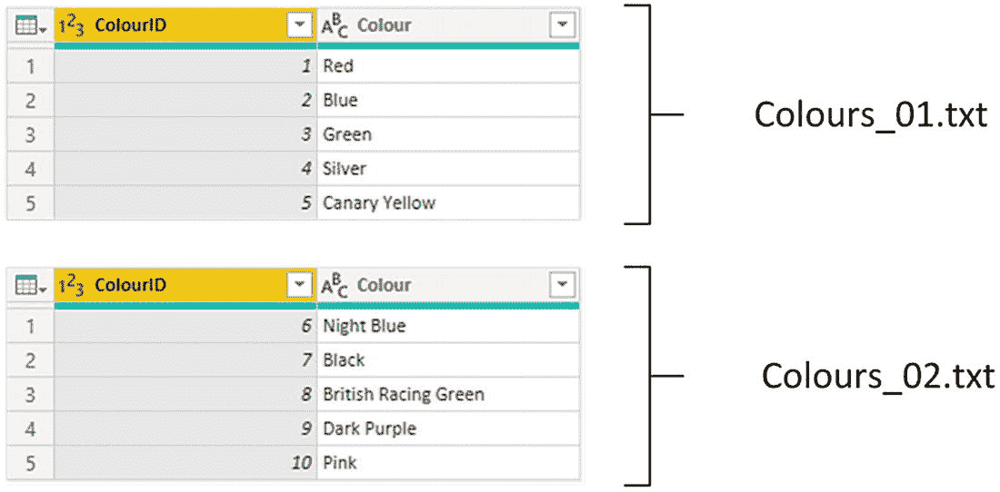

图 9-12 用于追加的源数据

1.  创建查询，将以下每个文本文件加载到 Power BI Desktop 中——但不要执行最后的加载步骤，该步骤会将它们添加到数据模型。两个文件都在`C:\PowerBiDesktopSamples\MultipleIdenticalFiles`文件夹中：
    - `Colours_01.txt`
    - `Colours_02.txt`
2.  将查询命名为`Colours_01`和`Colours_02`。你可以在图 9-12 中看到这两个查询的内容。

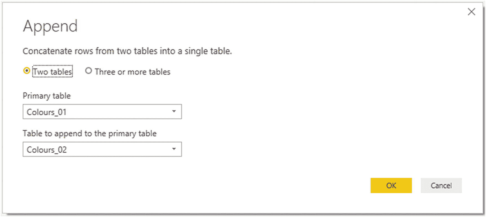

图 9-13 “追加”对话框

1.  打开其中一个查询（我使用`Colours_01`，但任一个都可以）。
2.  在`Power BI Desktop`查询编辑器“开始”功能区中，单击“追加查询”按钮右侧的箭头，然后选择“将查询追加为新查询”。将出现“追加”对话框。
3.  确保选中“两个表”单选按钮。
4.  从“要追加的表”弹出菜单中，选择查询`Colours_02`。该对话框看起来将如图 9-13 所示。

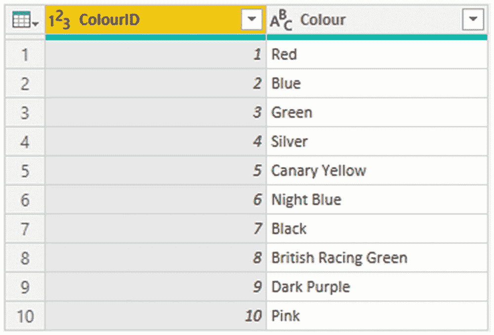

图 9-14 包含已追加数据的新查询

5.  单击“确定”。两个输出表中的数据将被追加到一个新查询中。你可以在图 9-14 中看到结果输出的示例。

现在你可以继续进行任何需要应用的修改。你会注意到，当表被相互追加时，列名不会作为数据的一部分重复出现。

这种方法的一个有趣之处在于，你在两个源表和新查询之间建立了一个链接。这意味着，当你刷新源数据时，不仅`Colours_01`和`Colours_02`表中的数据会更新，你刚刚创建的“派生”查询也会被更新。

### 追加多个查询的内容

`Power BI`查询编辑器并不限制你一次只能追加两个文件。你可以（如果确实需要）追加数量几乎无限多个的相同文件。

此外，你可以像追加文本或 CSV 文件一样轻松地追加 Excel 文件——如下例所示：

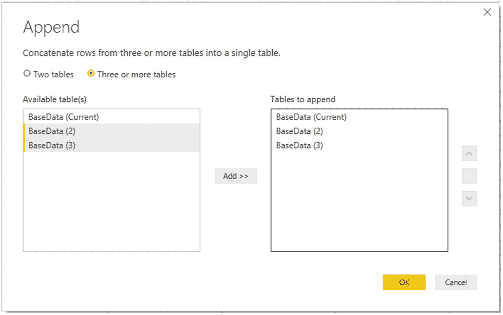

图 9-15 追加多个查询

1.  在一个新的、空的`Power BI Desktop`文件中，单击“转换数据”以打开查询编辑器。
2.  创建查询，加载`C:\PowerBiDesktopSamples\MultipleIdenticalExcel`文件夹中的所有 Excel 文件（这些文件是相同的，每个文件包含一个名为`BaseData`的工作表）。
3.  在左侧的“查询”窗格中选择名为`BaseData`的查询。
4.  单击“追加查询”按钮。
5.  在“追加”对话框中选择“三个或更多表”单选按钮。
6.  按住 Ctrl 键单击对话框左侧“可用表”列表中的`BaseData (2)`和`BaseData (3)`表。
7.  单击“添加”按钮。你可以在图 9-15 中看到“追加”对话框现在的样子。
8.  单击“确定”。查询`BaseData (2)`和`BaseData (3)`中的数据将被追加到当前查询 (`BaseData`) 中。

值得注意的一点是，你可以：
*   通过单击查询（或按住 Ctrl 键单击多个查询），然后依次单击对话框右侧的叉号图标，从右侧的要追加的查询列表中移除查询。
*   通过单击要移动的查询，然后依次单击对话框右侧的向上和向下尖括号，来更改查询的加载顺序。

## 更改数据结构

有时，你的需求会超越我们迄今为止在讨论数据清理和转换时所看到的技术。考虑到你获取的数据的形状，某些数据结构需要更彻底的改造。我将以下内容归入这一类：
*   逆透视数据
*   透视数据
*   转换行和列

这些技术中的每一种都旨在满足数据加载中特定但常见的需求，所有这些都将在接下来的几页中进行描述。

### 逆透视表

有时，你可能需要分析以“透视”或“非规范化”格式提供的数据。本质上，这意味着本应放在单个列中的信息被分解并放置到多个列中。在图 9-16 中给出了一个透视数据集的前几行示例，并且可以在`C:\PowerBiDesktopSamples\PivotedDataSet.xlsx`示例文件中找到。

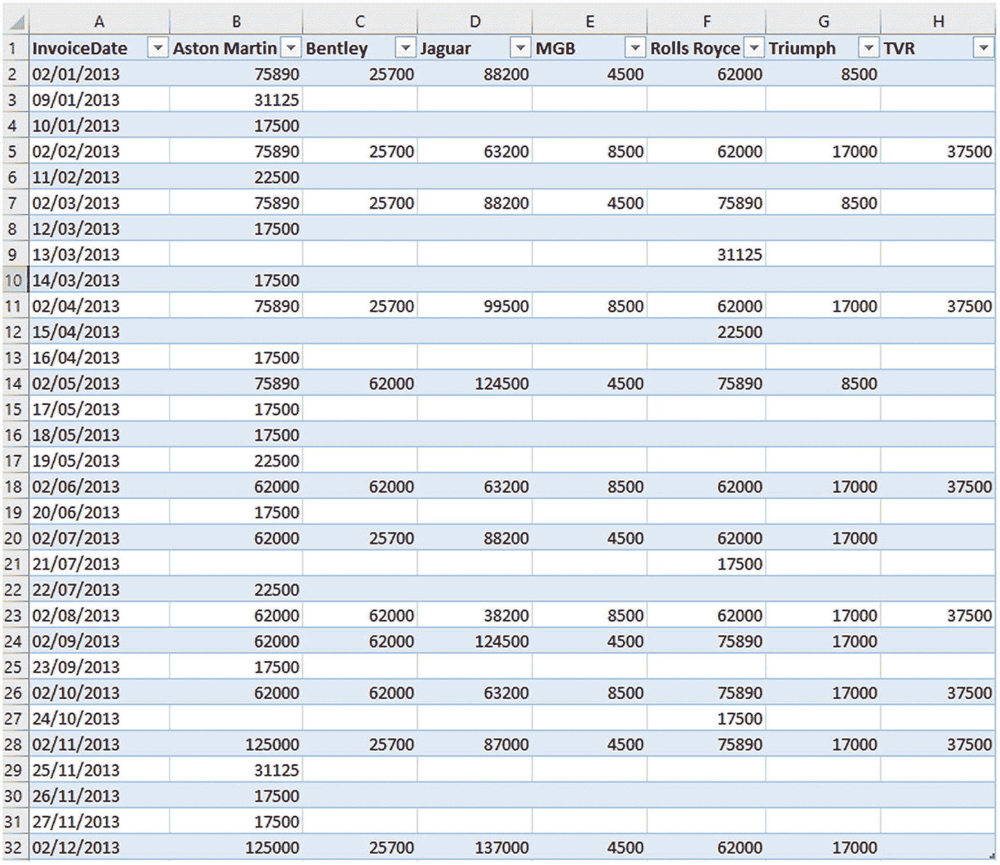

图 9-16 一个透视数据集

为了正确分析这些数据，我们确实需要将汽车的品牌从列标题切换为特定列的内容。幸运的是，这并不难：

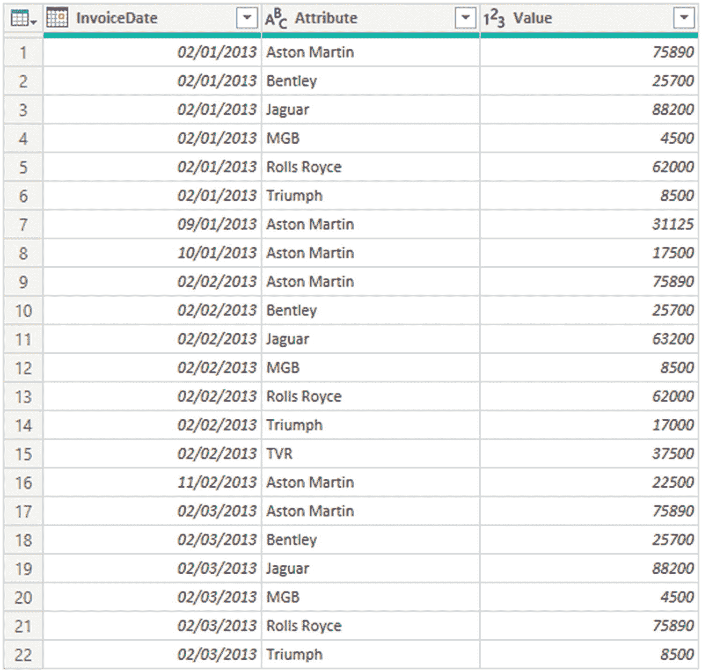

图 9-17 一个逆透视后的数据集

1.  在一个新的`Power BI Desktop`文件中，将`C:\PowerBiDesktopSamples\PivotedDataSet.xlsx`文件中的`PivotedCosts`表加载到`Power BI Desktop`中。确保第一行被设置为表的标题行。
2.  切换到查询编辑器（如果尚未打开），然后选择所有你想要逆透视的列。在此示例中，这意味着除了第一列（所有汽车品牌）之外的所有列。
3.  在“转换”功能区中，单击“逆透视列”按钮（或者右键单击任意选中的列，然后从上下文菜单中选择“逆透视列”）。表将被重新组织，前几条记录将如图 9-17 所示。`已逆透视的列`将被添加到`应用的步骤`列表中。
4.  重命名`Power BI Desktop`查询命名为`属性`和`值`的列。

数据现在以标准的表格方式呈现，因此可以用来创建数据模型，进而生成报表和仪表板。

#### 逆透视选项

在“转换”功能区的“逆透视列”弹出窗口中逆透视数据时，有几个可用选项：
*   `逆透视其他列`：这将把所有其他列的内容添加到逆透视的输出结果中。
*   `仅逆透视所选列`：这只会将任何预选列的内容添加到逆透视的输出结果中。

**注意：** 与使用`查询编辑器`应用的众多技术一样，在执行透视和逆透视操作之前，选择正确的列至关重要。

### 透视表

在某些情况下，您可能需要将数据从列切换到行，以便高效使用。这种操作称为*数据透视*。毫不意外，它与您在上一个部分看到的逆透视过程非常相似。

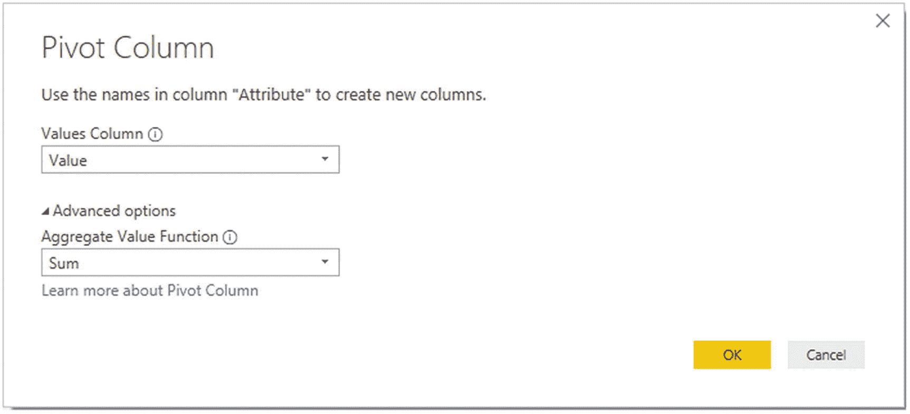

*图 9-18：透视列对话框*

1.  按照上一部分的步骤 1 到 3 操作，最终得到如图 9-17 所示的数据表。
2.  单击`Attribute`列内部。
3.  在“转换”功能区中，单击“透视列”按钮。将出现“透视列”对话框。
4.  选择`Value`（数字列）作为通过透视转换进行聚合的值列。
5.  展开“高级”选项，并确保将“求和”选为“聚合值函数”。“透视列”对话框将如图 9-18 所示。

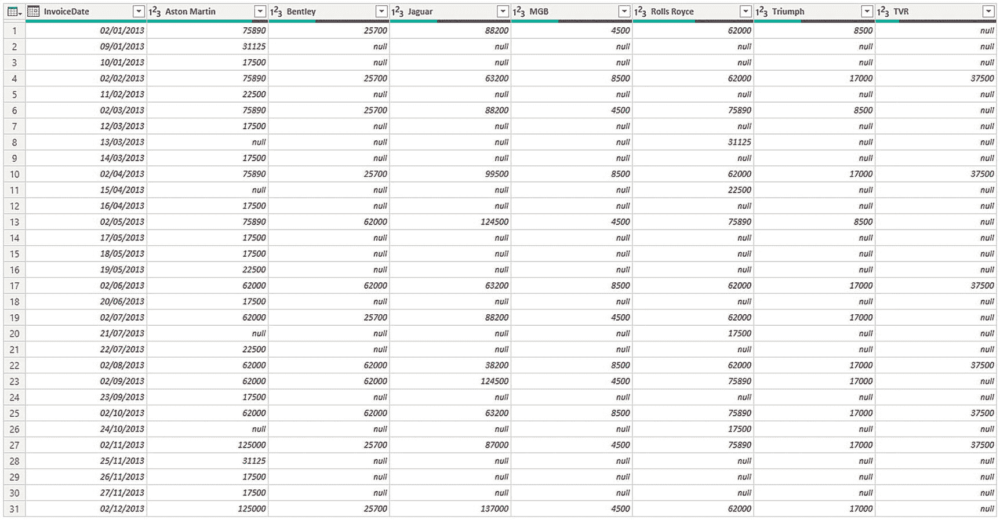

*图 9-19：透视后的数据*

6.  单击“确定”。表格已透视，外观如图 9-19 所示。`Pivoted Column`被添加到“应用的步骤”列表中。

**注意：** “透视列”对话框的“高级”选项部分允许您选择应用于透视表中值的聚合操作。

“逆透视”按钮包含另一个菜单选项，如果您单击“逆透视”按钮右侧的小三角形，则会显示该选项。这是“逆透视其他列”选项，它会在您运行转换时，将*未*选中的所有列的内容从列转换为行。

### 转置行和列

在某些情况下，您可能会遇到一个源表，其中列需要变为行，而行需要变为列。幸运的是，对于`Power BI Desktop`来说，这是一次点击即可完成的转换。操作方法如下：

*图 9-20：需要转置的数据集*

1.  在`Power BI Desktop`查询编辑器中编辑`C:\PowerBiDesktopSamples\DataToTranspose.xlsx` Excel 文件。您需要选择`Sheet1`。您将看到一个如图 9-20 所示的数据表。
2.  在“转换”功能区中，单击“转置”按钮。数据被转置，并显示为两列，就像您在第二章中看到的`CountryList.txt`文件一样。
3.  重命名生成的列。

## 数据质量分析

`Power BI Desktop`现在包含了帮助您分析数据质量和构成的功能。它可以通过提供以下信息，帮助您更深入地理解和感受源数据：
*   列质量
*   列分布
*   列配置文件

### 列质量

`Power BI Desktop`可以分析查询中每个数据列的以下方面：
*   数据有效性
*   错误
*   空字段

然后，它会返回每个列中这些元素的百分比。然后，您可以更详细地检查数据，以追踪潜在的异常情况。这里我们将使用文件 `CH08Example1.pbix`。

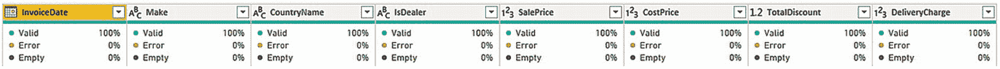

*图 9-21：列质量*

1.  在“查询编辑器”中，切换到“视图”菜单。
2.  勾选“列质量”复选框。如图 9-21 所示，列质量分析将显示在每个列标题下方。

### 列分布

分析列中数据的分布可以显示列包含的唯一值和不同值。这可以帮助您了解数据的相关性和有用性。

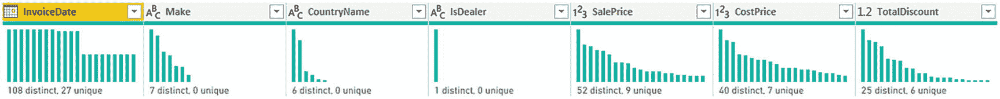

*图 9-22：列分布*

1.  勾选“列分布”复选框。如图 9-22 所示，列分布分析将显示在每个列标题下方。

值得注意的是列分布中不同元素和唯一元素之间的区别：

*   *不同*元素可能在列中出现多次——不同计数总数指示整体上存在多少个单独的元素。
*   *唯一*元素在列中仅出现一次。

### 列配置文件

列配置文件信息指示列中每个不同值相对于元素总数的百分比。

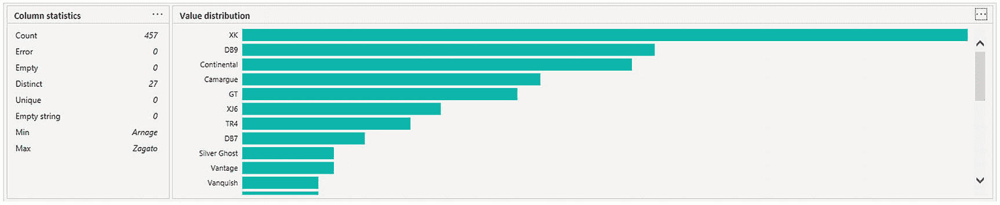

*图 9-23：列配置文件*

1.  勾选“列配置文件”复选框。如图 9-23 所示，列配置文件分析将显示在屏幕底部。

您甚至可以选择同时显示所有三个数据质量分析选项。如果这样做，最终可能会得到一个如图 9-24 所示的屏幕。

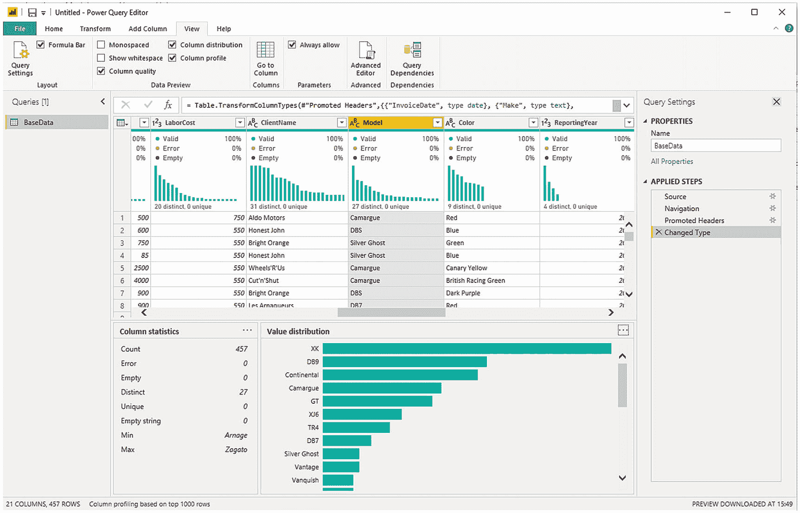

*图 9-24：显示所有数据质量分析选项*

在这些选项中，只有“列分布”依赖于所选列。因此，您需要分别单击每个列以查看所选列的值分布。此外，您可以通过分别单击列统计窗口和值分布窗口右上角的省略号并选择“复制”，来独立复制列的统计信息和值分布。然后，可以将此信息粘贴到例如 `Excel` 中，以分析数据集的元数据。

### 分析整个数据集

默认情况下，内置数据配置文件仅查看数据集中的前 1000 条记录——大概是为了加快配置文件分析操作的速度。但是，您可以强制 `Power BI Desktop` 分析整个数据集。

*图 9-25：选择分析范围*

1.  在“查询编辑器”屏幕的左下角，单击“基于前 1000 行进行列分析”。将出现如图 9-25 所示的弹出窗口。
2.  选择“基于整个数据集进行列分析”。稍等片刻（取决于数据集的大小）后，配置文件分析将更新。

### 纠正异常

Power BI 的数据分析工具只能从高层级上指示数据的概况。它不会擅自修改数据——毕竟，即使数据被标记为包含错误或异常，它也可能仍然有用。

不过，它可以帮助你应用一些基本的数据清理。

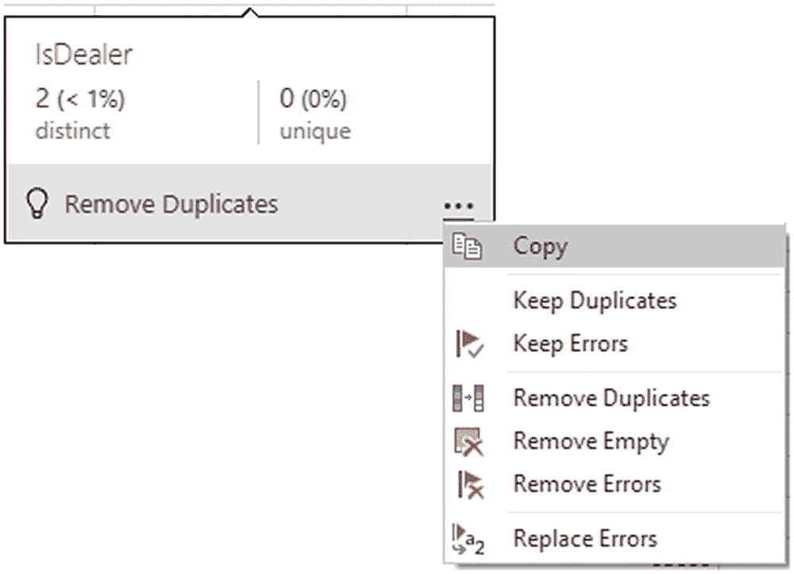

*图 9-26：分析纠正选项*

1.  将鼠标悬停在屏幕顶部的列质量或列分布数据上。将出现一个包含更详细信息的弹出窗口。
2.  点击弹出窗口右下角的省略号。将出现你在图 9-26 中看到的弹出窗口。
3.  选择你感兴趣的选项来纠正任何异常。

当然，以这种方式清理数据实际上可能会损害数据的完整性——甚至删除有价值的信息。在某些数据集中，被标记为错误的数据可能正是你想要更详细检查的数据。因此，我建议在仅仅为了将错误和空单元格的百分比降至零而清理数据之前，要谨慎行事。

**注意**：一旦你选择了任何数据质量选项，它们将在未来的 `Power BI Desktop` 会话中保持激活状态，直到你取消选中该选项。

### 数据转换方法

我很理解你可能会对如此众多的可用转换选项感到困惑。因此，此时记住几个关键原则可能会有所帮助：

*   如有疑问，请右键单击要转换的列。这将在上下文菜单中列出最常见的可用选项。
*   若要更改现有数据，请使用 `Transform` 菜单。
*   若要添加新列，请使用 `New Column` 菜单。
*   请记住，你可以通过删除数据转换过程中的步骤来“撤销”你的修改。

## 结论

本章向你展示了如何将来自一个或多个潜在数据源的源数据结构化为有效的数据表。除此之外，你还了解了如何对数据进行透视和逆透视、如何向上和向下填充行数据，以及如何转置行和列。

可能你学到的最重要的事情是如何联接单独的查询，以便将来自一个查询的数据添加到另一个查询中。这可能涉及从单独的查询中查找数据，或将一个查询的聚合结果带入另一个查询。

最后，你学习了如何分析源数据的质量，并了解该数据集能有多么直接地发挥作用。

现在，是时候将你的数据转换技能提升到一个新水平，学习如何设置复杂的数据提取和转换例程了。这些将是第 10 章的主题。

