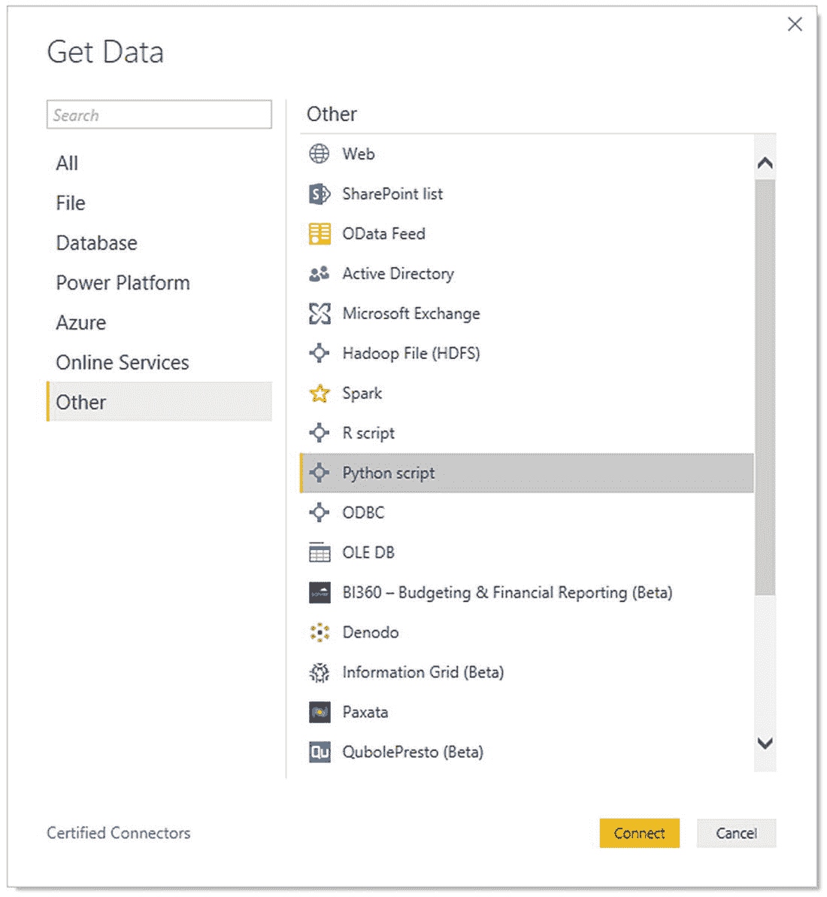
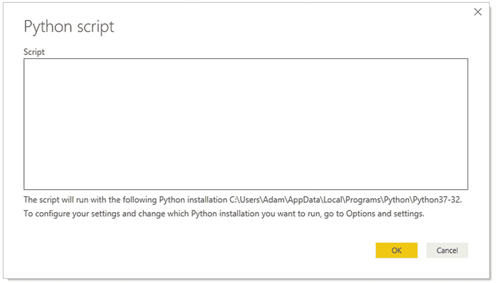
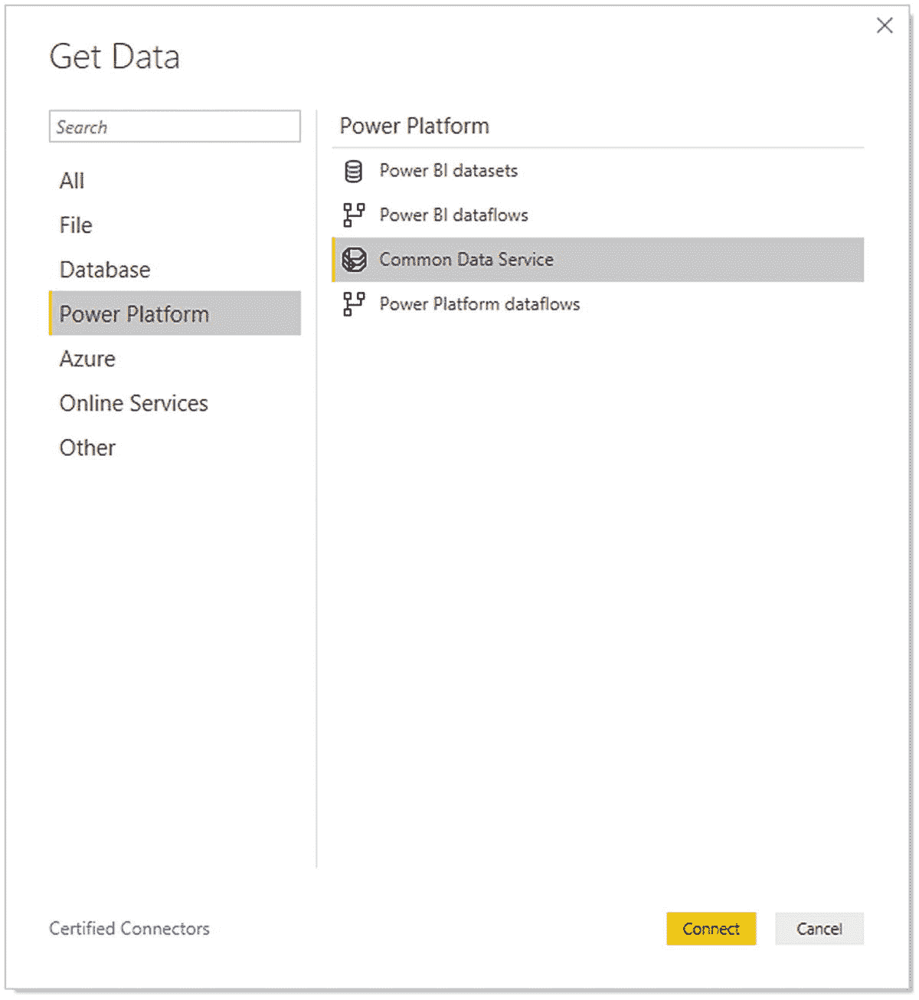
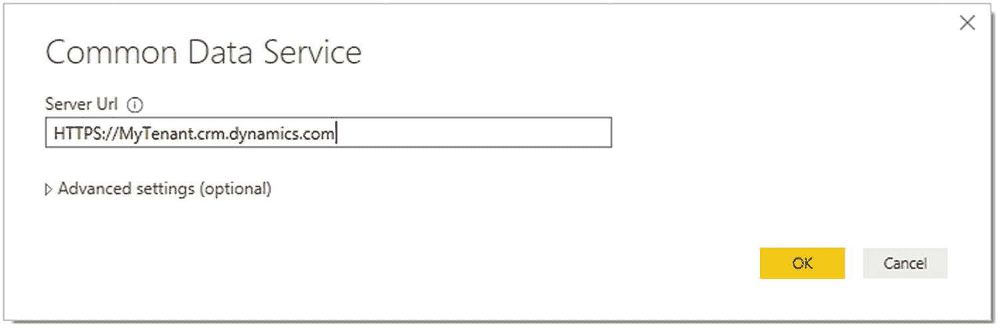

# Python Transformations

如果 Python 是你进行数据分析、数据转换和人工智能的首选语言，那么你也可以将现有的 Python 知识应用于为 Power BI 仪表板准备数据。

**注意**：要在 Power BI 中使用 Python，你需要在计算机上安装自己喜欢的 Python 版本和 IDE。

*图 6-8 选择使用 Python 脚本时的“获取数据”对话框*

1. 在 Power BI Desktop 的“开始”功能区中，单击“获取数据”按钮。
2. 单击左侧的“其他”，然后选择右侧的“Python 脚本”。“获取数据”对话框将如图 6-8 所示。
3. 单击“连接”。将出现“Python 脚本”对话框，你可以在其中粘贴之前在 Python IDE 中准备好的脚本，该脚本用于连接数据并进行预处理。你可以在图 6-9 中看到此对话框。

*图 6-9 “Python 脚本”对话框*

4. 单击“确定”。数据流中的表和字段将出现在 Power BI Desktop 的“字段”窗格中。

**注意**：我无意在此书中尝试解释如何使用 Python。我只是想让 Python 用户知道，他们可以利用现有知识并将其用于 Power BI。

## Common Data Model

如果你使用的是存储在 Microsoft Common Data Model（通用数据模型，它是 Common Data Service 的一部分）中的数据，那么你可以极其轻松地连接到这些数据——正如你可能期望的那样。

*图 6-10 连接到 Common Data Service*

1. 在“开始”功能区中，单击“获取数据” ➤ “更多”。
2. 选择左侧的“Power Platform”和右侧的“Common Data Service”。对话框应如图 6-10 所示。
3. 单击“连接”，并在“Common Data Service”对话框中输入你的服务器 URL。此对话框应类似于图 6-11。
4. 单击“确定”。将出现“导航器”，你可以在其中选择要连接的数据实体。

*图 6-11 “Common Data Service”对话框*

由于 Common Data Service 本质上是一个数据库，我建议你回头参考第 3 章，了解在 Power BI Desktop 中使用数据库源的详细信息。