# 12. `M` 语言

在 Power BI Desktop 中，数据导入和修改并非完全通过界面驱动。实际上，整个过程的底层是由一种高度专用的编程语言支撑和驱动的。这种语言被称为“`M`”，它贯穿于你在前 11 章中所学到的所有内容。

大多数用户——在大多数情况下——根本不需要直接使用 `M` 语言。这是因为到目前为止，你在本书中深入学习过的 Power Query 编辑器界面既全面又极其直观。然而，有些时候你可能需要：
-   添加一些无法通过图形界面直接访问的附加功能
-   添加编程逻辑，例如生成日期或数字序列
-   通过编程方式创建或操作自己的列表、记录或表
-   创建自己的内置函数，以扩展或增强 `M` 语言中已有的函数
-   使用高级编辑器修改代码
-   为数据导入过程添加注释

在介绍这些概念之前，我需要先说明几点注意事项：
-   支撑 Power BI Desktop 查询的“`M`”语言并非适合胆小者。这门语言乍看之下可能显得晦涩难懂。
-   其文档非常技术化，对于新手来说并不容易理解。
-   即使对于经验丰富的程序员来说，学习曲线也可能很陡峭。
-   “`M`”语言与许多 Excel 高级用户熟知的 `VBA`（Visual Basic for Applications）截然不同。
-   手动调整步骤可能会对精心构建的数据加载和转换过程造成严重破坏。

此外，“`M`”语言内容庞大，足以写成一本完整的书。因此，我有意在此只提供最浅显的介绍。如需更详细的资料，我建议你查阅微软文档。目前可在以下网址找到：
-   `https://msdn.microsoft.com/en-us/library/mt779182.aspx`
-   `https://msdn.microsoft.com/en-us/library/mt807488.aspx`

在本章中，我不会假设读者具备任何深入的编程知识。我会提供一些与标准编程概念的比较，以帮助那些使用过 `VBA`、`C#` 或 `Java` 编程的读者。但请放心，本章的目的是为热情的 Power BI Desktop 用户打开新的视野，而不是陷入复杂的专业技术世界。

要最好地理解所有这些内容，可能的方法是：基于你已有的知识，解释你（仅通过使用 Power Query 图形界面）实际上就已经在编写 `M` 代码了。然后，通过了解如何调整现有代码来扩展这些知识，最后你将学会如何独立编写 `M` 代码。

## 什么是 `M` 语言？

尽管如此，我还是应该先确立一些技术基点，解释 Power Query 公式语言（或者现在大家都叫它 `M` 语言）是什么，以及它能做什么——不能做什么。

`M` 是一种`函数式`语言。它`绝非`为执行通用编程而设计。实际上，经验丰富的程序员将徒劳地寻找那些在其他语言中核心的编码结构和技术。（冒险地说，可能会冒犯编程纯粹主义者），我更倾向于从三个方面向初学者介绍 `M` 是一种函数式语言：
-   它的存在是为了执行一个简单的功能：加载和转换数据。
-   它构建在一个包含超过 700 个内置函数的汇编之上，每个函数都旨在执行特定的数据加载和/或转换逻辑。
-   它表现为一系列一个或多个函数，每个函数将一组输入值计算为单个输出值。

为了完成这个简短的介绍，你还需要知道：
-   `M` 是区分大小写的，因此在输入函数关键字和变量名时需要非常小心。
-   `M` 是强类型语言，这意味着你必须遵守所使用的数据元素的核心类型，并在必要时将它们转换为适当的类型。`M` 不会自动为你完成这项工作。
-   `M` 构建在一组关键字、运算符和标点符号之上。

我不想在此太过深入技术。尽管如此，我希望这个高级概述能为你学习本章后面将要接触的一些方法做好准备。

## `M` 与 Power Query 编辑器

关于 `M` 的一个好消息是：你已经能够编写它了。我的意思是，在前 11 章中你遵循的每个示例都为你编写了一行或多行 `M` 代码。实际上，当你使用 Power Query 编辑器进行数据加载和转换过程时，生成的每一步都会自动为你创建 `M` 代码。

这意味着几件（非常积极的）事情：
-   你不必非得从零开始编写 `M` 代码。通常，你可以使用查询编辑器界面完成大部分工作，然后调整自动生成的代码，添加你所需的最终自定义元素。
-   你无需学习超过 700 个函数来编写 `M` 代码，因为查询编辑器可以为你查找并编写许多合适的指令。
-   查询编辑器界面与 `M` 代码的编写方式紧密相连。因此，理解如何使用该界面有助于你理解 `M` 代码是什么以及它是如何工作的。

### 修改步骤的代码

如果你希望深入探索 Power BI Desktop 的内部机制，可以通过编辑每次添加或修改查询步骤时自动生成的代码，来修改查询中的步骤。

要快速了解可以进行的操作：
1.  打开查询编辑器，加载 Excel 文件 `C:\PowerBiDesktopSamples\BrilliantBritishCars.xlsx`（只有一个名为 `BaseData` 的源表）。
2.  选择 `IsDealer` 列并将其删除。
3.  单击 `BaseData` 查询中的 `Remove Columns` 步骤。
4.  在“视图”菜单中，确保已勾选“公式栏”复选框。你将在公式栏中看到“`M`”代码，其外观如图 12-1 所示。


图 12-1 已应用步骤的“`M`”代码

5.  在公式栏中，编辑 `M` 代码，将 `IsDealer` 替换为 `ReportingYear`。
6.  按下 `Enter` 键或点击公式栏中的勾选图标（复选标记）以确认更改。

该步骤及后续数据将更新以反映你的更改。

你在步骤 5 中所做的修改实际上意味着你正在重新添加 `IsDealer` 列，并删除 `ReportingYear` 列。你也可以通过界面完成此操作（单击此步骤的“已应用步骤”列表中的齿轮图标），但关键在于理解两种方式都可行，并且 Power Query 界面只是在生成和修改 `M` 代码。因此，如果你愿意，可以直接修改此代码。

如果你是 Excel 高级用户（许多 Power BI 爱好者都是如此），那么你可能会认为这与 Excel 宏开发类似，这是情有可原的。的确，在某些方面是相似的：
- 核心代码可以被录制（`VBA` 用于 Excel，`M` 用于 Power BI）。
- 生成的代码随后可以被修改。

当然，这是一个非常简单的比较。两种方法可能相似，但两种语言却截然不同。然而，如果这能作为一个比喻，鼓励你转向 `M` 开发，那就这样吧。

在公式栏中修改查询步骤的 `M` 代码时，不可避免地会有一系列注意事项。这些包括（但远不限于）以下几点：
- 任何错误不仅会导致该步骤失败，还会导致从当前步骤开始，整个数据加载和转换过程失败。
- 你需要记住 `M` 是区分大小写的，这个层级上哪怕最细微的错误都可能导致整个进程失败。
- 必须遵守使用引号来定义文字元素（如列名）的规则。
- `M` 大量使用括号和花括号。需要一些实践和对底层逻辑的理解才能充分体会它们在不同上下文中的用途。

幸运的是，当（或如果）错误出现时，`M` 会提供相当清晰的错误消息。例如，如果你输入了错误的字段名，你可能会看到类似图 12-2 所示的消息。


图 12-2 一条“`M`”错误消息

然而，我并不想让你觉得修改 `M` 代码困难或危险。因此，为了扩展前面的示例，如果你将其扩展为删除两列（而不只是一列），`M` 代码将如下所示：

```
= Table.RemoveColumns(#"Changed Type",{"ReportingYear", "IsDealer"})
```

> 注意
> 更一般地，通常最好查看现有步骤的代码——或者使用示例数据集并行创建“虚拟”代码——以了解特定函数的 `M` 代码是什么样子。这将指明如何最佳地修改代码。

## `M` 表达式

为了让你更清晰地理解每个 `M` “步骤”包含什么，图 12-3 展示了一个步骤的核心结构。不过，只有 Power Query 接口才称之为“步骤”。`M` 实际上称之为`表达式`。因此，从现在开始我将使用这个术语。

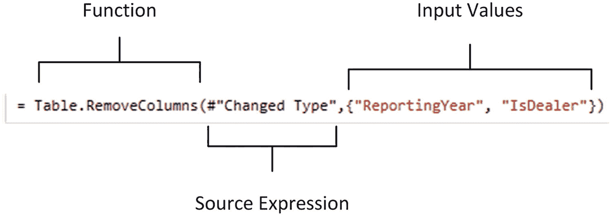

图 12-3 一个 `M` 表达式

这里有几点你需要了解的基本要点：
- 每个 `M` *表达式*由*函数*组成。这些函数可以是任何内置函数（例如此处使用的 `Table.RemoveColumns` 函数），也可以是你自己定义的函数（本章稍后会解释）。它们也可以是计算或简单的逻辑。

# Power Query M 代码编写与调试

## 引言

正如你在本书到目前为止的学习中所了解到的，数据混搭本质上是一系列单独的操作（或者像 Power Query 接口所称的步骤）。这些操作在一个“链”中连接起来，每个表达式都建立在前一个表达式之上，并引用该表达式。在图 12-3 中，这个特定的表达式引用了其前面的 `#"Changed Type"` 表达式的输出。

M 表达式可以变得极其复杂，并且包含多个函数——类似于复杂的 Excel 公式。由于函数可以嵌套，这可能导致相当复杂的表达式。

## 通过添加自定义列编写 M 代码

编写特定类型 M 代码的另一种方法是添加自定义列。虽然在 Power BI Desktop 中它们被称为自定义列，但通常也称为派生列或计算列。尽管它们能完成许多任务，但其核心作用是：

*   连接（或合并，如果你更喜欢这个说法）现有列。
*   向数据表添加计算。
*   提取列的特定部分。
*   根据现有数据向表添加标记。

理解这些列的最佳方式可能是在实践中观察它们。然后，您可以在自己的流程中扩展这些原则。然而，这可以成为学习基本 M 编码的绝佳起点——尽管仅限于 M 中数据整理的一个狭窄领域。

首先，让我们执行一个列连接，并创建一个名为 `Vehicle` 的列，该列连接 `Make` 和 `Model` 列，中间用空格隔开。

1.  打开一个空白的 Power BI Desktop 文件。
2.  连接到 `C:\PowerBiDesktopSamples\BrilliantBritishCars.xlsx` 数据源。
3.  单击“转换数据”以打开 Power Query 编辑器。
4.  在“添加列”功能区中，单击“自定义列”。将显示“添加自定义列”对话框。
5.  单击右侧列列表中的 `Make` 列，然后单击“插入”按钮；`=[Make]` 将出现在对话框左侧的“自定义列公式”框中。
6.  在 `=[Make]` 后面的“自定义列公式”框中输入 `& " " &`。
7.  单击右侧列列表中的 `Model` 列，然后单击“插入”按钮。
8.  单击“新列名”框内部，并为该列输入一个名称。我将其命名为 `CarType`。对话框如图 12-4 所示。

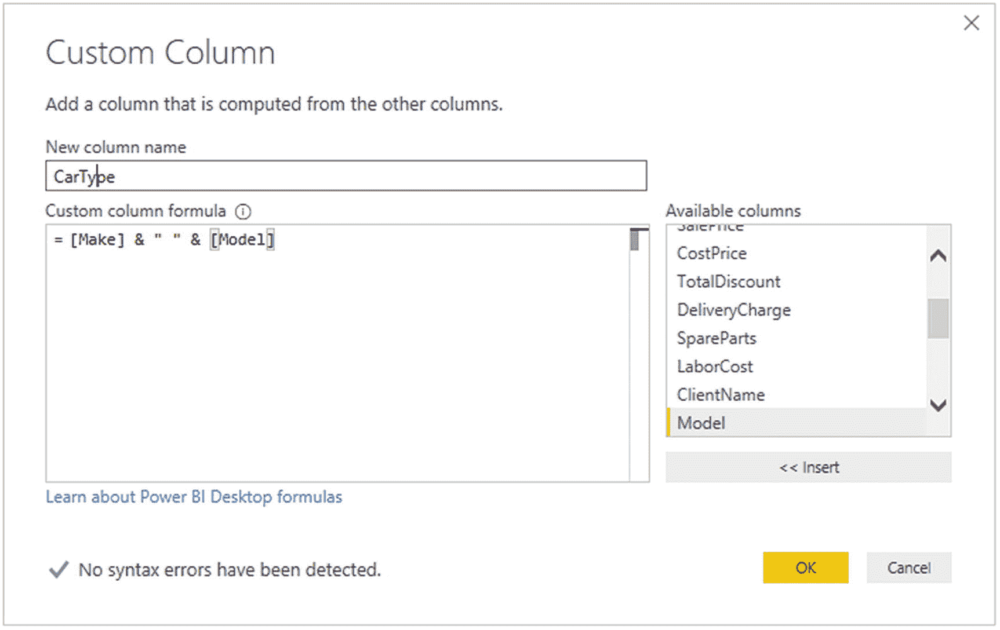

图 12-4 自定义列对话框

9.  单击“确定”。新列将添加到数据表的右侧；它包含公式的结果。`Inserted Column` 出现在“应用的步骤”列表中。公式栏包含以下公式：

```powerquery
= Table.AddColumn(#"Changed Type", "CarType", each [Make] & " " & [Model])
```

如果您愿意，始终可以通过双击某列将其插入到“自定义列公式”框中。要删除某列，只需在“自定义列公式”框中删除列名称（包括方括号）即可。

> **提示**
> 必须始终将列名称括在方括号内。

您可以看到这一行 M 代码遵循了您已经见过的原则。它使用了一个 M 公式 (`Table.AddColumn`)，该公式引用了一个先前的表达式 (`#"Changed Type"`)，然后应用了执行表达式需求的代码——在本例中，是添加一个包含基本 M 代码的新列。

> **注意**
> `each` 关键字是一种 M 约定，表示该列中的每条记录都将应用该公式。

## 高级编辑器

公式栏只是 M 编码的初始步骤。您几乎总是在 Power Query 高级编辑器中编写 M 代码。这有几个根本原因：

*   高级编辑器显示构成 M 查询的所有表达式。
*   它使理解事件（或步骤或表达式，如果您喜欢）的顺序变得更加容易。
*   高级编辑器内置了 IntelliSense。这意味着您可以在键入时看到列出的 M 函数。
*   它有一个语法检查器，有助于隔离和识别语法错误。
*   它对 M 代码进行颜色编码，使其更易读、更易理解。

### 高级编辑器中的表达式

您在公式栏中单独看到的 M 表达式并非孤立存在。恰恰相反，它们始终是数据加载、清理和转换事件这一连贯序列的一部分。如果您现在查看之前从 Excel 文件加载表时创建的整个 M 代码块，可能会更清楚地理解这一点。

要查看 M 代码，您需要打开高级编辑器：

1.  在“开始”功能区中，单击“高级编辑器”按钮。“高级编辑器”窗口将打开，如图 12-5 所示。您还可以从 Power Query 编辑器中看到“应用的步骤”列表，以帮助您理解每个步骤实际上是如何成为一个 M 表达式的。

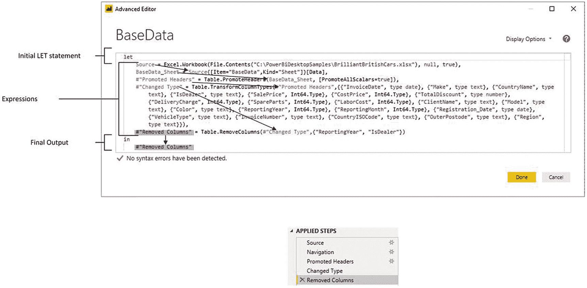

图 12-5 高级编辑器中的语法检查

此对话框包含您创建的连接和转换过程的整个结构。它包含以下核心元素：

*   一系列表达式（即步骤）。
*   一个 `let` 表达式，作为数据转换表达式序列的外部容器。
*   一个 `in` 表达式，返回整个查询的输出。

如果您查看图 12-5，可以看到关于 `Let…In` 块内部表达式序列的几个重要事项：

*   每个表达式都有名称——您可以在“应用的步骤”列表中看到其名称。
*   除了第一个表达式外，每个表达式都引用另一个表达式（几乎总是前一个表达式）。
*   除最后一个表达式外，所有表达式都以逗号结尾。
*   一个表达式可以跨越多行代码。对于除最后一个表达式外的所有表达式，都是由最后的逗号结束该表达式的。
*   最后一个表达式成为查询的输出。

虽然这是一个相当简单的 M 查询，但它包含了展示 M 工作原理的所有基本元素。您构建的几乎所有 M 查询都将反映这些核心原则：

*   包含一个 `Let…In` 块。
*   包含一个或多个包含函数的表达式。

### Let 语句

`let` 语句是 M 语言的核心元素。它的存在允许单独评估一组值，并将每个值分配给一个变量名。这些变量形成一个结构化的评估过程序列，然后用于 `in` 语句之后的输出表达式中。在许多方面，您可以将其视为一个“处理单元”。`Let` 语句可以嵌套以增加更大的灵活性。

在大多数 `let` 语句中，变量序列将从上到下排序（如图 12-6 所示），其中每个命名的表达式引用并构建于前一个表达式之上。这是查询编辑器将命名表达式呈现为步骤的方式，通常也是编写易于理解的 M 脚本的最简单方法。然而，从技术上讲，不必像这样对表达式排序，因为表达式的顺序可以是任意的。

### 在高级编辑器中修改 M 代码

如同 Power BI 中的其他所有事物一样，通过示例最能领略高级编辑器的妙处。你在第 3 章中已经了解了如何创建和修改与数据源的连接。你也可以直接在 `M` 语言中修改连接。这要求你了解并理解你所使用的数据库。

1.  添加一个新查询，连接到 SQL Server 数据库。我使用的是自己电脑上的一个 SQL 实例和数据库。
2.  在左侧的“查询”列表中选择此查询。
3.  在“主页”功能区中，单击“高级编辑器”按钮。将出现“高级编辑器”对话框，如图 12-6 所示。

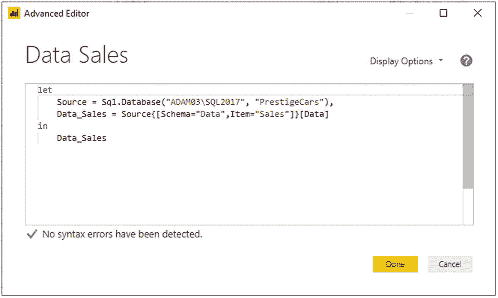

图 12-6 用于更改数据库连接的“高级编辑器”对话框

4.  更改以下任一元素：
    1.  Source 行中的服务器名称（当前为 `"ADAM03\SQL2017"`）。
    2.  第二行中的数据库名称（当前为 `Name="PrestigeCars"`）。
    3.  第三行中的架构名称（当前为 `Schema="Data"`）。
    4.  第三行中的表名称（当前为 `Item="Sales"`）。
5.  单击“完成”确认所有更改并关闭“高级编辑器”。

这种方法确实是在“裸奔”——没有安全网，我向你展示它更多是为了提高你的认知。然而，如果你希望继续深入学习 `M` 语言，它确实为一些深远的可能性打开了大门。

**注意：** 当然，你可以单击“取消”以忽略在高级编辑器中对 `M` 代码所做的任何更改。查询编辑器会要求你确认是否真的要放弃修改。

### 语法检查

如果你打算编写和修改 `M` 代码，很可能会频繁使用高级编辑器。因此，熟悉它能够提供的帮助无疑是非常值得的。具体来说，它的语法检查功能极其有用，而且是完全自动的。

假设（但愿不会！）你的代码中出现了错误。高级编辑器可能会像图 12-7 中那样显示。

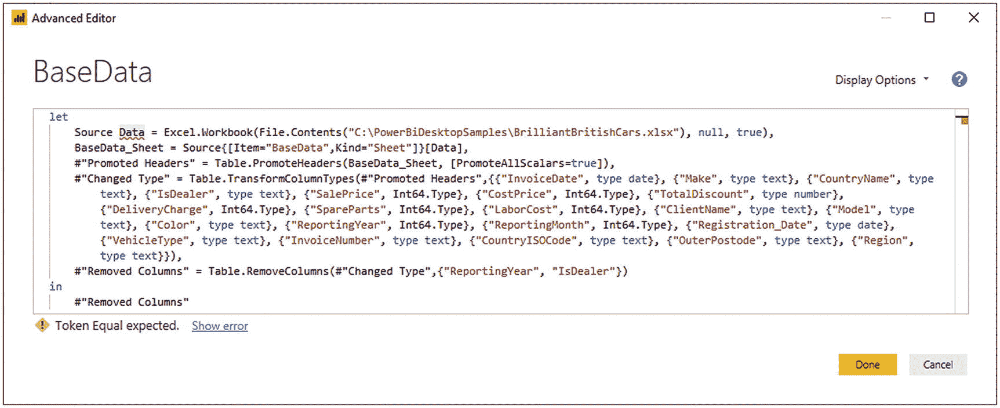

图 12-7 高级编辑器中的语法检查

如你所见，在这种情况下，高级编辑器不再在代码下方显示一个勾选框以及令人安心的消息“未检测到语法错误。”取而代之的是错误消息，并且任何错误都会用红色下划线标出。单击“显示错误”链接，会通过以灰色背景显示错误来源来将其高亮。

## 高级编辑器选项

高级编辑器还有一些可配置的可选设置。

1.  在高级编辑器对话框的右上角，单击“显示选项”右侧的下拉三角形。你可以在图 12-8 中看到它。

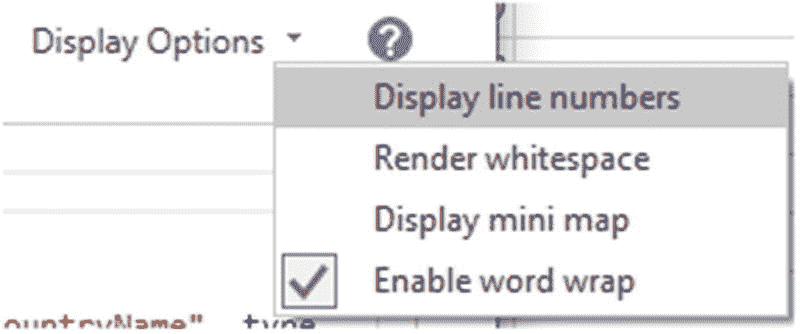

图 12-8 高级编辑器选项

2.  选择“启用自动换行”。任何在高级编辑器单行中过长而无法完整显示的单个`M`表达式将自动换行至下一行。

可用选项在表 12-1 中说明。

表 12-1 高级编辑器选项

| 选项 | 描述 |
| --- | --- |
| `显示行号` | 在代码左侧添加行号。 |
| `显示空白字符` | 将空白字符显示为灰色圆点。 |
| `显示缩略图` | 在高级编辑器右侧显示代码结构的概览图。 |
| `启用自动换行` | 允许长代码行换行至下一行。 |

## 基础 M 函数

`M`语言非常庞大——庞大到单靠一章只能进行粗略的概述。尽管如此，为了使这个概述更有条理，了解一些你可能在开始使用`M`时觉得有用的`M`函数的关键类别是值得的。

以下列表绝非详尽无遗，但希望可以成为你探索`M`函数之旅的一个起点。基础类别包括：
- 文本函数
- 日期函数
- 时间函数
- 日期时间函数
- 逻辑函数
- 数字函数

我将重点放在这些类别上，因为它们无论在应用还是使用上很可能都是最容易理解的。当你了解其中一些函数后，我们便可以继续学习可用范围内其他函数。

大多数较基础的`M`函数的应用方式可能会让你想起它们在 Excel 中的对应函数。例如，如果你想扩展用于连接 Make 和 Model 列的公式，以便只提取 Make 列最左边的三个字符，你可以使用如下代码：

```
= Table.AddColumn(#"Changed Type", "CarType", each Text.Start([Make], 3) & " " & [Model])
```

结果如图 12-9 所示。

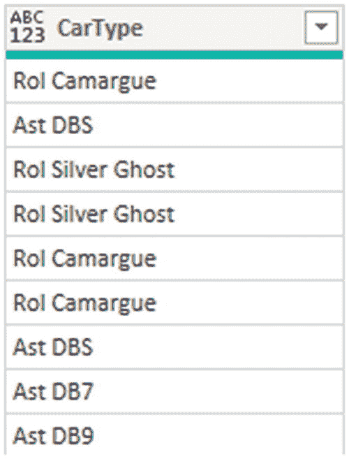

图 12-9 应用第一个文本函数

如你所见，将`Make`列包裹在这个特定的文本函数中，为表达式增加了一层额外的数据转换层。

### 文本函数

我不会逐一介绍所有文本函数的每种可能用法，而是倾向于向您展示一些更有用的文本函数（至少在我的经验中是这样）。这些代码片段在表 12-2 中给出，毫无疑问，您会认出其中许多之前通过 Power Query 用户界面访问过的函数。

表 12-2 文本函数示例

| 输出 | 代码片段 | 描述 |
| --- | --- | --- |
| 左侧 | `Text.Start([Make],3)` | 返回`Make`列的前三个字符。 |
| 右侧 | `Text.End([Make],3)` | 返回`Make`列的最后三个字符。 |
| 截止到特定字符 | `Text.Start([Make],Text.PositionOf([Make]," "))` | 返回最左侧字符，直到第一个空格。 |
| 截止到分隔符 | `Text.BeforeDelimiter([InvoiceNumber], "-" ,"2")` | 返回第三个连字符之前的文本。 |
| 文本长度 | `Text.Length([Make])` | 查找文本的长度。 |
| 提取子字符串 | `Text.Range([Make], 2, 3)` | 从文本中提取特定数量的字符——从指定位置开始。 |
| 移除子文本 | `Text.RemoveRange([Make], 2, 3)` | 从文本中移除特定数量的字符——从指定位置开始。 |
| 替换文本 | `Text.Replace([Make], "o", "a")` | 将文本或列中所有的`o`字符替换为`a`。 |
| 修剪空格 | `Text.Trim([Make])` | 移除文本或列中前导和尾随的空格。 |
| 转换为大写 | `Text.Upper([Make])` | 将文本或列转换为大写。 |
| 转换为小写 | `Text.Lower([Make])` | 将文本或列转换为小写。 |
| 添加首字母大写 | `Text.Proper([Make])` | 为文本或列的每个单词添加首字母大写。 |

> **注意：** 如果您仔细查看这些函数，可能已经注意到任何数值参数都是从零开始的。因此，要在拆分列中的文本时定义第三个连字符，您应该使用`2`，而不是`3`。

毫无疑问，`M`语言中还有更多的文本函数可用。然而，目标并非让读者淹没在技术细节中，而是让您了解`M`语言的工作方式以及它能实现什么。

一旦您也学习了 DAX 语言以在 Power BI 中创建计算，您可能会想知道，既然在数据模型中几乎可以做同样的事情，为什么还要在 Power BI Desktop 查询中执行此类操作。嗯，确实存在一些重叠；因此您可以选择使用哪个。您可以在数据准备和分析过程的多个阶段执行某些操作。这完全取决于您如何使用数据以及使用什么工具进行分析。

表 12-2 只是`M`语言中可用文本函数的一个子集。如果您想查看完整列表，请访问微软网站[`docs.microsoft.com/en-us/powerquery-m/text-functions`](https://docs.microsoft.com/en-us/powerquery-m/text-functions)。

### 数值函数

为扩展您的知识，表 12-3 展示了`M`语言中一些可用的数值函数。在此我重点向您展示一些数值类型转换以及核心计算函数。

表 12-3 数值函数示例

| 输出 | 代码片段 | 描述 |
| --- | --- | --- |
| 返回一个 8 位整数 | `Int8.From("25")` | 将文本或数字转换为 8 位整数。 |
| 返回一个 16 位整数 | `Int16.From("2500")` | 将文本或数字转换为 16 位整数。 |
| 返回一个 32 位整数 | `Int32.From("250,000")` | 将文本或数字转换为 32 位整数。 |
| 返回一个 64 位整数 | `Int64.From("2500000000")` | 将文本或数字转换为 64 位整数。 |
| 返回一个十进制数 | `Decimal.From("2500")` | 将文本或数字转换为十进制数。 |
| 从给定值返回一个双精度浮点数 | `Double.From("2500")` | 将文本或数字转换为浮点数。 |
| 将文本作为源并转换为数值 | `Number.FromText("2500")` | 将文本转换为数字。 |
| 四舍五入一个数字 | `Number.Round(5000, 0)` | 将数字四舍五入到指定小数位数（负数参数表示十位、百位等）。 |
| 向上舍入一个数字 | `Number.RoundUp(5020, -2)` | 将数字向上舍入到指定小数位数（负数参数表示十位、百位等）。 |
| 向下舍入一个数字 | `Number.RoundDown(100.01235, 2)` | 将数字向下舍入到指定小数位数（负数参数表示十位、百位等）。 |
| 去除符号 | `Number.Abs(-50)` | 返回数字的绝对值。 |
| 乘幂 | `Number.Power(10, 4)` | 返回第一个参数的值的第二参数次方。 |
| 取模 | `Number.Mod(5, 2)` | 返回数字除以除数的整数除法的余数。 |
| 指示数字的符号 | `Number.Sign(-1)` | 如果数字为正数则返回 1，如果为负数则返回-1，如果为零则返回 0。 |
| 计算平方根 | `Number.Sqrt(4)` | 返回数字的平方根。 |

> **注意：** 如果您是 Excel 用户，您可能能看到这与在 Excel 和 Power Pivot 中构建公式有明显的相似性，不同之处在于这里（与 Power Pivot 中一样）您使用列名而不是单元格引用。

表 12-3 只是`M`语言中大量可用数值函数的一个小部分。如果您想查看完整列表，请访问微软网站[`docs.microsoft.com/en-us/powerquery-m/number-functions`](https://docs.microsoft.com/en-us/powerquery-m/number-functions)。

### 日期函数

M 语言有很多日期函数。表 12-4 包含了一些可能有用的函数示例。

表 12-4 日期函数示例

## 日期函数

| 输出 | 代码片段 | 描述 |
| --- | --- | --- |
| 日 | `Date.Day(Date.FromText("25/07/2020"))` | 从日期中返回一个月中的第几天。 |
| 月 | `Date.Month(Date.FromText("25/07/2020"))` | 从日期中返回月份的数字。 |
| 年 | `Date.Year(Date.FromText("25/07/2020"))` | 从日期中返回年份。 |
| 星期几 | `Date.DayOfWeek(Date.FromText("25/07/2020"))` | 从日期中返回一周中的第几天。 |
| 星期名称 | `Date.DayOfWeekName(Date.FromText("25/07/2020"))` | 从日期中返回星期名称。 |
| 月初 | `Date.StartOfMonth(Date.FromText("25/07/2020"))` | 从日期中返回该月的第一天。 |
| 月末 | `Date.EndOfMonth(Date.FromText("25/07/2020"))` | 从日期中返回该月的最后一天。 |
| 年初 | `Date.StartOfYear(Date.FromText("25/07/2020"))` | 从日期中返回该年的第一天。 |
| 年末 | `Date.EndOfYear(Date.FromText("25/07/2020"))` | 从日期中返回该年的最后一天。 |
| 年中第几天 | `Date.DayOfYear(Date.FromText("25/07/2020"))` | 从日期中返回该年的第几天。 |
| 年中第几周 | `Date.WeekOfYear(Date.FromText("25/07/2020"))` | 从日期中返回该年的第几周。 |
| 季度 | `Date.QuarterOfYear(Date.FromText("25/07/2020"))` | 从日期中返回季度的数字。 |
| 季初 | `Date.StartOfQuarter(Date.FromText("25/07/2020"))` | 从日期中返回该季度的第一天。 |
| 季末 | `Date.EndOfQuarter(Date.FromText("25/07/2020"))` | 从日期中返回该季度的最后一天。 |

表 12-4 只是 M 语言中可用日期函数的一个子集。如果您想查看完整列表，请访问微软网站 [`docs.microsoft.com/en-us/powerquery-m/date-functions`](https://docs.microsoft.com/en-us/powerquery-m/date-functions)。

## 时间函数

M 语言还包含许多时间函数。表 12-5 列出了一些可能有用的函数示例。

### 表 12-5 时间函数示例

| 输出 | 代码片段 | 描述 |
| --- | --- | --- |
| 小时 | `Time.Hour(#time(14, 30, 00))` | 从时间中返回小时。 |
| 分钟 | `Time.Minute(#time(14, 30, 00))` | 从时间中返回分钟。 |
| 秒 | `Time.Second(#time(14, 30, 00))` | 从时间中返回秒。 |
| 从分数获取时间 | `Time.From(0.5)` | 从一天中的分数返回时间。 |

表 12-5 只是 M 语言中可用时间函数的一个子集。如果你想查看完整列表，可以访问微软网站 [`https://docs.microsoft.com/en-us/powerquery-m/time-functions`](https://docs.microsoft.com/en-us/powerquery-m/time-functions)。

同样，由于日期时间函数和时区日期时间函数与日期和时间函数非常相似，我在这里没有展示它们。这些函数也可以在微软网站上找到。

## 持续时间函数

M 语言还能提取持续时间——以天、小时、分钟和秒为单位。表 12-6 展示了一些基本的持续时间函数。

### 表 12-6 持续时间函数示例

| 输出 | 代码片段 | 描述 |
| --- | --- | --- |
| 天 | `Duration.Days(#duration(10, 15, 55, 20))` | 以天为单位的持续时间。 |
| 小时 | `Duration.Hours(#duration(10, 15, 55, 20))` | 以小时为单位的持续时间。 |
| 分钟 | `Duration.Minutes(#duration(10, 15, 55, 20))` | 以分钟为单位的持续时间。 |
| 秒 | `Duration.Seconds(#duration(10, 15, 55, 20))` | 以秒为单位的持续时间。 |

表 12-6 几乎涵盖了 M 语言中所有可用的持续时间函数。如果你想查看其余的几个函数，可以访问微软网站 [`https://docs.microsoft.com/en-us/powerquery-m/duration-functions`](https://docs.microsoft.com/en-us/powerquery-m/duration-functions)。

## M 概念

现在是时候“拆掉自行车的辅助轮”，学习如何独立骑行了。这意味着，首先要熟悉几个 M 的结构性概念。

这意味着要从能用来修改数据内容的“入门级”函数，过渡到创建和修改数据结构本身。M 本质上专注于加载和呈现表格数据结构，因此数据表是一种核心的数据结构。然而，它还能操纵其他数据结构——你在之前的章节中已经顺便接触过它们。那么，在本章中，我们将探讨三种核心数据结构。它们统称为结构化值——与原始值（如文本、数字或日期和时间）相对。其中一些包括：

* 列表
* 记录
* 表格

不过，在深入探讨这些结构化数据元素之前，你需要理解 M 语言的两个基本方面。它们是：

* 数据类型
* M 值（也称为变量或标识符）

那么，闲话少叙，让我们开始踏上 M 的探索之旅吧。

## M 数据类型

如果你要创建自己的列表、记录和表格，那么了解 M 中数据类型的基础知识将会很有帮助。

在开始使用 M 时，你需要记住，原始数据值必须始终是以下类型之一：

* 数字 (Number)
* 文本 (Text)
* 日期 (Date)
* 时间 (Time)
* 日期时间 (DateTime)
* 时区日期时间 (DateTimeZone)
* 持续时间 (Duration)
* 逻辑值 (Logical，如果你愿意，也可以称为 `Boolean`)
* 二进制 (Binary)
* 空值 (Null)

还有其他类型，比如 `function`、`any` 或 `anynonnull`，但我们不会在本章中涵盖它们。

所有数据类型都期望以特定方式输入。实际上，你必须按照表 12-7 所示的方式输入数据，以避免在 M 代码中出现错误。

### 表 12-7 数据类型输入

| 数据类型 | 代码片段 | 备注 |
| --- | --- | --- |
| 数字 (Number) | `100``0.12345``2.4125E8` | 不要使用千位分隔符或货币符号等格式。 |
| 文本 (Text) | `"Calidra Power BI Training"` | 始终用双引号括起来。若要输入实际的引号文本，请使用两个双引号。 |
| 日期 (Date) | `#date(2020,12,25)` | 日期必须在 `#date()` 函数中按年、月、日指定。 |
| 时间 (Time) | `#time(15,55,20)` | 时间必须在 `#time()` 函数中按时、分、秒指定。 |
| 日期时间 (DateTime) | `#datetime(2020,12,25,15,55,20)` | 日期时间必须在 `#datetime()` 函数中按年、月、日、时、分、秒指定。 |
| 时区日期时间 (DateTimeZone) | `#datetimezone(2020,12,25,15,55,20,-5,-30)` | 时区日期时间必须在 `#datetimezone()` 函数中按年、月、日、时、分、秒、天偏移量、小时偏移量指定。 |
| 持续时间 (Duration) | `#duration(0,1,0,0)` | 在 `#duration()` 函数内，天、小时、分钟和秒用逗号分隔。 |
| 逻辑值 (Logical) | `true` | 小写的 `true` 或 `false` |

## M 值

在深入实际编码之前，你真的需要了解一些关于 M 值的基本原理：

* 值是表达式（expression）的输出结果。
* 值也是变量。
* 值的名称区分大小写。
* 如果值名称包含空格或受限字符，则必须用 `#""`（井号后跟双引号）括起来。

这第四点显然引出一个问题：“什么是受限字符？” 一个简单的答案——避免死记硬背符号列表——就是“任何非字母数字的字符”。

> **注意**
>
> Power Query 编辑器界面会尽可能通过添加空格的方式，使步骤（即表达式返回的值）更具可读性。因此，这些值在 M 代码中总是以 `#"Step Name"` 的形式出现。

### 在 M 中定义你自己的变量

由于任何表达式返回的值也是变量，因此在 M 中定义你自己的变量出奇地简单。你所要做的就是输入一个变量名（如果包含空格或受限字符，则需加上井号并用引号括起来）、一个等于号，以及变量定义。

举一个非常简单的例子，请看图 12-10。这段 M 脚本定义了 `List.Numbers()` 函数所需的三个参数（你将在表 12-8 中看到该函数），然后在函数内部使用了这些变量。

**表 12-8** 列表生成

| 代码片段 | 描述 |
| :--- | :--- |
| `{1..100}` | 从 1 到 100（含）的连续数字序列。 |
| `{1..100, 201..400}` | 从 1 到 100，然后从 201 到 400 的连续数字序列。 |
| `List.Numbers(0, 100, 5)` | 从 0 开始，按 5 递增，直到达到 100。 |
| `{"A".."Z"}` | 大写字母 A 到 Z。 |
| `List.Dates(#date(2020, 1, 1), 366, #duration(1, 0, 0, 0))` | 2020 年的每一天——从 2020 年 1 月 1 日开始，添加 366 天（以天为单位的持续时间表示）。 |
| `List.Times(#time(1, 0, 0), 24, #duration(0, 1, 0, 0))` | 一天中的每个小时，从凌晨 1 点开始。 |

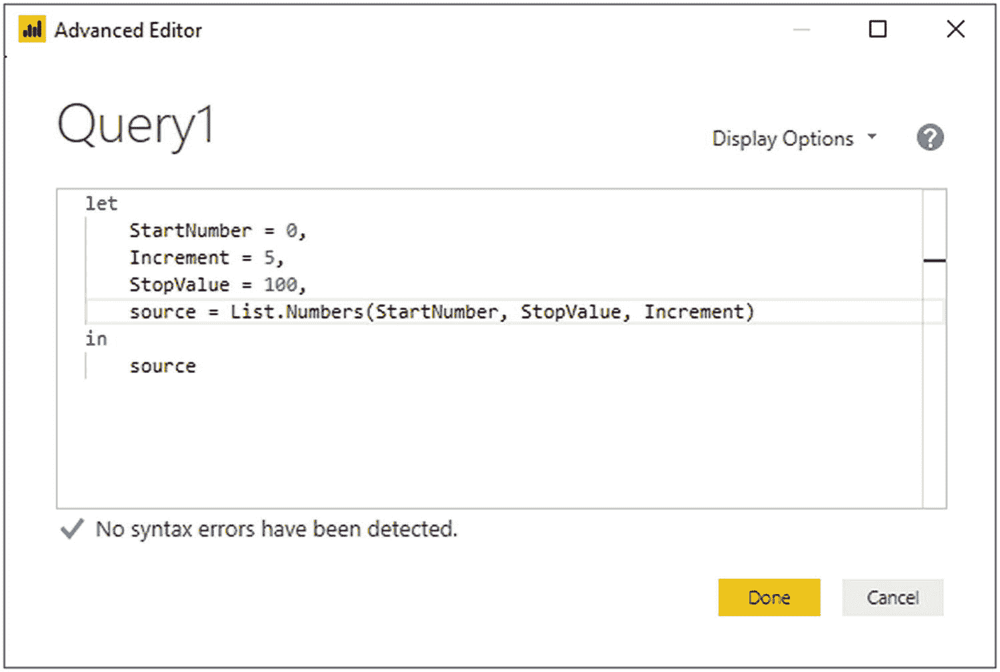

**图 12-10** M 中的用户变量

在定义自己的变量时，只需记住几点：

*   它们遵循与 M 中输出值相同的命名约定。
*   变量可以在定义它的子表达式以及包含该子表达式的任何表达式中被引用。
*   变量可以是一个简单的值，也可以是一个返回值的计算。

## 编写 M 查询

在真正编写 M 代码之前，你需要了解如何以及在何处编写代码。假设你需要一个环境来练习本章后续的示例：

1.  打开一个新的空白 Power BI Desktop 文件。
2.  在“开始”功能区中，单击`新源` > `空白查询`。Power Query 编辑器将会打开。
3.  单击`高级编辑器`。一个`高级编辑器`对话框将打开，其中仅包含一个外部的 `let` 表达式，如图 12-11 所示。

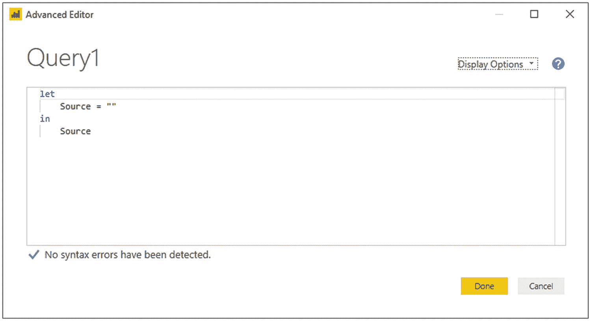

*图 12-11 准备高级编辑器来编写 M 代码*

> **注意** 从技术上讲，M 中并不强制要求使用 `let` 子句。你可以直接输入一个表达式。不过，我更喜欢“按部就班”地编写 M——至少一开始是这样。

### 列表

你在第 11 章为基于查询的参数创建弹出列表时已经见过 M 列表（这再次表明，查询编辑器中的一切都基于 M）。列表仅仅是一系列的值。

列表在 M 中有特定的用途，可以直接用于数据模型中。然而，它们更常被用作更复杂数据转换过程中的中间步骤。如果你有编程背景，将列表视为类似于数组的东西可能会有所帮助。

#### 手动创建列表

一个列表就是用花括号括起来的一组逗号分隔的值——例如：

```
{1,2,3}
```

一旦集成到 M 查询的结构中，它可能看起来像图 12-12 所示的示例。

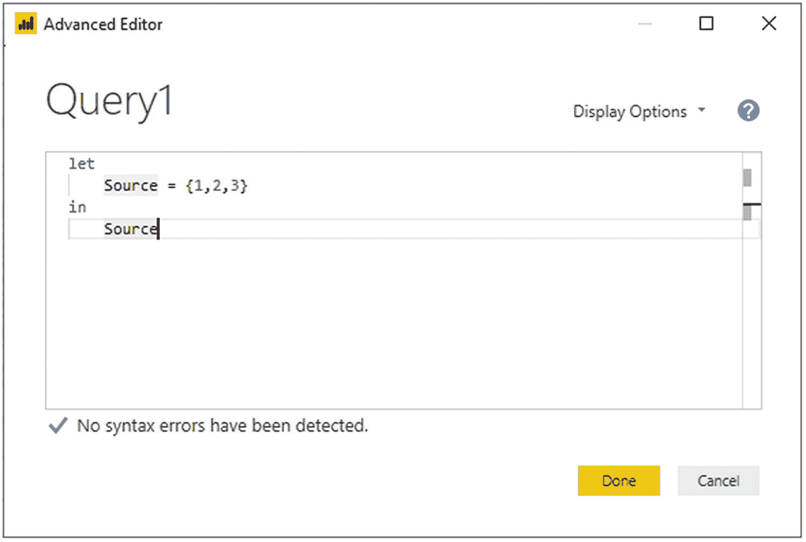

*图 12-12 高级编辑器中的列表*

一旦创建（无论是作为查询的中间步骤还是查询的最终输出），任何需要列表作为输入的地方都可以使用这个列表。事实上，如果你为前面的示例单击`完成`按钮，Power Query 编辑器会将该 M 代码片段显示为一个功能列表——与你第 11 章中创建的完全一样。因此，你现在可以快速轻松地为参数（例如）创建自定义列表。

关于列表，你需要了解一些技术信息：

-   列表大小没有限制。
-   列表可以包含相同类型的数据（即所有元素都是数值、日期或文本等），也可以包含不同类型的数据。
-   列表可以为空——即由一对空花括号组成。
-   列表可以水平或垂直输入。也就是说，前面显示的列表也可以输入为：

```
Source = {
    1,
    2,
}
```

生成列表非常简单；知道何时使用列表才是难点。

#### 使用列表生成序列

列表在 M 中有很多用途，但有一个领域它们特别出色，那就是生成数字、日期或文本的序列。我不再逐一繁琐地解释每种方法，而是在表 12-8 中整理了一组用于生成列表的 M 代码片段示例。

#### 从列表访问值

如果你转向更高级的 M 编码，很可能会需要在 M 脚本中引用列表中的一个值。最简单的方法是使用*位置引用*。下面是一段实现此功能的简短 M 代码：

```
let
    Start = {"George","Bill","George W.", "Barack", "Donald"},
    source = Start{3}
in
    source
```

这段代码片段的输出是列表中的第四个元素——这说明了 M 中的列表是*从零开始*的。也就是说，列表中的第一个元素是元素 0。

#### 列表函数

M 中有几十个可用的列表函数。数量太多，无法在此详细讨论。因此，为了让你了解操作列表的一些可能方法，请看表 12-9。所有这些函数都使用你之前看到的非常简单的列表。

**表 12-9** 列表函数

| 输出 | 代码片段 | 描述 |
| :--- | :--- | :--- |
| 第一个值 | `List.First(MyList)` | 返回列表中的第一个元素。 |
| 最后一个值 | `List.Last(MyList)` | 返回列表中的最后一个元素。 |
| 排序列表值 | `List.Sort(MyList)` | 对列表中的值进行排序。 |
| 提取范围 | `List.Range(MyList, 4)` | 从列表中提取一个值的范围。 |
| 返回值 | `List.Select(MyList, each _ ="Adam")` | 返回列表中符合条件的元素。 |
| 生成列表 | `List.Generate()` | 创建一个顺序值的列表。 |
| 聚合值 | `List.Sum(MyList)` | 聚合列表中的数值。 |
| 替换值 | `List.ReplaceMatchingItems(MyList, {"Joe", "Fred"})` | 替换列表中的一个值范围。 |
| 转换为列表 | `Table.Column(MyList)` | 将表中的一列作为列表返回。 |

表 12-9 只是 M 中可用列表函数的一小部分。如果你想查看全部函数，可以在微软网站 [`https://docs.microsoft.com/en-us/powerquery-m/list-functions`](https://docs.microsoft.com/en-us/powerquery-m/list-functions) 上找到。

### 记录

如果说列表可以被视作你可以在 M 代码中使用的数据列，那么*记录*就是数据行。在 M 中创建更复杂的数据转换例程时，你很可能会需要定义记录。

最简单的形式是，以下是在 M 中创建的示例记录：

```
let
    Source = [Surname = "Aspin", FirstName = "Adam"]
in
    Source
```

如果你需要访问记录中的数据，可以将记录变量名后面跟上用方括号括起来的字段名，如下所示：

```
let
    Source = [Surname = "Aspin", FirstName = "Adam"],
    Output = Source[Surname]
in
    Output
```

你可能会发现一些有用的记录函数。这些函数在表 12-10 中列出。

**表 12-10** 记录函数

| 输出 | 代码片段 | 描述 |
| :--- | :--- | :--- |
| 添加字段 | `Record.AddField()` | 向记录添加一个字段。 |
| 移除字段 | `Record.RemoveFields()` | 从记录中移除一个字段。 |
| 重命名字段 | `Record.RenameFields()` | 重命名记录中的一个字段。 |
| 输出字段 | `Record.Field()` | 返回记录中指定字段的值。 |

## 记录函数
| 计数 | `Record.FieldCount()` | 返回记录中的字段数量。 |

表 12-10 只是 M 中可用记录函数的一个子集。如果你想查看完整列表，可以在微软网站 [`https://docs.microsoft.com/en-us/powerquery-m/record-functions`](https://docs.microsoft.com/en-us/powerquery-m/record-functions) 上找到。

## 表格

在 M 语言中，你可能经常使用的最终结构化数据类型是`表格`类型。正如你对一种用于加载、清理和塑造表格数据的语言所期望的那样，表格数据类型是 M 语言的基础。

如果你决定在 M 语言中手动创建自己的表格，那么你至少需要包含以下结构元素：

- `#table()` 函数
- 一组列/字段标题，其中每个字段名称用双引号括起来，并且这组字段名称用大括号包裹
- 各行数据，每行用大括号括起来并用逗号分隔，其中所有行的集合也用大括号包裹

一个手工编码表格的简单示例如下：

```powerquery-m
#table(
{"Surname", "FirstName"},
{
{"Johnson","Vladimir"},
{"Putin","Emmanuel"},
{"Macron","Angela"},
{"Merkel","Boris"}
}
)
```

然而，这种方法的缺点是没有为字段定义类型。因此，一种更健壮的方法是像这样扩展表格：

```powerquery-m
#table(
type table
[
#"Surname" = text,
#"FirstName" = text
],
{
{"Johnson","Vladimir"},
{"Putin","Emmanuel"},
{"Macron","Angela"},
{"Merkel","Boris"}
}
)
```

`注意`

用于定义所需数据类型的类型关键字已在本章前面概述过。

M 语言中提供了许多表格函数。我已在表 12-11 中概述了一些比较有用的函数。

**表 12-11** 表格函数

| 输出 | 代码片段 | 说明 |
| --- | --- | --- |
| 合并表格 | `Table.Combine()` | 合并结构相似或不同的表格。 |
| 记录数 | `Table.RowCount()` | 返回表格中的记录数。 |
| 第一条 | `Table.First()` | 返回表格中的第一条记录。 |
| 最后一条 | `Table.Last()` | 返回表格中的最后一条记录。 |
| 查找行 | `Table.FindText()` | 返回表格中包含所需文本的行。 |
| 插入行 | `Table.InsertRows()` | 在表格中插入行。 |
| 输出行 | `Table.Range()` | 输出选定的行。 |
| 删除行 | `Table.DeleteRows()` | 删除表格中的行。 |
| 选择列 | `Table.SelectColumns()` | 输出选定的列。 |

表 12-11，正如你可能想象到的，只是 M 语言中可用表格函数的极小一部分。如果你想查看完整列表，可以在微软网站上找到：[`https://docs.microsoft.com/en-us/powerquery-m/table-functions`](https://docs.microsoft.com/en-us/powerquery-m/table-functions)。

## 其他函数领域

正如我之前提到的，M 语言是一个庞大的主题，足以写满一整本（非常厚的）书。我们快速概述了一些核心概念和函数，但如果你想掌握 M 语言，还有很多东西需要学习。如果你真的有兴趣了解更多，我建议你搜索微软文档中关于表 12-12 所列内容的部分，以进一步扩展你的知识。

**表 12-12** 其他函数领域

| 函数领域 | 说明 |
| --- | --- |
| 数据访问函数 | 访问数据并返回表格值。 |
| 二进制函数 | 访问二进制数据。 |
| 合并器函数 | 由其他库函数使用，用于合并值以逐行应用逻辑。 |
| 日期时间函数 | 应用于日期时间数据的函数。 |
| 时区日期时间函数 | 应用于包含时区信息的日期时间数据的函数。 |
| 表达式函数 | 用于表达式的 M 代码。 |
| 行函数 | 将数据转换为值列表。 |
| 替换器 | 由库中的其他函数使用，用于替换结构中的给定值。 |
| 拆分器 | 将值拆分为子元素。 |
| 类型 | 返回 M 类型。 |
| Uri | 处理 URL 和 URI。 |
| 值 | 处理 M 值。 |

## M 语言中的自定义函数

M 语言还允许你编写自定义函数，以便重复执行高度特定的任务。

作为一个非常简单的自定义函数示例，尝试将以下代码片段添加到一个新的空白查询中：

```powerquery-m
let DiscountAnalysis =
(Discount as number) =>
if Discount < 10 then "Poor" else "Excellent" in DiscountAnalysis
```

当你关闭高级编辑器时，你会看到此查询已被识别为一个 M 函数，并显示在查询列表中。你可以在图 12-13 中看到这一点（我已将其重命名为“DiscountAnalysis”）。

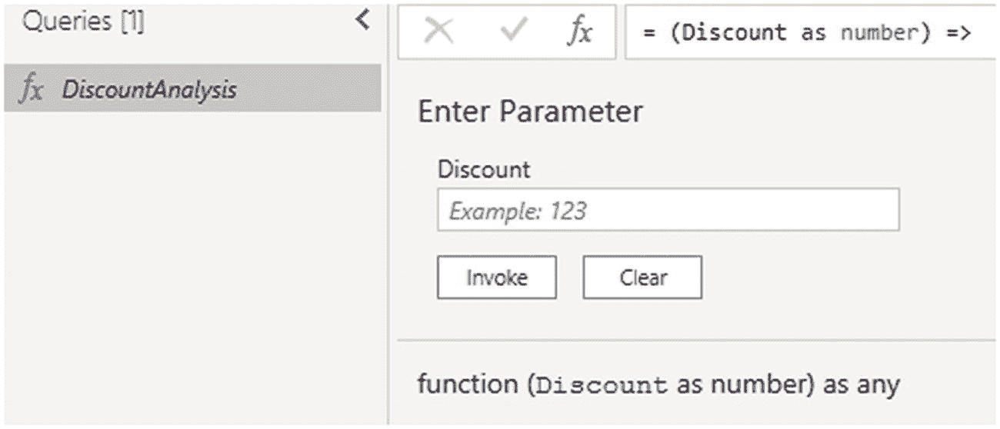

**图 12-13** M 语言中的用户定义函数

现在，你可以随时以交互方式调用该函数，只需输入一个值作为折扣并点击“调用”按钮即可。你也可以在其他 M 函数中使用此函数。实际上，这可能就是你首先创建自定义函数的原因。

如果你想看一个更高级的函数，请看下面的代码片段，它会填充日期，如果需要，为日和月添加前导零：

```powerquery-m
let
FormatDate = (InDate as date) =>
let
Source = Text.PadStart(Text.From(Date.Month(InDate)),2,"0") & "/" & Text.PadStart(Text.From(Date.Day(InDate)),2,"0") & "/" &Text.From(Date.Year(InDate))
in
Source
in
FormatDate
```

## 为 M 代码添加注释

复杂的 M 代码可能极其密集。因此，当你在数周或数月后重新审视代码时，很可能需要一些方法来记住你为什么创建某个流程。

一个让自己生活更轻松的简单方法是为 M 代码添加注释。你可以为你编写的代码以及自动生成的查询添加注释。

有两种添加注释的方法。

### 单行注释

要注释单行（你可以在一行的开头或行中进行），只需添加两个正斜杠——像这样：

```
//This is a comment
```

从两个斜杠到行尾的所有内容都将被视为注释，不会被 M 语言解析。

### 多行注释

多行注释可以覆盖多行——甚至可以覆盖一行的一部分。它们覆盖所有包含在 `/* ... */` 内的文本。

```
/* This is a comment
Over
Several lines */
```

`/* ... */` 内的所有内容都将被视为注释，不会被 M 语言解析。


## 结论

本章结束了关于加载和转换源数据的部分。在本章中，你学习了 M 语言的基础知识，这些知识支撑着你迄今为止在本书中学到的所有内容。

你首先了解了如何使用 Power Query 编辑器界面来帮助你编写简短的 M 代码片段。然后，你继续探索了 M 语言的基本概念，例如表达式、变量和值。最后，你学习了 M 语言中的数据类型，以及更复杂的数据类型（如列表和表格），这些类型是复杂数据转换的基础。这涉及到学习使用高级编辑器来编写和调试你的代码。

在本章以及前面的 11 章中，你基本上看到了一个三阶段的过程：首先，找到数据；然后，将其加载到 Power BI Desktop 查询中；最后，对其进行清理和修改。你可以使用的技术简单但功能强大，范围从更改数据类型到合并多个数据表。既然你的数据已准备好并可供使用，你可以将其添加到 Power BI Desktop 数据模型中，并开始创建你的 Power BI Desktop 仪表板。接下来，你将开始使用查询的输出构建一个完整的数据模型。这将是下一章的主题。


