# 13. 创建数据模型

要创建令人惊叹的可视化效果，你只需要一样东西，那就是优质的数据。具体来说，你需要将干净且准确的数据加载到 Power BI Desktop 的数据模型中。在这里，你可以将来自多个数据源、数以千万计的行数据，精炼成一个连贯且强大的框架，并以此为基础构建你的分析和仪表板。

使用查询来查找、转换和加载源数据（正如你在第 1 章到第 12 章中学到的那样）是为数据模型准备数据的基础。然而，这个过程并未就此结束。一旦你能够访问所需的数据，你仍然需要完成一些额外的工作。要完成整个过程，你需要将这些查询组合成一个清晰易懂、对任何使用者都一目了然的连贯结构。

为了确保你能够轻松地在 Power BI Desktop 中创建数据模型，以便日后在仪表板中进行深入分析，本章将向你介绍一些建模数据所需应用的技术。你将了解如何将已加载的数据表转换为 Power BI Desktop 数据模型中的结构化数据集。这个框架包括应用适当的数据类型、分类和格式，从而使你能够从模型中的数据传递信息、洞见并进行分析。这个学习曲线涵盖的过程包括：

- 定义合适的语义层——即确保所有表和字段都具有清晰易懂的名称
- 确保所有数据类型都正确
- 格式化数据
- 为每个字段设置 Power BI 将在仪表板中使用的默认聚合方式
- 在数据模型中联接表

此列表中的第五点可能是数据建模中最基础的方面。实际上，它将占据本章近一半的篇幅。为了准确、精确地报告数据，你必须让 Power BI Desktop 理解一个表中的数据如何与另一个表中的数据相关联。将一个表链接到另一个表，将让你能够利用这些数据来提供准确且有说服力的结果。

再次提醒，本章使用的所有示例文件都可以在 Apress 网站上找到。下载后，它们应位于 `C:\PowerBiDesktopSamples` 文件夹中。

## Power BI Desktop 的“数据”视图

要开始使用 Power BI Desktop 准备所有表和字段，通常最简单的方法是在“数据”视图中工作。这意味着：

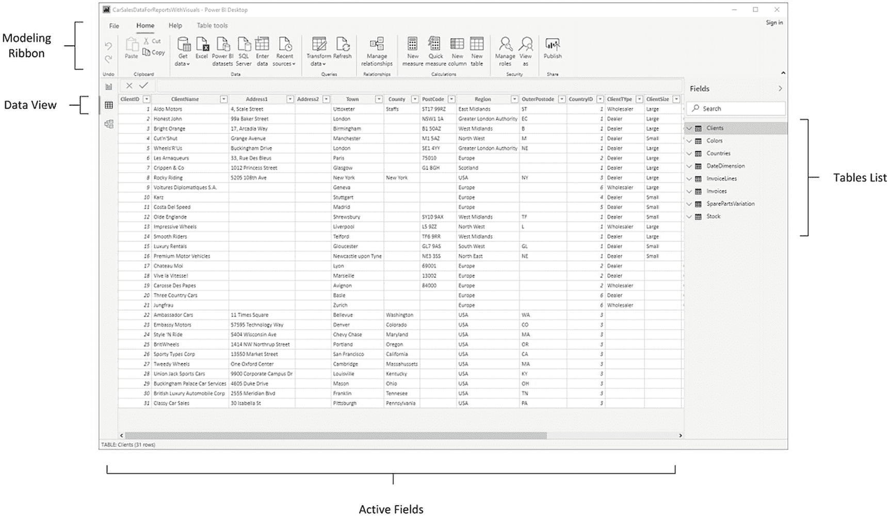

图 13-1 – “数据”视图

1. 运行 Power BI Desktop 并加载你需要访问数据所需的任何查询。要遵循本章中的示例，请打开 `C:\PowerBiDesktopSamples\CarSalesDataFromDataModel.pbix` 文件。
2. 如果你使用自己的数据，请确保已关闭 Power BI Desktop 查询窗口，并应用了所有已做的更改，然后返回到 Power BI Desktop 环境。
3. 单击左侧的“数据”视图图标。你将切换到“数据”视图，在该视图中，你可以看到右侧“字段”列表中的所有可用表。其中一个表将被选中，其数据将显示在“数据”窗格中，如图 13-1 所示。“可视化”和“筛选器”窗格将不再可见，并且会出现两个新菜单——“表工具”和“列工具”（如果选择了列的话）。

`注意：` 只有在数据被加载到 Power BI Desktop 数据模型之后，才能对数据进行建模。我的意思是，如果在查询编辑器中编辑数据后，没有应用更改就返回 Power BI Desktop 窗口，将会阻碍你的数据建模——或者至少会阻止你获得准确的结果。

## “数据视图”还是“查询”？

你可能会想，“数据”视图目前看起来似乎没什么特别。甚至，它看起来像是 Power BI Desktop 查询窗口的一个扩展。不过请放心，你很快就能看到在“数据”视图中能做什么，以及 Power BI Desktop 在数据建模方面究竟有多强大。目前，关键在于要记住，你（可以这么说）已经打开了一扇通往 Power BI Desktop 核心引擎的大门。尽管这个新世界是 Power BI Desktop 的一部分（并且你可以通过单击“数据”视图图标上方的“报表”视图图标立即返回到 Power BI 可视化界面），但最好暂时将其视为一个平行宇宙。这个宇宙有自己的功能区和按钮，并且独立于“报表”视图，以便你可以专注于增强数据和数据结构。

Power BI Desktop 的“数据”视图也与 Power BI Desktop 的查询编辑器不同。例如，Power BI Desktop 查询窗口与“数据”视图的一个主要区别在于，在“数据”视图中，你看到的是 *所有* 数据。而查询窗口仅显示数据的 *样本*。一旦你将数据加载到数据模型中，你最终就能访问 *整个* 数据集（所有表中的所有数据），而这正是你在“数据”视图中可以看到的内容。

第二个区别是，一旦你离开了查询窗口，你将始终处理整个数据集，并且仅根据特定仪表板或可视化的需求对其进行筛选。因此，你需要意识到，你在查询窗口中应用的任何筛选器都会限制 Power BI Desktop 中可以显示的数据。相比之下（正如你将在本书后面看到的），一旦你定义了核心数据并创建了数据模型，你可以对整个仪表板或特定的可视化应用后续的筛选器。

在某些方面，Power BI Desktop 查询可以完成一些也可以在“数据”视图或“关系”视图中完成的工作。例如，你可以在两者中创建计算字段（你将在下一章了解如何在“数据”视图中执行此操作）。我的建议是，尽量记住 Power BI Desktop 查询用于查找、筛选和整合数据，而“数据”视图用于精炼和计算数据模型中的数据层和度量值。但是，每个用户都可以选择自己偏好的方法，并在查询编辑器或“数据”视图中执行任何必要的计算。毕竟，结果才是最重要的。

`注意：` 在建模数据之前，*务必*确保你已在查询编辑器中单击了 `关闭并应用`。这可以保证你正在处理的是你已进行的数据转换的最新版本，以及最新的数据。如果你没有单击 `关闭并应用`，你将在 Power BI Desktop 窗口的顶部看到一条警报。

“数据”视图主要用于为最终的建模步骤准备数据。这包括：

- 操作表
- 添加“排序依据”字段，以确保仪表板元素中的排序顺序正确
- 重命名表和列
- 定义数据类型
- 设置数据类别
- 格式化数据
- 基于字段值创建组
- 设置 `按列排序`（以使用另一列的内容对列进行排序）
- 将表设置为日期表，以应用时间智能

一旦定义了这些核心元素，你就可以进入建模步骤，在该步骤中，你将表联接成一个连贯的数据模型。

## Power BI Desktop 的“数据”视图功能区

那么，当你看 Power BI Desktop 数据时，你到底在看什么呢？基本上，你可以看到三个功能区，它们都致力于准备数据模型的基本方面：

- 主页功能区
- 表工具功能区
- 列工具功能区（当选择了一列时）

后两个功能区将在本章后面详细解释。主页功能区将在下一章详细解释。

## 管理 Power BI Desktop 数据

假设一切顺利，你现在已经成功地将来自不同数据源的一系列表添加到了 Power BI Desktop 数据模型中。如果你已打开文件 `C:\PowerBiDesktopSamples\CarSalesDataFromDataModel.pbix`，可以在 Power BI Desktop 窗口右侧的“字段”列表中看到一组数据表。单击某个表，该表的数据就会显示在“数据视图”窗口的中央区域。很快，我们就要看看你能用这些数据做什么了，但首先，为了完成对整体数据管理的概述，你需要了解如何执行以下操作：

- 重命名表
- 删除表
- 移动表
- 在表中移动
- 重命名字段
- 删除字段
- 设置字段宽度

`注意`
当加载和编辑源数据时，我通常使用术语“数据集”来描述源数据。现在数据已最终加载完毕，我将使用术语“（数据）表”来描述 Power BI Desktop 在塑造和扩展数据模型时使用的数据实体。这是因为，表几乎总是查询所产生所有转换的输出结果。同样地，我更倾向于将“字段”列表中显示的数据列称为“字段”——即使 Power BI Desktop 经常将它们称为“列”。

### 操作表

让我们先来看看如何调整你已经成功导入和转换的表。

#### 重命名表

假设你想要重命名之前使用 Power BI Desktop 查询导入的表。请遵循以下步骤：

- 单击 Power BI Desktop 窗口右侧“字段”列表中的表名。
- 选择“表工具”功能区。
- 在 `名称` 字段中输入新名称或修改现有名称。
- 按 Enter 键。

*这也会重命名该表所基于的查询*。本质上，Power BI 允许你在 Power BI Desktop 查询窗口或数据窗口中重命名数据集。因为查询*就是*表，重命名其中一个也会重命名另一个。

`注意`
你也可以右键单击 Power BI Desktop 窗口右侧“字段”列表中的表名，然后选择 `重命名`，接着输入新名称或修改现有名称。

#### 删除表

删除表的操作与重命名表几乎完全相同——你只需右键单击表名选项卡，然后选择 `删除` 而不是 `重命名`。由于这可能是一个影响深远的操作，Power BI Desktop 会要求确认。

`注意`

# 操作表字段

当你删除一个表时，你是将其从 Power BI Desktop 中完全移除。这意味着它也会`同时`从你可能用于转换数据的查询集中被移除。因此，在删除表时你需要非常小心，因为你可能会丢失所有精心制作的转换步骤。

## 从可用字段列表中选择一个字段

如果你想直接跳转到某个数据字段（并假设你知道哪个字段包含你感兴趣的数据），你只需这样做：

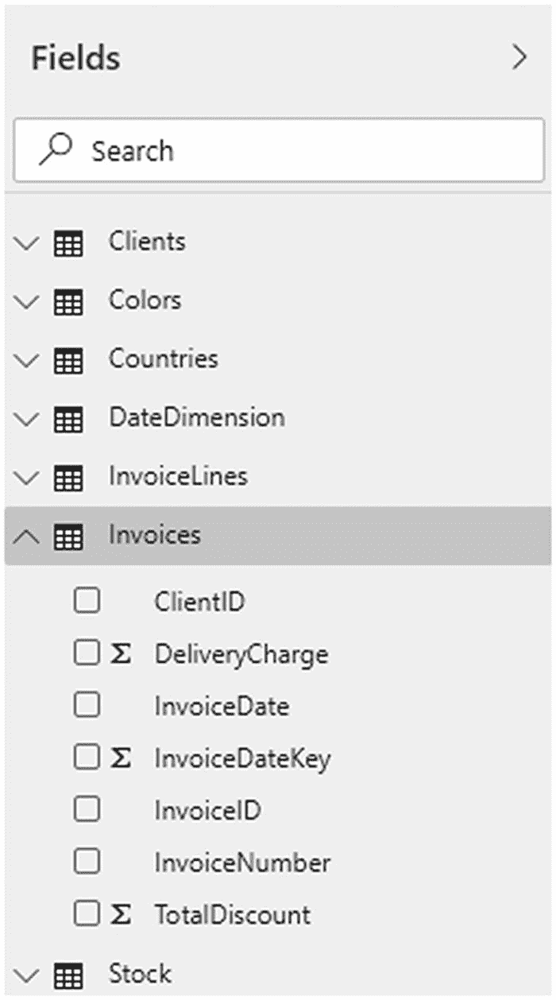

**图 13-2** `表中的字段列表`

1.  在“字段”列表中，单击包含你要跳转字段的表左侧的展开三角形。该表中的字段列表将显示出来，如图 13-2 所示。
1.  单击包含你要研究数据的字段名称。该字段将在表中被选中。

## 操作字段

现在，让我们看看如何在表内部对构成表的数据字段执行类似的操作。

### 重命名字段

重命名字段相当简单。你只需这样做：

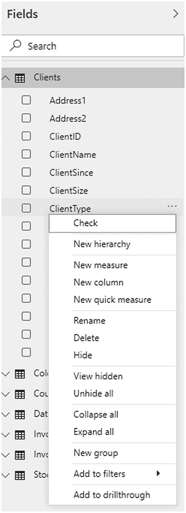

**图 13-3** `Power BI Desktop 上下文菜单`

1.  在“字段”列表中，右键单击你要重命名的字段标题（或单击字段名称右侧的省略号）。在此示例中，它是`Data Clients`表中的`ClientType`字段。该字段将被选中，并出现上下文菜单，如图 13-3 所示。
1.  从上下文菜单中选择`重命名`。当前字段名称将被高亮显示。
1.  为字段输入新名称（`TypeOfClient`），然后按 Enter 键。

就这样。你的字段已被重命名；它同时也被选中。但是，你不能使用同一表中现有字段的名称。如果你尝试这样做，Power BI Desktop 将显示如图 13-4 所示的对话框。

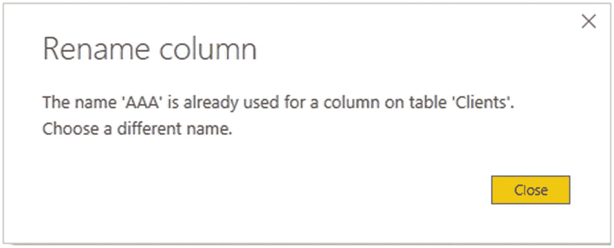

**图 13-4** `重命名字段对话框`

如果发生这种情况，只需单击`关闭`，然后使用不同的新字段名称重新开始。

尽管重命名字段看似微不足道，但它可能很重要。首先考虑其他用户；他们需要字段名称立即可懂且对他们有意义。然后是 [PowerBI.com](http://powerbi.com) 的 Q&A 自然语言功能。只有当你的字段名称与查询中使用的名称一致，或者是可识别的同义词时，该功能才能正常工作。最后，你确实需要为你的字段赋予你乐于看到在所有基于此数据集的仪表板中标准化的名称（即使你可以在可视化效果中单独重命名字段）。这样做的好处是，相同的数据将始终具有相同的名称，从而消除受众——以及你自己——潜在的理解困难或混淆。

你也可以通过右键单击你感兴趣的字段标题并从上下文菜单中选择`重命名`，或者通过单击列内部，然后选择“列工具”功能区，在其中更改`名称`字段的内容来重命名字段。

**提示**

Power BI Desktop 在重命名字段（实际上，也包括表和计算）方面非常宽容。你可以重命名查询窗口、数据视图、报表视图或关系视图中的`大多数`元素（取决于它们添加的位置），这些更改将传播到整个 Power BI Desktop 数据模型。更好的是，如果这些元素已应用于仪表板，重命名字段、计算和表通常不会给 Power BI Desktop 带来任何困难，因为这些仪表板也会更新以反映名称的更改。只需注意，如果你自定义了很多名称并且没有记录字段以供参考，你会发现逆向工程一个报表可能是一项相当艰巨的任务。在实践中，如果你始终在查询中保留从别名字段到源字段的引用，这会为你节省大量精力。

### 删除字段

删除字段同样简单。当你导入了一个本来不想导入的字段，或者发现不再需要某个字段时，你很可能需要进行此操作。要删除一个字段，请执行以下操作：

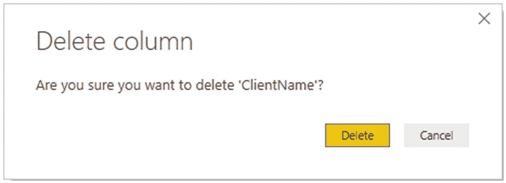

**图 13-5** 删除字段

1. 右键单击你想要删除的字段标题。或者，右键单击`字段（Fields）`列表中的字段名称。该字段将被选中，并出现上下文菜单。
2. 从上下文菜单中选择`删除字段（Delete Fields）`。除非该字段为空，否则将会出现如图 13-5 所示的确认对话框。
3. 点击`确定（OK）`。该字段将从表中删除。

删除未使用的字段是一种良好的实践，因为这样做将：

- 减少数据集所需的内存
- 加快数据刷新操作
- 减小 Power BI Desktop 文件的大小

> **注意**：删除字段确实是永久性的。你无法使用撤销功能恢复它。实际上，刷新数据也不会将该字段重新添加回表中。如果你不小心删除了一个字段，可以选择不保存并关闭 Power BI Desktop 文件，然后重新打开，从而恢复到上一个版本。另外，你也可以返回源查询，并将字段名称重新添加到查询中，因为在 Power BI Desktop 中删除字段会在相关查询的底层步骤序列中添加一个`删除列（Remove Field）`步骤。

### 移动字段

一旦进入数据模型，你`不能`移动字段。因此，如果你想因任何原因更改字段顺序，必须切换到 Power BI Desktop 查询编辑器并在那里移动字段。一旦你保存并应用更改，修改后的字段顺序就会在数据模型中可见。但是，在**报表视图**的`字段（Fields）`列表中，字段将始终按字母顺序排列。

### 设置字段宽度

为了让数据更易读，从而更容易理解，你可能想做的最后一件事情是调整字段宽度。我知道作为 Excel 或 Word 用户，你可能觉得这已是老生常谈，但为了内容的完整性，操作方法如下：

1. 将鼠标指针悬停在你想更改宽度的字段的标题右侧边界上。鼠标指针会变成双向箭头。
2. 向左或向右拖动鼠标指针。

> **注意**：你不能在调整一个字段宽度之前先选中几个相邻的字段，然后一次性将它们设置为正在调整的字段的宽度。你可以双击要更改宽度的字段标题的右侧边界，这样 Power BI Desktop 会自动将宽度设置为该字段中最长元素的宽度。

调整字段宽度纯粹是为了帮助你阅读数据，对任何视觉对象中的列宽`没有影响`。

## 准备数据

现在，你的表和列已经准备好了（这可以称为“准备语义层”），你可以开始定义每个字段的基本方面。这包括：

- 数据类型归因
- 格式化数据
- 数据分类
- 设置默认汇总
- 准备数据组

几乎所有此类操作都使用`列工具（Column tools）`功能区完成。你可以从图 13-6 中看到这个功能区。该功能区的内容在表 13-1 中进行了说明。

**表 13-1** 列工具功能区

| 按钮 | 说明 |
| --- | --- |
| 名称 (Name) | 允许你修改列名称。 |
| 数据类型 (Data type) | 设置列的数据类型。 |
| 格式类型 (Format type) | 设置整体格式类型。 |
| 格式 (Format) | 指定精确的格式设置。 |
| 默认汇总 (Default summarization) | 从可用选项中设置默认汇总方式。 |
| 数据类别 (Data category) | 应用数据类别。 |
| 按列排序 (Sort by column) | 应用按列排序（使用另一列中的数据进行排序）。 |
| 数据组 (Data groups) | 允许你对数据进行分组。 |
| 关系 (Relationships) | 显示`管理关系`对话框。 |
| 新建列 (New column) | 使用 DAX 添加一个新列。 |

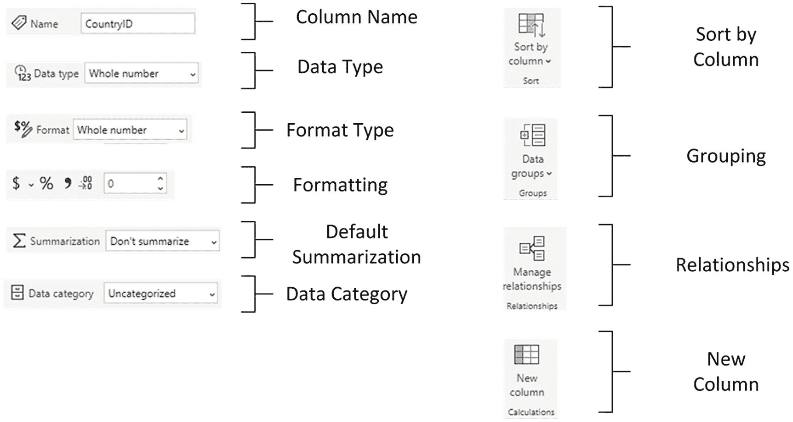

**图 13-6** 列工具功能区

在某些操作中，你可能还会用到`表工具（Table tools）`功能区。该功能区的内容在表 13-2 中进行了说明。你可以从图 13-7 中看到这个功能区。

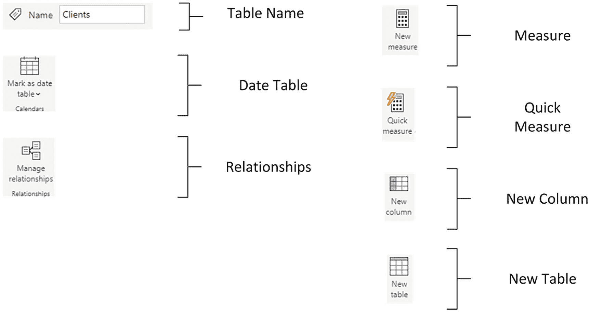

**图 13-7** 表工具功能区

**表 13-2** 表工具功能区

| 按钮 | 说明 |
| --- | --- |
| 表名称 (Table name) | 允许你修改表名称。 |
| 日期表 (Date table) | 将选定的表设置为日期表。 |
| 关系 (Relationships) | 显示`管理关系`对话框。 |
| 度量值 (Measure) | 使用 DAX 添加一个新度量值。 |

## Power BI Desktop 数据类型

当你从外部源导入数据时，Power BI Desktop 会尝试将其转换为其使用的九种数据类型之一。这些数据类型在表 13-3 中进行了描述。

**表 13-3** Power BI Desktop 数据类型

| 数据类型 | 说明 |
| --- | --- |
| 十进制数 (Decimal Number) | 将数据存储为最多包含 15 位有效十进制数字的实数。负值范围从 –1.79E +308 到 –2.23E –308。正值范围从 2.23E –308 到 1.79E + 308。 |
| 固定小数位数 (Fixed Decimal Number) | 将数据存储为具有指定位数小数的数字。 |
| 整数 (Whole Number) | 将数据存储为整数，可以是正数或负数，但必须是介于 9,223,372,036,854,775,808 (–2⁶³) 和 9,223,372,036,854,775,807 (2⁶³–1) 之间的整数。 |
| 日期/时间 (Date/Time) | 以主机的日期和时间格式存储数据。仅 1900 年 1 月 1 日及之后的日期有效。 |
| 日期 (Date) | 以主机的日期格式存储数据。 |
| 时间 (Time) | 以主机的时间元素格式存储数据。 |
| 文本 (Text) | 将数据存储为最多 536,870,912 字节的 Unicode 字符串。 |
| 真/假 (True/False) | 将数据存储为布尔值——真或假。 |
| 二进制 (Binary) | 将数据存储为二进制（机器可读）数据。 |

你可以像这样设置列的数据类型：

1.  在`数据视图（Data View）`中，选择（或点击进入）你想要更改数据类型的列。
2.  激活`列工具（Column tools）`功能区。
3.  从`数据类型（Data type）`弹出列表中选择一种数据类型。

与在`查询编辑器（Query Editor）`中设置数据类型的情况一样，系统不允许你应用不恰当的数据类型。

### 格式化 Power BI Desktop 数据

Power BI Desktop 允许你对表中包含的数据应用格式。当你在 Power BI Desktop 数据模型中格式化数据时，你实际上是在定义一种格式，该格式将用于你使用此指标创建*所有仪表板中的所有可视化效果*。因此，出于以下原因，学习如何格式化数据是值得的：

-   通过在数据视图中一劳永逸地定义格式，你将在创建报表和演示文稿时节省时间并避免重复操作。之后，数据将以此 Power BI Desktop 文件中多个可视化效果所应用的格式显示。
-   如果你能以具有内在意义的格式查看数字，这可以帮助你更直观地理解数据。

以下说明如何格式化一个字段（本例中为数字字段）：

1.  假设你在 Power BI Desktop 数据视图中工作，在“字段”列表中单击包含要格式化指标的表的名称。
2.  单击要格式化的字段内部（来自示例文件`CarSalesDataFromDataModel.pbix`中`InvoiceLines`表的`SalePrice`字段）。
3.  在“列工具”功能区中，单击“千位分隔符”图标（“格式设置”部分中的逗号）。字段中的所有数字都将被格式化为包含千位分隔符和两位小数。

表 13-4 描述了可用的各种格式选项。

**表 13-4**

**货币格式选项**

| 格式选项 | 图标 | 描述 | 示例 |
| --- | --- | --- | --- |
| 常规 | | 保持数据未格式化。 | 100000.01 |
| 货币 |  | 添加千位分隔符、两位小数以及当前货币符号。 | $100,000.01 |
| 日期/时间 | | 以选择的某种日期和时间格式格式化日期和/或时间值。 | |
| 小数 | | 添加千位分隔符和两位小数。 | 100,000.01 |
| 整数 | | 添加千位分隔符并截断任何小数。 | 100,000 |
| 百分比 |  | 乘以 100，添加两位小数，并加上百分比符号前缀。 | 28.78% |
| 千位分隔符 |  | 添加千位分隔符。 | |
| 科学计数 | | 以科学记数法显示数字。 | 1.00E+05 |
| 文本 | | 将字段内容格式化为文本。 | |
| 二进制 | | 将字段内容保留为数据的二进制表示形式。 | |
| 真/假 | | 将字段内容格式化为真/假。 | |
| 小数位数 |  | 增加或减少小数位数。 | |

如果你想恢复到“纯原始”数据，可以通过选择“常规”格式来实现。请记住，你不是在 Excel 中，并且不能仅格式化一部分数字——要么格式化整个字段，要么什么都不做。另外，无法通过按住 Ctrl 键单击来进行非连续选择以格式化不相邻的字段。并且，你无法选择多个相邻字段并一次性格式化它们。

至此，你可能已经意识到 Power BI Desktop 遵循“一次格式化，处处应用”的原则。然而，这并不意味着你必须在创建仪表板和报表之前就详尽地准备好数据。你可以随时在数据模型和报表视图之间切换以选择其他格式，并且确信刚刚应用的格式将用于所有使用了相关指标的仪表板。

> **注意：** 如果字段中的数据是文本或日期/时间数据类型，则无法选择数字格式。同样，只有字段包含可以解释为日期或时间的数据时，日期和时间格式才可用。只有布尔（真/假）数据类型可以格式化为真/假。最后，只有包含二进制数据的字段才能格式化为二进制。

#### 货币格式

Power BI Desktop 会提供多种货币格式供你选择。要选择你想要的货币：

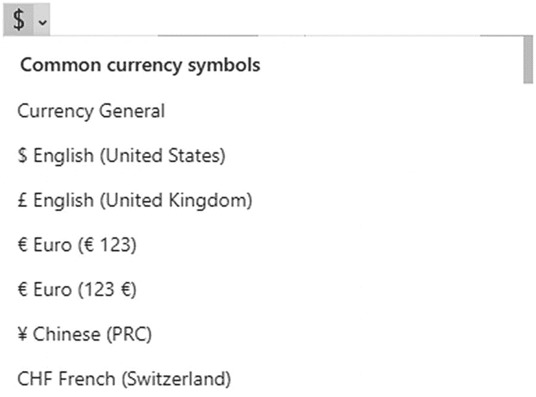

**图 13-8** 货币格式弹出列表

1.  单击货币格式图标右侧的弹出按钮（朝下的三角形）。这将显示可用格式列表。
2.  选择你想要的货币符号，或者滚动列表查看所有可用的货币格式，如图 13-8 所示，然后单击“确定”。

> **注意：** 应用的千位分隔符以及小数分隔符取决于应用格式的电脑设置。

## 为仪表板准备数据

将数据整合到一个能够为仪表板提供动力的结构中，除了为最终呈现指定数据类型和格式之外，还需要进行一些良好的调整。作为仪表板基础工作的一部分，你可能还需要：

-   对数据进行分类
-   应用默认汇总方式
-   定义排序依据字段
-   隐藏字段

这些概念乍一看可能有些深奥，让我们实际操作一下，以明确为什么需要为数据模型添加这些调整。

### 数据分类

Power BI 仪表板并非仅仅由事实和数据构成。它们还可以包含地理数据或指向网站或文档的超链接。虽然我们人类能够比较容易地识别出`URL`，并且可以猜测出包含邮政编码的字段中包含的是邮政编码，但对于计算机来说，这些直觉可能并非那么显而易见。因此，如果你希望 Power BI 能够（例如）添加地图或超链接，那么如果你对包含用于地图和链接的数据类型的任何字段进行分类，将为你自己和应用程序都带来便利。

例如，假设你想将`Countries`表准备为仪表板地图的潜在数据源（假设你已经加载了`CarSalesDataFromDataModel.pbix`示例文件）：

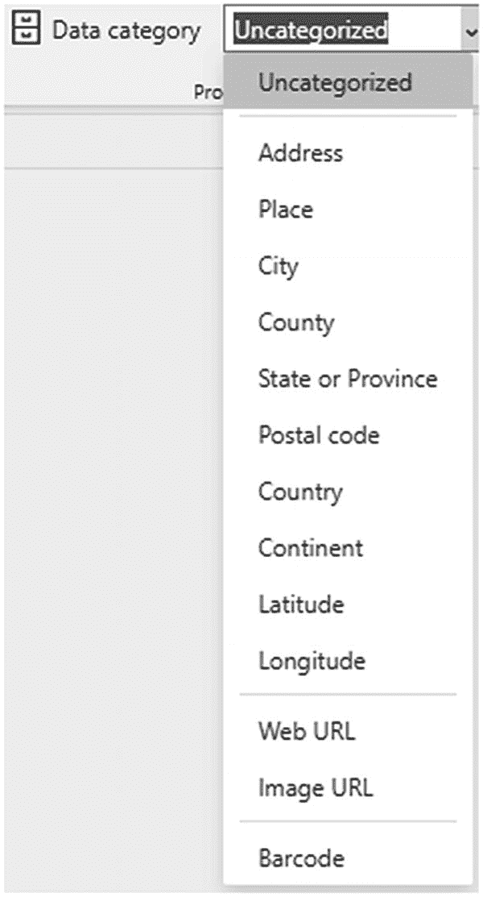

图 13-9：数据类别选项

1.  在数据视图中，从字段列表中选择`Countries`表。`Countries`表中的数据将显示在 Power BI Desktop 窗口的中心。
2.  单击`CountryName`字段内部。该字段将被高亮显示。

### 应用默认汇总

在创建仪表板时，你通常会对数字数据进行聚合。大多数情况下，这意味着对数字求和以返回字段总计。但是，可能存在某些数据字段你希望应用其他聚合方式。请执行以下操作来设置你自己的默认聚合（假设你已经加载了`CarSalesDataFromDataModel.pbix`示例文件）：

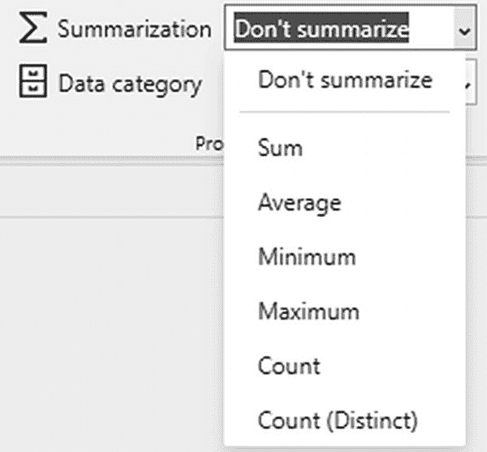
图 13-10：默认汇总弹出菜单

1. 在数据视图中，从字段列表中选择`Colors`表。Colors数据将显示在Power BI Desktop窗口的中心。
2. 单击`Color`字段内部。该字段将被高亮显示。
3. 在列工具功能区中，单击汇总按钮右侧的弹出菜单。弹出汇总菜单，如图13-10所示。
4. 从上下文菜单中选择`计数`。

功能区将显示“默认汇总：计数”。

可用的默认汇总选项在表13-6中进行了描述。

**表 13-6：默认汇总选项**

| 默认汇总选项 | 描述 |
| --- | --- |
| 不汇总 | 此字段中的数据不进行汇总。 |
| 求和 | 此字段中的数据被加总（求和）。 |
| 平均值 | 返回此字段中数据的平均值。 |
| 最小值 | 返回此字段中数据的最小值。 |
| 最大值 | 返回此字段中数据的最大值。 |
| 计数 | 返回此字段中的元素个数。 |
| 计数（非重复） | 返回此字段中独立（非重复）元素的个数。 |

显然，你只能对数值应用数学聚合。但是，你可以对任何类型的数据应用计数。

**注意：** 指定默认聚合并不妨碍你在仪表板中覆盖该默认设置。它仅仅是设置了一个默认值，在从字段聚合数据时作为标准应用。在实际工作中，这非常有用，因为它可以减少你构建仪表板所花费的时间。

### 定义排序依据字段

有时，你会希望仪表板可视化中的排序不是基于所选字段的内容，而是基于另一个字段的内容。例如，假设你有一个包含销售月份的数据表。如果你按月份排序，你可能不希望看到月份按字母顺序显示，从四月开始。在这种情况下，你可以告诉Power BI Desktop，你希望按月*名称*元素，依据另一个字段中包含的月*份编号*进行排序。

1. 加载`C:\PowerBiDesktopSamples\CarSalesDataFromDataModel.pbix`示例文件（当然，前提是你尚未加载它）。
2. 在数据视图中，从字段列表中选择`DateDimension`表。日期数据将显示在Power BI Desktop窗口的中心。
3. 单击`MonthFull`字段内部。该字段将被高亮显示。
4. 在列工具功能区中，单击“按列排序”按钮，并从可用字段列表中选择`MonthNum`。

现在，如果你在可视化中按`MonthFull`排序，你会看到月份按你可能预期的顺序显示——从一月到十二月。如果你*没有*应用按列排序，那么日历月份将按字母顺序排序，即从四月到九月！同样，此选择适用于你在Power BI Desktop仪表板中创建的、基于此数据模型的*任何*可视化。因此，请记住在数据源处，在文本字段（如日期等）旁边添加数字排序字段。

要移除按列排序，请保持选中该字段，只需再次单击“按列排序”按钮，然后从可用字段列表中选择原始字段名称即可。

**提示：** 如果你想查看哪个字段已被设置为排序依据字段，只需单击要排序的字段内部，然后单击排序依据字段按钮。字段弹出列表会在用于对所选字段进行排序的字段左侧显示一个勾选标记。

本章的示例文件（`CarSalesDataFromDataModel.pbix`）已经包含了你可以用作排序依据字段的字段。在实际工作中，你的源数据可能并非总是如此立即可用。因此，请记住，你随时可以切换到Power BI Desktop查询编辑器，并使用额外的字段来增强源表，然后你便可以在数据视图中使用这些字段对数据进行排序。

### 隐藏用户界面中的表和字段

一个数据模型可能包含的字段远多于创建报表和仪表板所需的字段。这些字段可能包括（但不限于）：

- `排序依据列`
- 已出现在层次结构中的字段（稍后几页会看到）
- 包含中间计算结果的字段（下一章会解释）
- 包含“以防万一”加载但目前并不需要的数据的字段

因此，为了清晰起见，您可能希望隐藏与分析非严格相关的字段（甚至是整个表）。这不仅减少了杂乱，还能避免新用户开始使用您创建的数据模型时产生困惑。同时，这也能确保只有必要的数据可见。

#### 隐藏字段和表

作为第一步，您需要将字段（或表，如果愿意的话）标记为隐藏。操作方法如下：

1. 单击要隐藏的字段或表。
2. 从弹出菜单中选择`在报表视图中隐藏`。

隐藏的字段和表暂时仍会显示在`字段`列表中，但会变为灰色。尽管如此，隐藏的字段以及隐藏表中的字段仍然可以在可视化对象中使用。

要重新显示隐藏的字段或表，只需右键单击相应的字段或表，然后在弹出菜单中取消选中`在报表视图中隐藏`选项。

#### 从视图中移除隐藏的字段和表

如果您的目标是“整理”`字段`列表，您可以完全从视图中移除隐藏的字段和表，操作如下：

1. 单击`字段`列表中的任意表或字段，然后在弹出菜单中取消选中`查看隐藏项`选项。

所有隐藏的字段和表将从`字段`列表中消失。要重新显示所有隐藏的字段和表，只需在弹出菜单中选中`取消全部隐藏`选项即可。

### 在 Power BI Desktop 表中对数据进行排序

Power BI Desktop表可能包含数百万行，因此您最不愿意做的就是在一个随机数据集中向下滚动。幸运的是，在表中排序数据很简单：

1. 激活包含要排序字段的表。
2. 在表中（不是在`字段`列表中），右键单击您想要排序数据的字段内部。我将选择`Stock`表中的`Make`字段。
3. 在上下文菜单中点击`升序排序`选项，以升序（字母顺序）对该字段进行排序。

该表使用所选字段作为排序键进行排序，即使是大型数据集也能在极短时间内正确排序。如果您想按降序（反向字母顺序或从大到小顺序）对表进行排序，请单击上下文菜单中的`降序排序`选项。

此时，您需要记住，数据模型并非真正为交互式数据分析而设计。那是仪表板的功能。因此，您不应期望像使用大型Excel电子表格那样使用Power BI Desktop中的数据表。

**提示**
如果您需要视觉指示表明某个字段已排序，请查看字段名称的右侧。您会看到一个小箭头，箭头向上表示降序排序，向下表示升序排序。

如果您想移除应用的排序操作并返回到最初导入的数据集，您只需单击该字段上下文菜单中的`清除排序`图标即可。

**注意**
您无法执行复杂的排序操作；也就是说，您不能先对一个字段进行排序，然后再对另一个字段进行次级排序（如果第一个字段中存在相同元素）。您也无法先按最不重要的字段排序，然后逐步向上到最重要的字段进行排序，以实现复杂排序的效果。这是因为Power BI Desktop始终根据最初加载的数据集对数据进行排序。请记住，您可以在Power BI Desktop Query中添加索引字段（如第8章所述），然后如果需要重新应用初始排序顺序，可以基于这些索引字段进行排序。

### 创建和修改组

有时，列表中有多个单独项，您希望将不同的值集合收集到组中。这可能是为了获取不同子域的更高级别视图，或者仅仅是为了从记录集中隔离某些值。在以下情况下，这尤其有用：

- 将一组不同的值可视化为单个元素
- 将“长尾”值归入一个类别

**提示**

---

### 关于数据类别

在列工具功能区中，单击数据类别按钮右侧的弹出菜单。你可以看到图13-9中显示的这个上下文菜单。

4. 从菜单中选择`国家/地区`。

功能区将显示“数据类别：国家/地区”。这意味着Power BI Desktop现在知道如何将字段内容用作仪表板中生成地图的国家。

可用的数据类别选项在表13-5中进行了描述。

**表 13-5：数据类别选项**

| 数据类别选项 | 描述 |
| --- | --- |
| 未分类 | 适用于不用于超链接或创建地图的数据。 |
| 地址 | 为制图指定一个地址。 |
| 地点 | 为制图指定一个位置或地点。 |
| 城市 | 为制图指定一个城市。 |
| 县 | 为制图指定一个县。 |
| 州或省 | 为制图指定一个州或省。 |
| 邮政编码 | 为制图指定一个邮政编码（ZIP码）。 |
| 国家/地区 | 为制图指定一个国家或地区。 |
| 大洲 | 为制图指定一个大洲。 |
| 纬度 | 为制图指定一个纬度。 |
| 经度 | 为制图指定一个经度。 |
| Web URL | 指示超链接的`URL`。 |
| 图像 URL | 指示仪表板中图像来源的`URL`。 |
| 条形码 | 指定该字段包含条形码。 |

**注意：** 不指定数据类别并不意味着Power BI Desktop不能在仪表板中创建地图或识别URL。但是，除非你向应用程序指明某个字段包含特定类型的数据，否则无法保证结果有合理的成功机会。

如果您愿意，可以将组视为“水平”组织，而层次结构则对应于“垂直”选择。

## 创建一个组

假设您将频繁使用一组颜色作为仪表板中表格和图表的基础。以下是如何创建一个包含可用颜色子集的组：

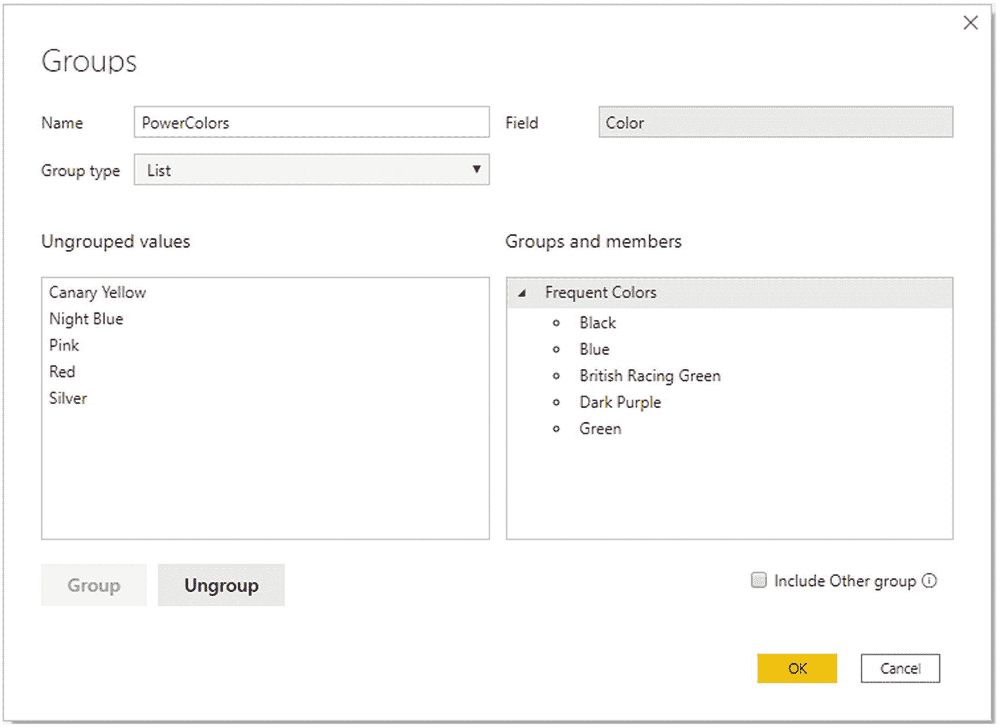

**图 13-11** – “组”对话框

1.  单击 Power BI Desktop 窗口左上角的`数据`图标。

2.  选择`Colors`表。

3.  单击`Color`字段内部。

4.  在`列工具`功能区中，单击`新建组`图标。将出现“组”对话框。

5.  在`名称`字段中，输入组的名称。在此示例中，我将使用 `PowerColors`。

6.  在左侧的未分组值列表中，按住 Ctrl 键并单击以下五个元素：

    1.  Black

    2.  Blue

    3.  British Racing Green

    4.  Dark Purple

    5.  Green

7.  单击`分组`。

8.  重命名颜色组（当前已高亮显示）。

9.  按 Enter 键。对话框将如图 13-11 所示。

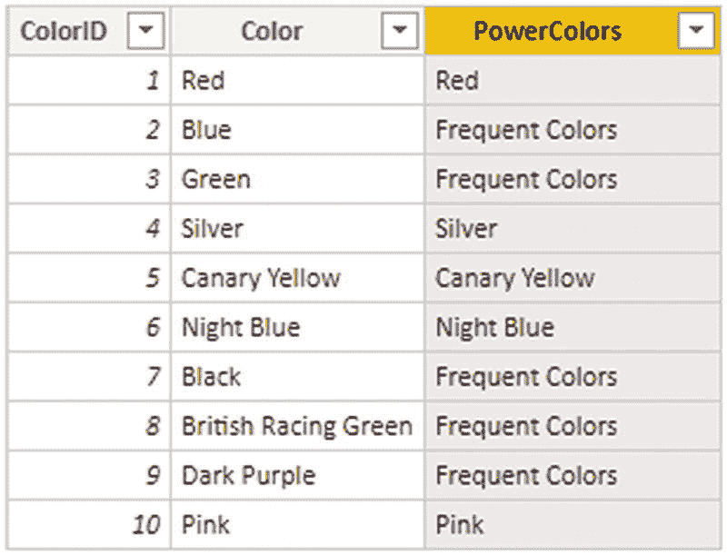

**图 13-12** – 一个组字段

10. 单击`确定`。将创建一个包含组定义的新字段，如图 13-12 所示。组的名称成为新字段的名称。

您现在可以在视觉对象中使用此字段来对元素进行分组。您将在第 16 章中看到更详细的说明。

创建组时有几点需要注意：

-   选中`包含其他组`复选框将提取原始字段中的所有剩余项，并用它们创建一个“其他”组。

-   您可以创建多个组。只需根据需要分组的次数重复执行步骤 6 和 7 即可。

-   原始字段中的任何值在组中不能出现多次。

## 修改组

任何现有的组都可以轻松更改，只需执行以下操作：

1.  单击包含要修改的组的字段内部。

2.  在`列工具`功能区中，单击`编辑组`图标。将出现“组”对话框。

3.  通过单击右侧`组和成员`列表中的值来从组中移除任何项目。然后单击`取消分组`。

4.  通过选择左侧的项目，然后在右侧选择相应的组后，单击`分组`按钮来添加任何新值。

5.  单击`确定`。修改后的组将应用于所选字段。

## 删除组

由于组本质上就是一个字段，因此删除组的方法与删除字段完全相同：

1.  在`字段`列表中，展开包含新字段的表。您会看到组字段在字段名称左侧有一个带有两个空心方块的小图标。

2.  右键单击该组字段并选择`删除`。

3.  确认删除。

> **注意**：
> 您可以在一个表中“混合搭配”使用组。例如，您可以将表中的所有单独值分配到不同的组，或者您可以创建多个组来处理某些值，同时将其他值保留在组外。

## 将表标记为日期表

现在，Power BI Desktop 需要知道您导入的表实际上是一个日期表，它可以利用该表来添加时间智能功能。这操作起来比描述起来要简单：

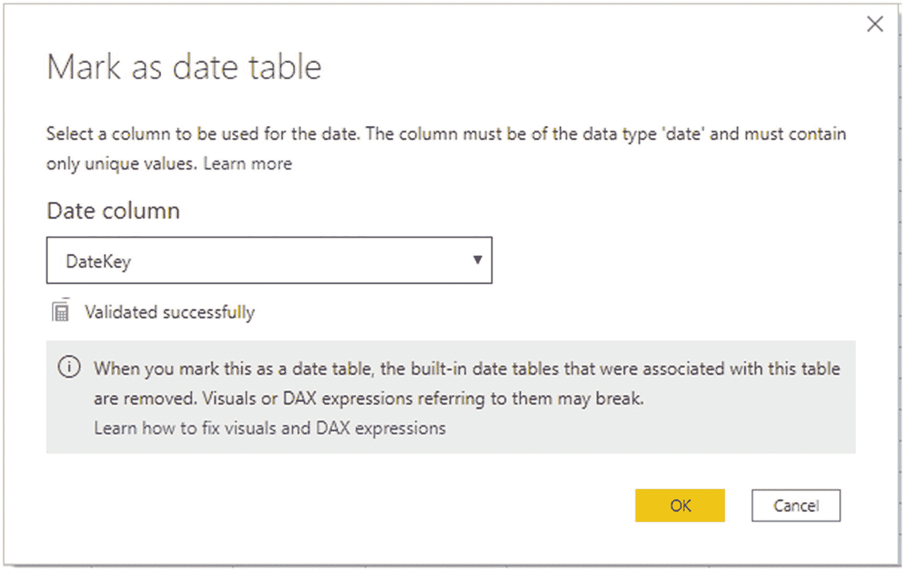

**图 13-13** `标记为日期表`对话框

1.  切换到数据视图。

2.  单击 `DateDimension` 表。

3.  在“表工具”功能区中，单击`标记为日期表`按钮。将出现`标记为日期表`对话框。

4.  选择包含连续日期列表的列。在本书使用的示例中，它是 `DateKey` 列。该对话框应如图 13-13 所示。

5.  单击`确定`。

现在，Power BI Desktop 知道此表有些特殊，并且它只包含一个可用于为分析添加时间智能的日期列表。最后要做的，是在日期表中的 `DateKey` 列与包含要随时间分析的数据的表中的日期字段之间定义关系。在我们使用的示例数据中，这将是 `SalesDate` 表中的 `InvoiceDate` 字段。通过这种方式，数据集知道您可能正在按发票日期查看销售情况，但 `DateTable` 将提供用于显示随时间变化的指标的天、月、季度和年列表。

> **注意**：可以在 Excel、DAX 或 M 中创建日期维度。但是，所需的技术超出了本书的范围。

## 设计 Power BI Desktop 数据模型

恭喜！您已经在为自助式商业智能 (BI) 开发高性能数据模型的道路上取得了长足进步。您已将来自一个甚至多个源的数据导入到 Power BI Desktop 数据模型中。您已使用 Power BI Desktop 数据模型窗口仔细查看了数据，并且可以执行重命名表和字段等基本操作。确保数据集准备就绪、可用作自助式 BI 数据仓库的最后一步是创建和管理表之间的关系。这是在 Power BI Desktop 中设计连贯且可用数据集的基础部分。

在深入探讨表关系的技术细节之前，我们首先需要回答几个简单的问题：

-   什么是表之间的关系？

-   我们为什么需要它们？

表关系是数据表之间的链接，允许一个表中的字段在另一个表中被有意义地使用。如果您打开了 Power BI Desktop 示例文件 `CarSalesDataFromDataModel.pbix`，您可以看到有一个包含库存数据的 `Stock` 表，其中包含 `ColorID` 字段，但不包含实际颜色本身。作为补充，有一个名为 `Colors` 的颜色参考表。由此可知，如果我们想说明购买汽车时的颜色，就需要能够链接这些表，以便 `Stock` 表可以“查找”所购汽车的实际颜色。这需要两个表之间存在某些共性，幸运的是，两者都包含一个名为 `ColorID` 的字段。因此，如果我们能够使用此字段联接两个表，就可以看到库存中每辆车的颜色 ID 所代表的颜色。

如果您查看 `Invoices` 和 `InvoiceLines` 表，可以看到链接表的另一个示例。这两个表是使用一种称为关系建模的技术设计的。这本质上意味着创建了两个表以避免无意义的数据重复。因此，任何用于描述发票的数据（例如发票日期或发票号码）都存储在 `Invoices` 表中，而所有关于已售车辆详细信息的都保存在一个名为 `InvoiceLines` 的单独表中。然后，这两个表共享一个允许它们联接的字段，以便用户在需要时可以一起查看两个表中的数据。这意味着，任何可能重复的元素都存储在“标题”表中，例如 `Invoices` 表，而非重复数据则存储在明细表（本例中为 `InvoiceLines` 表）中。

将这两个表的数据存储为一个表是可能的。然而，这意味着每当发票包含多个项目时，都需要重复发票日期或发票号码等元素。这将导致数据元素重复并大幅增加文件大小。

显然，这些例子非常简单。但它们并非过度做作。它们代表了许多关系数据库存储数据的方式。因此，您有很大机会在从公司数据库导入的现实世界数据中看到类似的潜在链接或关系。无论如何，如果您想在数据分析中使用来自多个源的数据，您必须找到一种方法，使用公共字段（比如我刚刚提到的 `ColorID` 字段）来链接这些表。实际情况可能更复杂（例如，两个表中的字段名称可能不同），但该原则始终适用。

> **提示**：如果您拥有必要的权限以及 SQL 知识，则可以使用查询直接在源数据库中联接表。这样，您就可以从一开始就在 Power BI Desktop 中创建更少的“扁平化”表，并避免在 Power BI Desktop 中创建蜘蛛网般的新表关系。

### Power BI Desktop 环境中的数据建模

在深入探讨创建和增强数据模型的具体细节之前，我认为最好先熟悉一下建模功能区，它是数据建模的起点。

#### 建模功能区

建模功能区用于对数据和表进行分类和组织，以及添加计算字段和附加指标，并对数据进行分类和格式化。它包含的按钮如图 13-14 所示，并在表 13-7 中进行了解释。

**表 13-7** “列工具”功能区按钮

| 按钮 | 描述 |
| --- | --- |
| `管理关系` | 允许您联接表，以及删除这些联接（称为*关系*）并对其进行修改。 |
| `新建度量值` | 用于向表添加新值或计算。 |
| `新建快速度量值` | 用于在 Power BI Desktop 的帮助下向表添加新值或计算。 |
| `新建字段` | 向表添加新的计算字段。 |
| `新建表` | 添加一个新表。 |
| `假设参数` | 允许您添加一个新的交互式“假设”参数。 |
| `管理角色` | 允许您限制给定用户的数据访问权限。 |
| `以角色身份查看` | 让您查看给定角色可用的数据。 |
| `Q&A 设置` | 指导 Power BI 自然语言界面更好地理解问题。 |
| `设置语言` | 选择 Q&A 使用的语言。 |
| `设置语言架构` | 导入、导出或编辑 Q&A 使用的语言架构。 |

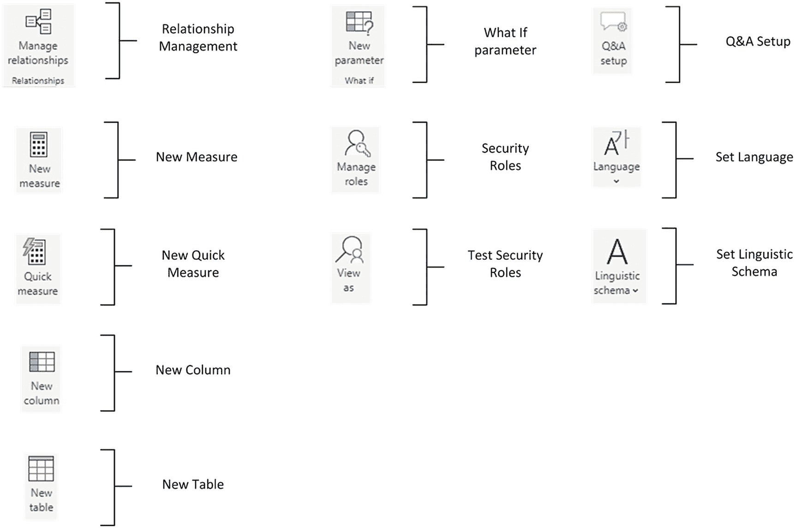

**图 13-14** “列工具”功能区中的按钮

好的，作为一名高级文档工程师和翻译员，我将严格按照您提供的注意事项和示例，将以下英文文本翻译成中文。

## 数据视图和模型视图

`Power BI Desktop` 允许你通过两种不同但互补的方式查看数据模型。当你需要所有数据表的高层级概览时，应使用`模型视图`，因为它能让你从细节中抽离出来，将数据集视为一个整体。以下是操作方法：

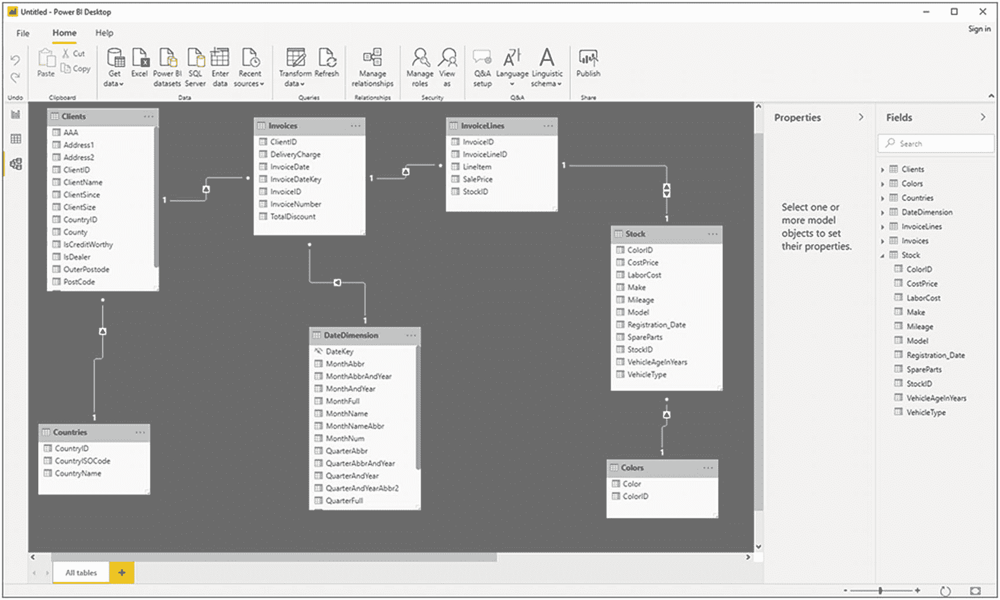

**图 13-15** 模型视图

1.  点击 `Power BI Desktop` 窗口左侧的`模型视图`按钮。`Power BI Desktop` 将在`模型视图`中显示这些表，如图 13-15 所示。

从图 13-15 可以看出，你现在看到的是大部分或全部表，虽然可以看到表名和字段名，但看不到数据。不仅如此，你还可以看到一些表已经建立了联接——尽管并非全部。这是因为 `Power BI Desktop` 总是会尝试猜测表之间任何可能的关系，并在可能的情况下自动创建关系，以节省你的时间和精力。

这正是我们所需要的，因为现在是从整体结构而非细枝末节的角度进行思考的时候了。你可以使用此视图来移动和调整表的大小。移动表只需拖动表的标题栏即可。调整表的大小则需要将指针放在表边缘或角落上，然后拖动鼠标。

> **技巧提示**
> 尽管重新排列表的位置可以被视为纯粹的审美需求，但我认为这样做非常有用。布局良好的数据集设计有助于你理解表之间的关系以及数据的固有结构。

### 模型视图显示选项

`模型视图`的全部意义在于让你能够清晰地查看整个数据集，并在必要时修改布局，从而更清晰地查看表之间的关系。

## 创建关系

一旦知道表之间哪些字段是共通的，创建关系就很容易了。既然我们已经确定需要将`颜色`表联接到`库存`表，那么让我们看看如何使用文件 `C:\PowerBiDesktopSamples\CarSalesDataForLinkingTables.pbix` 来执行此操作。此文件包含本章目前为止所见的数据表，但表之间没有任何关系。

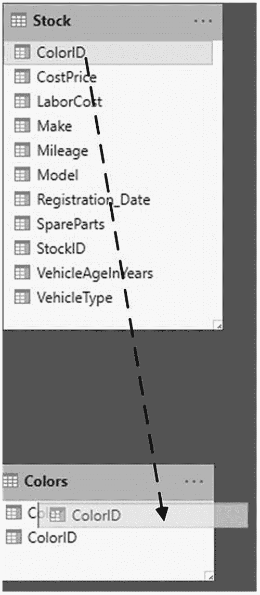

**图 13-16** 表关系

1.  打开文件夹 `C:\PowerBiDesktopSamples` 中的 `Power BI Desktop` 文件 `CarSalesDataForLinkingTables.pbix`。
2.  将`库存`表中的 `ColorID` 字段拖到`颜色`表中的 `ColorID` 字段上，如图 13-16 所示。

只需执行这些操作即可。现在，这两个表已经联接，来自两个表的数据可以在报告和仪表板中有意义地使用。

> **注意**
> 目前，在 `Power BI Desktop` 数据模型中，你只能基于单个字段联接表。在 `Power BI Desktop 查询编辑器`中准备查询以供数据模型后续使用时，可能需要考虑到这一点。

### 手动创建关系

你不必通过拖放字段名来创建关系。如果你愿意，可以指定用于在表之间创建关系的表和字段。此外，你不必非要处于`模型视图`中来执行此操作。所以，为了说明问题并向你展示 `Power BI Desktop` 的灵活性，在本示例中，你将根据其共同的 `InvoiceID` 字段来联接`发票`表和`发票行`表：

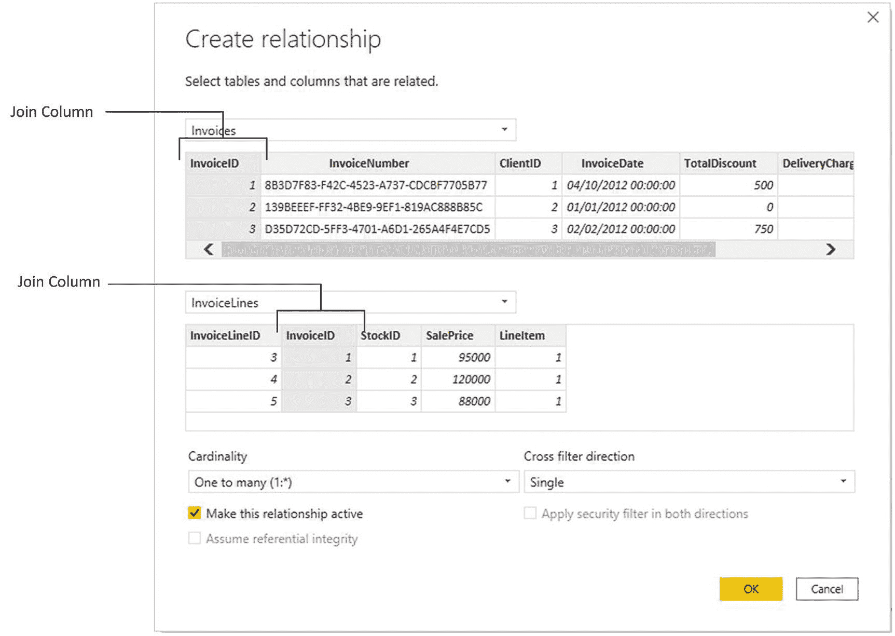

**图 13-17** `创建关系`对话框

1.  选择一个你想要使其出现在关系中的表。本示例我将使用`发票`表。
2.  点击`建模`功能区中的`管理关系`按钮（如果你在`数据视图`中，则点击`表工具`功能区中的该按钮）。将出现`管理关系`对话框。
3.  点击`新建`。将出现`创建关系`对话框。
4.  在对话框的上半部分，从表的下拉列表中选择`发票`表。
5.  在对话框的下半部分，选择`发票行`表作为相关的查找表。`InvoiceID` 字段应自动显示为要联接的字段（它将在两个表中都被选中）。如果 `Power BI Desktop` 已猜出该字段，它将显示为选中状态。如果没有猜中，或者猜错了，你总可以为两个表选择正确的字段。`创建关系`对话框应如图 13-17 所示。

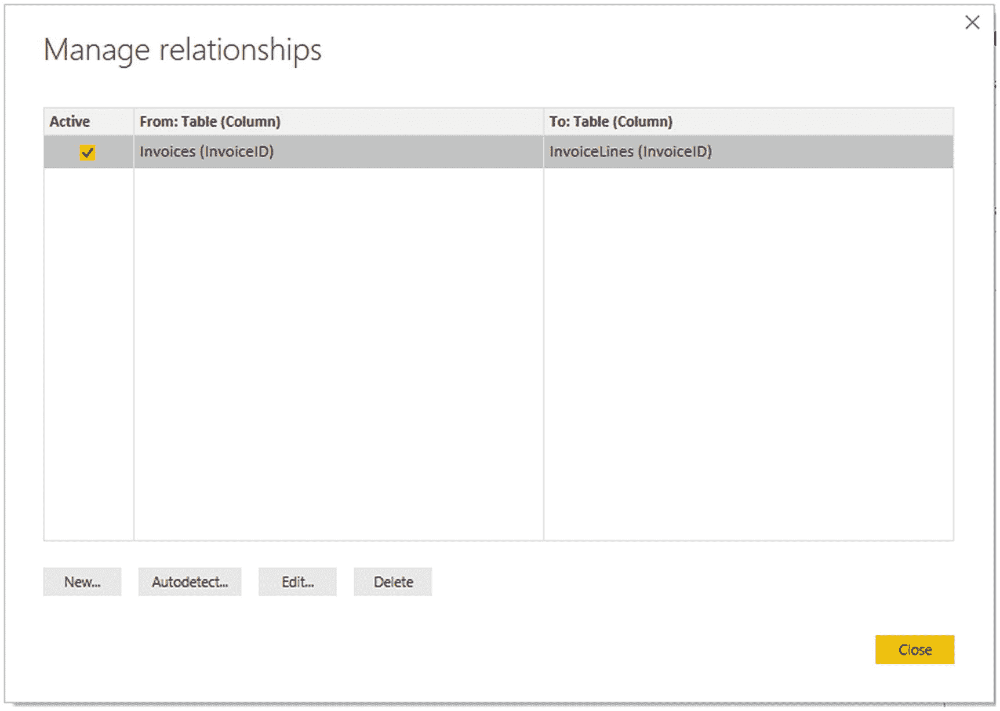

**图 13-18** `管理关系`对话框

1.  点击`确定`。`创建关系`对话框将关闭，并返回到`管理关系`对话框。此时它应如图 13-18 所示。你可以看到，它指示了哪个表中的哪个字段用于联接到哪个其他表中的哪个其他字段。
2.  点击`关闭`。`管理关系`对话框将关闭，并且关系将被创建。

### 自动创建关系

无论数据源是什么，你都可以让 `Power BI Desktop` 自动检测关系。这种方法有几个优点：

-   你可以避免大量手动工作。
-   你可以减少出错的风险（例如，在错误的字段上创建表之间的关系，甚至在不相关的表之间创建关系）。

这项技术非常简单易行。你只需执行以下操作：

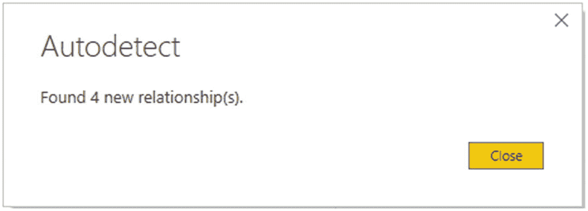

**图 13-19** `自动检测`对话框

1.  点击`开始`功能区中的`管理关系`按钮。将出现`管理关系`对话框。
2.  点击`自动检测`。几秒钟后，将出现如图 13-19 所示的对话框。

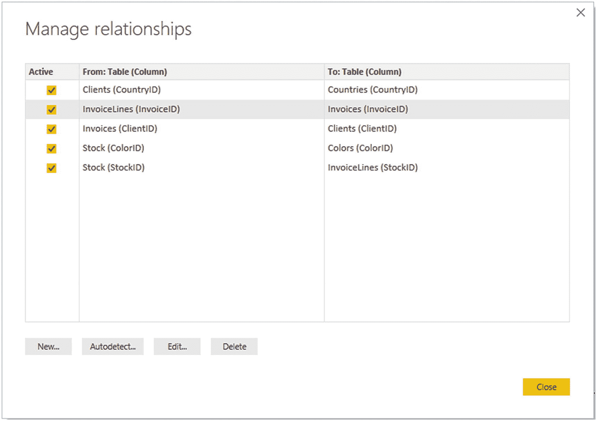

**图 13-20** 自动检测关系后的`管理关系`对话框

1.  点击`关闭`。`管理关系`对话框将列出数据模型中的所有关系——既有预先存在的关系，也有自动检测过程发现的关系。`管理关系`对话框现在应如图 13-20 所示。
2.  点击`关闭`以返回到`关系视图`。

你将看到，你刚刚导入的表已经拥有了在 `Power BI Desktop` 中生成的关系。

### 删除关系

除了创建关系之外，你不可避免地也会想在某些时候删除它们。这既是直观的也是可视化的操作。

**图 13-21** `删除关系`对话框

1.  点击`开始`功能区中的`设计视图`按钮。`Power BI Desktop` 将在`模型视图`中显示这些表。
2.  选择你想要删除的关系。连接两个表的箭头将变为双链接，并且两个表将被高亮显示。
3.  右键单击并选择`删除`（或按 `Delete` 键）。将出现`确认`对话框，如图 13-21 所示。
4.  点击`删除`。

该关系将被删除。但是，这些表将保留在数据模型中。

### 管理关系

如果你希望更改表中作为关系基础的字段，你还有另一种选择。可以使用“`管理关系`”对话框。如果你想要一次性创建或删除多个关系，这种方法也可能很有用。要使用此对话框：

1.  在“`主页`”功能区的“`设计`”选项卡中，点击“`管理关系`”。将出现“`管理关系`”对话框，如图 13-18 之前所示。
2.  点击你想要修改的关系。
3.  点击“`编辑`”（或双击该关系）。将出现“`编辑关系`”对话框（它与图 13-17 中显示的“`创建关系`”对话框几乎完全相同）。
4.  按照前述步骤继续修改关系。

如你从该对话框所见，你还可以选择创建或删除关系。由于这些过程与我已描述的步骤完全相同，因此不再赘述。

用于创建和管理关系的技术本身并不难掌握。然而，在数据集的表之间建立正确的关系是*绝对基础*的。简而言之，如果你试图在单个 Power BI Desktop 仪表板中使用来自无关联的表的数据，你不仅会收到需要创建关系的警报，还会得到明显不准确的结果。基本上，你所有的分析都会是错误的。因此，值得预先花几分钟时间设计一个清晰、准确且逻辑一致的数据集。

> **提示：** 在“`模型`”视图中双击某个关系，也会显示“`编辑关系`”对话框。

### 停用关系

如果你不再需要表之间的某个关系，但又不想删除它，你也可以选择停用该关系。这意味着该关系不再生效，但你可以快速轻松地重新激活它。

停用（或重新激活）关系非常简单，只需选中或取消选中“管理关系”对话框中（如前文图 13-18 所示）“活动”字段的复选框即可。

## 高级关系选项

“编辑关系”对话框中包含一些你可能偶尔会用到的几个高级选项。这些选项包括在定义数据模型结构时必须考虑的两个基本选项：

*   基数

*   交叉筛选方向

以下两个小节将分别讨论这些主题。

### 基数

基数定义了在一个表中，有多少字段与链接表中的匹配字段相关联。你可以在图 13-22 的基数弹出窗口中看到可用的选项。

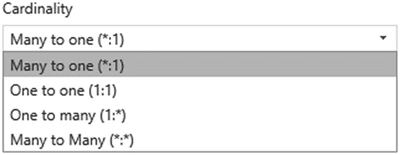

*图 13-22：表关系中的基数*

这些不同的选项在表 13-8 中进行了描述。

**表 13-8：Power BI Desktop 关系类型**

| 关系选项 | 描述 |
| --- | --- |
| 多对一 | 指定一个表中的多条记录与连接表中的单条记录映射。 |
| 一对一 | 指定一个表中的单条记录与连接表中的单条记录映射。 |
| 一对多 | 指定一个表中的单条记录与连接表中的多条记录映射。 |
| 多对多 | 指定一个表中的多条记录可能与另一个表中的多条记录连接。 |

Power BI Desktop 几乎总能检测到关系的正确基数。但是，例如，如果你因为怀疑将来可能需要另一种基数类型而想要覆盖软件所做的选择，那么你只需从弹出列表中选择你想要的基数即可。

#### 基数问题

遗憾的是，数据并不总是完美的。因此，有时当你选择用来连接两个表的基数时，在创建仪表板时可能会得到奇怪的结果。

不可能涵盖所有可能引发此错误的多种原因。因此，如果你看到此消息，以下是一些提示，希望能在你遇到此问题时帮你理清头绪：

*   对于一对多基数，请确保关系“一”方的字段值对应着“多”方的*所有*相应值。

*   对于一对一基数，请检查表关系两侧的字段*没有重复值*。

*   对于一对一基数，请确保表关系两侧的字段没有空值或 Null 值。

*   对于一对多基数，请确保关系“一”方的字段值不包含空值或 Null 值。

### 管理表之间的关系

在 Power BI Desktop 中管理关系通常是创建高效数据模型的关键。然而，提供完整的数据建模课程超出了本书的范围。不过，在创建初始数据模型时，这里有一些提示值得牢记：

-   以*主*表和*查找*表的角度来思考会有所帮助。在你本章学习的数据模型中，可以将某些表视为主数据的查找表，例如 `Colors`、`Countries` 和 `Clients` 表。

-   查找表通常包含一系列在表中不重复的值（例如，国家列表）。这些值被称为关系的“一”端，并连接到另一个在多个场合引用它们的表。因此，包含多个引用的表被称为关系的“多”端。数据库和数据仓库设计者也将此称为关系的*基数*。

-   如果你查看图 13-15（Power BI Desktop 模型视图），可以看到不同类型的关系在相关表之间的连接中已标明。关系末端的一个小 1 表示关系的“一”端，而一个星号表示关系的“多”端。

-   如果你的源数据包含许多通过一系列关系级联下来的查找表（一个经典案例是在许多零售环境中发现的类别 ➤ 子类别 ➤ 产品层次结构），为避免数据模型过于复杂，你可能更倾向于在 Power BI Desktop 中开发数据模型*之前*，使用 Power BI Desktop Query 将多个表合并为单个表。

-   有时——这可能在从关系数据库导入数据时出现——你需要基于多个字段连接表。这在 Power BI Desktop 中无法实现。但通常可以找到变通方法，比如同样在数据建模前使用 Power BI Desktop Query。在这种情况下，你可以通过使用多个字段创建连接来合并表（如你在第 8 章中所见）。

-   从数据仓库导入的数据可能具有内置的事实表结构（包含度量的主表）和维度表（包含查找元素）。然而，你可能也想像此处一样，使用 Power BI Desktop Query“扁平化”复杂的维度层次结构，并创建单层的查找元素表。

-   有时你可能需要在不同上下文中两次使用同一个表。例如，日期表可能用于关联销售日期和采购日期。在这种情况下，你可以再次导入日期表（并为其指定另一个名称），然后从一个查找表到两个不同的查找表创建两个独立的连接。这允许你按独立的日期标准筛选和聚合数据。像这样的查找表通常被称为*角色扮演维度*。

-   可以在一个表和另一个表之间创建多个关系，并指定只有一个是活动的。然后，你可以使用 DAX 中的 `USERELATIONSHIP()` 函数强制计算应用非活动关系。然而，这已经开始涉及更复杂的数据建模层级，因此我在这里仅提及这种可能性。

#### 交叉筛选方向

你可以在图 13-23 中看到两个交叉筛选选项。它们允许你指定筛选器是应用于连接表中所有表，还是仅应用于正在执行聚合的表。

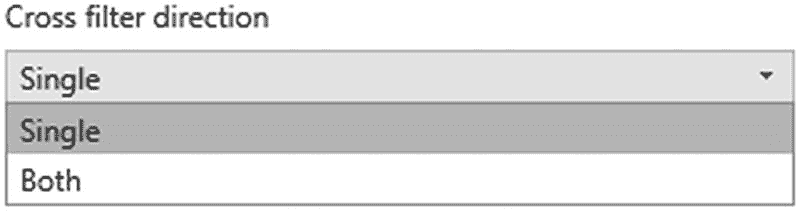

图 13-23：表关系中的交叉筛选方向

这两个选项在表 13-9 中进行了描述。

**表 13-9：交叉筛选方向选项**

| 交叉筛选方向选项 | 描述 |
| --- | --- |
| 单向 | 对链接表的筛选器将应用于数据聚合所在表，但反之则不成立。 |
| 双向 | 为了筛选目的，两个表被视为一个更大的表。所有表中的所有数据都将被筛选。 |

### 其他关系选项

关系剩余的基本选项是：

- 使此关系成为活动关系

- 假定引用完整性

#### 使此关系成为活动关系

在某些数据模型中，表之间可能存在多个关系（基于不同字段）。但是，任何时刻只能有一个关系是活动的。选中“使此关系成为活动关系”复选框，可告知 Power BI Desktop 所选关系是活动关系。不过，其他关系仍可在 DAX 代码中使用。

#### 假定引用完整性

此选项仅在使用 DirectQuery 时可用（你在第 4 章中学习了如何使用）。根据定义，此选项仅适用于关系数据库。启用此选项可让 Power BI Desktop 向底层数据源发送更高效的查询。这意味着数据更新得更快。要使其生效，有几个基本要求：

-   关系中“来源”字段中的数据绝不能为 null 或空白。

-   对于“来源”字段中的每个数据元素，在“目标”字段中都有一个对应的值。

-   “来源”字段位于一对多关系中的“多”端，或者该关系是一对一的连接类型。

**注意**：你需要意识到，当底层数据不满足前述要求时，设置“假定引用完整性”选项并不会阻止该选项被应用，甚至不会阻止数据被返回。然而，结果可能是错误的。

## 重新导入相关表

在结束本章时，有一点相当重要需要说明。即，如果你删除一组相关表，然后在未导入关系的情况下重新导入它们，Power BI Desktop 将*不会*记住之前存在的关系。因此，你将不得不手动重新创建所有关系。如果你删除并重新导入任何在 Power BI Desktop 中已链接到现有表的表，情况也是如此——一旦通过删除表的过程移除了某个关系，你就必须重新创建它。

## 表和字段属性

Power BI 数据模型会迅速变得极其复杂。因此，对其进行彻底文档化不仅重要，甚至可以说是*根本性*的。模型视图的“属性”窗格正是为此而设：

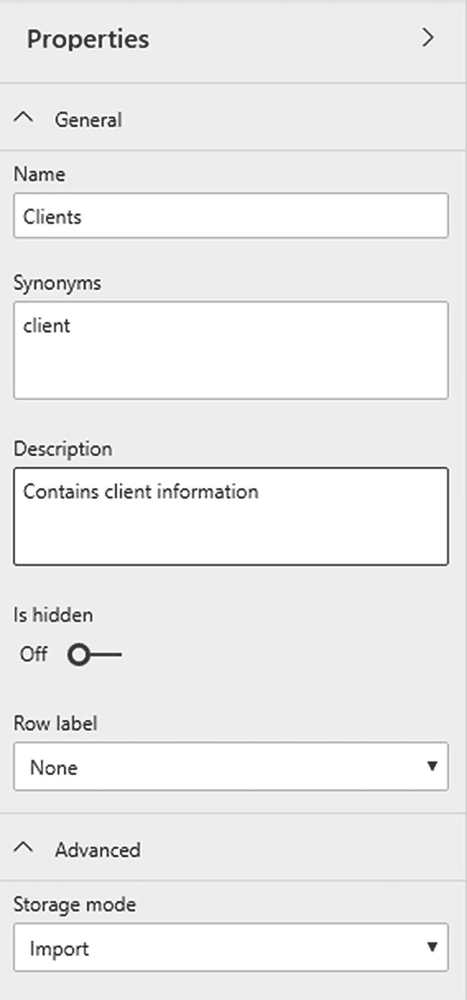

图 13-24：属性窗格

1.  切换到模型视图。

2.  单击你想要记录的表格。

3.  在“属性”窗格中，单击“描述”字段内部并输入描述。“属性”窗格看起来会类似于图 13-24 所示。

单击字段名称可以同样的方式记录所选字段。

“属性”窗格还允许你设置所选字段的以下属性：

-   数据类型

-   数字格式

-   字段可见性（这也适用于表）

-   数据分类

-   默认聚合方式

-   按列排序（如果需要的话）

## 添加层次结构

当您希望"见树又见林"时，数据组织便成为基础。因此，Power BI Desktop 允许您即时创建任意层次结构，以便更好地理解所呈现信息的结构。

要创建层次结构（您可以在报表视图或数据视图中进行操作）：

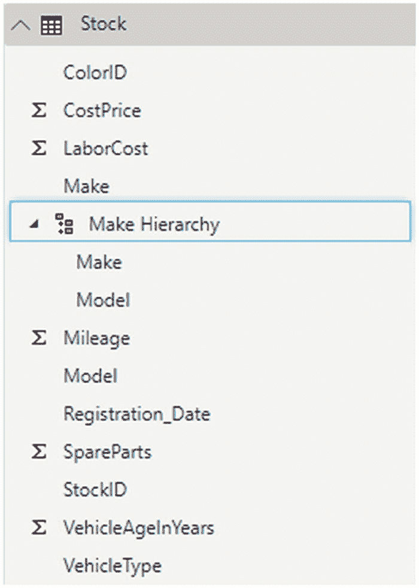

图 13-25：已添加的层次结构

1. 选择 `Stock` 表。

2. 右键单击将成为新层次结构中顶层元素的字段（此示例中为 `Make`）。

3. 选择`New Hierarchy`。一个名为`Make Hierarchy`的新层次结构将出现在`Stock`表中，其中包含`Make`字段作为层次结构的顶层元素。

4. 将`Model`字段拖入新层次结构的标题中。`Model`字段将被添加到层次结构中最高层级元素的下方。您可以在图 13-25 中看到这一点。

只需这些操作！现在，您可以将层次结构拖入报表画布，基于构成层次结构的多个元素创建表格。这些数据可用于任何位置——以及任何可视化对象中——只要这些位置或对象需要使用构成层次结构的多个字段。它们作为矩阵和向下钻取图表的基础特别有用，您将在第 15 章和第 16 章中了解这些内容。

当然，您可以像处理任何标准数据字段一样，重命名或删除层次结构或其内的任何层级。

`提示：` 将字段添加到层次结构意味着该字段现在在表中存在两次——一次作为“独立”字段，一次位于层次结构中。在大多数情况下，最好隐藏字段的原始版本，这样用户（和您自己）就不会在数据模型中看到该字段两次。

## 结论

本章全部内容涉及如何使用 Power BI Desktop 查询准备好的干净数据，并将其塑造成结构化和连贯的数据模型，该模型将成为您仪表板和报告的基础。

首先，您了解了如何查看数据模型中现在可用的整个数据集。这包括对数据进行排序和调整字段宽度。

然后您学习了如何确保每个字段被定义为具有适当的数据类型。之后，您直接将未来仪表板元素所需的任何数字格式应用于数据模型。您还了解了如何准备某些类型的字段以用于地图或提供超链接。

最重要的是，您学习了如何创建表关系，将所有不同的数据源整合到一个联合数据模型中，该模型现已成为深度分析的基础。在大多数情况下，这将是数据模型中最重要的一方面。简而言之，一个良好、干净且结构清晰的数据模型将使您能够充分利用数据可视化——这正是本书剩余章节的主题。

