# 8. 数据转换与清洗

当数据集经过塑形和筛选（如上一章所述）后，通常仍需要一些修改才能投入实际使用。从本质上讲，这些修改大多是简单但必要的技术，用于使数据更清洁、更标准化。我选择将这些方法归入*数据转换与清洗*这一主题之下。

在最终将源数据加载到数据模型之前，您可能希望执行的操作通常涵盖一系列*最终确定*数据的过程，以便数据在模型中可用。这些操作可能包括：

*   更改列的数据类型——例如，告知 Power BI Desktop 某列包含数字。
*   确保将第一行用作标题（如果需要）。
*   删除列内容的一部分。
*   将单元格中的值替换为其他值。
*   转换列内容——例如，将文本转换为大写，或去除数字中的小数。
*   对空单元格执行向下或向上填充，以确保记录完整。
*   对数字列应用数学或统计（甚至三角函数）函数。
*   将日期或时间数据转换为日期元素，如天、月、季度、年、小时或分钟。

转换数据并不仅限于减少数据。有时您可能需要对数据进行*扩展*以使其可用。这通常意味着向数据表添加更多列。实现此目的的技术包括：

*   复制列并可能更改复制列中数据的格式。
*   将列中的部分数据提取到新列中。
*   将列中的所有数据拆分，使每个数据元素出现在单独的列中。
*   将多列合并成一个新列。
*   添加自定义列，这些列可能包含计算、提取列的部分数据到新列，甚至拼接多列内容。
*   添加“索引”列以确保唯一性或记住排序顺序。

本章将带您领略这些基本的数据转换技术。读完本章后，您将能够以粗糙的现成数据源为起点，将其转换为一个精致且连贯的数据表，使其成为 Power BI Desktop 数据模型中的关键部分。不仅如此，您还将比使用企业级工具更快、更轻松地完成繁重的工作。

完成本章练习所需的示例数据位于文件夹 `C:\PowerBiDesktopSamples` 中。请注意，本章中的所有示例均假设您已打开查询编辑器。

## 查看完整记录

在开始清洗数据之前，您可能需要仔细查看数据。虽然 Power BI Desktop 查询编辑器擅长上下滚动列以查看单个字段的数据比较情况，但要了解单条记录的完整内容通常不太容易。

因此，为了避免在数据行之间疯狂左右滚动，查询编辑器提供了另一个极其简单的解决方案。如果您单击某一行（更具体地说，是左侧网格中该行的编号），Power BI Desktop 查询编辑器将在数据集下方的单个窗口中显示整个记录的内容。您可以在图 8-1 中看到这样一个示例，该图使用的是 Power BI Desktop 文件 `CH08Example1.pbix`。

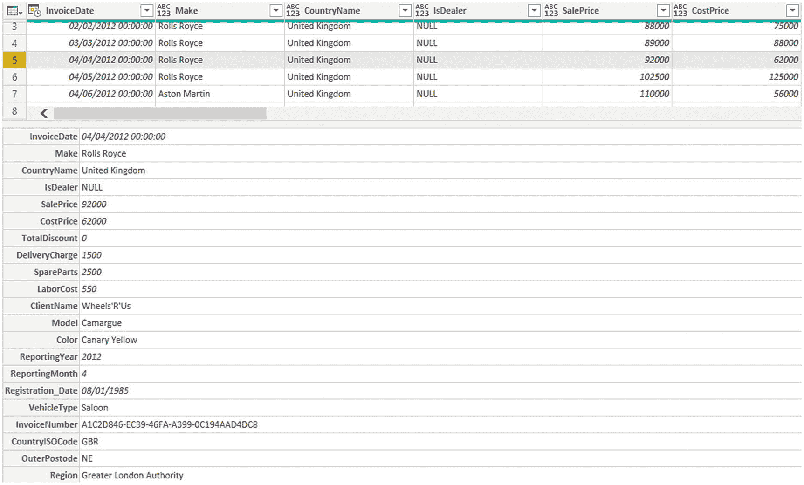

**图 8-1** 查看完整记录

> **注**  
> 您可以通过上下拖动上下窗口之间的灰色分隔线来调整记录集和数据集窗口的相对高度。

## Power BI Desktop 查询编辑器上下文菜单

与 Windows 程序一样，Power BI Desktop 查询编辑器也充分利用上下文（或“右键单击”）菜单作为功能区的替代方案。在转换数据集时，您可能会发现自己主要使用三个上下文菜单：

*   *表菜单*：当您右键单击包含数据的网格的左上角时，会出现此菜单。
*   *列菜单*：当您右键单击列标题时，会出现此菜单。
*   *单元格菜单*：当您右键单击数据单元格时，会出现此菜单。

尽管我在解释如何转换数据时频繁提到了上下文菜单，但现在快速查看一下它们可能更容易，以便您了解各种选项。图 8-2 为您提供了这三个上下文菜单的快速概览。

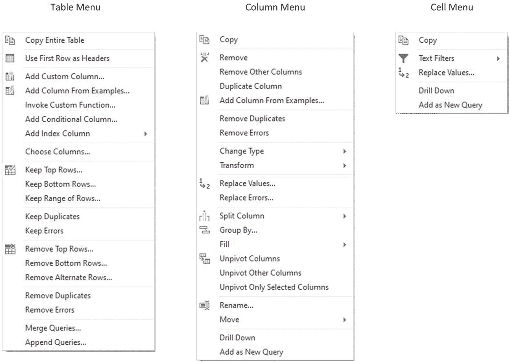

**图 8-2** Power BI Desktop 查询编辑器上下文菜单

由于上下文菜单中的可用选项将在本章、前一章以及后续四章中进行解释，因此此处不再一一详述。

> **注**  
> 单元格上下文菜单中的筛选器选项会反映该单元格的数据类型。因此，数字单元格将显示“数字筛选器”选项。

## 将第一行用作标题

Power BI Desktop 非常擅长猜测是否应将源数据集的第一条记录用作列标题。这一点至关重要，原因有二：

*   您可以避免列名被命名为 `Column1`、`Column2` 等。这样泛泛地命名会使用户（甚至您自己）不必要地难以理解数据。
*   您可以避免在数字列中出现本应是列标题的文本元素，否则可能稍后引发问题。这是因为整个列必须具有相同的数据类型才能应用另一种数据类型。例如，第一行中有标题文本会阻止对数字和日期/时间数据类型进行此操作。原因可能是标题是文本，而该列的其余部分包含数字或日期。

然而，尽管罕见，但仍有可能出现 Power BI Desktop 猜测错误的情况，即它假定数据集中的第一条记录是数据，而实际上它是标题信息。因此，您会看到一组泛型列标题，如 `Column1`、`Column2` 等。幸运的是，纠正此错误并将第一行用作标题是一项简单的任务：

*   在 Power BI Desktop 查询窗口的“转换”功能区中，单击“将第一行用作标题”。

几秒钟后，第一条记录消失，列标题变为原来第一条记录中的元素。右侧的“应用的步骤”列表中现在包含一个“提升的标题”元素，指示已执行的操作。此步骤会被高亮显示。

> **注**  
> 当源是数据库时，Power BI Desktop 通常能够自动应用此步骤。当源是文件时，它通常也能正确猜测。然而，它并不总能准确猜测，因此有时需要您手动干预。如果 Power BI Desktop 在“应用的步骤”列表中新增了“提升的标题”步骤，您就能看出它是否进行了猜测。

在极少数情况下，如果 Power BI Desktop 操作错误，将非标题行的第一行误认为是列标题，您可以通过单击“将第一行用作标题”按钮右侧的小三角形来重置标题，使其成为第一行。这将显示一个简短菜单，您可以在其中单击“将标题用作第一行”选项。右侧的“应用的步骤”列表中现在包含一个“降级的标题”元素，列标题变为 `Column1`、`Column2` 等。随后，您可以根据需要重命名这些列。

## 更改数据类型

数据修改中一个真正基础的方面是确保数据具有正确的类型；也就是说，如果你有一列数字需要在某个时候进行计算，那么该列应该是数字列。如果它包含日期，则应将其设置为日期或时间数据类型之一。我意识到这看起来可能很繁琐，甚至多余；然而，如果你希望确保数据能在后续流程中被正确地细分和处理，那么从一开始就设置正确的数据类型就*至关重要*。另一个好处是，如果你在加载数据的过程中尽早验证数据类型，你就可以从一开始就发现数据是否存在潜在问题——例如，无法被识别为日期的日期。这让你能在处理数据集的工作早期就决定如何处理劣质或不可靠的数据。

好消息是，对于许多数据源，Power BI Desktop 会自动应用适当的数据类型。具体来说，如果你从数据库加载了数据，那么 Power BI Desktop 会识别每一列的数据类型并应用合适的原生数据类型。不幸的是，对于文件源，特别是 CSV、文本和（偶尔）Excel 文件，以及一些 XML 文件，情况可能会稍微棘手一些。对于这些文件类型，Power BI Desktop 通常会尝试猜测数据类型，但有时它并不能成功。如果它已经尝试推断数据类型，你会在“应用的步骤”列表中看到一个`Changed Type`步骤。因此，如果你从这些源获取数据，很可能需要手动为许多列应用数据类型。

> **注意**  
> 在某些情况下，数字并不应该被解释为数值数据。例如，法国邮政编码是五位数字，但它永远不会以任何方式进行计算。因此，最好在数值数据类型不合适的情况下，通过将数据类型更改为文本，让 Power BI Desktop 知道这一点。

请执行以下操作来更改一列或一组列的数据类型：

1. 打开 Power BI Desktop 示例文件 `C:\PowerBiDesktopSamples\CH08Example1.pbix`。
2. 在 **开始** 功能区中单击 **转换数据** 按钮。查询编辑器将打开。
3. 单击你要更改数据类型的列内部。如果你想修改多个列，则按住 `Ctrl` 键并单击所需的列标题。在本例中，你可以选择 `CostPrice` 和 `TotalDiscount` 列。
4. 在 **转换** 功能区中单击 **数据类型** 按钮。将会出现一个包含可能数据类型的弹出菜单。
5. 选择适当的数据类型。如果你选择了 `CostPrice` 和 `TotalDiscount` 列，那么 **整数** 是要选择的类型。

几秒钟后，数据类型将被应用。`Changed Type` 将出现在 `应用的步骤` 列表中。你可以应用的数据类型在表 8-1 中概述。

**表 8-1** Power BI Desktop 中的数据类型

| 数据类型 | 说明 |
| --- | --- |
| 小数 | 将数据转换为十进制数。 |
| 固定小数位数 | 将数据转换为具有固定小数位数的十进制数。 |
| 整数 | 将数据转换为整（整）数。 |
| 日期/时间 | 转换为日期和时间数据类型。 |
| 日期 | 转换为日期数据类型。 |
| 时间 | 转换为时间数据类型。 |
| 持续时间 | 将数据设置为持续时间。这些用于日期和时间计算。 |
| 文本 | 设置为文本数据类型。 |
| 真/假 | 将数据类型设置为布尔值（真或假）。 |
| 二进制 | 将数据定义为二进制，因此，它不直接可见。 |

> **注意**  
> **数据类型** 按钮在 **开始** 功能区中也可用。同样，你可以右键单击列标题并选择 **更改类型** 来选择不同的数据类型。

不可避免地，有时你会尝试应用一个根本无法用于特定列的数据类型。将文本列（例如此示例数据表中的 `Make`）转换为日期是行不通的。如果你这样做，Power BI Desktop 查询编辑器会将列内容替换为 `Error`。这并不是决定性的或危险的，你只需使用前一章中描述的技术删除 `应用的步骤` 列表中的 `Changed Type` 步骤，即可将数据恢复到之前的状态。

有时，你可能会在数据类型已经被更改后尝试更改它。在这种情况下，你将收到一个类似于图 8-3 所示的警报。

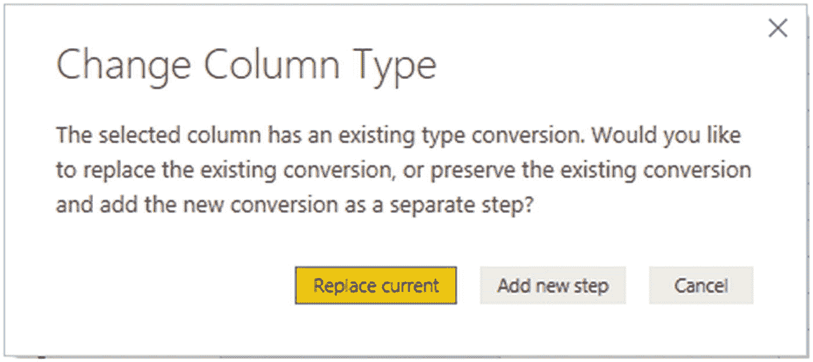

**图 8-3** 更改列类型警报

如果发生这种情况，你可以执行以下两种操作之一：

- 让 Power BI Desktop 使用你刚刚选择的数据类型更新现有的转换步骤。
- 添加一个新的转换步骤。

你的选择将完全取决于你对底层数据集应用了哪种类型的转换。

同时更改一组你*认为*需要进行此操作的列的数据类型会有所帮助。采用这种方法有几个很好的理由：

- 你可以集中精力正确地设置数据类型，如果你有条理地工作，你就不太可能忘记设置数据类型。
- 为许多列应用数据类型（即使你分几次操作，针对单列或多列）只会向 `应用的步骤` 列表添加一个步骤。

> **注意**  
> 不要在 Power BI Desktop 查询中寻找任何数据*格式化*选项；这里没有。这是有意为之，因为该工具旨在结构化、加载和清理数据，而不是呈现数据。你将在 Power BI Desktop 数据视图中执行格式化操作，正如你将在第 13 章中看到的那样。

### 检测数据类型

为数十列应用正确的数据类型可能会非常耗时。幸运的是，Power BI Desktop 现在包含一个自动为整个表应用数据类型的选项：

1. 在 **转换** 功能区中，单击 **检测数据类型** 按钮。
2. `Changed Type` 将出现在 `应用的步骤` 列表中。大多数列将应用正确的数据类型。

这种技术并不总是能给出完美的结果，有时你会想要覆盖 Power BI Desktop 已应用的数据类型选择。然而，它仍然是数据准备工具集中一个受欢迎的补充，在准备数据集时可以为你节省大量时间。

### 数据类型指示器

若是靠猜测来判断每个列属于哪种数据类型，那将毫无效率可言。因此，Power BI Desktop 会通过直观的方式为你指明每个列对应的数据类型。如果你仔细查看每个列标题的左侧，会看到一个微小的图标。每个图标都指明了该列的数据类型。每个图标的含义如表 8-2 所示。

**表 8-2** Power BI Desktop 查询编辑器中的数据类型图标

| 数据类型图标 | 描述 |
| --- | --- |
| 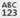 | 可能的数据类型中的任意一种 |
|  | 整数 |
| 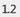 | 小数 |
|  | 定点小数 |
|  | 百分比 |
|  | 文本 |
|  | 真/假 |
|  | 日期/时间 |
|  | 日期 |
|  | 时间 |
|  | 日期/时间/时区 |
|  | 持续时间 |
|  | 二进制 |

### 切换数据类型

另一种快速更改列数据类型的方法是，单击列标题左侧的数据类型图标，然后从图 8-4 所示的上下文菜单中选择所需的数据类型。

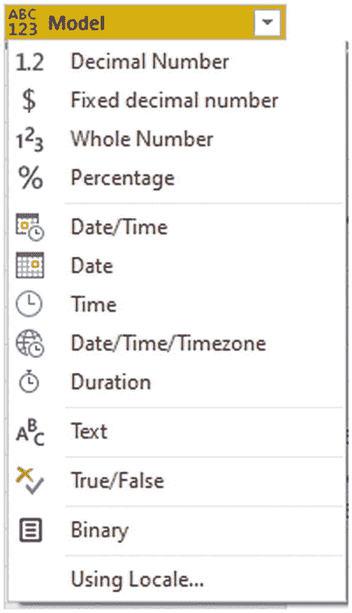

**图 8-4** 数据类型上下文菜单

### 使用区域设置的数据类型

在转换数据类型时，你也可以选择使用当前区域设置来指定日期、时间和数字格式。这意味着在其他国家/地区打开此 Power BI Desktop 文件的用户，将看到适应当地格式习惯的日期、时间和数字格式。操作方法如下：

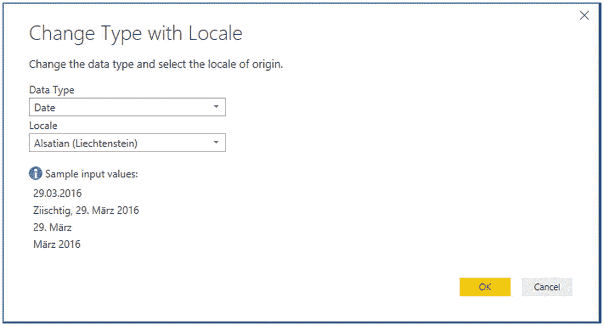

**图 8-5** "使用区域设置更改类型"对话框

1. 打开查询编辑器（如果尚未打开）。
2. 单击列标题左侧的数据类型图标。
3. 从弹出菜单中选择`使用区域设置`。此时将显示"`使用区域设置更改类型`"对话框。
4. 从可用数据类型列表中选择要应用的新数据类型。
5. 从全球区域设置列表中选择所需的区域设置。对话框将如图 8-5 所示。
6. 单击`确定`。数据类型将被转换为所选区域设置。`应用的步骤`列表中将添加一个名为`已更改的类型(使用区域设置)`的步骤。

## 替换值

加载的某些数据可能需要通过一种全局查找并替换的操作，用其他值替换特定值——就像在文档中操作一样。例如，你可能需要标准化某个汽车品牌（以当前示例数据集为例）因输入错误导致的拼写不一致。要执行此特定的数据清理操作，请执行以下步骤：

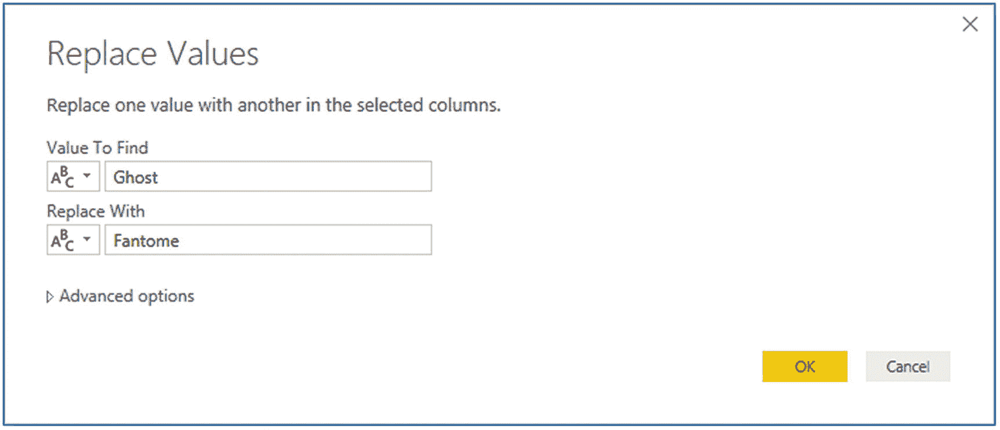

**图 8-6** "替换值"对话框

1. 在查询编辑器中，单击包含要替换数据的列的标题。该列将被选中。在此示例中，我以文件`CH08Sample1.pbix`中的`Model`列为例。
2. 在"开始"功能区中，单击`替换值`按钮。此时将显示"`替换值`"对话框。
3. 在`要查找的值`框中，输入要替换的文本或数字。在此示例中，我使用了`Ghost`。
4. 在`替换为`框中，输入要替换成的文本或数字。在此示例中，我使用了`Fantôme`，如图 8-6 所示。
5. 单击`确定`。整个列中的数据将被替换。`已替换值`将添加到`应用的步骤`列表中。

关于此技术，我仅需补充几点说明：

- `替换值`过程会搜索所选列中每条记录里你所查找文本的每一次出现。它不会查找单元格的全部内容，除非你通过在高级选项中勾选`匹配整个单元格内容`复选框来专门指定。
- 如果在开始此过程之前，你单击的是包含要替换内容的某个单元格（而不是像我们刚才那样单击列标题），Power BI Desktop 会自动将该单元格的内容填入"`替换值`"对话框的"要查找的值"框中。
- 你只能替换包含文本元素的列中的文本。这不适用于设置为数值或日期数据类型的列。实际上，如果你输入的值与所选列的数据类型不匹配，你将在"`替换值`"对话框中看到一个黄色的警告三角。
- 如果你确实需要用其他日期或数字替换日期或数值列中的部分内容，那么你可以：
  - 将该列转换为文本数据类型
  - 执行替换操作
  - 将该列转换回原始数据类型

"`替换值`"对话框还有一些可应用的高级选项。你可以通过单击左侧的三角形展开`"高级选项"`项来查看它们。这些选项在表 8-3 中进行了解释。

**表 8-3** 高级替换选项

| 选项 | 描述 |
| --- | --- |
| 匹配整个单元格内容 | 仅当搜索值构成某一行列的全部内容时才进行替换。 |
| 使用特殊字符替换 | 用非打印字符替换搜索值。 |
| 制表符 | 用制表符替换搜索值。 |
| 回车符 | 用回车符替换搜索值。 |
| 换行符 | 用换行符替换搜索值。 |
| 回车符和换行符 | 用回车符和换行符替换搜索值。 |

> **注意：** 替换那些属于其他单词子集的单词是有风险的。在进行任何数据替换时，请确保不会破坏除你打算更改的元素之外的其他内容。

最后，作为一个纯粹无关的评论，我必须补充一点，我绝不建议对劳斯莱斯进行品牌重塑，因为这近乎是汽车领域的亵渎。

## 转换列内容

Power BI Desktop 拥有强大的自动化数据转换工具箱，可让你通过多种方式标准化列的内容。这些包括：

- 设置文本列的大小写
- 对数值数据进行四舍五入或应用数学函数
- 从日期列中提取日期元素，例如年、月或日（以及其他元素）

Power BI Desktop 对于将转换应用于合适的数据类型非常严格。这是因为转换完全取决于所选列的数据类型。这也再次确认了在数据转换过程的早期——尤其是在*转换列内容之前*——就应该执行应用必要数据类型的操作。请记住，只有当列是数值数据类型时，你才能选择数值转换；只有当列是日期数据类型时，你才能选择日期转换。同样，基于文本的转换只能应用于文本数据类型的列。

## 文本转换

让我们来看一个实际的简单转换操作。作为示例，我将让 Power BI Desktop 将 `Make` 列转换为大写字符。

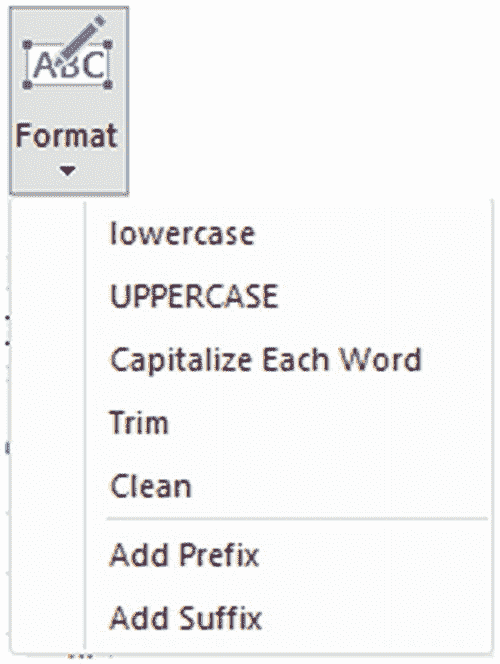

**图 8-7** “格式”菜单

1. 仍然使用文件 `CH08Example1.pbix`（并已切换到查询编辑器），单击要转换内容的列中的任意位置（此处为 `Make` 列）。
2. 在“转换”功能区中，单击“格式”按钮。将出现一个弹出菜单。
3. 选择 `UPPERCASE`（大写），如图 8-7 所示。

整个列的内容将被转换为大写。`Uppercased Text`（大写文本）将添加到“已应用步骤”列表中。

从“格式”按钮的菜单中可以看出，在格式化（或转换）文本时，你有五个可用的选项。这些选项在表 8-4 中进行了说明。

**表 8-4** 文本转换

| 转换 | 描述 | 已应用步骤定义 |
| --- | --- | --- |
| Lowercase（小写） | 将所有文本转换为小写。 | Lowercased Text（小写文本） |
| Uppercase（大写） | 将所有文本转换为大写。 | Uppercased Text（大写文本） |
| Capitalize Each Word（每个单词首字母大写） | 将每个单词的首字母转换为大写。 | Capitalized Each Word（每个单词已首字母大写） |
| Trim（修剪） | 移除文本前后的所有空格。 | Trimmed Text（已修剪文本） |
| Clean（清除） | 移除所有不可打印字符。 | Cleaned Text（已清除文本） |
| Add Prefix（添加前缀） | 在列内容开头添加文本。 | Added Prefix（已添加前缀） |
| Add Suffix（添加后缀） | 在列内容末尾添加文本。 | Added Suffix（已添加后缀） |

**注意：** 我意识到 Power BI Desktop 查询将文本转换称为*格式化*。尽管如此，这些选项属于整体数据转换选项的一部分。

#### 添加前缀或后缀

你也可以为列中的所有数据添加前缀或后缀。这非常简单：

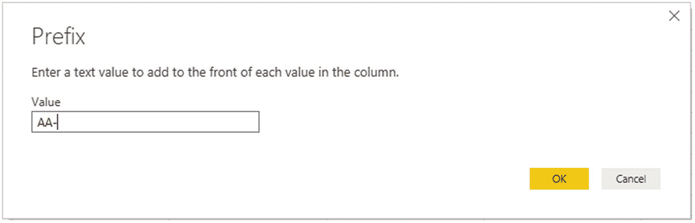

**图 8-8** 为文本添加前缀

1. 在查询编辑器中，单击要添加前缀的列内部。
2. 在“转换”功能区中，选择 `Format ➤ Add Prefix`（格式 ➤ 添加前缀）。将显示“前缀”对话框，如图 8-8 所示。
3. 在 `Value`（值）字段中输入要添加的前缀。
4. 单击 `OK`（确定）。

你指定的前缀将放置在数据集中所选字段的每条记录的起始位置。

**注意：** 如果为数值或日期/时间列添加前缀或后缀，则列数据类型将自动转换为文本。

#### 删除前导和尾随空格

不可避免地，有时你会遇到在数据之前、之后或之前*和*之后带有额外空格的数据。这可能具有隐蔽性，因为它可能导致：

- **数据重复**，因为带有尾随空格的值与没有尾随空格的相同文本被视为*不*相同
- **排序问题**，因为前导空格会导致元素出现在排序列表的*顶部*
- **分组错误**，因为带有空格的元素与没有空格的元素不属于同一组

幸运的是，Power BI Desktop 查询针对此问题提供了一个高效彻底的解决方案。

1. 仍然使用文件 `CH08Example1.pbix`（并已切换到查询编辑器），单击要转换内容的列中的任意位置（此处为 `Make` 列）。
2. 在“转换”功能区中，单击“格式”按钮。将出现一个弹出菜单。
3. 从菜单中选择 `Trim`（修剪）。

列数据中的所有多余前导和尾随空格都将被移除。这有助于对记录进行排序、分组和去重。

#### 删除不可打印字符

某些源数据可能包含称为不可打印字符的隐蔽元素。即使这些字符对人类来说几乎总是不可见的，但在打印报表和仪表板时也可能导致问题。

如果你怀疑源数据包含不可打印字符，可以像这样轻松地删除它们：

1. 在查询编辑器中，单击你知道（或怀疑）包含不可打印字符的列内部（或选择这些列）。
2. 单击 `Format ➤ Clean`（格式 ➤ 清除）。

Power BI Desktop 会将 `Cleaned Text`（已清除文本）添加到“已应用步骤”列表中。

## 数字转换

正如你可以转换基于文本的列的内容一样，你也可以对数值进行转换。例如，假设你想将一列中的所有数字四舍五入到最接近的整数。

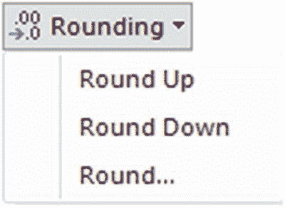

图 8-9 舍入选项

1. 在查询编辑器中，点击要转换内容的列中的任意位置（本例中为 `TotalDiscount` 列）。
2. 在“转换”功能区中，点击“舍入”按钮。将出现一个弹出菜单，显示所有可用选项。你可以在图 8-9 中看到它。
3. 选择**向上舍入**。

整个列中的值将向上舍入到最接近的整数。`Rounded Up` 将被添加到 `Applied Steps` 列表中。

其他可用的数值转换在表 8-5 中进行了描述。由于这些数值转换使用了“转换”功能区中的多个按钮，我已指明应使用哪个按钮来获得所需结果。

**表 8-5** 数字转换

| 转换 | 描述 | 已应用步骤定义 |
| --- | --- | --- |
| 舍入 ➤ 向上舍入 | 将每个数字舍入到指定的小数位数。 | `Rounded Up` |
| 舍入 ➤ 向下舍入 | 将每个数字向下舍入。 | `Rounded Down` |
| 舍入… | 将每个数字舍入到你指定的小数位数。如果指定负数，则舍入到给定的小数位。 | `Rounded Off` |
| 科学 ➤ 绝对值 | 使数字成为绝对值（正数）。 |   |
| 科学 ➤ 幂 ➤ 平方 | 返回每个单元格中数字的平方。 | `Calculated Square` |
| 科学 ➤ 幂 ➤ 立方 | 返回每个单元格中数字的立方。 | `Calculated Cube Value` |
| 科学 ➤ 幂 ➤ 乘幂 | 将每个数字提高到指定的幂次。 | `Calculated Power` |
| 科学 ➤ 平方根 | 返回每个单元格中数字的平方根。 | `Square Root` |
| 科学 ➤ 指数 | 返回每个单元格中数字的指数。 | `Calculated Exponent` |
| 科学 ➤ 对数 ➤ 以 10 为底 | 返回每个单元格中数字的以 10 为底的对数。 | `Calculated Base 10 Logarithm` |
| 科学 ➤ 对数 ➤ 自然对数 | 返回每个单元格中数字的自然对数。 | `Calculated Natural Logarithm` |
| 科学 ➤ 阶乘 | 计算列中数字的阶乘。 | `Calculated Factorial` |
| 三角函数 ➤ 正弦 | 计算列中数字的正弦值。 | `Calculated Sine` |
| 三角函数 ➤ 余弦 | 计算列中数字的余弦值。 | `Calculated Cosine` |
| 三角函数 ➤ 正切 | 计算列中数字的正切值。 | `Calculated Tangent` |
| 三角函数 ➤ 反正弦 | 计算列中数字的反正弦值。 | `Calculated ArcSine` |
| 三角函数 ➤ 反余弦 | 计算列中数字的反余弦值。 | `Calculated ArcCosine` |
| 三角函数 ➤ 反正切 | 计算列中数字的反正切值。 | `Calculated ArcTangent` |

> **注意：** Power BI Desktop 查询甚至不会让你尝试对文本或日期应用数字转换。如果你点击字母或日期列内部，相关按钮将保持灰色不可用状态。

#### 计算数字

Power BI Desktop 查询还可以对列中的数字应用简单算术运算。例如，假设你想将所有销售价格乘以 110%，作为预测的一部分。操作方法如下：

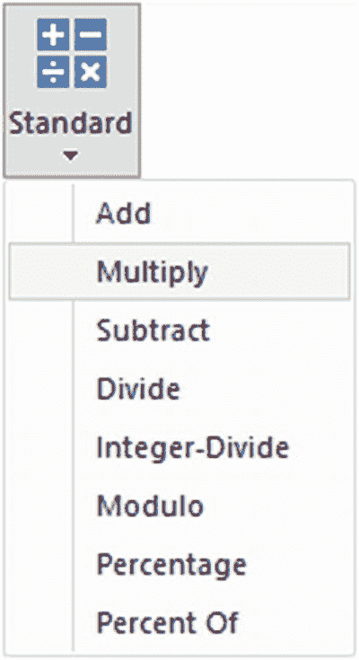

图 8-10 对列应用计算

1. 仍使用文件 `CH08Example1.pbix`（并已切换到查询编辑器），点击任意数字列内部。在此示例中，我使用了 `SalePrice` 列。
2. 点击“转换”功能区中的 `Standard` 按钮。菜单将如图 8-10 所示弹出。

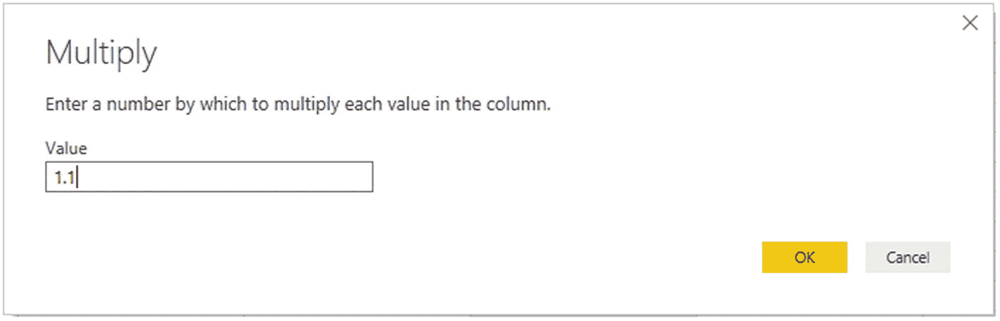

图 8-11 对列应用计算

3. 点击 `Multiply`。将出现 `Multiply` 对话框。
4. 在 `Value` 框中输入 `1.1`。对话框将如图 8-11 所示。
5. 点击**确定**。

所选列中的所有数字将乘以 `1.1`。换句话说，它们现在是原始值的 110%。表 8-6 描述了可以在 Power BI Desktop 查询中执行的可能的数学运算。

**表 8-6** 应用基本计算

| 转换 | 描述 | 已应用步骤定义 |
| --- | --- | --- |
| 加法 | 将一个选定值添加到列中的数字上。 | `Added to Column` |
| 乘法 | 将列中的数字乘以一个选定值。 | `Multiplied Column` |
| 减法 | 从列中的数字中减去一个选定值。 | `Subtracted from Column` |
| 除法 | 将列中的数字除以一个选定值。 | `Divided Column` |
| 整数除法 | 将列中的数字除以一个选定值并移除余数。 | `Integer-Divided Column` |
| 取模 | 将列中的数字除以一个选定值并仅保留余数。 | `Calculated Modulo` |
| 百分比 | 将选定的百分比应用于该列。 | `Calculated Percentage` |
| 百分比 | 将列中的值表示为您输入值的百分比。 | `Calculated Percent Of` |

> **注意：** 你也可以在 Power BI Desktop 数据视图中执行多种类型的计算，而避免在查询编辑器中进行计算。事实上，许多 Power BI Desktop 纯粹主义者似乎更喜欢将任何类似于计算的操作放在数据模型内部进行，而不是在查询阶段。和以往一样，我将由你决定更喜欢哪种方法。请注意，某些繁重的转换如果在运行时计算可能会拖慢报表速度，而其他操作只有作为深思熟虑的计算过程的一部分时才有效。

最后，请务必记住，当你执行此类操作时，你正在修改数据。在实际应用中，在对列中包含的数据进行重大修改之前，复制该列可能更安全。这允许你保留初始数据可用，尽管代价是增加加载时间和 Power BI Desktop 文件的大小。

## 日期转换

日期转换遵循与文本和数字转换相似的原理。例如，以下操作演示如何从日期中提取月份：

1.  仍然使用文件 `CH08Example1.pbix`（并已切换至查询编辑器），点击 `InvoiceDate` 列内部。
2.  在“转换”功能区中，点击“日期”按钮。此时将显示菜单。
3.  点击“年”。此时将显示子菜单。
4.  选择“年”。日期的年份部分将替换 `InvoiceDate` 列中的所有日期。

其他可能的日期转换操作如表 8-7 所示。

**表 8-7** 日期转换

| 转换 | 说明 | 已应用步骤定义 |
| --- | --- | --- |
| 年龄 | 计算原始日期与当前本地时间之间的日期和时间差（以天和小时计）。 | 计算的年龄 |
| 仅日期 | 将数据转换为不含时间元素的日期。 | 计算的日期 |
| 年 ➤ 年 | 从日期中提取年份。 | 计算的年 |
| 年 ➤ 年初 | 返回日期所在年份的第一天。 | 计算的年初 |
| 年 ➤ 年末 | 返回日期所在年份的最后一天。 | 计算的年末 |
| 月 ➤ 月 | 从日期中提取月份的数字。 | 计算的月 |
| 月 ➤ 月初 | 返回日期所在月份的第一天。 | 计算的月初 |
| 月 ➤ 月末 | 返回日期所在月份的最后一天。 | 计算的月末 |
| 月 ➤ 月天数 | 返回日期所在月份的天数。 | 计算的月天数 |
| 月 ➤ 月名称 | 返回日期所在月份的名称。 | 计算的月名称 |
| 日 ➤ 日 | 从日期中提取天数。 | 计算的日 |
| 日 ➤ 星期几 | 将星期几作为数字返回（星期一为 1，星期二为 2，依此类推）。 | 计算的星期几 |
| 日 ➤ 年中天数 | 计算日期自年初以来的天数。 | 计算的年中天数 |
| 日 ➤ 日初 | 将值转换为日期和时间的当天开始时刻。 | 计算的日初 |
| 日 ➤ 日末 | 将值转换为日期和时间的当天结束时刻。 | 计算的日末 |
| 日 ➤ 日名称 | 将星期几作为星期名称返回。 | 计算的日名称 |
| 季度 ➤ 季度 | 返回日期所在的日历季度。 | 计算的季度 |
| 季度 ➤ 季初 | 返回日期所在日历季度的起始日期。 | 计算的季初 |
| 季度 ➤ 季末 | 返回日期所在日历季度的结束日期。 | 计算的季末 |
| 周 ➤ 年中周数 | 计算日期自年初以来的周数。 | 计算的年中周数 |
| 周 ➤ 月中周数 | 计算日期自月初以来的周数。 | 计算的月中周数 |
| 周 ➤ 周初 | 返回日期所在周的第一天（星期日）的日期。 | 计算的周初 |
| 周 ➤ 周末 | 返回日期所在周的最后一天（星期六）的日期。 | 计算的周末 |

## 时间转换

您也可以使用 Power BI Desktop 查询将日期/时间或时间值转换为其组成部分。这与应用日期转换的方式极为相似，但为求完整，下面说明具体操作方法：

1.  点击 `InvoiceDate` 列内部。
2.  在“转换”功能区中，点击“时间”按钮。此时将显示菜单。
3.  点击“小时”。时间的小时部分将替换 `InvoiceDate` 列中的所有值。

> **注意：** 时间转换只能应用于日期/时间或时间数据类型的列。

时间转换的范围如表 8-8 所示。

**表 8-8** 时间转换

| 转换 | 说明 | 已应用步骤定义 |
| --- | --- | --- |
| 仅时间 | 提取日期和时间中的时间部分。 | 提取的时间 |
| 本地时间 | 根据日期/时间和时区值将日期/时间转换为本地时间。 | 提取的本地时间 |
| 分析 | 从文本中提取日期和/或日期/时间元素。 | 分析的日期时间 |
| 小时 ➤ 小时 | 从日期/时间或日期值中提取小时。 | 提取的小时 |
| 小时 ➤ 小时初 | 从日期/时间或时间值中返回小时的开始时刻。 | 计算的小时初 |
| 小时 ➤ 小时末 | 从日期/时间或时间值中返回小时的结束时刻。 | 计算的小时末 |
| 分钟 | 从日期/时间或时间值中提取分钟。 | 提取的分钟 |
| 秒 | 从日期/时间或时间值中提取秒。 | 提取的秒 |
| 最早 | 从日期/时间或时间值中返回最早的时间。 | 计算的最早 |
| 最晚 | 从日期/时间或时间值中返回最晚的时间。 | 计算的最晚 |

> **注意：** 在实际应用中，您可能希望保留源列不变，并对该列的副本应用数字或日期转换。为此，只需应用相同的转换技术，但使用“添加列”功能区中的按钮，而非“转换”功能区中的按钮。

### 持续时间

如果某列中的值可以解释为持续时间（以天、小时、分钟和秒为单位），则 Power BI Desktop 查询可以提取持续时间的组成部分作为数据转换。但是，要实现这一点，该列*必须*设置为持续时间数据类型。这意味着该列的内容必须能够被 Power BI Desktop 解释为持续时间。任何与此数据类型不兼容的值都将被设置为错误值。

如果你有持续时间数据，可以像这样提取其组成部分：

1.  继续使用文件 `CH08Example1.pbix`（并切换到查询编辑器），点击 `InvoiceDate` 列内部。
2.  在“转换”功能区中，点击“持续时间”按钮。将出现一个菜单。
3.  点击“小时”。时间的小时部分将替换 `InvoiceDate` 列中的所有值。

持续时间转换的范围如表 8-9 所示。

表 8-9 持续时间转换

| 转换 | 描述 | 已应用步骤定义 |
| --- | --- | --- |
| 天 | 从持续时间值中隔离出天元素。 | 提取的天数 |
| 小时 | 从持续时间值中隔离出小时元素。 | 提取的小时数 |
| 分钟 | 从持续时间值中隔离出分钟元素。 | 提取的分钟数 |
| 秒 | 从持续时间值中隔离出秒元素。 | 提取的秒数 |
| 总天数 | 将持续时间值显示为天数加上代表小时、分钟和秒的小数部分。 | 计算的总天数 |
| 总小时数 | 将持续时间值显示为小时数加上代表分钟和秒的小数部分。 | 计算的总小时数 |
| 总分钟数 | 将持续时间值显示为分钟数加上代表秒的小数部分。 | 计算的总分钟数 |
| 总秒数 | 将持续时间值显示为秒数加上代表毫秒的小数部分。 | 计算的总秒数 |
| 乘 | 将持续时间（及其所有组成部分）乘以你输入的值。 | 已乘列 |
| 除 | 将持续时间（及其所有组成部分）除以你输入的值。 | 已除列 |
| 统计信息 ➤ 求和 | 返回列中所有持续时间元素的总和。 | 计算的求和 |
| 统计信息 ➤ 最小值 | 返回列中所有持续时间元素的最小值。 | 计算的最小值 |
| 统计信息 ➤ 最大值 | 返回列中所有持续时间元素的最大值。 | 计算的最大值 |
| 统计信息 ➤ 中位数 | 返回列中所有持续时间元素的中位数。 | 计算的中位数 |
| 统计信息 ➤ 平均值 | 返回列中所有持续时间元素的平均值。 | 计算的平均值 |

**注意**

如果对持续时间进行乘法或除法运算，Power BI Desktop 查询会显示一个对话框，以便你输入要乘以或除以该持续时间的值。

### 向下填充空单元格

想象一个数据源，其中的数据以矩阵样式结构进入 Power BI Desktop。结果是，某些列只包含单个元素的示例，然后是一系列空单元格，直到列表中的下一个元素。如果这很难想象，那么请看图 8-12 中所示的示例文件 `CarMakeAndModelMatrix.xlsx`。

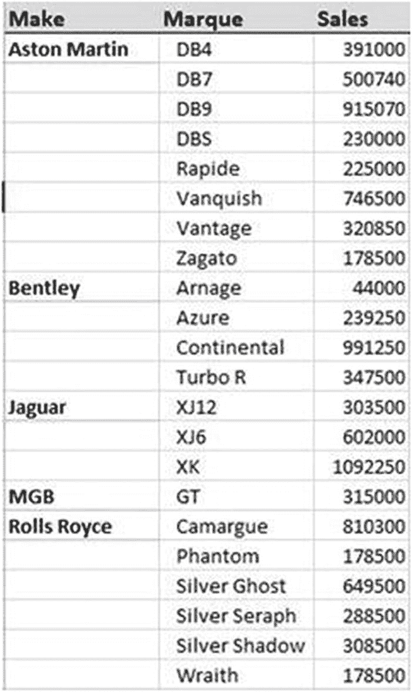

图 8-12 Excel 中的矩阵数据表

所有这些空白单元格都是问题，因为我们需要一个完整的数据表——或者更确切地说，如果 Power BI Desktop 没有一种非常酷的方法来克服这一特定困难，它们就会成为问题。请执行以下操作来解决此问题：

1.  打开一个新的 Power BI Desktop 文件。
2.  在启动屏幕中，点击“获取数据”。
3.  在“获取数据”对话框中，选择“Excel”。然后点击“连接”并导航到 `C:\PowerBiDesktopSamples\CarMakeAndModelMatrix.xlsx`。
4.  点击“打开”，选择“Sheet1”，然后点击“转换数据”。这将直接带你进入查询编辑器。
5.  点击包含空单元格的列内部；确保点击的位置是你希望用上方第一个非空单元格的内容替换空单元格的位置。
6.  在“转换”功能区中，点击“填充”。将出现一个菜单。
7.  选择“向下”。空白单元格将被上方第一个非空单元格的值替换。`已填充向下` 将添加到“已应用步骤”列表中。

现在，该表格将如图 8-13 所示。

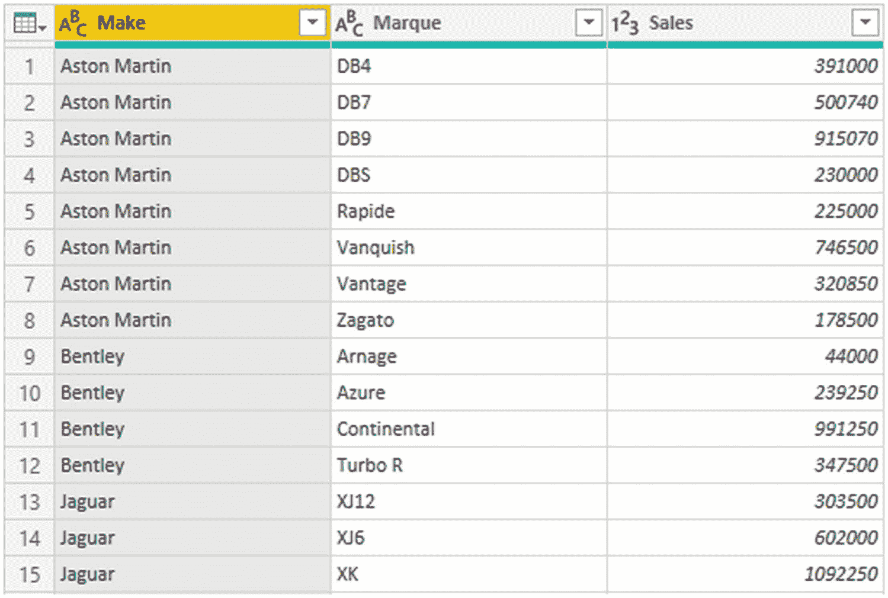

图 8-13 空单元格已被正确数据替换的数据表

**注意**

此技术旨在处理一个相当具体的问题，并且仅当导入的数据按包含缺失元素的列进行分组时才真正有效。

虽然不常见，但您也可以使用此技术用下方的值填充空单元格。如果需要这样做，只需从“转换”功能区中选择“填充” ➤ “向上”。无论采用哪种方式，都需要注意该技术适用于整个列。

### 提取列内容的一部分

很多时候，源列的内容可能包含比您实际需要更多的数据。在这种情况下，Power BI Desktop 可以通过仅提取列的一部分来帮助您。此技术的工作原理如下：

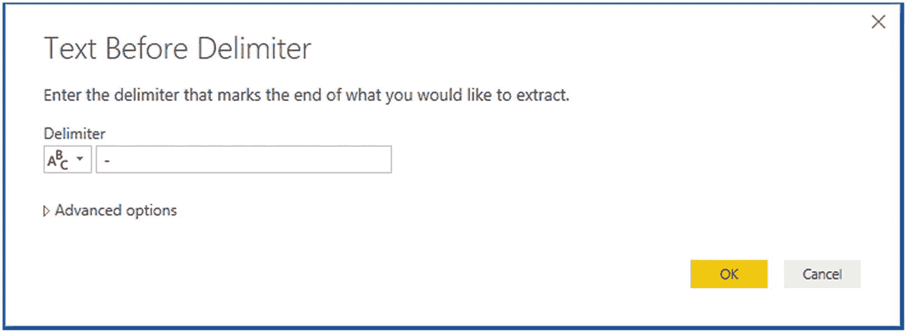

图 8-14 “分隔符前的文本”对话框

1.  加载 `C:\PowerBiDesktopSamples\CH08Example1.pbix` 示例文件，然后点击“转换数据”。
2.  点击 `InvoiceNumber` 列内部。
3.  在“转换”功能区中，点击“提取” ➤ “分隔符前的文本”。将显示“分隔符前的文本”对话框。
4.  在“分隔符”字段中输入一个连字符（或减号）。该对话框将如图 8-14 所示。
5.  点击“确定”。字段内容将被替换为连字符之前的字符。一个名为 `提取的分隔符前文本` 的步骤将添加到“已应用步骤”列表中。

“提取”功能允许您从多种方式中进行选择，以从列中提取数据子集。当前可用的选项在表 8-10 中进行了解释。

表 8-10 提取转换

| 转换 | 描述 | 已应用步骤定义 |
| --- | --- | --- |
| 长度 | 显示字段内容的字符长度。 | 提取的长度 |
| 首字符 | 显示从字段左侧开始指定数量的字符。 | 提取的首字符 |
| 尾字符 | 显示从字段右侧开始指定数量的字符。 | 提取的尾字符 |
| 范围 | 显示在指定的起始和结束位置之间（从字段左侧算起，以字符为单位）指定数量的字符。 | 提取的范围 |
| 分隔符前的文本 | 显示在指定字符之前出现的所有文本。 | 提取的分隔符前文本 |
| 分隔符后的文本 | 显示在指定字符之后出现的所有文本。 | 提取的分隔符后文本 |
| 分隔符间的文本 | 显示在两个指定字符之间出现的所有文本。 | 提取的分隔符间文本 |

#### 高级提取选项

三个提取选项（分隔符前的文本、分隔符后的文本和分隔符间的文本）允许您应用一些高级选项，这些选项使您能够在从列中提取数据时更进一步。这些技术将在以下两节中进行说明。

#### 分隔符前后的文本

如果你正在提取列内容的一部分，并使用分隔符来隔离要保留的文本，那么你还有几个额外的选项可供选择。

你可以通过点击`高级选项`，从图 8-14 所示的对话框中访问这些选项。此时，对话框将如图 8-15 所示。

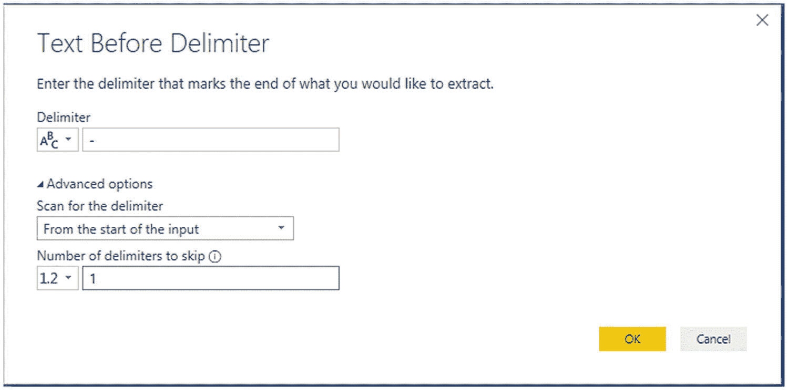

**图 8-15** — “分隔符前的文本”与“分隔符后的文本”对话框的高级选项

你现在拥有的两个选项是：

- **扫描分隔符**：此选项允许你选择从列内容的开头向前查找，还是从列内容的末尾向后查找，以定位你要搜索的分隔符。
- **要跳过的分隔符数量**：在此处，你可以指定你感兴趣的是第 *n* 次出现的分隔符。

#### 分隔符间的文本

“分隔符间的文本”对话框中的高级选项，本质上允许你应用之前看到的相同选项，只不过同时应用于起始分隔符和结束分隔符。在图 8-16 的“分隔符间的文本”对话框中你可以看到这一点。

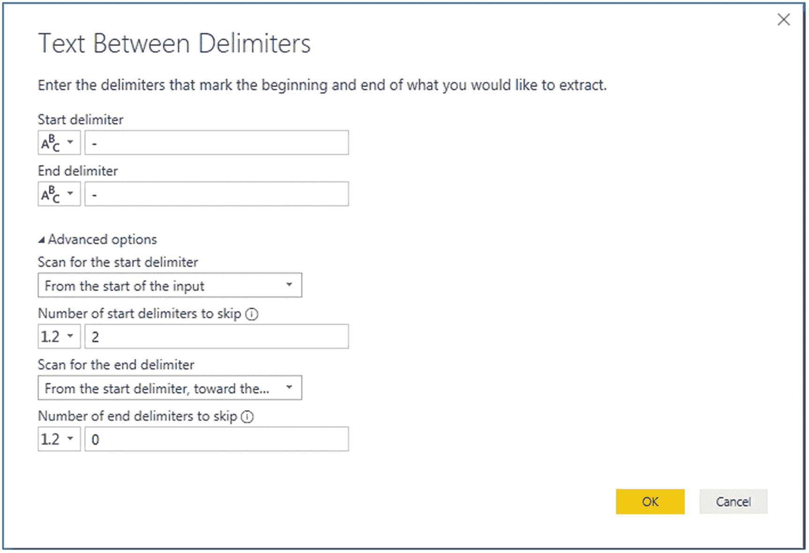

**图 8-16** — “分隔符间的文本”对话框的高级选项

> **注意**：`提取`按钮可以在`转换`和`新列`两个功能区中找到。如果你从`转换`功能区执行此操作，则现有列的内容将被替换。如果你使用`添加列`功能区中的按钮，则包含提取文本的新列将添加到任何现有列的右侧。

### 复制列

有时你只需要简单复制一列，不增不减。这时就轮到`复制列`按钮上场了。

1. 加载 `C:\PowerBiDesktopSamples\CH08Example1.pbix` 示例文件。
2. 打开 Power BI Desktop 查询编辑器。
3. 点击你想要复制的列内部（或列标题）。在本示例中，我将使用 `Make` 列。
4. 在`添加列`功能区中，点击`复制列`按钮。几秒钟后，列的副本将在现有表格的右侧创建。`复制的列`将出现在`应用的步骤`列表中。
5. 滚动到表格右侧并重命名现有列；它当前名为 `Make-Copy`。

> **注意**：复制列的名称为`原始列名称-副本`。我发现，在数据混合处理过程中，尽早重命名列的副本会很有帮助。

## 拆分列

有时，源列包含的数据确实需要拆分成较小的部分，分布在两列或多列中。以下是这种情况的典型示例：

-   某列包含一个元素列表，元素之间由特定字符（称为*分隔符*）分隔。
-   某列包含一个元素列表，但元素可以在列中的特定位置进行划分。
-   某列包含拼接文本，需要拆分成其组成元素（例如银行账号和社会安全号码）。

以下简短章节将说明如何处理这些情况。

#### 按分隔符拆分列

这是你可能偶尔遇到的另一个需求。导入的数据中有一个列需要进一步拆分为多个列。想象一个文本文件，其中的列由分号分隔，并且这些细分列中的每一个都包含一个以逗号分隔的元素列表。导入文件后，你需要进一步分离这个使用了不同分隔符的列的内容。

以下是将数据从一个列拆分到多个列的方法：

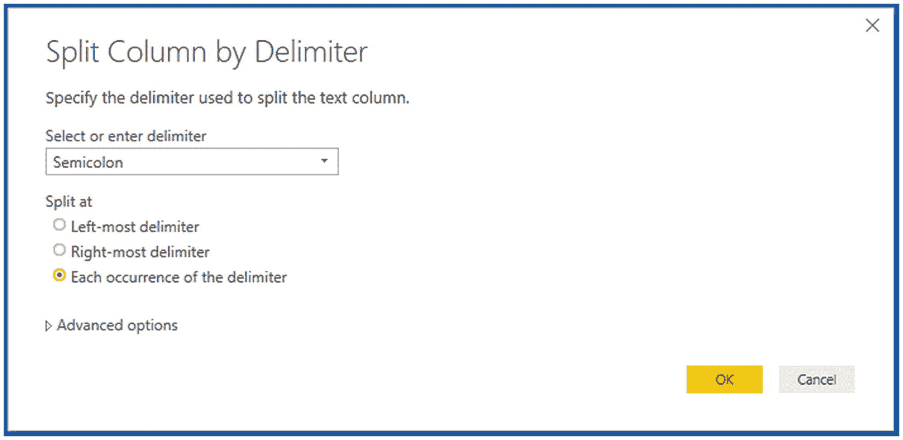

**图 8-17** — 使用分隔符拆分列

1. 打开 `C:\PowerBiDesktopSamples\CH08DataToParse.pbix` 示例文件并切换到查询编辑器。
2. 在`转换`功能区，点击`将第一行用作标题`。
3. 点击 `ClientList` 列内部。你可以看到此列包含多个数据元素，每个元素由分号分隔。
4. 在`转换`功能区，点击`拆分列` ➤ `按分隔符`。将出现“按分隔符拆分列”对话框。
5. 从“选择或输入分隔符”弹出菜单的可用选项列表中选择`分号`（尽管查询编辑器可能已经检测到了）。
6. 点击“分隔符的每次出现”作为拆分文本列的位置。对话框应如图 8-17 所示。
7. 点击`确定`。`按分隔符拆分列`将出现在`应用的步骤`列表中。

原始列被替换，所有新列被命名为 `InvoiceNumber.1`、`InvoiceNumber.2`，依此类推。创建的新列数量与分隔符数量相同；每个列都被命名为 (`Column.n`) 并按顺序编号。此操作的结果如图 8-18 所示。

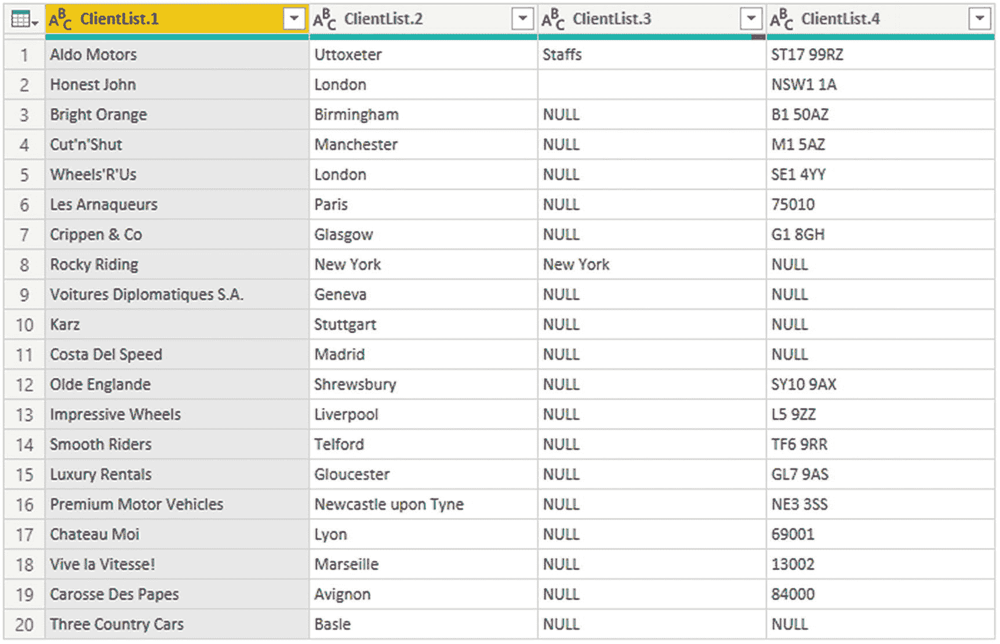

**图 8-18** — 拆分列的结果

此特定过程有多个选项，就数据而言，它们的后果可能相当深远。表 8-11 包含了对可用选项的描述。

**表 8-11** — 分隔符拆分选项

| 选项 | 描述 |
| --- | --- |
| `冒号` | 使用冒号 (`:`) 作为分隔符。 |
| `逗号` | 使用逗号 (`,`) 作为分隔符。 |
| `等号` | 使用等号 (`=`) 作为分隔符。 |
| `分号` | 使用分号 (`;`) 作为分隔符。 |
| `空格` | 使用空格 ( ) 作为分隔符。 |
| `制表符` | 使用制表符作为分隔符。 |
| `自定义` | 允许你输入自定义分隔符。 |
| `在最左侧的分隔符处` | 仅在分隔符第一次出现时拆分一次列。 |
| `在最右侧的分隔符处` | 仅在分隔符最后一次出现时拆分一次列。 |
| `在分隔符的每次出现处` | 将列拆分为与分隔符数量相同的列数。 |
| `拆分为列` | 这保持数据集中的行数不变，并为拆分操作产生的每个新元素创建新列。 |
| `拆分为行` | 为拆分操作产生的每个新元素创建新行，并根据拆分元素的数量多次复制现有记录。 |

#### 分隔符拆分的高级选项

按分隔符拆分文本时，有一些可用的高级选项。当你点击“按分隔符拆分列”对话框中的`高级选项`元素时，这些选项会显示出来，并在表 8-12 中进行了解释。

**表 8-12** — 分隔符拆分选项

| 高级选项 ➤ `要拆分成的列数` | 允许你设置最大列数，数据将以给定的字符数为单位分块拆分到这些列中。任何额外的列都将被放置在最后一列。 |
| --- | --- |
| 高级选项 ➤ `引号字符` | 包含在双引号内的文本中的分隔符不会用于将文本拆分为列。将此选项设置为“无”将拆分引号内的元素。 |
| `使用特殊字符拆分` | 启用`插入特殊字符`按钮。然后你可以点击此按钮并选择用于拆分数据的特殊字符。可选的有`制表符`、`回车符`、`换行符`、`回车符和换行符`或不间断空格。 |

#### 按字符数拆分列

此主题的另一个变体是，当每一列中的文本具有固定的字符数，并且需要在特定间隔处将其分解为组成部分时。例如，假设您有一个字段，其中每组（特定数量的）字符都有特定含义，并且您希望将其拆分为多列。或者，假设您希望提取最左侧或最右侧的 *n* 个字符，并保留其余部分。银行账号和社会安全号码就是这样的例子。这时，按字符数拆分列就能派上用场。由于原理与我们刚刚看到的过程非常相似，我将不再重复整个过程。您只需在上一个练习的第 5 步中选择“按字符数”菜单选项即可。此类操作的选项见表 8-13。

**表 8-13** 按字符数拆分列时的选项

| 选项 | 描述 |
| --- | --- |
| 字符数 | 允许您定义在拆分列之前的数据字符数。 |
| 一次，尽可能靠左 | 仅在从左侧算起的指定字符数处拆分一次列。 |
| 一次，尽可能靠右 | 仅在从右侧算起的指定字符数处拆分一次列。 |
| 重复 | 根据需要多次拆分列，以每隔定义的字符数将其分割成多个段。 |
| 高级选项 ➤ 拆分为的列数 | 允许您设置一个最大列数，数据将按指定字符数分块拆分到这些列中。任何额外的列都将被放置在最右侧的列中。 |
| 拆分为列 | 保持数据集中的行数不变，并为拆分操作产生的每个新元素创建新列。 |
| 拆分为行 | 为拆分操作产生的每个新元素创建新行，并根据拆分元素的数量重复现有记录。 |

拆分列时有几点需要注意：
- 按分隔符拆分时，Power BI Desktop 会尽力推测源列必须拆分的最大列数。如果它猜错了（您可以展开“高级选项”框查看其估算值），您可以在此处覆盖该数字。
- 如果您选择“自定义分隔符”，Power BI Desktop 会在对话框中显示一个新框，您可以在其中输入特定的分隔符。
- 并非每条记录都必须具有相同数量的分隔符。如果某行的拆分元素较少，Power BI Desktop 会简单地将最右侧的列留空。

**注意：** 仅当列为文本数据时才能拆分列。如果您尝试拆分日期或数字列，“拆分列”按钮将保持灰色不可用状态。

## 合并列

当您阅读本节标题时，可能会感到某种似曾相识。毕竟，我们在前一章中已经看到了如何合并列（即如何将多个列中的数据融合到一个更宽的单一列中），不是吗？是的，我们确实做过。然而，这并非本章中您唯一一次看到之前尝试过的操作。这是因为 Power BI Desktop 查询在“添加列”功能区中重复了“转换”功能区中的几个选项。虽然这些功能的工作方式大致相同，但有一个本质区别。如果您从“转换”功能区选择一个选项，那么您选择的列将被*修改*。如果您从“添加列”功能区选择类似的选项，则原始列将不会被更改，而是会添加一个包含数据转换结果的*新列*。

合并列就是一个很好的例子。由于我在前一章中已经详细介绍了如何执行这种数据转换，因此我将不再赘述。只需说明，如果您按住 Ctrl 键单击两个或多个列的标题，然后在“添加列”功能区中单击“合并列”，您仍然会看到所选列的数据被连接到一个单一的列中。但是，这次原始列*会保留*在数据集中。新列被命名为“已合并”，与您使用“转换”功能区合并列时选择的第一个列的情况完全相同。

以下是可以覆盖现有列中的数据*或*将结果显示为新列的其他函数：
- *格式*：修剪文本或更改文本的大小写
- *提取*：获取列的一部分并据此创建另一列
- *解析*：添加一列，其中包含作为 JSON 或 XML 字符串的源列数据
- *统计信息*：创建聚合数值的新列
- *标准*：创建计算所得数值的新列
- *科学*：通过将某些类型的数学运算应用于列中的值来创建新列
- *三角*：通过将某些类型的三角运算应用于列中的值来创建新列
- *舍入*：通过舍入列中的值来创建新列
- *信息*：创建一个新列，指示列中值的算术信息
- *日期*：通过从日期列的值中提取日期元素来创建新列
- *时间*：通过从时间或日期/时间列的值中提取时间元素来创建新列
- *持续时间*：通过计算两个日期或日期/时间之间的持续时间来创建新列

在转换数据时，关键在于决定在应用这些函数之前是否想要或需要保留原始列。然而，同样地，如果您后来决定做出了错误的决定，这也不是根本问题，因为您可以随时回溯。或者，您也可以始终决定默认插入新列，并在数据转换过程的后续阶段删除任何您确实不需要的列。

## 通过示例创建列

如果你对 Excel 或 Power Pivot 公式不太熟悉，自己创建列可能会有些胆怯，因此 Power BI Desktop 开发团队尝试通过添加另一种创建自定义列的方式来简化你的工作。除了通过列名（并需要处理方括号和其他特殊字符）来引用列之外，你还可以通过行中的实际数据来构建新列。

以下步骤展示了如何实现此操作：

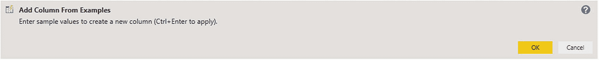

**图 8-19** 通过示例创建列

1. 加载示例文件 `C:\PowerBiDesktopSamples\CH08Example1.pbix`。

2. 单击 `Transform Data`。

3. 在 `Add Column` 功能区中，单击 `Column From Examples`。数据上方将出现一种新型的公式栏，如图 8-19 所示。同时，在现有数据的右侧将创建一个新的空列。

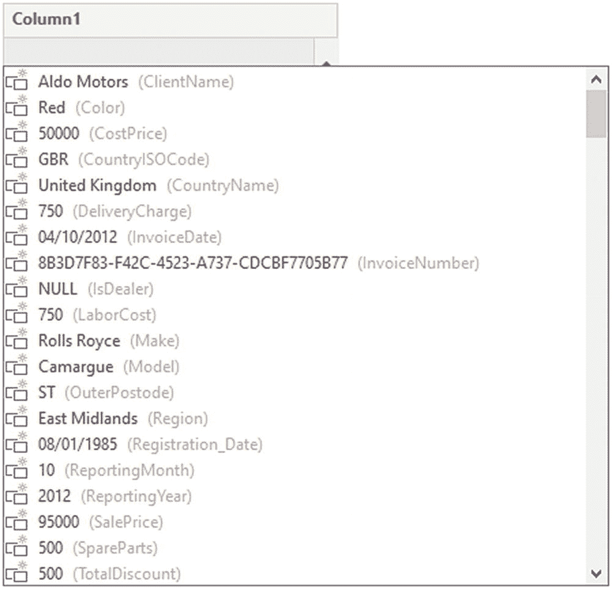

**图 8-20** 通过示例创建列时显示行中的数据

1. 双击右侧新列的内部。将显示来自每个字段的数据列表，如图 8-20 所示。

2. 双击 `Red` 以选择 `Color` 列中的数据。

3. 输入一个空格、一个连字符和一个空格，然后输入 `Camargue`（这是该行模型的名称）。

4. 单击顶部公式栏中的 `OK`。

`Power BI Desktop` 将添加一个新列，其中包含颜色、分隔符和模型。`Inserted Merged Column` 将作为新步骤添加到 `Applied Steps` 列表中。

> **注意:** 在 `Column from Examples` 按钮的弹出菜单中，你可以选择将所有现有列作为示例的基础，或仅选择你之前选定的列。

从这个简短示例可以看出，通过示例创建列允许你使用列中的数据，而不是列名。它还消除了编写代码创建新列时必须使用双引号和 & 符号的需要，正如上一节所述。

> **提示:** 如果你选择 `Column From Examples` ➤ `From Selection`，那么当你像本例步骤 6 那样双击新列内部查看数据示例时，将只会看到来自所选列的数据。

## 添加条件列

并非所有附加列都是对现有数据的简单提取或拼接。有时你需要应用一些简单的条件来定义新列的内容。这就是 `Power BI Desktop` 的 `Conditional Column` 函数的用武之地。

通过一个实际示例可能最能理解 `Conditional Columns`。假设你想添加一列，其中包含对 Brilliant British Cars 产品购买者类型的评论。操作方法如下：

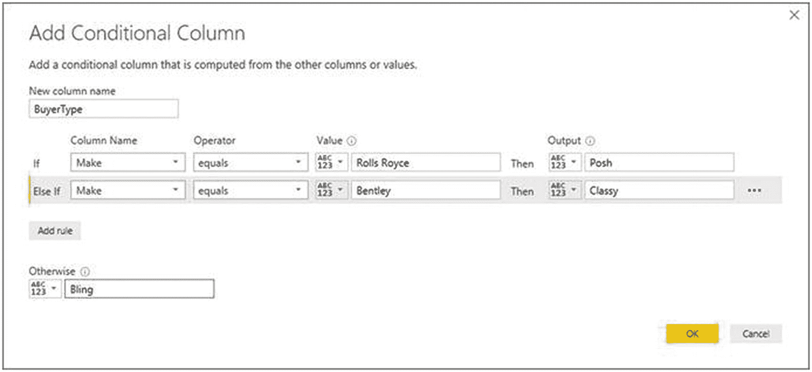

**图 8-21** `Add Conditional Column` 对话框

1. 加载示例文件 `C:\PowerBiDesktopSamples\CH08Example1.pbix`。

2. 单击 `Transform Data`。

3. 在 `Add Column` 功能区中，单击 `Conditional Column`。将出现 `Add Conditional Column` 对话框。

4. 在“New column name”字段中输入 `BuyerType`。

5. 选择 `Make` 作为列名。

6. 将运算符保留为 `Equals`。

7. 输入 `Rolls Royce` 作为值。

8. 输入 `Posh` 作为输出。

9. 单击 `Add Rule`。

10. 选择 `Make` 作为列名，将运算符保留为 `Equals`，输入 `Bentley` 作为值，并添加 `Classy` 作为输出。

11. 在 `Otherwise` 字段中输入 `Bling`。对话框将如图 8-21 所示。

12. 单击 `OK`。将添加一个新列，其中包含 `Posh`、`Classy` 或 `Bling`，具体取决于每条记录的制造商。`Added Conditional Columns` 将作为新步骤出现在 `Applied Steps` 列表中。

从 `Add Conditional Column` 对话框中可以看出，在定义数据匹配逻辑时，它提供了一系列可供调整的选项。这些选项在表 8-14 中进行了概述。

**表 8-14** 自定义列运算符

| 运算符 | 描述 |
| --- | --- |
| `Equals` | 设置必须与所选字段内容匹配的文本，以便应用输出。 |
| `Does Not Equal` | 设置不得与所选字段内容匹配的文本，以便应用输出。 |
| `Begins With` | 设置必须位于所选字段左侧的文本，以便应用输出。 |
| `Does Not Begin With` | 设置不得出现在所选字段左侧的文本，以便应用输出。 |
| `Ends With` | 设置必须位于所选字段右侧的文本，以便应用输出。 |
| `Does Not End With` | 设置不得出现在所选字段右侧的文本，以便应用输出。 |
| `Contains` | 设置可以出现在所选字段任意位置的文本，以便应用输出。 |
| `Does Not Contain` | 设置不能出现在所选字段任意位置的文本，以便应用输出。 |

另外值得注意的是，比较值、输出和替代输出可以是值（如本例所示）、列或参数（你将在第 9 章中了解）。如果要删除某条规则，只需单击所需规则右侧的省略号，然后选择 `Delete`。

> **提示:** 如果你想要更改 `Add Conditional Column` 对话框中规则的顺序，只需单击所选规则右侧的省略号，然后从弹出菜单中选择 `Move Up` 或 `Move Down`。

## 索引列

`索引列` 是一个新列，用于对表中的每条记录按顺序进行编号。此编号方案适用于该表，因为它当前是按排序顺序且从零开始。在许多情况下，`索引列` 都很有用。以下是一些示例：

- 重新应用之前的排序顺序。
- 为每条记录创建唯一引用。
- 准备一个记录集，用作 `Power BI Desktop` 数据模型中的维度表。在这种情况下，`索引列` 就成为了维度建模者所称的*代理键*。

此列表绝非详尽无遗；在你使用 `Power BI Desktop` 的过程中，几乎肯定还会发现其他用途。无论需求如何，以下是添加 `索引列` 的方法：

1. 在 `Add Column` 功能区中，单击 `Index Column`。新的、顺序编号的列将添加到表的右侧，并且 `Added Index` 将添加到 `Applied Steps` 列表中。

2. 滚动到表的右侧并重命名 `索引列`；它当前被命名为 `Index`。

在决定如何开始对 `索引列` 进行编号时，你有相当大的自由度。选项如下：

- 从 0 开始，每行增加 1。
- 从 1 开始，每行增加 1。
- 从任意数字开始，并以任意数字递增。

正如你在步骤 1 中所见，默认情况下，`Power BI Desktop Query` 从 0 开始对行进行编号。但是，你可以通过单击 `Add Index Column` 按钮右侧的小三角形来选择其他选项。这将显示一个包含三个选项的菜单。

选择第三个选项 `Custom`，会显示如图 8-22 所示的对话框。

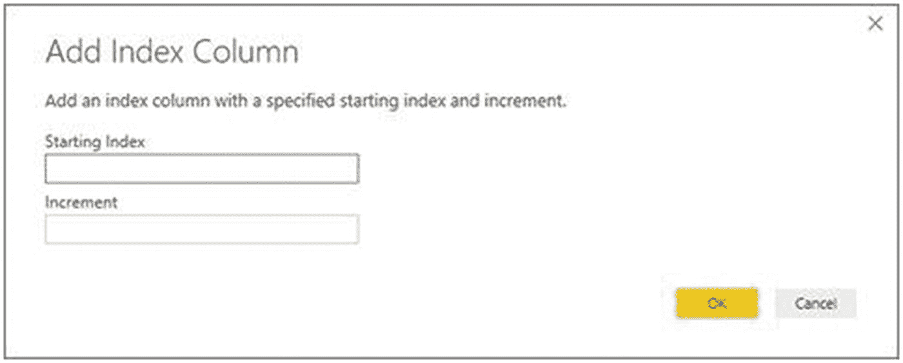

**图 8-22** `Add Index Column` 对话框

此对话框允许你指定数据集中第一行的起始编号以及每条记录递增的增量。

## 结论

在本章中，您学习了一些可用于清理和扩展数据集的基本技术。您了解了如何对数字进行向上和向下取整、如何实现统一的文本呈现格式，以及如何删除数据列中多余的空格和不可打印字符。

您还学习了如何替换列内的值，以及如何将数学、统计和三角函数应用于数字。其他技术包括从日期/时间和持续时间列中提取日期、时间和持续时间元素。

最后，您学习了一系列技巧，帮助您根据现有列中的数据添加新列。这些技巧涵盖从简单的整列复制或合并列，到提取列数据的部分内容，甚至利用简单逻辑推导出不同的数据并添加到新列。

现在，我们来学习如何将此前相互独立的数据集合并到单个查询中，并解析复杂数据类型以将其添加到数据集中。您甚至将学习如何在单个查询中加载多个结构相同的文件，以及如何对数据进行透视、逆透视和转置。所有这些都将是下一章的主题。

