# 10. 复杂数据加载

并非所有的数据加载都仅仅是建立到源的连接，并对源数据（幸运的是，这些数据已经以结构清晰的表格形式呈现）应用转换。有时，你可能希望在加载数据时“突破界限”，为在你的 Power BI 仪表板中使用而准备更复杂的源数据结构。我的意思是，源数据最初并非采用立即可用的表格格式，需要对其重新进行一些结构整理，才能准备好供使用的表格。

为了解决这类挑战，本章将解释如何执行以下操作：

-   从源文件夹中添加多个相同的文件
-   从源文件夹中选择要加载的相同源文件
-   从包含 JSON 数据的源文件中加载简单的 JSON 结构
-   解析源文件中包含 JSON 数据的列
-   解析源文件中包含 XML 数据的列
-   加载复杂的 JSON 文件——并选择要使用的元素
-   加载复杂的 XML 文件——并选择要使用的元素
-   将列转换为列表以用于复杂加载例程

最后——纯粹是为了完善 Power BI 查询编辑器及其功能的整体概览——我将提一下如何

-   重用最近使用的查询
-   修改最近使用的查询列表
-   从 Power BI 查询编辑器导出数据

## 从源文件夹添加多个文件

现在让我们考虑一个有趣的数据提取挑战。你收到了一批文件，可能是从 FTP 站点下载的或通过电子邮件接收的，并且你已经将它们全部放入一个特定的目录中。但是，如果有几百个文件，你肯定不想像第 2 章那样逐个加载文件——然后像你在第 9 章中看到的那样，将所有文件单独追加以创建最终的复合数据表。

**注意**：只有当所有文件都严格相同时，查询编辑器才能加载多个文件。这意味着要确保每个文件中的所有列都按相同的顺序排列并具有相同的名称。

以下是实现此目标的更高效方法：

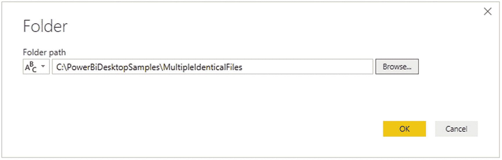

图 10-1
文件夹对话框

1.  创建一个新的 Power BI Desktop 文件。
2.  在 Power BI Desktop 的“开始”功能区中，点击 `获取数据` ➤ `文件`，打开 `获取数据` 对话框。然后在对话框右侧选择 `文件夹`。
3.  点击 `连接`。将显示 `文件夹` 对话框。
4.  点击 `浏览` 按钮，导航到包含要加载文件的文件夹。在此示例中，它是 `C:\PowerBiDesktopSamples\MultipleIdenticalFiles`。如果愿意，你也可以粘贴或输入文件夹路径。`文件夹` 对话框将如图 10-1 所示。

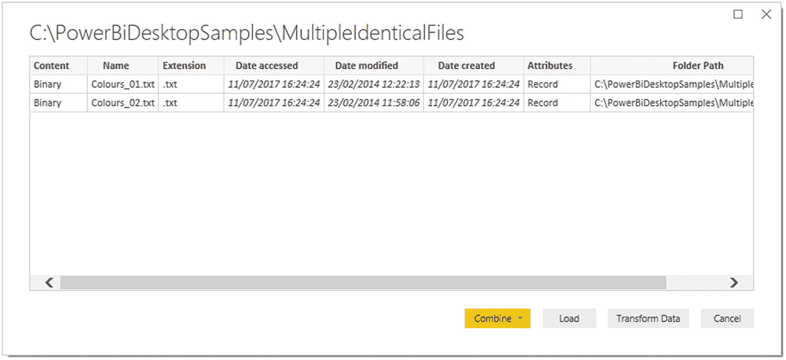

图 10-2
Power BI Desktop 中的文件夹内容

1.  点击 `确定`。将打开文件列表窗口。文件夹及其所有子文件夹的内容以表格格式列出，如图 10-2 所示。

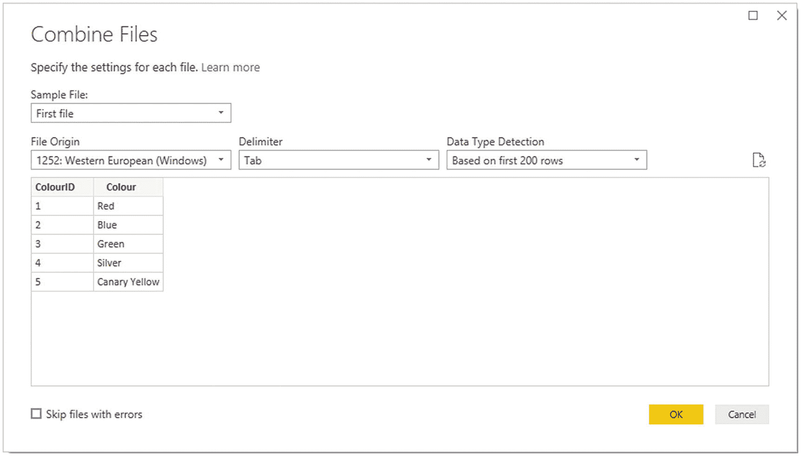

图 10-3
合并文件对话框

1.  点击 `合并` 按钮上的弹出箭头，然后选择 `合并并转换数据`。将出现 `合并文件` 对话框，如图 10-3 所示。在这里，你可以选择文件夹中的哪个文件作为要导入文件的*模型*。

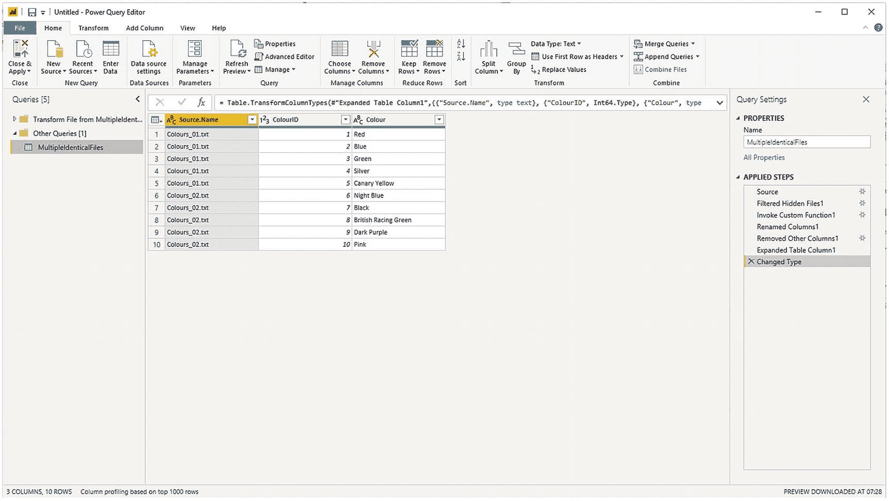

图 10-4
从文件夹加载的数据

1.  点击 `确定`。Power BI Desktop 查询编辑器将显示导入的数据。如图 10-4 所示。
2.  点击 `关闭并应用`。所有源文件中的数据将被加载到 Power BI Desktop 数据模型中。

**注意**：`合并文件` 对话框中的其他选项在第 2 章中有说明。

### 筛选文件夹中的源文件

有时候你可能只想从文件夹中导入文件的*子集*。也许文件并不相同，或者你只是不需要源目录中的某些可用文件。无论出于何种原因，这里有一种方法可以让 Power BI Desktop 自动遍历目录，*仅*加载与你指定的文件名条件相符的文件。换句话说，查询编辑器允许你在加载实际数据之前筛选源文件集。在本示例中，我将展示如何加载多个 Excel 文件：

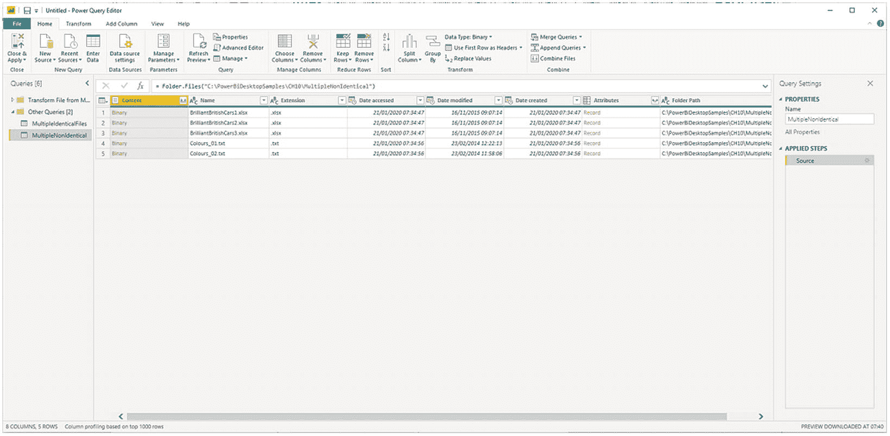

**图 10-5** – 加载多个文件时显示文件信息

1.  执行前述步骤 1 至 5，以显示包含你欲加载文件的文件夹内容。本例中，该文件夹为 `C:\PowerBiDesktopSamples\MultipleNonIdentical`。
2.  单击**转换数据**。查询编辑器窗口将打开，并显示目录中的文件列表及其众多属性。你可以在图 10-5 中看到示例。

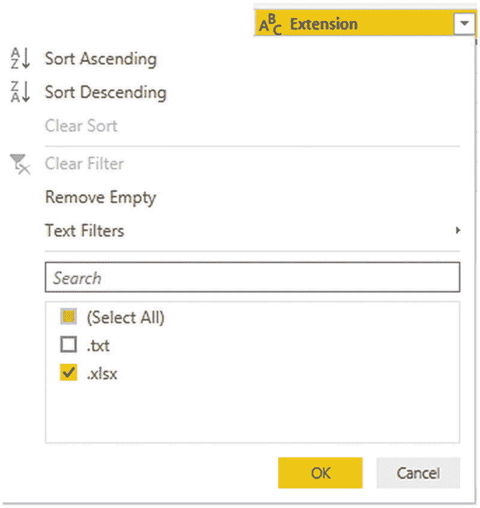

**图 10-6** – 加载多个相同文件时筛选文件类型

3.  由于你只想加载 Excel 文件并避免任何其他类型的文件，请单击列标题**扩展名**的筛选弹出菜单，并取消勾选*除* `.xlsx` *之外*的所有元素。如图 10-6 所示。

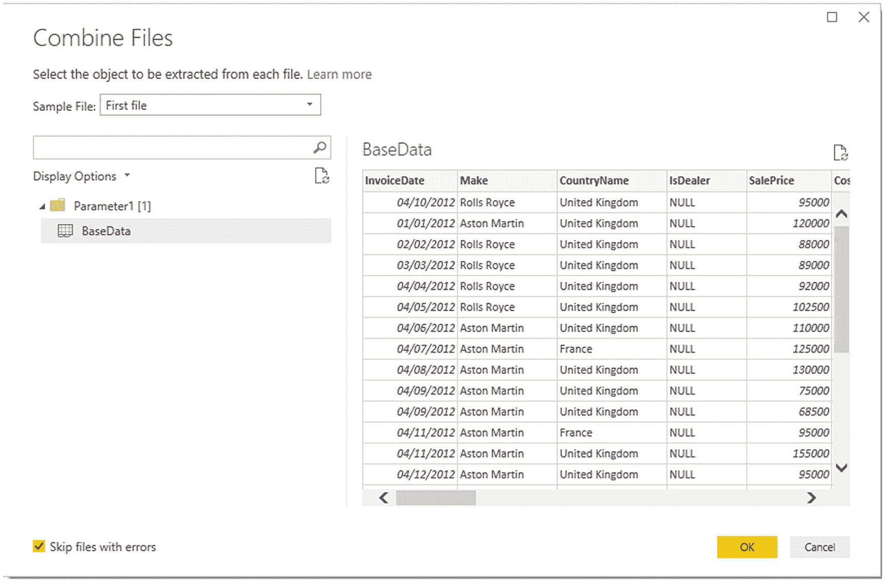

**图 10-7** – 加载多个 Excel 文件时选择源数据

4.  单击**确定**。现在你只能在查询编辑器中看到文本文件。
5.  单击第一列标题右侧的**展开**图标（两个向下的箭头），该列名为**内容**，列中的每一行都包含单词 *Binary*。Power BI 将显示你在第 2 章中见过的**合并文件**对话框。
6.  从可用文件中选择一个作为数据加载的示例文件。
7.  单击对话框左侧层级结构中包含你欲加载数据的工作表、表格或命名区域。
8.  单击**跳过包含错误的文件**。此时，对话框将如图 10-7 所示。
9.  单击**确定**。Power BI Desktop 查询编辑器将加载所有文件并显示结果。

现在，所有源文件的内容都已加载到 Power BI Desktop 查询编辑器中，可以像其他任何数据集一样进行转换和使用。这可能涉及删除多余的标题行（如下下节所述）。更重要的是，如果你向源目录中添加更多文件，然后点击**开始**功能区中的**刷新**，*所有*与筛选条件匹配的源文件都将重新加载，包括添加到指定目录中符合筛选条件的新文件。

> **注意**  
> 加载多个 Excel 文件时，你需要知道数据源（无论是工作表、命名区域还是表格）在所有源文件中的名称*必须*相同，否则数据将无法加载。

### 显示和筛选文件属性

在查询编辑器中显示文件夹内容时，你会看到一组可用于筛选数据的文件属性。这些属性涵盖基本要素，例如：

*   文件名
*   文件扩展名
*   文件夹路径
*   创建日期
*   上次访问日期
*   修改日期

然而，还有更多的文件描述属性可供使用，只需在查询编辑器中显示它们即可。操作方法如下：

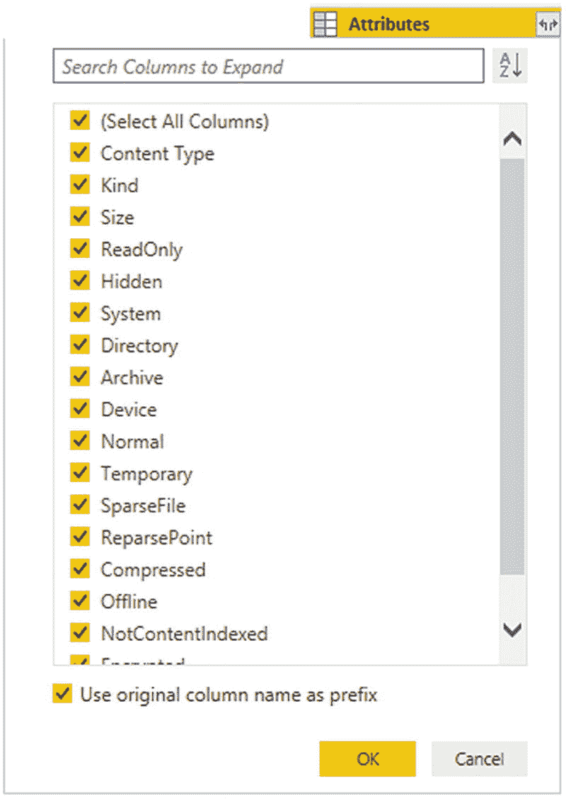

**图 10-8** – 加载多个 Excel 文件时选择源数据

1.  执行上一节中的步骤 1 和 2。
2.  通过单击**属性**列右侧的**展开**图标（双箭头），显示可用属性。将显示可用属性列表，如图 10-8 所示。
3.  从列表中选择要显示的属性，然后单击**确定**。

每个属性都将作为查询编辑器中的新列出现。现在，你可以基于展开的属性列表，对这些列进行筛选以选择文件。

> **注意**  
> 你也可以基于显示的目录、日期或任何文件信息进行筛选。只需应用你在第 7 章中学到的筛选技巧即可。

### 多次加载文件后删除标题行

如果源文件中包含为每个源文件加载的标题行，以下是一种快速从数据中删除它们的方法：

1.  如果（且仅当）每个文件包含标题行，则向下滚动生成的表格，直到找到一个标题元素。在本例中，它是 `ColourID` 列中的单词 *ColourID*。
2.  右键单击 `ColourID`，然后选择**文本筛选器** ➤ **不等于**。所有包含多余列标题的行都将被删除。

> **注意**  
> 如果你的源目录只包含你想要加载的文件，则步骤 2 是不必要的。尽管如此，我始终会添加此类步骤，以防以后添加了“错误”类型的文件，导致后续处理运行失败。同样，你也可以设置文件名筛选条件以限制加载的文件。

## 加载与解析 JSON 文件

如今，越来越多的数据以 JSON 格式进行交换。JSON 代表 JavaScript 对象表示法，它被认为是一种高效且轻量级的方式来传输潜在的大量数据。JSON 文件本质上是一种以特定方式结构化数据的文本文件。

虽然 Power BI Desktop 可以非常轻松地连接到 JSON 数据文件（毕竟它们只是一种文本文件），但它们包含的数据并非总能立即可解。因此，你将学习如何加载该文件，并查看如何调整此连接以将其转换为有意义的信息。将源文本转换为可理解的格式通常被称为*解析*数据。

要连接到 JSON 文件并将其包含的数据解析为可用的表格：

**图 10-9** 初始导入后的 JSON 文件

1. 在"开始"功能区中，依次单击"获取数据" ➤ "更多" ➤ "文件" ➤ "JSON"，然后单击"连接"。

2. 选择文件 `C:\PowerBiDesktopSamples\Colors.json`，然后单击"打开"。你将看到如图 10-9 所示的记录列表。

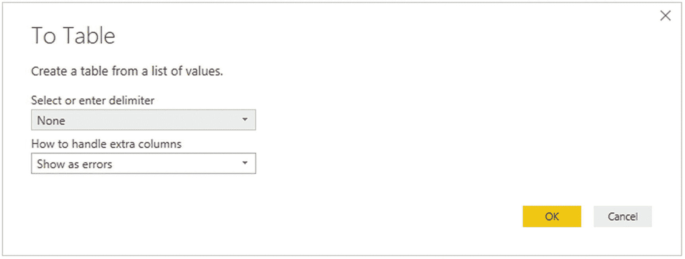

**图 10-10** "转换为表"对话框

3. 你将看到查询编辑器添加了"列表工具 转换"功能区。此功能区将在下一节中详细说明。单击此功能区中的"转换为表"按钮。将出现"转换为表"对话框，如图 10-10 所示。

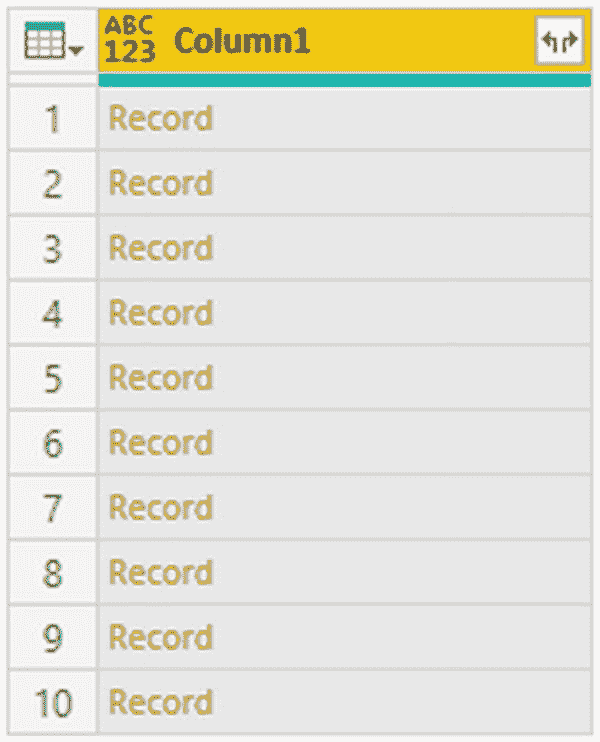

**图 10-11** 转换为表的 JSON 文件

4. 单击"确定"。数据列表将转换为表格。这意味着它现在会在列标题右侧显示展开图标，如图 10-11 所示。

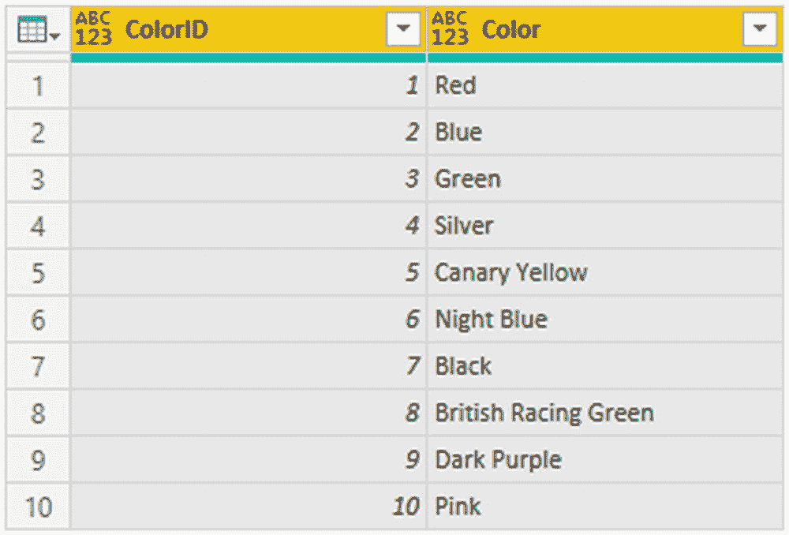

**图 10-12** 转换为数据集的 JSON 文件

5. 单击列标题右侧的展开图标，在弹出的对话框中，取消选中"使用原始列名作为前缀"。

6. 单击"确定"。JSON 文件的内容现在显示为标准数据集，如图 10-12 所示。

虽然过程并非特别困难，但可能看起来有点违反直觉。然而，它确实有效，你可以使用它来处理复杂的 JSON 文件，以便在 Power BI Desktop 中使用它们包含的数据。

## "列表工具 转换"功能区

Power BI Desktop 将某些数据视为列表，而非数据表。它处理列表的方式略有不同，并显示一个特定的功能区来修改列表数据。"列表工具 转换"功能区在图 10-13 和表 10-1 中进行了说明。

**表 10-1** "列表工具 转换"功能区选项

| 选项 | 说明 |
| --- | --- |
| 转换为表 | 将列表转换为表格结构。 |
| 保留项目 | 允许你保留列表顶部或底部指定数量的项目，或列表中的一个范围。 |
| 删除项目 | 允许你删除列表顶部或底部指定数量的项目，或列表中的一个范围。 |
| 删除重复项 | 删除列表中的任何重复项。 |
| 反转项目 | 反转列表顺序。 |
| 排序 | 将列表从最低到最高或从最高到最低排序。 |
| 统计信息 | 返回关于列表中元素的计算统计信息。 |

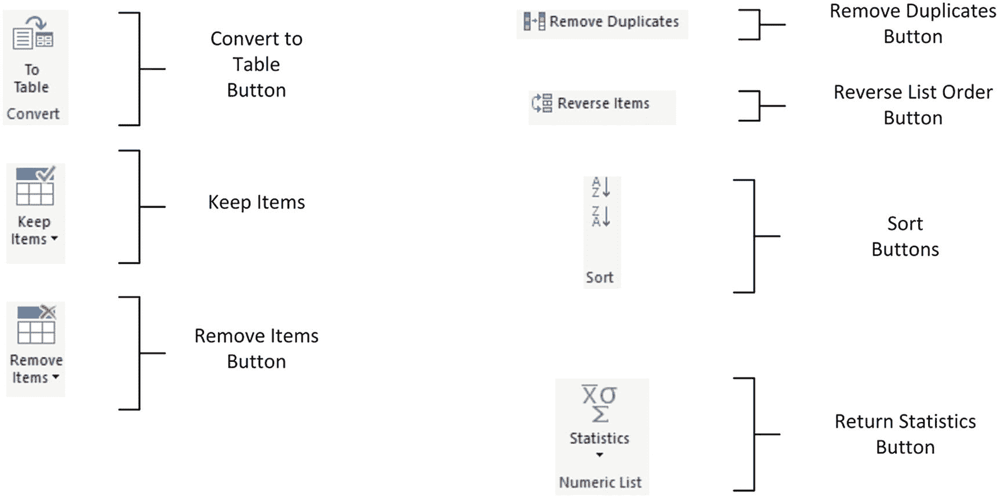

**图 10-13** "列表工具 转换"功能区

### 从列中解析 XML 数据

某些数据源，尤其是数据库源，在字段内部实际上包含了 XML 数据。问题在于，当加载数据时，Power BI Desktop 会将 XML 数据解释为纯文本。如果你查看图 10-14 中的 `AvailableColors` 列，就会发现这并不是特别有用。

因此，Power BI Desktop 再次提供了针对此类问题的解决方案。为了演示如何将这种文本转换为可用数据，你将找到一个示例 Excel 文件（`C:\PowerBiDesktopSamples\XMLInColumn.xlsx`），其中包含一列 XML 数据。请按以下步骤操作：

1. 在一个新的空白 Power BI Desktop 文件中，单击"编辑查询"切换到查询编辑器。

2. 在"开始"功能区中，依次选择"新建源" ➤ "Excel"。

3. 选择 Excel 文件 `C:\PowerBiDesktopSamples\XMLInColumn.xlsx`。

4. 选择此文件中的唯一工作表。它名为 Sales。

5. 滚动到数据集的右侧，选择最后一列：`AvailableColors`。导航器对话框如图 10-14 所示。

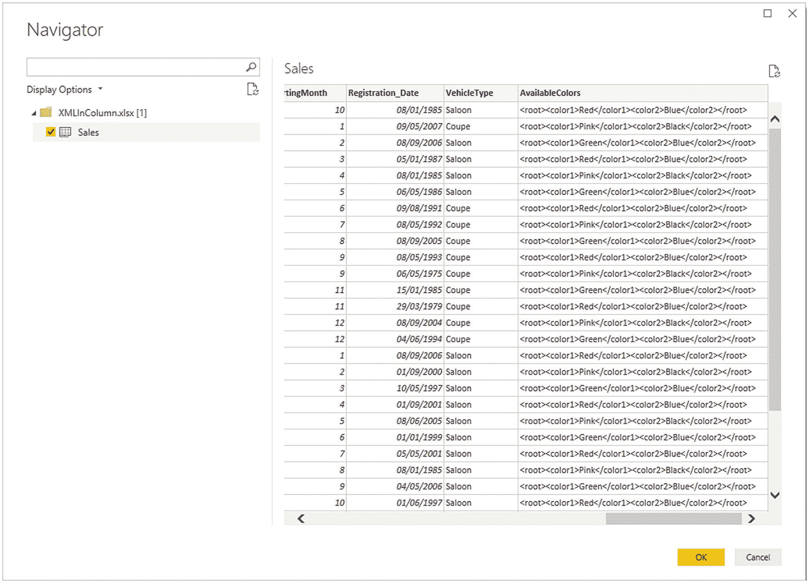

**图 10-14** 包含 XML 的列

6. 单击"确定"连接到源文件。

7. 选择数据集右侧的 `AvailableColors` 列。

8. 在"添加列"功能区中，单击"解析" ➤ "XML"。将在右侧添加一个新列。该列将如图 10-15 所示，标题为 `XML`。

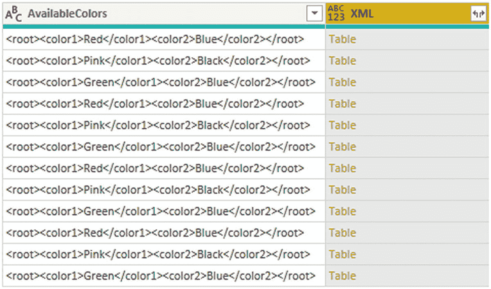

**图 10-15** 转换为表格列的 XML 列

9. 单击 `XML` 列标题右侧的展开图标，在弹出的对话框中取消选中"使用原始列名作为前缀"。确保选中所有列，然后单击"确定"。两个新列（或者确切地说，与 XML 数据元素数量一样多的新列）将出现在数据集的右侧。查询编辑器将如图 10-16 所示。

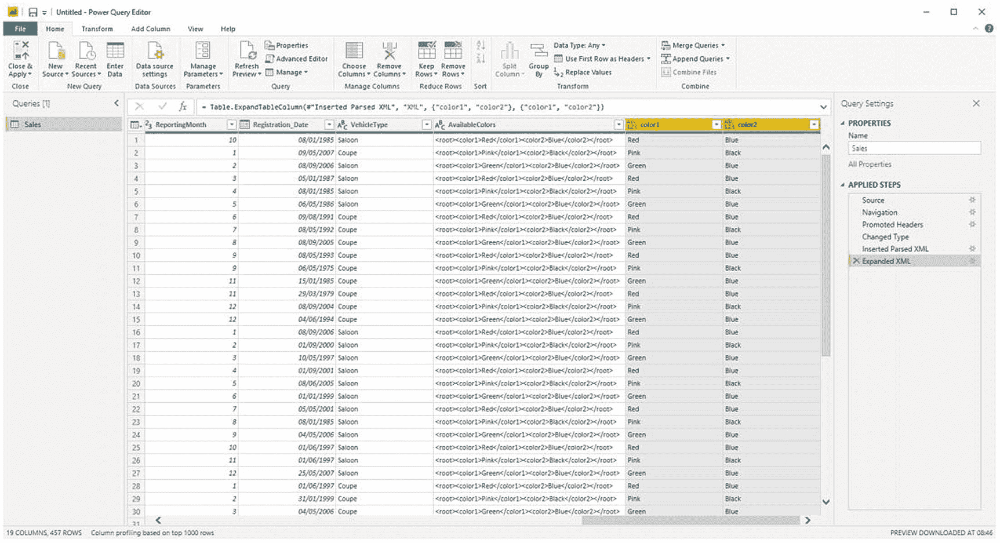

**图 10-16** 扩展到新列中的 XML 数据

10. 通过选择包含原始 XML 的列，然后在上下文菜单中单击"删除列"，来删除包含初始 XML 数据的列。

使用此技术，你现在可以提取源数据集中的 XML 数据，并使用它来扩展原始源数据。

### 解析列中的 JSON 数据

有时，你可能会遇到字段中包含 JSON 的数据。从数据集中的字段提取这些数据并将其转换为列的技术，与你之前在上一节中看到的 XML 数据处理方法几乎相同。

鉴于这种方法非常相似，并且与你之前导入 JSON 文件时看到的步骤相差无几，这里我将只提供处理最终结果的截图。在此截图中，你将看到源 JSON 以及从 JSON 中提取并添加到数据集中的数据列。

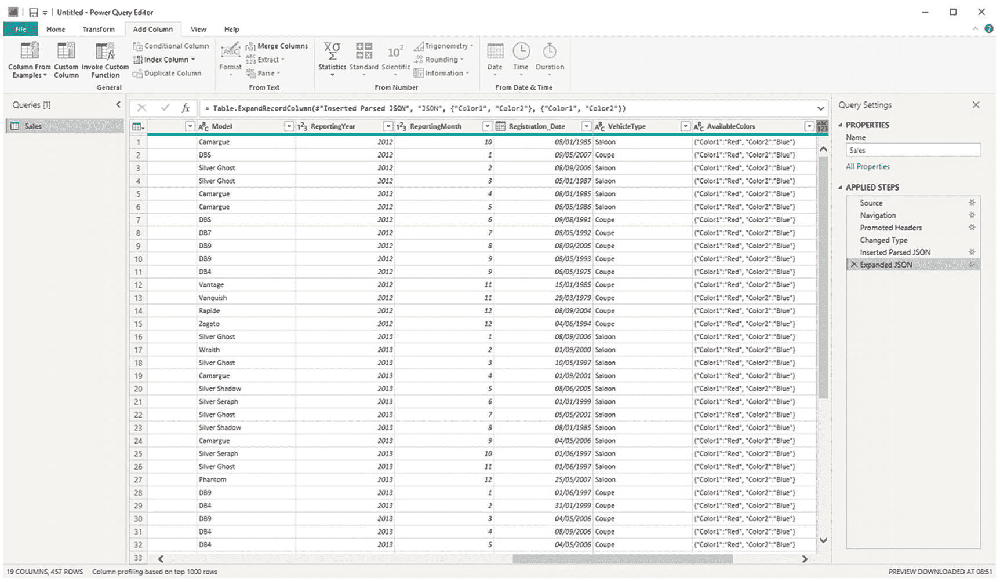

**图 10-17** 展开为新列的 JSON 数据

1.  在一个新的空白 Power BI Desktop 文件中，从 Excel 文件 `C:\PowerBiDesktopSamples\JSONInColumn.xlsx` 加载数据，并切换到查询编辑器。选择此文件中唯一的工作表：Sales。
2.  滚动到数据集右侧，选择最后一列：AvailableColors。
3.  在“添加列”功能区中，单击“解析” → “JSON”。右侧将添加一个新列，其标题为 JSON。
4.  单击 JSON 列标题右侧的“展开”图标，并在弹出对话框中取消选中“使用原始列名作为前缀”。确保所有列都被选中，然后单击“确定”。数据集右侧将出现两个新列（实际上，新列的数量与 JSON 数据元素的数量一致）。查询编辑器将如图 10-17 所示。
5.  删除包含原始 JSON 数据的列。

诚然，本例中 JSON 数据的结构极其简单。现实世界中的 JSON 数据可能复杂得多。不过，你现在有了一个起点，可以在此基础上解析存储在数据集列中的 JSON 数据。

#### 复杂的 JSON 文件

JSON 文件的结构并不总是像你几页前看到的 `colors.json` 文件那样简单。实际上，JSON 文件可能包含多个数据子层，这些子层被组织成独立的*节点*。每个节点可能包含以逻辑方式分组在一起的多个数据元素。通常，你需要从源文件中选择数据的“子层”——或者可能只选择某些子层元素，而不选择其他元素。

本节将向你展示如何从复杂的 JSON 结构中选择你感兴趣的数据元素。具体来说，示例源数据文件包含一个“根”层，其中显示核心数据，如发票号、销售日期和销售价格（以及其他元素），以及三个包含以下信息的“子层”：

-   车辆
-   财务数据
-   客户

> **注意**：如果你想了解包含多个嵌套节点的复杂 JSON 文件的大致结构，只需在文本编辑器中打开文件 `C:\PowerBIDesktopSamples\CarSalesJSON_Complex.json`。

在本例中，你将学习如何从源文件中的一个或多个（但不是全部）可用数据中选择元素：

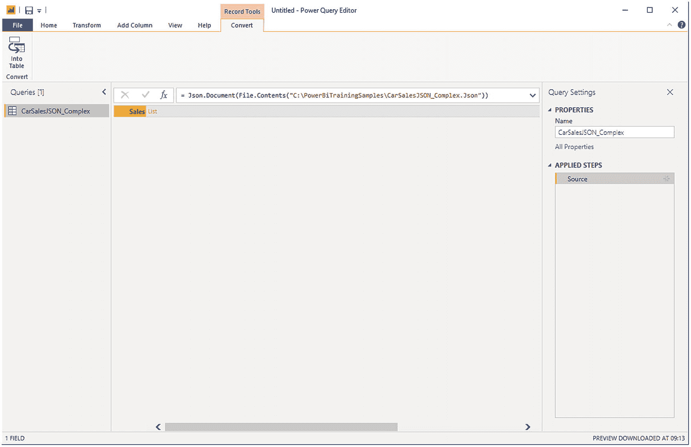

**图 10-18** 打开一个复杂的 JSON 文件

1.  在 Power BI Desktop 功能区中，单击“获取数据” → “文件”，然后在“获取数据”对话框右侧的文件源列表中选择“JSON”。
2.  单击“连接”并导航到包含要加载的 JSON 文件的文件夹（本例中为 `C:\PowerBIDesktopSamples\CarSalesJSON_Complex.json`）。
3.  单击“打开”。查询编辑器窗口将出现，并自动显示“记录工具转换”功能区。你可以在图 10-18 中看到这一点。

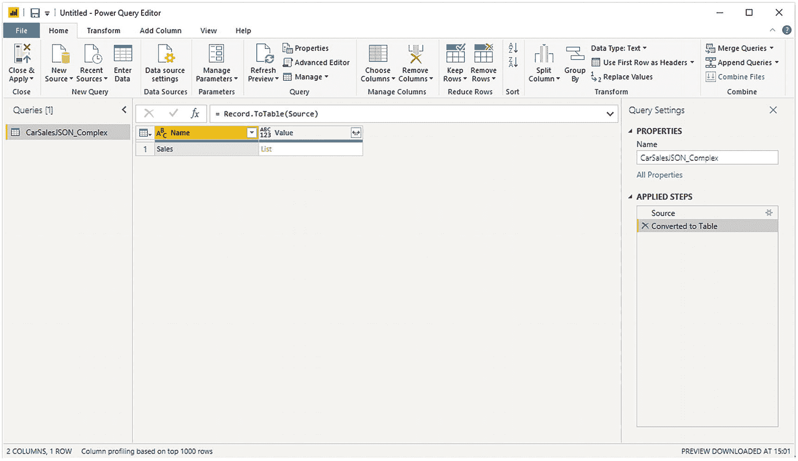

**图 10-19** 一个复杂的 JSON 文件

4.  从“记录工具转换”功能区中单击“转换为表”。查询编辑器将如图 10-19 所示。

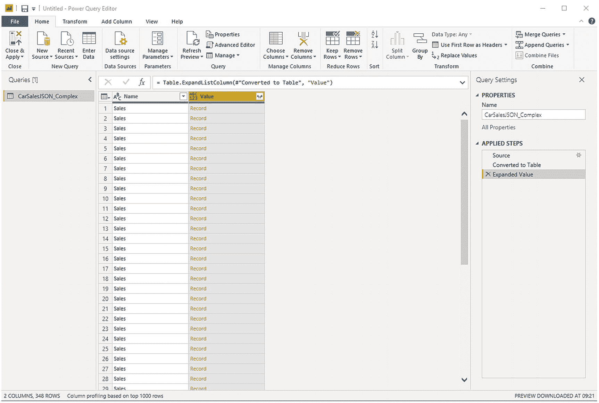

**图 10-20** 展开一个 JSON 文件

5.  单击 Value 列右上角的“展开”图标，然后选择“扩展到新行”。查询编辑器将如图 10-20 所示。

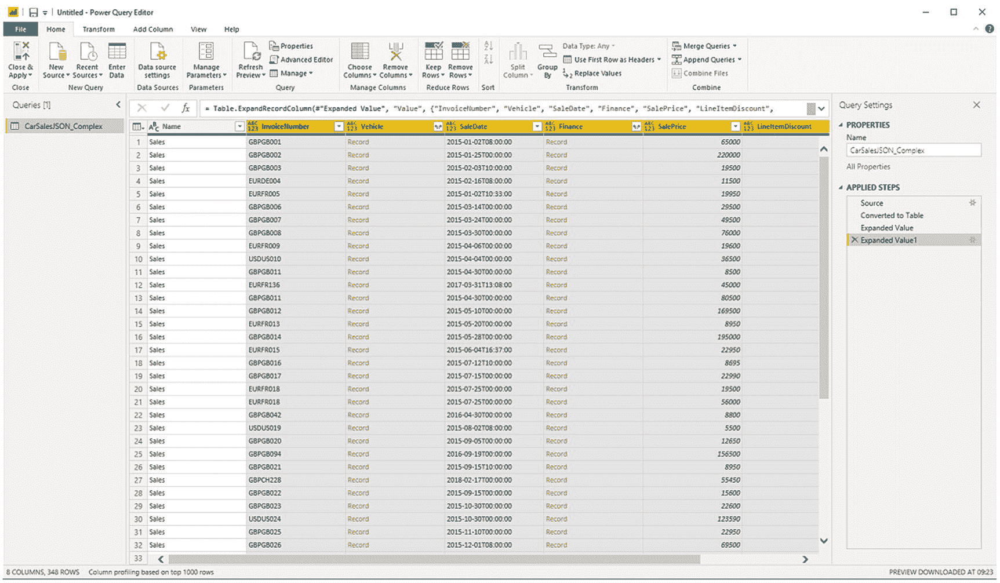

**图 10-21** 查看 JSON 文件的结构

6.  单击 Value 列右上角的“展开”图标，然后单击“确定”以显示所有 JSON 属性。查询编辑器窗口将如图 10-21 所示。每个包含“记录”一词的列实际上都是一个包含更深层子层数据的 JSON 节点。

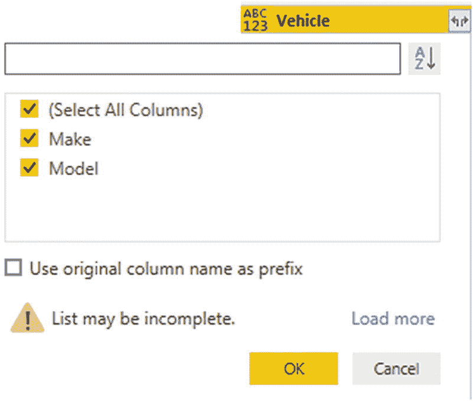

**图 10-22** JSON 文件中的嵌套元素

7.  选择“Vehicle”列，然后单击列标题右侧的“展开”图标。将显示源 JSON 内“嵌套”在更低层的可用元素列表。你可以在图 10-22 中看到这一点。

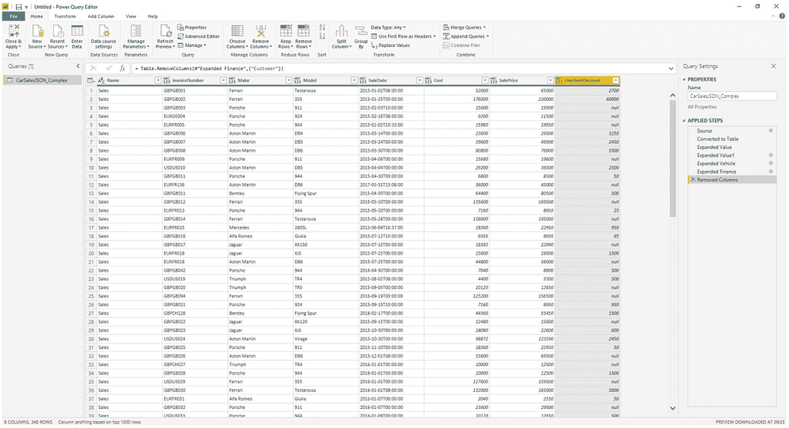

**图 10-23** 解析后的 JSON 文件

8.  单击“确定”。新列将添加到数据表中。
9.  选择“Finance”列，然后单击列标题右侧的“展开”图标。将显示此列对应的源 JSON 内“嵌套”在更低层的可用元素列表。仅选择“Cost”列，然后单击“确定”。
10. 删除“Customer”列。查询编辑器窗口将如图 10-23 所示，所有必需的列现在都显示在数据表中。
11. 单击 Power BI Desktop 窗口顶部的“应用更改”按钮。

> **提示**：当你在识别 JSON 节点中的嵌套数据时，一个好的做法是单击“展开”弹出菜单中的“加载更多”链接。这将强制 Power Query 扫描更多记录，并可能返回更完整的嵌套字段列表。

这种方法使你可以高度灵活地选择从 JSON 文件中加载的数据。你可以选择包含源结构中任何层的任何列。如你所见，你可以非常轻松地选择或忽略整个嵌套数据子层。

本节只是对解析复杂 JSON 文件的简单介绍。由于这种特殊的数据结构可能包含多个数据子层，并且可以在 JSON 文件的每个“节点”中混合数据和子层，因此源数据结构可能极其复杂。幸运的是，你刚刚学到的技术可以扩展以处理任何复杂程度的 JSON，并帮助你驾驭最令人生畏的数据结构。

> **注意**：“展平”源数据非常重要，这样可以移除所有子层（或节点），并将它们包含的数据显示为查询中的简单列。

### 复杂 XML 文件

与 JSON 文件一样，XML 文件可以包含多层数据组成的复杂嵌套结构，这些数据被分组到不同的节点中。好消息是，Power BI 查询编辑器处理这两种数据结构的方式相似。

这两种方法非常相似，因此我不会展示所有截图——它们与上一节中的内容几乎完全相同。

1. 在 Power BI Desktop 的功能区中，依次点击 `获取数据` ➤ `文件`，然后在 `获取数据` 对话框右侧的文件源列表中选择 `XML`。

2. 点击 `连接`，然后导航到包含要加载的 XML 文件的文件夹（本例中为 `C:\PowerBIDesktopSamples\ComplexXML.Xml`）。

3. 选择名为 `Sales` 的 XML 节点，然后点击 `转换数据`。查询编辑器窗口将会出现。

4. 选择 `Vehicle` 列，然后点击列标题右侧的 `展开` 图标。将显示嵌套在源 XML 内部较低级别的可用元素列表。

5. 点击 `确定`。新列将被添加到数据表中。

6. 选择 `Finance` 列，然后点击列标题右侧的 `展开` 图标。将显示嵌套在源 XML 内部较低级别的可用元素列表。仅选择 `Cost` 列，然后点击 `确定`。

7. 移除 `Customer` 列。

8. 点击 Power BI Desktop 窗口顶部的 `应用更改` 按钮。

与 JSON 文件的情况一样，这种方法允许你极其有选择性地从 XML 源文件加载数据。你可以选择包含源结构中任何级别的任何列。你可以极其轻松地选择或忽略整个嵌套数据的子级别。

### 将列转换为列表

有时你需要使用列表格式的数据。在第 11 章学习如何参数化查询时，你将看到一个实际示例。幸运的是，Power BI Desktop 让你能够非常轻松地将列转换为列表：

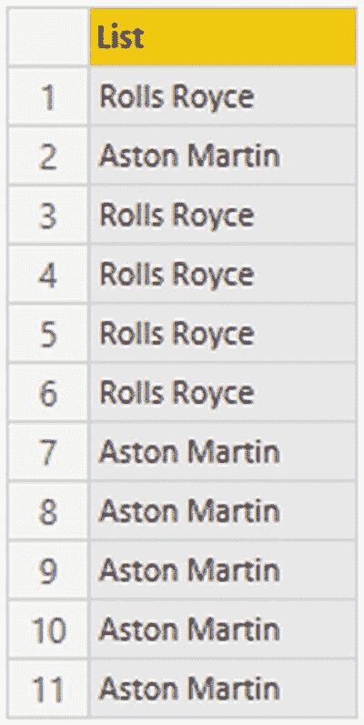

图 10-24

从“转换为列表”操作得出的列表

1. 依次点击 `获取数据` ➤ `Excel`，然后连接到 Excel 文件 `C:\PowerBiDesktopSamples\BrilliantBritishCars.xlsx`。

2. 选择 `BaseData` 工作表，然后点击 `转换数据` 以打开查询编辑器。

3. 通过单击列标题来选择要转换为列表的列。本例中我将使用 `Make` 列。

4. 在 `转换` 功能区中，单击 `转换为列表`。如图 10-24 所示，查询编辑器将显示生成的列表。

在执行更高级的数据转换过程时，此列表现在可以在某些情况下使用。

## 重用数据源

在第 2 章至第 6 章中，你已经了解了如何从各种源访问数据以跨一系列报告构建多个查询。实际情况很可能是你经常需要反复指向相同的数据源。有鉴于此，Power BI 开发团队找到了一种方法来简化你的工作。

Power BI Desktop 会记住你最近使用过的数据源，并让你在任何报告中都能快速轻松地重用它们。操作步骤如下：

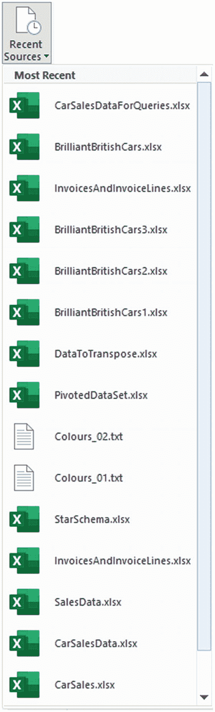

图 10-25

最近使用的源

1. 在 `开始` 功能区中，点击 `最近使用的源` 按钮。将显示最近使用的十几个数据源的列表。你可以在图 10-25 中看到这个列表。

2. 点击你想要重新连接的数据源，然后继续加载或连接数据。

如果你找不到所需的数据源，并且确定最近使用过它，则可以滚动到此列表底部并点击 `更多`。Power BI Desktop 将在 `最近使用的源` 对话框中显示完整的最近使用的源列表，如图 10-26 所示。

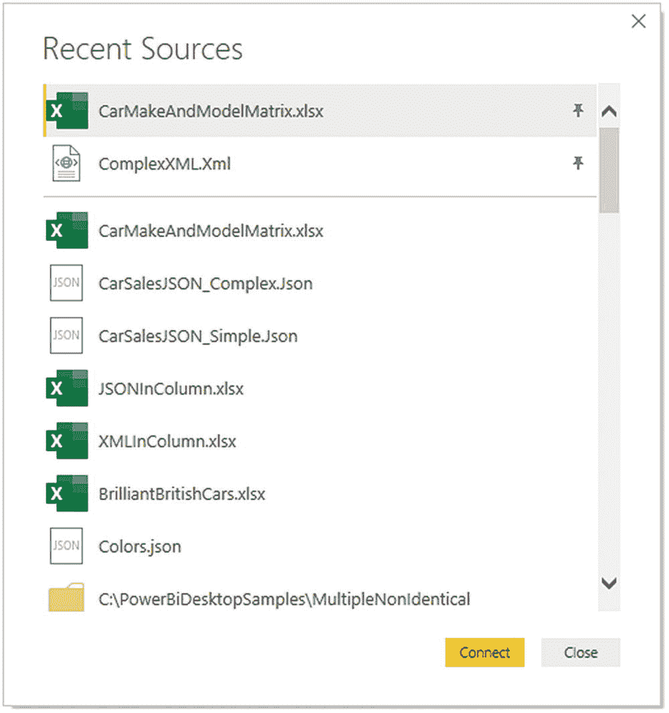

图 10-26

`最近使用的源` 对话框

如果你要连接到任何允许 DirectQuery 或实时连接的数据库或数据仓库源，将会看到一个类似图 10-27 的对话框。

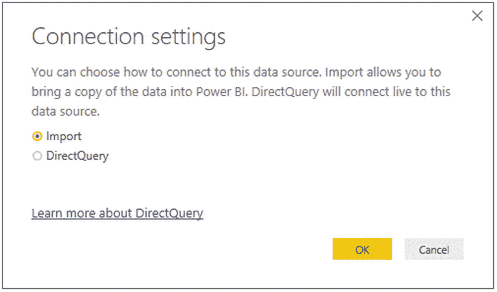

图 10-27

重用现有连接时定义连接设置

在这里，你可以决定是加载数据还是使用直接连接，这次是针对所选的数据源。

### 固定数据源

如果你仔细查看图 10-26，会看到 Excel 文件 `CarMakeAndModelMatrix.xlsx`（以及其他文件）被固定在 `最近使用的源` 对话框的顶部。这可以确保某些数据源始终在手边，随时可以重用。

要将最近使用的数据源固定到最近使用的源菜单和对话框，请执行以下操作：

1. 点击 Power BI Desktop“开始”功能区中的 `最近使用的源` 按钮。

2. 滚动到菜单底部并点击 `更多`。将出现 `最近使用的源` 对话框。

3. 将鼠标悬停在最近使用的数据源上。数据源名称的右侧将出现一个图钉图标。

4. 点击图钉图标。该数据源即被固定到 `最近使用的源` 菜单和 `最近使用的源` 对话框的顶部。数据源名称的右侧会保留一个小的图钉图标。

**注意**

要从 `最近使用的源` 菜单和 `最近使用的源` 对话框中取消固定一个数据源，你只需点击已固定数据源的图钉图标。这将取消固定，并且它会重新出现在最近使用的数据源列表中。

如果你愿意，在决定要在 `最近使用的源` 列表中显示哪些元素时，还可以应用以下选项：

- `从列表中移除`
- `清除列表中未固定的项`

### 从 Power BI Desktop 查询编辑器复制数据

Power BI Desktop 被设计为数据目的地。它本身没有任何数据导出功能。但是，你可以从 Power BI Desktop 查询编辑器手动复制数据。更准确地说，你可以复制以下任何内容：

- 查询中的数据
- 一列数据
- 单个单元格

在所有情况下，过程都是相同的：

1. 点击要复制的元素。这可以是
   - 数据网格左上角的方块
   - 列标题
   - 单个单元格

2. 右键单击并从上下文菜单中选择 `复制`。

然后你可以将剪贴板中的数据粘贴到目标应用程序中。

**注意**

此过程有些限制，因为你不能选择单元格区域。并且你必须记住，在查询编辑器中你看到的只是示例数据。但是，你可以点击 `关闭并应用`，然后切换到 `表视图`（如第 13 章所述），在那里你可以复制整个表。

## 结论

本章通过讲解如何处理基于 Excel 和文本数据源的多个文件加载，将你使用 Power BI 查询编辑器进行数据转换的知识提升到了一个新高度。随后，你学习了如何处理包含复杂嵌套结构的源文件数据——特别是 JSON 和 XML 文件。你还了解到如何从其他数据源所含的列中解析 JSON 和 XML 元素。

接着，你学习了如何重用数据源以及管理常用数据源以节省时间。最后，你学习了如何将数据转换过程中产生的样本数据复制到其他应用程序中。

至此，关于使用 Power BI 查询编辑器进行数据加载与转换的基础介绍就告一段落了。现在是时候学习更高级的技术了，你可以运用这些技术来加速、增强、管理和构建你的数据转换流程。这些方法正是接下来两章的主题。

