# 16. Power BI Desktop 中的图表

拥有能够从根本上改变公司运营方式的、具有变革意义的洞察是一回事，而能够说服同事接受您的远见则是另一回事。那么，有什么比用一个无可辩驳地证明您观点的图表，直观地、即时地向他们展示您是正确的更好的方法呢？

Power BI Desktop 基于“一图胜千言”的理念。其图表工具可让您创建清晰且有说服力的可视化对象，向受众传达的信息远比大量数字所能表达的要多得多。因此，本章将向您展示，不仅可以让数据解释您的分析，而且可以让数据看起来仿佛要跃出屏幕，这是多么简单。在接下来的几页中，您将看到一个强大的图表如何能够说服您的同事和老板，让他们相信您的想法和洞察是值得追随的。

更实际一点说，Power BI Desktop 允许您将合适的数据集制作成：

- 饼图
- 条形图
- 柱形图
- 折线图
- 面积图
- 散点图
- 气泡图
- 漏斗图
- 瀑布图
- 环形图
- 功能區圖

在本章中，我们将开始学习所有这些图表类型，然后扩展其中一些类型以创建堆叠条形图、堆叠柱形图和堆叠面积图，以及 100% 堆叠条形图、100% 堆叠柱形图和双轴图表。一旦您决定了最合适的图表类型，就可以通过添加标题、数据标签和图例（在适当的情况下）来增强您的可视化效果。在下一章中，您将学习如何设置所有这些元素的格式，以赋予您的图表应有的惊艳效果。

## 初识图表

通常，通过实践而非空谈，更容易体会到 Power BI Desktop 的简洁性和强大功能。因此，我建议直接开始创建第一个图表。在本节中，我们将仅介绍“入门级”图表，它们都有一个共同点——都基于单列数据值和单列描述性元素。数据将包括：

- 客户列表
- 特定年份的汽车销量

那么，让我们开始绘制图表吧！在本章中，您将使用 Apress 网站上可供下载的 `C:\PowerBiDesktopSamples\CarSalesDataForReports.pbix` Power BI Desktop 文件。

### 创建第一个图表

任何 Power BI Desktop 图表都始于一个数据集。因此，让我向您介绍图表的世界，展示如何通过几次点击创建一个条形图；以下说明了如何开始：

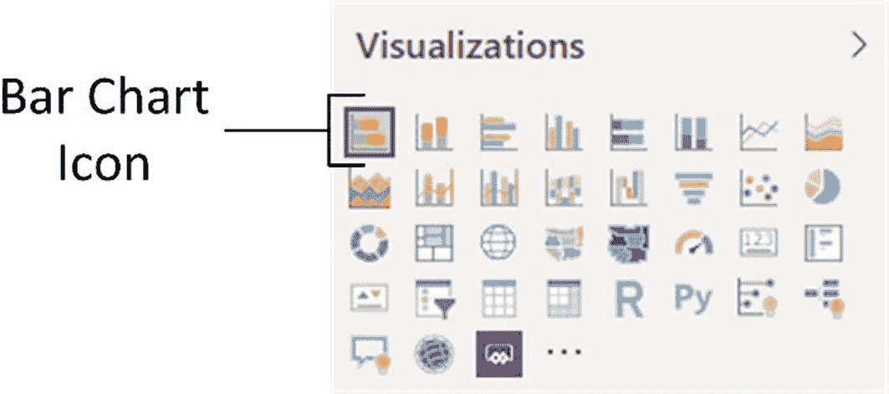
图 16-1 — `可视化`窗格中的`条形图`图标

1.  从可下载示例中打开文件 `C:\PowerBiDesktopSamples\CarSalesDataForReports.pbix`。
2.  单击`可视化`窗格左上角的`堆叠条形图`图标。此图标如图 16-1 所示。仪表板画布上将出现一个空的条形图可视化对象。

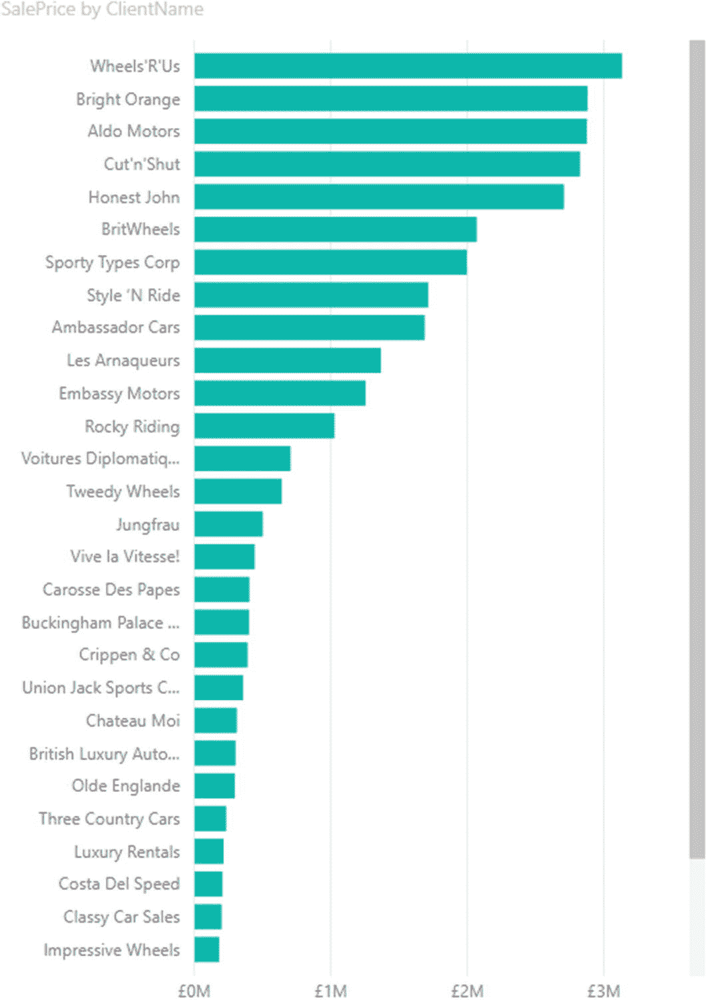
图 16-2 — 调整大小后的条形图

1.  保持选中空的条形图可视化对象，然后展开`字段`列表中的`Clients`表。
2.  选中 `ClientName` 字段左侧的复选框。
3.  保持选中此新建的条形图可视化对象，然后展开`字段`列表中的 `InvoiceLines` 表。
4.  单击 `SalePrice` 字段左侧的复选框。这会将每个客户的累计销售额添加到图表中。
5.  调整图表大小（建议加宽并增加高度），直到坐标轴标签清晰可见，如图 16-2 所示。

创建一个简单的入门级图表就是这么简单。这个过程可能只需要几秒钟，一旦完成，就可以向您的受众展示，或者根据您的需求进行改造。

尽管如此，还是需要做一些说明来阐明在 Power BI Desktop 中创建图表的基本知识：

- 创建图表时，您可以使用第 14 章和第 15 章中描述的任何技术向可视化对象添加字段。您可以将字段拖入`可视化`窗格的字段框，或者如果愿意，也可以直接拖入可视化对象中。
- 当仅使用单个数据集时，您可以选择“聚类”或“堆叠”作为条形图或柱形图的图表类型；无论哪种情况，结果都是相同的。随着我们深入学习，您会发现当图表基于多个数据字段时，情况就不同了。
- Power BI Desktop 会在图表的左上角添加一个标题，说明图表所基于的数据。您可以在图 16-2 中看到一个示例。
- 创建图表仅仅是第一步。您还可以做更多的事情来增强图表并突出其所能带来的洞察。所有这些都将在本章以及下一章中进一步介绍。

### 将表格转换为图表

另一种创建图表的方法是先创建一个表格（例如，通过将数据字段拖拽到 Power BI Desktop 画布上，而不事先点击图表图标）。然后选中该表格，并点击 `Visualizations`（可视化）窗格中的图表图标，即可将表格转换为图表。

然而，如果你先创建了一个表格，然后将其转换为图表（通过选中表格并点击`堆积柱形图`图标），`Visualizations`（可视化）窗格的字段井会发生变化，以反映创建或修改图表时可用的选项。如果你选中刚刚创建的图表，你会看到 `ClientName`（客户名称）字段被放置在了`轴`框中，而 `SalePrice`（销售价格）字段被放置在了`值`框中。如果可视化对象是表格，则这两个框都不存在。如图 16-3 所示。

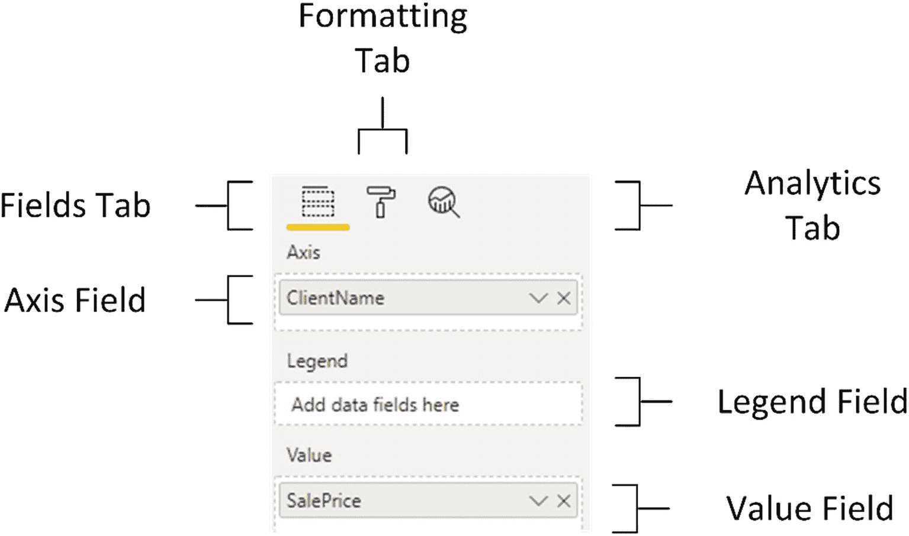
图 16-3 条形图的字段列表

### 删除图表

删除图表就如同删除表格、矩阵或卡片一样简单。你只需：

1.  点击图表内部。
2.  按下`Delete`键。

如果你从（选中图表时的）`Visualizations`（可视化）窗格字段井的`布局`部分移除了所有字段，那么你也会删除该图表。

### 基本图表修改

现在你有了一个初始图表。但是，假设你想更改图表所基于的字段。那么，要更改轴元素（客户名称和所表示的值），你只需：

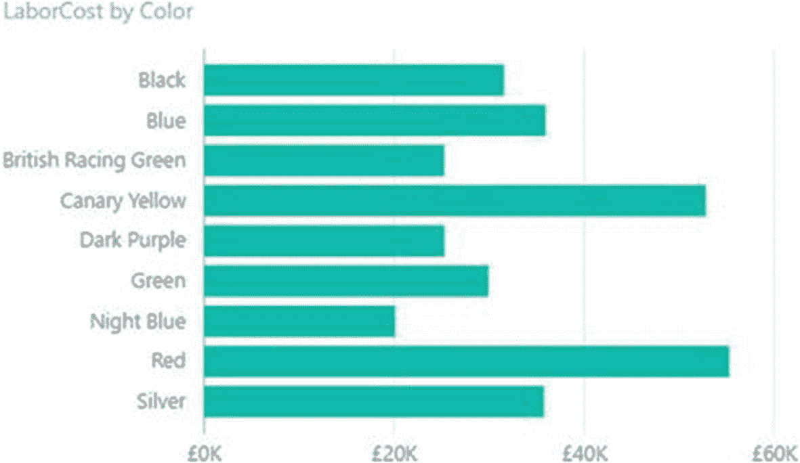
图 16-4 一个带有相应`布局`部分的简单条形图

1.  点击你之前创建的条形图。暂时避免点击图表中的任何条形。
2.  在`Visualizations`（可视化）窗格的字段井中，点击`值`井中 `SalePrice`（销售价格）右侧的小叉号（或点击 `SalePrice`（销售价格）的弹出菜单，选择`移除字段`）。条形将从图表中消失。
3.  将`字段`列表中`库存`表的 `LaborCost`（劳动力成本）字段拖拽到`值`井中。
4.  在`Visualizations`（可视化）窗格的字段井中，点击`轴`框中 `ClientName`（客户名称）的弹出菜单，选择`移除字段`。客户名称将从图表中消失，并出现一个单独的条形。
5.  在`字段`列表中，展开`颜色`表，并将`颜色`表中的 `Color`（颜色）字段拖拽到`轴`框中。颜色列表将替换轴上的客户列表，一系列条形将替换单个条形。参见图 16-4 查看差异。

就是这样。你无需重建就完全改变了图表。Power BI Desktop 已更新图表中的数据和图表标题，以反映你的更改。

## 基本图表类型

当处理单个值集时，你可能会使用以下六种核心图表类型来表示数据：

*   `条形图`
*   `柱形图`
*   `折线图`
*   `饼图`
*   `圆环图`
*   `漏斗图`

让我们看看如何使用当前的数据集（你之前应用的颜色和劳动力成本）来尝试这些图表类型。

## 柱形图

`柱形图`实质上就是`条形图`，只是条形是垂直的而非水平的。因此，请执行以下操作将你的`条形图`切换为`柱形图`：

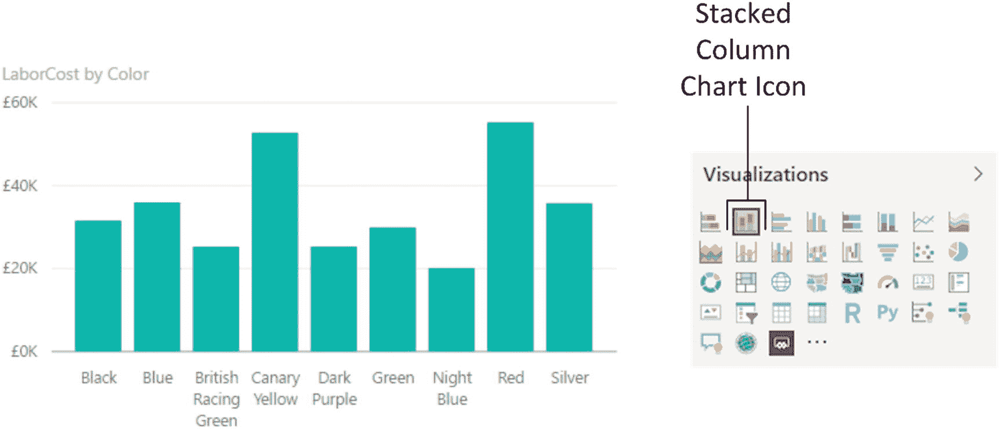
图 16-5 一个基础的`柱形图`

1.  点击你之前创建并修改过的`条形图`（即图 16-4 中所示的那个）。避免点击图表中的任何条形。
2.  在`Visualizations`（可视化）窗格中，点击`堆积柱形图`图标。
3.  根据需要调整图表大小。你的图表应如图 16-5 所示。

## 折线图

`折线图`将数据显示为一组由线条连接的点。执行以下操作将你的`柱形图`切换为`折线图`：

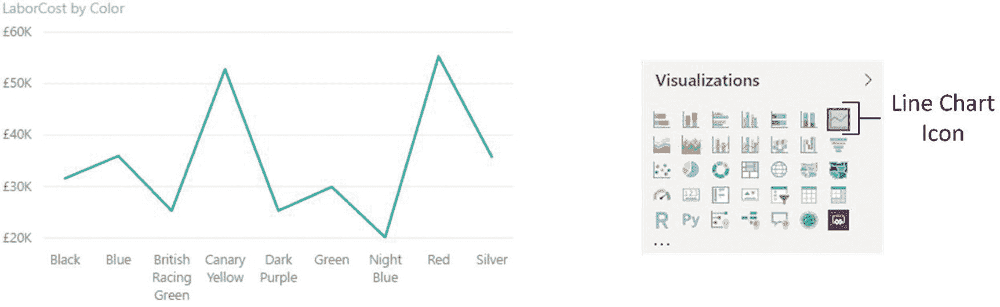
图 16-6 一个简单的`折线图`

1.  点击你之前创建的`柱形图`。暂时避免点击图表中的任何柱形。
2.  在`Visualizations`（可视化）窗格中，点击`折线图`图标。你的图表应如图 16-6 所示。

## 饼图

`饼图`在展示单一系列有限数据集时效果极佳，就像本例中的情况。要将可视化对象切换为`饼图`：

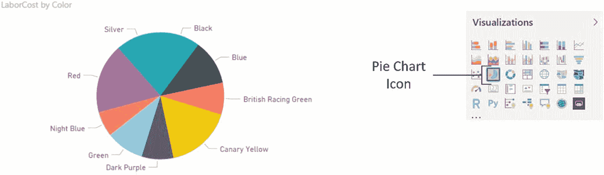

图 16-7

一个基础的饼图

1.  点击你之前创建的折线图。暂时避免点击图表中的任何线条。

2.  在`Visualizations`（可视化）窗格中，点击`饼图`图标。折线图将变为饼图。

3.  如有必要，调整饼图大小以正确显示所有颜色的文本。你的图表应如图 16-7 所示。你会注意到，饼图的`布局`部分略有变化，`轴`框已被`图例`框取代。

如果饼图同时包含正值和负值，其显示会失真。Power BI Desktop 不会显示负值。如果你的数据集包含正负数据混合，那么 Power BI Desktop 会在图表上方显示一个警告：“值过多。未显示所有数据。”这几乎总是意味着饼图包含正和负值，且负值未显示。这同样适用于圆环图。负值也可能使漏斗图看起来有点怪异。如果你想亲自验证这一点，请尝试创建一个包含制造商和毛利润的表格。你会看到该表格包含七行，但相应的饼图或圆环图只显示六个扇区。这是因为毛利润为负值的制造商（TVR）未出现在饼图中。

在实践中，当数据包含负值时，你可能更倾向于不使用饼图或圆环图，或者你可能希望将正负值分离成两个数据集，并使用筛选器显示两个图表（这在第 20 章中解释）。

#### 注意

在图表中调整大小和字体以容纳所有元素、轴和/或图例标签可能比较棘手。一个有用的技巧是在源数据中准备“缩写”数据字段，就像 `Date`（日期）表中的 `QuarterAbbr`（季度缩写）字段那样，包含 `Q1`、`Q2` 等，而不是 `Quarter 1`、`Quarter 2` 等，以节省图表空间。

## 基本图表调整

我希望你会同意，在 Power BI Desktop 中创建图表极其简单。然而，制作一个富有说服力的可视化过程，并不会在你获取数据集并将其显示为图表后就此停止。至少，你需要对新图表进行以下微调：

*   调整图表大小
*   重新定位图表
*   对图表中的元素进行排序
*   更改图表中的字体大小

这些任务都毫不困难。实际上，当你掌握了适用技巧后，只需几秒钟就能将你的初始图表转变为一个引人注目的可视化论述。

### 调整图表大小

图表与 Power BI Desktop 仪表板画布上的其他视觉对象一样，可以根据需要调整大小。下面说明了如何调整图表大小：

1.  单击图表内部（但不要单击任何条形、柱形、折线或饼图扇区）。

2.  将鼠标指针悬停在图表角落或边缘中间出现的八个控点之一上，该控点可用于调整图表。指针会变为双向箭头。

3.  拖动鼠标指针以调整图表大小。

**注意：** 请记住，边缘中间的控点仅允许您在水平或垂直方向上调整图表大小，而角落的控点则允许您在水平和垂直两个方向上调整。

调整图表大小可能会对坐标轴上显示的文本产生显著影响。Power BI Desktop 始终努力保持坐标轴文本的可用空间与整个图表大小成比例。

对于柱形图、折线图和条形图，这可能导致文本被截断，并用省略号（三个点）表示并非所有文本都可见。对于柱形图和折线图，文本甚至可能倾斜 45 度，或者旋转为垂直显示。

如果您将条形图的高度（或柱形图或折线图的宽度）减小到某个阈值以下，Power BI Desktop 将停止尝试在非数值轴上显示所有元素。相反，它只会显示少数元素，并添加一个滚动条，让您可以滚动浏览其余数据。此外，如果轴标签无法完整显示，它们将被截断（并添加省略号）。您可以在图 16-8 中看到条形图的这些效果示例。

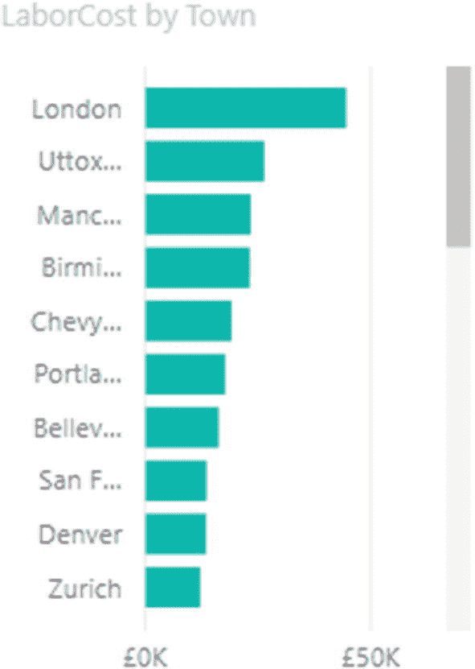

*图 16-8* — 带有可见滚动条的图表

这意味着您可能需要微调图表的大小和高宽比，直到获得最佳效果。如果您急于调整到位，我建议使用右下角的控点来调整图表大小，因为向上、向下、向左和向右拖动该控点可以快速向您展示可用的显示选项。

### 重新定位图表

您可以按如下方式将图表移动到 Power BI Desktop 报表中的任意位置：

1.  将鼠标指针放在图表的边框上。
2.  拖动鼠标指针。

### 对图表元素进行排序

有时，通过更改图表中数据的显示顺序，您可以真正突出数据的某个要点。到目前为止，您可能已经注意到，在创建图表时，坐标轴上的元素（对于条形图、柱形图、折线图或饼图都是如此）默认按字母顺序排列。如果您想确认这一点，只需查看图 16-5 到 16-8 即可。

现在，例如，假设您想展示车辆颜色如何影响毛利率。在这种情况下，您希望按从高到低的顺序对图表中的数据进行排序，以便清楚地了解数据是下降还是上升。以下步骤说明了如何执行此操作：

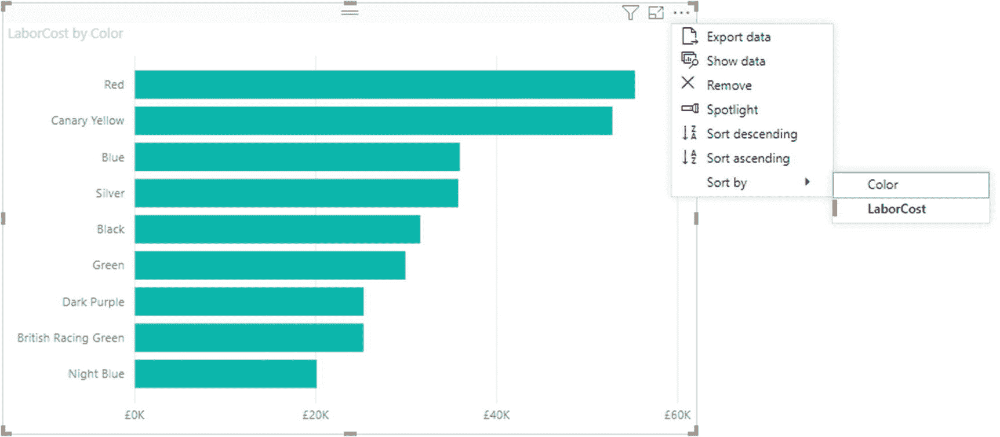

*图 16-9* — 使用图表中的弹出菜单对数据进行排序

1.  如前所述（并在图 16-4 中显示），选择 `Color` 和 `LaborCost` 的条形图类型。
2.  将鼠标指针悬停在图表上。您会看到图表边框和选项按钮（右上角的省略号）出现。
3.  单击省略号以显示图表菜单，然后单击“排序依据”右侧的 V 形图标，选择适当的字段来对数据进行排序（在此示例中为 `LaborCost`）。
4.  单击“降序排序”。如图 16-9 所示，此时列按字母逆序排序。

如您所见，当按数值排序时，初始排序是降序。现在，假设您想按升序查看按颜色分类的销售额。您只需重复刚才的操作，图表就会重新排序。只不过这次是按升序排序。同样，当您首次对文本元素进行排序时，图表按升序排序，而第二次排序时则按降序排序。

关于饼图排序，我还想补充一点。当您按数值字段对饼图进行排序时，饼图会从图表顶部开始按顺时针方向排序。因此，如果您按 `LaborCost` 降序对颜色进行排序，那么销量最高的颜色位于饼图顶部（12 点钟方向），销量第二高的颜色紧挨其右侧（例如，2 点钟方向），依此类推。图 16-10 显示了一个示例。

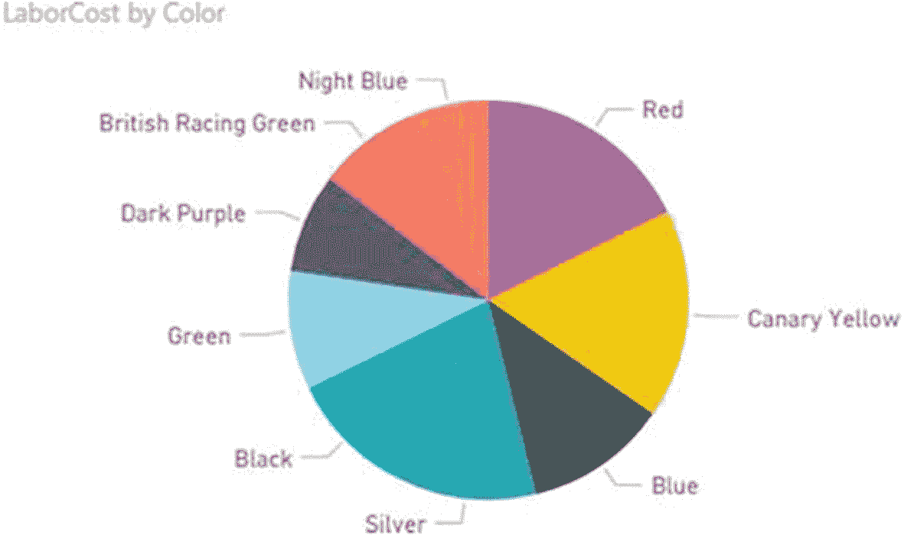

*图 16-10* — 在饼图中对数据进行排序

## 环形图

环形图本质上是饼图的一种变体。然而，与曝光度过高的“老大哥”饼图相比，它们能在呈现方式上带来令人耳目一新的变化。幸运的是，它们同样易于创建。在此示例中，您将了解如何可视化每辆已购车辆品牌所产生的零部件成本。为了改变方法，在此示例中，您将首先创建一个表，然后将其转换为环形图：

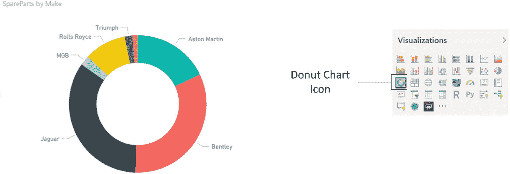

*图 16-11* — 环形图

1.  继续使用（或打开）文件 `C:\PowerBiDesktopSamples\CarSalesDataForReports.pbix`。
2.  确保未选中任何当前视觉对象。
3.  展开“字段”列表中的“库存”表。
4.  选中“品牌”字段左侧的框。一个包含已购品牌列表的表格将出现在仪表板画布上。
5.  保持选中此新表格，并单击“库存”表中“备件”字段左侧的复选框。这会将每个品牌的备件累计成本添加到表中。
6.  单击“可视化”窗格中的“环形图”图标。这将把表格转换为环形图。
7.  如有必要，调整图表大小以清晰显示品牌名称，如图 16-11 所示。

## 漏斗图

在比较单个系列图表的相对值时，漏斗图是绝佳的选择。既然您现在已精通使用 Power BI Desktop 创建图表的技巧，那么设计一个显示按颜色分类的零部件成本的漏斗图对您来说应该不成问题。

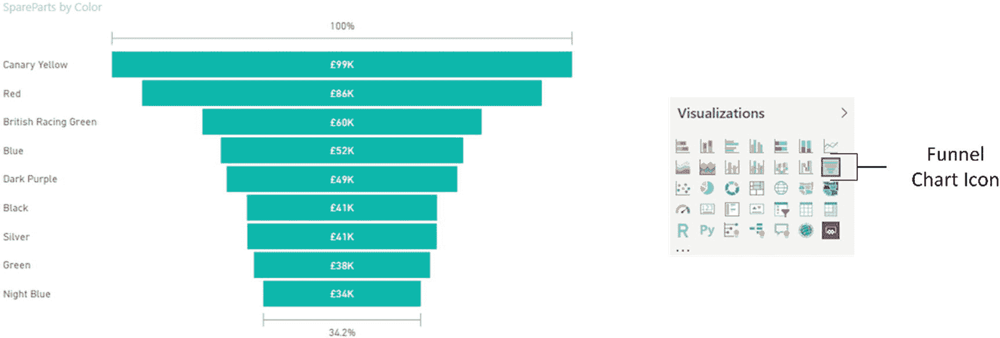

*图 16-12* — 漏斗图

1.  继续使用文件 `C:\PowerBiDesktopSamples\CarSalesDataForReports.pbix`。
2.  展开“字段”列表中的“颜色”表。
3.  将“颜色”字段拖到仪表板画布的空白区域。一个包含车辆颜色列表的表格将出现。
4.  保持选中此新表格，并单击“库存”表中“备件”字段左侧的复选框。这会将每个品牌的零部件累计成本添加到表中。
5.  单击“可视化”窗格中的“漏斗图”图标。这将把表格转换为漏斗图。漏斗图会将备件成本值最高的颜色显示在视觉对象的顶部。
6.  如有必要，调整图表大小以清晰显示颜色名称，并使所有颜色的相对权重更清晰易懂，如图 16-12 所示。

## 图表中的多数据值

本章到目前为止，我们看到的都是显示单一数值的简单图表。遗憾的是，现实情况很少如此简单，因此是时候转向稍微复杂但可能更贴近实际的场景了——你需要比较和对照多个数据元素。

在这组示例中，我将假设我们需要深入分析迄今为止汽车销售中以下间接成本要素：

- 零件
- 人工

因此，为了初步比较这些间接成本，我们先从一个簇状柱形图开始：

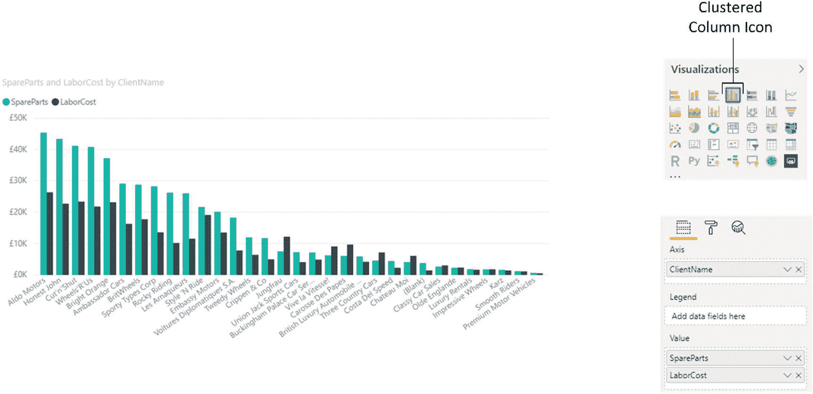

**图 16-13** – 图表中的多数据值——一个显示“布局”部分的簇状柱形图

1. 打开（或继续使用）可下载示例中的文件 `C:\PowerBiDesktopSamples\CarSalesDataForReports.pbix`。

2. 从一个全新的 Power BI Desktop 报表开始，创建一个显示以下字段的表：
   - `ClientName`（来自 `Clients` 表）
   - `SpareParts`（来自 `Stock` 表）
   - `LaborCost`（来自 `Stock` 表）

3. 保持选中该表，点击可视化窗格中的簇状柱形图图标。

4. 调整图表大小，使其清晰易懂，如图 16-13 所示。（我也在图中包含了可视化窗格中的字段，方便您查看。）

您会注意到，包含多个数据集的图表默认会显示图例，并且自动生成的图表标题现在显示为“按 `ClientName` 划分的 `SpareParts` 和 `LaborCost`”。同时，图表会自动按（添加的第一个数据系列中的）最高值从左侧开始排序。

相同的数据集也可以作为其他能有效显示多数据值的图表的基础：

- 堆叠柱形图
- 簇状柱形图和堆叠柱形图
- 折线图
- 面积图
- 堆叠面积图

由于柱形图本质上是旋转了 90 度的条形图，我就不再展示示例了。但在图 16-14、16-15、16-16 和 16-17 中，您将分别看到堆叠柱形图、折线图、面积图和堆叠面积图的示例——它们都基于相同的数据创建。您还会发现，在创建这些类型的可视化时，可视化窗格字段井中的“布局”部分对于所有这些图表都是相同的。

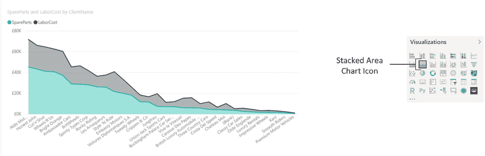

**图 16-17** – 基于多个数值的堆叠面积图

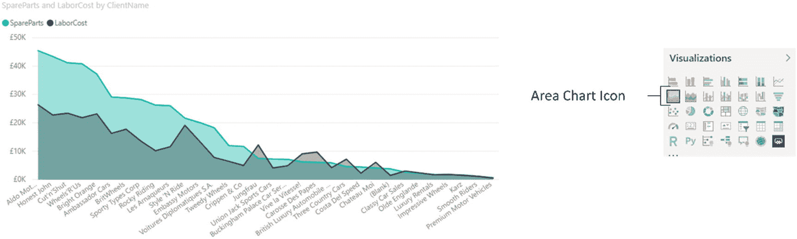

**图 16-16** – 显示多个数值的面积图

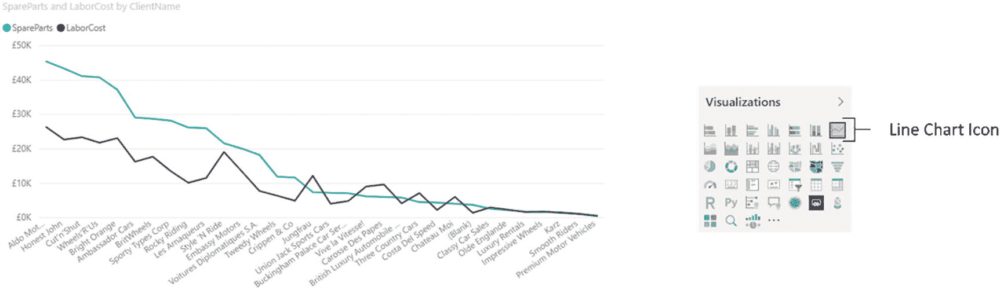

**图 16-15** – 显示多个数值的折线图

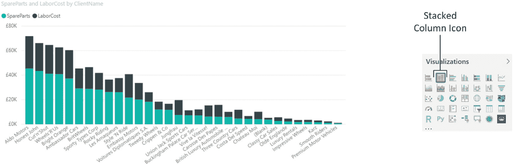

**图 16-14** – 一个简单的堆叠柱形图

这四种图表都以不同的方式展示了相同的数据。了解这一点后，您就可以选择最能传达信息、并将读者注意力吸引到您试图强调的重点上的图表类型。

如果您不确定哪种图表最能传达您的信息，那就逐个尝试所有类型。只需单击视觉对象库中的相关图标，即可将图表转换为另一种图表类型。实际上，有时差异可能极其细微。例如，面积图和堆叠面积图的本质区别在于 X（垂直）轴。在图 16-17 中，这是一个累计值。相比之下，图 16-16 直接比较了两个数值，数值较高的系列位于数值较低的系列之后。

> **注意：** 如果您愿意，这些图表类型中的任何一种都可以用来显示单一数据系列。这完全取决于您使用图表所呈现的效果以及见解的清晰度。

### 100% 堆叠柱形图和条形图

比较多个数据集的一种方法是将每个单独的数据系列表示为总量的百分比。Power BI Desktop 包含了两种能够“开箱即用”实现此功能的图表类型。它们是 100% 堆叠柱形图和 100% 堆叠条形图。

既然您现在知道如何创建使用多个数据系列的图表，我就不详细解释如何生成这两种图表类型了；您只需从可视化窗格中选择正确的图表图标即可。因此，我建议您看看图 16-18 和图 16-19，它们分别展示了使用与创建图 16-14 中簇状柱形图相同的数据生成的示例。

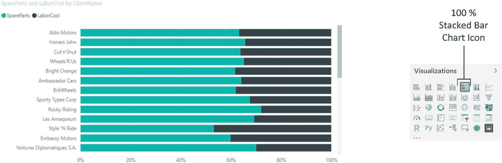

**图 16-19** – 一个 100% 堆叠条形图

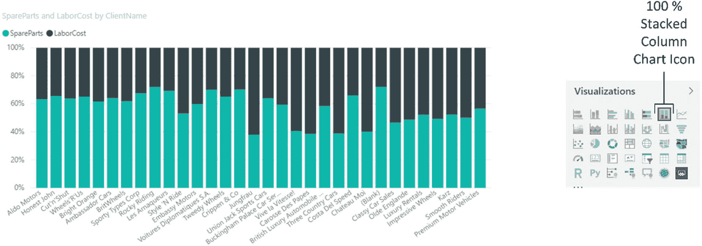

**图 16-18** – 一个 100% 堆叠柱形图

## 散点图

散点图是将数据值绘制在两条数值轴上的图表，因此根据定义，你需要两组数值数据才能创建散点图。为了理解这些图表的用途，让我们想象一下，你想查看所有已售汽车品牌和型号的销售额与利润率。希望这能让你看清，真正从卖车中赚钱的究竟是哪些车型。以下是如何操作的方法：

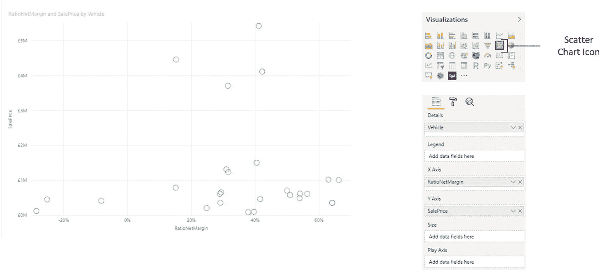

**图 16-20** – 一张散点图

1. 使用文件 `C:\PowerBiDesktopSamples\CarSalesDataForReports.pbix`，删除所有现有的可视化对象。

2. 按此顺序创建一个包含以下字段的表：
   1. `Vehicle`（来自 `Stock` 表）
   2. `RatioNetMargin`（来自 `InvoiceLines` 表）
   3. `SalePrice`（来自 `InvoiceLines` 表）

3. 单击可视化窗格中的散点图图标，将该表转换为散点图。Power BI Desktop 将显示一个如图 16-20 所示的散点图。根据你的喜好调整图表大小。

如果你查看可视化窗格的“字段”区域（也显示在图 16-20 中），你会看到 Power BI Desktop 已按如下方式使用了你选择的字段：

- `Vehicle`：放置在“详细信息”框中。
- `RatioNetMargin`：放置在“X 轴”框中。这是垂直轴。
- `SalePrice`：放置在“Y 轴”框中。这是水平轴。

如果将鼠标指针悬停在散点图中的某个点上，你将看到该特定汽车型号的数据。

> **注意：** 根据定义，散点图需要 X 轴和 Y 轴都具有数值。因此，如果你将非数值添加到“X 值”或“Y 值”框中，Power BI Desktop 会将数据转换为计数聚合。

我们通过首先将所有必需的字段添加到初始表中来制作此图表。我们还确保按正确的顺序添加它们，以便散点图首次就能正确显示。在交互式数据可视化的实际应用中，情况可能不会如此顺利，因此很高兴知道 Power BI Desktop 非常宽容。而且，如果你愿意，它允许你逐步构建散点图（就像任何其他图表一样）。在实践中，这意味着你可以从一个仅包含散点图最低要求三个字段中的两个字段的表开始，将该表转换为散点图，然后添加剩余的数据字段。Power BI Desktop 始终将数值或时间字段分配给 X 和 Y 轴（按照它们在“字段”框中出现的顺序），并将第一个描述性字段放入“详细信息”框中。

创建散点图后，你可以随意交换字段，并用数据表中其他字段替换现有字段。

## 气泡图

散点图的一种变体是气泡图。这是我个人最喜欢的图表类型之一，当然，你不能过度使用它，否则会削弱其效力。基本上，气泡图是包含第三组数据的散点图。因此，散点图显示两组数据（一个在 X 轴上，一个在 Y 轴上），而气泡图允许你添加第三部分信息，该信息成为点的*大小*。因此，每个点都变成了一个气泡。

理解气泡图的最佳方法是创建一个。因此，我们假设你想在一个图表中查看所有已售汽车品牌的以下数据：

- 总销售额
- 净利润率
- 毛利润

这解释了气泡图如何为你做到这一点：

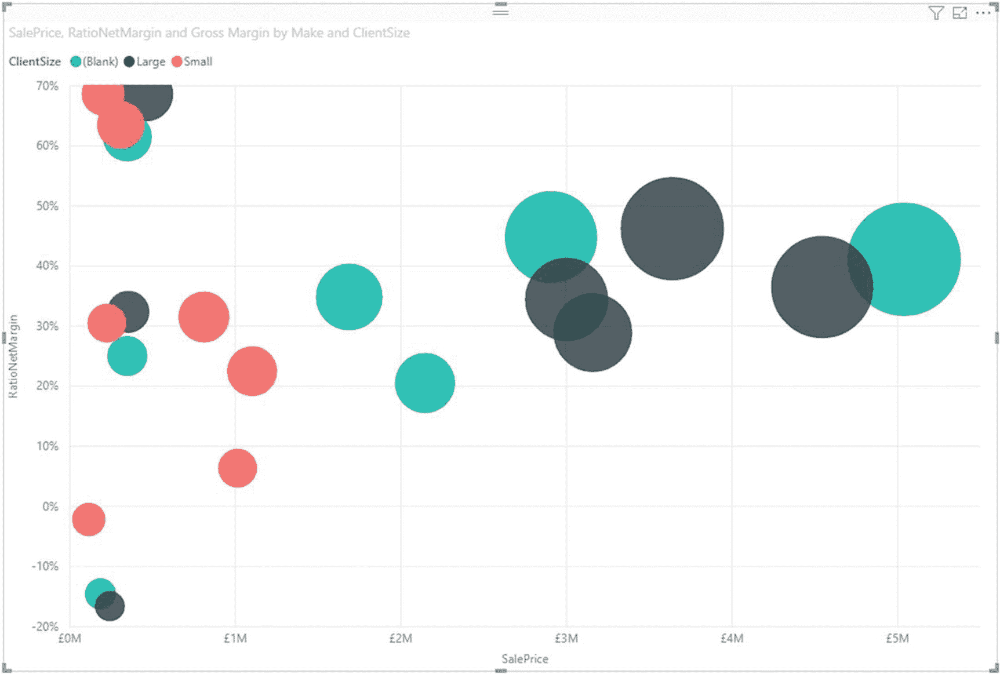

**图 16-21** – 一个初始气泡图

1. 使用文件 `C:\PowerBiDesktopSamples\CarSalesDataForReports.pbix`，删除所有现有的可视化对象。

2. 按此顺序创建一个包含来自 `SalesData` 表的以下字段的表：

## 气泡图
接下来，你需要选择创建气泡图所需的字段：

1.  `Make`（来自 `Stock` 表）
2.  `SalePrice`（来自 `InvoiceLines` 表）
3.  `RatioNetMargin`（来自 `InvoiceLines` 表）
4.  `Gross Margin`（来自 `InvoiceLines` 表）

3.  单击散点图图标，将该表转换为散点图。是的，气泡图就是散点图，只是添加了一个新的调整。
4.  将 `ClientSize` 字段从 `Clients` 表拖到可视化窗格的“图例”框中。Power BI Desktop 将显示一个如图 16-21 所示的气泡图。
5.  如果需要，调整图表大小。

如果你查看可视化窗格中的字段框（如图 16-22 所示），你会看到 Power BI Desktop 已按如下方式使用了你选择的字段。

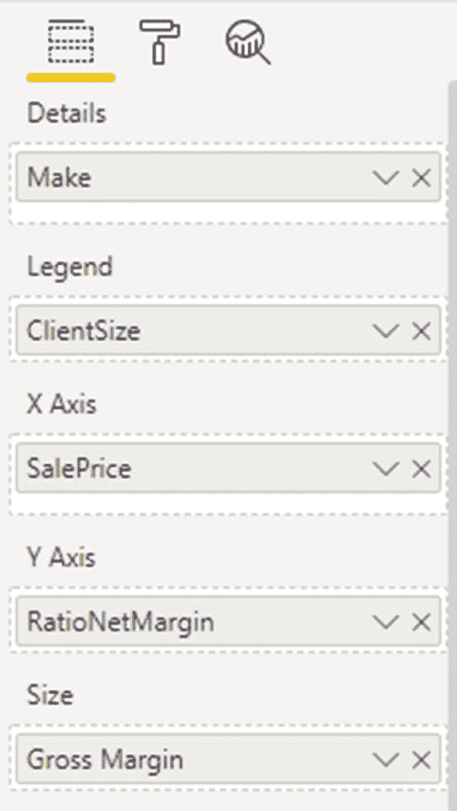

图 16-22 气泡图可视化窗格的字段框

-   `Make`：放置在“详细信息”框中。这定义了核心气泡。
-   `ClientSize`：添加到“图例”框中。这会为每个明细元素（品牌）和图例项（客户规模）的组合创建气泡。
-   `SalePrice`：放置在“X 轴”框中。这是垂直轴。
-   `RatioNetMargin`：放置在“Y 轴”框中。这是水平轴。每个气泡都位于垂直轴和水平轴数值的交点处。
-   `Gross Margin`：放置在“大小”框中。这定义了点的大小，这些点因此变成了不同大小的气泡。

将鼠标指针悬停在气泡图中的某个点上。你将看到放置在字段列表“布局”部分中每个品牌的所有数据，包括 `Gross Margin`。

## 瀑布图
我现在想介绍的是 Power BI Desktop 提供的一种更具原创性的图表类型——瀑布图。这种图表类型非常适合显示最终数值的组成部分；在此示例中，它用于显示各种已售品牌如何构成总销售额。

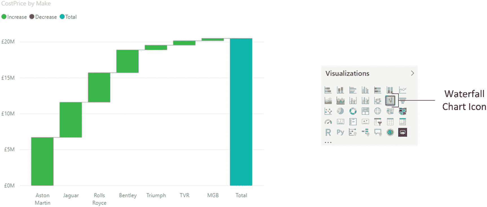

图 16-23 一张瀑布图

1.  打开文件 `C:\PowerBiDesktopSamples\CarSalesDataForReports.pbix`，并删除所有现有的可视化对象。
2.  单击瀑布图图标。你可以在图 16-23 中看到它。一个空的瀑布图将出现在仪表板画布上。
3.  展开 `Stock` 表并勾选以下字段：
    1.  `Make`
    2.  `CostPrice`
4.  根据你的审美要求调整图表大小。它应该看起来像图 16-23。

在分析一个整体的构成要素时，瀑布图非常有用。例如，你可以尝试用它来分解所有成本要素。值得注意的是，如果图表中有任何负值，它们将以与正值不同的颜色显示，并且会不可避免地减少右侧总计柱的值。

## 带状图
Power BI Desktop 提供的图表选项中新增了一种带状图。带状图几乎总是以时间元素作为 X 轴，旨在展示随时间变化的趋势。更具体地说，它们总是将最高值置于图表的最上部带状区域。

这可能最好通过一个例子来理解。因此，我建议你尝试以下操作。

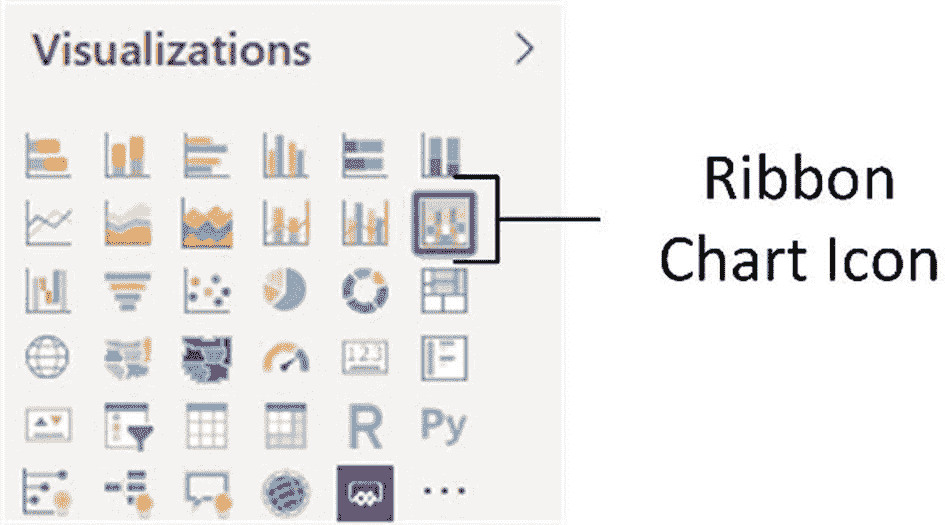

图 16-24 – 带状图图标

1.  在“可视化”窗格中单击“带状图”图标（如图 16-24 所示）。

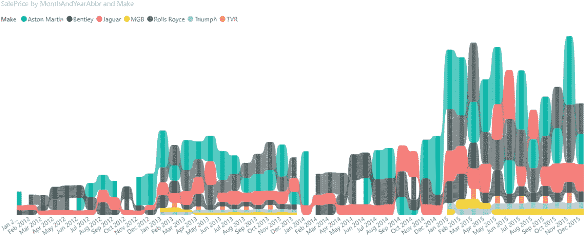

图 16-25 – 一个带状图

2.  在“字段”列表中，单击以下字段：
    -   `MonthAndYear`（在 `DateDimension` 表中）作为“轴”
    -   `SalePrice`（在 `InvoiceLines` 表中）作为“图例”
    -   `Make`（在 `Stock` 表中）作为“值”
3.  调整图表大小，使其看起来像图 16-25 所示。

正如你所见，带状图展示了不同品牌汽车销售量随时间变化的起伏。实际上——虽然这可能提前涉及第 17 章的内容——我建议你单击图表图例中的一个品牌。这将高亮显示该品牌，并展示其随时间的变化趋势。

## 双轴图
在结束图表类型介绍之前，让我们来看两种结合了你本章前面学过的两种基本图表类型的图表：
-   “折线图和簇状柱形图”
-   “折线图和堆积柱形图”

我们逐一讨论。

### 折线图和簇状柱形图
假设 Brilliant British Cars 的首席执行官决定对车辆购买情况展开分析。他想找出可能影响购买的、令人感兴趣的相关性，以最大化利润。因此，为了满足他的要求（或者可能是为了迎合他），你决定转而查看间接成本和里程数，看看是否存在任何相关性。

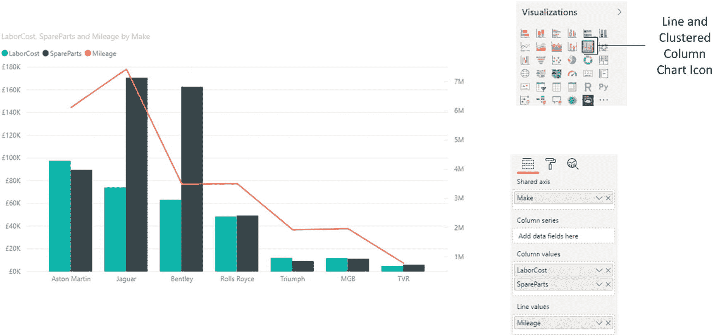

图 16-26 – 一个折线图和簇状柱形图

1.  打开文件 `C:\PowerBiDesktopSamples\CarSalesDataForReports.pbix`，并删除任何现有的视觉对象。
2.  单击“折线图和簇状柱形图”图标。仪表板画布上会出现一个空的折线图和簇状柱形图。
3.  展开 `Stock` 表并勾选以下字段：
    -   `Make`（将添加到“共享轴”框）
    -   `LaborCost`（将添加到“列值”框）
    -   `SpareParts`（将添加到“列值”框）
4.  同样从 `Stock` 表中，将 `Mileage` 字段拖入“可视化”窗格字段槽中的“行值”框。
5.  根据你的审美需求调整图表大小。它应该看起来像图 16-26 所示。

正如你所见，此图表结合了使用左侧轴显示人工和零件成本的簇状柱形图，以及使用右侧轴显示里程数的折线图。这两个图表共享 X（或水平）轴。

此外，这种分析可以让人立刻明白，有一种品牌即使里程数低也未必意味着维修成本低。因此，老板应该会很高兴你发现了这种意想不到的相关性。

### 折线图和堆积柱形图
双轴图的一个关键优势在于，两个 Y 轴的刻度可以相差很大。因此，例如，当你想要查看零件和人工成本与购买成本（其数量级远高于其他两种成本）之间的关系时，使用折线图和堆积柱形图可以非常有助于更清晰地查看数据。

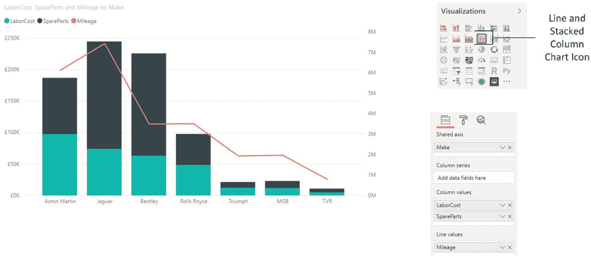

图 16-27 – 一个折线图和堆积柱形图

1.  打开文件 `C:\PowerBiDesktopSamples\CarSalesDataForReports.pbix`，并删除任何现有的可视化对象。
2.  展开 `Stock` 表并勾选以下字段，以在仪表板画布上显示一个表格：
    -   `Make`
    -   `LaborCost`
    -   `SpareParts`
3.  单击“折线图和堆积柱形图”图标。该表格将转换为一个折线图和堆积柱形图。
4.  同样从 `Stock` 表中，将 `CostPrice` 字段拖入“可视化”窗格的字段槽。将其放置在“行值”框中。
5.  根据你的审美需求调整图表大小。它应该看起来像图 16-27 所示。

通过这种方式，你可以比较数值，如果单一图表类型会导致某个值（本例中的成本价）使其他值相形见绌，以至于无法读取。

## 数据详情
在结束图表类型介绍之前，我只想补充几点说明。

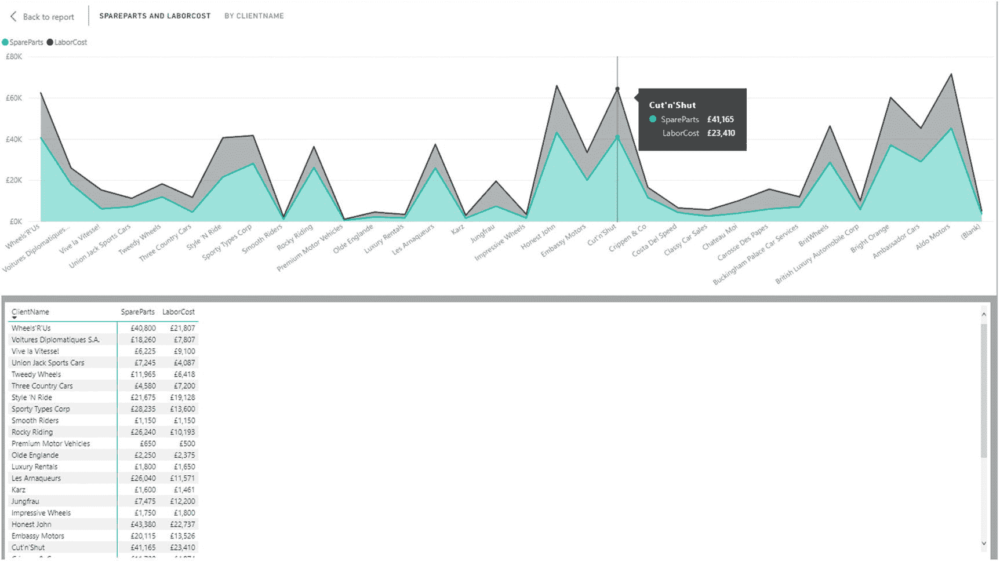

图 16-28 – 显示图表的弹出数据

-   只需将鼠标指针悬停在条形（或柱形、折线、数据点或饼图扇区）上，你始终可以精确查看条形、柱形、折线、数据点或饼图扇区背后的具体数字。无论图表是正常大小还是已弹出覆盖 Power BI Desktop 报表区域，此功能均有效。
-   无论你对图表做了多少修改，如果需要，你始终可以将其切换回表格。只需选中图表，然后从“设计”功能区中的“表格”按钮选择所需的表格类型即可。如果这样做，你会看到该表格会尝试模仿你应用于图表的设计调整，保持与图表相同的字体大小以及表格与图表相同的大小。如果你随后切换回图表，你会发现你应用的大多数设计选项仍然存在——当然，除非你在切换回图表可视化对象之前对表格做了任何更改。

## 深入挖掘与展开图表数据层级

你始终可以将为图表提供支持的原始数据并排显示在图表下方，就像使用基于文本的视觉对象一样。只需单击图表右上角的省略号，然后选择“显示数据”以显示源数据。你可以在图 16-28 中看到一个示例（你还可以看到数据点如何在折线图、面积图和堆积面积图中显示）。

要切换回仪表板画布，请单击图表左上角的“返回报表”。

Power BI Desktop 图表的一个极其有用的特性是，你可以将其用作交互式演示工具。要发现数据所揭示的信息并将其传达给受众，最有效的方法之一就是深入挖掘或展开数据层级。所有标准的 Power BI 图表类型都允许你实现这一点。

`向下钻取`适用于所有标准图表类型。这意味着你可以向下钻取到：

- 堆积条形图
- 堆积柱形图
- 簇状条形图
- 簇状柱形图
- 100% 堆积条形图
- 100% 堆积柱形图
- 折线图
- 面积图
- 堆积面积图
- 折线和堆积柱形图
- 折线和簇状柱形图
- 瀑布图
- 散点图
- 气泡图
- 饼图
- 漏斗图
- 圆环图
- 树状图

创建可钻取图表时需要记住的关键点是，你必须将要钻取的字段放置在字段井的`轴`区域（双轴图表的`共享轴`区域），而不是放置在`图例`区域（饼图也不是放在`详细信息`区域）。

### 向下钻取

幸运的是，你可以使用与上一章中导航数据层级相同的技巧来向下钻取图表。因此，将这种方法从表和矩阵扩展到图表是非常容易的。下面是一个简单的示例，演示如何在可钻取图表中分析所售车辆的品牌、型号和颜色层级：

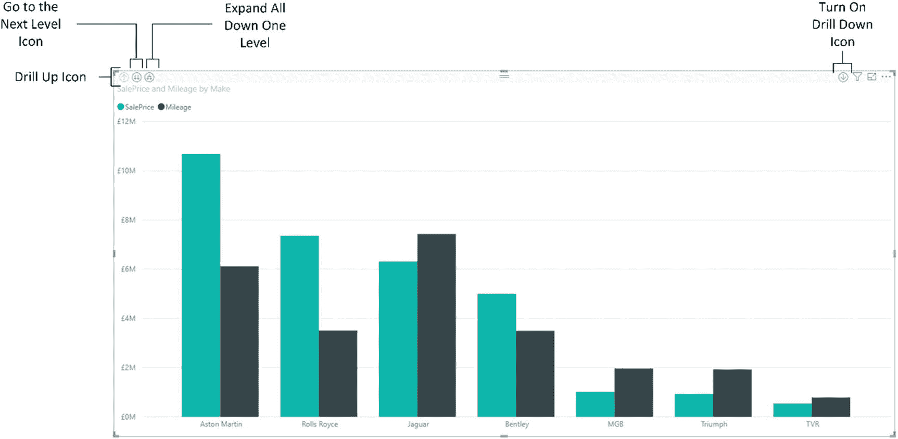

*图 16-29* 显示层级中最顶层数据的柱形图

1. 单击`可视化`窗格中的`簇状柱形图`图标。仪表板画布上将创建一个空的图表视觉对象。
2. 按以下顺序将以下字段拖入字段井的`轴`区域：
   1. `品牌`（来自`库存`表）
   2. `型号`（来自`库存`表）
   3. `颜色`（来自`颜色`表）
3. 将`售价`（来自`发票明细`表）和`里程`（来自`库存`表）字段拖入图表。图表将如图 16-29 所示。如您所见，它只显示`轴`字段井中的最顶层元素——车辆品牌。

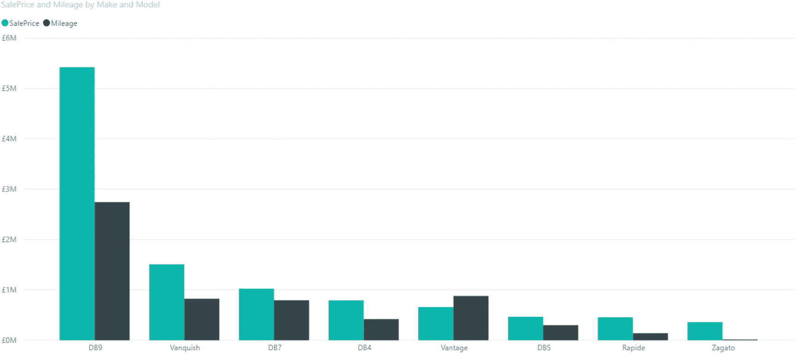

*图 16-30* 显示层级中第二层数据的柱形图

1. 单击图表右上角的`启用向下钻取`图标。该图标将变为深色背景上的白色箭头。
2. 单击`阿斯顿·马丁`的任意一个柱体。图表现在将显示所售`阿斯顿·马丁`的型号，如图 16-30 所示。

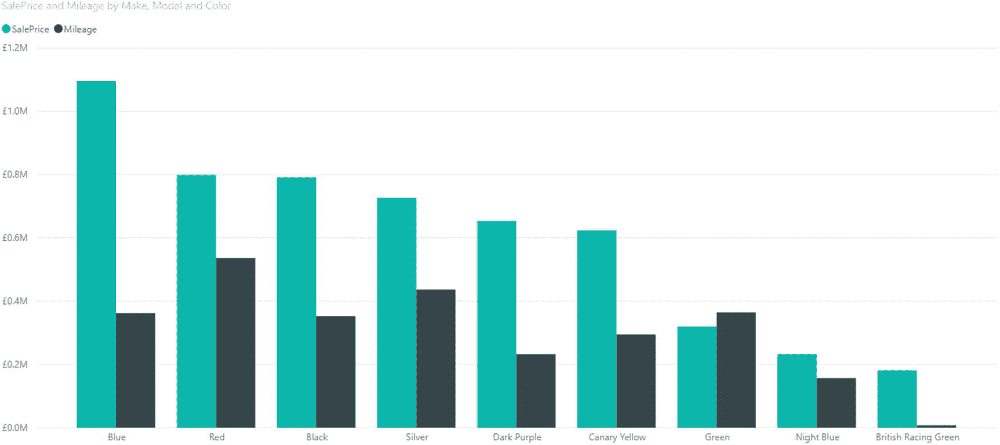

*图 16-31* 显示层级中最底层数据的柱形图

1. 单击`DB9`的任意一个柱体。图表现在将显示所售`阿斯顿·马丁 DB9`的颜色，如图 16-31 所示。

一旦向下钻取到图表的较低层级，你随时可以通过单击图表左上角的`向上钻取`图标返回到上一层级（并从那里继续向上钻取，直到达到最顶层）。

### 在层级中展开全部下一级

`在层级中展开全部下一级`图标产生的效果与通过单击图表中的柱体进行向下钻取不同。如果你单击`在层级中展开全部下一级`图标，你将看到所有下一层级的元素，而不仅仅是你点击的那个子组的层级元素。要了解这一点，请尝试以下步骤：

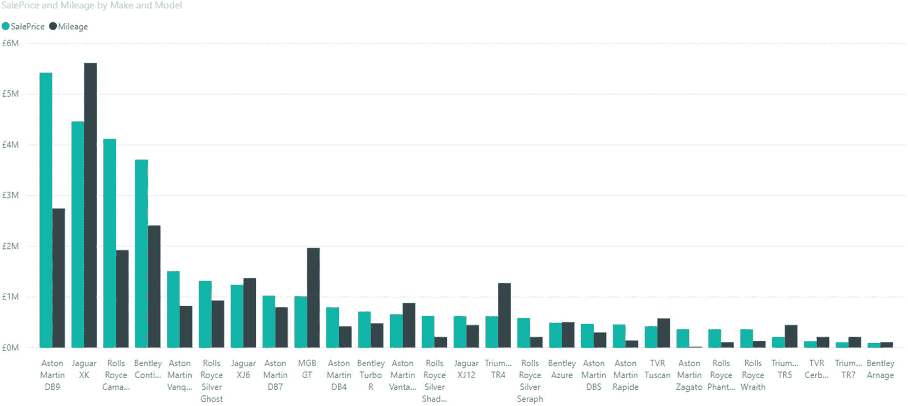

*图 16-32* 将图表向下展开一级

1. 重新创建上一节中的图表（执行步骤 1 至 3），直到您再次看到图 16-29 所示的图表。
2. 单击`在层级中展开全部下一级`图标。
3. 调整图表大小以提高其可视性。您将看到一个如图 16-32 所示的图表。

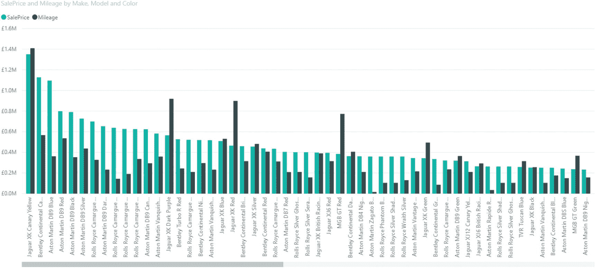

*图 16-33* 将图表再向下展开一级

1. 再次单击`在层级中展开全部下一级`图标。
2. 如有必要，调整图表大小。这次图表将如图 16-33 所示。

### 转到层级中的下一级

你可以应用的最后一个层级导航技巧是`转到层级中的下一级`。要测试此功能，请尝试以下步骤：

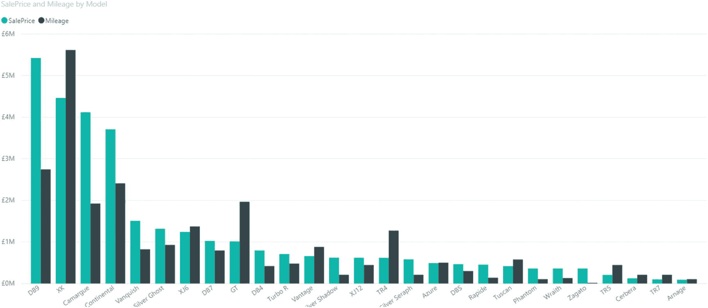

*图 16-34* 在图表中转到下一级

1. 重新创建倒数第二节中的图表（执行步骤 1 至 3）。
2. 单击`转到层级中的下一级`图标。
3. 调整图表大小以提高其可视性。您应该会看到一个如图 16-34 所示的图表。

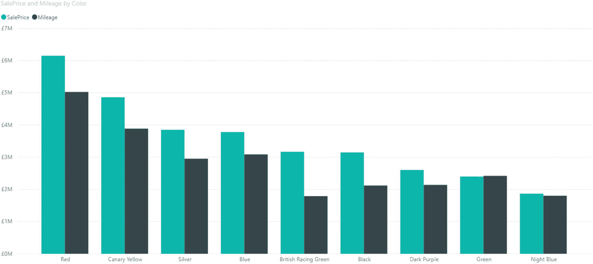

*图 16-35* 在图表中转到更深层级

1. 再单击一次`转到层级中的下一级`图标。您将看到一个如图 16-35 所示的图表。

总之，可用于导航图表层级的三个选项是：

- `向下钻取`：仅显示您单击的特定元素的下一级数据。
- `在层级中展开全部下一级`：显示所有元素的下一级数据。
- `转到层级中的下一级`：仅显示数据层级中下一级的数据。

**注意：** 无论您使用哪种技巧来显示较低层级的数据，您始终可以通过单击`向上钻取`图标返回到上一层级。

## 包含与排除数据点

你在第 15 章中已经看到，可以在矩阵中包含和排除记录。同样，你也可以将这一技巧应用于图表。这有助于你清除杂乱数据、剔除异常值，或仅专注于选定的数据点集。以下是一个排除数据点的示例：

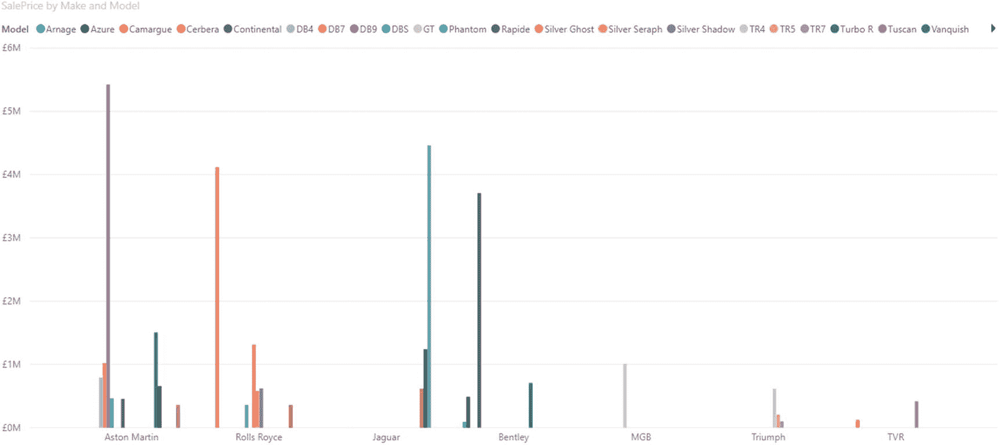

**图 16-36** 排除数据点前的柱形图

1. 使用以下数据元素创建一个如图 16-36 所示的簇状柱形图：
   - `轴`：`Make`（来自`Stock`表）
   - `图例`：`Model`（来自`Stock`表）
   - `值`：`SalePrice`（来自`InvoiceLines`表）

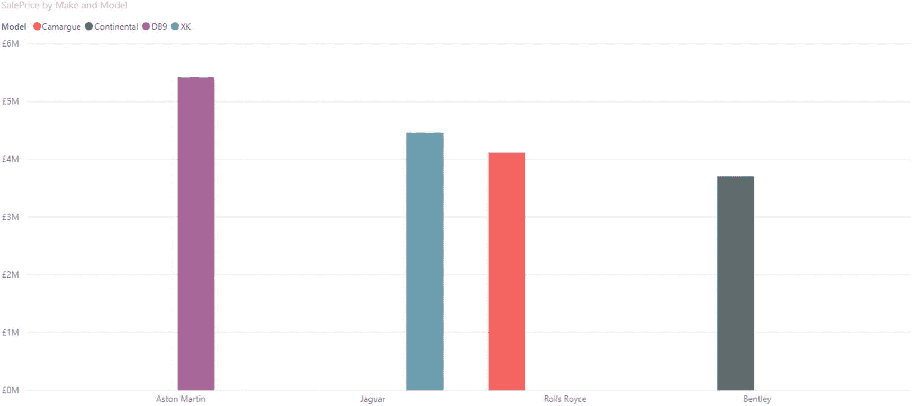

**图 16-37** 排除数据点后的柱形图

2. 按住`Ctrl`单击以选中四个最高的柱形。
3. 右键单击任意选中的柱形，然后从弹出菜单中选择**包含**。图表将显示为图 16-37 所示。

剩余数据与之前完全相同，但移除过高的柱形后，你可以更清晰地看到其他数据元素之间的差异。

最后一点，从图 16-36 可以看出，如果图例包含过多无法舒适显示的项目，图表会提供一个滚动箭头，以便你查看图例中的其余项目。

## 结论

本章带你了解了可在 Power BI Desktop 报表和仪表板中使用的各种可用图表类型。这些图表从经典的饼图、折线图、柱形图和条形图，延伸至不常见的漏斗图、圆环图、面积图、散点图、气泡图和瀑布图。你看到有些图表适用于单个数据系列，而另一些则可以处理多个数据系列。为了增加特殊效果，你还了解了如何创建混合图表类型、创建百分比条形图和柱形图，以及调整轴元素。

然而，如果你决定添加一些引人注目的格式，这些图表可以以更高层次呈现。这正是你将在下一章学习的内容。

