# 11. 组织、管理和参数化查询

创建一个健壮且高效的数据查询，不仅仅是找到合适的加载与转换函数并按正确顺序排列它们。它还涉及扩展、调整和维护整个流程。这可能是为了在测试查询时纠正错误，也可能是为了适应新的需求。本章将介绍一些可用于处理查询生命周期各个阶段的技术。

创建一个引人注目的仪表板可能意味着要从大量且多样化的查询中获取数据。这也可能意味着这些查询需要相互连接，以形成一个数据转换的级联流程，从而从多个来源整理出实用且可用数据模型的核心元素。因此，你需要知道如何*管理*你所创建的查询，以便高效地使用它们，并在实际场景中保持对查询的有效控制。

然而，并非所有的数据流都是固定不变且可预测的。不可避免地，会有一些情况，你需要根据源数据的特征来定制数据摄取过程。这可能意味着要对查询进行参数化以允许用户交互，或者动态调整数据流。

## 管理转换过程

到目前为止，我们应用的大多数转换步骤都是可以应用于几乎任何数据表的独立元素。然而，即使是在执行一个简单的数据加载和转换过程时，你也可能希望通过多个转换步骤来塑造、清理和过滤数据，以达到期望的结果。这正是 Power BI Desktop 方法如此灵活的原因，因为你可以将大部分数据转换步骤应用于几乎任何数据表。其艺术在于将它们安排成一个序列，这个序列可以在数据发生变化时被重复使用，以重新处理新的源数据并提供最新的输出结果。

理解和管理这一过程的关键在于熟悉`查询设置`窗格中的`已应用步骤`列表。该列表包含了你应用的每一步的详细信息，并按应用顺序排列。每个步骤都保留了 Power BI Desktop 在创建时赋予的名称，并且每个步骤都可以通过以下方式进行修改：

-   **重命名**
-   **删除**
-   **移动**（在某些情况下）

更令人欣慰的是，在许多情况下，步骤本身也是可以修改的。这样一来，你就不必受限于最初的选择，而是有机会对流程中的各个步骤进行调整和优化。这可以避免你重建整个 ETL 例程中的步骤序列，只需替换其中的一个环节即可。

为了试验修改查询的各种方法，你需要一些初始数据。因此，我建议你首先创建一个查询，从以下 Excel 源文件加载数据：`C:\PowerBiDesktopSamples\CarSalesDataForQueries.xlsx`。从该源文件中，选择以下工作表：

-   `Clients`
-   `Colors`
-   `Countries`
-   `Invoices`
-   `InvoiceLines`
-   `Stock`

数据加载完成后，切换到查询编辑器窗口。

### 修改步骤

如何修改一个步骤取决于原始转换是如何应用的。经过一点实践，这就会变得得心应手，并且总是涉及首先单击你想要修改的步骤，然后应用不同的修改。如果你调用功能区选项（例如更改数据类型），则只需直接从功能区应用另一种数据类型即可更改数据类型。如果你使用的是显示对话框的选项（例如拆分列等），则可以在`已应用步骤`列表中右键单击该步骤，然后从上下文菜单中选择`编辑设置`。或者，如果你愿意，也可以单击大多数（但并非全部）步骤右侧显示的“齿轮”图标，打开一个对话框，你可以在其中调整步骤设置。此对话框将显示你最初应用的所有选项和设置；你可以在其中进行任何你认为必要的修改。

最后一种可以轻松修改流程设置的方法是，每次单击某个步骤时，编辑公式栏中显示的公式。然而，这需要理解支撑数据转换过程的每一段代码的所有复杂性。我将在第 12 章中对代码修改进行简要介绍。

**提示**

如果你能强迫自己将使用 Power BI Desktop 编写的过程组织起来，那么稍微提前思考和规划就能带来丰厚的回报。例如，某些任务（如设置数据类型）可以在单个操作中完成。这意味着你只需在一个地方查找一组类似的数据转换即可。不仅如此，如果之后需要更改某个列的数据类型，我建议你在进行任何进一步修改之前，先单击`更改的类型`步骤。这样，你是在扩展原始步骤，而不是创建其他步骤——这可能会使过程更加混乱且不必要地冗长。

### 重命名步骤

Power BI Desktop 使用已应用转换的名称来命名步骤。这意味着如果之后应用了另一个类似的步骤，Power BI Desktop 会使用相同的名称并加上数字增量。由于在查看一系列转换步骤时，这并不总是易于理解，因此你可能更愿意为各个步骤提供更友好的名称。操作步骤如下：

1.  选择查询（或者，如果你愿意，可以选择源表或工作表）。在此示例中，我将使用`Clients`查询。
2.  右键单击你想要重命名的步骤，例如`更改的类型`。
3.  从上下文菜单中选择`重命名`。
4.  输入新名称。我将使用`NewDataTypes`。
5.  按`Enter`键。

该步骤即被重命名，新名称将出现在`查询设置`窗格的`已应用步骤`列表中。这样，你可以确保在几天、几周甚至几个月后重新查看某个数据转换过程时，能够更直观地理解你定义的流程以及你为何如此塑造数据。


### 删除步骤或一系列步骤

删除步骤看似简单，但这样做可能会带来严重后果。这是因为 ETL 流程通常是一系列紧密耦合的事件，每个事件都严重依赖于前一个事件。因此，删除一个步骤可能导致后续所有步骤失败。要知道哪些步骤可以删除而不会产生严重后果，这取决于你正在开发的流程类型以及你使用 Power BI Desktop 的经验。无论如何，如果你需要删除一个步骤，请按以下步骤操作：

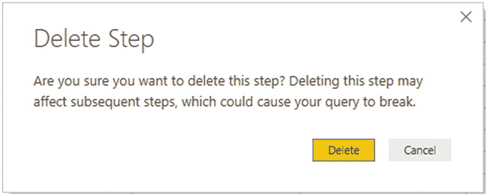

**图 11-1** – `删除步骤` 对话框

1. 将鼠标指针悬停在要删除的流程步骤上。
2. 点击出现的叉号（`×`）图标。
3. 选择 `删除`。可能会出现`删除步骤`对话框，如图 11-1 所示。
4. 点击 `删除` 按钮进行确认。该步骤即被删除。

如果——这很有可能发生——删除此步骤导致流程的其余部分出现问题，你会看到数据表被一条错误消息所替代。该消息的具体内容将取决于 Power BI Desktop 遇到的错误类型。

在描述此技巧时，我特意指出你*可能*会看到`删除步骤`对话框。如果你删除的是一个步骤序列中的最后一步，那么你可能不会看到它，因为此时通常不会产生任何潜在的严重后果；最坏的情况是，你需要重新创建该步骤。如果你删除的是流程中间的一个步骤，那么在引发大量潜在问题之前，你或许应该认真考虑是否要这样做。因此，在这些情况下，系统会要求你确认删除操作。

**注意：** 如果在此时你意识到自己刚刚毁掉了数小时的工作成果，那么（深吸一口气后）请点击 Power BI Desktop 窗口中的 `文件` 菜单（位于左上角的向下三角形）并选择 `关闭`，然后不保存就关闭 Power BI Desktop。不要指望能像在其他桌面应用中使用撤销功能那样操作。为了降低你的血压，你或许更应该在*删除任何步骤之前*，保存一份包含复杂数据转换过程文件的副本。你也可以将整个数据转换过程复制为`M`代码——你将在下一章学到这一点。

另一种方法是右键单击要删除的步骤并选择 `删除`。你可能仍然需要确认删除操作。

如果你意识到某个流程步骤中的错误使你截至流程结束的所有工作都无效，那么与其逐个删除多个元素，不如在上述练习的步骤 2 处，从上下文菜单中选择 `删除至末尾`。

### 修改现有步骤

当你创建一系列应用步骤来生成和转换数据流时，Power BI Desktop 并不会强制你锁定在僵化的事件序列中。当你发现需要修改流程中的某个步骤时，这一点会变得非常明显。

例如，假设你发现从 Excel 中选择初始数据时加载了错误的工作表。当你只需简单地替换工作表名称时，你并不想重复整个过程。

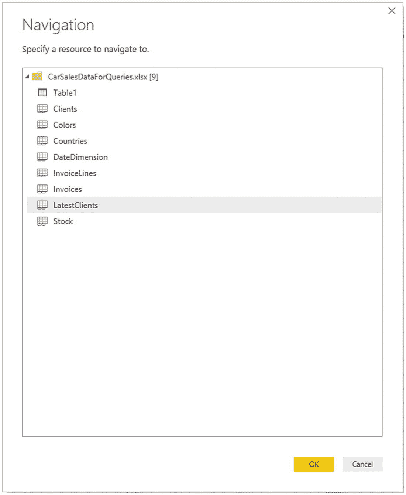

**图 11-2** – 用于步骤修改的 `导航` 对话框

1. 选择你想要修改的查询（此示例中为`Clients`）。
2. 点击要修改的步骤（此例中为 `Navigation`）。
3. 点击步骤名称右侧的齿轮（或设置）图标。将出现相应的对话框。本例中显示的将是你在图 11-2 中看到的 `导航` 对话框。
4. 点击你想要用来替换当前数据集的表或工作表（此示例中为 `LatestClients`）。
5. 点击 `确定`。

查询编辑器将用一个源数据集替换另一个。它可能还会添加额外的步骤，以确保数据适合在查询中使用。

正如你在前十章中所见，Power BI Desktop 提供了广泛的数据摄取和修改可能性。因此，我无法在此描述修改“应用步骤”相关的所有可能选项。尽管如此，其原理很简单：

- 如果查询编辑器可以修改某个步骤，则步骤名称右侧会显示齿轮图标。
- 点击修改（齿轮）图标将显示用于创建该步骤的对话框（或者，即使该步骤是由 Power BI Desktop 自动创建的，该对话框也可用于修改该步骤）。

某些步骤不显示修改图标。这是因为该步骤无法修改，只能删除（至少在使用查询编辑器界面时如此）。举个例子，请添加以下步骤：

1. 选择你想要修改的查询（此示例中为`Clients`）。
2. 点击最后一个步骤。
3. 右键单击 `Address2` 列并选择 `删除`。

`已删除列` 这个新步骤将出现在 `应用步骤` 列表中。此步骤没有修改图标。因此，目前你可以删除它，但*不能*修改它——至少不能通过图形用户界面来实现。不过，你可以像在第 12 章中学到的那样修改步骤的代码。

**注意：** 修改现有步骤并非“万能灵药”。这是因为一系列数据转换可能高度依赖于为特定数据结构量身定制的逻辑。例如，这也就意味着，你只能将数据源替换为另一个结构几乎完全相同的数据源。然而，修改步骤在很多情况下可以避免你重写整个数据流序列。

### 添加步骤

你可以在序列中的任何位置添加步骤。你只需点击*位于*你想要插入的新步骤*之前*的步骤，然后再点击任何功能区中对应新步骤的图标。与删除步骤时的情况类似，Power BI Desktop 会显示一条警告，提示此操作*可能*会导致从此新步骤开始的后续流程出现问题。

### 更改流程步骤顺序

从技术上来说，对流程中的步骤重新排序是可能的。然而，根据我的经验，这并不总是可行的，因为改变流程中步骤的顺序可能和删除步骤一样造成严重破坏。不过，你仍然可以像这样尝试一下：

1. 右键单击你想要重新排序的步骤。
2. 从上下文菜单中选择 `上移` 或 `下移`。

我仍然不认为这能创造奇迹，但知道有这种功能也不错。

**提示：** 请记住，在调整流程应用顺序之前，点击任何流程步骤都会导致 Power BI Desktop 窗口中的表格刷新，以显示截至并包含所选步骤的数据状态。这是对流程以及 ETL 过程如何执行的一个非常清晰的视觉指南。


## 排序方法

面对数组形式的数据转换选项，您很可能会疑惑：在使用 Power BI Desktop 开展新 ETL 项目时，最佳方法是什么？我深知每个项目各有不同，但作为一份简明指南，我建议按以下顺序组织项目：

1. 将数据加载到 Power BI Desktop 中。
2. 提升或添加易理解的列标题。例如，当`Column29`可以改为（比如）`ClientName`时，您肯定不希望在某流程的第 47 步还要琢磨这个列名是什么。
3. 移除任何不需要的列。数据集越小，处理速度越快。此外，如果您只关注真正需要的信息，将更容易集中精力理解数据。已移除的列只需删除或编辑对应的移除步骤即可恢复。
4. 修改表中每一列的数据类型。正确的数据类型是许多转换步骤的基础，对筛选也至关重要，因此最好尽早完成设置。
5. 筛选掉任何不需要的记录。再次强调，数据集越小，处理速度越快。这包括去重操作。
6. 解析任何复杂的 JSON 或 XML 元素。
7. 执行必要的数据清洗。
8. 执行必要的转换操作。
9. 执行必要的列拆分或添加自定义列。
10. 添加衍生列。
11. 添加任何计算或数据逻辑转换。
12. 处理 ETL 流程中产生的所有错误记录。

再次强调，这并非权威指南。但我希望，当您使用 Power BI Desktop 创建数据加载和转换流程时，它能帮助您"拨云见日"。

## 错误记录

某些数据转换操作会引发错误。在处理混合源数据时，这是常态。例如，大型数据集中的某日期列可能包含几行文本或数字记录。若将该列转换为日期数据类型，任何无法转换的值都会显示为错误值。

### 移除错误

假设您不需要 Power BI Desktop 标记为包含错误的记录，可以一次性移除所有这些记录：

1. 点击包含错误的列内部；若需同时移除多列的错误，请按住`Ctrl`键点击包含错误的列标题。
2. 在"开始"功能区点击"移除错误"。所选列中标记为错误的记录将被删除。`已移除错误`步骤会添加到`应用的步骤`列表中。

此处必须格外谨慎，以免删除有效数据。只有您查看数据后，才能判断某列中的错误是否意味着可以安全丢弃该数据。其他情况下，最佳建议是清洗数据，或保留包含错误的记录。潜在错误的种类和多样性如同数据本身一样浩瀚。

## 管理查询

一旦您使用 Power BI Desktop 一段时间，很可能会沉迷于基于更广泛数据源创建更多、更深入的分析。这必然意味着要学会高效、富有成效地管理数据模型所依赖的数据源。

幸运的是，Power BI Desktop 查询自带一系列查询管理工具，包括：

- 组织查询
- 分组查询
- 复制查询
- 引用查询
- 记录查询
- 将列添加为新查询
- 启用数据加载
- 启用报表刷新

让我们逐一了解这些功能。

### 组织查询

当您在 Power BI Desktop 查询编辑器中使用十几个或更多查询时，可能希望对它们的组织方式加以控制。首先，您可以修改查询在 Power BI Desktop 查询编辑器窗口左侧"查询"窗格中的显示顺序。这允许您覆盖默认顺序（即最近添加的数据源显示在列表底部）。

按以下步骤调整查询在列表中的位置：

1. 右键点击要移动的查询。
2. 从上下文菜单中选择"上移"（或"下移"）。

若要多次移动查询位置，需重复此操作。

### 分组查询

您还可以创建自定义组，更好组织正在使用的 Power BI Desktop 文件中的查询。这不会影响查询的工作方式。分组查询仅是一种组织技巧，不会以任何方式改变您在 Power BI Desktop 报表模式下看到的数据表。

#### 创建新组

以下说明如何创建新组：

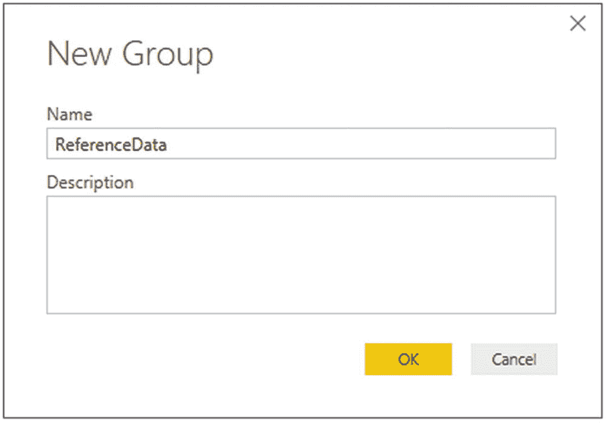

**图 11-3** – "新建组"对话框

1. 右键点击要添加到新组的查询。此处以`Colors`查询为例。
2. 从上下文菜单中选择"移动到组" ➤ "新建组"。将出现"新建组"对话框。
3. 输入组名称，（可选）添加描述。我将组命名为`ReferenceData`。对话框将如图 11-3 所示。
4. 点击"确定"。

新组创建完成，所选查询将出现在该组中。"查询"窗格将如图 11-4 所示。

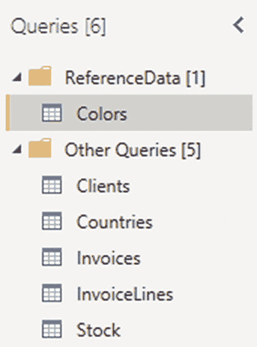

**图 11-4** – 添加新组后的"查询"窗格

**注意：** 默认情况下，所有其他查询会被添加到名为`其他查询`的组中。

#### 重命名组

您可以重命名任何已添加的组。

1. 右键点击要重命名的组。
2. 从上下文菜单中选择"重命名"。
3. 编辑或替换名称。
4. 按`Enter`键。

**注意：** `其他查询`组无法重命名或删除。默认情况下，所有新查询都将添加到该组。

#### 将查询添加到组

要将查询从当前组移动到其他组，可执行以下步骤：

1. 右键点击要添加到其他现有组的查询。
2. 从上下文菜单中选择"移动到组" ➤ *目标组名称*。

所选查询将移至指定组。

### 复制查询

如果您已完成大量数据转换工作，在对项目进行任何潜在风险变更前，很可能希望保留原始查询的副本。幸运的是，这非常简单。

1. 右键点击要复制的查询。
2. 从上下文菜单中选择"复制"。

查询被复制，副本出现在源查询所在组内的查询列表中。副本名称与原始查询相同，并附加带括号的数字。您始终可以在"查询设置"窗格或查询编辑器窗口左侧的"查询"窗格中重命名它。

**注意：** 如果愿意，您也可以使用复制粘贴功能。这一技巧的优势在于：在粘贴查询副本*之前*，只需点击目标组的文件夹图标，即可为复制后的查询选择目标组。


### 引用查询

如果您正在构建复杂的 ETL（提取、转换、加载）流程，您可能会考虑分阶段组织工作，以便更好地管理整个过程。为此，Power BI Desktop 查询编辑器允许您*将一个查询的输出用作另一个查询的源*。这样您就可以将流程的不同部分（例如，结构、筛选，然后是清洗）分解为单独的查询，从而能够专注于不同查询中转换的不同方面。

要将一个查询的输出用作另一个查询的源数据，您需要*引用*一个查询。具体操作如下：

1.  右键单击要用作新查询源数据的查询。
2.  从上下文菜单中选择 `引用`。新查询将在 `查询` 窗格的查询列表中创建。
3.  右键单击新查询，选择 `重命名`，并为其指定一个有意义的名称。

除非您重命名新查询，否则新查询的名称将与原始查询相同，并附加一个括号数字。如果您单击新查询，您在引用的查询中看到的数据将与单击源查询的最终步骤时看到的数据完全相同。

从现在开始，您在引用的（源）查询中所做的任何修改都会对用作第二个查询源的数据产生影响。

在实践中，我猜想您不会希望使用同一查询的两个副本来创建报表。实际上，如果一个查询被用作“中间”查询，它包含的数据可能甚至不是完全可用的。因此，您可能希望*使中间查询对 Power BI Desktop 中的报表和仪表板不可用*。具体操作如下：

1.  右键单击原始（源）查询。
2.  在上下文菜单中取消选中 `启用加载`。菜单项左侧的复选标记将会消失。

源查询将不再出现在 `报表视图` 中，因此无法在视觉对象中使用。值得注意的是，任何“中间”查询（即用于修改数据但不在 `数据视图` 或 `报表视图` 中显示的查询）都会以斜体显示。

您可能会疑惑为什么要创建“中间”查询。以下是一些思路：

*   您希望将复杂的数据转换隔离到更易于管理的子集中。例如，您可能希望一个中间查询转换数据，而后续的查询清洗数据。
*   您可能希望应用一组通用的初始转换，然后将数据反馈到两个独立的数据准备路径中——一个用于详细视图的数据，另一个用于聚合视图的数据。

> **注意：** 请确保任何现有报表未使用您随后以此方式设为不可用的查询，否则您的报表中将出现损坏的视觉对象。

### 记录查询

在复杂的 ETL 过程中，很容易混淆——或者根本忘记——哪个查询执行什么功能。因此，我总是建议通过添加有意义的描述来记录查询。

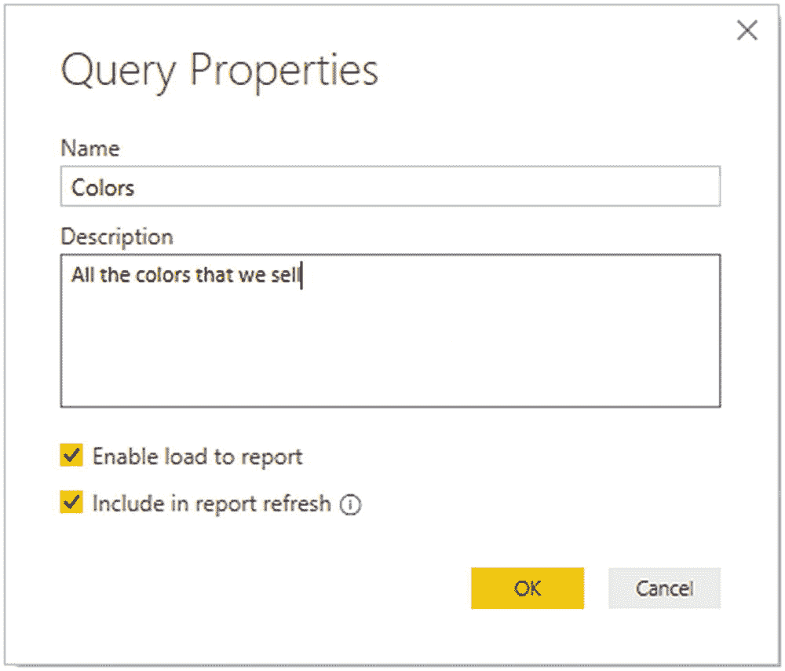

*图 11-5： 为查询添加描述*

1.  右键单击您想要添加注释的查询。
2.  从上下文菜单中选择 `属性`。将出现 `查询属性` 对话框。
3.  添加描述。结果可能类似于图 11-5 中所示的对话框。
4.  单击 `确定`。

现在，当您将光标悬停在查询编辑器中查询列表的查询名称上时，您添加的描述会作为工具提示显示。

### 将列添加为新查询

有时您可能需要提取一列数据并将其用作单独的查询。例如，可能是您需要它包含的数据作为另一个查询的引用数据。以下步骤说明了如何实现这一点：

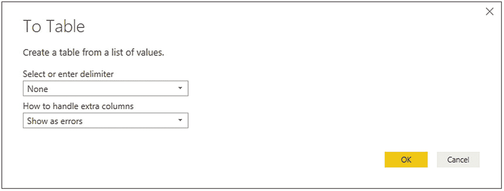

*图 11-6： “到表”对话框*

1.  在左侧的 `查询` 列表中，选择包含您想要隔离为新查询的列的查询。
2.  右键单击包含您想要隔离的数据的列标题。
3.  从上下文菜单中选择 `添加为新查询`。将创建一个新查询。其名称来源于原始查询和源列。
4.  在 `转换` 功能区中，单击 `到表`。将出现 `到表` 对话框，如图 11-6 所示。
5.  单击 `确定`。新查询将成为一个数据表，并将具有您所选列的名称。
6.  如果您认为有必要，重命名该查询。

现在，您可以在数据模型中使用此查询，并将其作为链接查询过程集合的一部分。

> **注意：** 以这种方式创建的查询与从中获取数据的源查询完全断开连接。换句话说，对源数据的任何刷新都将*不会*影响您从列创建的新查询。

### 启用数据加载

您可能已经得到这样的印象：您创建的任何查询都将始终成为 Power BI Desktop 数据模型的一部分。但事实**并非**如此，正如我在引用查询部分简要提到的。例如，您可以创建实际上只是“暂存”查询的查询（这些查询是更复杂的转换序列的一部分），或者只包含查找数据（这些数据会添加到另一个表但在数据模型中不需要）的查询。在这种情况下，您肯定不希望这些表给数据模型增加混乱。

要阻止查询被添加到数据模型中，请执行以下操作：

1.  在左侧的 `查询` 列表中，选择您希望保留在查询编辑器中——但不保留在数据模型中的查询。
2.  右键单击该查询并取消选中 `启用加载`。

该查询将不再与其他查询一起加载到数据模型中。

要将查询重置为加载到数据模型的候选对象，只需执行相同操作并确保`启用加载`已勾选。您可以通过上下文菜单中的复选标记来判断该查询是否将被加载。或者，您可以右键单击查询并显示查询属性，在其中可以勾选（或取消勾选）“启用加载到报表”复选框。

> **注意：** 您也可以在图 11-5 所示的 `查询属性` 对话框中设置此属性。

### 启用报表刷新

默认情况下，所有查询都可以刷新。这使您能够从源获取最新的数据到 Power BI Desktop 查询编辑器，然后进入数据模型。

有时您可能不希望刷新某个查询。可能是因为数据源不可用，或者速度很慢，或者您希望稍后回来获取最新数据。Power BI Desktop 查询编辑器允许您像这样为每个查询设置刷新选项：

1.  在左侧的 `查询` 列表中，右键单击您想要修改其刷新状态的查询。
2.  取消勾选“包含在报表刷新中”。

> **注意：** 只有已启用加载的查询才能修改其刷新属性。


#### 待处理的更改

在处理数据源并从查询编辑器切换到 Power BI Desktop 视图时，通常您会希望将源中的全部数据加载到数据模型中。

这种方法的一个缺点是，当您返回创建和修改可视化效果时，庞大的源数据集可能需要很长时间才能加载或重新加载。正因如此，Power BI Desktop 允许您从查询编辑器“开始”功能区中的“**关闭并应用**”按钮中选择“**关闭**”。这样做会立即将您带回数据视图，但不会应用您所做的任何更改。作为提醒，您将看到类似图 11-7 所示的警告，显示在数据视图的顶部。


**图 11-7** 待处理更改警告

您可以根据需要继续在数据视图中工作。当您有时间将修改后的源数据重新加载到数据模型中时，请单击“**应用更改**”按钮。但是，您需要明白，在您应用更改之前，您将看不到字段列表中表和字段结构的所有最新更改——当然，也看不到最新的数据。

## 参数化查询

Power BI Desktop 中的参数使您能够为查询的某些方面定义并应用特定条件。其核心是，它们是一种使您能够实现以下目的的技术：

*   存储一个值，以便在多个查询中使用
*   将潜在值的选项限制为特定的选项列表

目前，创建参数有三种基本方式：

*   您输入的一个单一值
*   从您手动输入的可能值列表中选择一个值
*   从使用现有查询创建的可能值列表中选择一个值

因此，使用参数是一个两步过程：

*   创建一个参数。
*   将其应用于查询。

参数实际上只不过是一种特殊类型的查询。由于它是一个查询，您可以：

*   将其加载到数据模型中（尽管很少需要这样做）
*   从另一个查询中引用它
*   在 DAX 公式中使用它

接下来的三个小节将解释如何创建参数。然后，我将向您展示在查询编辑器中使用参数来筛选或转换数据的一些方法。

### 创建简单参数

最简单的情况下，参数就是您存储的一个值，以便稍后使用它来协助您进行数据转换。以下是存储一个包含“True”值的参数的方法，以便用于过滤后续数据集：

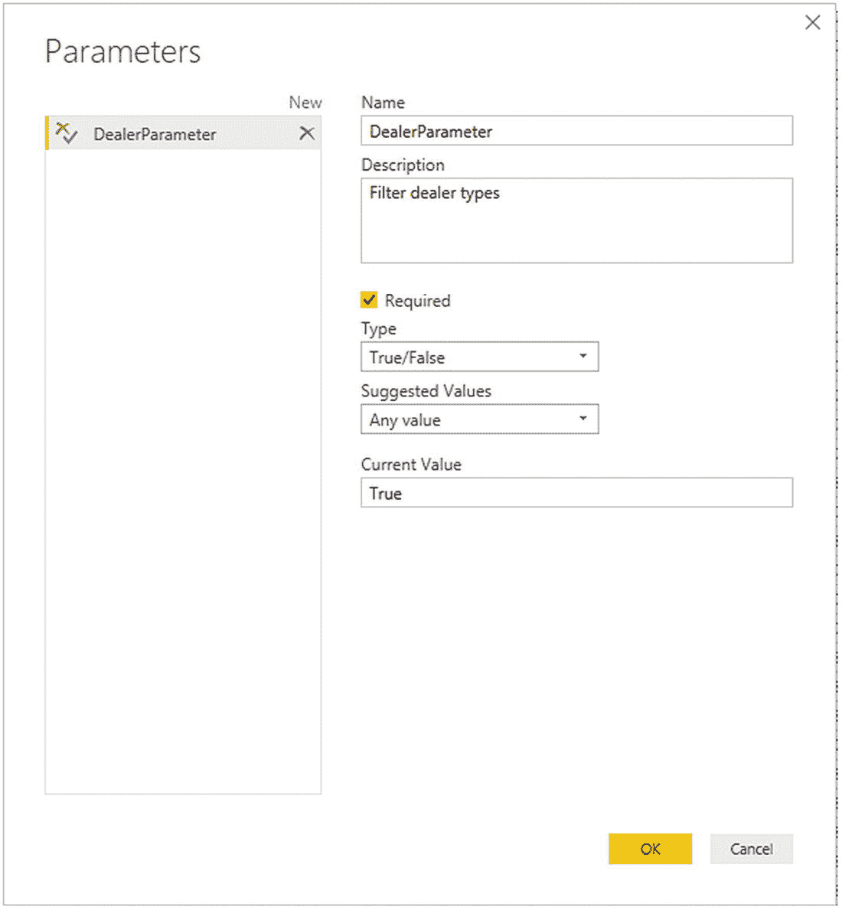

**图 11-8** 参数对话框

1.  将 Excel 文件 `C:\PowerBiDesktopSamples\CarSalesOverview.xlsx`（使用名为 CarSalesOverview 的工作表）中包含的数据加载到 Power BI Desktop 中。

2.  在“开始”功能区中，单击“**转换数据**”。查询编辑器将打开。

3.  在查询编辑器“开始”功能区中，单击“**管理参数**”按钮底部的小三角，然后从可用的菜单选项中选择“**新建参数**”。将出现“参数”对话框。

4.  输入 **DealerParameter** 作为参数名称，并输入 **Filter dealer types** 作为说明。

5.  确保选中“**必需**”复选框。

6.  从类型弹出列表中选择“**True/False**”。

7.  从弹出列表中，输入 **True** 作为当前值。该对话框将类似于图 11-8 中所示。

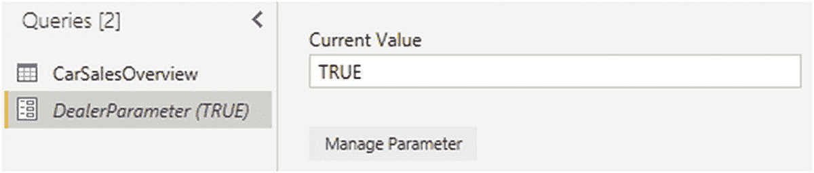

**图 11-9** 查询列表中的参数

8.  单击“**确定**”。新的参数将出现在左侧的“查询”列表中。您可以在图 11-9 中看到这一点。

目前，您所做的只是创建了一个参数并存储了一个值。您将在几页后了解如何使用此参数。如您所见，参数作为查询的一种类型存储，默认值会显示在查询名称后的括号中。

### 创建一组参数值

虽然单个参数可能很有用，但在实际中，您可能更需要潜在参数的列表。这将允许您在特定情况下从预定义的列表中选择参数值。以下是一个创建参数的示例，该参数包含样本数据中使用的可用国家/地区名称的子集：

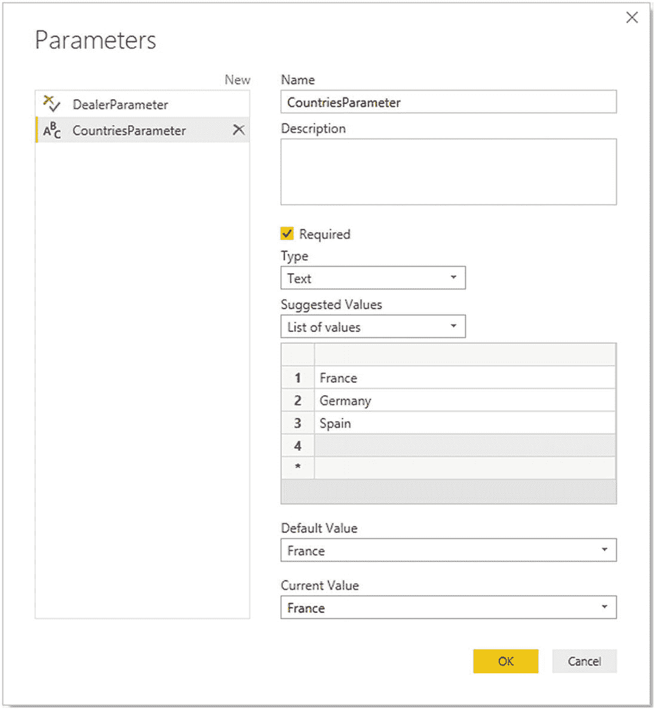

**图 11-10** 参数对话框

1.  使用您在上一节中创建的 Power BI Desktop 文件（基于 Excel 文件 `C:\PowerBiDesktopSamples\CarSalesOverview.xlsx`），打开查询编辑器（如果查询编辑器尚未打开）。

2.  在查询编辑器“开始”功能区中，单击“**管理参数**”按钮底部的小三角，然后从可用的菜单选项中选择“**新建参数**”。将显示“参数”对话框。

3.  输入 **CountriesParameter** 作为参数名称。

4.  确保选中“**必需**”复选框。

5.  从类型弹出列表中选择“**文本**”。

6.  在“**建议值**”弹出列表中，选择“**值列表**”。

7.  在出现的网格中输入以下三个值：
    *   France
    *   Germany
    *   Spain

8.  从弹出列表中选择 **France** 作为“**默认值**”。

9.  从弹出列表中选择 **France** 作为“**当前值**”。该对话框将类似于图 11-10 中所示。

10. 单击“**确定**”。新的参数将出现在左侧的“查询”列表中。

再次强调，您所做的只是创建了参数。您将在两页后了解如何应用它。

**注意：** 如您所见，您选择的任何当前值都将出现在“查询”窗格中参数名称右侧的括号内。这有助于您记住哪个值是当前的，并可能用于过滤数据。


### 创建基于查询的参数

手动输入用于选择参数的数值列表不仅繁琐，而且容易出错。因此，你可以利用现有查询中的数据来创建一系列可用元素，用于参数选择，而无需手动输入数值列表。举例来说，假设你需要一个包含公司销售的所有可用汽车品牌的参数：

1.  使用上一节中创建的 Power BI Desktop 文件（基于 Excel 文件 `C:\PowerBiDesktopSamples\CarSalesOverview.xlsx`），打开查询编辑器。
2.  在查询列表中选择 `CarSalesOverview` 查询。
3.  右键单击名为 `Model` 的列标题，然后选择 **添加为新查询**。一个名为 `Model` 的新查询将出现在查询列表中。此查询包含你选择的列的内容。
4.  右键单击 `Model` 查询，并取消勾选 **启用加载**。这可以防止该查询作为表出现在 Power BI Desktop 界面中。
5.  在新创建的查询中，单击“转换”功能区中的 **删除重复项**。该列表列将只显示唯一值。
6.  将新创建的查询重命名为 `ModelList`。
7.  在查询编辑器的“开始”功能区中，单击 **管理参数** 按钮底部的小三角形，然后从可用菜单选项中选择 **新建参数**。将显示“参数”对话框。
8.  输入 `ModelsParameter` 作为参数名称。
9.  确保选中 **必需** 复选框。
10. 从类型弹出列表中选择 **文本**。
11. 在 **建议的值** 弹出列表中，选择 **查询**。
12. 从可用列表的弹出列表中选择 `ModelList` 作为包含要使用的值列表的查询。
13. 输入 `DB9` 作为 **当前值**。
14. 单击 **确定**。新参数将出现在左侧的查询列表中。

现在，你应该能够在“查询”窗格中看到你创建的所有三个参数，如图 11-11 所示。

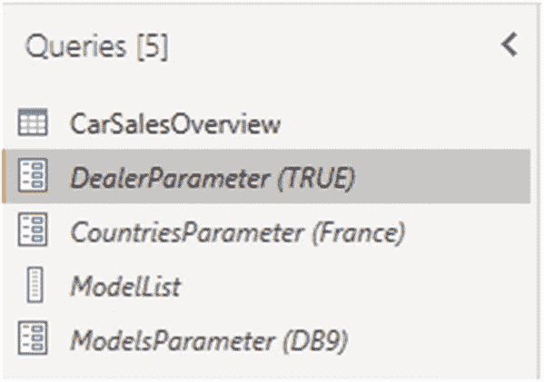

图 11-11：查询列表中的参数

> **注意**
> 阻止用于为参数提供一系列值的列表加载到数据模型中（如你在第 4 步中所做）是正常做法。这是因为数据模型中不需要此查询（或者你喜欢称之为列表），并且你不希望它出现在“字段”列表中而让用户感到困惑。

创建好参数后，你可以通过单击 **关闭并应用** 按钮退出查询编辑器。你应该会看到 Power BI Desktop 报表视图没有变化。这是因为参数用于塑造数据流过程，而*不是*作为数据模型中的数据。

> **提示**
> 也可以在使用参数时“即时”创建参数（即直接从使用参数的对话框内部创建）。但是，我发现事先准备好参数是更好的实践——也更具实用性。这会迫使你思考参数的原因以及其潜在的用途范围。它还可以避免你在试图同时做两件不同的事情时出错。

### 修改参数

幸运的是，参数一旦创建并非一成不变。你可以轻松修改：

-   参数的结构
-   选定的参数元素（当前值）

#### 修改参数的结构

如果你需要修改参数的构建方式，一种方法是执行以下操作：

1.  在查询编辑器的“开始”功能区中，单击 **管理参数**。将显示“参数”对话框，如前面几节所示。
2.  在对话框的左窗格中，单击要修改的参数。参数定义将出现在右侧。
3.  进行任何所需的修改。
4.  单击 **确定**。

或者，你也可以这样做：

1.  单击查询编辑器左侧查询窗格中的参数。
2.  单击 **管理参数** 按钮。将显示“参数”对话框。
3.  进行任何所需的修改。
4.  单击 **确定**。

如果你愿意，还可以右键单击“查询”窗格中的参数，然后从弹出菜单中选择 **管理** 以显示“参数”对话框。

### 在筛选记录时应用参数

现在你已经了解了如何创建参数，是时候看看它们的实际应用了。作为应用参数的第一个示例，你将看到如何使用参数来筛选查询：

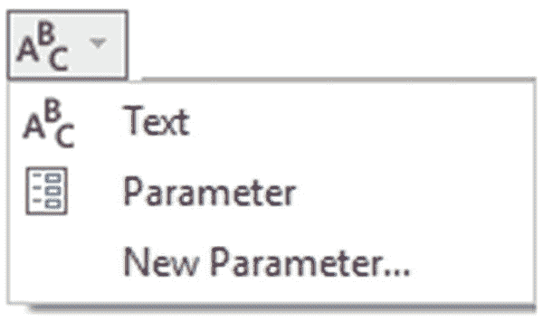

图 11-12：为筛选器选择参数

1.  打开文件 `C:\PowerBiDesktopSamples\ParametersExample.pbix`。此文件包含先前创建的三个参数。
2.  打开 Power BI Desktop 查询编辑器。
3.  单击查询列表中的 `CarSalesOverview` 查询。将显示一个汽车销售信息数据集。
4.  单击 `CountryName` 列的下拉菜单。
5.  选择 **文本筛选器**  **➤ 等于**。将显示“筛选行”对话框。
6.  将 **等于** 保留为第一个选项。
7.  单击第二个下拉菜单，然后从列表中选择 **参数**。你可以在图 11-12 中看到这一点。

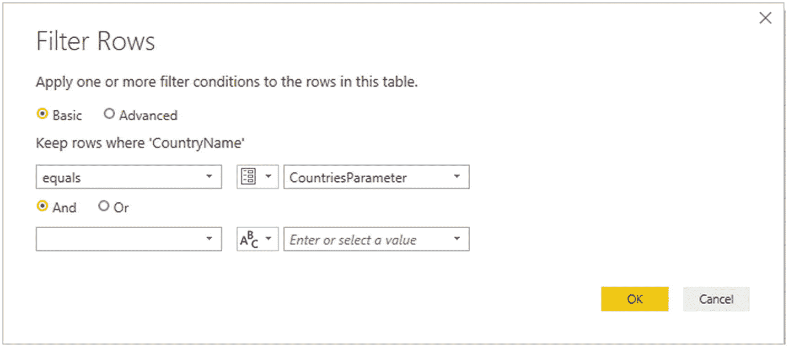

图 11-13：为筛选器应用参数

8.  为第三个下拉菜单选择 `CountriesParameter`。对话框将类似于图 11-13 所示。
9.  单击 **确定**。将应用当前参数值（你选择的国家/地区），并且数据集将使用当前参数值进行筛选。

> **注意**
> 要从筛选器中移除参数，只需删除 **应用的步骤** 列表中的相关步骤即可。

### 修改参数的当前值

你可能会想，仅仅为了筛选一个数据集而设置一个参数是否值得。然而，如果你修改当前参数值然后刷新数据以应用新参数，整个方法会变得更加有趣。以下是一个示例：

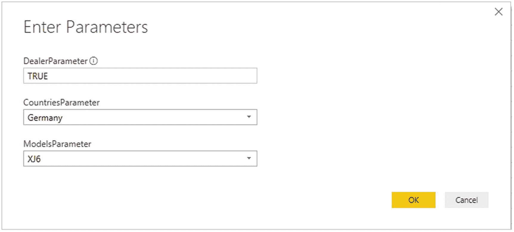

图 11-14：修改参数的当前值

1.  在查询编辑器的“开始”功能区中，单击小三角形以显示 **管理参数** 按钮的菜单。
2.  选择 **编辑参数**。将显示“输入参数”对话框。
3.  从 `CountriesParameter` 的值弹出列表中，选择一个可用值（而不是先前选择的值）。对话框应类似于图 11-14 所示。
4.  单击 **确定**。
5.  在查询编辑器的“开始”功能区中，单击 **刷新预览**。数据将被刷新，新的参数值将应用于使用这些参数的筛选器。

如果你需要测试多种筛选值组合，这种方法会特别有用。实质上，你可以使用多个参数对几个列应用一系列筛选器（或创建复杂的筛选器），然后使用“输入参数”对话框测试不同参数组合在数据集上的结果。这种技术避免了手动且重复地修改多个筛选器。另一个好处是，通过定义可用的参数选项列表，你可以限制用户（或你自己）只能从特定的参数选择列表中进行选择。当你选择 `CountriesParameter` 下拉菜单或 `ModelsParameter` 下拉菜单时，你可以看到这一点。


### 在查找和替换中应用参数

参数的另一个用途是将其用作查找和替换操作中的搜索值或替换值。你可以在以下示例中看到这一点：

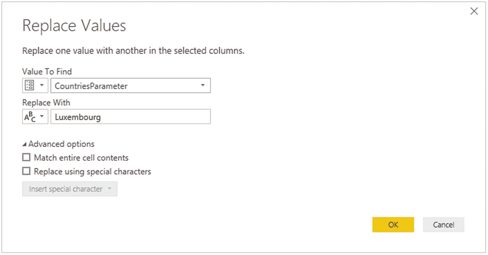

**图 11-15** 在查找和替换中使用参数

1. 打开 Power BI Desktop 文件 `C:\PowerBiDesktopSamples\ParametersExample.pbix`。
2. 打开 Power BI Desktop 查询编辑器。
3. 在查询窗格中单击 `CarSalesOverview` 查询。
4. 单击 `CountryName` 列内部。
5. 在“转换”功能区中，单击 `替换值`（或右键单击并选择 `替换值`）。将显示 `替换值` 对话框。
6. 单击 `要查找的值` 下方的弹出列表，然后选择 `参数`。
7. 选择 `CountriesParameter` 作为要应用的参数。
8. 输入 `Luxemburg`（例如）作为替换值。对话框将如图 11-15 所示。
9. 单击 `确定`。所选列的数据集中参数的当前值将被替换。

### 将参数应用于数据源

在某些企业环境中，有许多可用的数据库服务器，甚至可能有更多数据库。你可能会发现记住所有这些服务器和数据库很困难——你为其准备 Power BI Desktop 报告的用户也可能如此。

一种使企业环境更易于导航的解决方案是准备包含可用服务器和数据库列表的参数。然后可以使用并更新这些参数，以指导用户选择 SQL Server、Oracle 或其他数据库数据源。

要查看实际效果，你首先需要准备两个参数：

- 服务器列表
- 数据库列表

然后你可以了解如何使用这些参数连接到数据源。当然，你需要将我在步骤 3 和 4 中使用的示例服务器和数据库名称替换为你自己环境中的名称。

> **注意：** 仅当在“查询编辑器”的“视图”菜单中选中 `始终允许` 复选框时，才能应用参数。

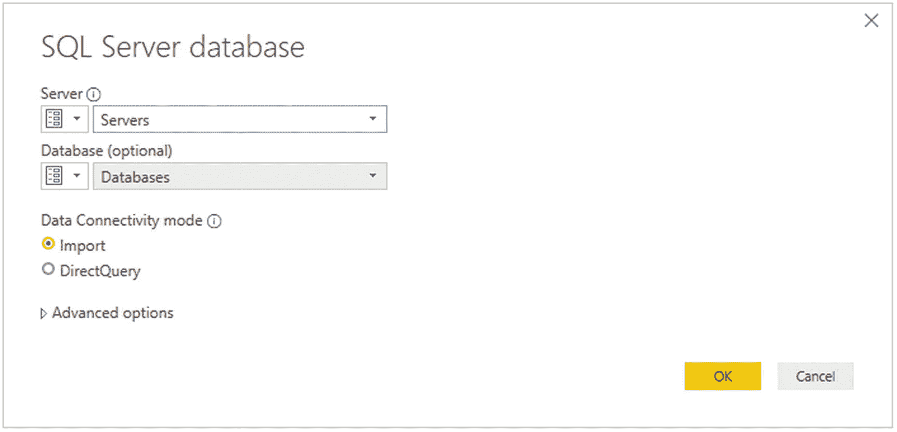

**图 11-16** 使用参数选择服务器和数据库

1. 打开一个新的 Power BI Desktop 文件并关闭启动屏幕。
2. 单击 `转换数据` 以打开查询编辑器。
3. 使用以下元素创建一个新参数：
   - *名称*：`Servers`
   - *类型*：文本
   - *建议值*：值列表
   - *列表中的值*：`ADAM03` 和 `ADAM03\SQLServer2016`（或你的数据库服务器）
   - *默认值*：`ADAM03\SQLServer2016`（或你的数据库服务器）
   - *当前值*：`ADAM03\SQLServer2016`（或你的数据库服务器）
4. 使用以下元素创建一个新参数：
   - *名称*：`Databases`
   - *类型*：文本
   - *建议值*：值列表
   - *列表中的值*：`CarSalesData` 和 `CarSalesMemoryBased`
   - *默认值*：`CarSalesData`
   - *当前值*：`CarSalesData`
5. 单击 `关闭并应用` 以关闭查询编辑器。
6. 在 Power BI Desktop 报告界面中，单击 SQL Server 按钮。
7. 在 `服务器` 行上，单击服务器弹出菜单并选择 `参数`。选择 `Servers` 参数。
8. 在 `数据库` 行上，单击数据库弹出菜单并选择 `参数`。选择 `Databases` 参数。`SQL Server` 对话框将如图 11-16 所示。
9. 选择数据连接模式以及任何要设置的高级选项。
10. 单击 `确定`。将显示服务器连接过程和对话框，然后你会看到导航器对话框，其中显示两个参数中当前服务器和数据库值对应的表和视图。

> **注意：** 如果随后将文件保存为模板，该模板可用作多个不同 Power BI Desktop 报告文件的基础，那么准备用于数据连接的参数尤其有用。你将在几页后了解如何创建模板。

### 参数的其他用途

这些示例仅涵盖了在 Power BI Desktop 中可以应用参数的少数情况。实际上，可以应用参数的范围随着产品的每次发布而增加。因此，请注意所有提供使用参数选项的对话框！

### 在数据源步骤中使用参数

一个可以快速证明真正节省时间的参数用法是在查询的 `源` 步骤中使用参数。简而言之，你可以使用参数代替固定的元素名称，例如：

- Excel 文件名
- 文件路径
- 数据库或数据仓库服务器
- 数据库

使用参数定义连接（即服务器和数据库引用）特别有用，因为这样可以：

- 提供连接信息的中央参考点
- 避免为来自同一服务器的类似查询重复输入连接详细信息——并最大限度地减少引入拼写错误的风险
- 更轻松地在开发、测试和生产服务器之间切换

为了说明这一点，假设你已经从上一节创建了参数 `Servers` 和 `Databases`，请尝试以下操作：

1. 创建到 SQL Server 数据库的连接（如第 3 章所述）。
2. 单击“开始”功能区中的 `转换数据` 按钮。
3. 在查询编辑器中，选择通过数据库连接创建的查询。
4. 单击右侧的 `应用的步骤` 中的第一步。此步骤应命名为 `源`。
5. 在公式栏中，替换如下所示的代码：

```
= Sql.Database("ADAM03\SQL2017", "PrestigeCars")
```

1. 替换为以下代码：

```
= Sql.Database(Servers, Databases)
```

1. 单击公式栏中的复选框或按 `Enter` 确认修改。你几乎肯定需要确认数据库凭据。

> **注意：** 你需要了解，硬编码的服务器和数据库名称必须用双引号括起来，而参数*不*应包含在引号中。还要记住，公式栏中使用的 `M` 语言区分大小写。因此，你需要*完全按照*创建时的名称输入参数名称。


### 将参数应用于 SQL 查询

如果使用关系数据库（如 Oracle 或 SQL Server）作为数据源，并且比较熟悉该源数据库使用的 SQL 方言，则可以使用 SQL 查询数据库，然后将 Power BI Desktop 参数应用到该源查询。

我们来看一下具体操作：

1.  打开一个新的 Power BI Desktop 文件，打开查询编辑器，并创建一个名为 `CountriesParameter` 的参数（如之前几页所示）。
2.  单击**关闭并应用**以关闭查询编辑器。
3.  在 Power BI Desktop 报表界面中，单击 **SQL Server 数据库**。
4.  输入正在使用的服务器和数据库。（如果使用的是 Apress 网站提供的示例，则服务器和数据库名称为你的服务器和 `CarSalesData` 数据库。）
5.  单击**高级选项**，并输入以下 SQL 语句：

    ```
    SELECT  ∗
    FROM    CarSalesData.Data.CarSalesData
    WHERE   CountryName = 'Germany'
    ```

6.  单击**确定**，并确认所有关于数据访问和权限的对话框。
7.  单击**编辑**以连接数据并打开查询编辑器。
8.  数据连接应该只有一个**应用的步骤**。展开公式栏并修改公式，使其如下所示：

    ```
    = Sql.Database("ADAM03\SQLSERVER2016", "CarSalesData", [Query="SELECT  ∗#(lf)FROM    CarSalesData.Data.CarSalesData#(lf)WHERE   CountryName = '"& CountriesParameter &"'"])
    ```

9.  单击公式栏中的勾号图标以确认更改。数据将发生变化，显示法国（当前参数值）的数据，而非德国（SQL 中的初始值）。

现在，你可以更改参数值并刷新数据。这会将当前参数放入 SQL 的 `WHERE` 子句中，并仅获取当前参数对应的数据。

如果觉得这样解释还不够详细，我们来看看在第 8 步做出更改*之前*，Power BI Desktop 使用的代码。M 语言如下：

```
= Sql.Database("ADAM03\SQLSERVER2016", "CarSAlesDAta", [Query="SELECT  ∗#(lf)FROM    CarSalesData.Data.CarSalesData#(lf)WHERE   CountryName = 'France'#(lf)"])
```

所做的更改是将 `France` 替换为 `"& CountriesParameter &"`。也就是说，将硬编码的条件“France”替换为了参数引用。实际上，就像在 Excel 中一样，你在公式中添加了双引号和 & 符号，以便代码能够包含一个外部元素。

这是一个非常简单的示例，但我希望它能为你打开一扇门，让你能够在数据库连接中更高级地使用参数。

**注意：** 参数更改后更新数据，可能需要接受数据更改和新的权限。

### 查询图标

正如你在前面的图 11-16 中看到的，有三个查询图标。表 11-1 对这些图标进行了说明。

**表 11-1** 查询图标

| 图标 | 查询类型 | 说明 |
| --- | --- | --- |
|  | 查询 | 标准查询的图标。 |
|  | 列表 | 列表的图标。 |
|  | 参数 | 参数的图标。 |

## 带参数的 Power BI 模板

如果你已经创建了一个包含强大数据转换例程或只是一组数据连接选项（如前面几页所示）的 Power BI 模型，你可能希望将这些中的任何一个或全部用作多个报表的公共基础。

解决方案非常简单。你只需将一个包含未来报表所需的所有代码、ETL（数据提取、转换、加载）和其他资源的 Power BI Desktop 文件保存为模板。然后，你可以打开该模板，一个新的 Power BI Desktop 文件将会打开，并加载该模板的所有查询、参数和代码。之后，你可以完全正常地将这个新文件保存为一个“标准”的 Power BI Desktop 文件。

要将文件保存为模板：

1.  创建包含查询、参数以及所有其他元素的模型文件，使其成为未来报表的基础。
2.  在**开始**选项卡上，单击**文件** ➤ **另存为**。
3.  在**另存为**对话框中，选择 **Power BI 模板文件 (∗.pbit)** 作为**保存类型**。
4.  输入文件名，然后单击**确定**。

现在，你可以像打开任何其他 Power BI Desktop 文件一样打开该模板文件。Power BI Desktop 将打开模板的一个副本，而模板本身保持不变。

## 结论

在本章中，你了解了如何管理和扩展使用 Power BI Desktop 创建的查询内容。具体来说，你了解了如何修改数据加载和转换过程中的单个步骤。这包括从重命名步骤到更改流程中步骤的顺序，甚至更改步骤实际执行规范的操作。

然后，你了解了如何管理整个查询。你学习了如何重命名和分组查询，以及如何链接查询，以便一个查询的输出成为另一个查询的数据源。

最后，你学习了如何向查询添加参数以及如何以可控的方式与查询交互。这使得查询（以及整个 ETL 过程）更加灵活和具有交互性。


