# 14. 表可视化

您现已进入冲刺阶段，目标交付清晰、有力且视觉上引人入胜的分析。是时候将数据转化为引人注目的仪表板，以激发观众的想象力。在本章中，您将开始学习如何使用 `Power BI Desktop` 来：
- 深入挖掘数据，从大量可用的数据和事实中提炼出有价值的信息
- 创建交互式的见解视图，以便快速轻松地测试您的分析
- 增强结果的呈现，以吸引观众的注意力

本章及下一章将带您了解在 `Power BI Desktop` 中创建基于文本的可视化（如果您愿意，也可称之为视觉对象）的过程。在这两章中，您将学习如何创建和增强：
- 表
- 矩阵
- 卡片
- 多行卡片

这些可视化类型的共同点是它们旨在使用*文本*来传达信息，而不是使用更图形化的显示类型（您将在第 16 章至第 20 章中了解这些类型）。基于文本的可视化在以下场景中至关重要：
- 呈现详细信息的列表
- 显示关键数据的交叉部分
- 将观众的注意力集中在单个关键数字上
- 提供几个关键指标的清晰概览
- 向下钻取数据层次结构

由于您正处于学习曲线的第一步，本章将仅专注于您在 `Power BI Desktop` 中可以使用*表*数据所做的所有操作。这将使您熟悉核心技巧，然后您可以将这些技巧应用于其他基于文本的可视化——以及 `Power BI Desktop` 允许您用于交付分析的大部分（如果不是全部）图形和地理可视化。

本章中学到的技巧将使用一个名为 `C:\PowerBiDesktopSamples\CarSalesDataForReports.pbix` 的 `Power BI Desktop` 文件。该文件可在 Apress 网站上作为本书随附的可下载资料的一部分获取。

## Power BI Desktop 报表视图

到目前为止，在本书中，您已经使用了 `Power BI Desktop` 三个核心界面模式中的两个：数据视图和关系视图。现在，您将开始创建报告和仪表板，因此将使用三部曲的最后一部分：报表视图。

您始终使用报表视图来构建您的仪表板（或报告，如果更偏好此说法）。正是在这里，您添加和配置使用数据模型中已加载、清理、结构化和增强的数据的可视化。此活动在 `Power BI Desktop` 的报表画布中进行。

### 切换到报表视图

尽管报表视图是打开 `Power BI Desktop` 时的默认模式，但如果您花费了时间处理底层数据模型，则需要切换回该模式。以下说明如何激活报表视图：
- 单击 `Power BI Desktop` 屏幕左上角的报表视图图标。

您可以在图 14-1 中看到报表视图图标。

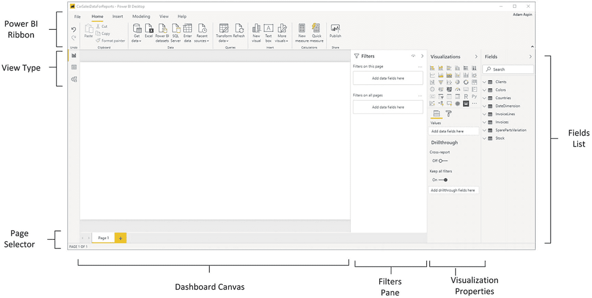

图 14-1 — Power BI Desktop

## Power BI Desktop 窗口

在进一步讲解之前，我想先说明一下 `Power BI Desktop` 窗口，因为从现在开始，你将在这本书中经常使用它。`Power BI Desktop` 窗口包含了图 14-1 中概述的元素。

可以看到，`Power BI Desktop` 屏幕简洁明了。它所包含的各种元素在表 14-1 中进行了说明。

**表 14-1** Power BI Desktop 选项

| 选项 | 说明 |
| --- | --- |
| Power BI 功能区 | 该区域包含了使用 `Power BI Desktop` 开发仪表板时可供使用的主要选项。 |
| 视图类型 | 这三个图标让你可以在仪表板视图（创建仪表板和报表）、数据视图（添加计算）和关系视图（连接不同来源的数据）之间切换。 |
| 仪表板画布 | 这是主要区域，你可以在其中添加可视化效果并设计仪表板。 |
| 可视化窗格 | 应用程序的这个区域特定于每种类型的可视化效果，并允许你设置仪表板上每个元素的特定属性。它还允许你筛选仪表板、页面和单个可视化效果。你也可以使用此窗格格式化可视化效果。 |
| 字段列表 | 在这里你可以看到源数据中所有可用的字段，你可以使用它们来构建可视化效果。 |
| 筛选器窗格 | 你应用于报表、当前页面或选定可视化效果的任何筛选器都会显示在此处。 |
| 可视化效果调色板 | 该区域包含所有当前可用的可视化效果类型，你可以将其添加到仪表板。 |
| 页面选择器 | 这些选项卡让你可以在报表的页面之间切换。 |
| 其他窗格 | `Power BI Desktop` 中还有几个其他可用窗格。但是，它们会保持隐藏状态，直到你选择显示它们。你将在后续章节中学习如何使用这些窗格。 |

`Power BI Desktop`（与大多数 Microsoft 应用程序一样）有多个可用的功能区。这些功能区将在本书中根据需要进行说明。

### 视图类型

在 `Power BI Desktop` 中，数据有三种主要视图。这些在表 14-2 中进行了概述。

**表 14-2** 视图类型

| 选项 | 图标 | 说明 |
| --- | --- | --- |
| 报表视图 |  | 这是在 `Power BI Desktop` 中创建报表（仪表板）的地方。它将是本书剩余章节的重点。 |
| 数据视图 |  | 此视图允许你查看已加载的数据。 |
| 模型视图 | 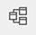 | 此视图（如第 13 章所示）允许你连接表以创建连贯的数据模型。 |

在本章以及所有专门用于创建仪表板和报表的章节中，我们将主要在报表视图中工作。

## 处理表格

表格可能是显示数据最简单、最基本的方式。但是，这种简单性不应减损其有用性。实际上，对于 `Power BI Desktop` 而言，普通的表格通常是默认的可视化效果。此外，正如你将在本章中看到的，对于非地理数据，表格是默认的呈现方式。

当然，我意识到花时间在一个通常被描述为直观的主题上似乎有些矛盾。对此，我只能说，虽然入门很容易，但要深入理解这个强大工具的所有潜力，确实需要一些解释。因此，我所采用的方法是尽可能彻底地介绍每个项目的所有可能性。因此，如果你还不需要所有细节，或者想略过复杂之处以便对整个主题有一个高层次的了解，可以随时向前（或向后）跳转。

### 创建基本表格

以下示例通过在 `Power BI Desktop` 中创建一个初始表格来向您介绍表格功能，该表格将显示客户名单及其总销售额：

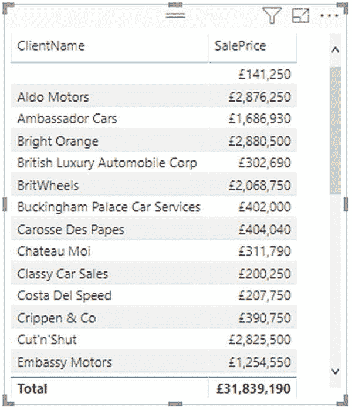

*图 14-2 每个客户的销售额基本表格*

1.  打开可下载示例中的 `C:\PowerBiDesktopSamples\CarSalesDataForReports.pbix` 文件。

2.  在“字段”列表中，展开 `Clients` 表。

3.  将 `ClientName` 字段拖到仪表板画布上。此时将显示一个包含 Brilliant British Cars 所有客户的表格。

4.  保持新表格的选中状态，然后在“字段”列表中展开 `InvoiceLines` 表。

5.  选中 `SalePrice` 字段左侧的复选框。这会将每个客户的累计销售额添加到表格中。结果应如图 14-2 所示。

这是一个非常小的表格。在实际应用中，您可能会遇到包含数千、数万（甚至数百万）条记录的表格。`Power BI Desktop` 通过仅加载向下滚动列表时所需要的数据（从数据中的前几条记录开始），来加速大型数据集的显示。因此，在大型表格中向下滚动时，您可能会看到滚动条前进得有些缓慢。

如果某个表格包含您在可视化对象中使用过的字段，则在选择该可视化对象时，该表格名称会在“字段”列表中以黄色显示。通过展开“字段”列表中的表格，您可以随时查看为该表格选择了哪些字段。所使用的字段会立即显示在“字段”列表（作为已选字段）和“可视化”窗格的字段井中。为了让您习惯这一概念，请参见图 14-3，该图展示了您刚刚创建的表格的这两个元素。

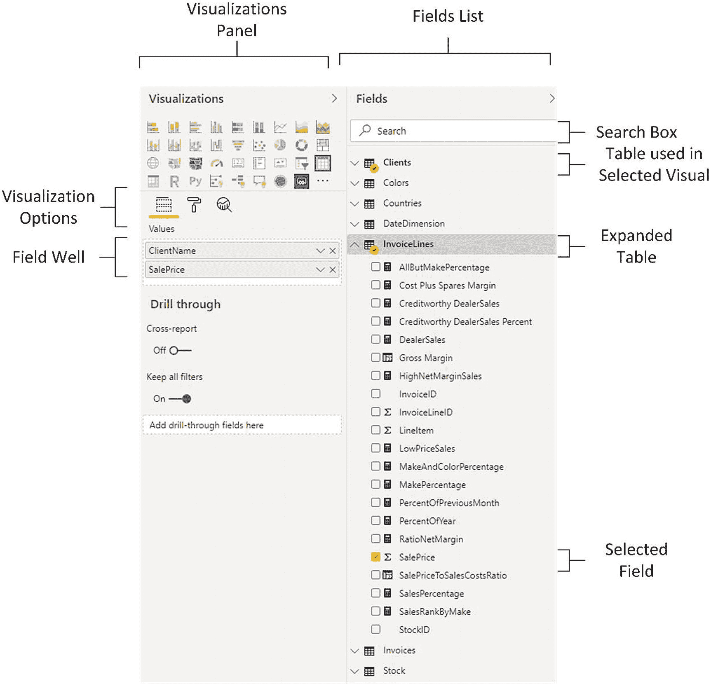

*图 14-3 可视化对象中使用的字段*

作为一款精良产品，`Power BI Desktop` 并不会将字段添加到表格的方式局限于一种。以下是向表格添加字段的几种方法：
-   将字段名称拖到“可视化”窗格的字段井中

# 添加和操作表格

在“字段”列表中选中字段（即勾选字段左侧的复选框）——前提是表格已被选中。

- 将字段拖到现有的可视化对象中

您可以随时向现有表格添加更多字段。需要牢记的关键点（如果您使用上述三种技术中的任何一种）是：必须**首先选择要修改的表格**。这只需在表格内部单击即可。单击后，您会立即看到表格处于活动状态，因为表格的边角以及每条边的中间会出现小尺寸控点。

> **注意：** 如果在添加字段之前没有选择现有表格，Power BI Desktop 将会使用您试图添加到表格的字段创建一个新的表格、图表或地图。如果误操作，只需删除这个新的可视化对象即可。

要创建另一个表格，只需在 Power BI Desktop 报表画布上任何现有可视化对象外部单击，然后像前面描述的那样开始选择字段。结果会创建一个新表格。Power BI Desktop 始终会尝试在画布的空白区域创建新表格。您很快就会了解到如何重新排列这种默认布局。

还有另一种创建表格的方法。即单击报表画布以确保取消选中所有现有可视化对象，然后在“可视化”窗格顶部的可视化对象选项板中单击表格图标。这将在报表画布上创建一个空白表格。您可以在图 14-4 中看到此图标，以及一个示例空表格。

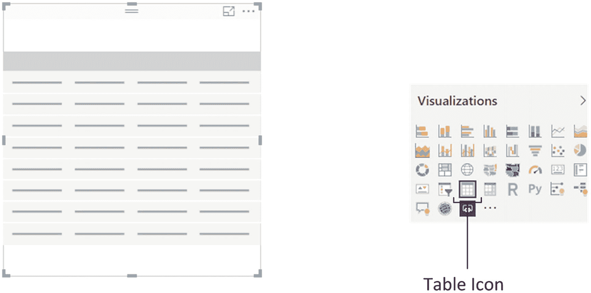
*图 14-4 表格图标*

## 选择表格

尽管可能显而易见，但我还是想提请您注意表格选择中的几个微妙之处，这些地方可能会让 Power BI Desktop 的新手感到困惑：

- 选择表格时，**避免**单击表格中的任何数据，因为这样会高亮显示该行并使其他数据变灰。除了影响可视性外，这还会应用交叉筛选——您可能不希望无意中应用此功能（您将在第 22 章中了解相关内容）。

- 始终通过单击数据外部来选择表格——或者更好的方法是，单击表格的顶部栏。您也可以单击表格边框来安全地选择它。

> **注意：** 如果您意外高亮显示了表格中的某一行（并因此使其余行变灰），只需再次单击该高亮行即可重置表格。

## 删除表格

假设您不再需要 Power BI Desktop 报表中的某个表格。删除它很简单：

1. 选择表格。您可以通过单击表格内的任意位置来完成此操作。即使将鼠标指针移开表格，表格边框也会显示出来。

2. 按 `Delete` 键。

选择表格的另一种方法是单击可视化对象（本示例中为表格）选中后右上角出现的选项按钮（省略号）。将显示该可视化对象的选项菜单。单击 `Remove` 选项将删除表格。您可以在图 14-5 中看到此上下文菜单。

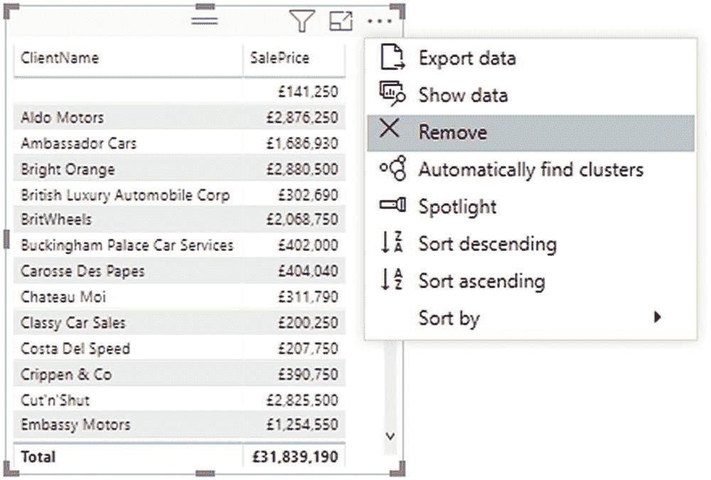
*图 14-5 表格可视化对象选项菜单*

删除表格非常容易，以至于您可能会误删，因此请记住，您可以通过按 `Ctrl+Z` 或使用 Power BI 窗口功能区左上角的 `撤消` 箭头来恢复意外删除的表格。

## 复制表格

在许多情况下，您需要复制表格。可能有以下几个原因：

- 您正在 Power BI Desktop 报表上创建新的可视化对象，并且需要该表格作为新元素（如图表）的基础。

- 您正在报表之间复制可视化对象。

- 您想保留一个表格示例，并在副本上尝试一些高级技巧，但希望保留旧版本作为安全选项。

无论哪种情况，您需要做的（正如您所料）就是：

1. 选择表格（如前所述）

2. 在“开始”功能区中，选择 `复制`（或按 `Ctrl+C`）

要粘贴副本，请单击当前或新 Power BI Desktop 报表中任何可视化对象的外部，然后从“开始”功能区选择 `粘贴`（或按 `Ctrl+V`）。

## 更改表格大小和位置

可以使用您在第 1 章中简要了解到的技术来调整表格大小和移动表格（就像 Power BI Desktop 报表中的任何其他可视化对象一样）。尽管您已经看到了这些可能性，但为了完整起见，我将在此处全面解释它们。

### 调整表格大小

调整表格大小非常容易。您需要做的就是单击任何表格控点并拖动鼠标。侧边的控点将改变表格宽度；顶部和底部的控点将改变表格高度；角控点通过更改所选角相邻两条边的尺寸来同时修改高度和宽度。

### 移动表格

移动表格就像将指针悬停在表格上方使其边缘显示，然后将其拖拽到新位置一样简单。

在微调仪表板上可视化对象的位置时，您可能更愿意使用键盘。用于执行此操作的键盘选项如表 14-3 所示。

**表 14-3 移动可视化对象的键盘快捷键**

| 选项 | 说明 |
|---|---|
| 向左微移 | 左光标键 |
| 向右微移 | 右光标键 |
| 向上微移 | 上光标键 |
| 向下微移 | 下光标键 |

---

## 更改列顺序

如果您已构建了一个 Power BI Desktop 表，最终将需要修改列从左到右的显示顺序。以下说明了如何执行此操作：

1. 激活 `Fields` 列表（除非它已显示）。

2. 在 `Visualizations` 窗格中，确保显示了 `Fields` 选项（通过单击可用可视化对象集合下的条形图小图标）。

3. 单击要移动的字段名称。

4. 将字段垂直拖拽到其新位置。该位置可以在现有字段之间，也可以在 `Fields` 列表的顶部或底部。一条粗黄线表示该字段将被放置的位置。

图 14-6 显示了如何将字段从一个位置拖拽到另一个位置。

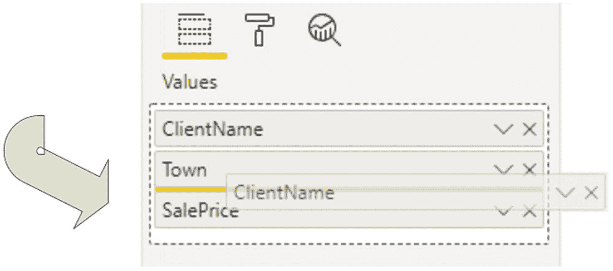
*图 14-6 – 通过移动字段更改列顺序*

> **注意：**
> 您无法通过在表格内部横向拖动列来更改其在表中的位置。

---

## 重命名字段

您还可以重命名可视化对象中的字段，而无需重命名数据表中的基础列。虽然这可能导致数据与其显示之间存在某种脱节，但在某些情况下，这是一种非常有用的技术。操作步骤如下：

1. 选择包含您要重命名的数据元素的可视化对象（在此示例中，我将使用您刚刚创建的表）。

2. 在 `Visualizations` 窗格的字段井中，右键单击要重命名的字段。

3. 从弹出菜单中选择 `Rename`。

4. 编辑字段名称 — 或者删除当前名称并输入新名称。

5. 按 `Enter` 键。

现在该字段已重命名。新名称将仅显示在选定的可视化对象中，而数据元素将保留其原始名称。

> **注意：**
> 在字段井中重命名字段也将重命名该字段。但是，这会将新名称应用于报表中的所有可视化对象。

---

## 从表中删除列

在 Power BI Desktop 中，另一项日常任务是在必要时从表中删除列。与重新排序列的顺序一样，此操作不是在表中直接完成，而是通过使用 `Fields` 列表来执行。实际上，有几种方法可以从表中删除列，我将从我认为最快的方法开始，然后描述其他方法：

1. 显示 `Fields` 列表 — 除非它已显示。

2. 取消选中 `Fields` 列表中的字段名称。

假设已选中一个可视化对象，以下是删除字段的其他方法：

- 在 `Visualizations` 窗格中，单击字段井中字段名称右侧的叉形图标。

- 在 `Visualizations` 窗格中，单击字段井中名称右侧的小三角形（请记住，这些是可视化对象中使用的字段）。当弹出菜单出现时，选择 `Remove Field`。

> **注意：**
> 请**不要**单击弹出菜单图标（字段名称右侧的省略号），然后在 *Fields list* 中选择 `Delete` 来从表中删除字段。执行此操作会从数据模型中删除该字段。

---

## 表粒度

Power BI Desktop 表将自动聚合数据到可用的最低粒度级别。简单来说，这意味着选择最低有用细节级别的数据，但不要添加毫无意义的细节元素非常重要。

如果我使用一个例子，这可能更容易理解。假设您从一个高聚合级别开始——例如国家/地区。如果您创建一个包含 `CountryName` 和 `SalePrice` 列的表，它将按国家/地区给出总销售额。如果您使用本书示例中给出的示例数据（`CarSalesDataForReports.pbix` 文件），此表仅包含大约六行左右。

然后在 `CountryName` 列之后添加 `ClientName` 列。执行此操作后，您将获得一组粒度更细的结果，其中包含**每个国家/地区每个客户**的聚合销售额。如果您（最后）添加 `InvoiceNumber`，您将获得非常详细的数据级别。确实，向表中添加如此精细的粒度可能会产生大量记录——如该表中出现的垂直滚动条所示。这些渐进的粒度级别如图 14-7 所示。

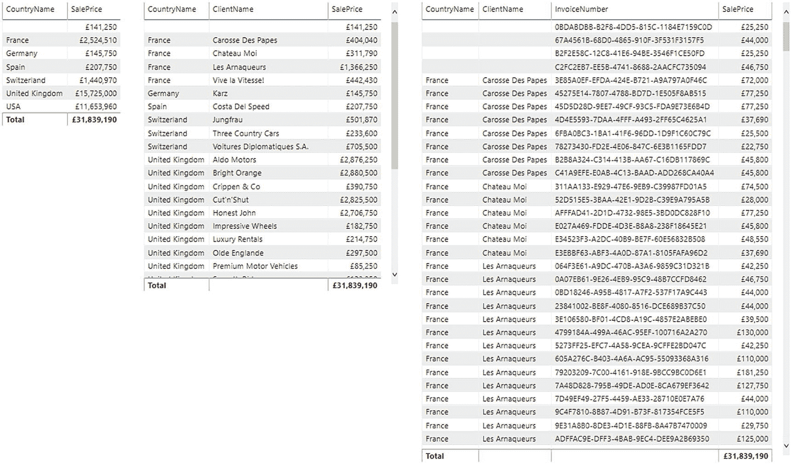

**图 14-7** – 渐进的表粒度

Power BI Desktop 始终尝试使用其基础数据模型中可用的信息来显示数据。

---

## 数据类型

并非所有数据都是平等的（或至少相同的），并且 Power BI Desktop 的基础数据模型将为您提供不同类型的数据。两种核心数据类型是：
- 描述性（非数字）属性
- 值（或数字度量）

Power BI Desktop 通过在多个字段旁边使用描述性图标来指示具体的数据类型，当您在 `Fields` 列表中展开数据表时可以看到这些图标。这些数据类型在表 14-4 中描述。

**表 14-4** – 数据类型

| 数据类型 | 图标 | 说明 |
| --- | --- | --- |
| 属性 | 无 | 一个描述性元素，是非数字的。它可以被计数，但不能被求和或求平均值。 |
| 聚合 |  | 一个可以更改其聚合类型的数字字段。 |
| 计算列 |  | 应用公式以创建新的计算列的结果。 |
| 计算 |  | 一个无法更改其聚合类型的数字字段，因为它是特定计算的结果。 |
| 地理 |  | 此字段可能用于地图中以提供地理参考。 |
| 二进制数据 |   | 此字段包含数据，例如图像。 |

数字字段不是唯一可以作为聚合添加的字段。如果您将属性字段添加到表中，然后通过单击 `Visualizations` 窗格中字段名称右侧的小三角形来显示此字段的弹出菜单，您可以选择 `Count`。您将在表的列中显示此属性的元素的*数量*，而不是元素的文本。图 14-8 为您显示了文本字段的示例弹出字段菜单。

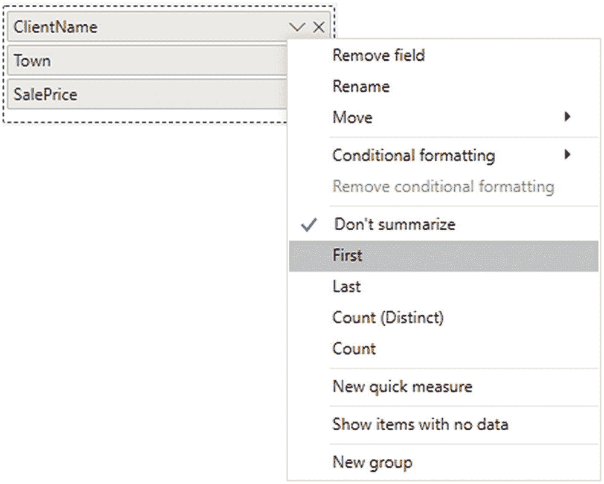

**图 14-8** – 文本字段的弹出菜单

## 搜索字段

如果你正在使用一个全新且尚不熟悉的数据集构建仪表板，你可能会浪费大量时间在可用表中仔细搜索所需的字段。

Power BI Desktop 通过 `Search`（搜索）字段让数据查找变得更加轻松。你可以在 `Fields`（字段）列表的顶部看到它。只需输入部分字段名称，即可立即筛选 `Fields`（字段）列表，仅显示包含你输入文本的字段。你可以在图 14-9 中看到一个示例。

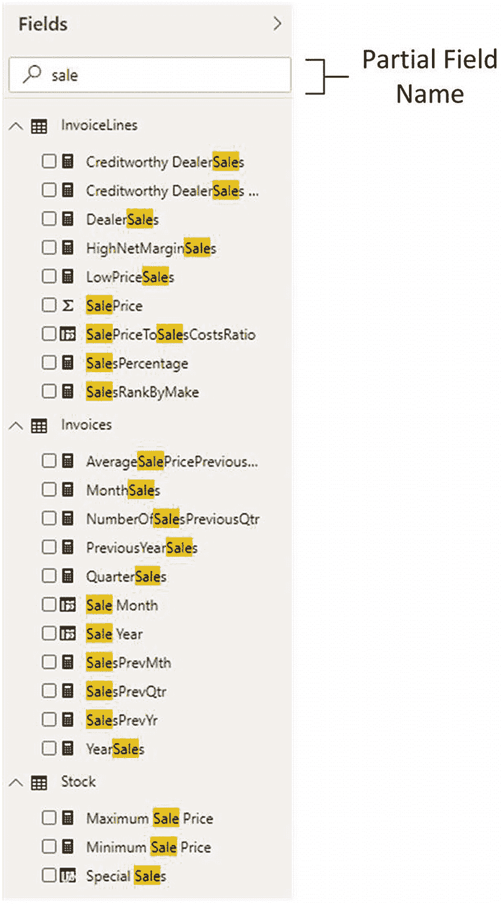

图 14-9 搜索字段

若要重置 `Fields`（字段）列表，使其显示所有可用的表和字段，只需删除搜索文本即可。

## 美化表格

因此，你已经设置了一个基本表格，并且其中的列顺序正确。很自然，下一步就是想让表格的呈现效果更吸引人一些。那么，让我们看看 Power BI Desktop 在这方面提供了什么。具体来说，我们将了解：
- 添加和删除合计
- 调整表格中的文本大小
- 更改列宽
- 按特定列中的数据对行进行排序

### 行合计

行合计会自动添加到所有数值字段中。但是，你可能希望删除这些合计。反之，你也可能希望添加之前删除的合计。无论如何，要从表格中删除所有合计：

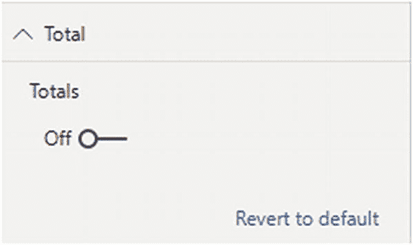

图 14-10 可视化窗格中表格的格式选项

1. 根据字段 `ClientName`（客户名称）、`Town`（城镇）和 `SalePrice`（销售价格）创建一个表格。
2. 在 `Visualizations`（可视化）窗格中，单击 `Format`（格式）图标（位于可用可视化类型调色板下方的小油漆滚筒）。将显示所选表格的格式选项。
3. 通过单击 `Total`（合计）一词左侧向下的 V 形图标展开 `Total`（合计）部分。
4. 将实心圆按钮（位于 `Totals`（合计）右侧）向左拖动（或单击按钮左侧或按钮本身）。它将变成一个空心圆，并且格式选项中的 `On`（开启）将变为 `Off`（关闭）。`Visualizations`（可视化）窗格将如图 14-10 所示。

若要在没有合计的情况下添加合计，请按照上述步骤操作（选中表格），然后在第 4 步中，将 `Off`（关闭）按钮向右拖动以将 `Totals`（合计）设置为 `On`（开启）。你可以在图 14-11 中看到你之前创建的表格（不含合计）。

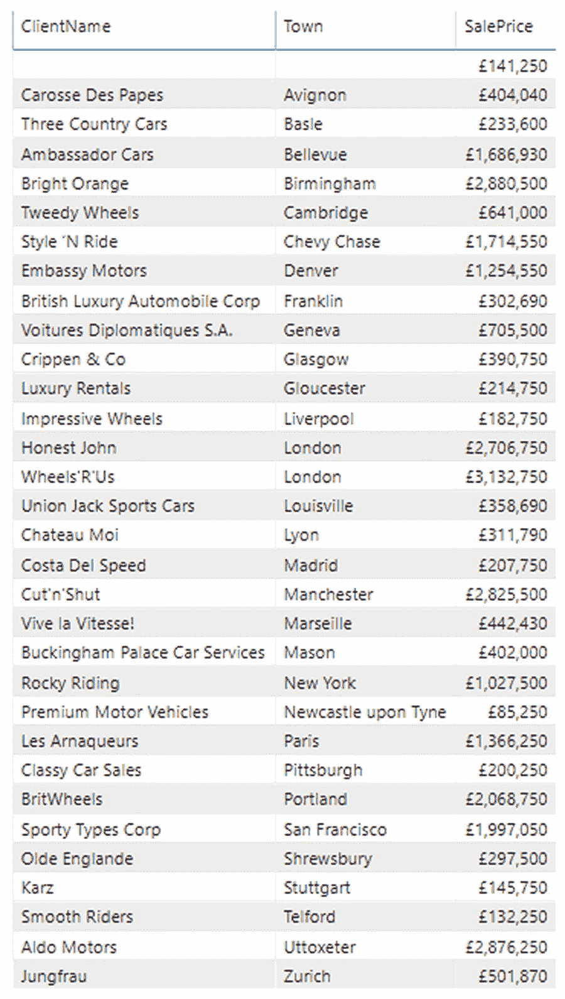

图 14-11 不含合计的初始表格

**注意**：只有当表格显示多条记录时，你才能添加或删除合计。如果表格显示的是某个值的最高聚合级别，则无法显示任何合计，因为你已经在查看总计了。在这种情况下，`Totals`（合计）按钮会变灰。

### 在报表中设置数字格式

你目前无法直接在 Power BI Desktop 报表的表格中设置数字格式。这是因为所有数字格式都集中在数据模型中。因此，如果你想应用与将值添加到表格时显示的格式不同的数字格式，则必须切换到 `Data View`（数据视图）并在那里应用格式。如果你需要回顾具体操作步骤，只需翻回到第 13 章，快速复习一下如何在 Power BI Desktop 中设置数字格式。

### 表格中的字号

你可能希望更改 Power BI Desktop 在首次创建表格时应用的默认字号。这很容易做到：
1. 选择该表格。
2. 在 `Visualizations`（可视化）窗格中，单击 `Format`（格式）图标。
3. 通过单击 `Values`（值）一词左侧向下的 V 形图标展开 `Values`（值）部分。
4. 单击当前文本大小右侧的向上或向下箭头。新的文本大小（以磅为单位）将显示在 `Text Size`（文本大小）框中，并且表格中文本的实际大小将增大。

以下是关于表格中字号的一些要点：
- 如果你愿意，可以在 `Text Size`（文本大小）框中输入字号以指定精确大小。更改字号*不会*导致表格变大或缩小，因为 Power BI Desktop 将继续像使用之前字号时一样，每列显示相同数量的字符。因此，你可能最终需要将 `Auto-size`（自动调整大小）设置为 `On`（开启）（这将在下一节中介绍）或调整表格大小（如前所述），以使表格完全符合你的要求。
- 此格式选项仅影响表格中*记录*的大小，而不影响列标题。要更改标题字体的大小，请展开 `Formatting`（格式）窗格的 `Column Headers`（列标题）部分，并使用完全相同的方法设置字号。这次，被更改的将是标题字体。

### 更改列宽

Power BI Desktop 会在你创建初始表格时自动设置列宽，以便所有数据都可见。

但是——正如你所期望的那样——你也可以手动调整表格中各个列的大小。操作方法大致与在 Excel 中相同：
1. 在列标题行中，将鼠标指针放在该列的最右边边缘。
2. 向左或向右拖动以调整列宽。

**注意**：正如你对一款面向 Excel 用户的产品所期望的那样，你可以双击列标题右侧的列分隔线，让 Power BI Desktop 自动调整列宽，以适应当前可见的最宽数据元素。

#### 禁止自动调整列宽并启用自动换行

如果你愿意，可以阻止 Power BI Desktop 自动重置列宽，并且还可以激活自动换行功能，以确保列中的文本不会被截断，而是流入下一行。操作方法如下：

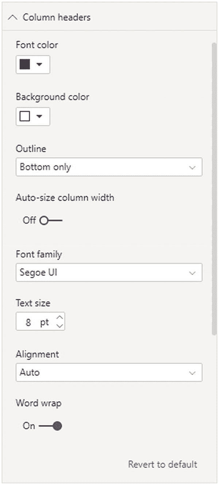

图 14-12 禁止表格的自动列宽调整

1. 选择该表格。在此示例中，我使用你在图 14-11 中看到的表格。
2. 在 `Visualizations`（可视化）窗格中，单击 `Format`（格式）图标（位于可用可视化类型调色板下方的小油漆滚筒）。将显示所选表格的格式选项。
3. 通过单击 `Column Headers`（列标题）一词左侧向下的 V 形图标展开 `Column Headers`（列标题）部分。
4. 单击 `Auto-size column width`（自动调整列宽）按钮。它将变成一个空心圆，并且格式选项中的 `On`（开启）将变为 `Off`（关闭）。
5. 将 `Word wrap`（自动换行）设置为 `On`（开启）。`Visualizations`（可视化）窗格将如图 14-12 所示。

现在，你可以更改表格中所用字体的大小，而不会导致列宽增大或缩小。相反，将 `Auto-size`（自动调整大小）选项重置为 `On`（开启）会导致列宽重新自动调整，以显示该列中最宽的元素。

**注意**：如果你正在设置表格格式，并且开始对哪些选项处于活动状态以及如何最好地重新开始感到有些困惑，你始终可以单击 `Revert to default`（恢复默认设置）以重新应用表格（或任何可视化对象）的标准“出厂设置”。

### 按列排序

表中的任何列，无论其数据类型如何，都可用作排序依据。要排序表格，只需点击列标题。表格中的行将根据所选列中的元素进行排序。首次对列进行排序时，排序顺序为 A 到 Z（对于数值，则为从低到高）。

表格一旦排序，便无法取消排序。不过，您可以使用另一列来重新排序数据。或者，您可以再次点击列标题，以相反顺序排序——Z 到 A（对于数值，则为从高到低）。

有关列排序的示例，请参见图 14-13（我将使用您为图 14-11 创建的表格）。您可以看到，数据按 `SalePrice` 从高到低排序。此外，在 `SalePrice` 列的标题下方，可以看到一个小朝下三角形。这表示该列按从最高值到最低值的顺序排序。

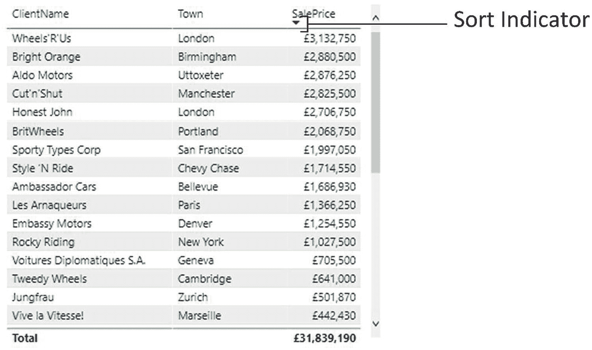
图 14-13 按数值列排序表格

有时，您是对一个字段的列进行排序（迄今为止的所有示例皆是如此），但实际排序操作却以另一列为基础。例如，您可以按月名称排序，但看到的结果是按月份数字排列的（这样您就不是按字母顺序，而是按数字顺序对月份进行排序）。您已在第 13 章中看到了如何配置。

## 格式化表格

作为精美产品的应有之义，Power BI Desktop 甚至可以提升普通表格的呈现效果，使其脱颖而出，并达到受众期望的引人注目的效果。当前可用的格式设置选项包括：

* 添加自动表格样式
* 设置标题格式
* 修改表格背景
* 添加和删除表格边框
* 设置行格式——包括交替行
* 添加和删除表格网格
* 设置列标题格式
* 列格式设置
* 设置总计格式
* 条件格式——包括色阶、字体颜色、数据条和“KPI 样式”图标

我确信，随着 Power BI Desktop 的日趋成熟，这些选项将继续得到发展。因此，当您阅读本书时，可能会看到进一步的呈现增强功能。不过，目前，我们先来看看当前可用的选项。

**注意**：没有专门用于设置表格中数字格式的选项。您可以通过点击 Power BI Desktop 窗口左侧的数据图标，选择要格式化的列，然后在 `建模` 功能区中选择一种数字格式来格式化数据。此格式随后将以相同方式应用于所选字段所在的每个视觉对象。

### 表格样式

Power BI Desktop 允许您从九种不同的方式中选择，只需几次点击即可快速格式化表格。这包括移除所有表格格式的选项。要格式化整个表格：

1. 点击表格内部以进行格式化。
2. 在 `可视化` 窗格中，点击 `格式` 图标。
3. 展开 `表格样式` 部分。从可用选项中选择一种表格样式。

您可以在表 14-5 中查看可用表格样式的范围。
表 14-5 可用的表格样式

| 矩阵样式 | 描述 |
| --- | --- |
| 默认 | 为交替行添加灰色背景。 |
| 无 | 移除所有格式。 |
| 最小化 | 在记录之间添加浅色间距。 |
| 粗体标题 | 为标题行添加深色背景。 |
| 交替行 | 为交替行添加灰色背景，并为标题行和总计行添加深色背景。 |
| 对比交替行 | 在浅灰色和深灰色之间交替行背景。为标题行和总计行添加深色背景。 |
| 鲜艳行 | 在浅绿色和深绿色之间交替行背景。 |
| 粗体标题鲜艳行 | 在浅绿色和深绿色之间交替行背景。为标题行和总计行添加深色背景。 |
| 稀疏 | 为标题行和总计行添加深色背景，并移除分隔行的浅色线条。 |
| 紧凑 | 为标题行和总计行添加深色背景，并在行列之间添加垂直和水平线条。 |

您可以添加的表格样式实际上不过是预设值。如果您希望精确定义表格中记录的显示方式，可以应用接下来几节中解释的各种选项。

**注意**：要移除表格样式并恢复到“普通样式”的呈现，只需从可用表格样式的弹出列表中选择 `无` 即可。

### 添加和设置标题格式

与 Power BI Desktop 中的大多数可视化对象一样，表格也可以有标题。添加标题后，您可以设置其：

* 字体颜色
* 背景颜色
* 文本对齐方式

尽管这很简单，但我还是倾向于为了完整性而解释所有选项。

1. 选择表格。在此示例中，我使用您在图 14-11 中看到的基于 `Town`、`ClientName` 和 `SalePrice` 的表格。
2. 在 `可视化` 窗格中，点击 `格式` 图标（可用可视化类型调色板下方的小油漆滚筒）。将显示所选表格的格式设置选项。
3. 通过点击 `标题` 一词左侧的向下 V 形展开 `标题` 部分。
4. 点击 `关` 一词右侧的空心圆右侧。这将为所选表格激活标题。
5. 在 `标题文本` 右侧的空白框中，为表格输入一个标题。我建议使用 **按城镇销售额**。
6. 点击 `字体颜色` 右侧的弹出菜单三角形，并从可用色调调色板中选择一种颜色。
7. 点击 `背景颜色` 右侧的弹出菜单三角形，并从可用色调调色板中选择一种颜色。
8. 点击 `对齐` 右侧的中间图标。这将使文本相对于表格宽度居中对齐。
9. 使用箭头增加标题字体的大小。

格式设置选项和表格将如图 14-14 所示。

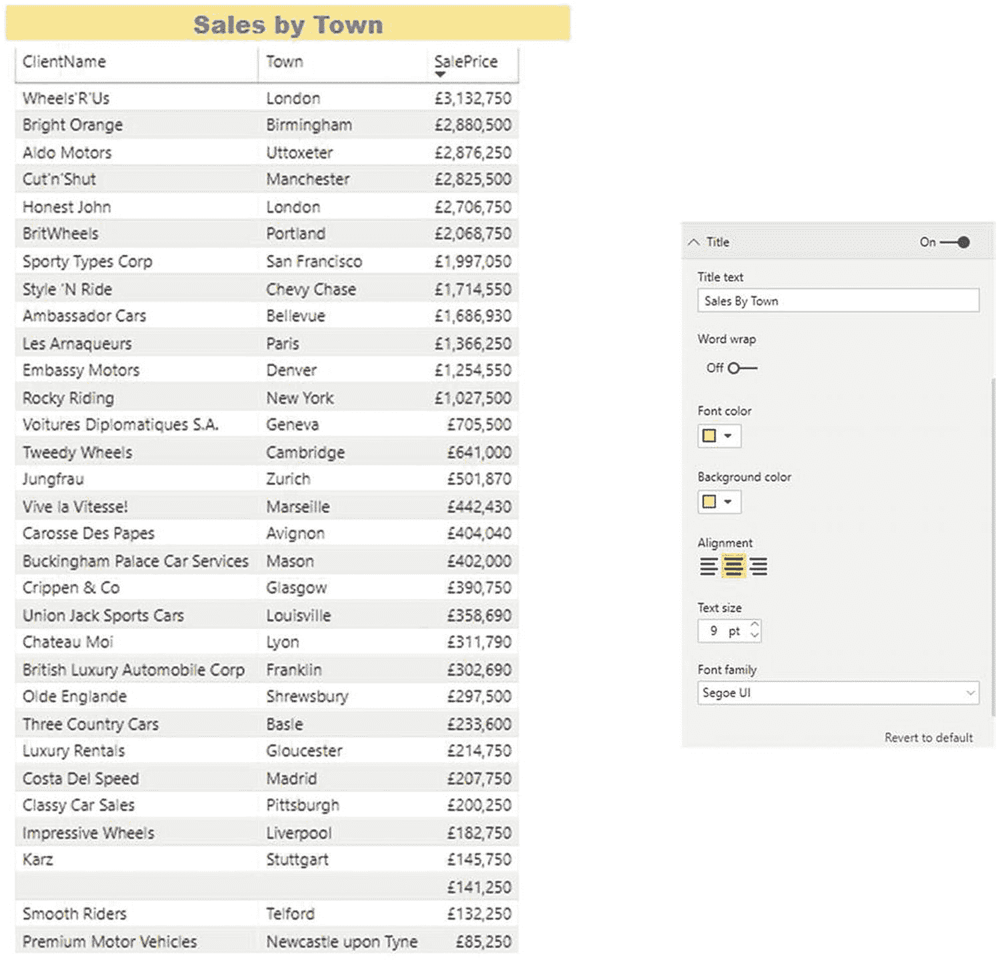
图 14-14 表格标题选项

**注意**：如果您愿意，也可以在 `文本大小` 字段中输入所需的字体大小。

### 修改表格背景

表格标题并非唯一可修改以增强视觉效果的元素。你还可以调整表格本身的若干属性，为仪表盘增添亮点。以下是可以修改的两个方面：

- 背景颜色
- 表格透明度

以下示例展示了这两种修改方法：

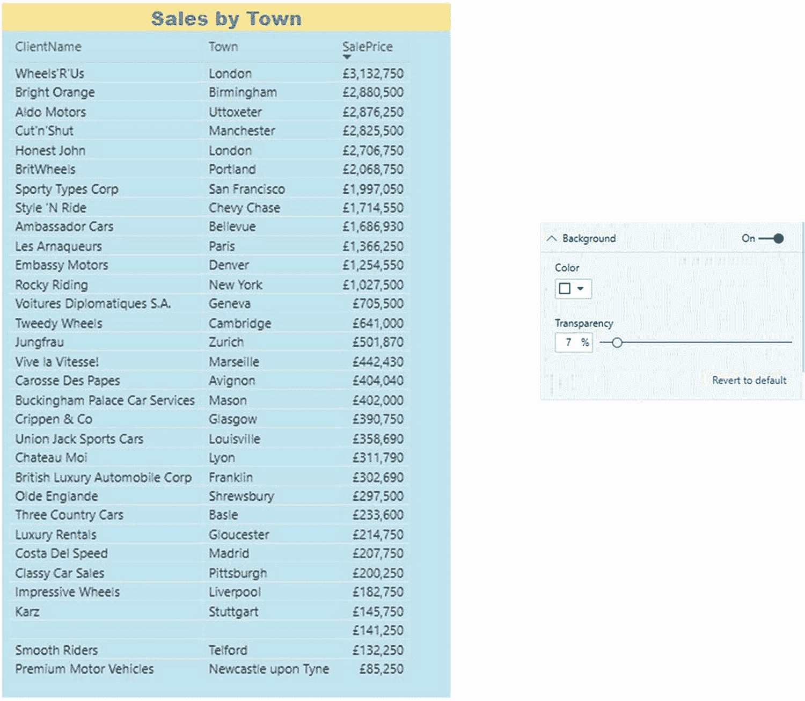
**图 14-15** 为表格设置背景颜色

1. 选中该表格。在本例中，我使用的是你在图 14-14 中看到的表格。
2. 在`可视化`窗格中，点击`格式`图标（位于可用可视化类型面板下方的小油漆滚筒图标）。此时将显示所选表格的格式设置选项。
3. 将`样式`设置为`无`。
4. 点击`背景`字样左侧向下的 V 形箭头，展开`背景`部分。
5. 确保`背景`字样右侧的开关已设置为`开启`（如果没有，则点击空圆圈右侧进行更改）。
6. 点击`颜色`右侧的弹出菜单三角形，从可用颜色面板中选择一种颜色。
7. 点击`透明度`滑块开关，并将其向左滑动，通过降低透明度百分比来加深背景颜色。此时格式设置选项和表格将如图 14-15 所示。

**注意**：你可以看到，使用此技术，你仅设置了表格可视化对象的背景，而并非构成表格本身的单元格行和列。你将在稍后几页中学习如何格式化行和列。

### 表格边框

若要增添更多视觉效果，你可以为任何表格添加外边框。操作方法如下：

1. 选中该表格。在本例中，我使用的是你在图 14-15 中看到的表格。
2. 在`可视化`窗格中，点击`格式`图标。此时将显示所选表格的格式设置选项。
3. 将`边框`按钮向右滑动。这将为表格应用一个边框。
4. 展开`边框`部分。
5. 从弹出面板中的可用颜色中选择一种边框颜色。
6. 向右拖动`圆角半径`按钮，以定义边框圆角的大小。

### 行格式设置

在前面的章节中，你已了解如何更改表格中行的字体大小。这只是可应用于表格行的格式设置选项之一。以下是其他一些可能性：

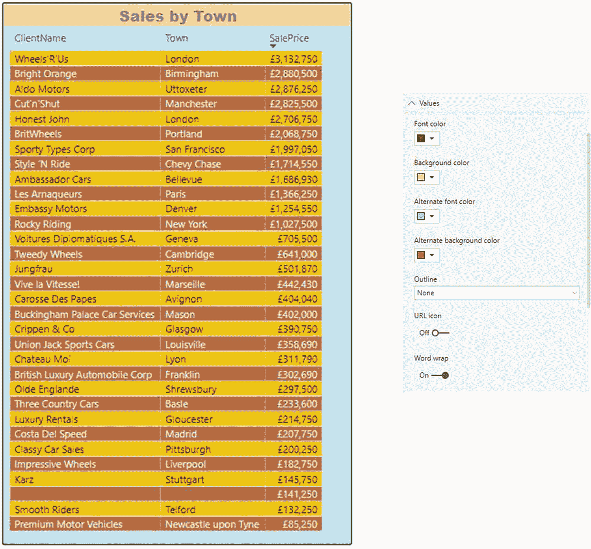

`图 14-16` 设置表格的交替行格式

1.  选中你想要美化的表格。在本例中，我使用的是你在图 14-10 中看到的表格。
2.  在`可视化`窗格中，点击`格式`图标。
3.  展开`值`部分。
4.  选择一种背景颜色以及一种交替背景颜色。
5.  选择一种字体颜色以及一种交替字体颜色。
6.  从可用的轮廓样式中选择`轮廓`。
7.  调整左侧两列的宽度。表格应大致如图 14-16 所示。

目前有七种可用的轮廓样式，外加移除所有轮廓样式的选项。这些样式在`表 14-6`中加以说明。

`表 14-6` 可用的轮廓样式

| 轮廓样式 | 说明 |
| --- | --- |
| `无` | 移除标题的边框。 |
| `仅底部` | 为标题添加底部边框。 |
| `仅顶部` | 为标题添加顶部边框。 |
| `仅左侧` | 为标题添加左侧边框。 |
| `仅右侧` | 为标题添加右侧边框。 |
| `顶部 + 底部` | 为标题同时添加顶部和底部边框。 |
| `左侧 + 右侧` | 为标题同时添加左侧和右侧边框。 |
| `框架` | 为标题添加一个框架。 |

在此之际，我还有几点补充说明：
- 选择轮廓样式将为整个表格添加边框，该边框位于`可视化对象内部`，与你之前应用于整个可视化对象外边缘的表格边框不同。
- 启用自动换行将使所有列中的文本换行到下一行。这会增加任何受影响行的高度。
- 在`值`部分启用`URL 图标`选项，会将 URL 文本转换为图标。

## 表格网格

如果你使用`可视化`窗格格式设置选项中的`表格网格`部分，则可以更精确地扩展表格的呈现效果。

让我们以图 14-16 中的表格为例，看看这是如何工作的：
1.  选中要格式化的表格，并在`可视化`窗格中点击`格式`图标。
2.  展开`网格`部分。
3.  将`垂直网格`开关切换为`开启`以显示垂直网格线。
4.  从可用颜色面板中为垂直网格线选择一种颜色。
5.  在`垂直网格线粗细`字段中输入`3`。
6.  从可用颜色面板中为水平网格线选择一种颜色（此项默认应为开启状态；如果未开启，只需将`水平网格`的按钮向右滑动即可）。
7.  将`水平网格`按钮向右滑动，为水平网格线设置不同的粗细。
8.  在`行内边距`字段中输入`5`。
9.  从可用颜色面板中为轮廓颜色选择一种颜色。
10. 在`轮廓粗细`字段中输入`5`。
11. 在`文本大小`字段中输入`10`。
12. 调整列宽，以在列中显示所有文本和数字。

你可以在图 14-17 中看到这些更改的结果。我绝不是说这些增强功能具有任何深刻的审美价值——但至少你可以看到如何使用 Power BI Desktop 来格式化数据。

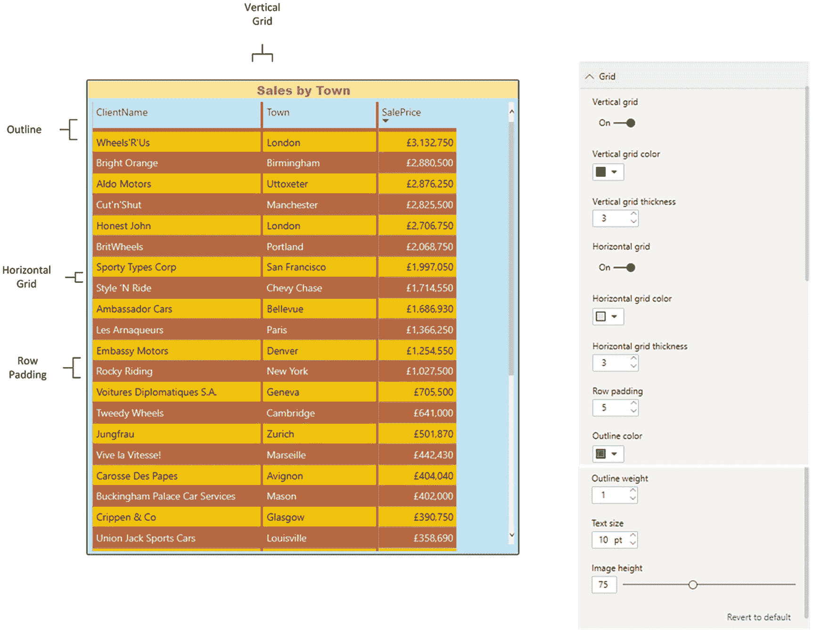

`图 14-17` 表格网格设置

> **注意**：根据你显示器的分辨率，你可能需要向下滚动`格式设置`窗格的`网格`部分。这可以通过使用`网格`部分右侧的灰色垂直滚动条来完成。

## 列标题

Power BI Desktop 还允许你修改列标题的格式。你可以执行以下调整以查看实际效果：

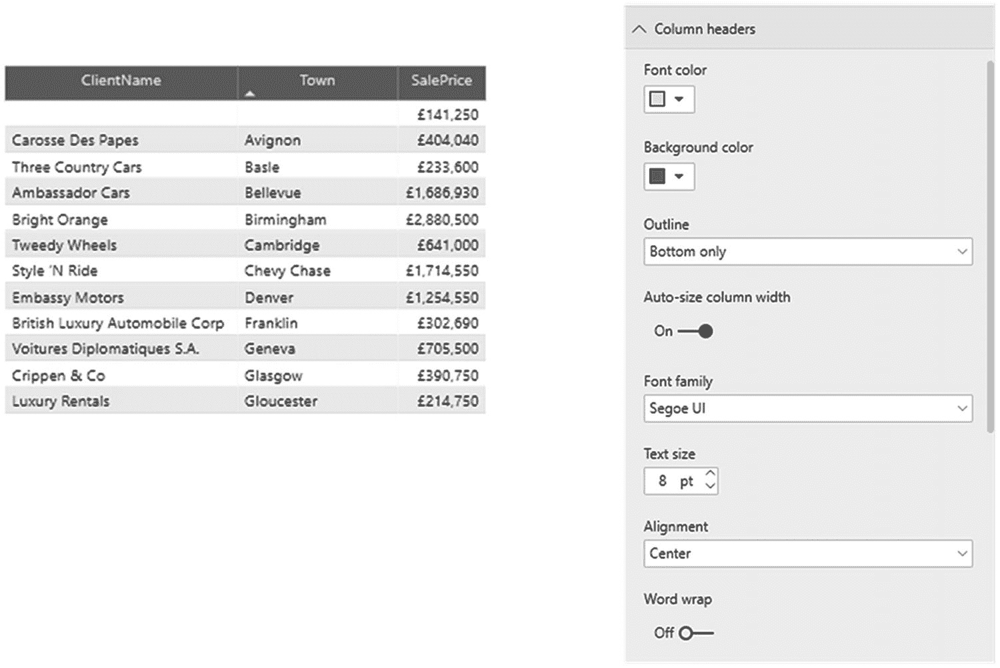

`图 14-18` 设置列标题格式

1.  使用默认表格样式，重新创建图 14-14 中的初始表格。
2.  展开`列标题`部分。
3.  使用相应的颜色面板分别为字体和背景设置颜色。
4.  点击向上箭头增大标题的字体大小。
5.  选择`居中对齐`作为`对齐方式`。
6.  在`轮廓`弹出菜单中，选择`顶部 + 底部`。这些样式与你之前应用于行值的样式相同，并在`表 14-6`中有详细说明。你可以在图 14-18 中看到最终的格式效果。

> **注意**：如果你选择在`文本大小`字段中输入文本大小值，请注意存在不可超过的限制。例如，如果你输入的数字小于 8，Power BI Desktop 将拒绝应用所请求的字体大小，并为`文本大小`字段添加红色轮廓。之后，你将需要输入一个有效的数字。

## 字段格式

可以单独设置每一列的格式。Power BI Desktop 将此称为字段格式。你需要知道，在实践中，过度使用此技术极易导致表格完全难以辨认。尽管如此，学习如何格式化单个列仍然值得。

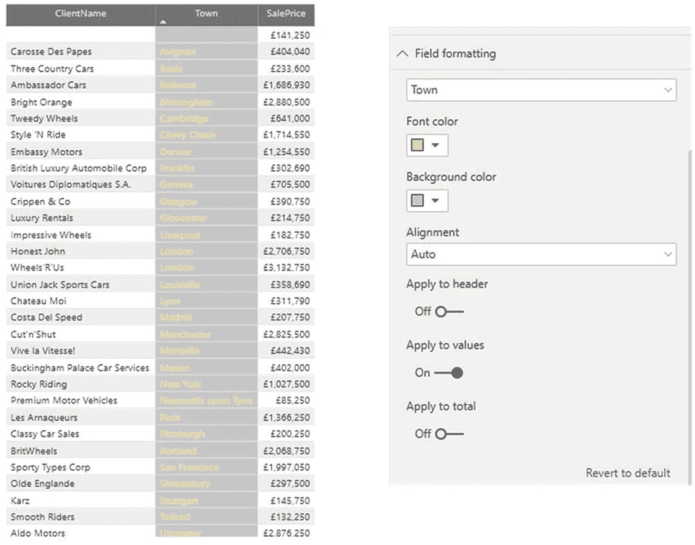

`图 14-19` — 添加列格式

1.  使用默认样式重新创建图 14-11 中的表格。
2.  展开`字段格式`部分。
3.  从`列格式`部分顶部的弹出列表中，选择要设置格式的列的列标题。本例中我将选择`城镇`。
4.  使用相应的调色板，分别设置字体和背景颜色。
5.  将`应用于总计`设置为`开`。
6.  将`应用于值`设置为`开`。
7.  保持`应用于标题`为`关`。
8.  你可以在图 14-19 中看到输出结果。

## 格式化总计

Power BI Desktop 允许你对表格中的总计进行更多操作，而不仅仅是启用或禁用它们。你可以格式化总计以增强其可见性（或者相反，尝试转移人们对不佳数据的注意力），如下所示：

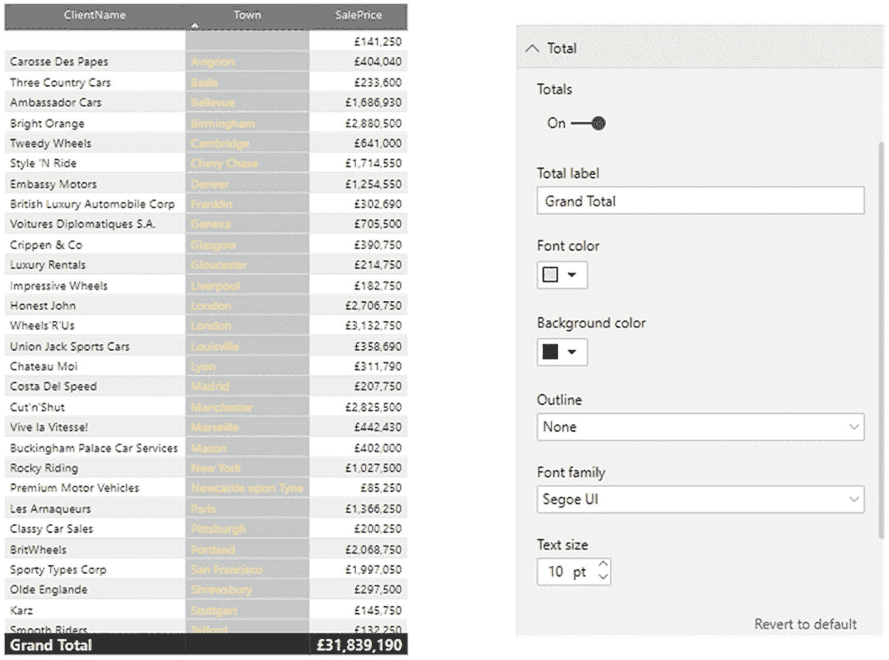

`图 14-20` — 格式化总计

1.  重新创建你在图 14-19 中看到的表格。
2.  在`可视化`窗格中（当然，保持表格处于选中状态），激活`格式`面板并展开`总计`部分。
3.  确保`总计`选项设置为`开`。
4.  从调色板中选择一种字体颜色。
5.  从调色板中选择一种背景颜色。
6.  输入合适的总计标签。
7.  将轮廓设置为`无`。
8.  输入一个数值或调整滑块以获得更大的字号。你可以从图 14-20 中看到这些操作的结果以及`格式设置`窗格的`总计`部分。

## 条件格式

数据表可以传达大量信息，但它们很少能让人立即理解数字的含义。这正是可以应用条件格式将数据转换为立即可用信息的地方。事实上，你可能已经习惯于在 Excel 电子表格中应用这些增强功能了。

在 Power BI Desktop 中，有四种类型的条件格式可以应用于为你的数字添加含义：
- `背景颜色`：为表格单元格的整个背景添加颜色阴影。阴影的强度反映了数据中选定的值。
- `字体颜色`：根据选定值更改文本的颜色。
- `数据条`：为表格单元格添加背景条。这里条的大小代表单元格中的值。
- `图标`：添加一个图标（KPI 指示器）以引起对单元格相对于另一个值的注意。

> **注意**：条件格式只能基于包含数值的字段中的值来使用，不能基于文本元素。但是，显示条件格式的字段（或者如果你愿意，可以称为列）不一定必须是其数据用于定义条件格式的那个字段。

### 背景颜色

色阶是一种应用于列中每个单元格的背景颜色。实际颜色会根据每行的值而变化。作为一个色阶如何工作的例子，请尝试以下操作：

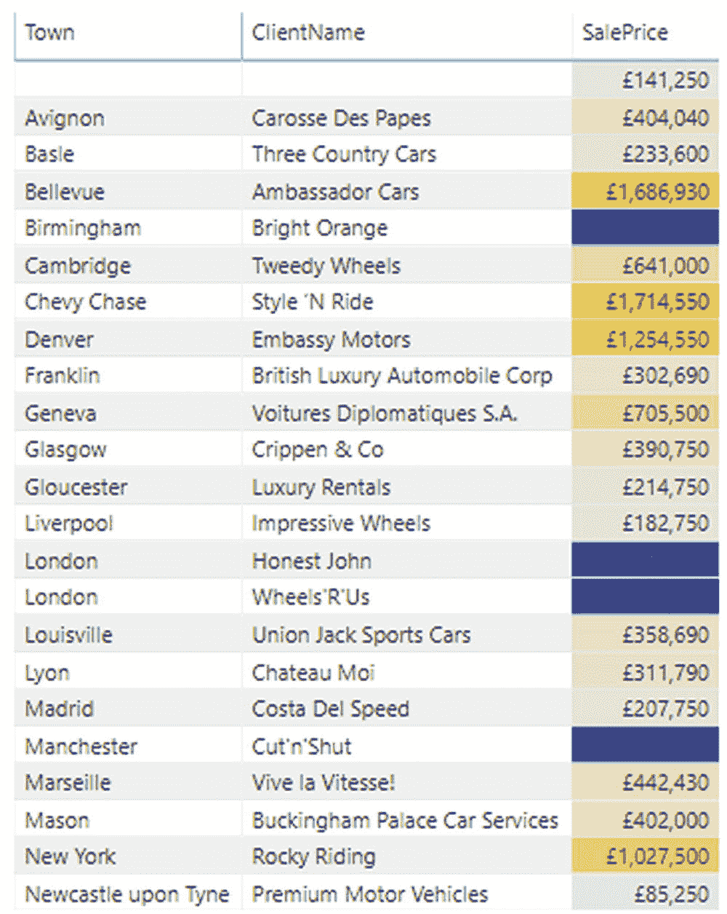

`图 14-22` — 应用了色阶的表格

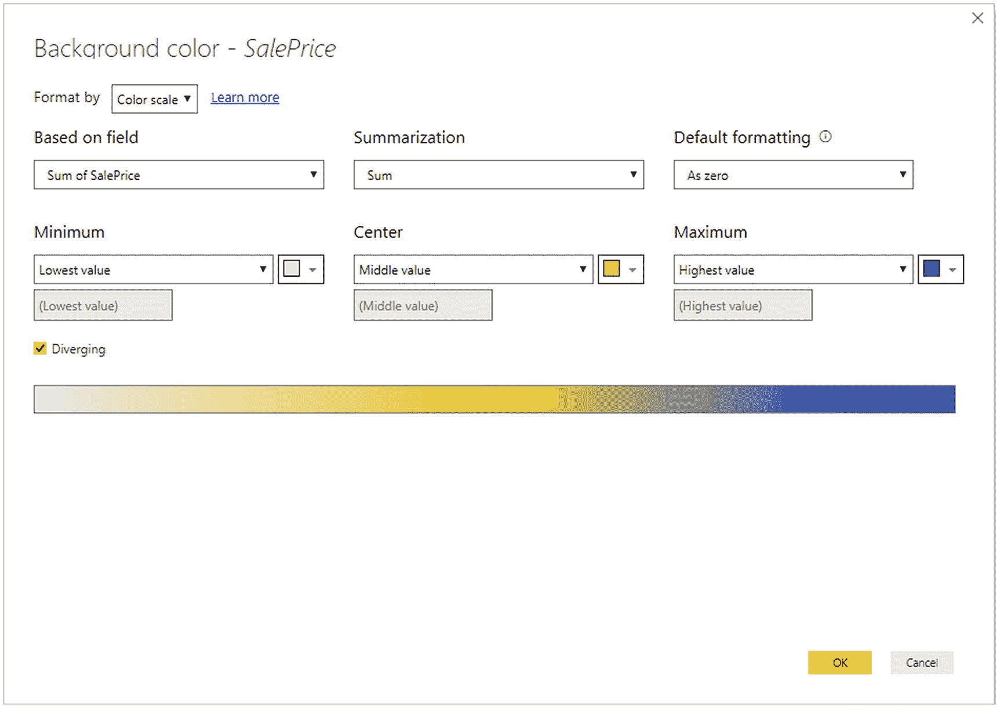

`图 14-21` — 色阶对话框

1.  重新创建图 14-11 中的表格。确保表格保持选中状态。
2.  单击`可视化`窗格中的`格式`图标，并展开`条件格式`部分。
3.  从表格列的弹出列表中选择要设置格式的列名称（在本例中是`销售价格`列）。
4.  将`背景颜色`按钮设置为`开`。
5.  单击`高级控件`链接。将显示`背景颜色`对话框。
6.  从`格式依据`弹出列表中选择`色阶`。
7.  从`汇总方式`弹出列表中选择一种`汇总方式`。在本例中，我建议选择`求和`。
8.  在`基于字段`弹出列表中选择`销售价格`字段。你会看到它在对话框中表示为`销售价格的总和`。
9.  在`设置空白值格式`弹出列表中，选择`为零`。
10. 为最小值设置颜色，从弹出调色板中选择一种较浅的颜色。
11. 选中`发散`复选框。
12. 为中心值设置颜色，从弹出调色板中选择一种中等的颜色。

13. 在`中心`的弹出列表中，选择`数字`。

14. 在现已启用的数字字段中输入`25000`。

15. 为最大值设置颜色，从弹出调色板中选择一种较深的颜色。`色阶`对话框将如图 14-21 所示。

16. 单击`确定`。表格将如图 14-22 所示。

在定义条件格式时，有几点值得注意：

- 你可以选择任何字段作为背景颜色阴影的基础——这个字段不必是实际在表格中显示阴影的那个字段。

- 正如你在第 15 步中看到的，在设置背景颜色时，你可以让 Power BI Desktop 自动检测最小值、最大值和中位数值，也可以自己定义特定值。

- 如果你不选中`发散`复选框，则只能定义两种颜色的范围。

- 你可以通过三种方式定义背景颜色：

  - `色阶`（我们在此处所做的）

  - `规则`（我们将在下一节定义字体颜色时介绍）

  - `字段值`（我将在下一节解释）

- 正如你在第 8 步中看到的，你可以从整个数据模型中选择一个字段作为条件格式的基础。

- 定义条件格式时，可以使用你期望的标准汇总方式（`求和`、`平均值`、`计数`等）。

### 文本颜色

另一种条件格式选项是通过条件格式设置每个值的文本颜色。这与对单元格背景应用条件格式非常相似。实际上，在此示例中，我将扩展之前的示例，对您刚刚创建的表格文本应用条件格式。不过这次，我们将对`Town`列应用基于规则的格式。

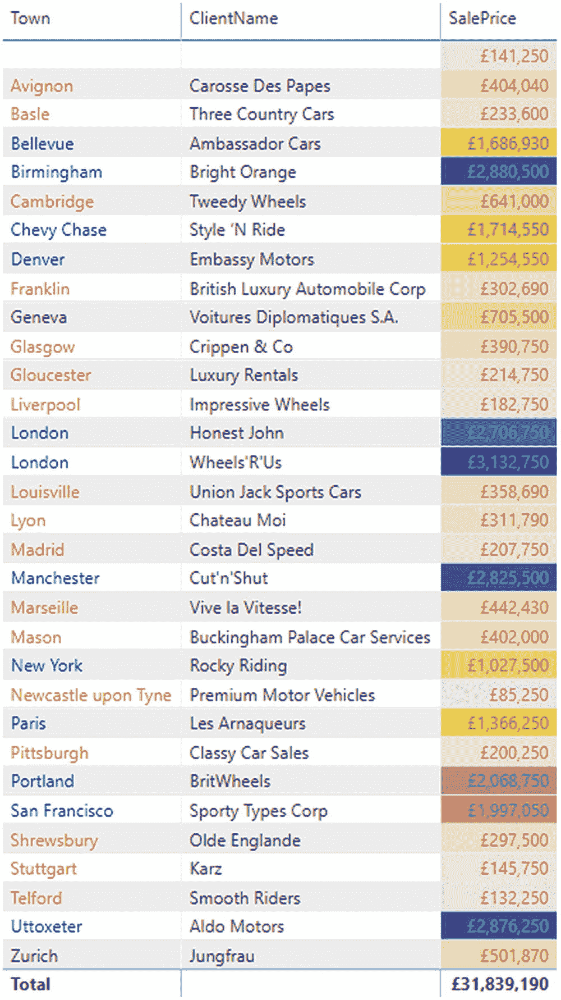

图 14-24：对表格应用条件文本和背景

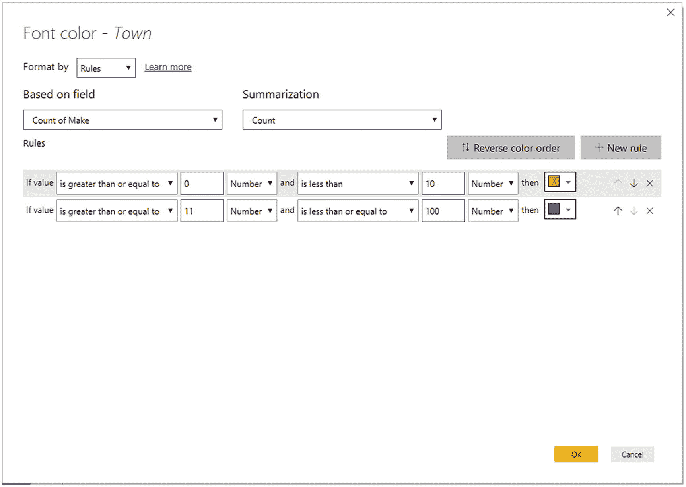

图 14-23：背景色阶对话框

1.  选择您在上一节中创建的表格。

2.  在“可视化”窗格中，单击“格式”图标。

3.  展开“条件格式”部分。

4.  从要格式化的列弹出窗口中选择`Make`列。

5.  将`字体色阶`设置为“开”。

6.  单击`字体颜色`的`高级控件`。将显示“字体颜色”对话框。

7.  从`格式化方式`弹出窗口中选择`规则`。

8.  为`基于字段`选择`Make`。

9.  将`汇总`保留为`计数`。

10. 从调色板中选择最小值的一种颜色。

11. 将`如果值`设置为以下内容：`大于或等于 0`（数字）且`小于 10`（数字）。

12. 从调色板中为此规则选择一种颜色。

13. 单击`+ 新建规则`按钮。新的规则行将出现在您刚刚创建的规则下方。

14. 将此规则的`如果值`设置为以下内容：`大于或等于 11`（数字）且`小于 100`（数字）。

15. 从调色板中为此规则选择一种颜色。对话框将类似于图 14-23 所示。

16. 单击`确定`。表格将类似于图 14-24 所示。

> **注意：** 如果您愿意，可以将文本和背景设置为不同的颜色（使用相同或不同的规则集），以获得与应用条件文本完全不同的效果。

在为文本设置条件格式时，您可能会发现以下几点：

-   如果选择非数字字段作为背景色底纹的依据，则只能使用`计数`或`非重复计数`作为汇总方式。

-   定义基于规则的条件格式时，您可以添加多个规则。

-   可以通过单击每条规则右侧的叉号图标来删除规则。

-   基于规则的条件格式同样可以应用于单元格背景。

-   如果要更改规则的應用顺序，只需单击每条规则右侧的上、下箭头即可。

-   单击`反转颜色顺序`按钮可保留规则，但会反转所应用的颜色。

-   应用基于规则的条件格式时，请注意准确设置阈值，以免排除任何值。

### 数据条

`数据条`是一种呈现技术，它将数值表示为表格单元格中实际数值后方的彩色条形。您可以通过以下步骤添加数据条：

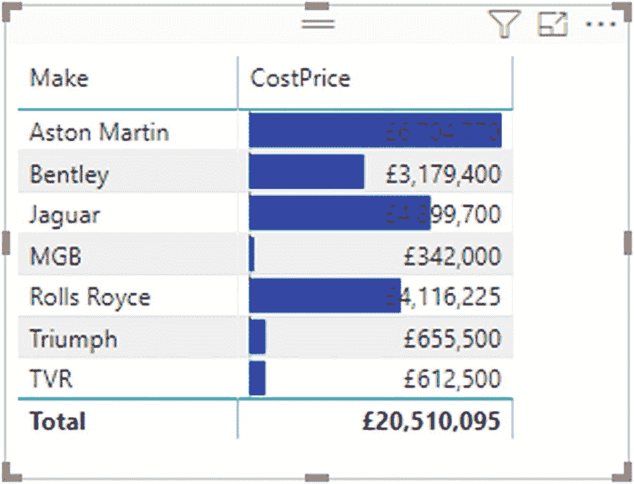

图 14-26：应用于表格的数据条

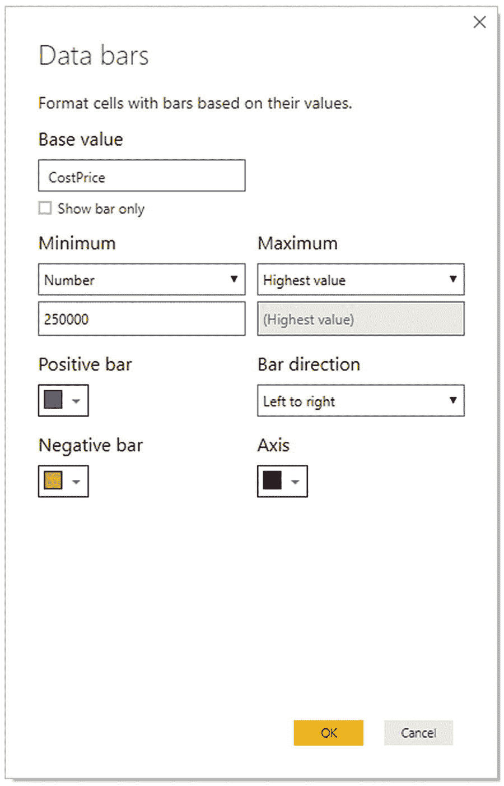

图 14-25：数据条对话框

1.  创建一个基于`Make`和`CostPrice`的表格。

2.  在“可视化”窗格中单击“格式”图标，并展开“条件格式”部分。

3.  从表格列名的弹出列表中选择要格式化的列名称（在此示例中为`SalePrice`列）。

4.  将`数据条`按钮设置为`开`。Power BI Desktop 会将数据条应用于`SalePrice`列。

5.  单击`高级控件`链接。将显示“数据条”对话框。

6.  在`最小值`弹出窗口中，选择`数字`。

7.  在现已启用的数字字段中输入 **250000** 作为值。

8.  为正向条形、负向条形和坐标轴选择颜色。对话框应类似于图 14-25 所示。

9.  单击`确定`。表格将类似于图 14-26 所示。

在应用数据条时，您可能会注意到以下几点：

-   您可以选择仅应用条形（而不显示实际数字）。

-   数据条只能应用于包含数字值的列。

您可以选择同时将数据条和色阶添加到同一列。然而，这可能会削弱视觉效果，而非帮助读者理解数据的含义。

### 图标

Power BI Desktop 中可用的数据可视化技术集合中，较新增加的功能是能够将关键绩效指标 (KPI) 显示为图标。您可以像这样将它们添加到表中任何现有的列：

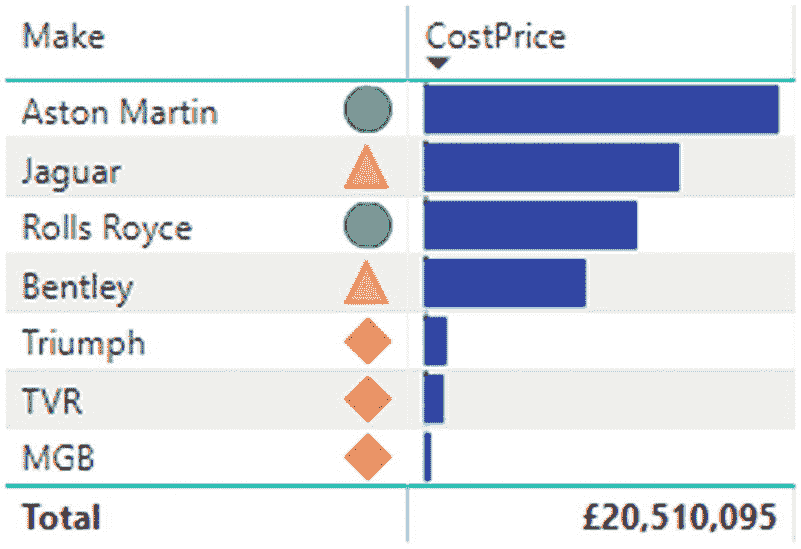

图 14-28：应用于表格的图标

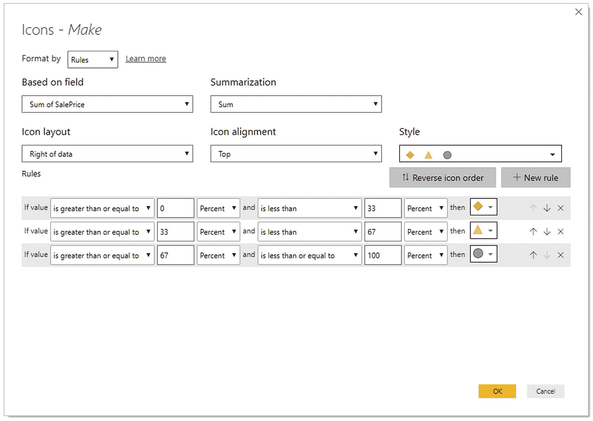

图 14-27：图标对话框

1.  选择您在上一节中创建的表格。

2.  在“可视化”窗格中单击“格式”图标，并展开“条件格式”部分。

3.  从表格列名的弹出列表中选择要格式化的列名称（在此示例中为`Make`列）。

4.  将`图标`按钮设置为`开`。将显示“图标”对话框。

5.  选择`求和`作为汇总方式。

6.  选择`SalePrice`字段作为`基于字段`。

7.  选择`数据右侧`作为`图标布局`。

8.  从`样式`弹出窗口中选择一个可用的图标样式集。

9.  选择`居中`作为`图标对齐方式`。“图标”对话框将类似于图 14-27 所示。

10. 单击`确定`。表格将类似于图 14-28 所示。

图标是对 Power BI Desktop 中可用数据显示技术的极佳补充。尽管如此，有几件事您需要了解：

-   对话框中显示的规则数量将自动映射到您所选样式的图标数量。

-   如果您删除或添加规则，`样式`将切换为`自定义`。您现在可以为每条规则选择所需的图标类型。

-   如果愿意，您可以为应用的每条规则选择一个特定的图标。

## 从可视化效果导出数据

最后，值得注意的是，您可以导出可视化效果所依据的数据。这适用于任何视觉对象，从表格到图表。您只需执行以下操作：

1.  单击视觉对象的菜单——图表、表格或地图右上角的省略号。然后从弹出菜单中选择`导出数据`。

2.  选择目标目录和文件名。

3.  单击`确定`，相关数据将被导出。目前唯一的导出格式是 CSV 文件。

> **注意：** 导出数据时，任何现有的筛选器都将被应用。这意味着，可能只有部分数据会导出到 CSV 文件中。

## 结论

我希望你现在已经熟悉了 Power BI Desktop 的报表界面，并能从容地使用它来以表格形式呈现数据。你学到的不仅是如何创建表格，还包括如何通过多种精妙（甚至不那么精妙）的方式改变表格的呈现效果，以增强其影响力。这涵盖从设置字体属性到条件格式，再到调整标题和数据的显示外观。

同样地，我也希望你能够轻松运用所学技巧对表格中的数据进行排序。

本章仅仅是 Power BI Desktop 帮助你分析和展示信息，让你的受众能够理解这些信息的一种尝试。因此，由于表格几乎是所有其他可视化形式的基础，掌握表格创建的技巧和诀窍非常值得。这样一来，你就能熟练地掌握 Power BI Desktop，为打造一些真正令人印象深刻的数据展示奠定基础。

既然你已经掌握了基础知识，现在是时候进入仪表板创建的下一阶段了，你将学习如何创建和增强矩阵与卡片。这些内容将在下一章中解释。