# 15. 矩阵和卡片视觉对象

本章将指导你在 Power BI Desktop 中创建更多基于文本的可视化对象。你将学习如何进一步运用前一章掌握的技能来创建和增强以下内容：

-   矩阵
-   卡片
-   多行卡片

你在本章中学到的技术将使用一个 Power BI Desktop 文件，该文件是应用了前四章大部分内容后的成果。此文件名为 `C:\PowerBiDesktopSamples\CarSalesDataForReports.pbix`。它作为本书的可下载资料的一部分，可在 Apress 网站上获取。

## 创建矩阵

在上一章中，你了解了如何使用表格以完整的列列表形式显示信息。然而，列表并不总能直观地让人感受到数据应如何在各个层级进行分组。以整洁的层级结构呈现信息，并包含多个分组层级，这是矩阵视觉对象的任务。

### 创建行矩阵

在创建矩阵时，我发现从信息层级的角度来思考，并设想信息从左到右流动会很有帮助。例如，假设我们想创建一个矩阵，将国家名称作为层级中的最高级别（因此也是最左侧的项）。然后，我们希望汽车品牌作为第二层级，位于左侧的下一项。最后，我们想要已售汽车的颜色，后面跟着所有我们关心的数值字段。你可以在图 15-1 中看到这个递进关系的图示。

*图 15-1 — 信息层级结构*

创建矩阵时，让“可视化”窗格反映层级结构非常重要。换句话说，你必须确保为矩阵选择的字段，以及你放置在字段框中的字段顺序，遵循你想要显示的层级结构。因此，要创建一个像刚才描述的那样的矩阵，你需要执行以下操作：

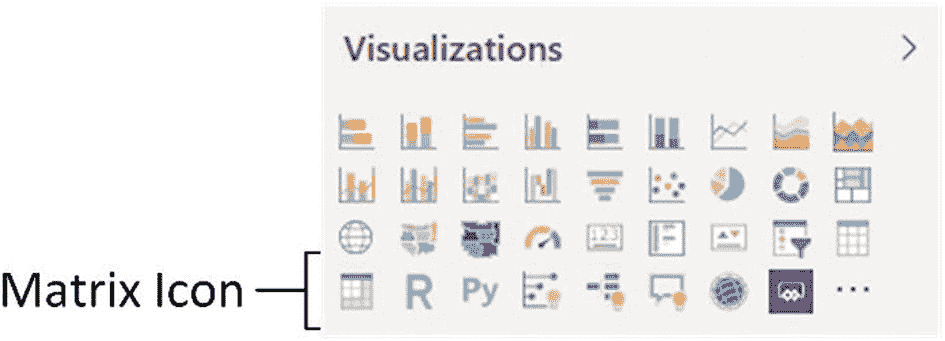

*图 15-2 — 一个矩阵表*

1.  使用 `C:\PowerBiDesktopSamples\CarSalesDataForReports.pbix` 文件作为你的数据源。

2.  在“可视化”窗格中点击矩阵图标。如图 15-2 所示。报表画布上会出现一个空矩阵。

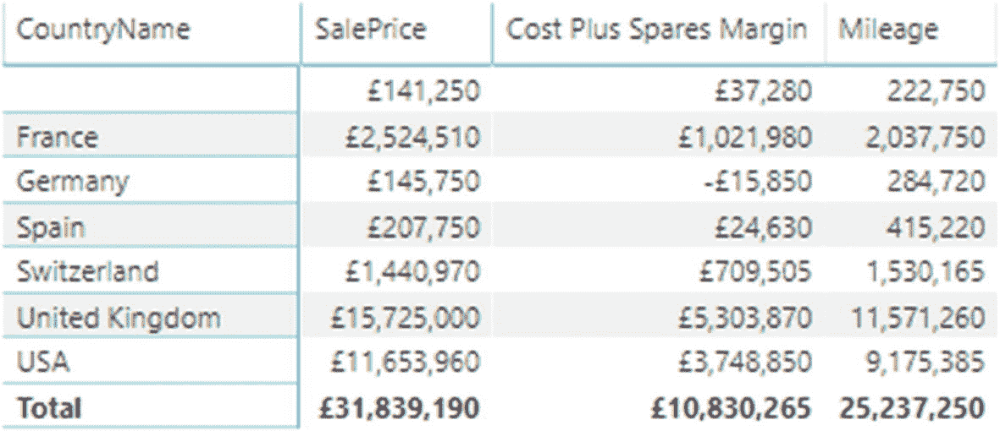

*图 15-3 — 显示数据顶层的矩阵*

3.  按顺序将字段 `CountryName`（来自 Countries 表）、`Make`（来自 Stock 表）和 `Color`（来自 Colors 表）拖到“可视化”窗格的“行”框中。然后添加字段 `SalePrice` 和 `Cost Plus Spares Margin`（来自 InvoiceLines 表）以及 `Mileage`（来自 Stock 表）。矩阵应该类似图 15-3。

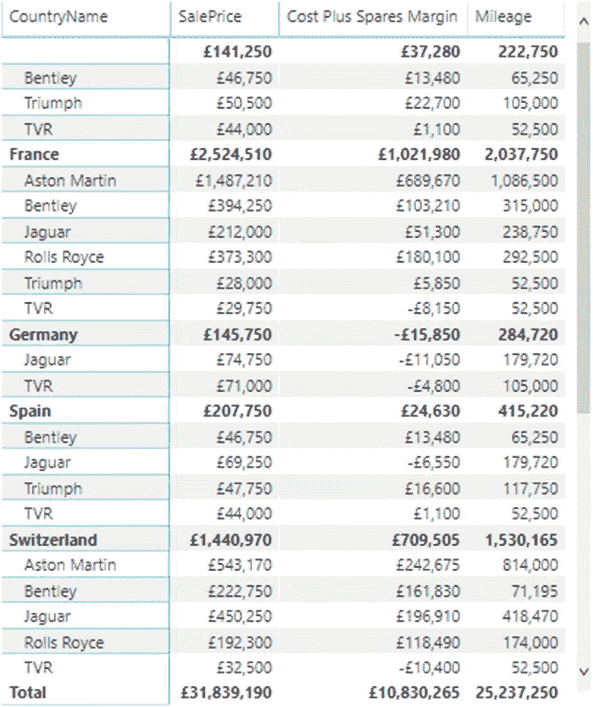

*图 15-4 — 一个两级矩阵*

4.  点击矩阵顶部的“在层级结构中向下展开一级”图标。这是从左数第三个看起来像小叉子的图标（如果你想提前看一下，可以在图 15-11 中找到这个图标）。矩阵应该类似图 15-4（注意：第一组行没有国家名称是完全正常的）。

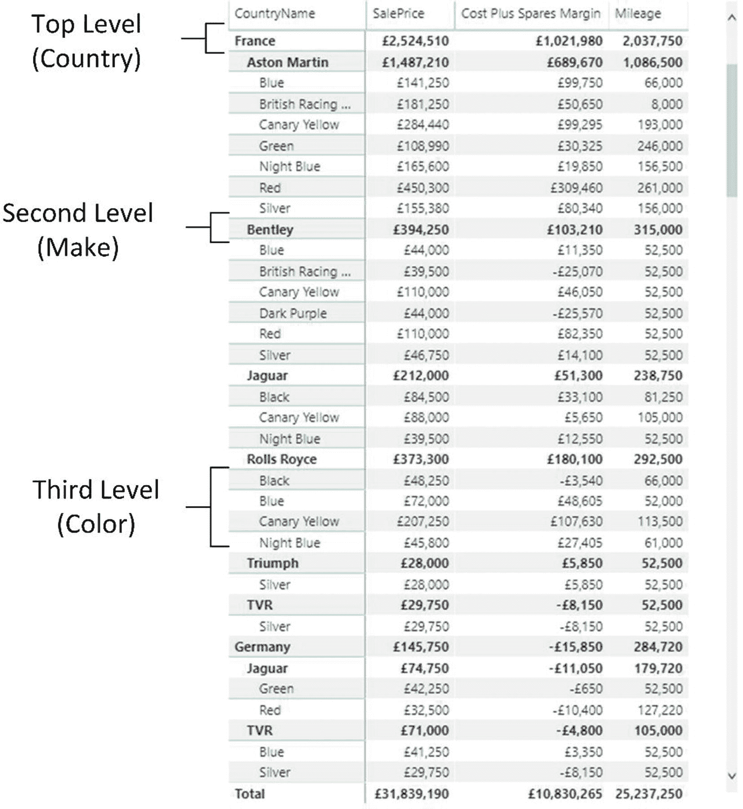

*图 15-5 — 一个三级矩阵*

5.  再次点击“在层级结构中向下展开一级”图标。矩阵应该类似图 15-5。

如你所见，矩阵显示不仅使数据更易于理解，而且会自动按层级中的每个元素对记录进行分组，并为每个级别添加小计。此外，层级中的每个级别都按升序排序。你可以展开添加到矩阵定义中的数据中的所有可用层级。这个最末层级将显示该层级的所有可用详细信息。

你也可以通过将字段直接拖入表格来将它们添加到表格中。当你这样做时，Power BI Desktop 始终会将文本字段添加到现有字段的*右侧*。在矩阵中，这意味着任何聚合或数值字段都会添加到现有聚合字段的右侧（并出现在“值”框中），而任何文本或日期时间字段都会添加到任何现有层级字段的右侧（并出现在“行”框中）。但是，通过在“行”和“值”框中上下拖动所需字段来重新组织它们，以定义正确的层级结构和你想要实现的整体显示类型总是很容易的。你可以在图 15-6 中看到“可视化”窗格如何反映矩阵层级。

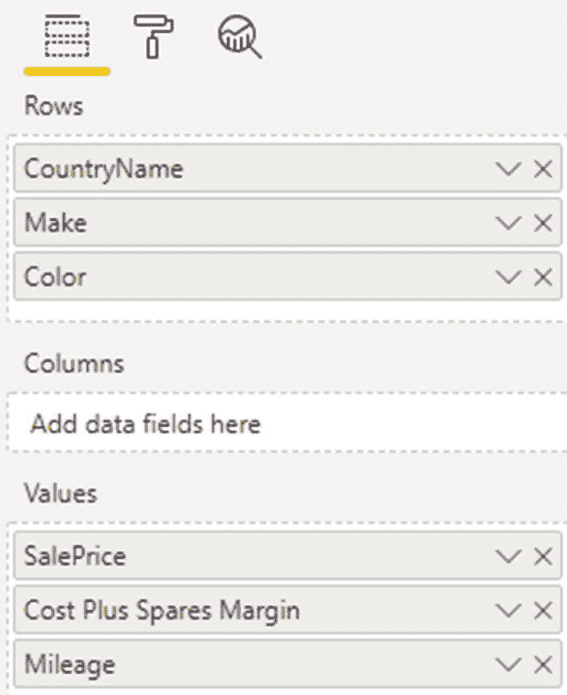

*图 15-6 — 显示矩阵层级结构的“可视化”窗格*

在创建矩阵时，我个人的偏好是将构成非数值层级结构的字段拖到“行”框中，这意味着我可以将它们准确地放置在现有元素的上方、下方或之间。这可以确保你的矩阵在第一次尝试时就看起来正确，从而帮助你避免一些非常令人困惑的重复检查！此外，由于 Power BI Desktop 默认会将额外的字段添加到“列”框中，因此在构建矩阵时精确操作会有所帮助。这意味着要仔细地将行标题的字段放置在“行”框中。

### 在矩阵中添加或删除小计

默认情况下，新建的矩阵会包含数据每个层级的小计。如果你希望从矩阵中删除小计：

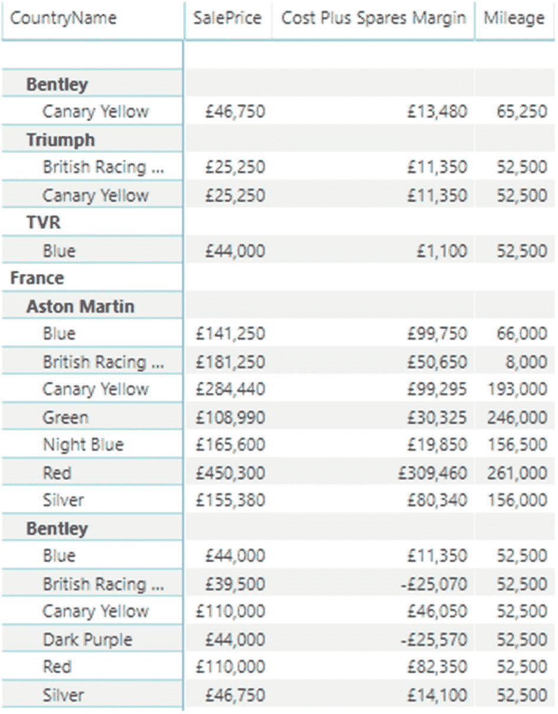

*图 15-7 — 无小计的矩阵*

1.  选择你在上一节使用的矩阵视觉对象。

2.  在“可视化”窗格中，点击“设置格式”图标。

3.  展开“小计”部分。

4.  点击“行小计”按钮以关闭行小计。这将从矩阵中移除所有总计，如图 15-7 所示。

## 列矩阵

Power BI Desktop 不仅能让你添加行级别的层次结构，你还可以创建列级别的层次结构，或者将两者混合使用。假设我们想清晰地了解按国家、制造商和车辆类型划分的销售额和毛利率，以及它们之间的相互影响。为了实现这一目标，我建议你通过添加一个 `VehicleType` 级别作为列层次结构，来扩展之前创建的矩阵。

操作步骤如下：

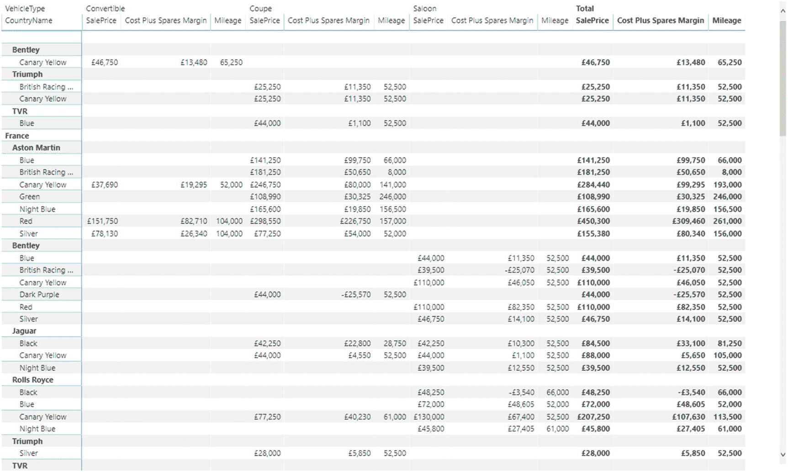

**图 15-8 - 行列矩阵表**

1. 点击之前创建的矩阵以将其选中。“可视化”窗格会显示 `Rows` 和 `Values` 框中用于此表的字段。
2. 将 `Stock` 表中的 `VehicleType` 字段拖到“可视化”窗格的 `Columns` 框内。这将在表的列中添加一个层次结构。表格将如图 15-8 所示。

“可视化”窗格现在看起来如图 15-9 所示。

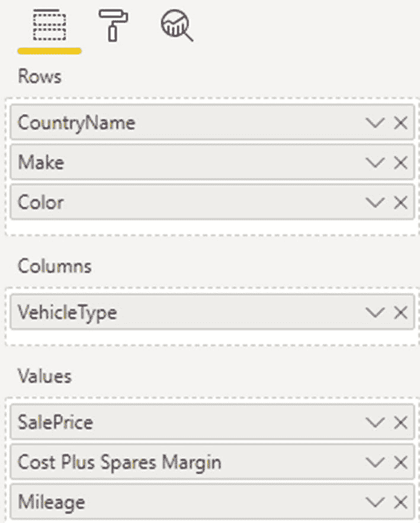

**图 15-9 - 行列矩阵表的“可视化”窗格**

如你所见，你现在可以根据国家名称、颜色、制造商和车辆类型查看销售额和毛利率，但它显示在一个交叉矩阵中，数据按行和列同时细分。

在结束关于创建矩阵的部分之前，有几件事你可能希望注意：

- 如果添加了总计，那么层次结构的 *每一个级别* 都会有总计。
- 将非数值数据添加到“值”字段框会使 Power BI Desktop 显示 `Count` 聚合。
- 矩阵可能会变得非常宽，尤其是当你有多级层次结构时。Power BI Desktop 矩阵通过水平滚动的工作方式来体现这一点。矩阵表会冻结左侧的非聚合数据列，并允许你向右滚动以显示聚合的（数值）数据。
- 移动“可视化”窗格中 `Columns` 和 `Rows` 框内的字段（使用如前所述的拖放操作）会重新排列表中的聚合数据列。

## 展开以及向下钻取和向上钻取

在创建原始矩阵时，你了解了如何展开矩阵以包含子级别。然而，在矩阵的数据层中导航时，Power BI Desktop 提供了多种可能性。这些包括：

- 显示层次结构中的一个或所有数据子级别
- 仅显示数据的更深级别
- 向下钻取以仅显示特定项目的下级级别
- 向上钻取以仅显示层次结构的上一个级别

在数据级别之间的导航通过四个界面元素的组合来完成：

- 数据/钻取功能区
- 每个矩阵顶部的图标
- 数据元素的上下文菜单
- 级别中每个单独项目的 `+/-` 图标

在学习如何在数据级别之间移动之前，先对所有这三个元素进行一个概览可能会有所帮助。

### 数据/钻取功能区

钻取层次结构数据时的一个重要工具是数据/钻取功能区。此功能区包含的按钮如图 15-10 所示，并在表 15-1 中进行了解释。

**表 15-1 - 可用的矩阵样式**

| 按钮 | 描述 |
| --- | --- |
| 将钻取应用于 | 向下或向上钻取，应用于页面上的所有视觉对象或仅选定的视觉对象。 |
| 查看数据 | 在单独的窗格中显示未格式化的数据。 |
| 切换到下一级别 | 显示按层次结构中的下一级别数据分段的数据。 |
| 在层次结构中向下展开一级 | 显示所有数据项及其下一级别的数据。 |
| 向上钻取 | 返回到上一个数据级别（展开或向下钻取）。 |
| 向下钻取 | 仅显示所选数据项及其任何子级别的数据。 |
| 可视化表 | 显示构成聚合行的记录的数据。 |
| 组 | 创建一个组以突出显示视觉对象中的选定值。 |
| 钻取 | 钻取到包含详细信息的另一个页面。 |

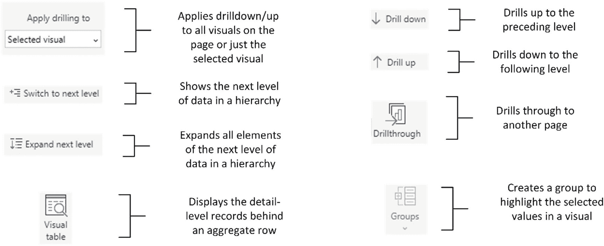

**图 15-10 - 数据/钻取功能区**

#### 矩阵导航图标

任何矩阵的数据上方都有一系列图标。你可以在图 15-11 中看到它们。我建议你熟悉这些图标，因为它们在钻取信息层次结构时至关重要。这不仅适用于矩阵，也适用于某些类型的图表。

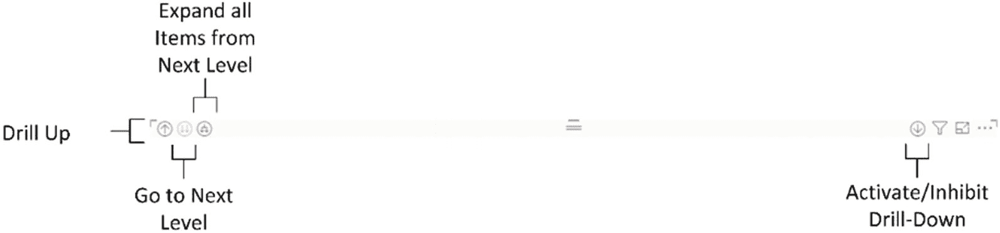

**图 15-11 - 矩阵的钻取和展开图标**

#### 矩阵项目的上下文菜单

在矩阵中浏览数据层次结构时，你可能需要的最后一种方法是右键单击矩阵中任何记录时出现的弹出菜单。你可以在图 15-12 中看到这一点。

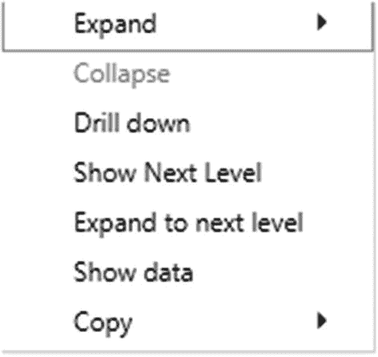

**图 15-12 - 矩阵项目的上下文菜单**

### 级别中每个单独项目的 +/- 图标

如果你不想，你不必展开矩阵中特定级别的每一个元素。你现在可以选择单独展开或折叠每个级别。

启用矩阵单个级别的展开可以按如下方式操作：

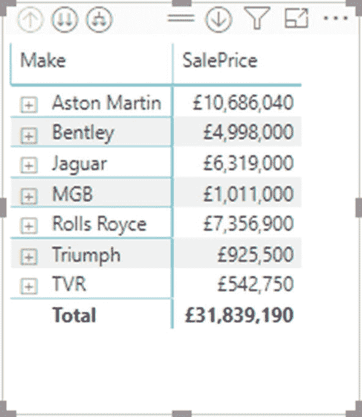

**图 15-13 - 显示 +/-（展开和折叠）图标的矩阵**

1. 使用 `Make` 和 `Model` 字段作为 `Rows`，`SalePrice` 作为 `Values` 创建一个矩阵。
2. 选中矩阵后，单击“可视化”窗格中的“格式”图标。
3. 展开 `Row Headers`。
4. 将 `+/- icons` 设置为“开”。矩阵将如图 15-13 所示。

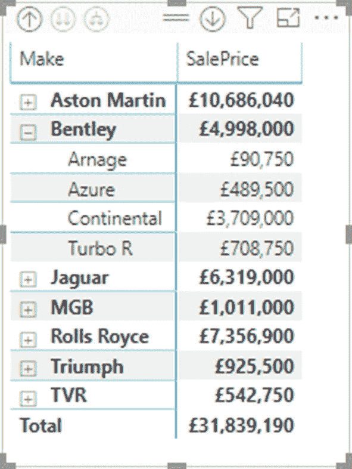

**图 15-14 - 具有一个展开级别的特定元素的矩阵**

5. 单击 Bentley 旁边的加号图标。选定项目的整个部分将被展开——但仅此而已。矩阵将如图 15-14 所示。

- 毫无疑问，你已经猜到，单击已展开项目的减号图标将折叠该特定级别。

### 显示上一级别的数据

几页之前，你了解了在创建矩阵时如何展开所有子级别，因此我在此不再赘述。但是，如果你当前显示了数据层次结构的三个级别，而想返回只显示两个级别，该怎么办？

1. 以图 15-5 中显示三个数据级别的矩阵为例。
2. 在“数据/钻取”功能区中，单击 `Drill Up`。

矩阵将仅显示两个数据级别，并再次类似于图 15-4 中的图像。

### 显示子级别的数据

矩阵并不要求您一次性显示所有层级的数据。如果您愿意，可以仅显示矩阵层次结构中较低层级的数据，具体操作如下：

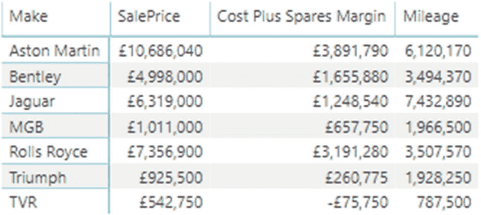

图 15-15 – 显示矩阵中不同层级的数据

1. 创建您在 图 15-3 中开始的矩阵，只显示顶层数据。
2. 点击矩阵顶部的“前往层次结构中的下一个级别”图标。矩阵中将仅显示第二级数据（颜色）。您可以在 图 15-15 中看到示例。

如您所见，汇总值完全相同。改变的只是数据的分段方式。

要返回到数据层次结构中的上一级，只需点击 `Data/Drill` 功能区中的 `Drill Up` 按钮，或点击矩阵左上角的 `Drill Up` 图标。

### 在行级别向下钻取

在浏览数据层次结构时，另一个完全不同的选项是针对特定层次结构元素进行向上和向下钻取。展开和钻取之间的关键区别如下：

- 展开层次结构会显示*所有*顶层元素的下一级数据。
- 向下钻取只会显示*所选*数据元素的下一个子级别。

要查看实际操作，请尝试以下步骤：

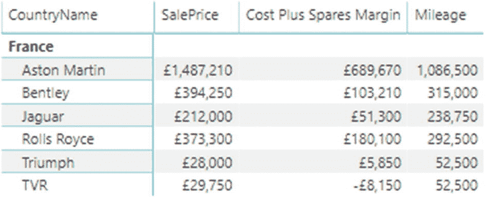

图 15-16 – 在矩阵中向下钻取

1. 右键单击矩阵中的任意顶层数据元素（我将以图 15-5 中矩阵的“法国”为例）。
2. 从上下文菜单中选择 `Drill down`。矩阵现在将如图 15-16 所示。

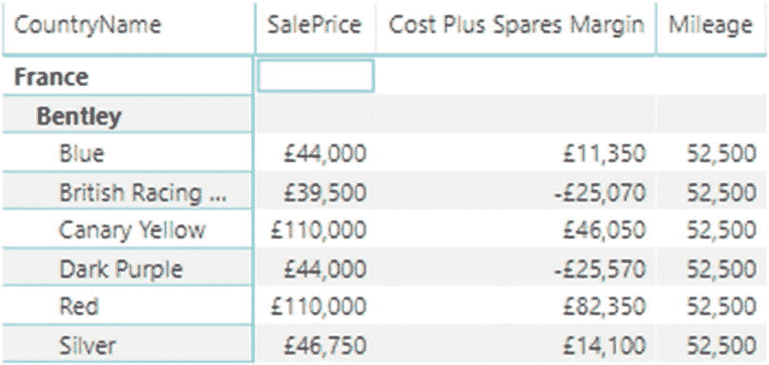

图 15-17 – 在矩阵中进一步向下钻取

1. 您可以继续向下钻取到更深层级的数据，只需右键单击第二层级中的任意数据元素，并从上下文菜单中选择 `Drill down`（例如，本例中的“Bentley”）。矩阵现在将如图 15-17 所示。

要返回上一层级，您只需点击 `Data/Drill` 功能区中的 `Drill Up` 按钮，或点击矩阵左上角的 `Drill Up` 图标。或者，您也可以右键单击数据项，然后从上下文菜单中选择 `Drill Up`。

### 使用点击穿透进行向下钻取

如果您觉得右键单击并选择 `Drill down` 选项有些麻烦，那么还有另一种解决方案。您可以将矩阵切换为通过简单点击数据项进行向下钻取。具体操作如下：

1. 在矩阵的右上角，点击“单击以启用向下钻取”图标。该图标将变成一个浅色背景上的深色箭头。
2. 点击任意数据元素（例如，一个国家）。您将向下钻取到下一层级。

您可以随时通过重新点击“单击以启用向下钻取”图标来关闭此选项。它将恢复为透明背景上的浅色箭头，表示这种形式的向下钻取已停用。

### 在列级别向下钻取

相同的向下钻取和向上钻取逻辑同样适用于列。以您之前创建的列矩阵为例（您可以在图 15-8 中看到）：

图 15-18 – 复杂矩阵中的向下钻取选项

1. 将 `Model`（来自 `Stock` 表）添加到矩阵的 `Columns` 数据字段中，并置于 `VehicleType` 字段下方。矩阵左上角会出现一个弹出菜单，提供行和列之间的选择。您可以在图 15-18 中看到这一点。

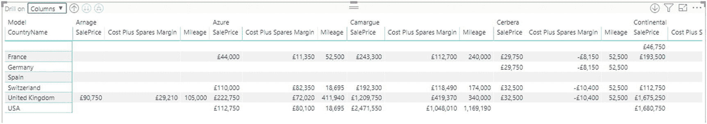

图 15-19 – 在多级列层次结构中向下钻取

1. 点击弹出菜单并选择 `Columns`。
2. 点击“前往层次结构中的下一个级别”图标。您将看到类似图 15-19 的内容，其中车辆类型已被模型取代作为列标题。

如您所见，层次结构同样适用于列和行。这归结为：

- 将字段添加到 `Visualizations` 窗格中的正确字段框（`Rows` 或 `Columns`）
- 从矩阵顶部的弹出菜单中选择适当的向下钻取模式（`Columns` 或 `Rows`）

## 可视化源数据

如果格式化后的表格或矩阵变得过于庞大或复杂，您可以选择查看不应用任何格式的底层数据。这通常能让您看到比精心格式化的可视化效果中更多的信息。

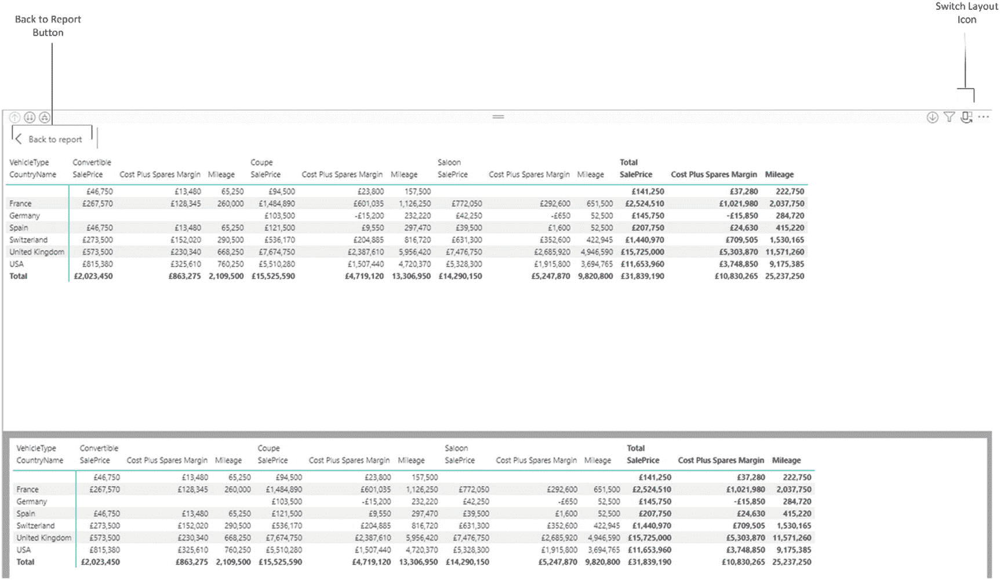

图 15-20 – 可视化源数据

1. 选择您想要显示其数据且不带格式的表格或矩阵。
2. 在 `Data/Drill` 功能区中，点击 `See Data` 按钮。所选表格或矩阵的未格式化数据版本将显示在第二个窗口中。您可以在图 15-20 中看到这一点。
3. 点击格式化表格上方的 `Back to report` 按钮（或再次点击 `Data/Drill` 功能区中的 `See Data` 按钮）以返回到正常的 Power BI Desktop 报表视图。

**注意：** 查看未格式化数据时，您目前无法调整两个窗口的大小。但是，您可以在任一窗口中上下滚动。如果您更希望在可视化的右侧（而不是下方）查看数据，请点击窗口右上角的 `Switch Layout` 图标。

## 查看记录

在处理聚合数据时，您有时可能会忽略有价值的细节。例如，您可能会错过一个使平均值产生偏差的巨大离群值。或者，某个单条记录的过高值可能导致总计高于正常或健康水平。

为了帮助您遵循直觉并将聚合值与详细数字进行权衡，Power BI Desktop 允许您随时查看矩阵中某个总计“背后”的底层记录。以下是一个示例：

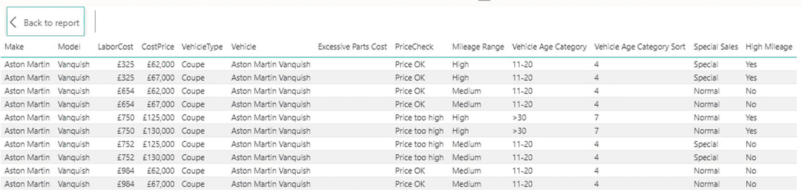

图 15-21 – 从矩阵中显示数据记录

1. 基于以下字段创建一个矩阵（所有字段均来自 `Stock` 表）：
   - `Make`（行）
   - `Model`（行）
   - `LaborCost`
   - `CostPrice`
2. 在 `Data/Drill` 菜单中，点击 `Expand all down one level in the hierarchy` 以查看制造商和模型的完整层次结构。
3. 右键单击 Aston Martin Vanquish 的劳动成本数值，然后从上下文菜单中选择 `See records`。您将看到构成该总计数值的所有明细记录。如图 15-21 所示。
4. 点击现在显示的记录上方的 `Back to report` 按钮，以返回到正常的 Power BI Desktop 报表视图。

**注意：** 或者，您可以右键单击矩阵中的任意值，然后选择 `See records` 以向下钻取到构成所选聚合值的详细记录。

## 包含与排除矩阵元素

某些矩阵可能包含海量数据，因此您可能需要仅关注部分选定元素。在 Power BI Desktop 中操作非常简单：

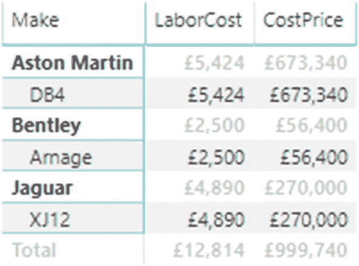

图 15-22

从矩阵中包含选定元素

1. 按上一节的内容重新创建矩阵（制造商、型号、人工成本、成本价格）。
2. 点击层次结构中的“向下展开所有内容一级”，查看制造商和型号的完整层次结构。
3. `Ctrl`+单击以下任意元素（制造商、型号或数值）：
   - 阿斯顿·马丁 DB4
   - 宾利 雅致
   - 捷豹 XJ12
4. 右键单击其中一个选定元素，然后从弹出菜单中选择“包含”。所有其他元素将从矩阵中删除。结果如图 15-22 所示。

> **注意**：作为包含特定元素的另一种方法，您可以选择想要*排除*的所有元素，然后从弹出菜单中选择“排除”。

目前，要回到包含所有数据行的完整矩阵，似乎唯一的方法是按 `Ctrl+Z` 撤销此操作。

## 将多个值显示为行

Power BI Desktop 近期一个非常实用的功能是能够创建复杂矩阵，其中的数据列现在可以显示为行。也就是说，您无需在复杂的列层次结构中并列查看多个数据值，而是可以将所有数值数据显示为行。

通过一个示例可以更好地理解这一功能：

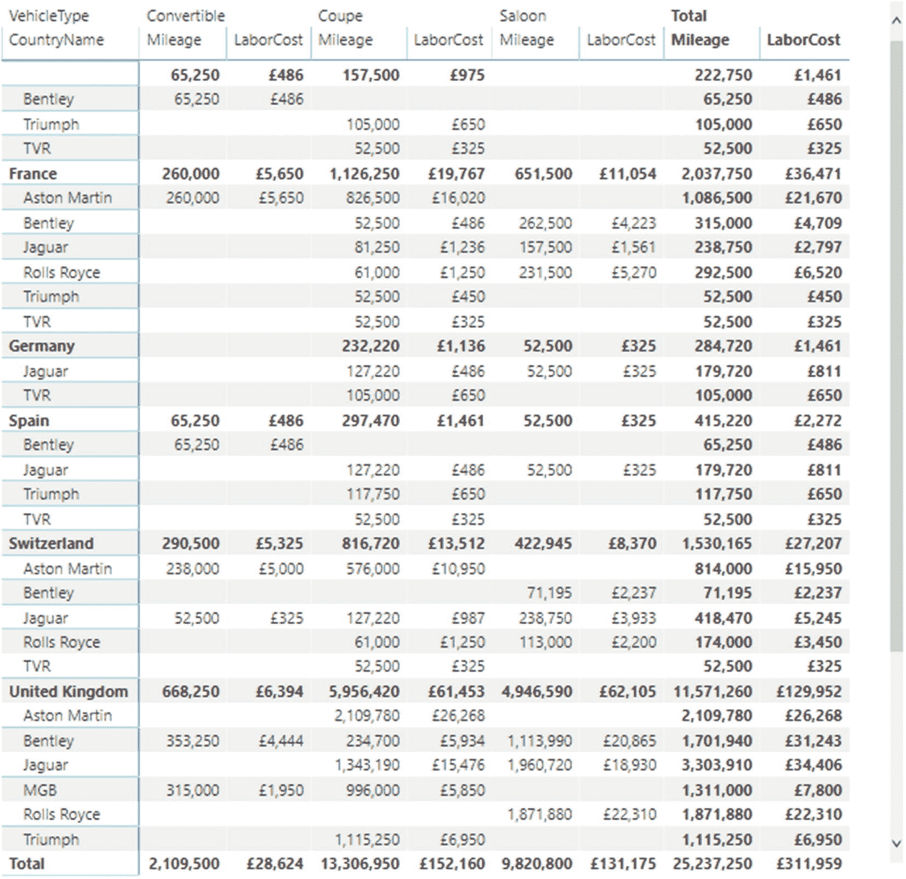

图 15-23

以列为数值的标准矩阵

1. 使用以下元素创建一个矩阵：
   - *行*：国家表中的“国家名”和库存表中的“制造商”（按此顺序）。
   - *列*：VehicleType（来自库存表）。
   - *值*：里程数和人工成本（按此顺序），均来自库存表。
2. 向下展开所有内容一级。矩阵将如图 15-23 所示。

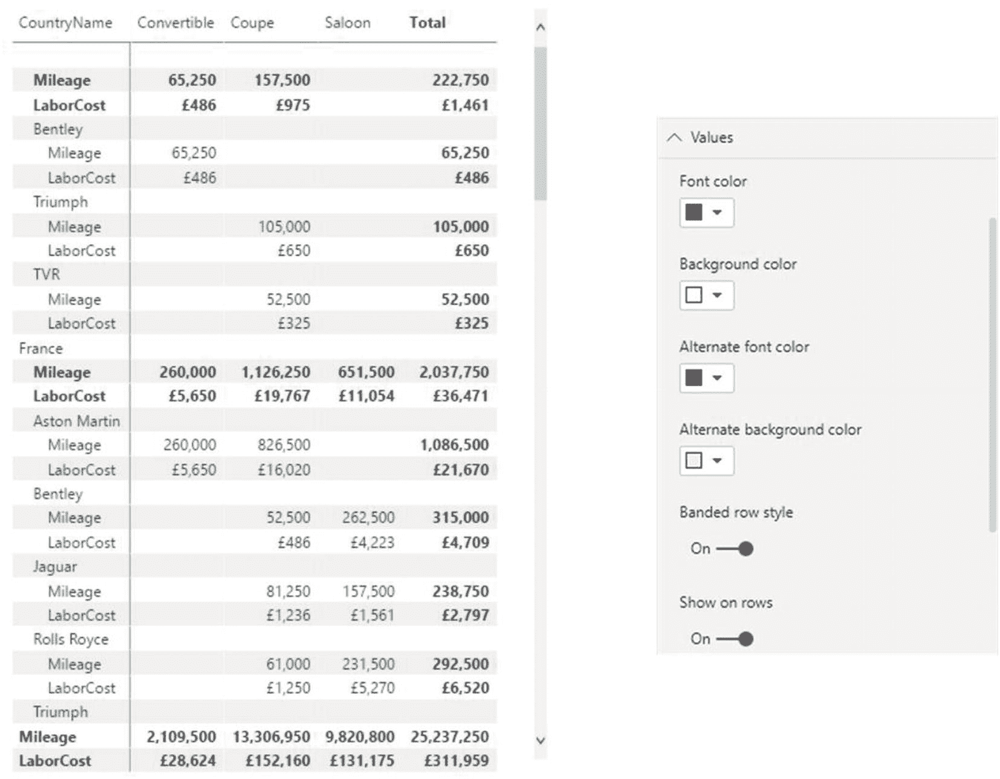

图 15-24

以行为数值的矩阵

1. 在“可视化”窗格中，单击格式图标并展开“值”部分。
2. 将“在行上显示”设置为开启。矩阵现在将如图 15-24 所示，其中的多个数据列变成了数据行。

只需将“在行上显示”切换为关闭，矩阵即可恢复为初始格式。

## 格式化矩阵

幸运的是，格式化矩阵所应用的技术与表格格式化技术大致相同。因此，我将不再重复上一章中关于修改以下方面的原则：

- 矩阵样式（即表格样式，但应用于矩阵）
- 网格
- 列标题
- 行标题
- 值
- 总计
- 标题
- 背景
- 条件格式

不过，矩阵还有一些额外的格式调整选项，分别是：

- 阶梯式布局
- 小计

我将在以下小节中解释这些选项。

### 阶梯式布局

在图 15-5 中，您可以看到矩阵的多个层级，它们通过缩进层级展示。然而，您可能更倾向于将每个层级显示在单独的列中。操作方法如下：

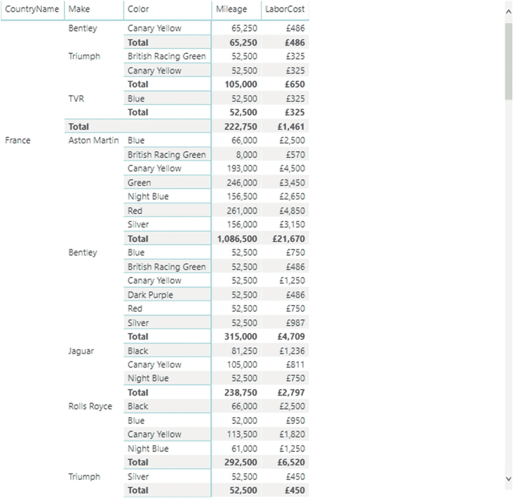

图 15-25

未使用阶梯式布局的矩阵

1. 选择（或重新创建）矩阵，使用“国家名”、“制造商”和“颜色”作为行数据，使用“里程数”和“人工成本”作为数值。
2. 在层次结构中单击两次“向下展开所有内容一级”，以显示所有数据层级。
3. 在“可视化”窗格中，单击格式图标。
4. 展开“行标题”部分。
5. 将“阶梯式布局”设置为关闭。
6. 必要时调整矩阵宽度。矩阵将如图 15-25 所示。

#### 小计

表格只有总计（假设您要显示它），而矩阵可以为显示的每一个数据层级提供小计。尽管格式化小计与格式化表格中的总计类似，但为了内容的完整性，我仍在此处描述相关选项：

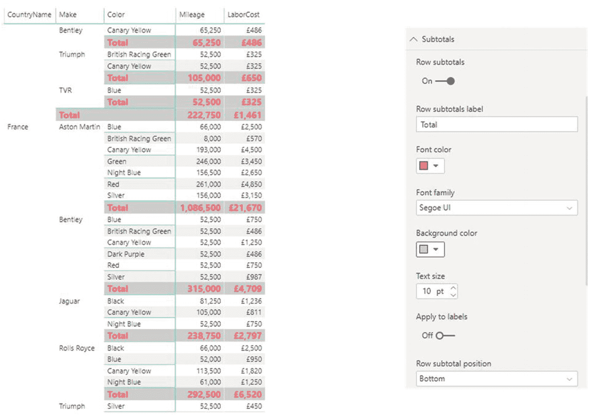

图 15-26

在矩阵中格式化小计

1. 选择您在上一节中使用的矩阵视觉对象。
2. 在“可视化”窗格中，单击格式图标。
3. 展开“小计”部分。
4. 从字体颜色调色板中选择不同的字体颜色。
5. 从字体系列弹出列表中选择不同的字体。
6. 在文本大小字段中输入一个数字（或使用箭头调整），以设置更大的字体大小。
7. 将“应用于标签”设置为开启——这将确保小计标签和数值都应用格式。矩阵应如图 15-26 所示。

> **注意**：由于总计的格式化方式与表格中的总计基本相同，因此此处不再赘述。如果您需要复习，请翻回上一章。

#### 放置小计

您还可以决定小计是放置在一组元素的上方、元素标题旁边，还是放在组下方独立行中。只需执行以下操作来放置小计：

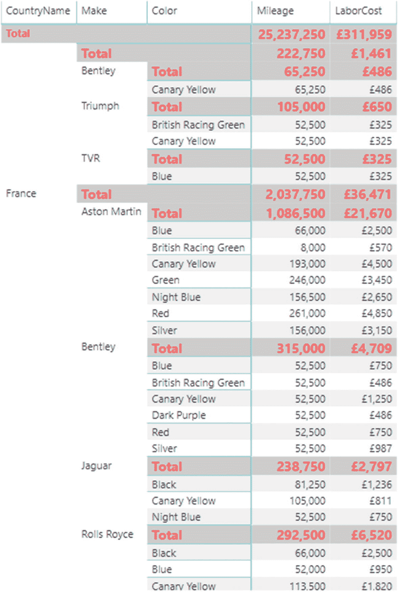

图 15-27

将小计放置在组下方

1. 重新创建图 15-21 中使用的矩阵（仅执行步骤 1 和 2）。
2. 在“可视化”窗格中，单击格式图标并展开“小计”部分。
3. 在“行小计位置”弹出菜单中，选择“顶部”。矩阵现在应如图 15-27 所示。

#### 每层级矩阵的自定义小计设置

Power BI Desktop 现在允许您定义是否在矩阵层次结构的每个层级（包括行和列）显示小计。查看具体操作：

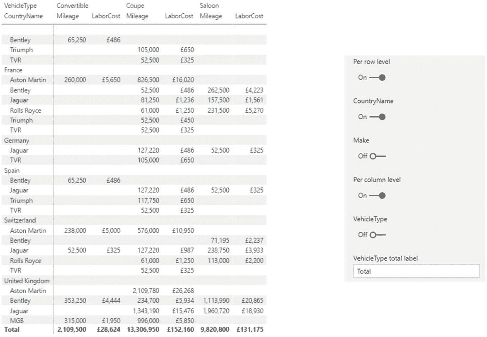

图 15-28

选择性小计

1. 重新创建图 15-23 中使用的矩阵（仅执行步骤 1 和 2）。
2. 在层次结构中点击“向下展开所有内容一级”（可点击矩阵中的图标或在“数据/钻取”菜单中操作）。
3. 在“可视化”窗格中，单击格式图标并展开“小计”部分。
4. 将“按行级别”设置为开启。这会将所有行数据元素的列表添加到“可视化”窗格中。
5. 将“按列级别”设置为开启。这会将所有列数据元素的列表添加到“可视化”窗格中。
6. 将“制造商”和“VehicleType”的按钮都设置为关闭。如图 15-28 所示，这些元素的小计已被移除。

## 矩阵中的数据排序

在对矩阵表中的数据进行排序时，排序顺序将遵循矩阵的层级结构。这意味着，如果你对层级结构中的第二个元素进行排序（在刚刚创建的示例表中，即`制造商`字段），那么层级结构中的主元素（`国家名称`，最左侧列）以及行元素层级结构中任何较低级别的元素，都将恢复为初始的（按字母顺序）排序顺序。

如果你按照矩阵中的任意值进行排序，则会使用层级结构中最高级别的总计来重新排列表格。你可以在图 15-29 中看到这一点，该矩阵基于图 15-25，已按总劳动力成本降序排序。这使得劳动力成本最高的国家移动到了表格顶部。此外，如果你有一个列矩阵（如此示例所示），那么最终你会按照列的总计（本例中最右侧的两列）对矩阵进行排序，使矩阵按数值排序，尽管是升序排列。

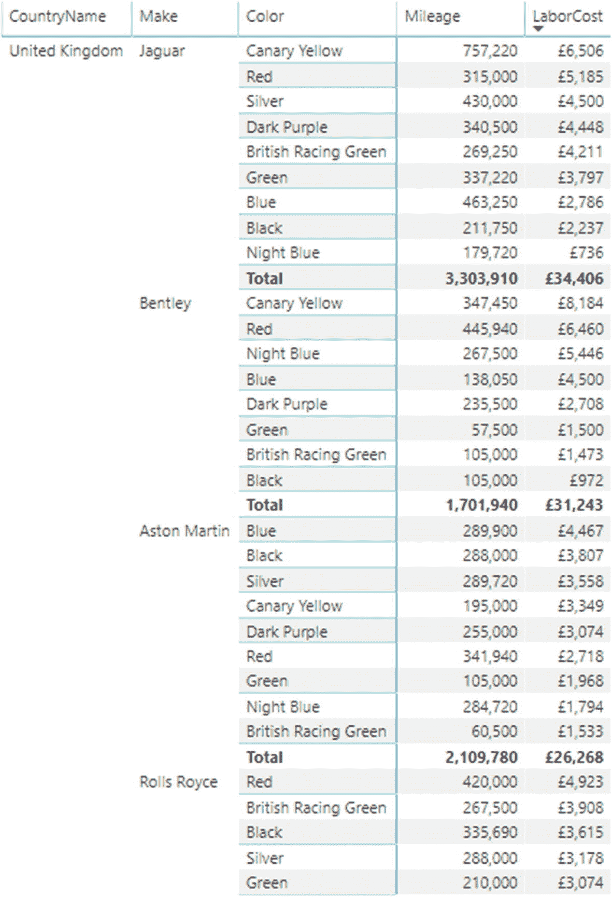

图 15-29

按值对矩阵进行排序

> **注意**  
> 与表格的情况一样，没有用于格式化矩阵中数字的特定选项。你可以通过点击 `Power BI Desktop` 窗口左侧的 `数据视图` 图标来格式化数据，选择要格式化的列，然后在 `建模` 选项卡中选择一种数字格式。

## 卡片

在某些情况下，你可能希望比其它数据更突出地显示单个数字。也许你需要吸引查看者注意你新的销售记录，或者你希望老板赞赏你获得的客户满意度评分。

无论动机如何，卡片都是解决方案。 `Power BI Desktop` 卡片是隔离和强调单个数字的一种简单而强大的方法。例如，假设你想在仪表板中显示迄今为止所有车辆的销售数据；以下说明了如何实现：

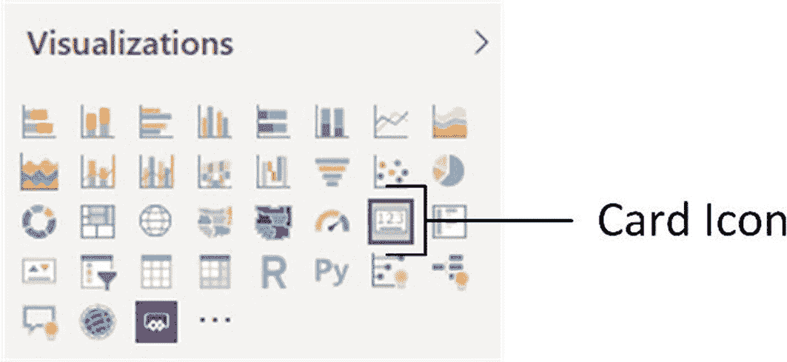

图 15-30

可视化效果库中的 `卡片` 图标

1.  使用 `C:\PowerBiDesktopSamples\CarSalesDataForReports.pbix` 文件作为数据源，点击任何现有可视化效果之外的空区域。

2.  在可用可视化效果库中，点击 `卡片` 图标。你可以在图 15-30 中看到此图标。仪表板画布上将出现一个空白卡片。

图 15-31

卡片可视化效果

3.  展开 `字段` 列表中的 `发票行` 表字段，并选择 `销售价格` 字段。所有销售的总计将出现在卡片中。

4.  调整卡片大小，使数字恰好适合卡片边框内，不留任何空白空间。最终的卡片将类似于图 15-31。

### 格式化卡片

如你刚才所见，卡片是将观众的注意力聚焦于关键数据的极其有效的方法。然而，你还可以做更多操作来增强这种强调效果，包括以下内容：

*   更改显示数据的单位、小数位数、颜色和文本大小。
*   移除自动显示的标签，并更改其文本大小。
*   添加一个可以独立格式化的标题。
*   更改卡片的背景颜色。
*   修改边框样式。

让我们看看如何调整你刚刚创建的卡片：

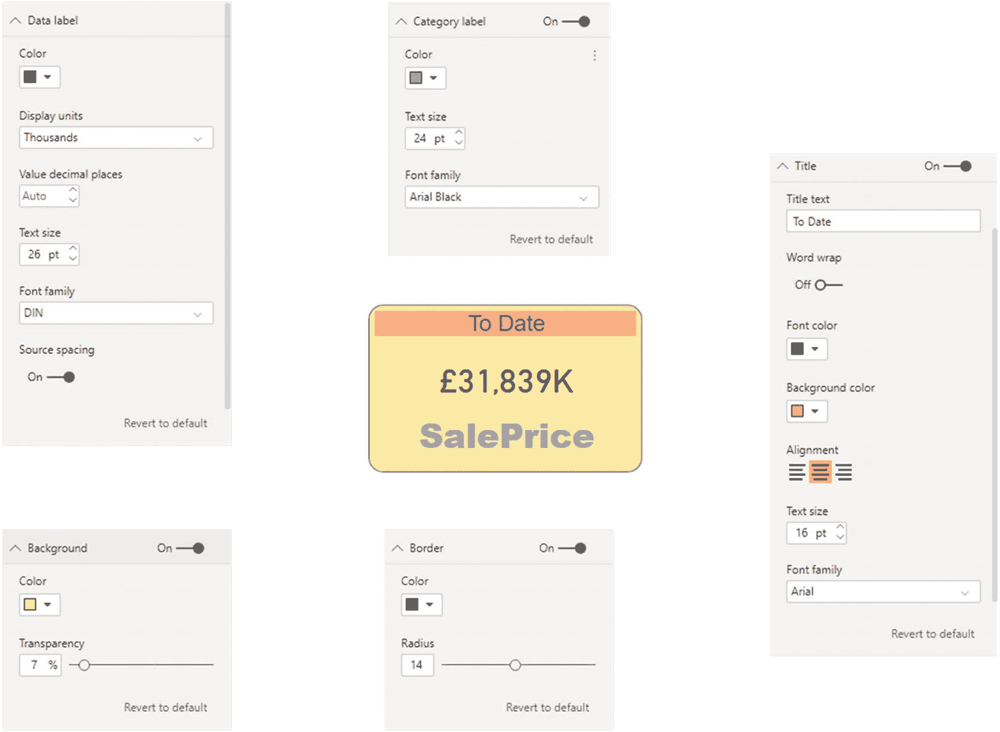

图 15-32

格式化后的卡片

1.  选择该卡片。在此示例中，我使用你在图 15-31 中看到的卡片。

2.  在 `可视化效果` 窗格中，点击 `格式` 图标（可用可视化效果类型调色板下方的小油漆滚筒）。将显示所选卡片的格式化选项。

3.  通过点击 `背景` 字样左侧向下的 V 形图标来展开 `背景` 部分。

4.  确保 `背景` 字样右侧的开关设置为 `开`（如果未设置，则点击空心圆右侧以更改此设置）。

5.  点击 `颜色` 右侧的弹出菜单三角形，并从可用颜色调色板中选择一种颜色。

6.  点击 `透明度` 滑块开关并将其向左滑动，通过降低透明度百分比来加深背景颜色。

7.  通过点击 `类别标签` 字样左侧向下的 V 形图标来展开 `类别标签` 部分。

8.  通过点击向上和/或向下 V 形图标或输入所需的文本大小来调整文本大小。如果需要，你也可以更改颜色和字体。

9.  通过点击 `标题` 字样左侧向下的 V 形图标来展开 `标题` 部分。

10.  通过点击 `标题` 右侧 `开/关` 按钮的右侧，将标题设置为 `开`。

11.  在 `标题文本` 中输入 `至今累计`。

12.  点击 `字体颜色` 右侧的弹出菜单三角形，并从可用颜色调色板中选择一种字体颜色。

13.  点击 `背景颜色` 右侧的弹出菜单三角形，并从可用颜色调色板中选择一种背景颜色。

14.  点击 `对齐方式` 图标中间的图标，将卡片标题居中。

15.  如果需要，可以选择不同的字体和字体大小。

16.  通过点击左侧向下的 V 形图标来展开 `数据标签` 部分。

17.  点击 `颜色` 右侧的弹出菜单三角形，并从可用颜色调色板中选择一种数据标签颜色。

18.  调整文本大小，或输入所需的文本大小。

19.  通过点击 `显示单位` 的弹出列表，为卡片中的数字选择一个显示单位。

20.  通过点击 `精度` 框右侧的向上和向下三角形，选择用于卡片数据的小数位数。如果愿意，你也可以直接输入小数位数。

21.  展开 `边框` 部分并打开边框。如果需要，可以更改边框颜色。

22.  调整 `圆角半径` 滑块以设置卡片的圆角。现在，卡片（以及格式化调色板）看起来将类似于你在图 15-32 中看到的元素。

用于格式化卡片中数值的可用显示单位在表 15-2 中进行了描述。

表 15-2

显示单位

| 显示单位 | 描述 |
| --- | --- |
| `自动` | 根据数字的大小，从可用的单位中选择合适的显示单位。 |
| `无` | 显示实际数字。 |
| `千` | 以千为单位显示数字，后跟一个 `K`。 |
| `百万` | 以百万为单位显示数字，后跟一个 `M`。 |
| `十亿` | 以十亿为单位显示数字，后跟一个 `bn`。 |
| `万亿` | 以万亿为单位显示数字，后跟一个 `T`。 |

## 多行卡片

利用 Power BI Desktop 的卡片式输出，可以以一种极具创新性的方式展示表格数据。与矩阵类似，你首先选择要在基本表格中显示的字段，然后将其转换为另一种视觉对象类型。以下是具体操作示例：

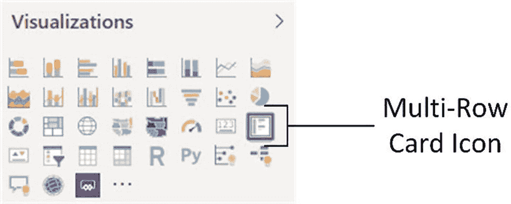

图 15-33  
可视化窗格中的多行卡片图标

1. 使用 `C:\PowerBiDesktopSamples\CarSalesDataForReports.pbix` 文件作为数据源，点击任何现有视觉对象的外部区域。

2. 在可视化窗格中，点击卡片图标。你可以在图 15-33 中看到此图标。一个空白的多行卡片将出现在仪表板画布上。

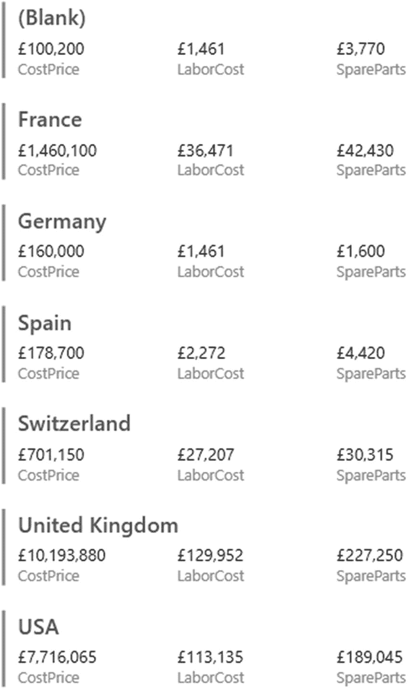

图 15-34  
一个卡片可视化效果

1. 按以下顺序添加字段：
   1. `CountryName`（来自 `Countries` 表）
   2. `CostPrice`（来自 `Stock` 表）
   3. `LaborCost`（来自 `Stock` 表）
   4. `SpareParts`（来自 `Stock` 表）

2. 调整多行卡片的大小，以便显示所有国家，且每个国家所有数字均显示在同一行。视觉对象将类似于图 15-34 所示的样式。不必担心 (空白) 成本；这些对应的是库存中尚未售出、因而还没有对应客户国家的车辆。

卡片式表格将按照字段在可视化窗格字段框中的出现顺序进行显示，并且可以像任何表格一样在此处重新排序。这使得每个卡片成为一个数据记录。字段将在每张卡片内从左到右排列，然后换行。有趣的是，调整表格大小可以显著改变其外观。一个非常窄的表格会将字段垂直排列，上下堆放。如果你能将所有字段放入一行，那么你将获得一个极具特色的多记录显示效果。

### 格式化多行卡片

多行卡片有几个视觉方面可以调整以增强效果。这些包括添加标题和更改背景颜色。我们来尝试这两项操作：

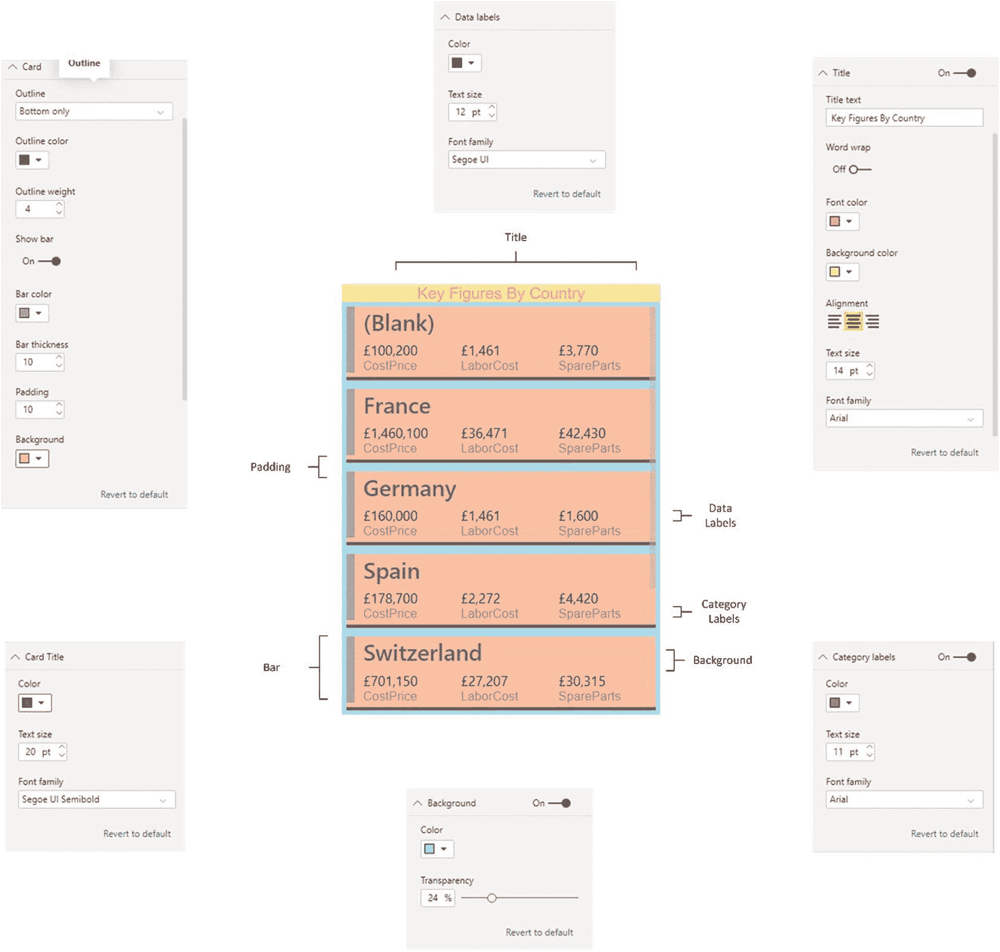

图 15-35  
一个格式化后的多行卡片

1. 选择多行卡片视觉对象。在此示例中，我使用了你在图 15-34 中看到的卡片。

2. 在可视化窗格中，点击格式图标（位于可用视觉类型调色板下方的小油漆滚筒）。所选多行卡片的格式选项将显示出来。

3. 点击“背景”一词左侧向下的 V 形图标展开背景部分。

4. 确保“背景”一词右侧的开关设置为“开”（如果未设置，则点击空心圆的右侧进行更改）。

5. 点击“颜色”右侧的弹出菜单三角形，并从可用色调调色板中选择一种颜色。

6. 点击“透明度”滑块开关，并将其向左滑动，通过降低透明度百分比来加深背景颜色。

7. 点击“标题”一词左侧向下的 V 形图标展开标题部分。

8. 通过点击“标题”右侧“开/关”按钮的右侧，将标题设置为“开”。

9. 在“标题文本”中输入 `Key Figures By Country`。

10. 点击“字体颜色”右侧的弹出菜单三角形，并从可用颜色调色板中选择一种字体颜色。

11. 点击“背景颜色”右侧的弹出菜单三角形，并从可用颜色调色板中选择一种背景颜色。

12. 为标题设置更大的字号。

13. 点击居中对齐的图标，以使标题居中。

14. 点击“卡片”右侧的弹出菜单三角形，然后选择“仅底部”作为轮廓样式。

15. 点击“轮廓粗细”字段内部，然后输入 `4`。

16. 从可用条形颜色调色板中选择一种不同的条形颜色。

17. 将“条形粗细”设置为 10，以增加条形的宽度。

18. 将“内边距”按钮设置为 10，以减少卡片内各个元素之间的间距。

19. 从“背景”可用的颜色调色板中选择一种背景颜色。

20. 展开“数据标签”部分，并增大字号。如有需要，可更改字体和字号。

21. 展开“卡片标题”部分，并增大文本字号。

22. 从可用颜色调色板中选择一种文本颜色。

23. 展开“类别标签”部分，并选择一种文本颜色、字体和字号。多行卡片视觉对象现在将类似于图 15-35 所示的样式。你可能需要调整其大小以达到正确效果。

> **注意**：你也可以像本章开头对初始表格所做的那样，固定多行卡片视觉对象的纵横比。同样地，你也可以像之前对卡片视觉对象那样添加边框。

### 对多行卡片排序

与表格和矩阵一样，多行卡片也可以排序。但是，对此类视觉对象应用排序顺序有一种特定的方法：

1. 点击多行卡片视觉对象右上角的省略号。

2. 选择“排序依据”。

3. 从弹出菜单的列列表中选择要依据其排序的列名。

多行卡片中的元素现在将根据所选列中的值进行排序。你可以在图 15-36 中看到弹出菜单的示例。此示例使用了你之前创建的多行卡片。

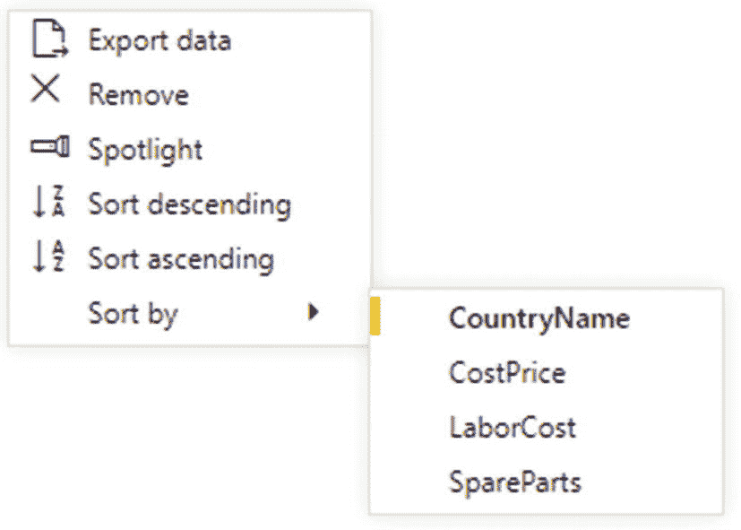

图 15-36  
对多行卡片进行排序

> **注意**：对多行卡片中的类别（此示例中的国家）进行排序时，将首先按字母顺序反向排序（因为多行卡片最初是按字母顺序排序的）。再次选择对类别进行排序将重置排序顺序为字母顺序。对某个值进行排序时，将始终从高到低排序——在弹出菜单中再次点击该值将移除排序顺序并恢复到初始顺序。

好的，作为高级文档工程师和翻译员，我将严格按照您的要求，将给定的英文文本翻译成中文，并保留所有格式。

## 在表格类型之间切换

Power BI Desktop 的众多优点之一在于，它从设计之初就旨在让您能够快速、轻松地测试想法并尝试不同的数据显示方式。因此，您完全可以轻松地切换表格类型，以查看哪种呈现风格最适合您的想法和想要传达的信息。要切换表格类型，您只需选择当前基于文本的可视化对象（表、多行卡或矩阵），然后从可用可视化对象库中选择以下选项之一：

- 表
- 矩阵
- 多行卡

更令人放心的是，Power BI Desktop 会记住您之前使用的表格类型的属性。例如，如果您设置了一个具有精心构建层次结构的矩阵，然后切换到卡片式表格，那么当您想要切换回矩阵时，Power BI Desktop 会记住您是如何设置该矩阵的。

要查看其实际工作方式的示例，请参阅图 15-37。此图显示了相同的初始可视化对象，该对象已被复制，然后在基于文本的核心可视化类型之间切换。我已将 `Color` 字段添加到矩阵中，并展开下一级别，以使表格和矩阵之间的差异更清晰。

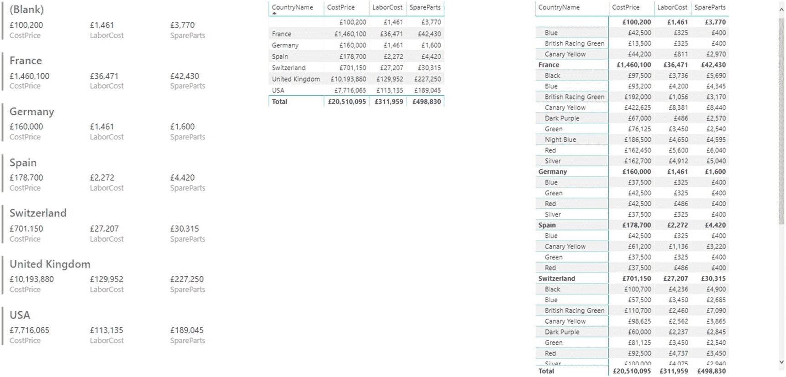

图 15-37 — 使用相同的数据和格式切换可视化对象

以下是这里需要注意的主要事项：

- 切换类型时，可视化对象的大小保持不变。因此，您可能需要调整其大小。
- 所有可以保留的格式都会被保留。从图 15-37 中所有三个可视化对象的标题和背景中都可以看到这一点。

## 结论

本章扩展了您在前一章中获得的知识，向您展示了如何创建矩阵。然后，您学习了如何向下钻取任何矩阵以显示信息的层次结构，或者仅显示数据层次结构中的子级别。

接着，您学习了如何创建卡片可视化对象以及 Power BI Desktop 独特而有效的多行卡。

既然您已经掌握了创建可视化对象的基础知识，现在是时候进入仪表板创建的下一个级别了。在接下来的两章中，您将了解如何创建和增强图表。这将使您能够更自由地发挥想象力，并帮助您的数据“开口说话”。

