# 17. 在 Power BI Desktop 中格式化图表

既然你已经掌握了基本图表，现在是时候进入下一步，学习如何调整图表以达到最佳效果。本章专门介绍 Power BI Desktop 中可用的各种技巧，以使你的图表真正清晰且强大。其中一些增强功能适用于所有图表类型，而另一些则特定于单一图表类型——甚至是一两种图表类型。

有时，你可以通过改变数据到图表元素的映射来更改图表的配置，从而增强图表效果。然而，在大多数情况下，你可以通过修改各种格式选项来增强图表——当你选中图表后在“可视化”窗格中点击油漆滚筒图标（格式图标）时，这些选项就会显示。为方便起见，从现在起我将其称为“格式部分”。

除了在本章中介绍格式化图表外，我们还将探讨 Power BI Desktop 中一个非常有趣的方面。这将涉及对可用内置分析功能的介绍。这些功能可以帮助你隔离并突出显示所创建图表中的关键趋势和信息。

在本章中，你将使用`C:\PowerBiDesktopSamples\CarSalesDataForReports.pbix` Power BI Desktop 文件（该文件可从 Apress 网站下载）作为你创建的任何图表的基础。

## 多个图表的格式化

值得注意的是，从一开始就可以通过按住`Ctrl`单击选择多个图表，在对它们进行任何格式更改之前，将相同的修改应用于同一仪表板页面上的多个图表。

然而，同时修改多个图表仅在*所有*选中的图表类型相同时才有效。

## 图表图例

如果你有一个图表包含多个提供其数值的字段（或者你正在创建饼图或圆环图），那么你会看到图例自动出现。

你可以通过修改以下任一选项来格式化图例：

- 图例显示
- 位置
- 图例标题

让我们逐一看看这些选项。

> **注意：** 只有当`值`字段中添加了多于一个字段时，图例才能显示（饼图和圆环图除外）。

### 图例显示

在某些情况下，Power BI Desktop 可能会自动显示图例，但你是否需要图例由你最终决定。要关闭图例，请执行以下操作：

1. 选中你想要隐藏图例的图表。
2. 在“可视化”窗格中，点击“格式”图标以显示格式部分。
3. 将“图例”按钮向左拖动（或点击其左侧），使其从实心圆变为空心圆。

图例将从选中的图表中消失。

#### 图例位置

默认情况下，图例位于图表的左上角。但你可以选择将图例放置在图表区域内的其他位置。请按以下步骤操作：

1. 选中你想要修改图例的图表。
2. 在“可视化”窗格中，点击“格式”图标。
3. 展开“图例”部分。
4. 从“位置”弹出菜单中选择一个可用的图例位置。

可用选项如表 17-1 所示。

**表 17-1** 图例位置选项

| 图例选项 | 描述 |
| --- | --- |
| 顶部 | 图例显示在图表上方左侧。 |
| 底部 | 图例显示在图表下方左侧。 |
| 左侧 | 图例显示在图表左侧顶部。 |
| 右侧 | 图例显示在图表右侧顶部。 |
| 顶部居中 | 图例显示在图表上方居中。 |
| 底部居中 | 图例显示在图表下方居中。 |
| 左侧居中 | 图例显示在图表左侧居中。 |
| 右侧居中 | 图例显示在图表右侧居中。 |

如果某个图例选项显示为灰色，则表示该选项当前处于活动状态。

图例可能需要进行一些调整，才能以可读的方式显示其内容。这是因为图例文本在初始显示时常常会被截断。如果是这种情况，唯一可行的选项就是修改图表大小或图例字体大小。

> **注意：** 你不能向*仅包含单个*数据系列的面积图、柱形图、条形图或折线图添加图例。

#### 图例标题

如果需要，你可以为图例添加标题：

1. 使用以下字段创建一个簇状柱形图（我假设你现在已经足够熟悉源数据表，可以使用`CarSalesDataForReports.pbix`文件定位这些字段）：
   1. `Make`
   2. `SalePrice`
   3. `Mileage`
2. 在“可视化”窗格中，点击“格式”图标。
3. 展开“图例”部分。
4. 确保“图例”按钮设置为`开启`。
5. 从可用选项的弹出列表中选择一个位置。
6. 确保“标题”按钮设置为`开启`。
7. 在“图例名称”框中输入图例标题。我建议添加`销售分析：`。
8. 从调色板中选择图例文本的颜色。
9. 选择字体系列和文本大小。

带有标题的图例示例如图 17-1 所示。

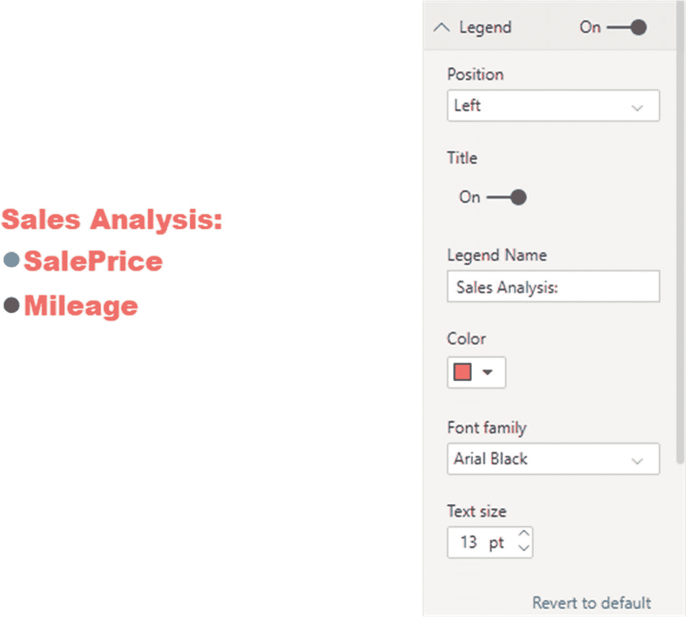

**图 17-1** 带有标题的图例

### 图表标题

每个图表都有一个标题，用于说明图表显示的内容，即其所基于的字段。可用的选项相当简单：

- 隐藏或显示标题
- 修改标题的默认文本
- 更改字体颜色
- 更改标题的背景颜色
- 更改对齐方式

让我们看看如何将所有这些选项应用于你之前创建的图表标题：

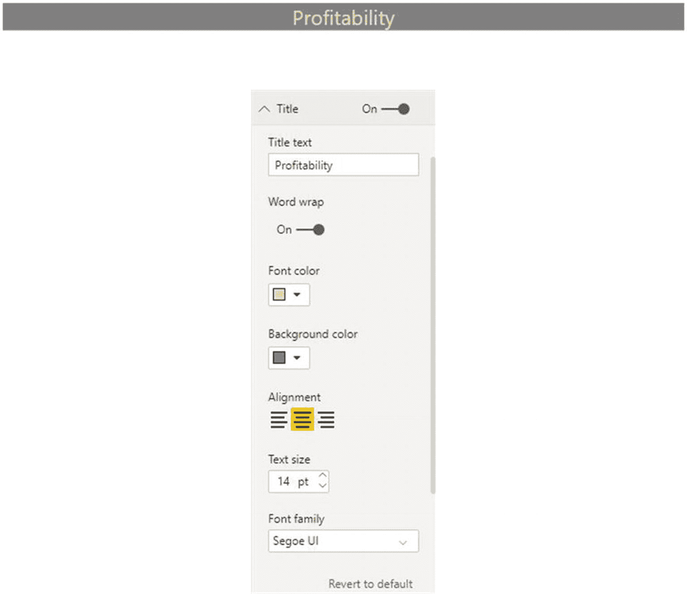

**图 17-2** – 图表标题调整

1. 选择包含你想要修改的标题的图表。
2. 在`可视化`窗格中，单击`格式`图标。
3. 展开`标题`部分。
4. 确保`标题`按钮处于`开启`位置。或者，切换到`关闭`位置以隐藏标题。
5. 在`标题文本`框中修改标题文本。在此示例中，我将其设置为`Profitability`。
6. 如果标题需要换行显示，请将`自动换行`设置为`开启`。
7. 单击`字体颜色`右侧的弹出菜单三角形，从可用颜色面板中选择一种颜色。
8. 单击`背景颜色`右侧的弹出菜单三角形，从可用色调面板中选择一种颜色。
9. 单击`对齐`右侧的中间图标。这将使文本相对于表格宽度居中。
10. 调整`文本大小`以设置更大的字号。你可以在图 17-2 中看到这些调整的结果。

你始终可以使用自由格式文本框向图表添加进一步标注。此技术在第 23 章中介绍。

### 图表数据标签

你已经看到，只需将鼠标指针悬停在感兴趣的数据上，就可以显示柱状图、条形图或折线图中某个数据点背后的精确数据。但有时你可能希望将图表背后的值永久显示在可视化内容上。这时就需要用到数据标签。

要向图表添加数据标签（在此示例中，我继续使用你在本章开头创建的图表），你只需执行以下操作：

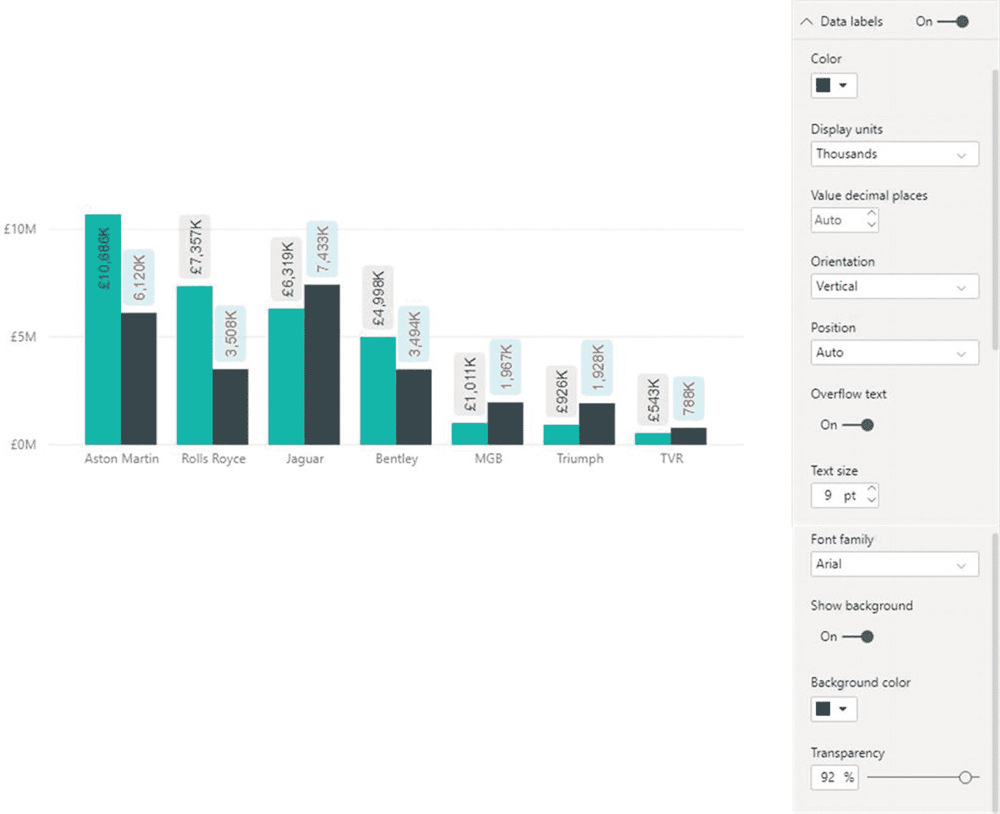

**图 17-3** – 柱状图中的数据标签

1. 选择要添加数据标签的图表。
2. 在`可视化`窗格中，单击`格式`图标。
3. 展开`数据标签`部分。
4. 将`数据标签`按钮设置为`开启`。
5. 通过单击显示单位的弹出列表，为卡片中的数字选择显示单位。在此示例中，我将千作为单位应用。
6. 通过单击`精度`框右侧的上下三角形，为卡片数据选择要使用的小数位数。如果你愿意，也可以直接输入小数位数。
7. 从弹出颜色面板中为数据标签选择一种颜色。
8. 从`方向`弹出列表中选择一种对齐样式（垂直或水平）。
9. 如果你希望文本溢出，请将`溢出文本`设置为`开启`。这意味着，无法完全放入条形图内部的文本元素仍然会被显示——即使它被截断了。
10. 选择标签相对于数据的位置（此选项仅适用于条形图和柱状图）。
11. 如果需要，可以微调文本大小和字体。
12. 将数据标签的背景颜色设置为`开启`——如果你希望数据标签显示在特定的彩色背景上，请从颜色面板中选择一种背景颜色。
13. 使用滑块调整数据标签背景的透明度。你可以在图 17-3 中看到此操作效果的示例。

**注意：** 将数据标签应用于柱状图、条形图和折线图时，你可能会注意到，有时 Power BI Desktop 无法将所有数据标签物理地放置在你所选选项所暗示的精确位置。这是因为有时条形图或柱状图内部没有足够的空间来容纳这些数字。在这些情况下，Power BI Desktop 会将数据放置在条形图或柱状图的外部。在其他情况下，数据无法放置在折线图、柱状图或条形图的外部，除非将其放置在轴的上端之上。在这里，Power BI Desktop 同样会调整呈现方式，以尽可能接近你要求的效果。这可能意味着数据标签根本不会显示。

数据标签定位的各种选项在表 17-2 中给出。

**表 17-2** – 数据标签位置选项

| 数据标签位置 | 描述 |
| --- | --- |
| 自动 | Power BI Desktop 会为获得最佳效果而放置数据标签。 |
| 内端 | 数据标签放置在条形图的右侧内部或柱状图的顶部内部。 |
| 外端 | 数据标签放置在条形图的右侧外部或柱状图的顶部外部。 |
| 内部居中 | 数据标签放置在条形图或柱状图的中心内部。 |
| 内基 | 数据标签放置在条形图的左侧内部或柱状图的底部内部。 |

关于数据标签主题，还有最后几点需要注意：

- 散点图和气泡图不显示数据标签。

- 如果你愿意，可以显示并调整图表中一个或所有数据系列的数据标签。只需单击`自定义系列`按钮将其设置为`开启`，然后从弹出列表中选择要设置格式的数据元素。然后，你可以像为整个图表设置数据标签格式一样，为这个选定的系列设置格式。

### 图表背景

如果你需要改变图表的美感，或者需要使某个图表在仪表板中脱颖而出，你还可以修改整个图表的背景颜色。因此，继续使用你之前创建的图表，你可以执行以下操作：

1. 选择要修改背景的图表。

2. 在`可视化`窗格中，单击`格式`图标。

3. 展开`背景`部分。

4. 确保`背景开启/关闭`开关设置为`开启`（右侧的实心圆）。

5. 单击`背景颜色`右侧的弹出菜单三角形，从可用颜色面板中选择一种颜色。

6. 将`透明度`滑块向左或向右移动，以增加或减少背景颜色的透明度（以及随之而来的强度）。

## 数据颜色

所有图表都允许你指定每个数据系列的颜色。当然，所需的工作量取决于你想要修改的数据系列的数量。操作方法如下：

1. 选择要修改数据颜色的图表。

2. 在`可视化`窗格中，单击`格式`图标。

3. 展开`数据颜色`部分。将显示图表数据系列（或某些图表类型的数据元素）列表。

4. 从可用的弹出颜色面板中为每个数据元素或系列选择一种颜色。

图 17-4 显示了你当前正在处理的图表修改后的数据颜色。

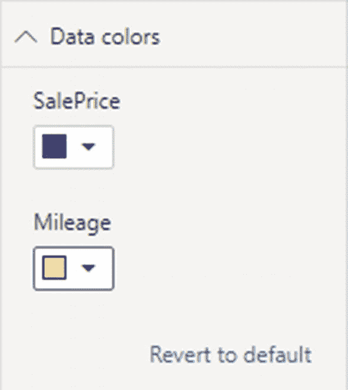

**图 17-4** – 指定数据颜色

**注意：** 如果图表仅包含一个数据系列（饼图和环形图总是如此，柱状图、折线图、条形图和面积图也可能如此），你可以选择为数据系列的`每个数据点`设置颜色。

## 绘图区

除饼图、环形图和漏斗图外，您可以为选定图表的绘图区设置背景图像。以下是操作示例：

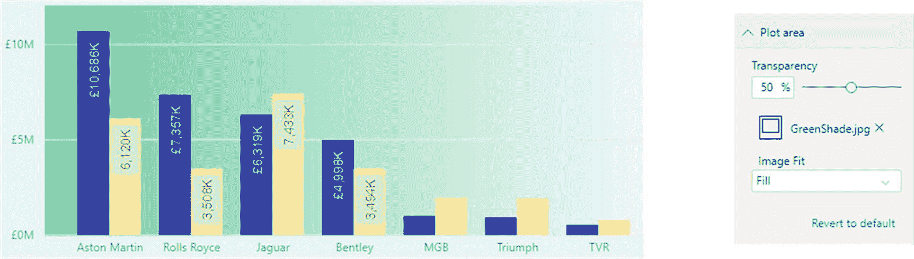

*图 17-5* – 向图表绘图区添加图像

1. 选中您要修改绘图区的图表（我仍使用本章开头看到的那个图表）。

2. 在`可视化`窗格中，点击`格式`图标。

3. 展开`绘图区`部分。

4. 点击`添加图像`。将出现标准的 Windows `打开`对话框。

5. 导航到您要添加的图像文件。我将使用 `C:\PowerBiDesktopSamples\Images\GreenShade.png`。

6. 点击`打开`。

7. 在`图像适合`弹出菜单中，选择`适合`。图像将展开以填满整个绘图区。您可以在图 17-5 中看到应用于图表的图像示例。

**注意：** 要删除您添加的图像，在`可视化`窗格的`格式`区域的`绘图区`部分中，点击图像文件名右侧的小叉号即可。

## 轴修改

大多数图表（饼图、环形图和漏斗图除外）都允许您调整轴属性。这意味着修改：

- X（水平）轴

- Y（垂直）轴

我们将分别快速了解一下两者。

#### 修改 X 轴

您可以更改 X 轴的以下几个方面：

- 轴显示

- 轴标题和呈现方式

- 轴标签的字体属性

- 类别宽度

一个简单的示例解释了如何调整 X 轴的这些方面：

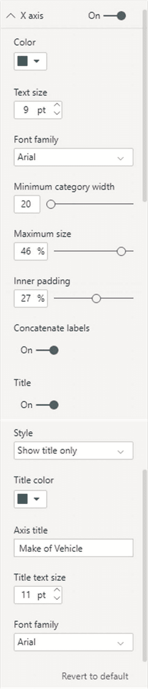

*图 17-6* – 格式化 X 轴

1. 选中您想要修改的带有 X 轴的图表。我将继续使用本章开头展示的图表。

2. 在`可视化`窗格中，点击`格式`图标。

3. 展开`X 轴`部分。

4. 确保`X 轴`开关已设置为`开启`（这会显示轴和描述性元素）。

5. 为轴标签选择字体、字号和颜色。

6. 将`标题`设置为`开启`（这会添加轴标题）。输入`车辆品牌`作为`轴标题`。

7. 在`可视化`窗格中（如果需要）向下滚动，为轴标题选择字体、字号和颜色。

8. 设置更大的`最小类别宽度`（这是图表中每个条形图的宽度）。

9. 设置更大的`内边距`（这是条形图组之间的间距）。

10. 设置`最大尺寸`（这定义了轴元素相对于绘图区高度的最大高度）。您可以在图 17-6 中的`可视化`窗格的`格式`区域看到这些属性。最终格式化后的图表如图 17-8 所示。

#### 修改 Y 轴

如果您的图表有 Y 轴（或者对于双轴图表，有两个 Y 轴），那么您可以修改以下元素：

- 轴位置

- 轴刻度类型

- 轴起始值

- 轴结束值

- 标题显示

- 显示单位

- 数字精度

- 网格线和网格线样式

同样，通过一个示例来了解如何应用这些不同的格式化选项可能最简单。我继续使用本章开头看到的图表。

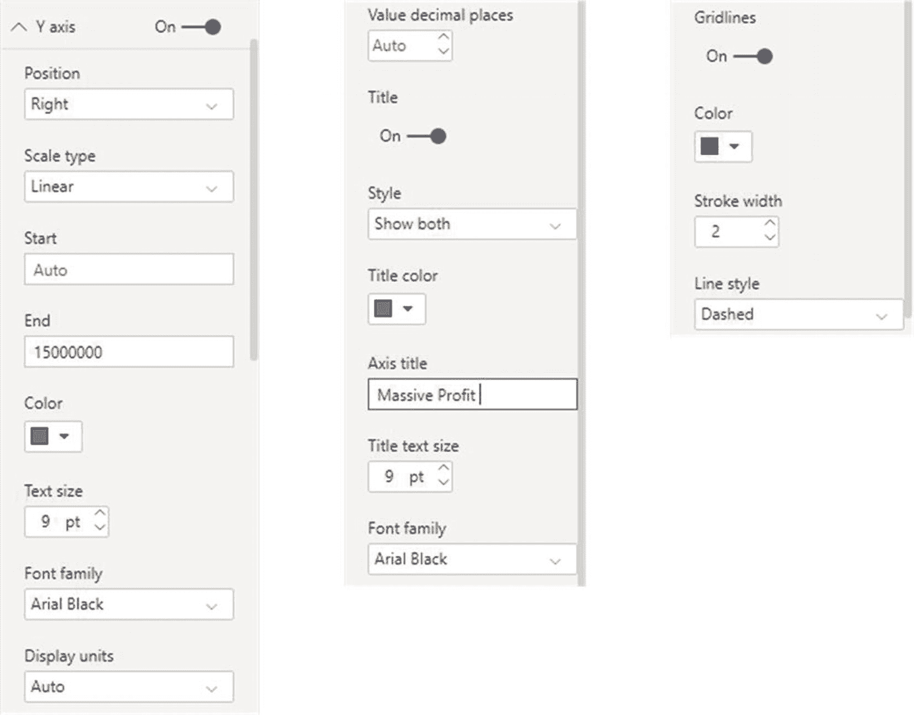

*图 17-7* – 格式化 Y 轴

1. 选中您要修改轴属性的图表。我将继续使用我们本章一直在修改的图表。

2. 在`可视化`窗格中，点击`格式`图标。

3. 展开`Y 轴`部分。

4. 从`位置`弹出菜单中，选择`右侧`。

5. 确保`刻度类型`设置为`线性`——如果您需要对数刻度，则设置为`对数`。

6. 输入`起始值`以设置轴的起始数值。该值可以为负数，并且必须是完整的、未格式化的数字（包括千位或百万位）。在本示例中，我将其保留为`自动`。

7. 输入`结束值`以设置轴的上限数值。同样，该值必须是完整的、未格式化的数字（包括千位或百万位）。在本示例中，我将其设置为`15000000`。

8. 设置 Y 轴元素的字体、字号和颜色。

9. 将`显示单位`设置（或保留）为`自动`。

10. 将`标题`开关切换为`开启`以显示 Y 轴标题。

11. 将`样式`设置为`显示两者`。这样轴标题将同时显示数字和单位。您可以根据偏好选择其中一种。

12. 在`值小数位数`字段中输入要显示在轴上的小数位数。

13. 在`轴标题`字段中输入标题。我添加的是`巨额利润`。

14. 设置轴标题的字体、字号和颜色。

15. 将`网格线`设置为`开启`。

16. 为网格线选择一种颜色。

17. 选择描边宽度和线条样式。您可以在图 17-7 中的`可视化`窗格`格式`区域的 Y 轴部分看到这些设置。最终的图表如图 17-8 所示。

如果您修改的是只有一个轴的图表，您可以通过从`位置`弹出菜单中选择`右侧`，将轴从图表的左侧移动到右侧。对于具有两个轴的图表，您可以使用此设置来交换轴的位置。

如果您的图表包含*两个*Y 轴（一个在左侧，一个在右侧），那么您可以对另一个轴重复这些设置。您可能需要在`可视化`窗格中向下滚动才能看到第二个轴的设置。

**注意：** 请记住，您可以在数据模型中将特定值定义为度量。如果您需要为图表中的 Y 轴设置可重复使用的最大值和最小值，这将非常有用。

### 图表边框

您可以像上一章为表格添加边框一样，为图表添加边框。只需点击`格式`图标，然后将`边框`按钮设置为`开启`。您随时可以通过展开`边框`部分并从可用颜色的弹出菜单中选择一种颜色来指定边框颜色。

### 通用属性

与上一章中看到的基于文本的可视化对象一样，您可以在`可视化`窗格的`格式`区域的`常规`部分中，指定图表在仪表板画布上的精确位置。

### 图表宽高比

作为图表格式化的最后一点说明，值得记住的是，您可以锁定图表的宽高比。这可以确保当您调整图表大小时，其宽度和高度相对于彼此保持原始比例。

要设置宽高比：

1. 点击图表以将其选中。

2. 在`可视化`窗格中，点击`格式`图标。

3. 在`锁定宽高`部分，点击`关闭`以开启锁定，或者点击表示锁定关闭的空心圆右侧，使其滑动到右侧并变成实心圆。

现在，当您使用角手柄调整表格大小时，它将保持其高度与宽度的比例。

最后，在图 17-8 中，您可以看到应用了所有修改的图表。在您对我（缺乏）的品味翻白眼之前，请注意，我并不是建议您以这种方式呈现图表（事实上，您可能应该将此视为*不应该*做什么的例子）。我只是想展示应用许多可用图表格式化选项后的结果。

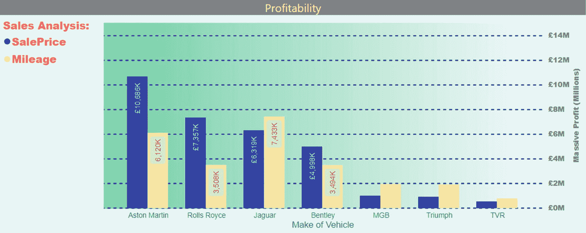

*图 17-8* – 一个完全格式化的图表

## 特定图表格式

尽管本章前面介绍的大多数图表都共享许多通用的格式选项，但其他图表也提供了不同的格式可能性。这意味着，虽然条形图、堆叠条形图、柱形图和堆叠柱形图都可以使用您刚刚学到的技术进行格式化，但其他图表类型则需要发现一些新的调整技巧。

### 折线图、面积图和堆叠面积图

一组共享新格式化选项的图表是折线图、面积图和堆叠面积图。更具体地说，它们都允许您调整图表的线条和点样式。以下示例向您展示了具体操作：

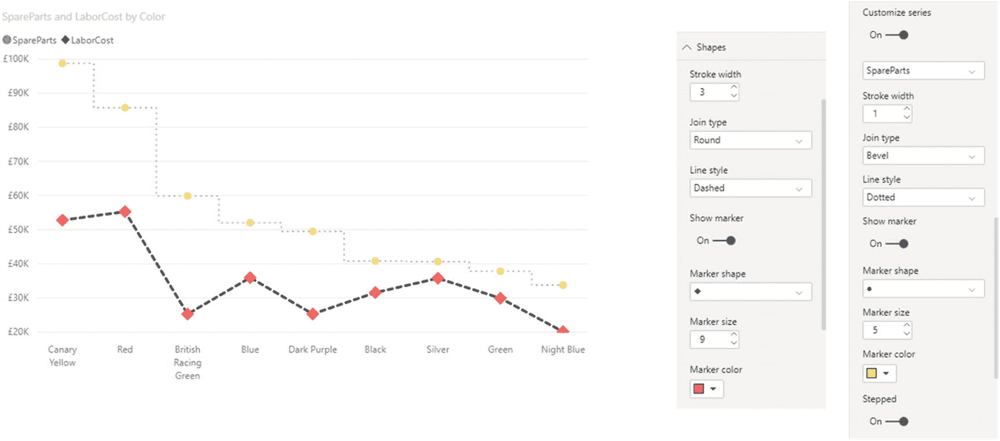
图 17-9 折线图中的形状选项

1. 使用以下字段创建一个新的折线图（使用文件 `CarSalesDataForReports.pbix`）：
   1. `Color`（来自 `Colors` 表）
   2. `SpareParts`（来自 `Stock` 表）
   3. `LaborCost`（来自 `Stock` 表）
2. 在 `Visualizations` 窗格中，单击 `Format` 图标。
3. 展开 `Shapes` 部分。
4. 将 `Stroke width` 设置为 `5`。
5. 将 `Show marker` 设置为 `On`。
6. 从 `Marker shape` 弹出列表中选择一个标记形状。
7. 增加标记大小并更改其颜色。
8. 将 `Line style` 设置为 `Dashed`。
9. 将 `Customize series` 设置为 `On`。
10. 从弹出列表中选择 `SpareParts` 作为要修改的数据系列。
11. 将 `Stroke width` 设置为 `1`，将 `Line style` 设置为 `Dotted`。
12. 将 `Show marker` 设置为 `On`。
13. 从 `Marker shape` 弹出列表中选择一个不同的标记形状。
14. 减小标记大小并更改其颜色。
15. 将 `Stepped` 设置为 `On`。您应该会看到一个类似于图 17-9 所示的图表。

**注意：** 如果没有显示标记，您可以从 `Shapes` 部分的 `Join type` 弹出菜单中选择连接类型（线条改变方向的交点）。

### 饼图和环形图

饼图和环形图也具有特定的格式化可能性。这些包括您可以更改饼图或环形图详细标签的方式。尝试以下操作：

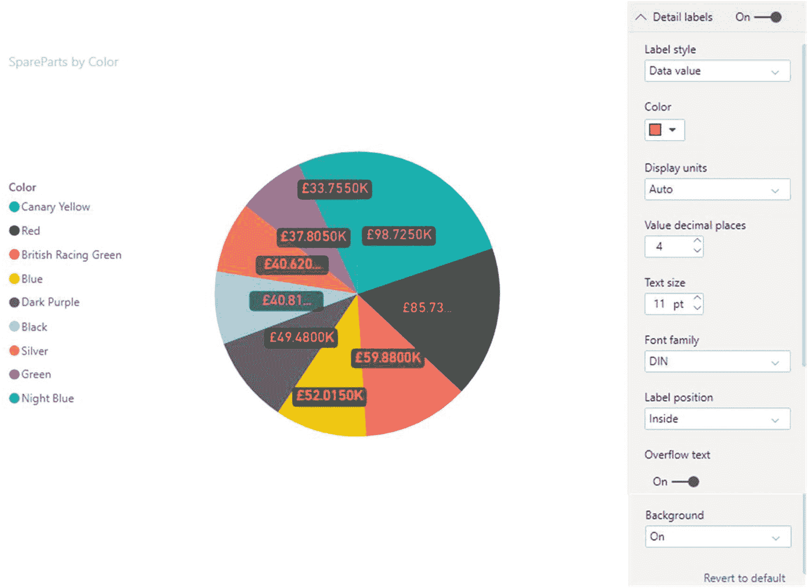
图 17-10 饼图中的形状选项

1. 使用以下字段创建一个新的饼图（使用文件 `CarSalesDataForReports.pbix`）：
   1. `Color`（来自 `Colors` 表）
   2. `SpareParts`（来自 `Stock` 表）
2. 在 `Visualizations` 窗格中，单击 `Format` 图标。
3. 将 `Legend` 设置为 `On`，并将其放置在左侧居中位置。
4. 展开 `Detail labels` 部分。
5. 从 `Label style` 弹出列表中选择 `Data value`。
6. 从调色板中选择一种颜色。
7. 输入或选择一个更大的文本字号。
8. 从 `Display units` 弹出列表中选择 `Millions` 作为显示单位。
9. 为 `Value decimal places` 设置输入 `4`。
10. 将 `Background` 设置为 `On`。
11. 将 `Overflow text` 设置为 `On`（这允许数据标签即使跨越饼图扇区边界也能显示）。您将得到一个类似于图 17-10 所示的图表。

### 带状图

带状图包含您之前看到的应用于堆叠柱形图的所有标准格式选项，因此我在此不再赘述所有这些可能性。然而，有一种格式化选项是此图表类型所特有的，即带状格式化。

要查看具体操作：

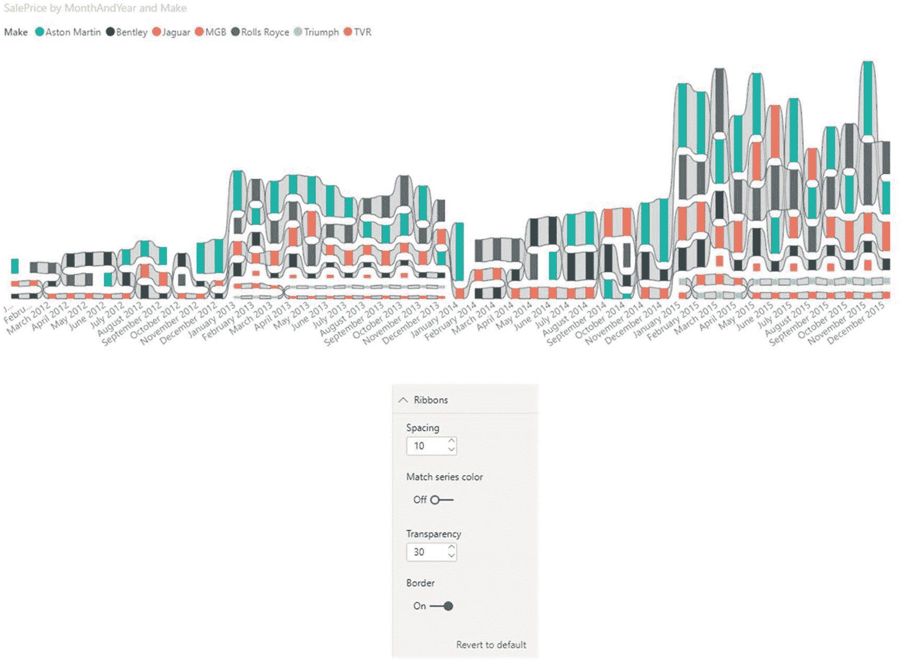
图 17-11 一个带状图

1. 重新创建您在第 16 章中制作的带状图。
2. 单击 `Visualizations` 窗格中的 `Format` 图标。
3. 展开 `Ribbons` 部分。
4. 将 `Spacing` 设置为 `10`。这会设置每个带状条之间的间距。
5. 将 `Match series color` 设置为 `Off`。这会将带状条颜色设置为灰色，而不是每个数据点的条形颜色。
6. 将 `Border` 设置为 `On`。结果（您可以与图 16-25 进行比较）如图 17-11 所示。

### 漏斗图

漏斗图允许您显示（或不显示）并格式化该图表类型特有的一个元素——转化率。这些是显示在漏斗上方和下方的百分比数字。以下简短指南说明了如何操作：

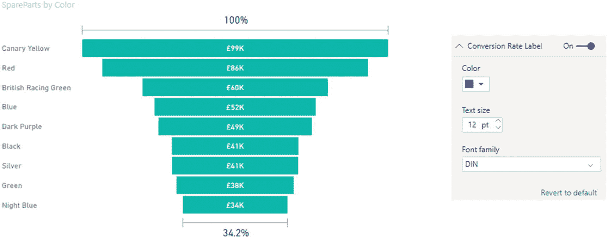
图 17-12 在漏斗图中调整转化率

1. 使用文件 `CarSalesDataForReports.pbix`，使用以下字段创建一个新的饼图：
   1. `Color`（来自 `Colors` 表）
   2. `SpareParts`（来自 `Stock` 表）
2. 按 `SpareParts` 排序。
3. 展开 `Visualizations` 窗格中 `Format` 区域的 `Conversion Rate` 部分。
4. 从调色板中选择一种颜色。
5. 输入或选择一个更大的文本字号。您将得到一个类似于图 17-12 所示的图表。

**注意：** 要阻止显示转化率，您只需单击 `Conversion Rate Label` 按钮即可。

### 散点图和气泡图

最后一组允许您应用某些特定格式的图表是散点图和气泡图。在创建这些图表类型时，您可以更改以下内容：
- 填充点
- 类别标签
- 按类别着色
- 颜色边框
- 气泡

为了查看这些效果，我们将创建一个新图表，然后尝试一些可用的选项。我们将从一个散点图开始，然后将其扩展为气泡图：

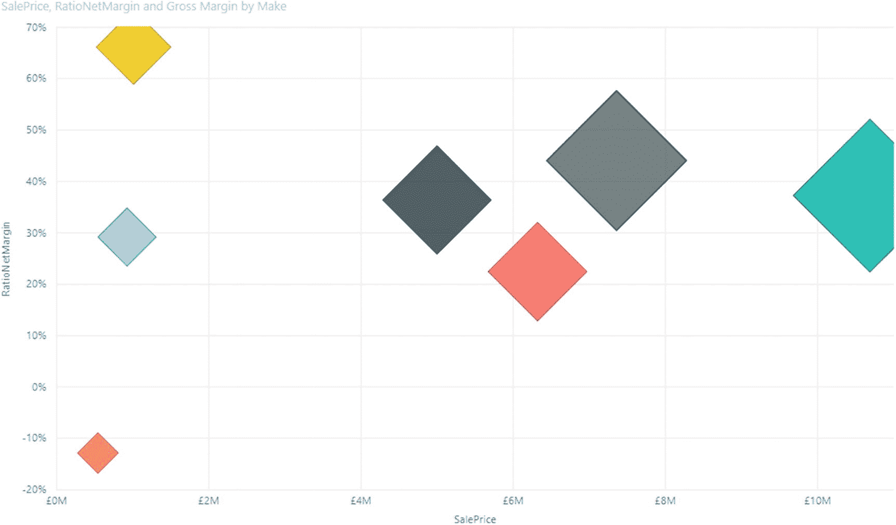
图 17-13 格式化气泡图

1. 使用以下数据元素创建一个散点图：
   1. *Details*：`Make`（来自 `Stock` 表）
   2. *X axis*：`SalePrice`（来自 `InvoiceLines` 表）
   3. *Y axis*：`RatioNetMargin`（来自 `InvoiceLines` 表）
2. 单击 `Visualizations` 窗格的 `Format` 图标。
3. 将 `Fill point` 按钮切换到 `On`。
4. 也将 `Color by category` 设置为 `On`。
5. 展开 `Shapes` 部分并将 `Size` 设置为 `20`。
6. 选择一个不同的 `Marker shape`。
7. 将以下数据元素添加到 `Visualizations` 窗格的 `Fields` 区域：
   1. *Size*：`Gross Margin`（来自 `InvoiceLines` 表）
8. 将 `Color border` 设置为 `On`。
9. 展开 `Data colors` 部分。现在图表看起来将类似于图 17-13 所示。

此时需要说明几点：
- 添加一个用于表达颜色饱和度的字段会停用 `Color by category` 格式化选项，并阻止您分配特定的数据颜色。
- 对于气泡图，您可以在 `Data colors` 部分指定用于定义气泡中颜色差异的实际值（假设已添加了颜色饱和度的值）。

### 气泡图播放轴

到目前为止，在本章中，你已经了解了以图表形式呈现数据的各种方式，以及如何使用多种图表类型选择和比较数据。Power BI Desktop 中的最后一个技巧（对于吸引观众注意力极其有效）是向可视化对象应用播放轴。这会使图表动起来，并且理想情况下，它非常适合展示数据如何随时间演变。遗憾的是，在纸质页面上很难获得“惊艳”的效果，因此这确实是一种必须亲自尝试的技术。

你需要知道，播放轴只能应用于散点图或气泡图。同样，添加播放轴并不适合或增强所有类型的数据。但是，如果你有一个时间相关的元素可以添加到图表中作为 Y 轴（例如，迄今为止的销售额），那么你可以产生一些强大且具有启示性的效果。

下面说明如何创建一个气泡图，显示所售汽车颜色的净利润率与年初至今销售额的关系：

# Power BI Desktop 图表增强与分析

1.  打开文件 `C:\PowerBiDesktopSamples\CarSalesDataForReports.pbix` 并删除任何现有的视觉对象。

2.  使用以下字段和顺序创建一个气泡图：
    - 图例：`Make`（来自 `Stock` 表）
    - X 轴：`YearSales`（来自 `Invoices` 表）
    - Y 轴：`RatioNetMargin`（来自 `InvoiceLines` 表）
    - 大小：`CostPrice`（来自 `Stock` 表）
    - 播放轴：`MonthAndYearAbbr`（来自 `DateDimension` 表）

3.  调整呈现方式（大小、图例位置、数据标签等）以获得最佳效果。

点击播放轴左侧的“播放”图标。你将看到气泡揭示出销售数据在整个年度中的进展情况。在时间线上的某个点，视觉对象将如图 17-14 所示。

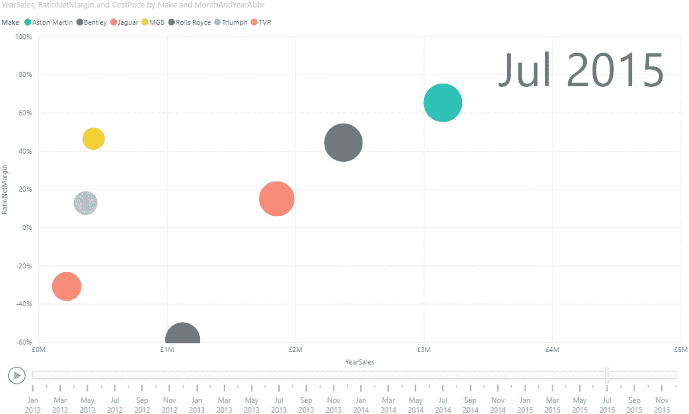

图 17-14 — 气泡图上的播放轴

在讨论播放轴时，有几点值得注意：
- 你可以在动画播放过程中点击暂停图标（播放图标此时已变为暂停图标）来暂停自动显示。你可以随意停止和开始。
- 你可以点击播放轴上的任意月份（或任意元素）来仅显示该元素的数据，而无需播放该时间点之前的数据。这本质上意味着你可以将播放轴用作数据的筛选器。
- 播放轴不必基于时间。然而，如果不以时间作为播放轴的基础，则更难看到数据的任何连贯性或进展。
- 使用累计数据（例如本示例中的 `YearSales` 数值，即年初至今的累计销售额）在基于时间的播放轴中尤其有效，因为它能让你了解每个数据项的销售额随时间增长的情况。
- 你可以将播放轴用作数据的另一个交互式筛选器，但这会让你错过一个绝妙的动画技术！

## 图表分析

向图表中的数据添加额外强调的另一种方法是添加分析增强功能。这些是添加的元素，用于将读者的注意力吸引到自动计算的值上。所有这些项目都作为线条独立于现有数据添加到图表中。它们包括：
- 常量：你可能希望将特定值作为图表中的一项添加。
- 最小值：这允许你引起对下限的关注。
- 最大值：这允许你引起对上限的关注。
- 平均值：你可以让 Power BI Desktop 计算一组数值的平均值并将其显示为一条线。
- 中位数：Power BI Desktop 也可以计算并显示中位数值。
- 百分位数：你可以指定要显示的百分位数。

为了更近距离地了解这一点，假设你想向一个包含所有品牌汽车的售价和里程数的图表添加以下线条：
- 平均里程数
- 最高售价

以下是操作方法：

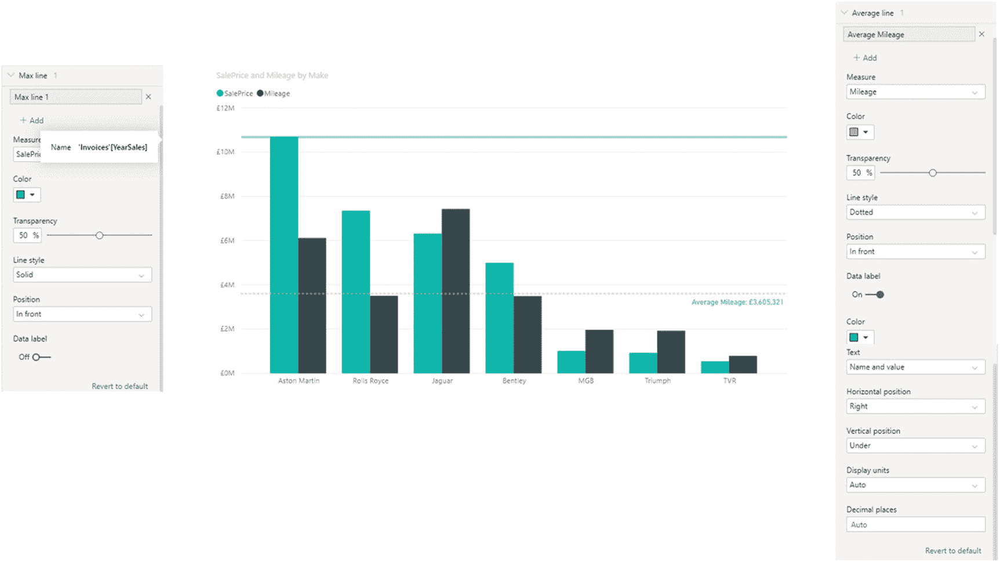

图 17-15 — 添加图表分析

1.  点击“可视化”窗格中的“簇状柱形图”图标。仪表板画布上将创建一个空的柱形图视觉对象。
2.  按以下顺序将以下字段拖入字段井的“轴”区域：
    - `Make`（来自 `Stock` 表）
    - `Model`（来自 `Stock` 表）
    - `Color`（来自 `Colors` 表）
3.  将以下字段拖入字段井的“值”区域：
    - `SalePrice`（来自 `InvoiceLines` 表）
    - `Mileage`（来自 `Stock` 表）
4.  点击“分析”图标（位于“可视化”窗格中“格式”图标的右侧）。
5.  展开“平均线”部分。
6.  点击“添加”。
7.  从“度量”弹出列表中选择 `Mileage`。
8.  从可用颜色调色板中选择一种颜色。
9.  将线条样式设置为“虚线”。
10. 点击“数据标签”按钮以激活数据标签。
11. 将文本设置为“名称和值”。
12. 将水平位置设置为“右侧”。
13. 将垂直位置设置为“下方”。
14. 双击包含文本“平均线 1”的字段，然后输入 `平均里程数`。
15. 关闭“平均线”部分。
16. 展开“最大线”部分。
17. 点击“添加”。
18. 从“度量”弹出列表中选择 `SalePrice`。
19. 将线条样式设置为“实线”。图表应类似于图 17-15 所示。

值得注意的是，你可以为一个分析元素添加多条线。也就是说，你可以添加任意多个平均值（例如），只要图表中有相应的数据元素。为此，只需在你希望添加另一条线的部分再次点击“添加”，然后定义设置以获得你想要的结果。尽管如此，这是一种既可能有助于你讲述数据故事，也可能有损图表清晰度的技术。因此，最好谨慎使用。

如果你要添加一条百分位线，那么你可能还需要调整一个额外的元素。这是数据元素最大值的实际百分位数值，你可以使用“百分位数”滑块进行调整。

移除分析线非常简单：
1.  点击“分析”图标。
2.  展开与要移除的线对应的部分。
3.  点击要移除的线右侧的叉号。

> **注意**：你实际上无法在图表中选择一条分析线。

## 散点图对称着色和比率线

Power BI Desktop 的两个功能可以帮助你在散点图中“分清主次”：
- 对称着色
- 比率线

它们的应用同样简单，但确实可以帮助你超越大量数据点，洞察到有价值的趋势和显著的数据项。

### 对称着色

此功能可让您查看哪些点在 X 轴上的值高于 Y 轴（反之亦然）。与 Power BI Desktop 的许多功能一样，通过实际示例来理解它效果最佳：

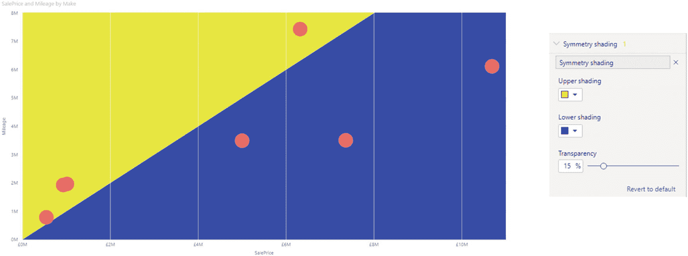

图 17-16 为散点图添加对称着色

1.  使用以下元素创建散点图：
    1. 详细信息：`Make`（来自 `Stock` 表）
    2. X 轴：`SalePrice`（来自 `InvoiceLines` 表）
    3. Y 轴：`Mileage`（来自 `Stock` 表）
2.  增大形状并填充它们（如前所述）。
3.  选中散点图，在“可视化”窗格中单击“分析”图标（放大镜）。
4.  展开“对称着色”部分。
5.  单击“添加”。
6.  从可用颜色调色板中选择上部着色的颜色。
7.  从可用颜色调色板中选择下部着色的颜色。
8.  调整“透明度”滑块，将透明度设置为 15%。图表将如图 17-16 所示。

您可以通过单击“对称着色”部分中“对称着色”框右侧的小叉号来移除对称着色。

> **注意**：仅当 X 轴和 Y 轴上的值范围可比时，对称着色才会真正有用。

### 比率线

最后一个即时分析功能是比率线。以下介绍如何应用它：

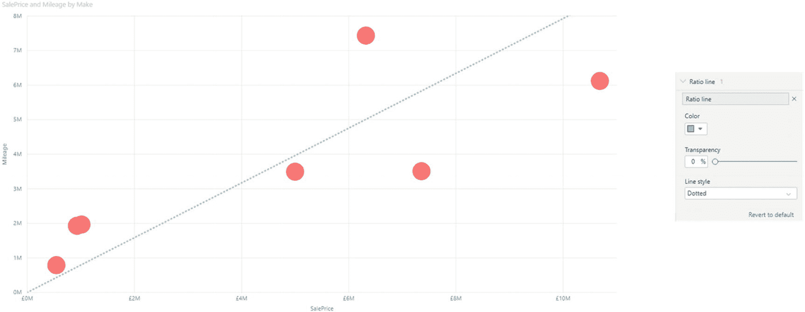

图 17-17 为散点图添加比率线

1.  按照上一节的步骤 1 和 2 创建散点图。
2.  展开“比率线”部分。
3.  单击“添加”。
4.  从可用颜色调色板中选择比率线的颜色。
5.  选择线条样式——“虚线”、“点线”或“实线”。
6.  从线条样式弹出列表中选择线条类型。图表将如图 17-17 所示。

与对称着色类似，您可以通过单击“比率线”部分中“比率线”框右侧的小叉号来移除比率线。

## 结论

在本章中，您学习了如何通过格式化来增强 Power BI Desktop 图表类型，以增加效果。这包括修改数据系列和数据点的颜色，以及添加或删除标题。您还了解了如何向特定类型的图表添加图例和数据标签。

接着，您学习了如何使用自动分析功能增强图表。这些功能包括平均值、选定的最大值以及比率线。

此外，您还了解了某些类型的图表（特别是气泡图）如何实现动画效果，以便您可以将时间作为描述性因素添加进来，帮助观众理解数据的演变过程。

现在，您已走在成为 Power BI Desktop 仪表板大师的道路上。接下来您只需了解剩余的一些可视化类型，即可完全掌握如何制作高影响力的演示。那么，现在进入接下来的三章，完成您的学习历程。