# 18. 其他类型的视觉对象

虽然基于文本的视觉对象和图表经常能够说明您的观点，但有时您需要以超越传统数据展示的方式来传达见解。这正是 Power BI Desktop 大显身手之处。利用正确的数据——只需点击几下——您就能让仪表板焕然一新。

- 树状图
- 仪表
- KPI
- R 视觉对象
- Python 视觉对象
- 分解树
- 关键影响因素

这些可视化类型中的大多数都像您在之前四章中看到的基于文本的视觉对象和图表一样易于创建。然而，它们易于使用的特点不应分散您对其能为报表和演示带来的清晰度和强大功能的关注。

本章将使用文件 `C:\PowerBiDesktopSamples\CarSalesDataForReports.pbix` 作为您将创建的视觉对象的基础。

## 树状图

一种能真正帮助您的观众理解各个数值与总计之间关系的视觉对象是树状图。虽然这并不是任何地理意义上的地图，但它确实可以帮助用户在数据集中找到方向。

再次强调，在视觉对象的世界里，眼见为实。让我们看一个树状图，它展示了每个汽车品牌和型号的劳动力成本如何累积：

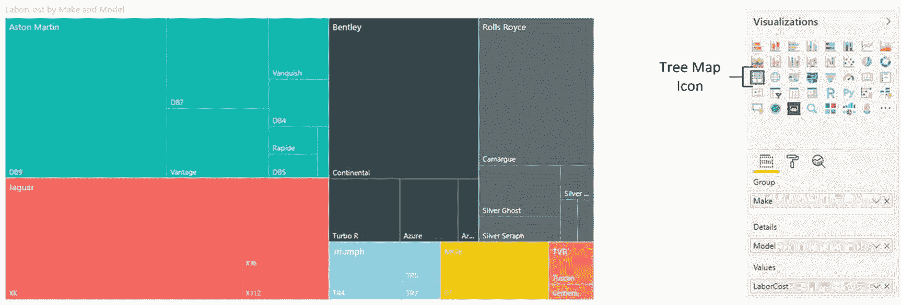

图 18-1

显示每个汽车品牌劳动力成本的树状图

1. 打开 `C:\PowerBiDesktopSamples\CarSalesDataForReports.pbix` 文件，或单击仪表板画布的空白区域。
2. 在**可视化**窗格中单击**树状图**图标。将出现一个空白树状图。
3. 展开 `Stock` 表，将 `Make` 字段拖入字段井中的**分组**框。
4. 将 `Model` 字段拖入字段井中的**详细信息**框。
5. 将 `LaborCost` 字段拖入字段井中的**值**框。树状图应如图 18-1 所示。

如图 18-1 所示，树状图按品牌对每个汽车型号进行了分组，然后将劳动力成本显示为树状图中每个方框的相对大小。这样，您的观众可以大致了解：

- 每个型号的劳动力成本与该品牌总劳动力成本的比较
- 每个品牌的劳动力成本与总劳动力成本的比较

正如您可能已经预料到的，您可以将鼠标悬停在树状图中的任何方框上，查看显示精确数据的弹出工具提示。

Power BI Desktop 将决定如何最好地组织树状图。然而，最终外观将取决于视觉对象的宽度和高度。因此，请毫不犹豫地调整这种特定类型的可视化，并观察随着您调整相对高度和宽度，它是如何变化的。

在某些情况下，树状图可能无法显示所有可用数据，原因可能是数据点过多，或者数值范围过宽而无法正确显示，或者（如饼图的情况）数据中包含负值。在这些情况下，树状图会在视觉对象的左上角显示一个警告信息符号。将鼠标指针悬停在此图标上，您将看到类似图 18-2 所示的消息。

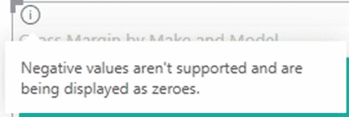

图 18-2

树状图数据警报

如果您看到此警告，建议您对数据应用筛选器（如第 21 章所述），以筛选掉导致问题的数据。


### 向下钻取与树状图

你在矩阵、图表和地图中已经见过的向下钻取和展开下级逻辑，同样适用于树状图。既然你已熟悉这一概念，这里仅展示一个使用树状图进行向下钻取的简短示例：

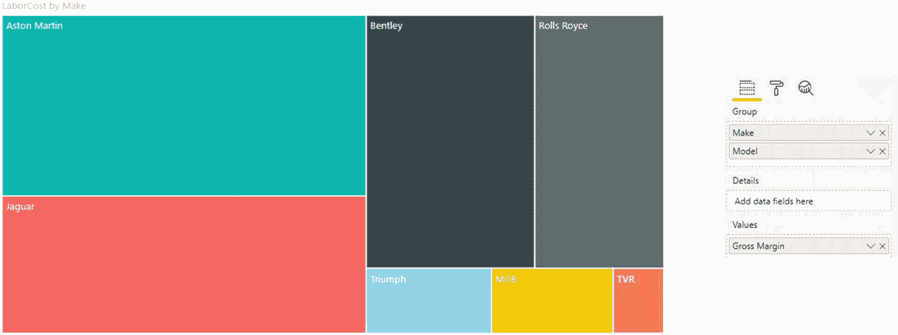

**图 18-3** — 向下钻取前的树状图

1. 选中你刚刚创建的树状图。
2. 将`Colors`表中的`Color`字段拖动到`可视化`窗格的组框中，放置在`Make`字段*下方*。字段框与树状图应如图 18-3 所示。此时按车型划分的相对劳动力成本将不再显示。

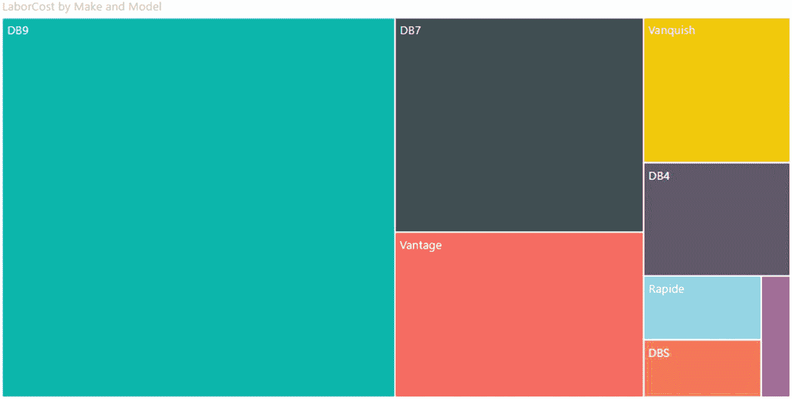

**图 18-4** — 向下钻取树状图

1. 点击可视化对象右上角的钻取模式图标，激活钻取模式。
2. 点击`Aston Martin`。你将向下钻取到该品牌的下一个层级（颜色），可视化效果将如图 18-4 所示。

### 设置树状图格式

树状图的格式化方式与其他可视化对象相同。以下是`可视化`窗格中`格式`图标下的可用选项：

* `图例`
* `数据颜色`
* `数据标签`
* `类别标签`
* `标题`
* `背景`
* `锁定纵横比`
* `边框`

由于前几章已对其他类型可视化对象应用这些选项进行了说明，此处不再赘述，仅对部分选项提供简要说明。

#### 图例

在我看来，图例是多余的，因为它重复了树状图中已显示的分组数据信息。不过，如果你选择不显示类别标签，图例可能会变得必要。

## 数据颜色

此调色板允许您为每个分组元素选择特定颜色。

#### 数据标签

您可以根据需要显示（或隐藏）树状图各区块背后的实际数值。这需要将`数据标签`按钮切换为`开`或`关`。展开`格式`窗格中的`数据标签`部分后，您还可以修改数据标签的颜色、单位、小数位数、文本大小和字体。

#### 类别标签

此选项允许您决定是否在树状图内部显示分组元素和明细元素信息。如果您的树状图包含数十个（甚至数百个）数据点，您可能希望隐藏类别标签。展开`格式`窗格中的`类别标签`部分后，您还可以修改类别标签的颜色、字体和大小。

#### 标题

与大多数可视化对象一样，您可以选择显示或隐藏标题，并修改其文本、字号和背景色。

#### 背景

您也可以为本章中看到的这类可视化对象应用彩色背景。

#### 锁定纵横比

如果将`锁定纵横比`设置为`开`，则在调整可视化对象大小时可保持其比例不变。

#### 边框

与几乎所有可视化对象一样，您可以为树状图添加或移除边框。

## 仪表盘

仪表盘是一种开箱即用的、极其有用的可视化对象。当您希望将实际值与目标值进行比较，或查看某项指标与关键绩效指标（KPI）的对比时，这类可视化对象尤为有效。在此示例中，您将使用仪表盘来比较采购与备件的总成本是否超出财务总监设定的阈值：

1. 打开`C:\PowerBiDesktopSamples\CarSalesDataForReports.pbix`文件，或点击仪表板画布的空白区域。
2. 点击`可视化`窗格中的`仪表盘`图标。将出现一个空白的仪表盘可视化对象。
3. 展开`InvoiceLines`表，将`Cost Plus Spares Margin`字段拖动到字段框的`值`框中。或者，直接将此字段拖入刚刚创建的仪表盘中。
4. 将`InvoiceLines`表中的`Cost Plus Spares Maximum`字段拖动到字段框的`最大值`框中。
5. 将`Cost Plus Spares Target`字段（同样来自`InvoiceLines`表）拖动到字段框的`目标值`框中。

仪表盘将如图 18-5 所示。

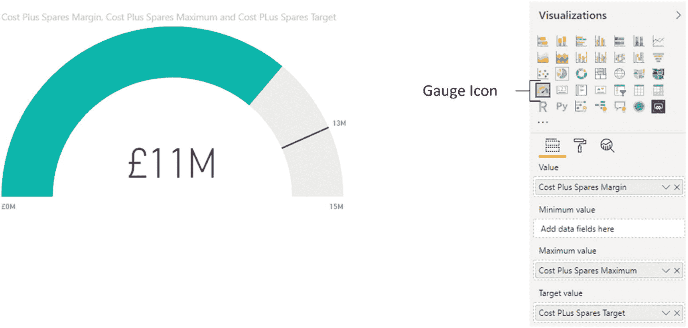

**图 18-5** — Power BI Desktop 中的仪表盘

仪表盘旨在显示相对于目标或总量的进度。因此，您可以为仪表盘设置表 18-1 中所述的元素。

**表 18-1** — 仪表盘的特定数据要求

| 元素 | 描述 |
| --- | --- |
| `值` | 在仪表盘中以彩色条形式显示的元素。 |
| `最小值` | 用于改变仪表盘视觉感知效果的最小值。 |
| `最大值` | 用于改变仪表盘视觉感知效果的最大值。 |
| `目标值` | 定义为需要实现的指标。 |

实际上，仪表盘只需要一个值。即使没有其他三个元素，它也能工作。然而，仪表盘真正的视觉力量在于它利用了观看者对目标或待实现值的预期。因此，通常最好至少应用一个目标值和最大值，以向读者传达成功或失败的概念。

> **注意：** 请记住，您可以在数据模型中将特定值定义为度量值。如果需要在仪表盘中设置最大值、最小值或目标值，这会非常有用。这样，您可以一次修改阈值，而无需单独更改多个可视化对象的属性。


好的，作为一名高级文档工程师和翻译员，我将严格遵循您的注意事项和示例格式，将给定的英文文本翻译成中文。


### 格式化仪表

许多仪表格式化选项都高度特定于仪表视觉对象。因此，这里快速介绍一下你需要了解的可用呈现技巧，以增强此类视觉对象的效果：

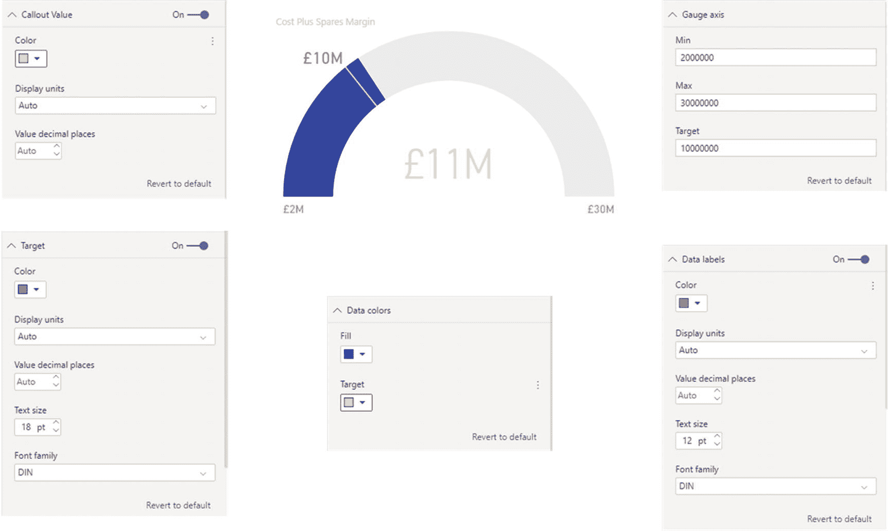

图 18-6 格式化后的仪表

1.  单击你之前创建的仪表。
2.  在“可视化”窗格中，删除目标值（`CostPlusSpares` 字段）。
3.  删除最大值（`SalePrice` 字段）。
4.  在“可视化”窗格中，单击“格式”图标。
5.  展开“仪表轴”部分。
6.  输入 **2000000** 作为最小值。
7.  输入 **30000000** 作为最大值。
8.  输入 **10000000** 作为目标值。
9.  展开“数据标签”部分。
10. 确保“数据标签”开关设置为“开”，然后展开“数据标签”部分。
11. 从弹出调色板中为数据标签选择一种颜色，并设置更大的字号。
12. 确保“目标值”开关设置为“开”，然后展开“目标值”部分。
13. 从弹出调色板中为目标值选择一种颜色。
14. 展开“标注值”部分。
15. 确保“标注值”开关设置为“开”，然后展开“标注值”部分。
16. 从弹出调色板中为标注值选择一种颜色。
17. 展开“数据颜色”部分，为填充和目标值选择一种颜色。仪表的外观将类似于图 18-6。

如果愿意，你还可以像之前为其他视觉对象所做的那样，更改背景、数据标签、边框和标题。如果你希望，也可以选择不显示数据标签或标注值（即仪表的值）。你只需将各自的开关设置为“关”即可。

> **注意**
> 
> 在“可视化”窗格的“格式”面板（本章前面已提及）中输入数字时，不得添加任何数字格式，例如千位分隔符。否则，格式将不起作用，Power BI 会等待你以原始形式输入数字。

仪表是一种简单但有效的视觉对象。一组仪表也是在高管仪表板上显示高层级关键指标的真正有效方式。

其余仪表格式化选项与你已见过的大多数视觉对象通用：
- 标题
- 背景
- 锁定纵横比
- 边框

### KPI

Power BI Desktop 还可以创建关键绩效指标视觉对象，用于说明数据元素相对于目标值的趋势。下面是一个示例：

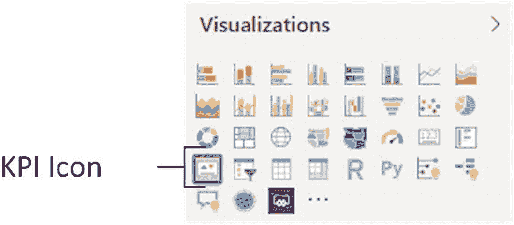

图 18-7 KPI 图标

1.  仍然使用 `CarSalesDataForReports.pbix` 文件，单击 KPI 图标以将簇状柱形图视觉对象添加到仪表板。保持空白 KPI 视觉对象处于选中状态。你可以在图 18-7 中看到此图标。

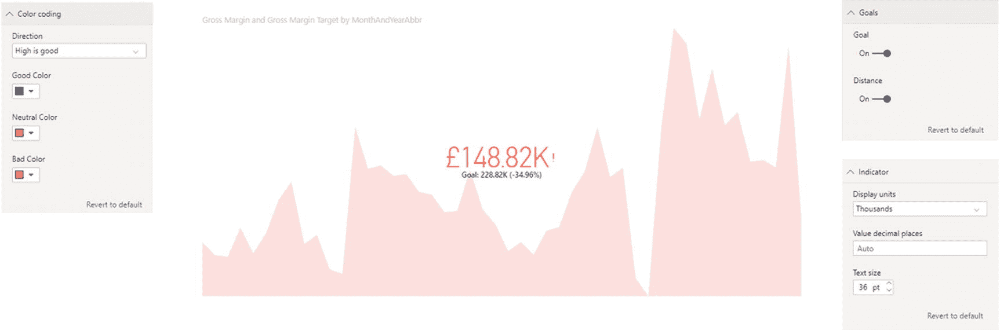

图 18-8 KPI 视觉对象

1.  添加 `Gross Margin` 字段（来自 `InvoiceLines` 表）以及 `MonthAndYearAbbr` 字段（来自 `DateDimension` 表）。
2.  将 `InvoiceLines` 表中的 `Gross Margin Target` 字段添加到“可视化”窗格的目标值框中。
3.  在“可视化”窗格中单击“格式”图标。
4.  展开“目标”部分。确保“距离”（显示任何百分比不足或超出）和“目标”（显示目标的累计值）设置为“开”。
5.  展开“指示器”部分，选择“千”作为显示单位。减小文本大小。
6.  展开“颜色编码”，为“良好颜色”选择另一种颜色。KPI 将类似于图 18-8 所示。

## R 视觉对象

如果你发现即使 Power BI Desktop 提供的广泛内置视觉对象也仍然不足以表达你的观点，那么你可以使用 R 语言将视觉对象提升到另一个更高的水平。所谓的“R”是一种用于分析数据和创建统计数据可视化的语言。它可以在 Power BI Desktop 报表和仪表板内部使用，以利用你为现有视觉对象准备的数据来扩展你正在交付的分析。

R 不是一种直观的语言，但它非常强大。以下是有关如何使用已加载的 `CarSales` 数据将 R 视觉对象添加到仪表板的示例：

> **注意**
> 
> 创建 R 视觉对象意味着需要在装有 Power BI Desktop 的 PC 上安装 R 引擎。你可以在 [`https://mran.revolutionanalytics.com/download/`](https://mran.revolutionanalytics.com/download/) 找到可用的 R 下载之一。

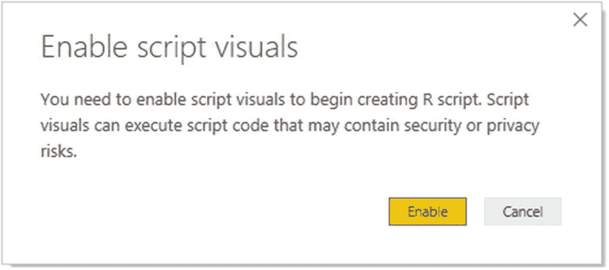

图 18-9 “启用脚本视觉对象”对话框

1.  打开 Power BI Desktop 文件 `C:\PowerBiDesktopSamples\CarSalesDataForReports.pbix`（除非它已经打开）。
2.  在“可视化”窗格中单击 R 视觉对象图标；将显示“启用脚本视觉对象”对话框，如图 18-9 所示。

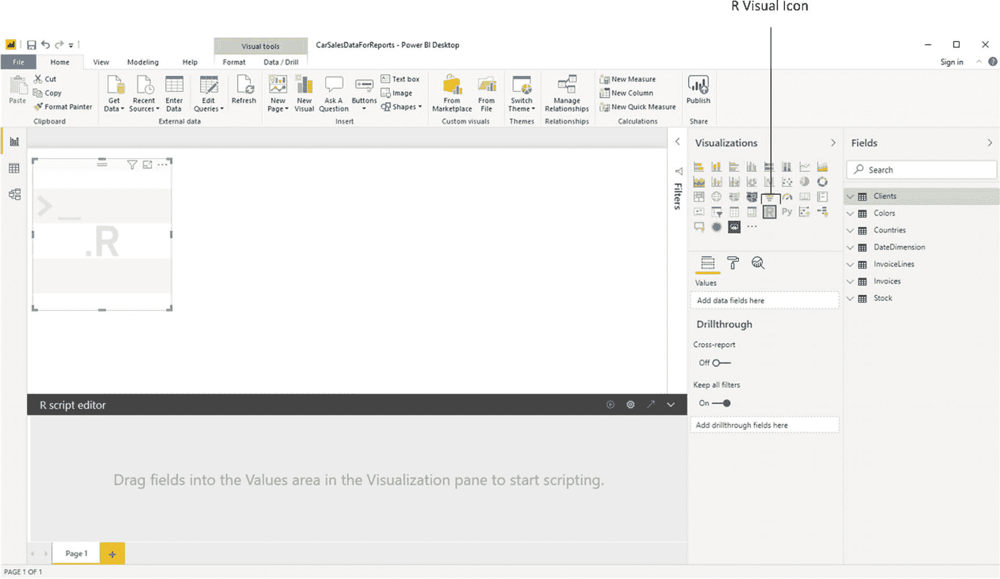

图 18-10 添加 R 视觉对象

1.  单击“启用”。一个空白的 R 视觉对象将添加到桌面画布，并且报表下方将出现一个包含 R 脚本编辑器的窗格。你可以在图 18-10 中看到这一点。

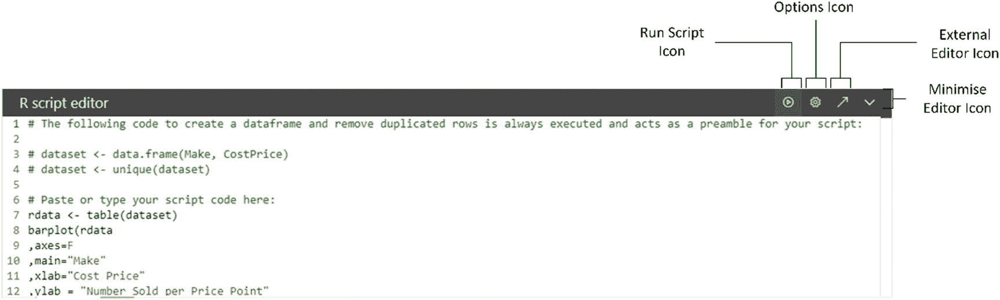

图 18-11 包含可运行脚本的 R 脚本编辑器

1.  将以下字段拖入 R 视觉对象（两者均来自 Stock 表）：
    -   `Make`
    -   `CostPrice`
2.  调整 R 视觉对象的大小，使其宽大于高。
3.  在 R 脚本编辑器的标题行下方添加以下脚本（此脚本可在文件 `C:\PowerBiDesktopSamples\Rscript.txt` 中找到）。完成此操作后，脚本编辑器将如图 18-11 所示。

```
rdata <- table(dataset)
barplot(rdata
,axes=F
,main="Make"
,xlab="Cost Price"
,ylab = "Number Sold per Price Point"
,legend = rownames(rdata)
,col=c("darkblue","red", "green", "yellow", "pink", "orange", "darkgreen") )
```

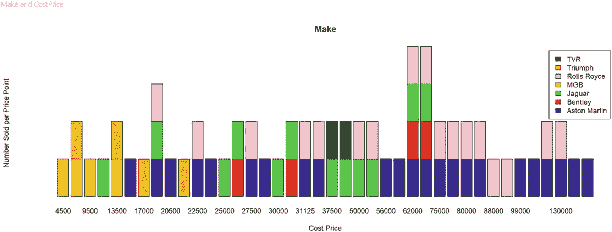

图 18-12 R 视觉对象

1.  单击脚本编辑器右上角的“运行脚本”图标。
2.  R 视觉对象将出现在 Power BI Desktop 中。
3.  根据需要调整 R 视觉对象的大小。最终视觉对象的外观可能类似于图 18-12 所示。

当然，只有当你准备好学习 R 语言时，才能创建 R 视觉对象。由于这是多本书籍的主题，因此我不在此处描述该语言。相反，我建议你参考该主题已有的许多优秀资源。

> **注意**
> 
> 如果调整 R 视觉对象的大小，你可能需要（通过单击 R 脚本编辑器中的“运行脚本”图标）重新运行 R 脚本，以强制视觉对象正确显示。

R 脚本编辑器图标在表 18-2 中进行了描述。

**表 18-2** R 脚本编辑器图标


| 图标 | 说明 |
| --- | --- |
| `Run Script` | 运行（或重新运行）R 脚本，并在 Power BI Desktop 中重新创建 R 可视化。 |
| `R script options` | 显示包含可用 R 脚本选项的对话框。 |
| `Edit script in external R IDE` | 使用 Power BI Desktop R 可视化中的脚本，运行外部 R 脚本编辑器。 |
| `Minimize the script pane` | 隐藏（或重新显示）R 脚本窗格。 |

### R 选项

如果确实有必要，你可以调整几个 R 选项。你可以通过选择 **文件 ➤ 选项和设置 ➤ 选项**，然后在“选项”对话框（如图 18-13 所示）左侧窗格中点击 **R 脚本** 来找到这些选项。

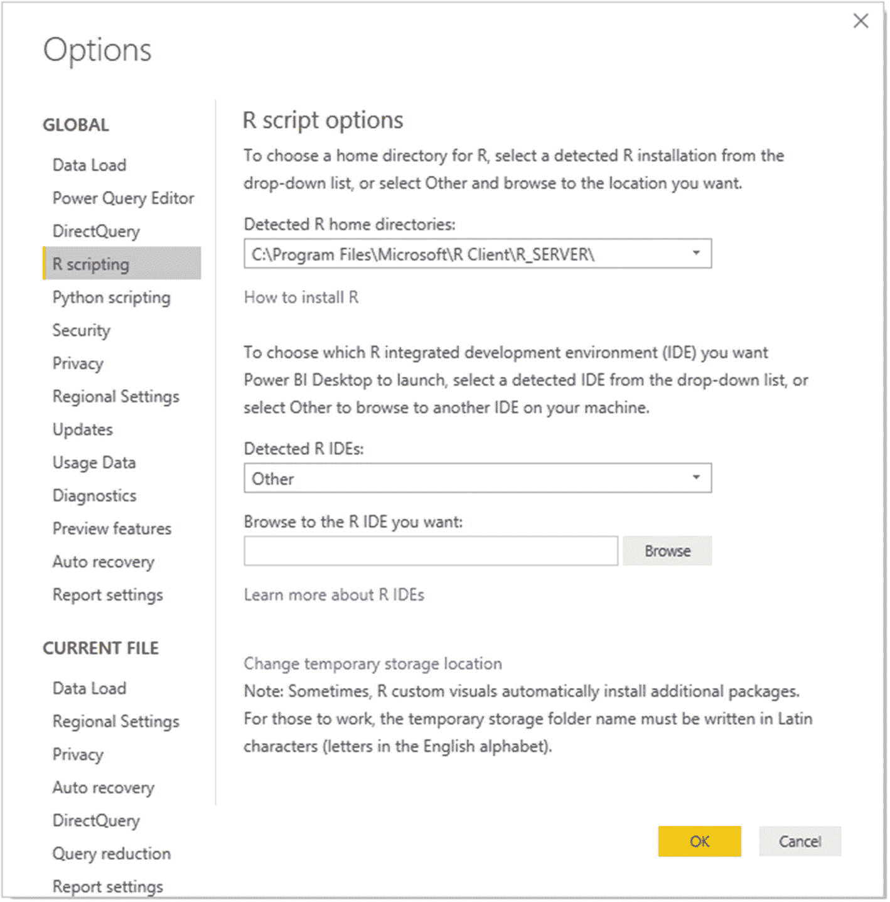

*图 18-13* R 选项

本质上，你可能只需进行少量调整：

- **R 脚本引擎**：Power BI Desktop 应能检测到您之前安装的 R 脚本引擎。如果未检测到，您可以浏览到包含 R 脚本引擎的目录。只需在弹出列表中选择**其他**，然后点击**浏览**按钮。
- **IDE**：如果您希望使用不同的外部 R 集成开发环境（IDE），只需点击**浏览**按钮选择首选的 R IDE。下次点击 R 脚本编辑器右上角的**外部编辑器**图标时，将调用此 IDE。

> **注意**：R 可视化的大部分格式设置都在 R 脚本本身中完成。但您可以使用 Power BI 格式设置选项来设置可视化的背景、边框和标题。

## Python 可视化

Power BI Desktop 较新的一个扩展是能够创建使用 Python 脚本编写的自定义可视化。虽然这与您刚刚看到的 R 可视化方法非常相似，但仍有一些细微差别。

首先，您需要在 PC 上安装 Python。有几种方法可以做到这一点，快速上网搜索应该能为您提供最新版本 Python 的下载路径。

其次，您可能需要在 PC 上安装 `pandas` 和可能的 `matplotlib` 库（如果尚未安装），因为在大多数情况下，将 Python 图表编写为 Power BI 可视化时都需要这两个库。

为了省去您研究这些技术的时间，您只需在 Python 脚本目录中（在我电脑上是 `C:\Users\Adam\AppData\Local\Programs\Python\Python37-32\Scripts`）运行以下两行代码：

```
pip install pandas
pip install matplotlib
```

要将 Python 图表创建为 Power BI 可视化：

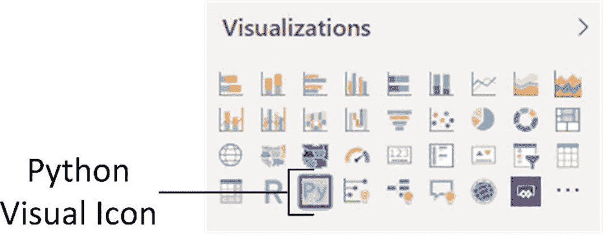

*图 18-14* Python 可视化图标

1. 打开（或保持打开）Power BI Desktop 文件 `C:\PowerBiDesktopSamples\CarSalesDataForReports.pbix`。
2. 在**可视化**窗格中点击 **Python 可视化**图标。您可以在图 18-14 中看到它。包含 Python 脚本编辑器的窗格将出现在报表下方。

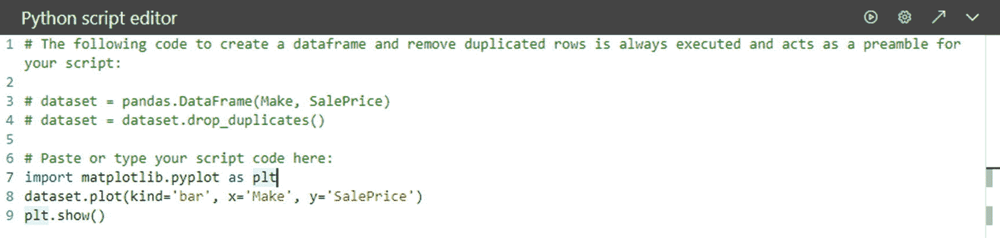

*图 18-15* Python 脚本编辑器

1. 将以下字段拖入 Python 可视化（这两个字段均来自 **Stock** 表）；添加到场字段的字段会自动创建一个数据框。
   - `Make`
   - `CostPrice`
2. 在 Python 脚本编辑器的标题行下添加以下脚本：

   ```
   import matplotlib.pyplot as plt
   dataset.plot(kind='bar', x="Make", y="SalePrice")
   plt.show()
   ```

3. 完成后，脚本编辑器将类似于图 18-15 所示。

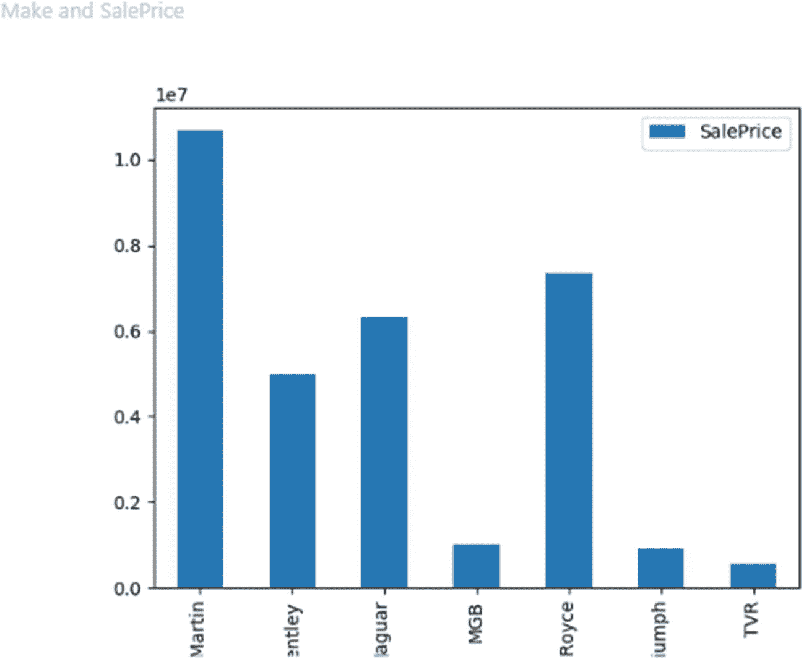

*图 18-16* 一个简单的 Python 可视化

1. 点击脚本编辑器右上角的**运行脚本**图标。Python 可视化将出现在 Power BI Desktop 中。
2. 根据需要调整 Python 可视化的大小。最终的可视化效果可能如图 18-16 所示。

> **注意**：Python 可视化的大部分格式设置都是在 R 脚本本身中完成的。但您可以使用 Power BI 格式设置选项来设置可视化的背景、边框和标题。

这很可能是您能制作的最简单的 Python 可视化。然而，重点不是用大量的 Python 代码让您眼花缭乱，而是向您展示，如果您正在转向 Power BI Desktop，利用您的 Python 技能是多么容易。或者，您可以将 Power BI Desktop 作为绝佳的练习场，在完善 Python 编码技能的同时，学习用于数据可视化的 Python。

### Python 选项

与 R 可视化的情况一样，您可以调整几个选项来为 Power BI Desktop 指定 Python 脚本选项。由于这些选项与前面为 R 描述的选项基本相同，此处不再赘述。不过，您可以在图 18-17 中查看可用选项。

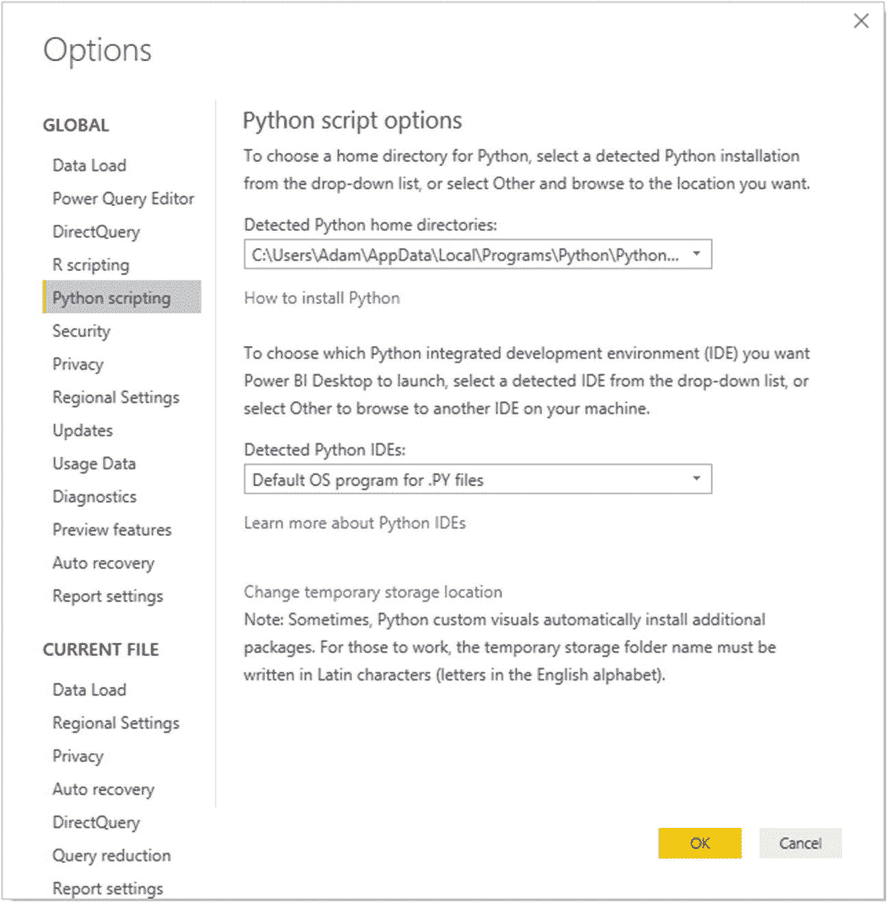

*图 18-17* Python 选项


## 分解树

分解树是最近新增到内置可视化图表库中的一种可视化图表（Power BI 社区对此报以热烈的欢迎）。此可视化图表允许你向下钻取多个元素（它称之为维度），以查看分析到最底层级的路径。

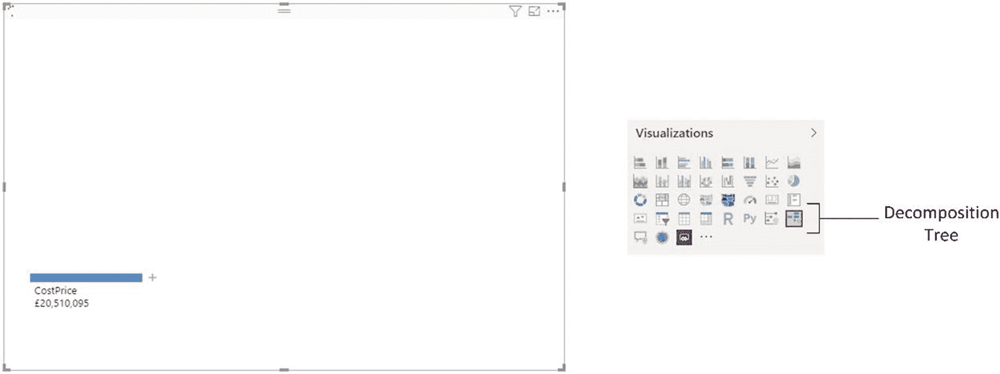

图 18-18

一个初始的分解树

1. 在 `CarSalesDataForReports.pbix` 文件中，单击“可视化”窗格中的“分解树”图标。你可以在图 18-18 中看到此图标。
2. 调整出现的空白可视化图表的大小，使其更大。
3. 将 `CostPrice` 字段添加到“分析”框。
4. 将以下元素添加到“解释依据”框：
   1. `Make`（来自 `Stock` 表）
   2. `Model`（来自 `Stock` 表）
   3. `Color`（来自 `Colors` 表）
   4. `CountryName`（来自 `Countries` 表）
5. 生成的可视化图表如图 18-18 所示。

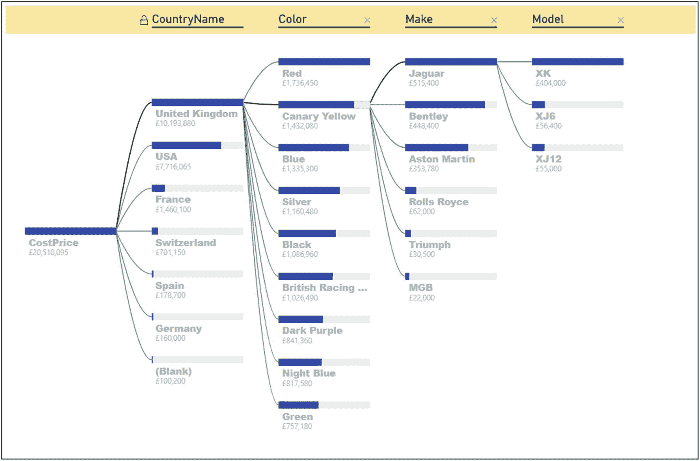

图 18-19

一个分解树

1. 单击分解树（`CostPrice`）中初始元素右侧的叉号。弹出菜单会显示你之前添加到“解释依据”框中的元素。
2. 单击 `CountryName`。每个国家/地区都会作为分解树中的一个子层级出现，并显示你最初选择的值的相对大小。
3. 单击某个国家/地区右侧的叉号。弹出菜单会显示你之前添加的其余元素。
4. 选择 `Color`。
5. 单击一种颜色右侧的叉号，然后选择一个 `Make`。
6. 激活你创建的可视化图表的“格式”窗格。
7. 展开“树”部分并设置：
   1. “主要颜色”为**蓝色**（这表示你选择的钻取路径）
   2. “连接线颜色”为**浅灰色**（这显示未选择的路径）
8. 展开“数据条”部分，并从调色板中为正向条形图选择一种不同的颜色。
9. 展开“类别标签”部分，并更改“字体系列”、大小和颜色。
10. 展开“数据标签”部分，并更改“字体系列”、大小和颜色。
11. 展开“级别标题”部分，并从调色板中设置“背景颜色”，然后将“显示副标题”设置为“关”。
12. 添加边框。分解树应如图 18-19 所示。

一旦设置好基本的分解树，你就可以通过单击任何层级的任何元素与其交互，立即查看在所建立的层次结构的所有层级上值的构成。

要充分利用分解树，你需要了解以下几点：

-   你可以随时通过向“解释依据”框添加更多层级来扩展层次结构。这些层级随后会出现在弹出菜单中。
-   只需单击元素名称右上角的叉号，即可从层次结构中移除一个层级。这不会从“解释依据”框中移除该层级。
-   要更改向下穿过各个层级的钻取路径，只需移除任何子层级，然后以不同的顺序重新添加它们。
-   单击级别标题中的锁定图标可临时锁定该级别以及选定级别左侧的所有级别。这可以避免你误删。再次单击锁定图标可解锁该级别。
-   双击一个值（例如本例中的颜色**蓝色**）将隐藏所有子层级。这允许你通过几次点击即可重建一条向下穿过层次结构的路径。
-   选择最后一个层级中的某个节点，会对其他可视化图表中的数据进行交叉筛选。

## 关键影响因素

当你想检查影响正在分析的指标的因素并进行比较和对比时，“关键影响因素”可视化图表会非常有用。与所有可视化图表一样，通过实际操作来查看它可能更容易理解。

1. 单击“可视化”窗格中的“关键影响因素”图标。
2. 将 `Weeks in Stock` 字段（来自 `Stock` 表）添加到“分析”框。
3. 将以下字段添加到“解释依据”框：
   1. `CostPrice`
   2. `TotalDiscount`
   3. `Mileage`

“关键影响因素”可视化图表应如图 18-20 所示。

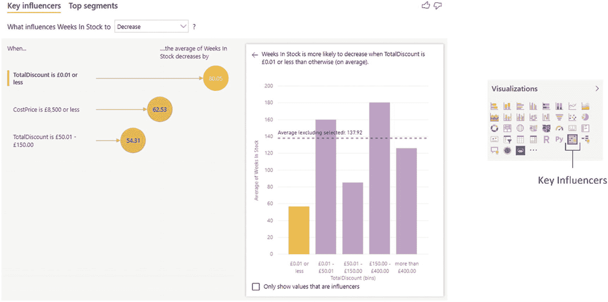

图 18-20

一个“关键影响因素”可视化图表

1. 展开“数据条”部分，并从调色板中为“主要颜色”和“次要颜色”选择不同的颜色。
2. 展开“钻取可视化颜色”部分，并更改“默认”和“参考线”颜色。

现在你可以看到哪些因素被认为会影响车辆库存时间。

要高效使用“关键影响因素”可视化图表，可能不可避免地需要了解以下几点：

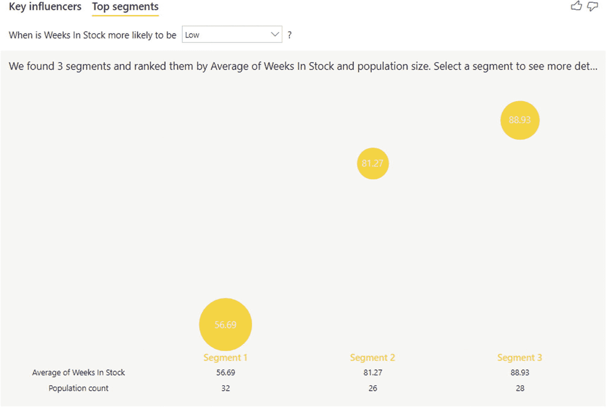

图 18-21

关键影响因素细分

-   单击可视化图表左侧的任意影响因素，会显示该影响因素的详细信息。
-   你可以从可视化图表顶部的弹出菜单中选择是选择可能增加还是减少正在分析的元素的影响因素。
-   单击可视化图表顶部的“细分”窗格，会切换到显示正在分析元素的细分群体。你可以在图 18-21 中看到这一点。

## 总结

在前五章中，你已经接触了各种各样的可视化图表，它们可以让你表达隐藏在数据中的趋势。本章在前几章的基础上，将树状图、仪表、基于 R 和 Python 的可视化图表以及分解树和关键影响因素可视化图表纳入其中。在下一章中，你将看到如何通过目前可在 Power BI Desktop 中下载和使用的众多第三方可视化图表，来扩展“开箱即用”的已有相当广泛的可视化图表范围。


