# 19. 第三方视觉对象

至此，想必您已经领略到 Power BI Desktop 提供的丰富可视化功能。从多种图表类型到仪表、表格和卡片，它提供了大量易于使用的方式，让您能够清晰有效地洞察数据。

然而，Power BI Desktop 的功能并不仅限于您目前所看到的内置可视化效果。它被设计成一个完全开放且可扩展的商业智能应用程序，允许第三方（甚至微软）添加其他视觉对象。这意味着，您目前接触到的核心元素仅仅是一个起点。还有许多其他的图表、文本和地图视觉对象，只需点击几下即可添加到 Power BI Desktop 中，然后借助这些引人注目的多样化仪表板元素，让您的观众眼前一亮。

作为一个可自由扩展的平台，Power BI Desktop 还托管着由微软和第三方开发的各种且日益丰富的视觉对象。这个视觉对象扩展库持续增长，并且极其易于访问和使用。本章的最后部分将向您展示一些当前的视觉对象，以及如何在您的 Power BI Desktop 仪表板中查找、添加和使用它们。本章将使用文件 `C:\PowerBiDesktopSamples\CarSalesDataForReportsWithVisuals.pbix` 作为您将创建的视觉对象的基础。

添加和使用这些增强功能既快速又简单。这是因为几乎所有 Power BI 可视化效果都使用相同的界面，并且它们都基于相同的基础数据模型。因此，学习使用一个新的视觉对象很可能只需要几分钟，因为您始终是在已掌握的知识和技术基础上进行构建。

> **注意：** 您需要了解，并非所有可用的自定义视觉对象都完全没有错误。此外，它们可能不具备您所期望的所有格式属性或交互功能。然而，这并不会降低它们的实用性或使用的乐趣。无论如何，我们有理由期待它们会随着时间的推移得到增强和改进。

## Power BI 视觉对象库

首先要做的是熟悉 Power BI 视觉对象库。这是一个中心枢纽，您可以在其中找到一系列免费的视觉对象，这些视觉对象由微软或第三方开发，随时可以添加到您的 Power BI 仪表板中。

以下说明如何连接到 Power BI 视觉对象库：

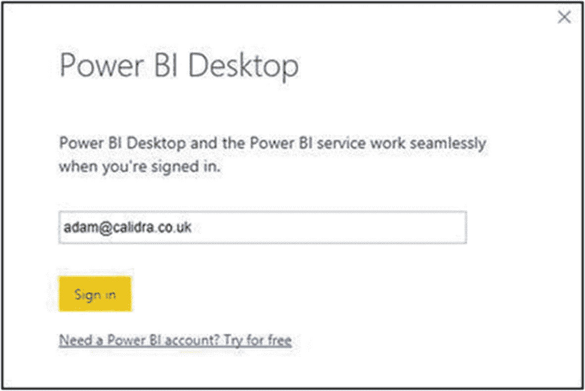

**图 19-1** Power BI 登录对话框

1. 在“插入”功能区中，点击“`更多视觉对象`”按钮，然后在弹出菜单中选择“`从 AppSource`”。如果您未登录 Power BI 帐户，将会看到类似图 19-1 所示的对话框，您可以在其中登录。

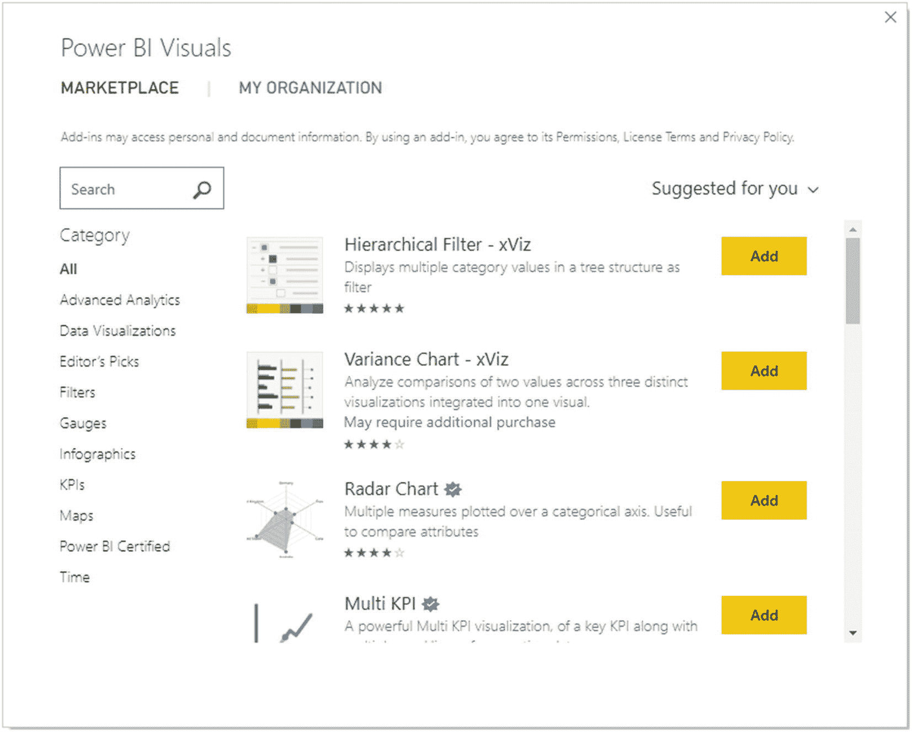

**图 19-2** 自定义视觉对象库

2. 输入您的密码并登录。您将看到图 19-2 中的对话框。

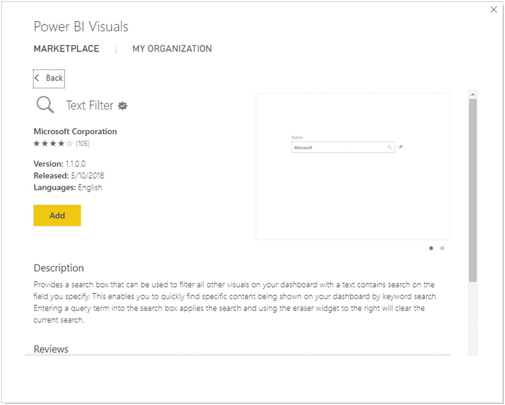

**图 19-3** 选择第三方视觉对象

3. 点击其中一个可用的视觉对象（您可以在“`搜索`”框中输入搜索词来查找特定的视觉对象，或者如果您在对话框左侧点击某种视觉对象类型，可以查看按类型分组和筛选后的结果）。您将会看到类似图 19-3 所示的对话框。

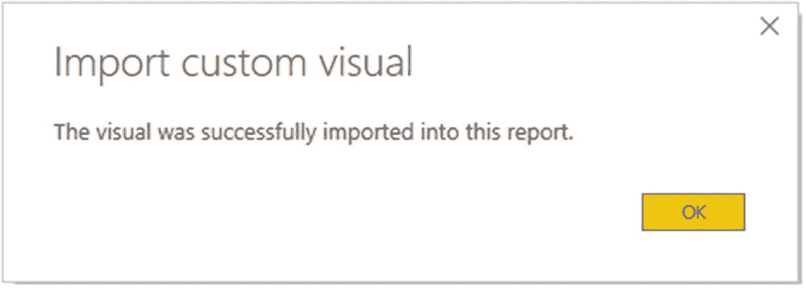

**图 19-4** 视觉对象导入确认对话框

4. 点击“`添加`”。该视觉对象将被添加到可用可视化效果的调色板中，并且将会显示您在图 19-4 中看到的对话框。

5. 点击“`确定`”。现在您就可以在当前 Power BI Desktop 报表中使用该视觉对象了。

自从本书付印以来，这些可供选择的第三方视觉对象无疑已经发生了很大的演变，因此，我想您现在看到的与书中相比会有很大不同。不过，希望您能兴奋地看到许多新的、令人惊叹的数据可视化类型，它们能让您的仪表板增添无与伦比的魅力。

> **注意：** 如果您确定在初始市场对话框（如图 19-2 所示）中找到了想要的视觉对象，那么您可以直接点击“`添加`”按钮将其导入。

## 从磁盘加载自定义视觉对象

访问这些用于报表的额外演示元素宝库的另一种方法是将它们下载到您的 PC，然后在需要时添加到 Power BI Desktop 中。具体操作如下：

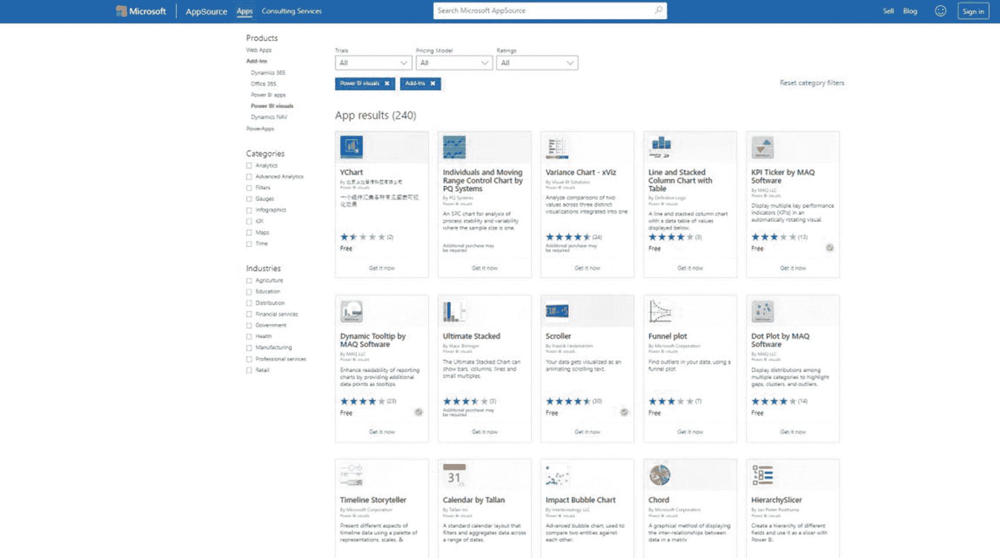

**图 19-5** 适用于 Power BI 网页的自定义视觉对象

1. 在您的网络浏览器中，导航至 [`https://appsource.microsoft.com/en-us/marketplace/apps?product=power-bi-visuals`](https://appsource.microsoft.com/en-us/marketplace/apps%253Fproduct%253Dpower-bi-visuals)。您将看到适用于 Power BI 网页的自定义视觉对象。目前，它看起来如图 19-5 所示。

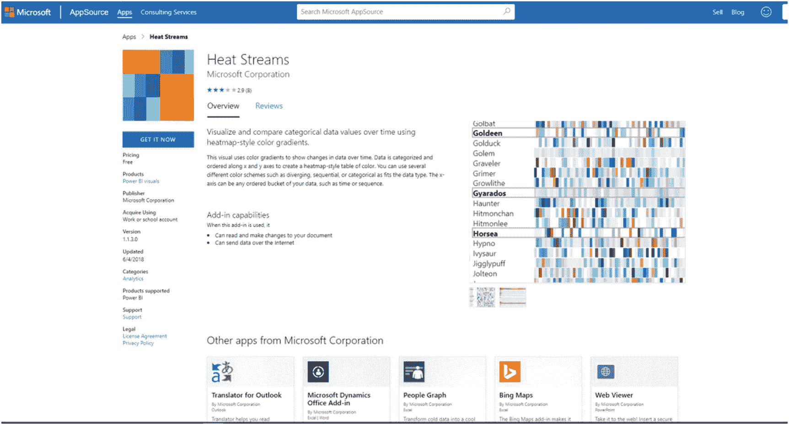

**图 19-6** 视觉对象下载对话框

2. 点击您想要下载的视觉对象。将显示一个专门介绍该视觉对象的第二个网页。它看起来会类似于图 19-6。

3. 点击“`立即获取`”按钮。

4. 点击“`选择下载`”。视觉对象将被下载。根据您的浏览器（以及任何特定机器的配置），它将被放置在一个特定的文件夹中，或者让您选择文件夹。

5. 在 Power BI Desktop 中，点击“开始”功能区中的“`更多视觉对象`” ➤ “`从我的文件`”。将出现一个警告对话框。

6. 点击“`导入`”。将出现 Windows“打开文件”对话框。

7. 导航到您在步骤 4 中下载视觉对象文件的文件夹。点击该视觉对象文件。

8. 点击“`打开`”。将出现确认对话框，如前文图 19-4 所示。

该视觉对象的图标将出现在“`可视化效果`”窗格中视觉对象库的底部。然后，您可以像使用任何其他 Power BI 视觉对象一样使用此视觉对象。

> **提示：** 视觉对象是按需添加到每个单独的 Power BI Desktop 文件中的。因此，虽然您只需下载一次视觉对象，但必须将它们加载到您想要使用它们的每个 Power BI Desktop（`.pbix`）文件中。如果您发现自己经常使用相同的第三方视觉对象，则应创建一个包含您使用的所有视觉对象的 Power BI Desktop 文件，然后将其另存为模板，用于未来的仪表板开发。这在第 9 章中已做解释。

导入已下载的自定义视觉对象的另一种方法是点击“`可视化效果`”窗格中视觉对象库中的省略号。这将显示一个弹出菜单，其中包含导入视觉对象的选项——可以从 Power BI 商店导入，也可以从您下载的视觉对象集合中导入。

一旦您将自定义视觉对象添加到 Power BI Desktop，您将在“`可视化效果`”窗格中看到代表它们的图标。如图 19-7 所示，它们分组排列在内置视觉对象下方。

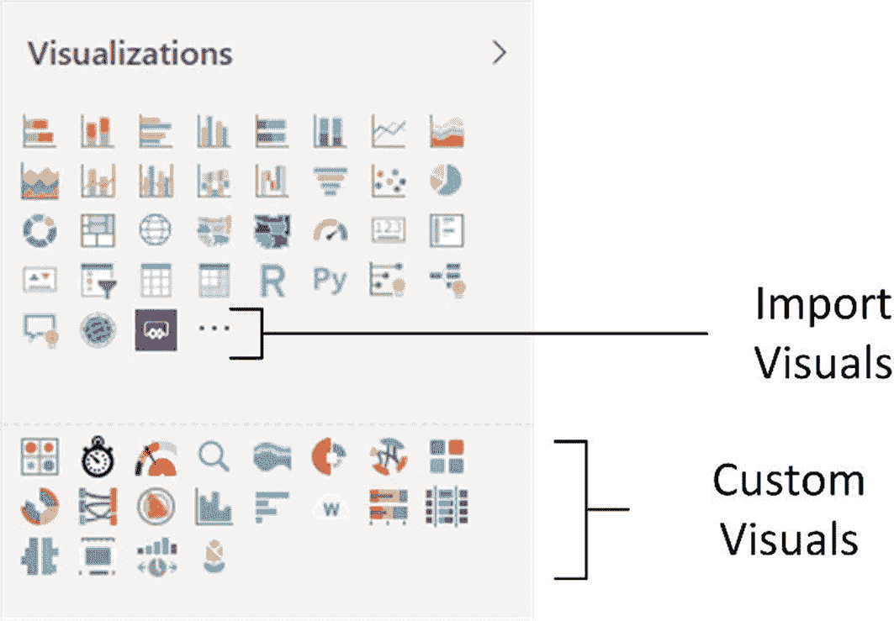

**图 19-7** “`可视化效果`”窗格中的自定义视觉对象

### 移除自定义视觉对象

如果你希望从可视化窗格中删除第三方视觉对象：

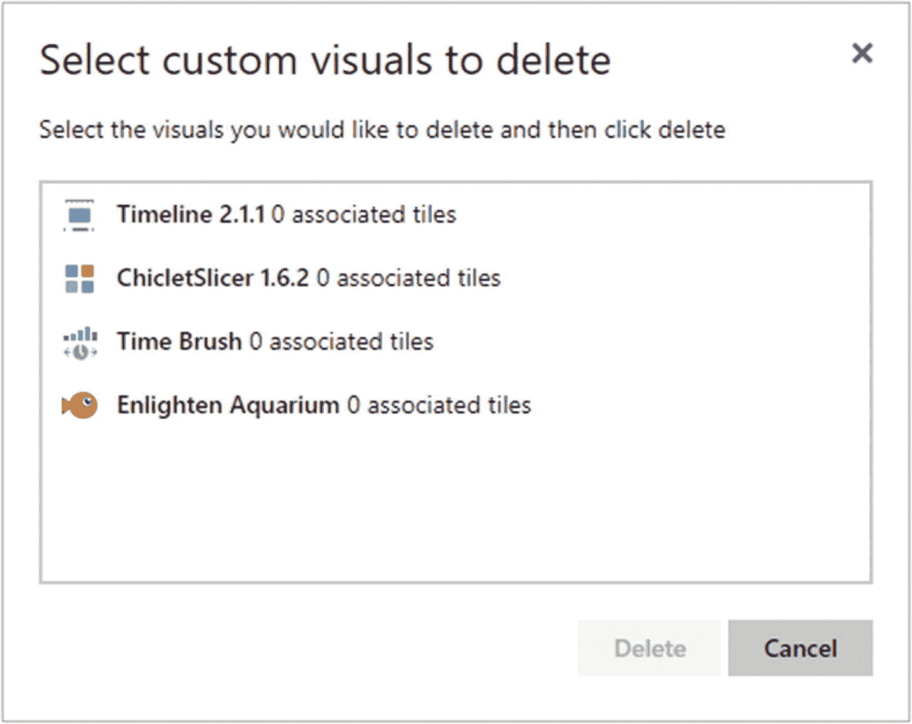

*图 19-8：删除自定义视觉对象*

1. 在可视化窗格的视觉对象库中单击省略号。
2. 选择`Delete a Custom Visual`。将显示如图 19-8 所示的对话框。

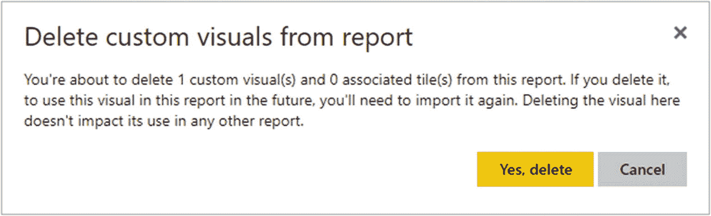

*图 19-9：自定义视觉对象删除对话框*

1. 选择要从当前报表中移除的视觉对象。你可以在对话框中按住`Ctrl`并单击多个视觉对象，以选择多个。
2. 单击`Delete`。将显示如图 19-9 所示的对话框。
3. 单击`Yes, delete`。

> **注意：** 这不会移除你之前下载的任何文件。你需要像删除任何标准文件那样删除它们。

## 自定义视觉对象快速概览

由于自定义视觉对象库处于持续变化的状态，因此无法讨论 Power BI 当前所有可用的扩展。然而，为了让您了解一些可能存在的增强功能，接下来几页将展示微软提供的一些*额外的*视觉对象。由于无法保证在您阅读本书时这些视觉对象仍以当前状态存在，因此我*不*解释如何创建它们，而仅展示一些使用本书示例数据创建的其他图表类型示例。

在以下所有示例中，视觉对象的标题指示了用于创建该视觉对象的字段。

## 星形图

星形图源自标准圆环图。但它使用一个额外的数据值来提供你在图 19-10 中看到的“扫描”效果。

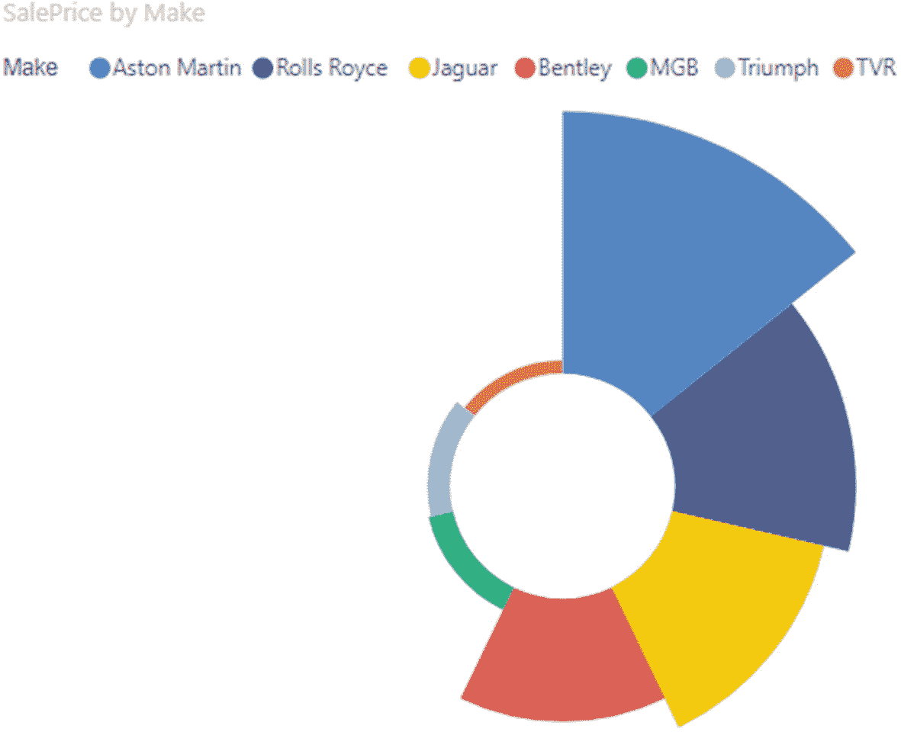

*图 19-10：星形图*

## 雷达图

雷达图常用于绩效分析，以显示各项指标及其对比情况。它们允许你显示相对于共享轴的多重数值，如图 19-11 所示。

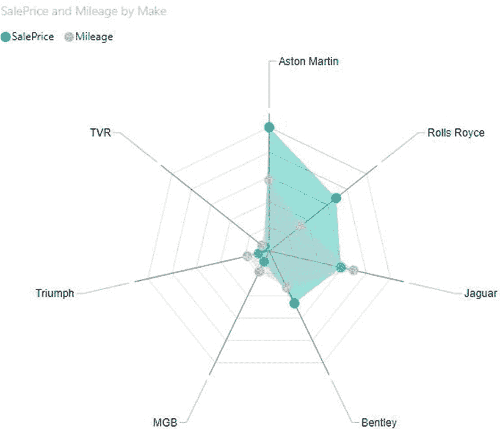

*图 19-11：雷达图*

### 子弹图

子弹图在追踪关键绩效指标（KPI）与目标对比时非常有用。通常需要你添加提供绩效衡量阈值的数据，这些阈值可以是绝对值或百分比。然而，它们在显示结果与目标比较方面非常有效，如图 19-12 所示。

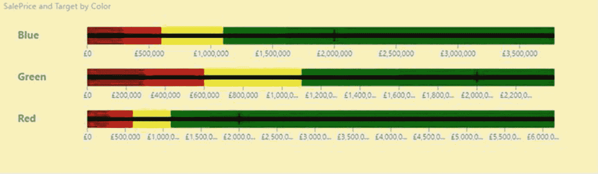

*图 19-12：子弹图*

> **注意：** 请注意，子弹图可能需要你扩展和准备源数据，以添加此类图表所需的所有元素——例如各种阈值以及最小值和最大值。

## 词云

词云显示数据集中词语出现的相对频率。它可以是一种独特的可视化方式，用于显示数值的相对权重，如图 19-13 所示。

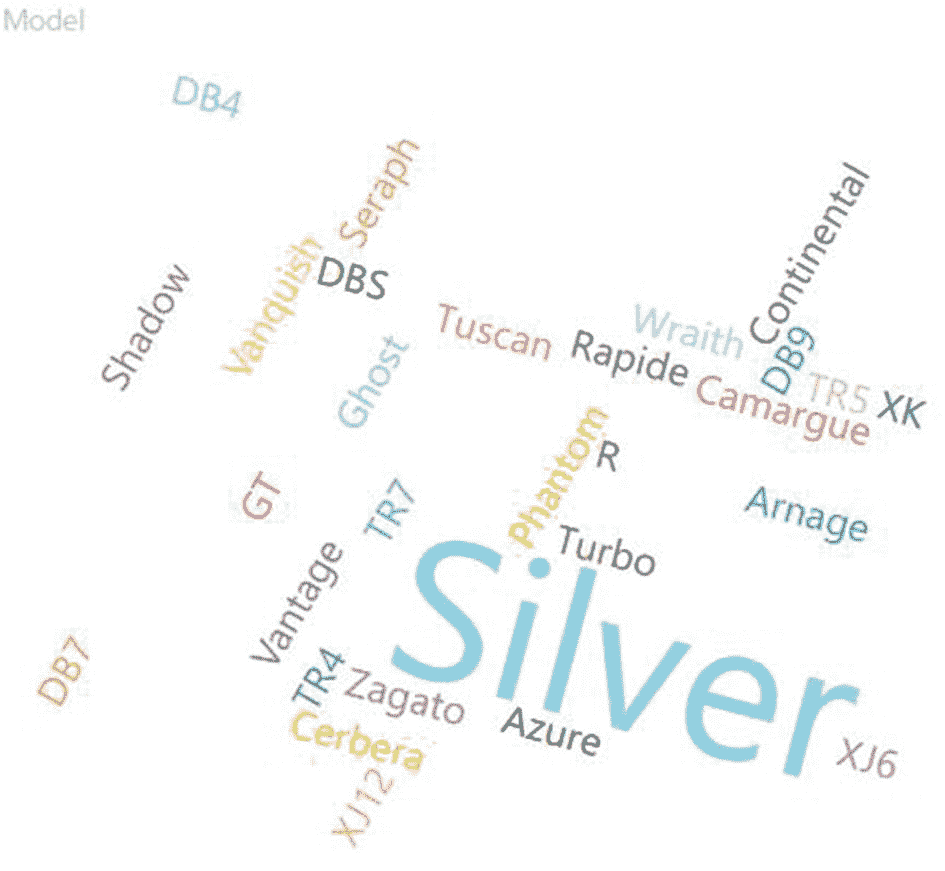

*图 19-13：词云*

## 流图

流图是一种平滑的堆叠面积图。如图 19-14 所示，流图擅长展示数值随时间的变化趋势。

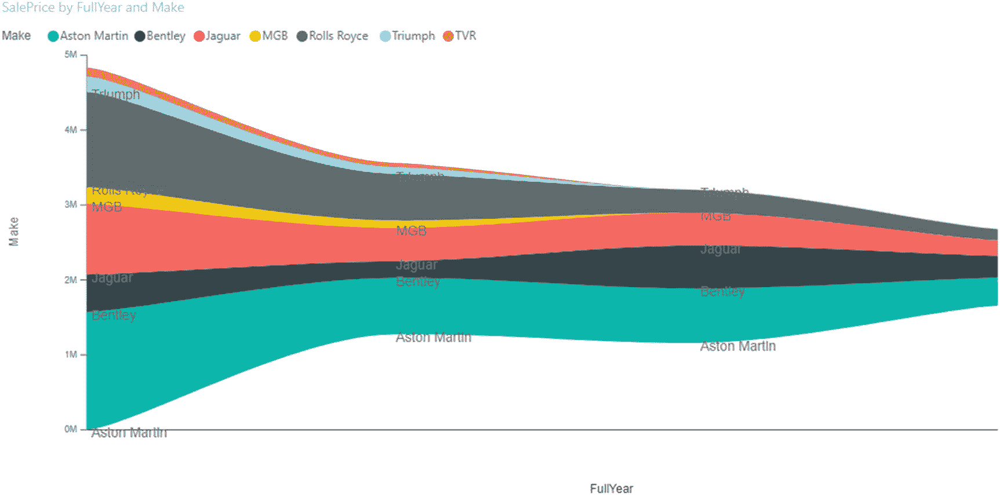

*图 19-14：流图*

有趣的是，流图可用的格式选项比某些其他导入的视觉对象多得多。

## 龙卷风图

龙卷风图是条形图的一种变体，其区别在于通过垂直分隔使两组数值之间的对比更加清晰，如图 19-15 所示。与条形图一样，你可以按图表中的任何数据元素对龙卷风图进行排序。

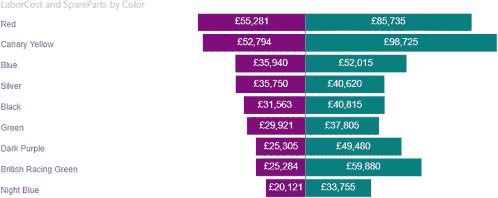

*图 19-15：龙卷风图*

## 弦图

弦图是一种有趣且略显非传统的方式，用于展示矩阵结构中数值之间的关系。图 19-16 展示了颜色与地区通过销售额如何关联。

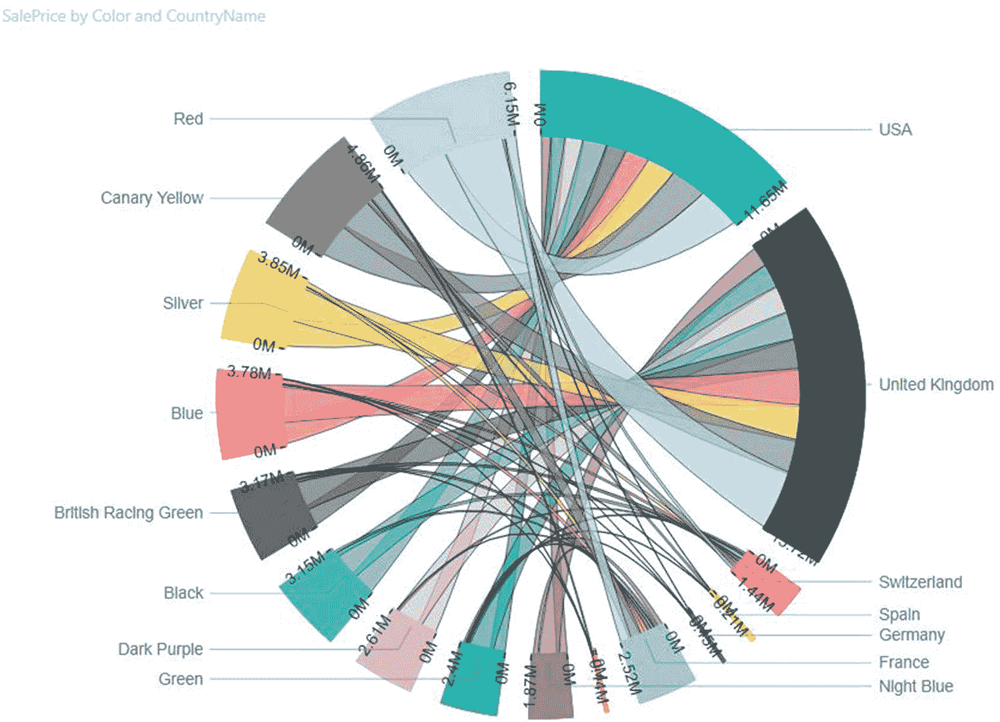

*图 19-16：弦图*

### 桑基图

图 19-17 中的桑基图同样展示了颜色与地区销售额之间的关系。该图表已进行筛选，因此仅显示四个地区的数据。

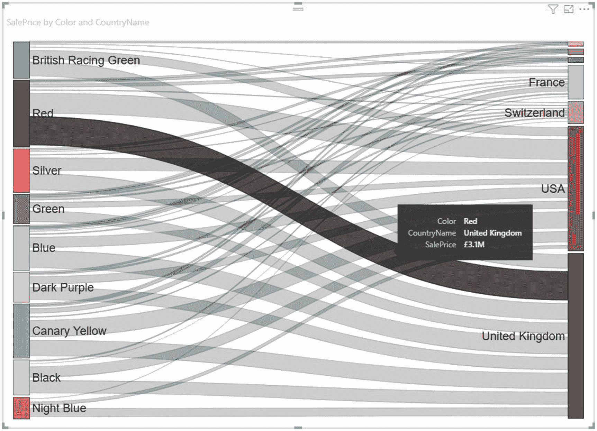

*图 19-17：桑基图*

## 水平条形图

水平条形图将每个条形的文本放置在条形内部。这本质上是一种节省空间的技术。你可以在图 19-18 中看到这一点。

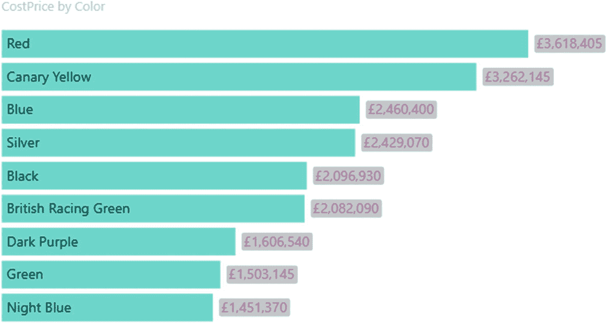

*图 19-18：水平条形图*

它还可以显示线条、锤头和棒棒糖。

## 属性切片器

属性切片器显示你要用于切片数据的元素列表。当面对潜在切片器元素的长列表时，它特别有用，因为你可以：

- 搜索你感兴趣的元素。
- 将它们逐个添加到切片器中——它们会出现在剩余元素之上。
- 将鼠标悬停在条形上时，可以查看每个元素的实际值。

你可以在图 19-19 中看到一个示例。

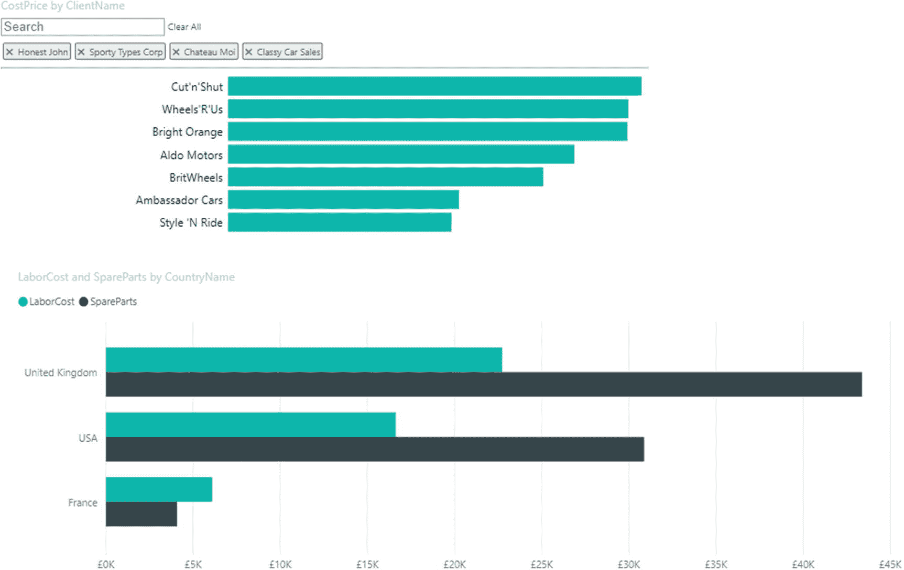

*图 19-19：属性切片器*

## 直方图

直方图显示按数据箱分组的数据，是对连续变量概率分布的估计。你可以在图 19-20 中看到一个示例。

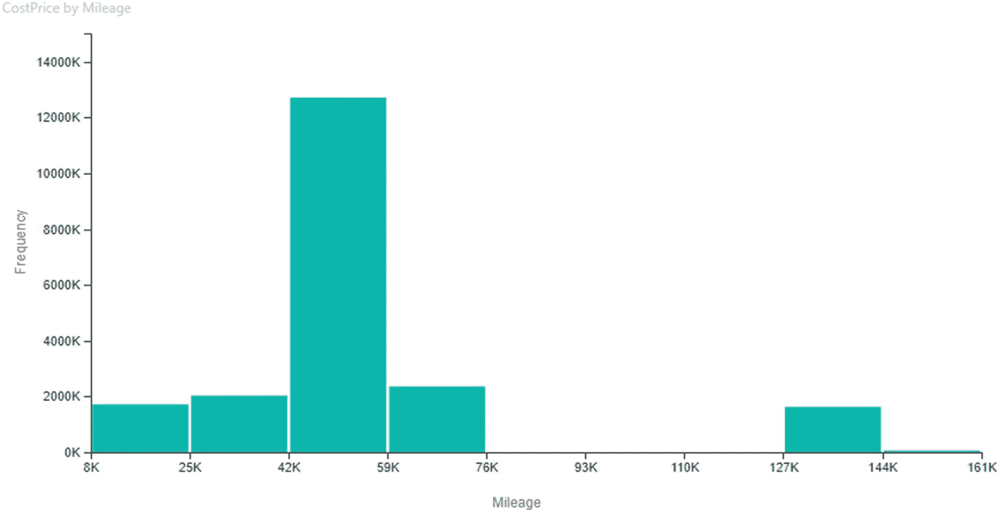

*图 19-20：直方图*

### 相关性图

图 19-21 中的相关性图展示了备件与人工成本之间的关系。

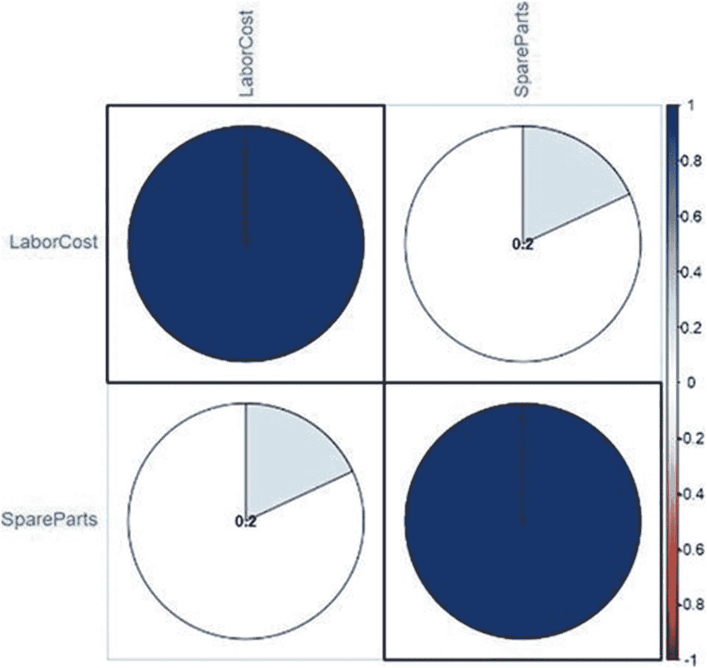

图 19-21 — 相关性图

值得注意的是，此可视化（如同许多可用的第三方可视化一样）使用了 `R` 语言。此类可视化要求你的计算机上安装了一个或多个 `R` 包。如果这些包尚未安装，你将看到一个如图 19-22 所示的对话框。

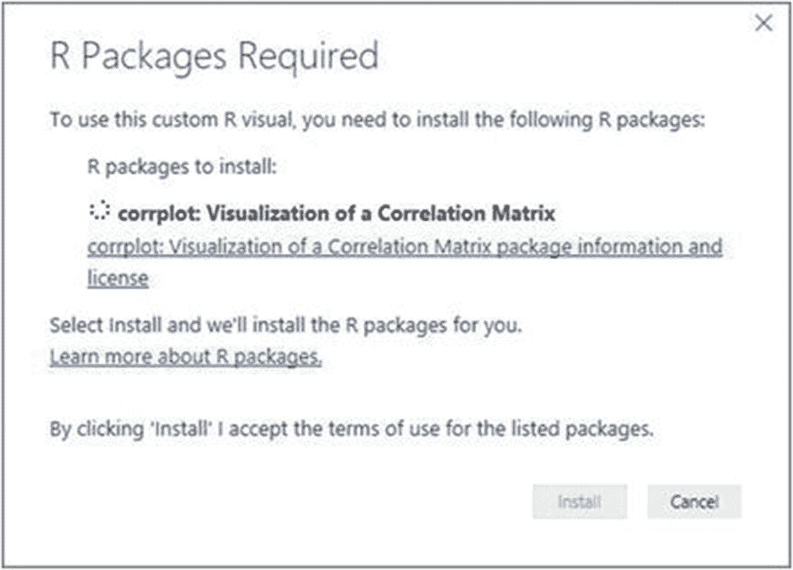

图 19-22 — 需要在本地安装的 R 包

点击“安装”将安装这些 `R` 包，随后会显示图 19-23 中所示的对话框。

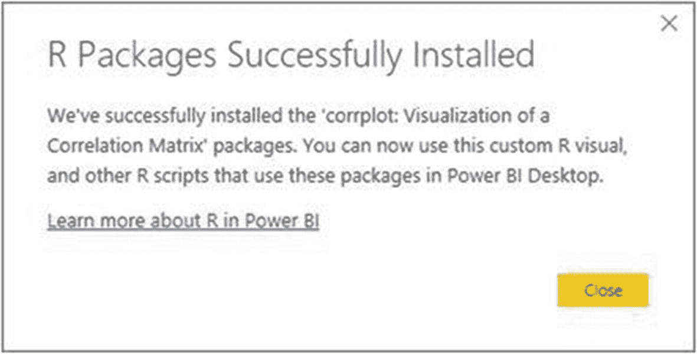

图 19-23 — 已成功安装自定义可视化所需的 R 包

### 倒计时器

倒计时器以“时钟”形式显示天数、小时数、分钟数和秒数，可在任何报表中实时递减。你可以在图 19-24 中看到示例。

图 19-24 — 倒计时器

## 信息图设计器

在微软提供的第三方可视化工具集中，能为仪表盘增添真正活力的一个新成员是信息图设计器。此可视化允许你创建使用图片作为图表元素的图表。此外，它还能层叠多张图片以创建极具吸引力的信息图。它唯一的初期缺点是使用了一个高度独特的界面，需要花费一些时间才能掌握——而且在我看来，这个界面并不直观。无论如何，它绝对值得一看。

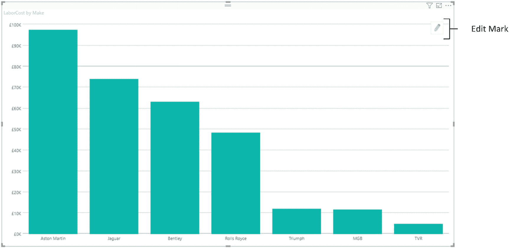

图 19-25 — 带有编辑标记的信息图设计器

1.  将信息图设计器添加到可视化窗格（如果你尚未添加的话）。
2.  单击可视化窗格中的信息图设计器图标。
3.  添加以下字段：
    1.  将 `Make` 添加到类别（Category）框。
    2.  将 `LaborCost` 添加到度量值（Measure）框。
4.  将出现一个相当标准的柱状图。
5.  将指针悬停在可视化对象上。编辑标记将出现在右上角。你可以在图 19-25 中看到示例。

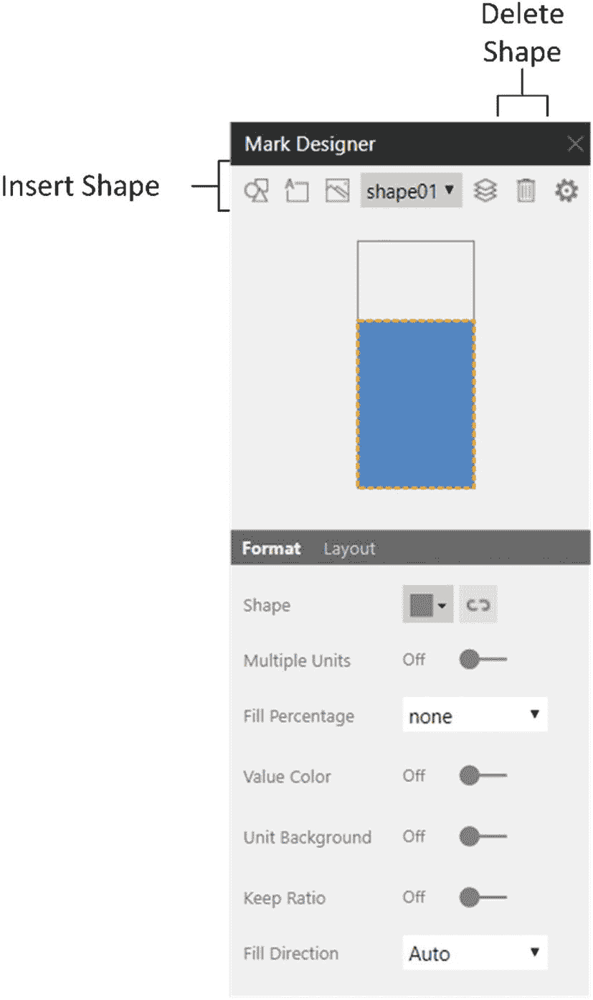

图 19-26 — 信息图设计器

1.  单击编辑标记。将出现标记设计器，如图 19-26 所示。在这里，你可以对信息图可视化对象进行几乎所有修改。

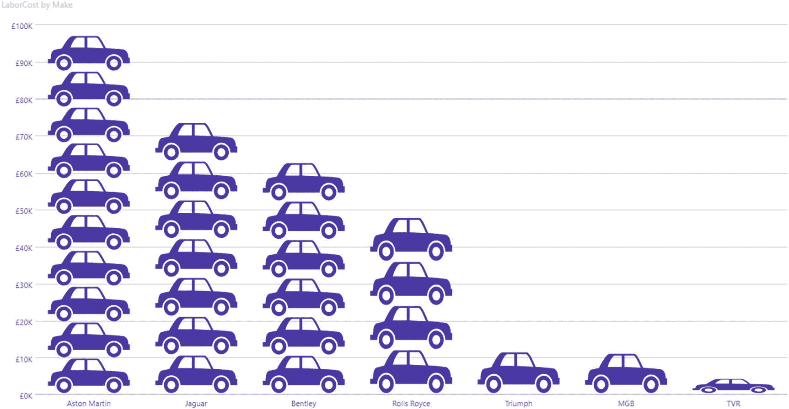

图 19-27 — 信息图设计器输出

1.  单击删除元素图标。
2.  单击插入形状图标，然后选择一个形状类型。在此示例中，我选择交通（Transportation）。
3.  选择一个形状。在此示例中，我选择汽车（Car）形状。
4.  在标记设计器的下部，将多单元（Multiple Units）设置为开启。你可以在图 19-27 中看到输出示例。
5.  单击右上角的叉号关闭标记设计器。

只需再次单击编辑标记，即可重新显示标记设计器并继续设置可视化对象的格式。

这只是信息图设计器所能实现的最简单示例。你可以添加多个形状、更改其颜色、拉伸或隔离它们，等等。你甚至还可以创建并添加自己的绘图。因此，当你需要一种打破传统图表和表格的视觉元素时，我建议你试试它。只需注意一点：需要投入少量时间来了解其无穷的可能性及其界面的工作方式。

## 自定义切片器

微软应用商店中还有几个出色的自定义切片器。我将在第 22 章中介绍其中的一些。

## 结论

在本章中，正当你认为情况不可能更好的时候，你发现了 Power BI Desktop 皇冠上的明珠：一系列广泛可用的免费扩展，你可以将其添加到仪表盘中，以其他分析工具无法企及的方式呈现你的见解。你已经领略了一些可下载的额外可视化对象，它们让你能够表达隐藏在数据中的趋势。

现在，你可以尽情发挥你的创造力，用丰富多彩的方式呈现你的见解，让听众惊叹不已，即使是那些最挑剔的用户也一定会印象深刻。

