# 20. Power BI Desktop 中的地图

另一种可用于分析和呈现见解的强大技术是以地图形式显示数据。这仅要求你的源数据包含可用于地理表示的信息。因此，如果数据集中包含国家/地区、州、城镇、邮政编码（或邮编），甚至经纬度，那么你就可以让 `Power BI Desktop` 在报表中添加地图，并以地图为背景显示所选数据。

更棒的是，`Power BI Desktop` 地图的行为方式与其他任何可视化对象完全相同。这意味着你可以筛选地图中显示的数据，并对其进行高亮显示，就像对图表、表格和矩阵所做的那样。不仅如此，地图还是 `Power BI Desktop` 报表的一个组成部分。因此，如果你在图表中高亮显示数据，同一报表中的地图也会随之高亮显示。不过，你需要等到下一章才能详细了解这一切。

`Power BI Desktop` 为你提供了四种类型的地图可视化对象：

*   地图

*   着色地图

*   形状地图

*   ArcGIS 地图

前三种地图类型简单且表现力强。第四种类型（`ArcGIS 地图`）需要多花些功夫才能掌握，但能够提供一些真正令人惊艳的输出。

本章的目的是向你展示一些通过使用地图为报表增添真正趣味的方法。然后，在呈现你的分析时，你可以与地图交互，*真正地*给你的观众留下深刻印象。

本章将使用文件 `C:\PowerBiDesktopSamples\CarSalesDataForReports.pbix` 作为你将创建的可视化对象的基础数据。

## 使用必应地图

在添加第一个地图之前，我想先解释一下在 `Power BI Desktop` 中地图的工作原理。其地理组件基于必应地图。因此，要添加地图，你需要能够连接互联网并使用必应地图服务。其次，底层数据集必须包含能被必应地图识别为地理数据的字段。换句话说，你需要国家/地区、州、城镇或其他必应地图可用于生成地图绘制的信息。幸运的是，如果 `Power BI Desktop` 识别出某个字段包含可用于（希望如此）创建地图的数据，它会在字段井中为该字段显示一个微小的地球图标，只要该字段位于底层数据集中且明显包含地理数据。

为避免数据被误解的风险，你可以向底层数据模型添加元数据，以定义地理字段类型。通过向字段应用数据类别，`Power BI Desktop` 地图随后会使用这些类别来解释用于制图的地理数据。准备数据，确保必应地图使用的任何字段不仅能被识别为包含地理数据，而且能被唯一识别，这一点至关重要。你必须帮助必应地图，这样，如果你要为名为巴黎的城市绘制数据，必应就能判断你指的是法国巴黎，还是德克萨斯州的巴黎。第[13]章解释了一些方法，你可以通过这些方法为必应地图准备数据，并进而使用这些数据为 `Power BI Desktop` 添加地图视觉对象。

> **注意**
>
> 世界上有些地区无法使用必应地图。因此，如果你在这些地理区域尝试使用 `Power BI Desktop` 的制图功能，在尝试创建地图时将不会看到任何地图显示。

## 在 Power BI Desktop 中创建地图

让我们从创建按国家/地区划分的销售额地图开始。幸运的是，示例数据集包含销售发生的国家/地区。这意味着我们可以使用这些数据让 `Power BI Desktop` 显示我们全球销售的地图。以下是创建初始地图的方法：

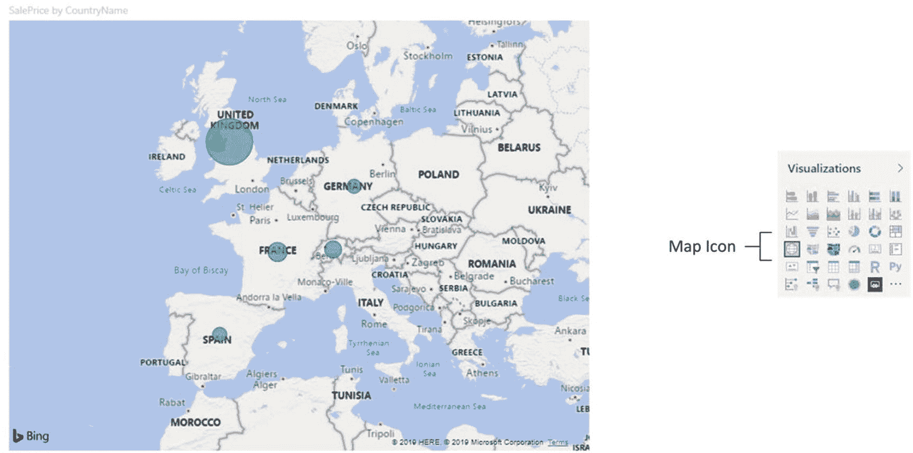

*图 20-1 – 销售额地图*

1.  打开 `C:\PowerBiDesktopSamples\CarSalesDataForReports.pbix` 文件。

2.  在“可视化”窗格中单击地图图标（即图 20-1 中基本为空的地球）。将出现一个空白地图（即使它看起来有点奇怪，但它确实是一个地图）。

3.  展开 `Countries` 表，将 `CountryName` 字段拖到地图视觉对象中。视觉对象将显示一个地图，其中包含所有存在值的国家/地区的数据点。

4.  展开 `InvoiceLines` 表，将 `SalePrice` 字段拖到地图视觉对象中。视觉对象会调整每个数据点的大小以反映销售值。

5.  将光标悬停在地图上，将欧洲拖到地图中央。

6.  使用鼠标滚轮，放大使得有销售数据的国家/地区位于视觉对象中央。最终效果将类似于图 20-1。

在进一步深入之前，有必要澄清一下 `Power BI Desktop` 地图的几个要点。以下是需要注意的关键点：

-   地图与其他视觉对象一样。你可以调整其大小，并将其移动到 `Power BI Desktop` 画布上的任何位置。
-   地图会应用为报表设置的所有筛选器（你将在下一章中了解更多关于筛选器的信息）。
-   地图中的每个数据点（或气泡）的大小与底层数据的相对大小成正比。

你可以将鼠标指针悬停在一个数据“气泡”上，以显示一个弹出窗口，其中显示所代表的具体数据。图 20-2 显示了这样一个示例。

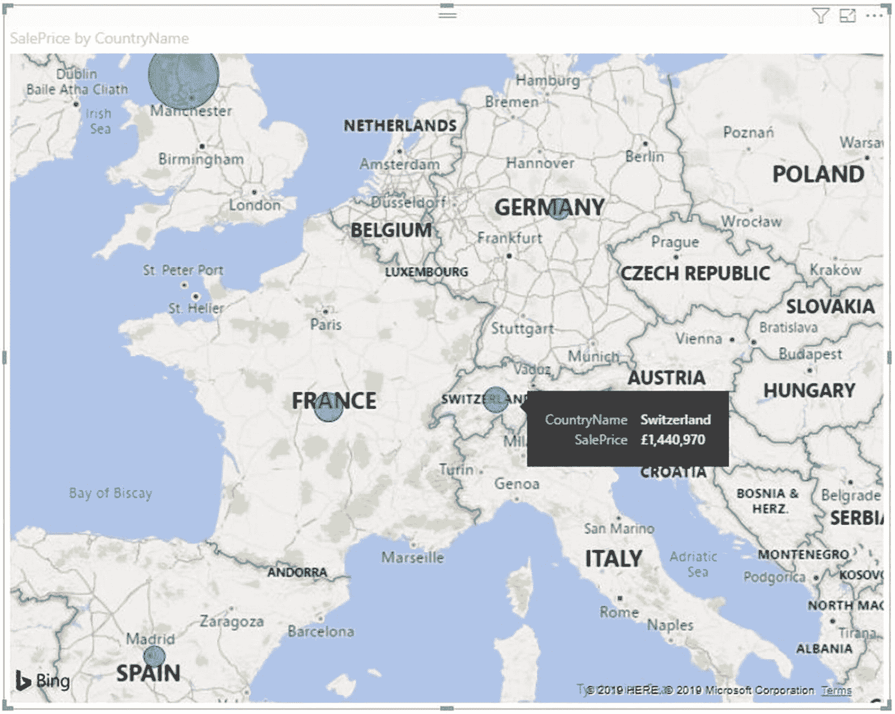

*图 20-2 – 在 Power BI Desktop 地图中显示具体数据*

## 使用地理数据

虽然这看似显而易见，但如果 `Power BI Desktop` 要在地图上叠加显示你的见解，你确实需要地理数据。因此，你绝对必须确保底层数据集包含可被解释为地理信息的列。在迄今为止的示例中，你已经看到 `Power BI Desktop` 能够解释国家/地区名称并使用它们在地图上显示数据。然而，它并不局限于只显示国家/地区。你可以使用以下任何一种来生成地图视觉对象：

-   国家/地区
-   邮政编码
-   州
-   县
-   城镇
-   纬度和经度

举例来说，请看图 20-3，其中 `Clients` 表中的 `Town` 字段被用于字段井中的“位置”框中。然后，使用初始示例步骤 5 和 6 中描述的技术，将地图调整为仅显示英国。

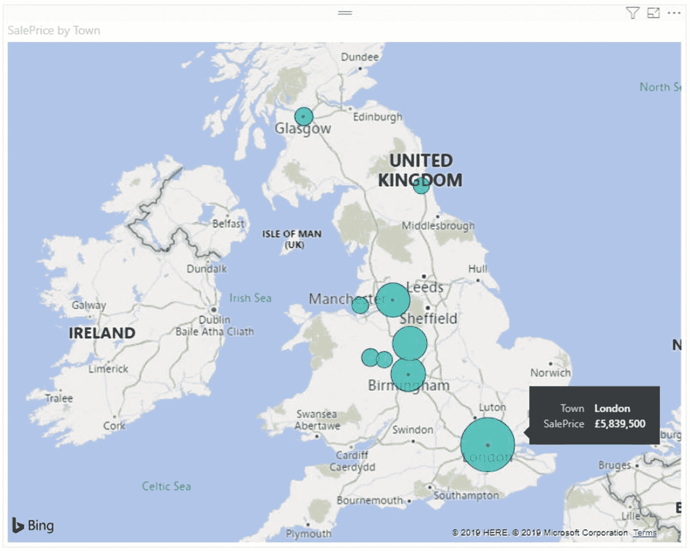

*图 20-3 – 显示每个城镇的相对销售额*

### 地理数据类型

在创建地图方面，`Power BI Desktop` 确实异常有用且宽容。如果你的数据可以在地理上进行解释，那么 `Power BI Desktop` 会尽力显示地图。然而，在开始使用 `Power BI Desktop` 之前，你几乎肯定需要将数据集塑造成一个连贯的数据模型。

在第一个 `Power BI Desktop` 示例中，我们添加了一个单一的地理数据字段。更重要的是，这个字段被立即识别出来——它是国家/地区名称。然而，在实际的制图数据世界中，你可能不仅需要添加多个字段，还需要指定每个字段代表哪种地理数据类型。简而言之，`Power BI Desktop` 需要知道你提供的数据代表什么。不仅如此，它还需要明确无误地知道它看到的是什么。因此，你有责任尽可能清晰、明确地定义源数据。这可能涉及以下几种方法中的一种或多种。

#### 在数据模型中定义数据类别

如你在第 [13] 章中所见，你可以在 Power Pivot 中为每个数据列定义数据类别。虽然这对于使用 `Power BI Desktop` 进行精确制图并非绝对必要，但它有助于减少潜在的异常情况。

#### 添加多级地理信息

`Power BI Desktop` 数据模型允许你向表中添加多个级别的地理信息。例如，你不仅可以在表的记录中添加国家/地区，还可以添加县和城镇。添加尽可能多的相关源数据字段的好处在于，通过这种方式工作，你可以帮助 `Power BI Desktop` 消除可能存在的歧义引用。例如，如果你只有一个 `Town` 字段，`Power BI Desktop` 可能无法判断你指的是阿拉巴马州伯明翰市，还是英格兰的第二大城市。但如果数据源同时拥有 `Country` 字段*和* `Town` 字段，那么 `Power BI Desktop` 检测到正确地理位置的可能性就会大得多。这一原则可以扩展到添加州、县和其他地理参考。

### 在地图中进行下钻

`Power BI Desktop` 允许您像在其他类型的可视化效果中钻取其他数据层级一样，对地理数据进行钻取。要查看此功能，您可以执行以下步骤：

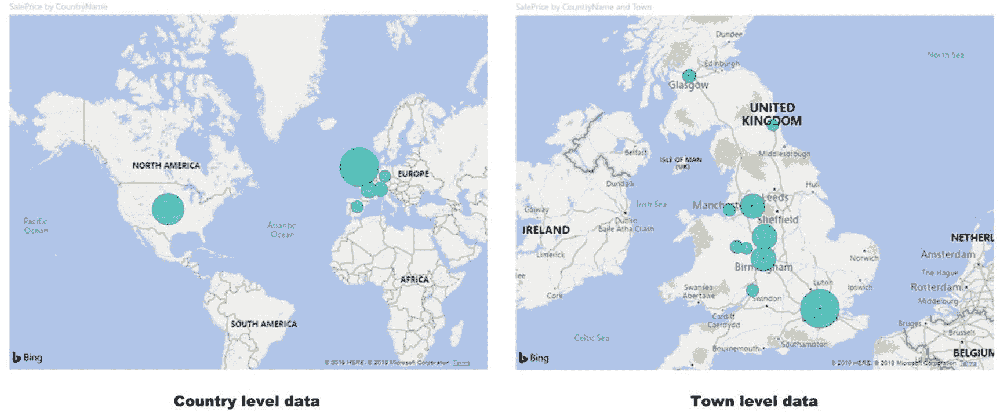

*图 20-4 在地理层级中向下钻取*

1.  使用以下字段（按此顺序）创建一个新的地图可视化效果：
    1.  `CountryName`（来自“国家/地区”表）
    2.  `Town`（来自“客户”表）
    3.  `SalePrice`（来自“发票行”表）
2.  单击地图可视化效果右上角的“钻取模式”图标以激活下钻功能。

3. 单击代表英国的泡泡。地图可视化效果将显示所选国家/地区的下一层级（城镇）数据。您可以在图 20-4 中看到这一点，该图显示了数据的两个层级。

幸运的是，在地图中进行上下钻取所使用的技术与您在矩阵和图表中已看到的技术完全相同。简单总结如下：

- 单击左上角的“上钻”图标可向上移动一个层级。

- 单击“转到层级中的下一级”图标可查看下一层级的数据。

注意： 正如您所料，如果您从国家/地区向下钻取，Power BI Desktop 将放大该国家/地区以显示城镇级别的详细信息。如果您决定显示较低层级的所有数据，则地图将保持其原始分辨率。

## 在 Power BI Desktop 中调整地图显示

正如您所见，创建地图非常简单。然而，初始地图不一定就是您希望向受众展示的最终版本。您可能希望：

- 更精确地在地图可视化效果中定位地图元素

- 放大或缩小地图

在接下来的几个小节中，我们将探讨您可以对 Power BI Desktop 地图进行的各种修改。希望您会发现这些调整既直观又易于实现。无论如何，稍加练习，您就会发现完成这些修改只需几秒钟。

### 定位地图元素

如果地图中显示的区域并非您理想的完美状态，那么您可以更改地图可视化效果中显示的区域（无论是国家/地区还是区域）。您可以按如下方式操作：

1. 将鼠标指针悬停在地图上。指针图标将变为手形图标。

2. 单击并拖动指针以移动地图元素。

### 放大或缩小

有可能显示的地图的缩放比例并非您所期望的。幸运的是，这非常容易修复。您只需执行以下操作：

1. 将鼠标指针悬停在地图上。

2. 向前滚动鼠标滚轮可放大查看地图的某一部分以获得更详细的视图。或者，向后滚动鼠标滚轮可缩小地图。

注意： 目前没有用于在地图中移动或缩放地图的键盘快捷键。

### 多值系列

到目前为止，您已经了解了如何向地图添加单个数据系列并将数据显示为数据点。Power BI Desktop 可以扩展这一模式，允许您将数据气泡显示为包含第二个数据系列的饼图——从而按每个地理实体的特定数据集显示数据的细分情况。

以此为例（并回顾一下我们目前已看到的一些地图创建技巧），让我们尝试按年龄范围分析欧洲汽车销量：

1. 保留您在上一节中创建的地图（如果尚未创建，则创建它）。

2. 展开“颜色”表，并将 `Color` 字段拖入“图例”字段井。

3. 调整地图可视化效果的大小。

现在地图包含了所售车辆颜色的图例。每个气泡现在都是一个数据饼图。饼图的总大小按比例表示每个国家/地区与其他饼图相比的数据总和。地图现在应如图 20-5 所示。

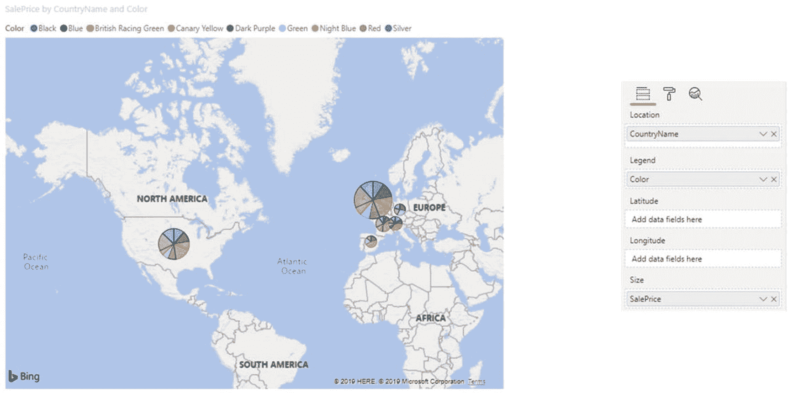

图 20-5

在 Power BI Desktop 地图中显示饼图

值得注意的是，如果您将鼠标指针悬停在某个国家/地区的数据表示（饼图）上，当指针经过每个饼图扇区时，您会看到一个工具提示，显示数据的详细信息，包括它所指的汽车颜色。

注意： 在显示地图时，您几乎总是需要以某种方式筛选数据。下一章将介绍有关数据筛选的所有详细信息。

## 突出显示地图数据

如果您已将数据添加到字段井的“图例”框，并且显示了图例，那么您可以在地图中突出显示数据扇区。这允许您将受众的注意力吸引到数据中的特定趋势上。

使用您之前创建并可在图 20-5 中看到的地图，单击图例中的“蓝色”（第二个元素）。对应于售出蓝色汽车的饼图扇区将被突出显示，如图 20-6 所示。

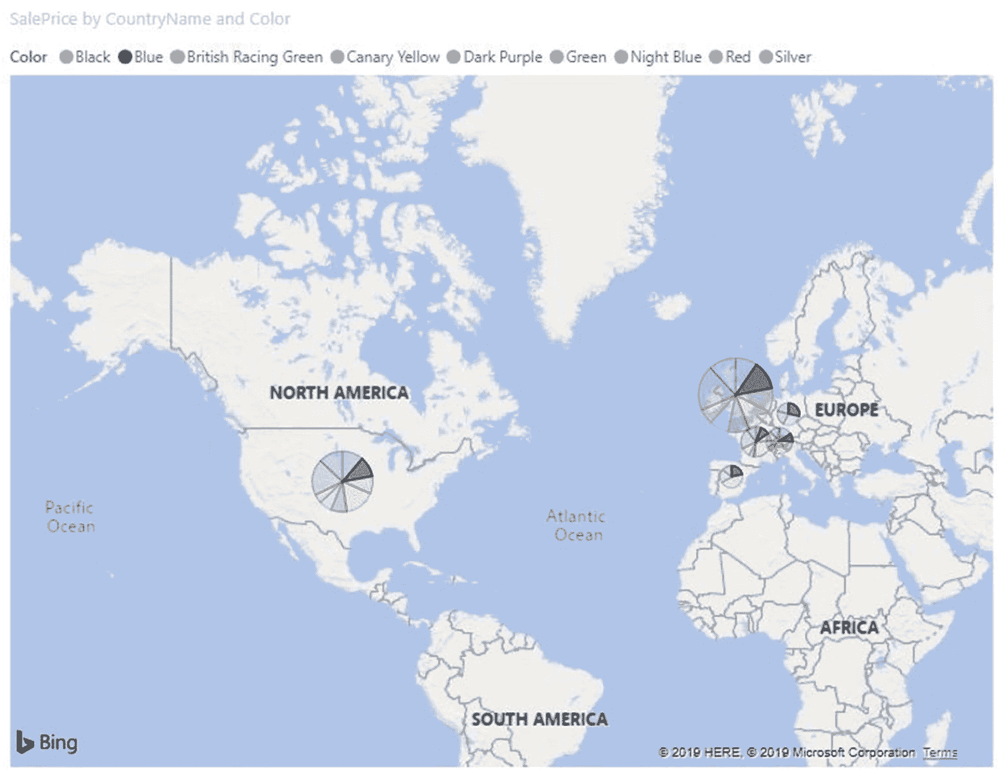

图 20-6

突出显示地图数据

要从地图中移除突出显示，您只需单击用于突出显示数据的图例元素，或直接单击图例标题。或者，单击地图上任何被突出显示的元素。

这只是 Power BI Desktop 如何将突出显示应用于可视化效果的一个预览。您将在第 22 章中了解更多关于此技术的信息。

## 填充地图

另一种数据展示方式是用颜色填充地理区域，而非显示气泡。Power BI Desktop 同样支持此功能。

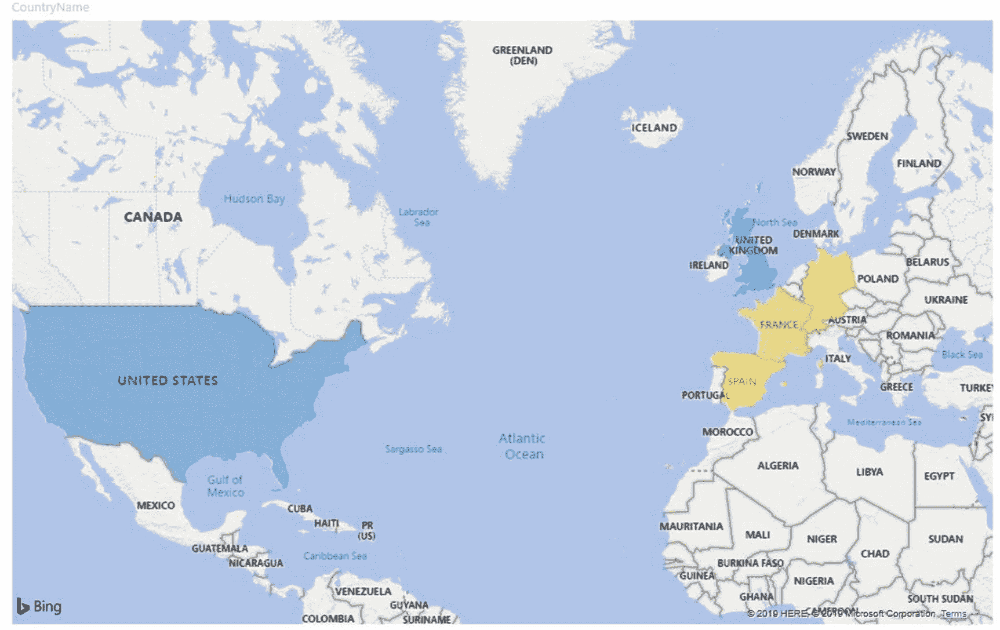

**图 20-9**

使用自定义着色显示各国成本的填充地图

1. 点击 `C:\PowerBiDesktopSamples\CarSalesDataForReports.pbix` 文件中的仪表板画布空白区域。

2. 在`可视化`窗格中点击`填充地图`图标。将出现一张空白地图。

3. 展开`国家/地区`表，将`国家名称`字段拖入地图可视化区域。可视化图将在地图中为有数值的国家/地区着色显示。目前所有国家/地区将显示为相同颜色。此时地图将如图 20-7 所示。

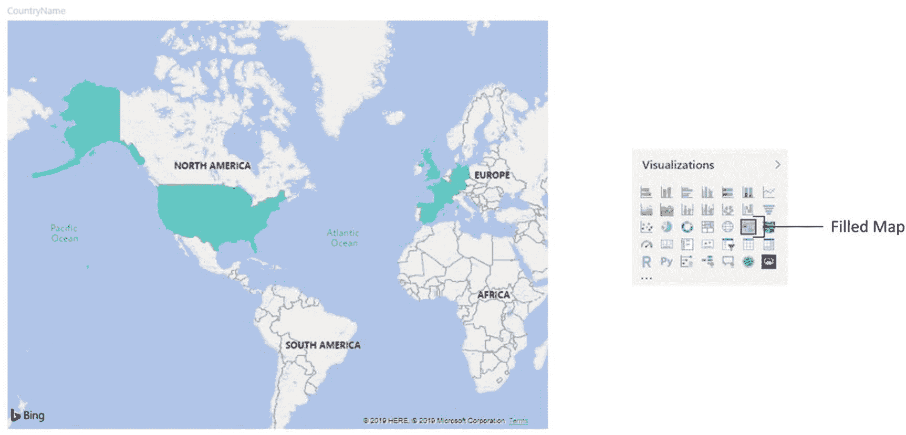

**图 20-7**

显示各国成本的填充地图

4. 选择`格式`图标并展开`数据颜色`部分。

5. 将指针悬停在默认颜色上。在`格式设置`窗格此区域的右上角将出现垂直省略号（三个点）。

6. 点击省略号。将弹出`条件格式`对话框。点击该对话框，将出现`默认颜色 – 数据颜色`对话框。

7. 在`基于字段`弹出菜单中，展开`库存`表并选择`成本价`。为`最小值`和`最大值`选择不同的颜色。`默认颜色 – 数据颜色`对话框将如图 20-8 所示。

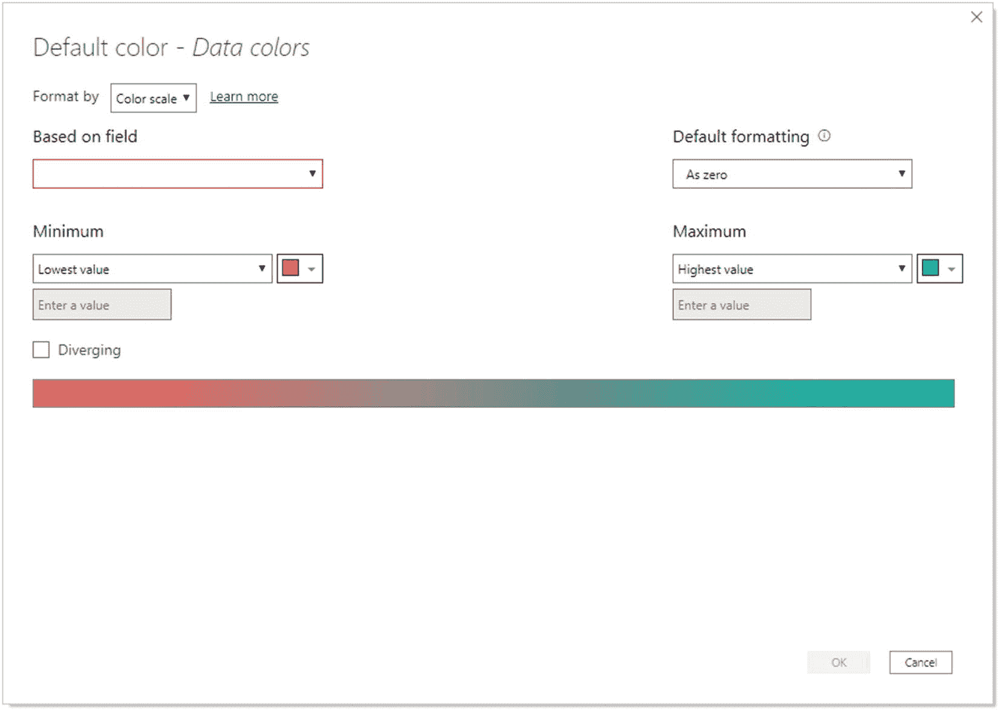

**图 20-8**

设置地图的填充颜色

8. 点击`确定`。地图将根据销售额调整每个国家/地区的着色深浅。颜色越深表示数值越高。此时地图将如图 20-9 所示。

`默认颜色 – 数据颜色`对话框还允许你根据精确的规则集或包含颜色参考值的字段来定义颜色。由于我在第 14 章已作说明，此处不再赘述，详情请参阅该章节。

## 形状地图

另一种可视化地理数据的方式是按州或区域展示。此选项要求源数据包含用于定义州和区域的标准代码。创建形状地图的方法如下：

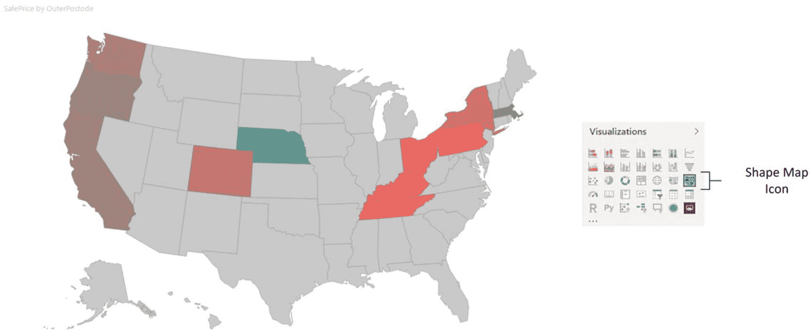

**图 20-10**

形状地图

1. 在`可视化`窗格中点击`形状地图`图标。

2. 将`外部邮政编码`字段（来自`客户`表）拖入`位置`框（或直接拖入地图）。

3. 将`售价`字段（来自`发票行`表）拖入`颜色饱和度`框（或直接拖入地图）。形状地图将如图 20-10 所示。

### 地图键

你很可能需要查找 Power BI Desktop 用于在形状地图中显示数据的地图键（区域代码）。这样你就可以将其添加到源数据中，或调整源数据以包含相应地理代码。

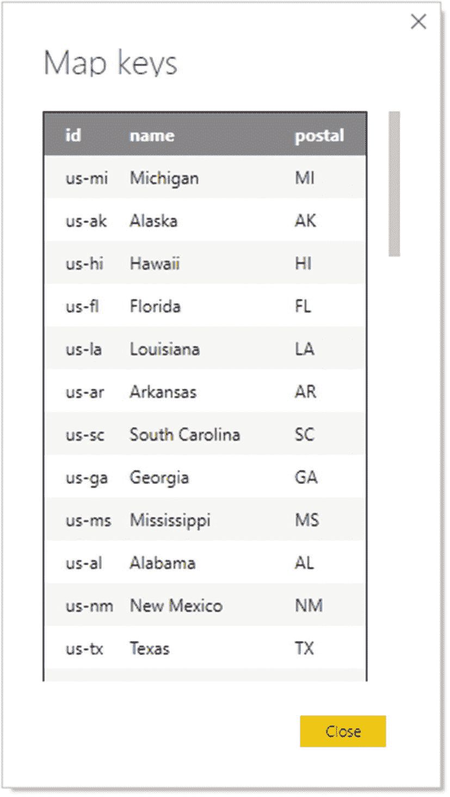

**图 20-11**

特定国家/地区的地图键

1. 选择你在图 20-10 中创建的形状地图。

2. 在`可视化`窗格中点击`格式`图标。

3. 展开`形状`部分。

4. 选择你想要显示代码的地图（国家/地区）。

5. 点击`查看地图键`。将显示一个包含地图键的对话框，如图 20-11 所示。

这是 Power BI Desktop 用于将数据分配到地理区域的数据元素列表。因此，你需要在源数据中包含这些数据，或准备将其添加到源数据中。也就是说，源数据中至少有一列必须与图 20-11 中显示的某个值相对应。

### 添加形状地图

如果你有特定的地图形状（可以包括从城镇到平面图的一切内容），则可以通过在形状地图的`格式设置`窗格`形状`部分中点击`添加地图`按钮来加载这些形状。

形状地图定义必须采用特定的 `.json` 格式创建。遗憾的是，创建这些定义超出了本书的讨论范围。

## 格式化地图

正如你所料，地图具有多种可应用的格式化选项。实际上，地图格式化的方式与其他可视化对象的格式化方式几乎完全相同。鉴于前五章已详细介绍了其中许多选项，本节将仅说明可能性，如需了解全部细节，请参阅第 14 章至第 18 章。

就地图和填充地图而言，你可以修改以下内容：

- **标题**：包括显示或隐藏标题，以及设置标题文本、字体颜色和背景颜色。

- **背景**：包括应用背景、设置其颜色和定义其透明度。

- **锁定纵横比**：如果将`锁定纵横比`设置为`开`，则可以在调整地图大小时保持其比例不变。

- **`边框`**：与大多数 Power BI Desktop 可视化对象一样，你可以为地图添加或移除边框。
所有地图类型都允许调整数据颜色。但根据地图类型的不同，颜色修改方式略有差异。下面我们将按地图类型分别介绍格式化选项。

## 地图

地图可视化对象允许你调整以下格式化方面：

- 数据颜色

- 类别标签

- 气泡

- 地图控件

- 地图样式

其中某些元素与你之前见过的格式化选项类似，因此此处不再赘述。但其他格式化元素要么采用全新的处理方式，要么与其他类型可视化对象中类似格式选项的处理方式差异显著，需要重新解释。

## 数据颜色

为地图选择数据颜色时，你可以选择将用于数据气泡的颜色。

**注意**

你无法为地图中的不同数据点应用不同颜色。

#### `类别标签`

如果你需要提供地图当前显示的地理元素名称（例如城镇或国家/地区），则可以将`类别标签`按钮设置为`开`。展开`类别标签`部分后，你还可以为类别标签选择字体系列、大小和颜色。

#### `气泡`

展开`气泡`部分后，可以调整`大小`滑块来设置气泡的相对大小。图 20-12 展示了示例。

#### `地图控件`

目前只有一种地图控件可以调整，即自动缩放功能。默认设置（`自动缩放`设置为`开`）意味着筛选地图数据时，地图上只会显示相关的地理区域。如果将此选项切换为`关`，则地图将保持显示同一区域，直到您手动更改。

#### `地图样式`

在本书付印时，Power BI Desktop 版本提供了五种地图样式：

- `Road`（默认）

- `Aerial`

- `Dark`

- `Light`

- `Grayscale`

您可以对比图 20-12 中选中航拍视图带来的差异（其中同时展示了调整气泡大小和添加类别标签的效果）。

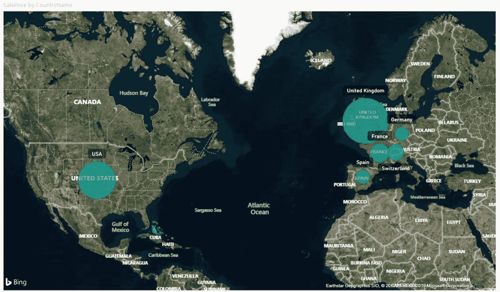

图 20-12
一张格式化的地图

#### `工具提示`

与图表类似，您可以将额外数据字段添加到`可视化`窗格的`工具提示`字段中。之后，当鼠标悬停在地图数据点（例如：图 20-12 中阴影地图内的一个国家）上时，您将在工具提示中看到该地图点的额外数据信息。

## 形状地图

形状地图中可更改的核心要素是实际形状的颜色。除此之外（您已了解），您还有一个主要选项：

- 为存在数据的每个地理区域设置颜色范围。

此外，您还可以为地图中无数据的部分选择颜色。

#### 定义数据颜色范围

如果形状地图包含数值数据，则可以使用发散颜色范围为每个地理区域设置颜色——这与您在填充地图中的操作类似。具体步骤如下：

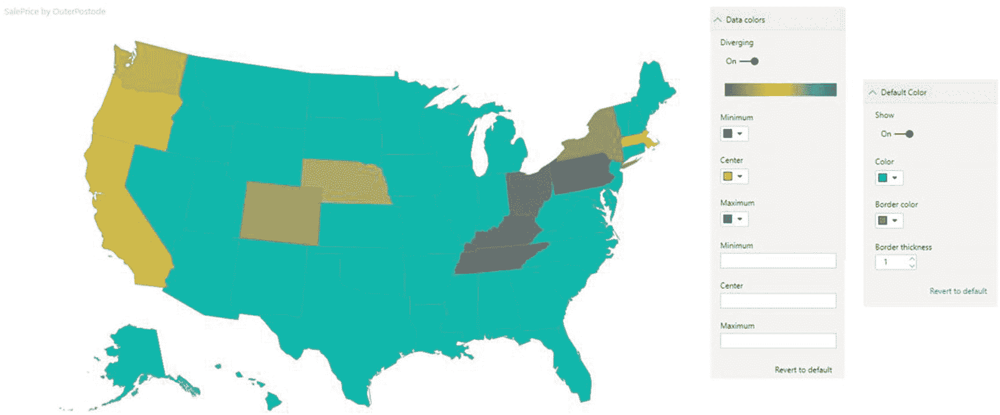

图 20-13
一张带阴影的填充地图

1.  创建形状地图：将`外部邮政编码`字段（来自`客户`表）添加到`可视化`窗格的`位置`字段中，并将`销售价格`字段（来自`发票行`表）添加到`颜色饱和度`字段中。
2.  单击`格式`图标，展开`数据颜色`部分（位于`格式设置`窗格中间）。
3.  将`发散`设置为`开启`。
4.  为`最小值`、`中心`和`最大值`选择颜色。
5.  展开`默认颜色`部分。
6.  将`显示`设置为`开启`。
7.  从`颜色`调色板中选择一种默认颜色。
8.  从`边框颜色`调色板中选择一种边框颜色。此时，地图将如图 20-13 所示。

## ArcGIS 地图

Microsoft 已与 ESRI（一家国际地理信息系统 [GIS] 软件供应商）合作，将 ArcGIS 地图功能集成到 Power BI Desktop 中。简而言之，此功能可将数据的地理空间表示提升到全新水平。使用 ArcGIS 地图，您可以：

- 通过添加热力图和聚合数据执行空间分析。
- 添加人口统计和参考数据。
- 使任何地图都外观出众。

### 创建 ArcGIS 地图

在本节中，您将看到几个示例，展示如何使用 ArcGIS 地图为您的仪表板增添真正的亮点。

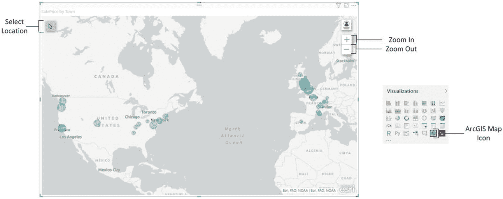

图 20-16
一个初始的 ArcGIS 地图

1.  打开文件 `C:\PowerBiDesktopSamples\CarSalesDataForReports.pbix`。
2.  在`可视化`窗格中，单击`用于 Power BI 的 ArcGIS 地图`图标。将出现`欢迎`对话框，如图 20-14 所示。
    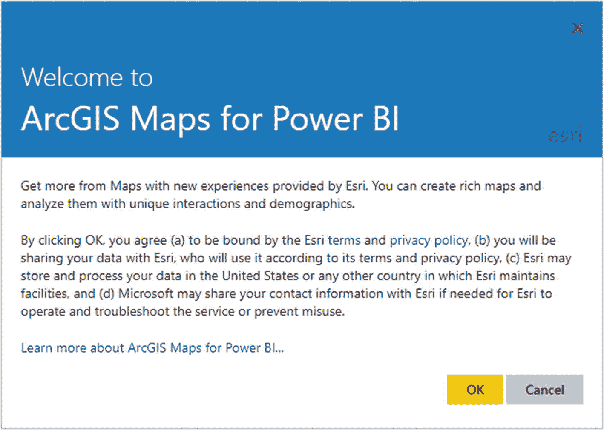
    图 20-14
    ArcGIS 欢迎对话框
3.  一个空白的 ArcGIS 地图将被添加到报表画布中。您可以在图 20-15 中看到此效果。
    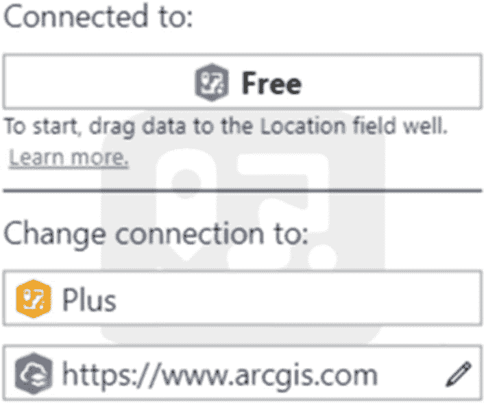
    图 20-15
    ArcGIS 地图可视化占位符
4.  将以下字段添加到 ArcGIS 地图：
    1.  `城镇`（来自`客户`表）
    2.  `销售价格`（来自`发票行`表）
5.  放大可视化效果以获得更清晰的视图。ArcGIS 地图将如图 20-16 所示。
到目前为止，一切都很简单——而且说实话，这与您之前使用传统 Power BI Desktop 地图工具所实现的功能并无太大区别。但是，当您学习使用 ArcGIS 地图中的更多选项时，事情将变得有趣得多。

> **注意**

> 您可以像在 Power BI Desktop 中操作其他地图一样，移动 ArcGIS 地图的显示区域或进行缩放。

### 选择底图类型

创建 ArcGIS 地图后，您可以通过一些强大的效果对其进行扩展。其中一个选项是更改地图本身的外观：

1.  在 ArcGIS 地图中，单击右上角的弹出菜单（省略号）。
2.  从上下文菜单中选择`编辑`。地图将扩展至全屏，并在地图顶部显示地图工具栏。
3.  单击工具栏左侧的`底图`。
4.  从可用类型面板中选择一个底图。地图显示将随之更改，如图 20-17 所示。
    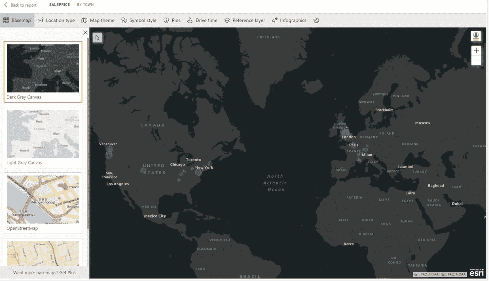
    图 20-17
    更改 ArcGIS 地图的底图类型
5.  单击 ArcGIS 地图左上角的`返回报表`，以返回报表画布。

> **注意**

> 若要关闭底图类型面板并仅显示地图本身，只需单击底图类型面板右上角的小叉号即可。当然，这仅适用于 ArcGIS 编辑模式。

### 选择位置类型

您可以使用`位置类型`选项选择地图数据的显示方式。这让您可以在以下两种显示方式之间进行选择：

- 数据作为点
- 数据作为边界（区域）

如果您选择将位置表示为边界，则可以进一步选择要显示哪些边界。边界的类型取决于所选国家/地区。表 20-1 列出了部分可用的边界定义。

**表 20-1**
**边界类型**

| 位置类型               | 国家/地区 | 描述                                                         |
|-----------------------|-----------|--------------------------------------------------------------|
| 整个国家               | 美国      | 将整个美国作为地图边界。                                       |
| 州                     | 美国      | 将每个州作为一个地理元素。                                     |
| 指定市场区域 (DMA)      | 美国      | 将每个 DMA 作为一个地理元素。                                  |
| 国会选区               | 美国      | 将每个国会选区作为一个地理元素。                               |
| 核心统计区 (CBSA)       | 美国      | 将每个核心统计区作为一个地理元素。                             |

## ArcGIS 地图高级功能

| 县                     | 美国      | 将每个县作为一个地理元素。                                     |
| 县分区                 | 美国      | 将每个县的一部分作为一个地理元素。                             |
| 邮政编码               | 美国      | 将每个邮政编码作为一个地理点。                                 |
| 城市和城镇             | 美国      | 将每个城镇和城市作为一个地理点。                               |
| 人口普查区域           | 美国      | 将每个普查区域作为一个地理元素。                               |
| 街区组                 | 美国      | 将每个普查街区组作为一个地理边界。                             |
| 国家                   | 英国      | 将英国的四个构成国分别作为一个地理边界。                       |
| 地区                   | 英国      | 将每个地区作为一个地理元素。                                   |
| 邮区                   | 英国      | 将每个邮区作为一个地理元素。                                   |
| 郡                     | 英国      | 将每个郡作为一个地理边界。                                     |
| 区                     | 英国      | 将每个区作为一个地理元素。                                     |
| 邮区 (外)              | 英国      | 将每个邮区（外部邮政编码）作为一个地理元素。                   |
| 邮区 (内)              | 英国      | 将每个邮区（内部邮政编码）作为一个地理元素。                   |
| 人口普查区域           | 英国      | 将每个普查区域作为一个地理元素。                               |

> **注意**
> 要使边界显示有效，底层数据必须包含允许 `ArcGIS` 地图识别边界的数据。

### 添加地图主题

地图主题可让您更改地理数据的显示方式，从而产生强大的视觉效果。例如，假设您想将销售数据显示为热力图：

1. 编辑您之前创建的 `ArcGIS` 地图。
2. 从菜单按钮中选择“地图主题”。左侧会显示一个可用选项面板。
3. 选择“热力图”。

您可以在图 20-18 中看到选择此选项的结果。

图 20-18：应用于 `ArcGIS` 地图的热力图

### 选择符号类型

`ArcGIS` 地图还为您提供了多种在地图上显示数据点的方式。您可以在以下示例中看到这一点：

图 20-19：带有格式化符号的 `ArcGIS` 地图

1. 重新创建您在本节开头首次看到的 `ArcGIS` 地图（图 20-16）。
2. 编辑地图。
3. 确保“地图主题”设置为“仅显示位置”。
4. 从菜单按钮中选择“符号样式”。
5. 在左侧的“符号样式”下，选择菱形符号。
6. 向右拖动“符号大小”滑块以增加符号大小。
7. 从可用颜色面板中选择符号填充颜色。
8. 如有需要，调整轮廓颜色和粗细（以及各种透明度设置）。您将看到类似图 20-19 所示的地图。

### 添加图钉

在地图上突出显示特定点的一种独特方法是添加图钉。这用于独立于底层数据来突出显示特定的地理位置。您可以使用 `ArcGIS Maps` 工具栏中的“图钉”菜单按钮来执行此操作，具体如下：

图 20-21：添加到 `ArcGIS` 地图的图钉

1. 在现有的 `ArcGIS` 地图可视化对象中，单击 `ArcGIS Maps` 工具栏中的“图钉”菜单按钮。左侧将出现“位置”窗格。
2. 在搜索字段中输入要搜索的位置。将出现一个可能位置的列表，如图 20-20 所示。

   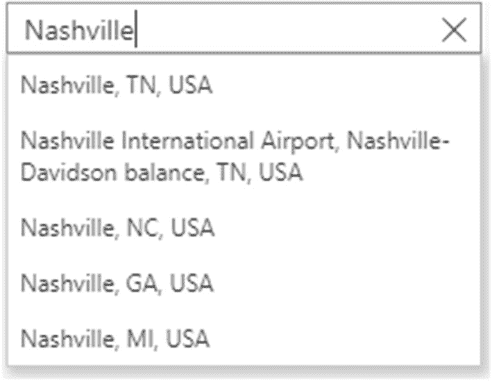
   图 20-20：选择图钉位置

3. 单击您想要精确高亮显示的位置。图 20-21 显示了一个输出示例。

要移除图钉，只需在“位置”窗格中单击要移除的图钉旁边的“删除”即可。

> **提示**：您可以向一个 `ArcGIS` 地图添加多个单独的图钉。

### 添加参考图层

`ArcGIS` 地图允许您访问某些统计地理数据集并将其添加到地图中。例如，您可以将美国房价中位数数据添加到地图中，并查看它与汽车销售数据有何关联（如果有的话）：

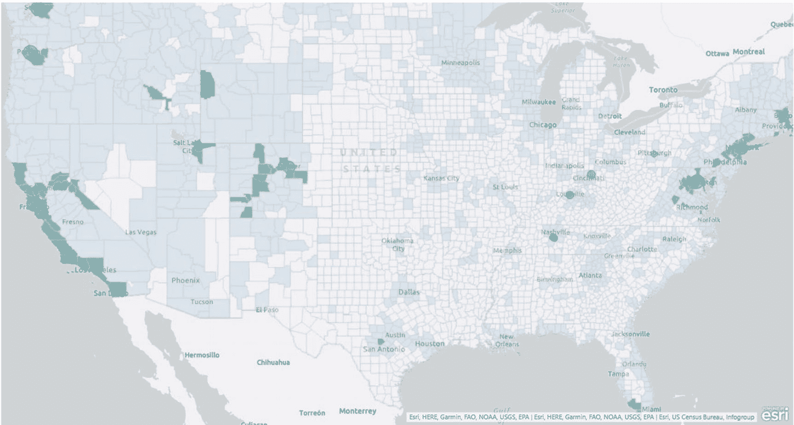

图 20-23：添加了参考数据的美国地图

1. 重新创建您在本节开头使用的初始 `ArcGIS` 地图。
2. 编辑 `ArcGIS` 地图。
3. 单击 `ArcGIS Maps` 工具栏上的“参考图层”按钮。
4. 从“参考图层”窗格中选择“2016 年美国房价中位数”参考图层。您可以在图 20-22 中看到该选项。

   
   图 20-22：`ArcGIS` 地图中部分可用的参考图层

5. 调整地图显示，放大美国。您可以在图 20-23 中看到添加了参考数据后的地图结果。

> **提示**：您一次只能添加一个参考数据图层。

### 添加信息图

`ArcGIS` 地图还可以访问与人口统计数据相关的数据。目前这些数据仅限于北美地区。您可以像这样添加参考数据：

图 20-24：`ArcGIS` 参考数据

1. 重新创建并编辑您在本节开头使用的初始 `ArcGIS` 地图。
2. 单击 `ArcGIS Maps` 工具栏上的“信息图”按钮。
3. 选择以下选项：
   - 总人口
   - 家庭收入
4. 将地图放大到旧金山地区。参考数据会随之调整，以对应显示的区域。您可以在图 20-24 中看到这一点。

## 结论

在本章中，您了解了如何以多种地图类型显示地理数据，从通过区域阴影强度表示数据的着色地图，到通过地图上数据点大小让数据本身说话的气泡图。您还了解了如何向报告中添加真正富有表现力的 `ArcGIS` 地图可视化对象，从而可以添加额外的地理数据来增强分析。

在过去的七章中，您已经见识了各种各样的可视化对象，它们可以帮助您表达数据中隐藏的趋势。本章在前六章的基础上，通过添加地图，进一步扩展了您对基于文本的可视化对象、图表、树状图、仪表和自定义可视化对象的了解。现在，是时候学习如何过滤和切片仪表板中的数据了。