# 21. 筛选数据

Power BI Desktop 从底层设计上就是为了让您（用户）能够从海量的事实和数据中筛选出有意义的见解。因此，关键在于能够快速准确地深入数据并突出显示其中包含的信息。这样，您无需应用复杂流程或与难以理解的界面作斗争，就可以随时探索新想法或跟随直觉。毕竟，`Power BI Desktop` 旨在帮助您提出新的分析，使您的业务在竞争中占据优势。

`Power BI Desktop` 提供了三种主要方法来帮助您专注于数据的关键要素：

- **筛选器**：限制报表、页面或可视化对象中显示的数据。这是本章的主题。
- **切片器**：允许用户在仪表板内交互式地筛选数据，并即时查看结果。
- **交叉筛选**：允许您即时、直观地为观众突出显示关键信息。

我们将在本章中讨论筛选器，并在下一章中讨论切片器和交叉筛选。

## 筛选器

Power BI Desktop 的开发者深知，数据是获得精准分析的关键。正因如此，你可以筛选基础数据模型中的任意字段或字段集，以提取其真正价值。这种方法不仅直观易用，而且速度极快，几乎无需等待结果返回。

筛选器作用于报表和可视化对象所依赖的数据。它们不必对用户可见，但在限制仪表板中显示的数据方面却极其强大。

你可以在创建 Power BI Desktop 报表之前、之后，甚至创建过程中添加筛选器。如果在创建表格前添加筛选器，表格将只显示筛选器允许通过的数据；如果向现有报表添加筛选器，数据可视化结果将在你眼前实时变化，以反映新的筛选条件；如果在包含可视化对象的 Power BI Desktop 报表中修改筛选器，则（正如你可能已猜到的那样）所有受该筛选器影响的可视化对象都将同步更新，以反映新的筛选标准——这一切都是瞬时完成的。

你可以筛选任何类型的数据：文本、数值、日期、逻辑值。每种数据类型都有各自选择元素、设置（尽可能）可包含或排除的值范围的方式。本章将讲解隔离目标显示数据的各种技巧。掌握这些后，你将能创建仅显示所需数据的 Power BI Desktop 报表。

我们将在本章后续部分详细探讨这些方法的运作原理。无论如何——正如 Power BI Desktop 的常见特性——通过实践比空谈更容易掌握这些概念，所以接下来让我们了解筛选器的工作原理。本章将使用 `C:\PowerBiDesktopSamples\CarSalesDataForReports.pbix` 示例文件作为学习所有筛选器应用的基础。

## 筛选器层级

在 Power BI Desktop 中，数据子集的提取基于筛选器的正确应用。因此，关于筛选器首先需要了解的是，它们作用于三个层级。具体包括：报表级筛选器、页面级筛选器、可视化级筛选器。

这三种筛选器的特性如表 21-1 所示。

**表 21-1** Power BI Desktop 筛选器

| 筛选器类型 | 应用范围 | 说明 |
| --- | --- | --- |
| 报表级 | 应用于当前报表中的每个可视化对象。 | 筛选当前文件中所有可视化对象的数据。 |
| 页面级 | 应用于当前活动页面中的每个可视化对象。 | 筛选当前页面中所有可视化对象的数据。 |
| 可视化级 | 仅应用于选定的可视化对象。 | 仅适用于选定的可视化对象（表格、图表等）。 |

筛选器的应用方式完全相同。关键在于它们对 Power BI Desktop 演示中可视化对象的影响范围。实际操作中，这将大大简化你的工作，因为你只需学习一次筛选器的应用方法，随后即可在不同文件的各层级中以相同方式使用。

现在，让我们从筛选器层级的最低层开始，了解如何使用筛选器：可视化级筛选器。

### 可视化级筛选器

将 Power BI Desktop 中的筛选器分为三种类型，纯粹是一种描述性的区分。对于 Power BI Desktop 而言，任何筛选器都是筛选器，所有筛选器的工作方式相同。然而，由于它们在应用时存在清晰的层级关系，我将从可视化级筛选器开始，然后逐步介绍其上级——页面级筛选器和报表级筛选器。鉴于三者的通用相似性，需要特别注意的是，确保你正在创建或修改的是正确的筛选器。这一点并非总是显而易见的，尤其是当你刚开始使用 Power BI Desktop 时。我将尽力在后续内容中阐明如何准确区分当前应用的筛选器层级，因为错误应用可能会对你试图传达的信息产生广泛影响。

#### “筛选器”窗格

首先需要注意的是，所有筛选器都在“筛选器”窗格中应用。该可折叠窗格位于报表画布的右侧，在选中示例可视化对象时，其外观如图 21-1 所示。

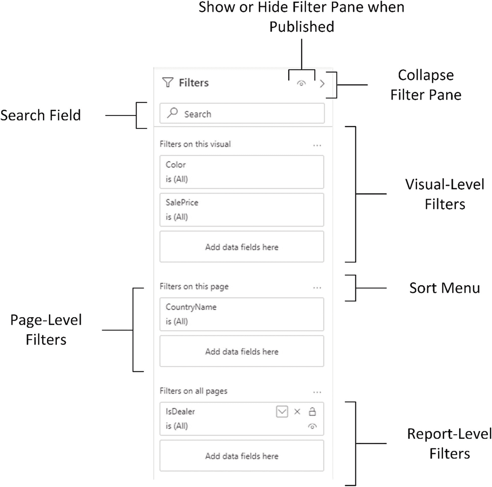

**图 21-1** “筛选器”窗格

如图所示，已在筛选器层级的所有可能级别上应用了不同的筛选器。仔细观察还可以发现，每个筛选器都显示了其应用方式（如有）。由于此处未应用任何筛选，每个筛选器均显示 `*All*` 作为当前选择，这表明所有数据均被允许通过。你将在后续几页中学习如何添加和调整筛选器。

**注意：** 仅当选中可视化对象时，“筛选器”窗格才显示可视化级筛选器。

#### 折叠与展开“筛选器”窗格

“筛选器”窗格会占用大量屏幕空间。这可以通过在不需要时折叠该窗格、在需要添加或修改筛选器时展开它来缓解。

要折叠“筛选器”窗格，只需单击窗格右上角的折叠按钮（向右的 V 形图标）。窗格将变为屏幕右侧的一个细长竖条。要使“筛选器”窗格重新显示，请再次单击同一按钮（此时变为向左的 V 形图标）。你可以在图 21-1 中看到折叠/展开按钮。

#### 添加筛选器

“筛选器”窗格会自动添加你用作可视化对象基础的任何字段。要验证这一点，请创建以下可视化对象：

1. 打开 `C:\PowerBiDesktopSamples\CarSalesDataForReports.pbix` 文件。
2. 使用以下字段创建聚类柱形图：
   - `Make`（来自 `Stock` 表）
   - `SalePrice`（来自 `InvoiceLines` 表）

   “筛选器”窗格将如图 21-2 所示。

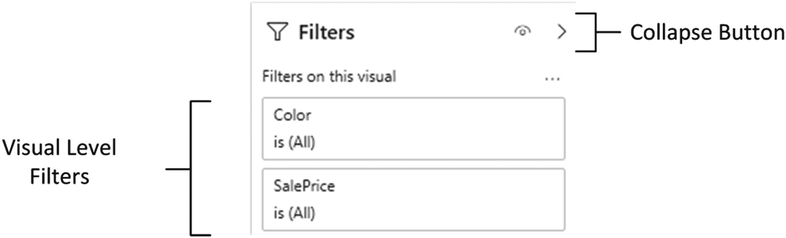

**图 21-2** 可视化级筛选器的自动创建

图 21-2 显示，将数据字段添加到可视化对象时，会自动将该字段添加到“可视化级筛选器”窗格中。

#### 应用筛选器

若要查看筛选器的作用，我们将图表限制为仅显示少数几种汽车品牌：

1. 选择你之前创建的簇状柱形图。
2. 在`筛选器窗格`中，将指针悬停在`Make`筛选器上。在该用作筛选器的字段右侧，将出现一个向下箭头。这是一个视觉级筛选器。
3. 单击箭头展开`Make`筛选器。`筛选器窗格`将显示视觉对象中出现的所有品牌。
4. 在`筛选器窗格`中，通过选中以下每个元素左侧的复选框来选择它们：
    - `Jaguar`
    - `Rolls Royce`
    - `Triumph`

你将看到，图表仅显示筛选器中所选汽车品牌的数据。结果图表应如图 21-3 所示。

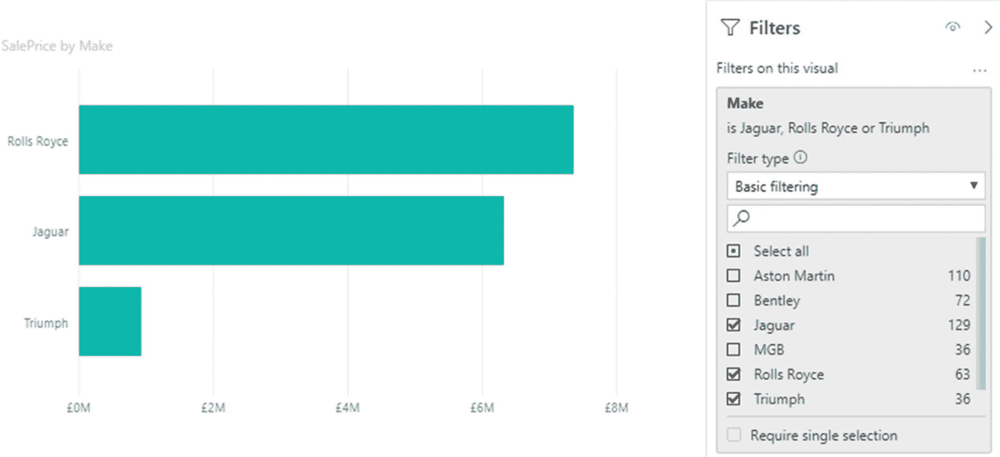

图 21-3：一个简单的筛选图表

你可能会注意到，首次应用筛选器时，所有复选框都是空的，包括`全选`复选框。默认设置（相当合乎逻辑地）是设置一个准备好进行调整的筛选器，但在用户决定应用哪些筛选器之前，不会实际筛选任何数据。一旦开始添加筛选元素，它们将显示在`筛选器窗格`中用于筛选数据的字段名称正下方。另一点需要注意的是，一旦筛选器被修改，它在`筛选器窗格`中通常会以不同的颜色显示。

修改筛选器的方式与应用它们的方式相同。要移除选中的筛选元素，只需单击带有复选标记的复选框以清除它。反之，要添加一个补充的筛选元素，只需单击一个空白的复选框。

最后要注意的一点是，如果你随后最小化某个字段的筛选器（通过单击已替换字段名称右侧向下箭头的向上箭头），你现在不仅会在`筛选器窗格`中看到字段名称，还会看到已应用筛选器的简洁描述。你可以在图 21-4 中看到一个示例。

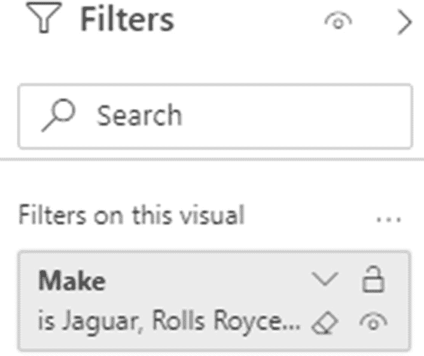

图 21-4：筛选器描述

> **注意**：你也可以在向视觉对象添加数据字段之前，先将字段添加到`筛选器窗格`。只需创建一个空白视觉对象，然后在将筛选器字段添加到`筛选器窗格`时保持其选中状态即可。

#### 全选筛选器

简单筛选器的唯一微妙之处在于，你还可以使用`全选`复选框。它充当一个全局的开启/关闭开关，用于选中或取消选中给定筛选器字段的所有可用筛选元素。`全选`筛选器字段有三种状态：
- *空白*：此字段未选择任何筛选器。

## 筛选器操作基础

-   *已勾选*：此字段的所有筛选器均被选中。
-   *虚线*：此字段的部分筛选器被选中。

选中或取消选中`全选`筛选器字段将选中或取消选中此字段的所有筛选元素，实际上会使筛选器失效。当你不仅想移除多个筛选选择以重新开始，而且还想选择所有元素以便单独取消选中某些元素（并避免手动选择大量元素）时，`全选`筛选器字段特别有用。

> **注意**：在筛选列表中选择多个元素时，你可能会想应用你可能习惯于在 Excel 或其他 Windows 应用程序中使用的经典 Windows 键盘快捷键。不幸的是，使用 Ctrl 或 Shift 单击来选择元素子集是不起作用的。你也不能使用空格键来选中或取消选中复选框。也无法使用光标键在筛选列表中的元素之间移动。

### 清除筛选器

建立一个精细调整的筛选器，以便从数据的噪音中钻取到核心信息，可能需要一些练习。幸运的是，筛选器的几乎瞬时应用意味着你几乎可以立即看到你的分析是否走在正确的道路上。然而，经常会有时候你想要重新开始，并移除特定筛选器的所有设置。这可以通过以下两种方式之一完成。第一种是单步操作：

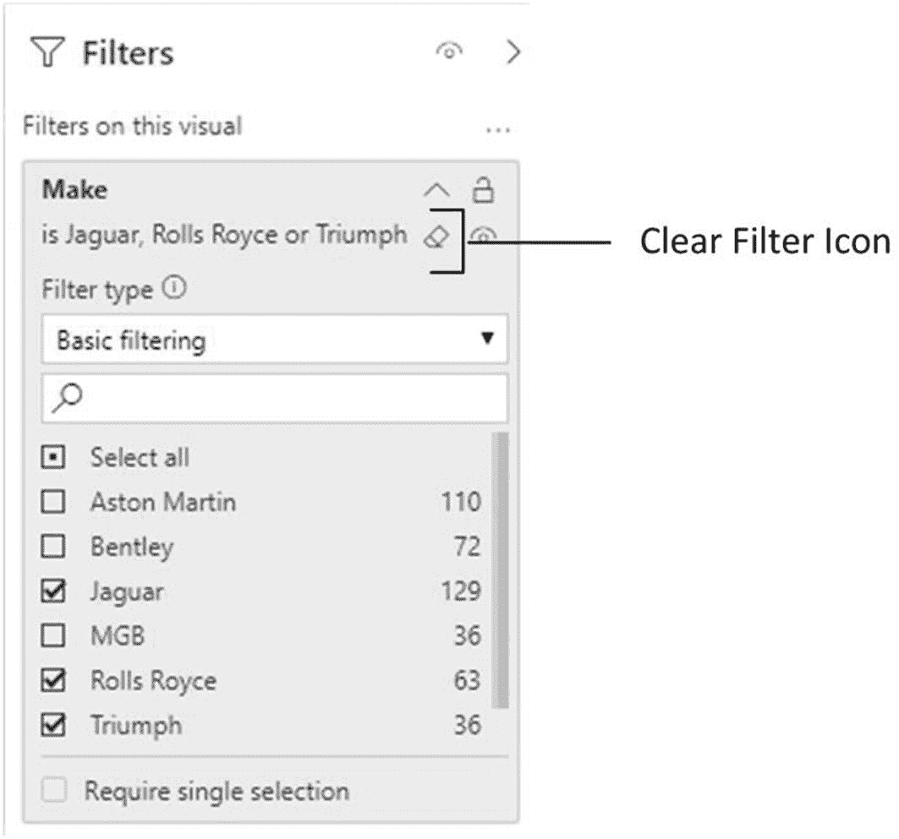

图 21-5：清除筛选器图标

1.  展开筛选器内容后，单击筛选器右侧的小橡皮擦图标，如图 21-5 所示。

或者，你可以执行以下操作，但*仅*适用于基本筛选器：

1.  通过单击向下箭头展开`筛选器窗格`中的筛选器。
2.  单击`全选`选项以移除所有筛选选择。
3.  最小化筛选器。

一旦筛选器被清除，使其恢复到之前状态的唯一方法是立即按`Ctrl+Z`。否则，你将不得不重新应用所需的条件。

### 添加筛选器

你不限于使用创建视觉对象时所使用的数据字段来筛选视觉对象。实际上，你可以使用数据模型中的任何字段来筛选视觉对象。操作方法如下：

1.  将要筛选的字段拖入`筛选器窗格`中“此视觉对象上的筛选器”部分下的“将数据字段添加到此区域”区域。
2.  按照你在前面章节中看到的方式应用筛选器。

### 移除筛选器

在处理筛选器时，有时你可能想要清理面板并重新开始。最快的方法是删除筛选器；一旦筛选器被删除，它将不再对 Power BI Desktop 报表中的数据产生任何影响。可以通过以下方式完成：

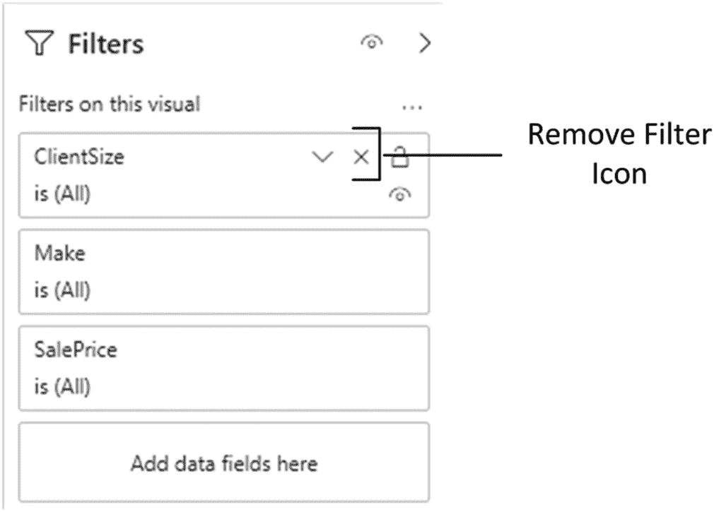

图 21-6：移除筛选器

1.  单击所选筛选器右侧的“移除筛选器”图标。此图标如图 21-6 所示。

这里的技巧是确保你选择了要移除的正确筛选器。然而，该技术适用于所有报表级和页面级筛选器，以及不用于显示数据的视觉级筛选器。

一旦筛选器被移除，使其恢复的唯一方法是立即单击“撤消”（或按`Ctrl+Z`）；否则，你将不得不从头开始重建。有趣的是，尽管你可以通过将元素拖入`筛选器窗格`来添加筛选器，但你不能将它们拖出`筛选器窗格`来移除它们。

但是，你可以通过单击字段名称右侧的叉号，从`筛选器窗格`中移除可视化级别字段（这些字段不作为视觉对象的数据使用）。

> **注意**：视觉级筛选器无法移除，只能重置为空，以便不应用任何筛选器。

## 筛选不同数据类型

到目前为止，你只看到了 Power BI Desktop 如何筛选文本元素。尽管基于文本的元素是许多数据筛选器的主要部分，但它们远非唯一可用的数据类型。还有：

-   数值数据
-   日期和时间数据
-   逻辑（真/假）数据

### 筛选数值数据

你可以像在 Power BI Desktop 中筛选基于文本的元素一样，筛选数值元素。然而，在筛选数字时，你很可能想要选择数值范围作为精确的数字。

#### 范围筛选模式

第一个值得了解的技巧是，在筛选数值数据时，默认选项是使用`阈值选择器`，这也是数值筛选器的唯一选项。阈值选择器允许你设置在 Power BI Desktop 报表、页面或可视化对象中显示的数字范围的下限和/或上限。

以下说明如何设置数据显示的数字范围：

1. 选择你之前创建的图表。
2. 清除所有现有筛选器。
3. 在“筛选器”窗格中，将指针悬停在 `SalePrice` 筛选器上。用作筛选器的字段右侧将出现一个向下的 V 形符号。
4. 单击该 V 形符号展开 `SalesPrice` 筛选器。“筛选器”窗格将显示两个弹出窗口，用于设置阈值。
5. 单击上方的弹出窗口，然后选择“大于或等于”选项。
6. 在上方弹出窗口下方的框中，输入值 **1000000**（不带任何千位分隔符或货币单位）。
7. 确保选中弹出窗口下方的 `And` 单选按钮。
8. 单击下方的弹出窗口，然后选择“小于或等于”选项。
9. 在下方弹出窗口下方的框中，输入值 **8000000**（不带任何千位分隔符或货币单位）。
10. 单击 `Apply filter`。图表将更改，仅显示你在筛选器中设置范围内的值。

就这样。你已为 Power BI Desktop 报表中与所选字段对应的所有数据设置了范围。它应类似于图 21-7。值得注意的是，在此图中，我加宽了“筛选器”窗格，以便你可以看到 Power BI Desktop 添加到范围筛选器以解释其功能的完整文本。如果你将“筛选器”窗格保留为默认宽度，则只会看到筛选器定义的缩写版本。

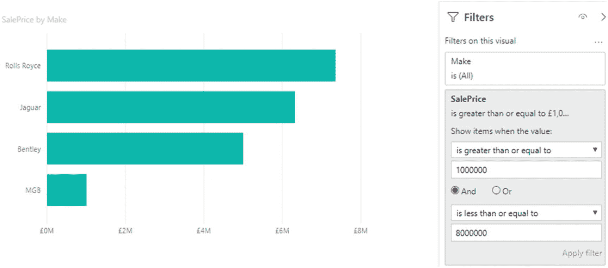

**图 21-7** 筛选范围

选择数值数据范围时，不必同时设置上限和下限。你可以设置其中之一，或两者都设置。

> **注意：** 如果你想从数据集中的可用数据中选择一个精确数字，可以将数值筛选器的筛选器类型切换为基本筛选。这将显示所选字段中的所有单个数字，以及每个值出现的次数。

#### 数值筛选选项

数字的筛选方式与文本不完全相同；筛选选项略有不同。这些筛选选项在表 21-2 中进行描述。

**表 21-2 数值筛选选项**

| 筛选选项 | 描述 |
| --- | --- |
| 小于 | 所选字段小于你搜索的数字。 |
| 小于或等于 | 所选字段小于或等于你搜索的数字。 |
| 大于 | 所选字段大于你搜索的数字。 |
| 大于或等于 | 所选字段大于或等于你搜索的数字。 |
| 等于 | 所选字段与你搜索的数字完全匹配。 |
| 不等于 | 所选字段与你搜索的数字不完全匹配。 |
| 为空 | 所选字段为空。 |
| 非空 | 所选字段非空。 |

如果你同时使用两个阈值级别来定义要包含或排除的值范围，或者要包含或排除的特定值，则需要应用逻辑筛选选项之一。这些选项如表 21-3 所示。

**表 21-3 逻辑筛选选项**

| 筛选类型 | 描述 |
| --- | --- |
| 与 | 应用两个筛选元素以*减少*允许通过筛选器的数据量。 |
| 或 | 分别应用任一筛选元素以*增加*允许通过筛选器的数据量。 |

在应用数值筛选器时，你**必须**输入一个数值——这并不令人惊讶。如果你错误地输入了文本，框的右侧会出现一个黄色菱形，提醒你输错了文本，并且 `Apply filter` 文本将保持灰色。

在这种情况下，你必须删除输入的字符，并在文本位置输入一个数值。

### 筛选日期和时间数据

最简单的形式是，日期和时间数据只是一系列元素或一段数值数据。因此，将日期维度中的字段拖到“筛选器”窗格中，可以让你选择一个或多个元素（例如年份或月份），或者定义一个范围（例如周）。按照以下步骤操作以查看实际效果：

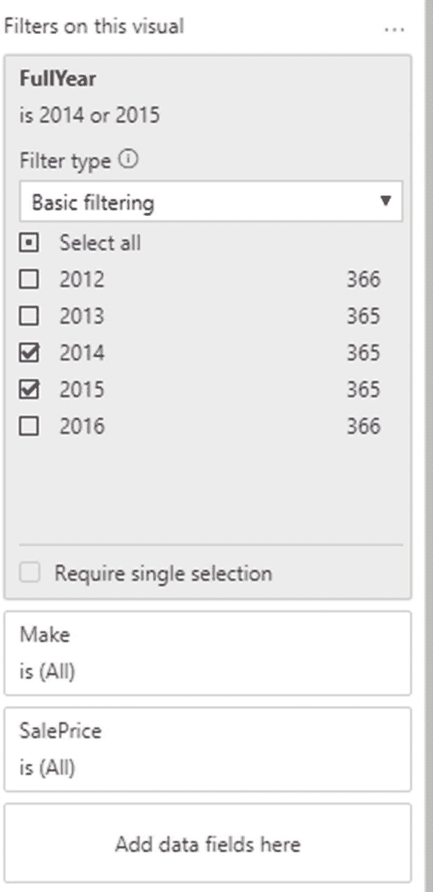

**图 21-8** 日期筛选器

1. 选择你之前使用 `Make` 和 `SalePrice` 字段创建的图表。
2. 清除所有现有筛选器。
3. 展开字段列表中的 `DateDimension` 表。
4. 将 `FullYear` 字段拖到“筛选器”窗格中“此视觉对象上的筛选器”部分的 `Add data fields here` 放置区域。由于 Power BI Desktop 假定年份是数字，因此它会切换到高级筛选。
5. 从 `Filter type` 弹出列表中选择 `Basic filtering`，以恢复为年份列表。
6. 在筛选器列表中单击一两年。图 21-8 演示了这一点。图表将更新，仅显示所选年份的数据。

我创建日期维度的原因之一是为了让你能够轻松地按日期元素进行筛选。因此，你现在可以使用 `DateDimension` 表中的任何字段来限制可视化对象中的数据。在我看来，该维度中以下字段非常有用：

* `FullName`
* `MonthAndYearAbbr`
* `QuarterAndYear`
* `YearAndWeek`

但是，你需要记住，你可以在一个筛选器中组合多个元素以获得正确的结果。因此，没有什么能阻止你，例如，筛选特定年份，然后添加星期几并计算该年份所有星期六的销售额。通过结合来自构建良好的数据维度的不同筛选元素，你可以极其轻松地查看数据随时间的变化情况。

这意味着，在按日期筛选时，你可能需要应用多个筛选器，并且可以从每个不同的筛选器（例如：年、季度和/或月）中选择元素。或者，如果你要按日期层次结构中的连续元素（例如年份，然后是月份）进行筛选，你可能会发现按使用的时间顺序（即年份后跟月份）将筛选元素从日期层次结构拖动到“筛选器”窗格更为直观。这样，你可以按照逻辑顺序，从“筛选器”窗格的顶部到底部，应用你感兴趣的日期条件。

> **注意：** 无论数据类型如何，你都不能将层次结构添加到筛选器。相反，你必须在字段列表中展开层次结构，并将层次结构的每个元素拖到所需的“筛选器”窗格中。

## 日期和时间筛选器

如果正在对 `Date` 或 `DateTime` 字段进行筛选，你很快就会发现 Power BI Desktop 会调整筛选器，帮助你更轻松地选择日期和时间。本质上，Power BI Desktop 允许你通过四种方式筛选日期和时间数据：

- 选择一个或多个确切的日期或时间（基本筛选）
- 定义一个日期或时间范围（高级筛选）
- 指定相对于当前日期的日期范围（相对日期筛选）
- 选择前几个日期（前 N 个筛选）

此外，日期字段的筛选器窗格会添加：

- 一个日历弹出窗口，允许你点击某个月的某一天（并向前或向后滚动浏览全年各个月份）
- 一个时间序列滚动筛选器，允许你选择一天中精确到每分钟的时间

为了直观地了解其工作方式，假设你想查看某个日期范围内的所有销售额：

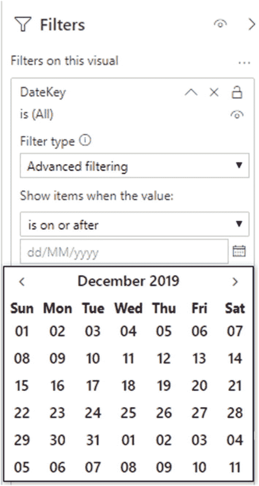
*图 21-9 – 日历弹出窗口*

1. 选择你之前创建的图表。
2. 按照之前所述的方法，从中删除 `FullYear` 筛选器。
3. 保持图表选中状态，展开 `DateDimension` 表，将 `DateKey` 字段拖放到“筛选器窗格”中“此视觉对象上的筛选器”部分的“在此处添加数据字段”区域。你将看到筛选器中显示了 `DateDimension` 表中的所有日期列表。
4. 点击“高级筛选”。
5. 从“显示符合以下条件的项目”弹出列表中，选择“晚于或等于”。
6. 点击弹出列表下方的日历图标。将显示如图 21-9 所示的日历弹出窗口。

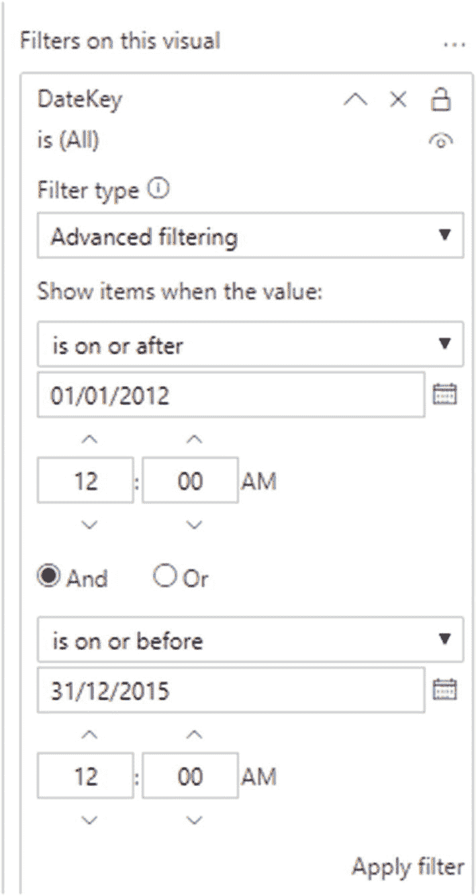
*图 21-10 – 日期范围筛选器*

1. 从日历中选择一个日期。此日期将显示在日历图标下方的框中。
2. 点击“且”单选按钮。
3. 在第二个弹出列表中，选择“早于或等于”。
4. 点击弹出列表下方的日历图标，并从日历中选择一个日期。此日期将显示在第二个弹出列表下方的框中。
5. 点击“应用筛选器”。筛选器窗格将如图 21-10 所示。

从日历弹出窗口中选择日期时，有几个技巧可以帮你节省时间（你可能在其他桌面软件中熟悉这些技巧）：

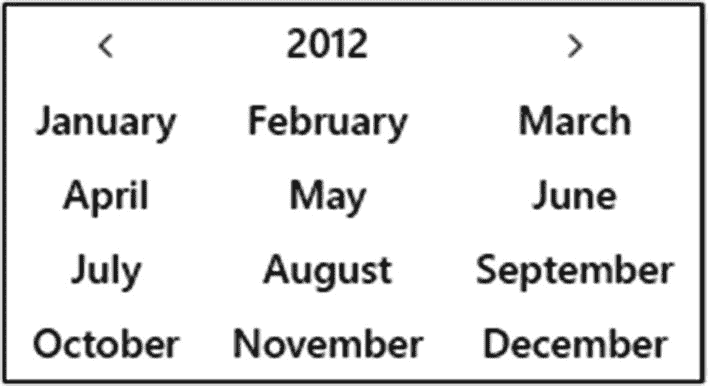
*图 21-11 – 月份的日历弹出窗口*

- 使用日历弹出窗口时，点击月份和年份右侧的右向 V 形符号，可显示下一个月。
- 使用日历弹出窗口时，点击月份和年份左侧的左向 V 形符号，可显示上一个月。
- 使用日历弹出窗口时，点击月份和年份会显示一个年份弹出窗口，在该窗口中，你可以点击年份右侧的右向 V 形符号显示下一年（或点击年份左侧的左向 V 形符号显示上一年），然后从显示的月份中选择所需的月份。你可以在图 21-11 中看到这一点。

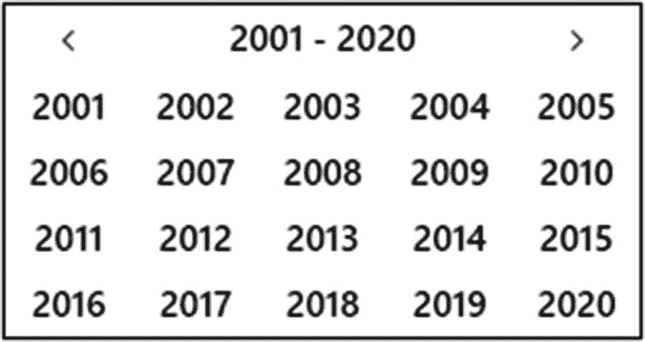
*图 21-12 – 年份的日历弹出窗口*

- 如果你已经点击了月份和年份，正查看某一年份的各个月份，你可以点击年份来查看年份范围。您可以使用左向和右向 V 形符号滚动浏览前一个和后一个年份范围，然后选择你要筛选的年份。你可以在图 21-12 中看到这一点。
- 使用时间弹出窗口时，点击时间的任何组成部分（小时、分钟或秒）内部，然后点击时间字段上方和下方的上下滚动三角形，可以快速滚动浏览可用选项。
- 点击时间框右侧的“上午”或“下午”，可以在上午和下午之间切换。

如果你不想使用日历弹出窗口选择日期，可以直接在 `Date`（或 `DateTime`）字段高级筛选器的日期框中输入日期。只需记住，输入的日期格式必须与你所使用的环境相对应，并且该格式能被 Power BI Desktop 识别。

> **注意：** 如果你输入的日期格式与系统格式不符，或者日期完全无效（例如 2 月 30 日），Power BI Desktop 将不允许你应用该筛选器。若要更正此问题，只需使用日历弹出窗口选择一个正确的日期即可。同样，如果你输入了一个不存在的时间，Power BI Desktop 将拒绝接受它，并会恢复为之前选择的（可接受的）时间。

## 日期筛选选项

日期的筛选方式无法完全与文本或数字相同。因此，日期筛选器的高级筛选选项与其他数据类型筛选时使用的选项略有不同。表 21-4 中对此进行了说明。

**表 21-4 – 高级日期筛选选项**

| 筛选选项 | 说明 |
| :--- | :--- |
| `等于` | 选定的字段包含你正在搜索的日期。 |
| `不等于` | 选定的字段不包含你正在搜索的日期。 |
| `晚于` | 选定的字段包含你输入日期之后的日期，即较晚的日期，不包括你输入的日期。 |
| `晚于或等于` | 选定的字段包含从你输入的日期开始或之后的日期。 |
| `早于` | 选定的字段包含你输入日期之前的日期，即较早的日期，不包括你输入的日期。 |
| `早于或等于` | 选定的字段包含你输入的日期或之前的日期，即早于或等于你输入的日期。 |
| `为空` | 选定的字段为空。 |
| `不为空` | 选定的字段不为空。 |

## 相对日期筛选

另一种查找日期范围数据的方法专门适用于当前日期。`Power BI Desktop` 可以帮助您查找过去几天、几周、几个月甚至几年的销售数据。操作步骤如下：

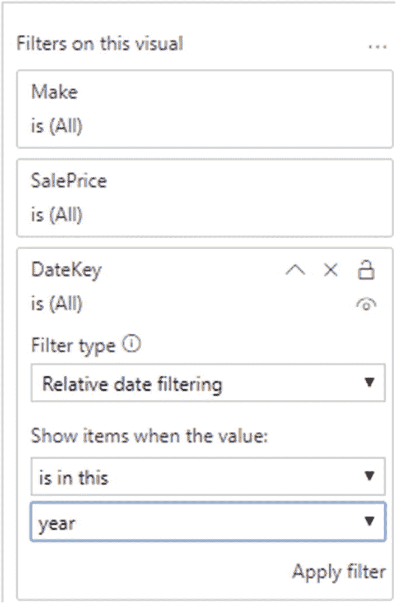
*图 21-13 – 应用相对日期筛选*

1. 选择您之前创建的图表。
2. 按照前述方法清除该图表上的所有筛选器。
3. 保持图表选中状态，展开 `DateDimension` 表，将 `DateKey` 字段添加到该视觉对象的 `筛选器窗格` 中。
4. 在 `筛选器类型` 弹出列表中，选择 `相对日期筛选`。
5. 在“当值满足以下条件时显示项目”弹出窗口中，选择“在此期间内”。
6. 在第二个“当值满足以下条件时显示项目”弹出窗口中，选择 `年`。`筛选器窗格` 将如图 21-13 所示。
7. 点击 `应用筛选器` 以筛选视觉对象中的数据。

相对日期筛选有多个选项可用。这些选项在表 21-5 中进行了说明。

**表 21-5 – 相对日期筛选选项**

| 筛选选项 | 筛选定义 | 说明 |
| :--- | :--- | :--- |
| `在过去` | 相对定位 | 获取当前日期之前的一段日期范围。 |
| `在此期间内` | 相对定位 | 指定要使用的当前时间段。 |
| `在将来` | 相对定位 | 获取当前日期之后的一段日期范围。 |
| `天` | 时间元素 | 将天数设置为时间段的数量。 |
| `周` | 时间元素 | 将周（滚动七天周期）设置为时间段的数量。 |
| `日历周` | 时间元素 | 将完整日历周设置为时间段的数量。 |
| `月` | 时间元素 | 将月（滚动周期，从日期到日期）设置为时间段的数量。 |
| `日历月` | 时间元素 | 将完整日历月设置为时间段的数量。 |
| `年` | 时间元素 | 将年（滚动周期，从日期到日期）设置为时间段的数量。 |
| `日历年` | 时间元素 | 将完整日历年设置为时间段的数量。 |

> **注意：** 选中 `在过去` 或 `在将来` 相对日期筛选选项后，`筛选器窗格` 中会显示一个额外字段，您可以在其中输入用于筛选数据的天数、周数、月数等。

### 筛选布尔值数据

源数据中可能还有您需要处理的其他数据类型。例如，您可能拥有布尔值（真或假）数据。然而，对于 `Power BI Desktop` 而言，无论出于何种目的，这都被视为基于文本的筛选器。另一方面，有些数据类型无法进行筛选，也永远不会出现在 `筛选器窗格` 中。二进制数据（如图像）就是如此。

因此，如果您对布尔值数据进行筛选，`Power BI Desktop` 会在该数据类型的展开筛选器中显示 `True` 和 `False`。以下是查看方法：

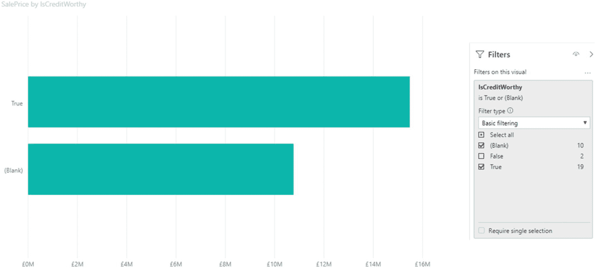

**图 21-14** – 应用布尔值筛选

1. 使用以下字段创建一个簇状柱形图：
    - `IsCreditWorthy`（来自 `Clients` 表）
    - `SalePrice`（来自 `InvoiceLines` 表）

2. 在 `筛选器窗格` 中展开 `IsCreditWorthy` 字段。

3. 选中 `True` 和 `空白`。图表和 `筛选器窗格` 将如图 21-14 所示。

## 高级文本筛选器

在许多情况下，当您深入挖掘数据时，仅选择“简单”筛选器就足以突出显示您和观众感兴趣的信息。但不可避免的是，有时您需要更精细地筛选数据，以便返回能够去芜存菁的结果。这正是 `Power Desktop BI` 高级筛选功能的用武之地。高级筛选允许您以更高的精度在字段数据内进行搜索，当您需要根据文本字段的部分内容包含或排除数据时，它尤其有用。

### 应用高级文本筛选器

让我们从一个简单的示例开始，说明如何对文本字段应用高级筛选器：

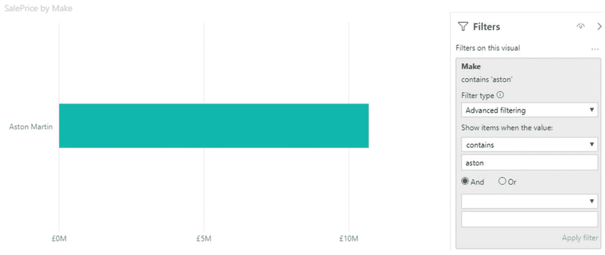

**图 21-15** – 应用高级筛选器的结果

1. 点击您想要筛选的视觉对象。再次，我们将使用本章前面使用 `Make` 和 `SalePrice` 作为数据字段创建的图表。

2. 清除任何现有的筛选器。

3. 在 `筛选器窗格` 中展开 `Make` 字段（如果尚未展开）。

4. 从 `筛选器类型` 弹出列表中选择 `高级筛选`。筛选器的主体部分会切换显示高级筛选器的弹出窗口和输入框，并且筛选器标题下的文本现在显示为“当值满足以下条件时显示项目”。

5. 从弹出窗口中选择 `包含`。

6. 点击筛选器文本框内部（位于显示 `包含` 的框下方），输入要筛选的文本（本示例中为 `aston`）。

7. 点击 `应用筛选器` 或按下 `Enter` 键。`Power BI Desktop` 报表中的所有对象将仅显示客户名称包含文本 `aston` 的数据。结果如图 21-15 所示；用于生成该结果的高级筛选器也已显示。

在此阶段，有几点重要事项需要说明：

- 高级筛选是**不**区分大小写的。您可以在筛选框中输入大写或小写字符；结果相同。

- 空格和标点符号很重要，因为它们会被逐字处理。例如，如果您输入 `A `（A 后面带一个空格），则只会找到包含 A（大写或小写）且后跟空格的元素。

- 高级筛选器与标准筛选器一样，其效果是累积的。因此，如果您应用了筛选器但未获得预期结果，请务必检查是否有其他层级的筛选器处于活动状态，可能会缩小返回的数据范围，使其超出您的需求。

- 如果您的筛选器从结果集中排除了所有数据，那么 `Power BI Desktop` 报表中的任何表格都会显示“此表不含任何行。”

- 同样，如果您的筛选器排除了所有数据，图表将为空。

无论如何，如果最终没有显示任何数据，或者显示的数据与您想要展示的不符，只需清除筛选器并重新开始。

### 清除高级筛选器

不可避免的是，您还需要知道如何移除高级筛选器。其过程与标准筛选器相同；您只需点击该字段筛选器顶部的 `清除筛选器` 图标（位于字段框内该字段的 V 形符号正下方）即可。此筛选器的筛选元素将被移除。

### 恢复为基本筛选

如果您决定不再定义和使用复杂筛选器，而希望恢复为基本筛选，那么只需为所选筛选器从 `筛选器类型` 弹出列表中选择 `基本筛选` 即可。`筛选器窗格` 将切换为针对所选字段的基本筛选。

### 文本筛选选项

在根据数据字段包含的文本进行筛选时，你可以通过多种方式将所筛选的字符串应用到基础数据上。这些方式对于文本字段的两个高级筛选选项（上部和下部）都是相同的，如表 21-6 所述。

表 21-6

高级文本筛选选项

| 筛选选项 | 说明 |
| --- | --- |
| 包含 | 所选字段的字段数据中包含搜索文本（不论位于何处）。 |
| 不包含 | 所选字段的字段数据中不包含搜索文本（不论位于何处）。 |
| 开头是 | 所选字段以搜索文本开头，其后可接任意数据。 |
| 开头不是 | 所选字段不以搜索文本开头，其后也不接任意数据。 |
| 是 | 所选字段与搜索文本完全匹配。 |
| 不是 | 所选字段与搜索文本不匹配。 |
| 为空 | 所选字段为空。 |
| 非空 | 所选字段非空。 |

你并非只能设置单个高级文本筛选。与数值字段的情况一样，你可以设置两个筛选，并将逻辑运算符设为 `Or` 来应用其中任一筛选。或者，你也可以通过将逻辑运算符设为 `And` 来设置两个互补的文本筛选。

## 前 N 项筛选

筛选数据的原因之一是从海量信息中提取含义。一种提供有意义分析的简便方法是隔离出表现最佳（或最差）的元素。例如，假设你想查看销量排名前三的汽车品牌：

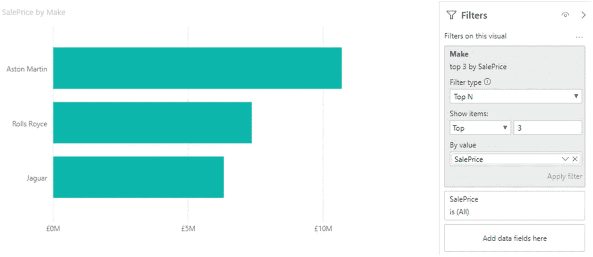

图 21-16

应用前 N 项筛选

1. 单击你要筛选的可视化对象。此处我们仍使用本章前面用 `Make` 和 `SalePrice` 作为数据字段创建的图表。

2. 在“筛选器”窗格中，展开“视觉级筛选器”窗格的 `Make` 部分。

3. 从 `筛选器类型` 弹出列表中选择 `前 N 项`。

4. 确保在 `显示项目` 弹出列表的可用选项中选择了 `前几项`。

5. 在 `显示项目` 弹出列表右侧的字段中输入 `3`。

6. 将 `SalePrice` 字段拖入 `按值` 字段。

7. 单击 `应用筛选器`。你将看到图表和筛选器呈现如图 21-16 所示。

这里所做的是在后台对每个品牌的 `SalePrice` 字段进行了聚合。然后使用最高的三个值来筛选数据。

**注意**：筛选后 N 项元素只需在 `显示项目` 列表中选择 `后几项` 即可。

### 特定可视化级别筛选

在本章中，到目前为止我们看到的筛选都是：用于筛选可视化对象的字段*同样*也显示在可视化对象本身中——无论是图表、地图还是表格。无可避免地，有时你将需要根据*未*在可视化对象中显示的字段进行筛选。虽然我们之前提到过这一点，但仍有必要更详细地解释这个概念。

以下示例说明了如何应用可视化级别筛选：

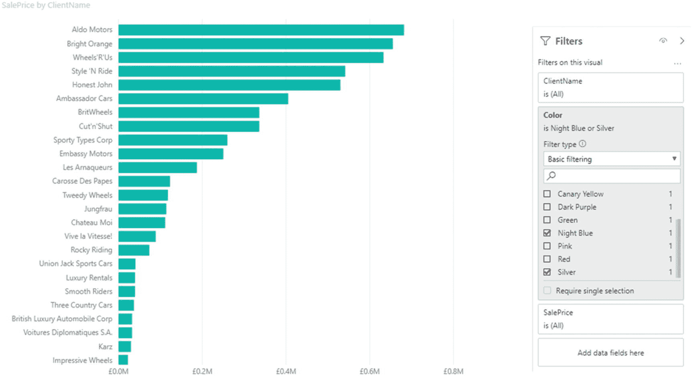

图 21-17

未使用数据字段的可视化级别筛选

1. 使用文件 `CarSalesDataForReports.pbix`，创建一个按 `ClientName` 分组的 `SalePrice` 聚集柱形图。

2. 显示“筛选器”窗格（如果尚未显示）。

3. 展开“Colors”表，将 `Color` 字段拖入该可视化对象的“筛选器”窗格中的 `将数据字段添加到此位置` 区域。筛选器窗格中的颜色列表将自动展开。但 `Color` 字段*不会*显示在可视化对象中。

4. 勾选一两种颜色，例如“Night Blue”和“Silver”。结果如图 21-17 所示。

你会立即注意到，应用的筛选仅影响所选的可视化对象（本例中的图表）。当你创建包含多个可视化对象的复杂报表时，会发现报表中的其他可视化对象的基础数据不会受到任何影响。

你可以通过单击筛选器名称右上角的 `清除` 图标，清除可视化级别的任何筛选。此外，你可以向可视化对象的“筛选器”窗格添加多个字段，*并且*可以以任意顺序添加。

**注意**：如果筛选器处于活动状态，从字段区域删除字段*不会*将其从“筛选器”窗格中移除。这可能会产生误导，因为该字段虽然不再显示在可视化对象中，但其效果仍然可见。

### 多个筛选

到目前为止，我们一直假设每次只应用一个筛选。相信我，在处理庞大复杂的数据集时，情况通常并非如此。通常，`Power BI Desktop` 允许你向报表添加多个筛选。这需要我们仔细考虑以下可能影响：

- 所有筛选器同时处于活动状态（除非你已清除某个筛选器），其效果是累积的。也就是说，只有当数据匹配*所有*活动筛选器设定的*所有*条件时，才会返回数据。因此，例如，如果你设置了在指定日期范围内且销售额高于某个数值的筛选条件，那么任何销售额低于你设定数值、或销售日期在你设定范围之前或之后的数据都*不会*被返回。

# Power BI Desktop 中的筛选器

- 如果你在处理多个筛选（无论是视觉级、页面级还是报表级），你可以通过在“筛选器”窗格顶部的`搜索`框中输入筛选所用字段的部分字符，只显示活动筛选器的一个子集。这将立即显示所有基于包含你输入字符的字段的筛选器。要清除`搜索`框，只需单击`搜索`框右侧的叉号图标。

- 要对任意级别（视觉级、页面级或报表级）的筛选器进行排序，只需单击筛选器右侧的省略号，然后从弹出的菜单中选择排序顺序。如果你想查看排序菜单，请参考图 21-1。

- 很容易忘记筛选器可能处于活动状态。请记住，“筛选器”窗格中的所有活动筛选器无论窗格本身是展开还是折叠，都保持有效。如果你打算折叠筛选器以更有效地利用屏幕空间，那么值得养成查看任何筛选器标题下方第二行文字的习惯，该行文字会描述当前筛选状态。例如，它会显示类似`包含 Rolls` 的信息。当然，具体文字会根据你应用的筛选器而变化。

## 页面级筛选器

在了解了筛选器的概念以及如何将其应用于可视化对象之后，现在我们来扩展这个概念，看看筛选器如何应用于多个可视化对象。

好消息是，无论筛选器应用于哪个层级，所有筛选器的配置方式都完全相同。因此，在页面级或报表级应用筛选器，只是选择在“筛选器”窗格中放置筛选器位置的问题。

例如，假设你想筛选一个页面上的所有可视化对象，使其仅显示特定年份的数据：

1.  在打开的 Power BI Desktop 文件（例如包含你可以在图 21-18 中看到的图表的文件）中，单击任何现有可视化对象外部的仪表板画布。
2.  展开 `DateDimension` 表。
3.  将 `FullYear` 字段拖到字段井并放入“页面级筛选器”框中。将显示此字段的高级筛选选项。
4.  选择“基本筛选”作为筛选器类型。
5.  从可用年份列表中选择 **2014**。当前页面上的所有可视化对象都将被筛选，仅显示此年份的数据。

图 21-18 向您展示了此操作的“筛选器”窗格。您可以看到页面级筛选器看起来与视觉级筛选器完全相同。唯一的区别（除了它产生的效果之外）是在“筛选器”窗格中的位置。

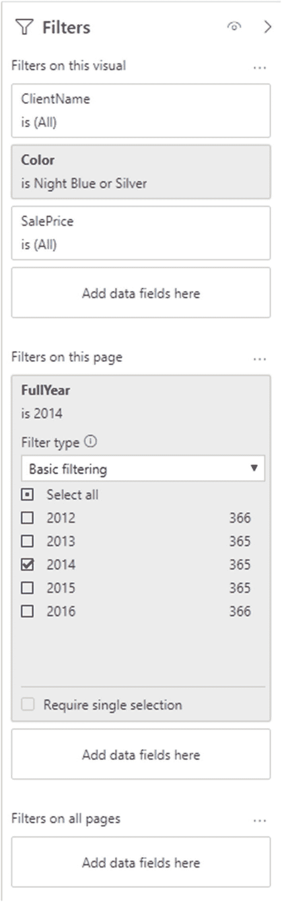

图 21-18：应用页面级筛选器

如果您愿意，可以通过将更多字段拖到字段井并放入“页面级筛选器”框来添加多个页面级筛选器。添加字段的顺序并不重要。您会注意到，无论是否选择了可视化对象，页面级筛选器都保持可见。

## 报表级筛选器

最高级别的筛选是在报表级别应用的。这意味着在此处设置的任何筛选器都将应用于报表中的每一页（或仪表板），从而也应用于文件中的每一个可视化对象。我知道 Power BI Desktop 现在将此概念称为“所有页面上的筛选器”，但我更喜欢使用旧术语，因为我觉得它更具表现力。应用报表级筛选器与应用页面级筛选器几乎完全相同。那么，假设你的整个报表只涉及一个国家/地区。以下是设置一个将应用于 Power BI Desktop 报表中每一页的筛选器的方法：

1.  使用文件 `CarSalesDataForReports.pbix`，获取你用 `ClientName` 创建的包含 `SalePrice`，然后按视觉级颜色和页面级 `FullYear` 筛选的报表。
2.  单击任何现有可视化对象外部的仪表板画布。
3.  展开 `Countries` 表。
4.  将 `CountryName` 字段拖到字段井并放入“报表级筛选器”框中。将显示此字段的高级筛选选项。
5.  确保为此筛选器选择“基本筛选”作为筛选器类型。
6.  从可用国家/地区列表中选择 **United Kingdom**。当前报表中（每一页上）的所有可视化对象都将被筛选，仅显示此年份的数据。

图 21-19 向您展示了此操作的“筛选器”窗格。

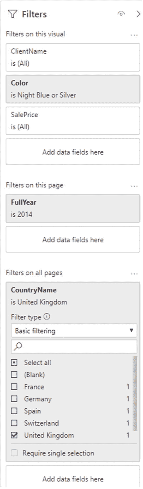

图 21-19：应用报表级筛选器

如果您愿意，可以通过将更多字段拖到字段井并放入“报表级筛选器”窗格来添加多个报表级筛选器。再次强调，添加字段的顺序无关紧要。您会注意到，无论是否选择了可视化对象，报表级筛选器都保持可见。

## 筛选器字段复用

尽管看起来可能违反直觉，但在某些情况下，您可以在同一筛选器级别重复使用同一字段来辅助工作。

例如，假设你想查看里程数在明确阈值之间的所有车辆的数据。请看下面的示例：

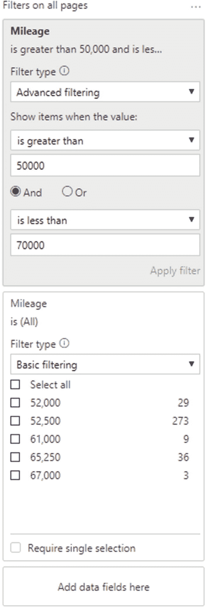

图 21-20：在筛选器中组合同一字段的多个迭代

1.  使用文件 `CarSalesDataForReports.pbix`，获取你用 `ClientName` 创建的包含 `SalePrice`，并经过筛选的报表。
2.  移除所有筛选器。
3.  展开 `Stock` 表。
4.  将 `Mileage` 字段拖到字段井，并放入“所有页面上的筛选器”井中。
5.  从第一个弹出菜单中选择“大于”。
6.  在第一个阈值框中输入 **50000**。
7.  确保选中“与”单选按钮。
8.  从第二个弹出菜单中选择“小于”。
9.  在第二个阈值框中输入 **70000**。
10. 单击“应用筛选器”。
11. 将 `Mileage` 字段拖到字段井，并放入刚刚创建的筛选器下方的“所有页面上的筛选器”井中。
12. 确保为此筛选器选择“基本筛选”。将显示所选里程范围内库存车辆的可选里程列表（以及每个里程对应的车辆数量）。您可以在图 21-20 中看到这一点。

您现在可以使用更详细的筛选器来筛选当前页面上的可视化对象。

需要注意的一点是，即使是在“筛选器”窗格内的一个筛选器框中，也会应用筛选器层次结构。简而言之，放在另一个筛选器上方的筛选器将筛选下方筛选器中的可用元素。然而，这仅适用于同一筛选器的复用。

> **注意：** 此示例设置为在页面级别进行筛选。它同样也可以应用于报表级别。

### 要求单选

某些筛选器选项允许您从列表中选择多个选项。您可能希望强制自己或最终用户只从该列表中选择一个元素。

在这种情况下，您需要做的就是选中列表下方的`需要单选`复选框。一旦该选项激活，它将取消选择列表中任何已有的选中元素，并且（可能更重要的是）当在筛选器中做出新选择时也会如此。

> **注意：** 选择`需要单选`选项也会隐藏“筛选器类型”弹出列表。要切换到另一种筛选器类型，您需要通过取消选中复选框来停用`需要单选`选项。

## 使用筛选器层次结构

鉴于可以应用多个级别的筛选器，Power BI Desktop 采用了一套筛选器层次结构：

-   首先，在数据级别，你对基础数据应用的任何选择或选项，都会限制 Power BI Desktop 可用于可视化信息的数据集。
-   其次，在报表级别，你应用的任何报表级筛选器，都会影响报表中使用（可能受限的）可用源数据的所有可视化项。
-   第三，在页面级别，你应用的任何页面级筛选器，都会影响视图上使用（经任何报表级筛选器筛选后、可能受限的）可用源数据的所有可视化项。
-   最后，对于每个可视化项，你应用的任何可视化级筛选器，都会进一步限制经报表级和页面级筛选器筛选后的数据——但仅限于所选的可视化项。

以下几点值得注意：

-   如果某个选项在更高层级（报表级或页面级）已被筛选掉，则你无法对可视化筛选器应用完全不同的选择。点击 `Select all` 将*仅*从先前筛选出的元素子集中进行选择。
-   如果你在可视化级别应用了一个筛选器，然后在报表或页面级别重新应用相同的筛选器，但选择了不同的元素，那么你仍会在可视化级别从筛选器中排除所有未选中的元素。我强调这一点，是因为 Power BI Desktop 会记住之前在可视化级别选中的元素，即使它们因已在视图级别被排除而无法在筛选器中使用，也会使它们保持可见。在我看来，即使应用了分层选择逻辑，这也会增加一定的视觉混乱。

希望这能向你表明，Power BI Desktop 在应用其筛选器层次结构方面是严谨的。如果你需要在报表或页面级别排除了筛选选项的情况下，在可视化级别应用筛选器，那么你别无选择，只能移除较高级别的筛选器，然后对所有必要的可视化项重新应用可视化级筛选器。

## 筛选技巧

Power BI Desktop 使得筛选数据以及排除任何你认为在数据分析中无用的数据变得极其容易。然而，与许多强大的工具一样，这种快速简便地应用筛选器的能力可能是一把双刃剑。因此，以下是关于在数据上应用筛选器的一些建议和注意事项。

### 不要过早筛选

首先，我想说一条关键的基本原则是“不要过早筛选”。我的意思是，如果你正在检查数据以寻找趋势、异常和见解，你必须小心谨慎，不要排除那些可能包含具有变革性意义的见解的数据。

问题在于，当你第一次深入一大堆数据中寻找有价值的信息时，你根本不知道自己在找什么。因此，我只能建议采用以下方法：

-   开始时不要应用任何筛选器，看看数据以其最基本的形式能说明什么。

- 一次只应用一个筛选器，并记得在尝试另一个筛选器之前删除当前筛选器。
- 尝试从筛选器的“层级”角度思考。因此，一旦你定义了一组初始筛选器，就逐一添加更多的筛选器。
- 慢慢来。人们很容易忍不住想一有发现就到处宣扬。这可能导致过度筛选和不可靠的数据。
- 始终移除任何并非绝对必要的筛选器。
- 如果隐藏了“筛选器”窗格，请务必小心。如果筛选器无法以某种方式可见，就很容易忘记它们处于激活状态。
- 请记住，你可以有特定于某个可视化项的筛选器，这些筛选器在“筛选器”窗格中不滚动可能不会立即可见。因此，始终检查报表中每个表和图表是否有任何处于激活状态的可视化筛选器。
- 请注意，筛选器是 Power BI 底层“基础结构”的一部分。它们并非为交互而设计。如果你正在寻找与数据的直观交互方式，应考虑使用切片器和交叉筛选（如下一章所述）。
- 筛选器可以对报表用户（或者像 Power BI 所称的报表阅读者）隐藏。这仅在您的报表发布到 Power BI 服务时才会生效。要隐藏用户的筛选器，请点击“筛选器”窗格右上角的“显示或隐藏筛选器窗格”图标。此图标已在图 21-1 中标注。

### 做注解，做注解，做注解

如果你要基于某个数据集展示一项关键发现，那么，在每种情况下都明确说明数据包含什么、不包含什么，可以避免很多尴尬。例如，你可能会对自己发现的揭示性销售趋势感到非常满意，以至于忘记了在基础数据中注明一个重要的排除项。现在，没人会认为你除了阐明观点之外还做了什么，但你的受众需要知道哪些内容被排除了以及原因——以防万一这会产生影响。毕竟，你肯定不希望在工作场所的竞争对手在重要会议中突然指出这一点，从而否定你的发现，对吧？

关于注解的技巧在第二十二章中有描述，如果你需要跳过去立即查看的话。

### 避免复杂筛选器

Power BI Desktop 的筛选器旨在直观且易于使用。其后果是，当你需要应用非常复杂的筛选器时——无论是文本、数字还是日期筛选器——它们可能会显得有些局限。

如果你需要创建复杂的筛选器，最好不要在报表中创建。相反，请考虑尝试使用 Power BI Desktop 查询来筛选源数据。如果你需要在报表中以一种更具交互性的方式在复杂筛选器设置之间切换，那么请使用 `DAX` 来定义列，这些列将筛选器的结果显示为文本，然后将筛选器的结果用作选择。一个非常简单的例子是考虑 `Mileage Range` 列。实际上，这会将车辆行驶里程分组到特定的区间。接着，在筛选器中选择一个或多个区间，将限制显示内容仅匹配预定义数据范围的数据。稍加练习，你就可以扩展此技术，在数据级别用 `DAX` 创建相当复杂的筛选器。

> **注意**
>
> 由于 `DAX` 本身是一个庞大的主题，本书将不会介绍此语言。

## 结论

本章向你展示了如何应用和微调一系列技术，使您能够限制将在 Power BI Desktop 报表中使用的基础数据。需要掌握的主要内容是，你可以在三个级别筛选数据：整体报表、每个页面以及页面上的每个可视化项。

你还了解了多种选择技巧，这些技巧允许你选择数据的子集。这些技巧范围从明确地简单选择几个元素，到指定更复杂的日期或值范围。最后，值得记住的是，你可以使用基础数据集中的任何字段来筛选数据，无论该字段是否在报表的可视化项中显示。

既然你已经掌握了筛选器，现在可以在此基础上继续学习 Power BI Desktop 用于数据子集选择的其他技巧：切片器和交叉筛选。这些将是下一章的主题。