# 22. 使用切片器

有了适当的筛选器后，您现在拥有了功能强大且富有洞察力的仪表板，可以随时向同事、老板和客户展示。然而，静态的图示只能以特定方式讲述故事。要达成交易或说服受众，您需要的是与数据和数字进行真正富有表现力的交互。Power BI Desktop 再次成为首选工具，它只需单击一下即可突出显示演示文稿中的关键指标——简洁而优雅地阐明您的观点。

说得更直白些，您可以在 Power BI Desktop 报表中与筛选后的数据进行交互，以细分或隔离指标。这些元素具有以下特点：

-   在 Power BI Desktop 报表中始终可见
-   可即时访问
-   可交互
-   清晰指示正在应用哪些选择

那么，您可以向 Power BI Desktop 报表添加哪些效果来选择和展示您的数据呢？本质上，它们归结为三种主要方法：

-   切片器
-   交叉筛选
-   突出显示

这些交互元素可以被视为一种补充级别的筛选。也就是说，它们会获取当前在“筛选器”窗格（任何级别）中设置的筛选器，然后在已通过现有筛选器允许的数据集之上提供进一步的细粒度*交互式*选择。每种方法都有其优点和局限性，但如果使用得当，每种方法不仅能让您发现数据的本质，还能清晰有效地阐明您的观点。

此外，您可以指定哪些切片器和视觉效果可以影响仪表板页面上的其他视觉效果。Power BI Desktop 的这一方面（称为视觉交互）是您将在本章中学习的关于使用切片器的另一个方面。

您将使用 `C:\PowerBiDesktopSamples\CarSalesDataForReports.pbix` 示例文件作为本章中创建的所有切片器的基础。

## 切片器

Power BI Desktop 中交互式筛选器的一种关键形式是*切片器*。实际上，它是一个标准的多选筛选器，您可以在其中选择一个或多个元素来筛选报表中的数据。其本质区别在于，切片器在 Power BI Desktop 报表上保持可见，而筛选器通常是隐藏的。因此，这是一种公开而非隐蔽的数据选择方法——并且能使选择标准立即可见。此外，您可以向 Power BI Desktop 报表添加多个不同的切片器，从而使用多个累积标准即时、交互地剖析数据。切片器可以基于文本，也*可以*是简单的图表，您很快就会看到这一点。如果您需要更高级或视觉上更有趣的数据切片方式，甚至可以向仪表板添加第三方切片器。

### 添加切片器

为了充分了解切片器的功能，我们需要实际查看一个运行中的切片器。这意味着页面中至少有一个标准视觉对象，以便您可以看到应用切片器的结果。要测试切片器：

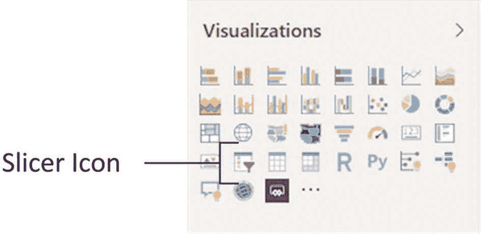

图 22-1 切片器图标

1.  打开 Power BI Desktop 文件 `C:\PowerBiDesktopSamples\CarSalesDataForReports.pbix`。
2.  使用以下字段创建一个表格（以显示使用切片器的效果）：
    -   `CountryName`（来自 Countries 表）
    -   `SalePrice`（来自 InvoiceLines 表）
3.  调整表格大小使其适合数据。
4.  在“字段”列表中，展开 Colors 表。
5.  将 Color 字段拖到仪表板画布的空白区域。它将变成一列表格。
6.  单击“可视化”窗格中的“切片器”图标。颜色表将变为切片器。切片器图标如图 22-1 所示。
7.  使用边角或侧边手柄根据需要调整切片器的大小。如果切片器包含许多元素，Power BI Desktop 将添加一个垂直滚动条以指示还有更多元素可用。

您可以通过列表中每个元素左侧的小方块（或可能为圆圈）来识别切片器。这样您就知道它不仅仅是一列表格。图 22-2 显示了一个使用 Color 字段的切片器。

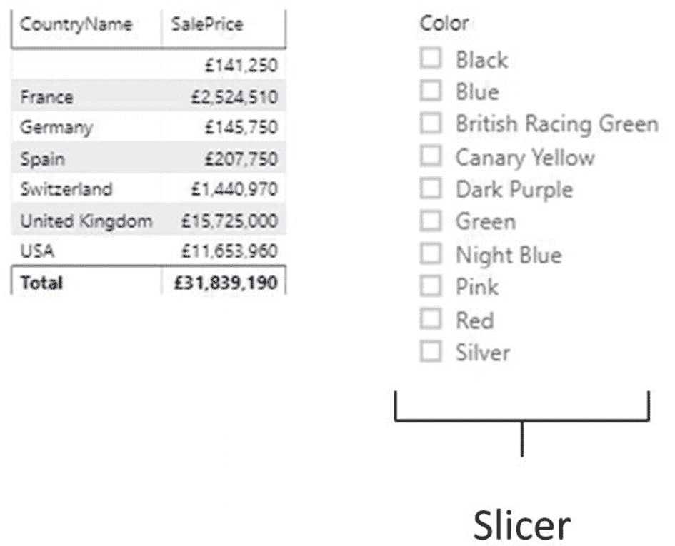

图 22-2 一个切片器

**提示**
如果切片器图标呈灰色，请确保您尝试转换为切片器的表格只有*一*列（即该视觉对象字段井的“值”框中只有一个字段）。

您可以为每个页面创建*多个*切片器。只需重复步骤 3 到 6 来添加切片器，但使用不同的字段作为新切片器的数据。

**注意**
切片器可以设置为一次应用于多个页面。您将在第 24 章学习如何做到这一点。

### 应用切片器

要应用切片器并使用它来筛选页面上的数据，请单击切片器中的单个元素，或按住 Ctrl 键单击多个元素。

Power BI Desktop 页面中的所有对象都会被筛选，以反映当前选定的切片器列表。此外，切片器列表中处于活动状态（因此用于按该元素筛选数据）的每个元素现在其左侧都有一个小的矩形，表示该元素已被选中。

图 22-3 显示了先前定义的切片器应用于图 22-2 所示的可视化效果时发生的情况。

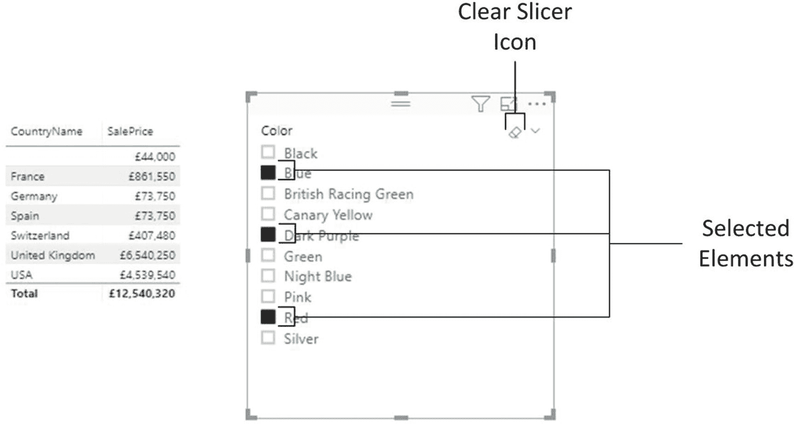

图 22-3 应用切片器

当您应用切片器时，请将其视为筛选器。也就是说，如果您从一个基于 `CountryName` 字段的切片器中选择两个元素，同时从另一个基于 Color 字段的切片器中选择三个元素，那么您将强制两个切片器（筛选器）将页面中显示的所有数据限制为您选择的三种颜色中任意一种所对应的两个国家。切片器和筛选器之间的核心区别在于，切片器始终可见——并且您需要选择或取消选择元素，而不是值范围。

如果您进行试验，还会发现无法从源数据中的数字字段创建切片器。切片器必须基于文本字段。如果您需要基于数据范围的切片器，则需要在数据模型中准备这些范围。`CarAgeBucket` 字段就是一个这样的例子。

**提示**
如果您按住 Ctrl 键单击切片器中所有已选定的元素，则可以取消选择它所代表的所有数据。但是，这不会清除 Power BI Desktop 报表。取消选择所有内容与选择所有内容相同——尽管切片器中每个元素左侧的选择方块不再可见。但是，使用 Shift 键单击与单击切片器元素没有区别。

### 清除切片器

要清除切片器并停止对视图中选定数据元素的筛选，请单击切片器右上角的“清除切片器”图标。该图标在图 22-3 中指出。

由切片器应用于视图的任何筛选器现在都将被移除。您将看到切片器列表中的每个元素现在左侧都有一个小的空矩形，表示该元素未被选中。报表中的数据现在不会被筛选掉。

**提示**
另一种完全清除切片器的技术是单击（或按住 Ctrl 键单击）切片器中最后一个仍在活动的元素。这会使所有元素都变为非活动状态。此外，您可以按住 Ctrl 键单击以选择所有项目。因此，实际上，移除所有切片器元素与激活所有元素效果相同。


### 删除切片器

要删除切片器并移除其应用于某个视图的所有筛选器，请选中该切片器并按 `Delete` 键。或者，单击鼠标指针悬停在切片器上时右上角出现的上下文菜单按钮（省略号），然后选择 `删除`。

切片器应用于视图的所有筛选器以及切片器本身都会被移除。

如果愿意，你甚至可以复制并粘贴切片器。当你需要在不同的 Power BI Desktop 报表或报表页面之间复制切片器时，这非常有用。

#### 将切片器转换为其他可视化类型

如果你打算在表格或图表中使用作为切片器基础的字段，则无需删除切片器并基于同一基础字段重新创建表格。你只需：

1. 选中该切片器。
2. 单击“设计”功能区中的 `表格` 按钮，然后选择要转换切片器到的表格类型（表格、矩阵或卡片）。

一旦切片器变为表格，它就不再对 Power BI Desktop 报表中的数据进行子集划分。

### 修改切片器

如果你只想将切片器中使用的字段替换为另一个字段，那么最简单的方法可能是这样做：

1. 选中要修改的切片器。
2. 将新字段拖到字段井中的现有字段上。

当前切片器字段会被新字段替换，并且切片器会更新以显示你添加的字段内容。或者，你也可以删除切片器并重新创建。

当你开始在 Power BI Desktop 报表中应用切片器时，你会迅速注意到 Power BI Desktop 筛选器层次结构的一个重要方面。切片器只能显示未被报表级或页面级筛选器明确排除的数据。例如，如果你在页面级别添加了一个 `Color` 筛选器，并仅在此筛选器中选择某些颜色，那么你将只能创建一个显示此颜色子集的切片器。切片器是动态的，它反映了在应用了任何报表和页面筛选器后可以显示的元素——就像任何其他可视化对象一样。因此，在筛选器中添加或移除元素会导致这些元素在基于该筛选字段的切片器中出现（或消失）。

如果愿意，你可以专门为切片器应用筛选器。这允许你限制切片器中显示的元素。如果你想这样做，那么你必须在前面示例的步骤 3 之后、将表格转换为切片器*之前*应用筛选器。但请注意，切片器本身*不会*给出任何正在被筛选的提示；也就是说，`筛选器`井中不会显示视觉级筛选器。

相反，要从切片器中移除筛选器，你需要将其切换回表格，移除筛选器，然后再切换回切片器。

> **提示**
> 当你保存包含带有活动切片器的 Power BI Desktop 报表的 Power BI Desktop 文件时，切片器会以保存时的状态重新打开。

## 日期切片器

选择日期范围可以扩展切片器的外观和实用性。由于实际操作可能更容易理解这一点，我建议你尝试以下步骤：

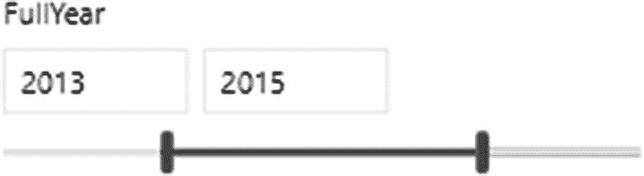
*图 22-4：按年份切片*

1. 打开示例文件 `C:\PowerBiDesktopSamples\CarSalesDataForReports.pbix`。
2. 在 `可视化` 窗格中，单击 `切片器` 图标。一个空的切片器将被添加到报表画布中。
3. 展开 `DateDimension` 表，并勾选 `FullYear` 字段（或将 `FullYear` 字段拖入新创建的切片器中）。
4. 将左侧（下限）阈值向右拖动，直到左侧年份字段显示 `2013`。
5. 将右侧（上限）阈值向左拖动，直到右侧年份字段显示 `2015`。切片器将如图 22-4 所示。页面中的任何数据都将被筛选，以排除此年份范围之外的数据。

如果你愿意，可以直接在此类切片器的某个年份字段中输入年份。但我认为这类切片器的用处恰恰在于它能够使用滑块快速轻松地更改阈值。

如果你使用设置为*日期类型*的数据字段，那么切片器可以帮助你快速轻松地设置日期，但方式略有不同。操作如下：

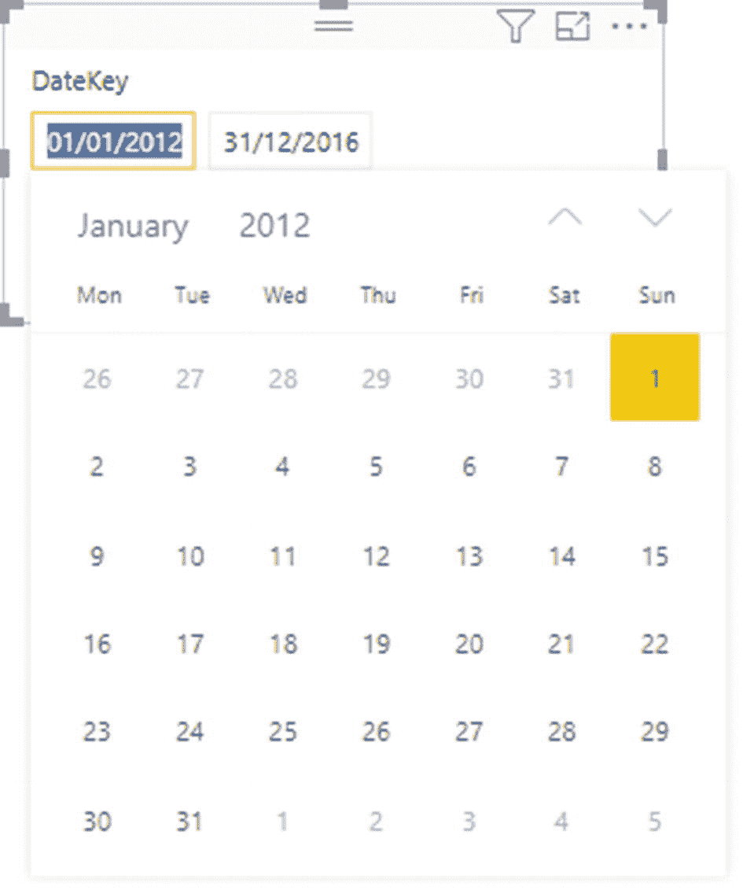
*图 22-5：日期切片器*

1. 在 `可视化` 窗格中，单击 `切片器` 图标。一个空的切片器将被添加到报表画布中。
2. 展开 `DateDimension` 表，并勾选 `DateKey` 字段。
3. 单击其中一个日期字段内部。切片器将如图 22-5 所示。
4. 选择要设置为日期阈值的日期。

为了充分利用此日历，你需要了解一些技巧：

- 单击上下 V 形符号可显示下个月或上个月。
- 单击日历弹出窗口中的年份可显示年份列表。您可以从中选择所需的年份。
- 单击日历弹出窗口中的月份可显示月份列表。您可以从中选择所需的月份。
- 您不能选择小于下限日期的上限日期。
- 此日历*允许*您选择基础日期表中未包含的日期。然而，这可能会导致报表中出现一些意想不到的结果。

> **注意**
> 日期维度中的某些字段（有时可能意味着大多数字段）被视为简单选择元素。因此，例如，在切片器中使用 `MonthFull` 字段将会产生一个月份列表，而没有滑块。最好的做法是试验 `DateDimension` 表中可用的各种字段，并使用最适合您目的的字段。

## 格式化切片器

切片器可以像任何其他 Power BI Desktop 可视化对象一样进行格式化。实际上，用于格式化切片器的许多技术与您在格式化表格和矩阵时已经见过的技术完全相同。因此，为了避免无意义的重复，本节将专注于任何特定于切片器的格式属性，并且仅顺便提及您在前几章中已经学过的格式化方法。

### 切片器方向

为了帮助您充分利用报表空间，切片器可以配置为垂直显示（如图 22-2 所示）或水平显示。要切换切片器的方向：

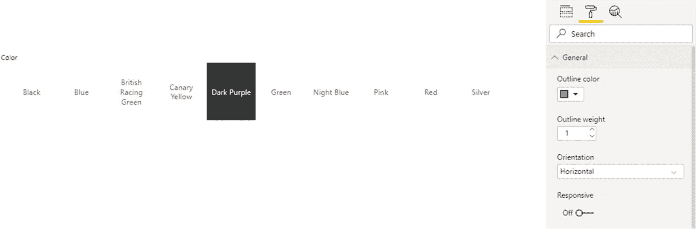
*图 22-6：水平切片器*

1. 选择要修改的切片器。（我选择了您之前创建的 Color 切片器。）
2. 在 `可视化` 窗格中，单击 `格式` 图标。
3. 展开 `常规` 部分。
4. 在 `方向` 弹出菜单中，选择 `水平`。
5. 调整切片器大小以适合您的仪表板。水平切片器看起来类似于图 22-6 所示。

正如您在图 22-6 中看到的，水平切片器没有垂直切片器所具有的小复选框。因此，当选择一个水平切片器元素时，整个元素会以“反色”显示。

您可能还注意到，当您调整切片器大小时，Power BI Desktop 会更改文本行数以及文本元素的宽度。因此，强烈建议您在更改切片器高度和宽度时进行试验，以获得最适合您的效果。


### 切片器响应式调整

在上一节中，你调整了切片器的大小，以便将所有可用选项容纳到单行中。不过，显示切片器时还有另一个可用选项，即让所有选项元素自动调整，以占满切片器中的所有可用空间。以下是这种做法的示例：

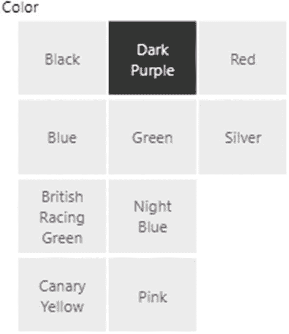

图 22-7：水平切片器

1.  选中要修改的切片器（我将继续使用你之前创建的“颜色”切片器）。
2.  在“可视化”窗格中，单击“格式”图标。
3.  展开“常规”部分。
4.  将`Responsive`（响应式）按钮设置为`On`（开启）。
5.  调整切片器大小。你将看到，只要切片器元素能全部容纳，它们就会改变以占满可用空间。此时切片器将类似于图 22-7 所示。

> **注意：** 如果切片器元素无法容纳在切片器内，你将看到一个 V 形标记，表示可以滚动查看可用元素。

### 修改轮廓线

在 Power BI Desktop 中，轮廓线是指切片器中分隔标题与项的那条线。以下介绍如何格式化这一特定元素：

1.  选中要修改的切片器（我使用了你之前基于文件 `CarSalesDataForReports.pbix` 创建的“水平颜色”切片器）。
2.  在“可视化”窗格中，单击“格式”图标。
3.  展开“常规”部分。
4.  使用`Outline weight`（轮廓线粗细）滑块将轮廓线粗细设置为 3 磅。
5.  单击`Outline color`（轮廓线颜色）弹出窗口并选择一种颜色。分隔线将随之变化，以反映你所做的修改。

### 调整选择控件

如果你对 Power BI Desktop 在切片器中选择项目的方式不满意，可以调整与此特定视觉对象的交互方式。虽然 Power BI 的默认交互模式在大多数情况下可能已足够，但了解切片器中还有其他选择元素的方式肯定没有坏处。

#### 添加或删除“全选”复选框

你可以按如下方式向切片器添加`Select all`（全选）复选框：

1.  选中要修改的切片器（我使用了你之前创建的原始垂直颜色切片器）。
2.  在“可视化”窗格中，单击“格式”图标。
3.  展开“选择控件”部分。
4.  将`Select all`（全选）开关滑动到`On`（开启）位置。这将在切片器的顶部（或左侧）添加一个`Select all`（全选）项。

如果你*不*希望切片器中存在`Select all`（全选）项，只需确保在第 4 步中将`Select all`（全选）开关设置为`Off`（关闭）即可。

#### 启用多选

切片器的默认模式是仅选择单个项目。只要`Multiselect`（多选）处于激活状态（默认即激活），这并不妨碍你在切片器中选择多个项目。如果需要激活——或停用——`Multiselect`（多选），请按以下步骤操作：

1.  选中要修改的切片器（我使用了你之前创建的原始垂直颜色切片器）。
2.  在“可视化”窗格中，单击“格式”图标。
3.  展开“选择控件”部分。
4.  将`Multiselect with Ctrl`（按住 Ctrl 键多选）开关滑动到`On`（开启）位置。这将允许选择多个切片器元素。

#### 启用单选

切片器的默认模式是仅选择单个项目，除非用户按住`Ctrl`键并单击多个项目。如果你希望一次只添加一个项目（并逐一取消激活它们），可以启用`Single select`（单选）来实现。只需按照以下步骤操作：

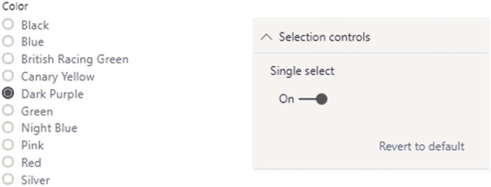

图 22-8：更改切片器的选择控件

1.  选中要修改的切片器（我使用了你之前创建的原始垂直颜色切片器）。
2.  在“可视化”窗格中，单击“格式”图标。
3.  展开“选择控件”部分。
4.  将`Single select`（单选）开关滑动到`On`（开启）位置。这将把切片器交互设置为单选模式。你可以在图 22-8 中看到此操作的结果，其中切片器的复选框已变为单选按钮。

> **注意：** 将`Single select`（单选）设置为`On`（开启）会使`Multiselect`（多选）和`Select all`（全选）选项从“格式”窗格中消失。

### 设置切片器的精确尺寸及 X、Y 坐标

如果你希望将切片器精确地放置在仪表板画布上，则可以设置切片器的`X`和`Y`（水平和垂直）坐标。你也可以指定其精确的高度和宽度。具体操作方法如下：

1.  选中要修改的切片器。
2.  在“可视化”窗格中，单击“格式”图标。
3.  展开“常规”部分。
4.  将`X Position`（X 位置）、`Y Position`（Y 位置）、`Width`（宽度）和`Height`（高度）的值替换为你希望应用的、定义切片器大小和位置的像素值。

### 格式化切片器标题

如果你想为切片器增添一些视觉上的吸引力，可以调整切片器标题的显示效果。这可以作为对用户有用的视觉提示，帮助他们将切片器与其他视觉对象区分开来。以下是一个操作示例：

1.  选中要修改的切片器（我使用了你之前创建的水平颜色切片器）。
2.  在“可视化”窗格中，单击“格式”图标。
3.  展开“切片器标题”部分。
4.  确保`Header`（标题）开关处于`On`（开启）位置。
5.  单击`Font color`（字体颜色）弹出窗口，为标题文本选择一种颜色。
6.  单击`Background color`（背景颜色）弹出窗口，为标题背景选择一种颜色。
7.  调整`Text size`（文本大小）以微调标题文本的尺寸。

### 格式化切片器项

切片器项是构成切片器中数据列表的单个元素，这些元素基于基础字段。同样，也可以对它们进行格式化，以吸引读者的注意力。示例如下：

1.  选中要修改的切片器（继续使用上一节中使用的颜色切片器）。
2.  在“可视化”窗格中，单击“格式”图标。
3.  展开“项”部分。
4.  单击`Font color`（字体颜色）弹出窗口，为项目文本选择一种颜色。
5.  单击`Background color`（背景颜色）弹出窗口，为每个项目的背景选择一种颜色。
6.  调整项目的`Text size`（文本大小）。
7.  单击`Outline`（轮廓）弹出窗口，选择`Frame`（框架）。

你还可以格式化切片器的以下方面：

-   背景
-   标题
-   锁定纵横比

不过，由于所有这些都与适用于表格和图表的格式化属性相同（并且你已在之前章节中看到过），因此我将不再重复描述。

最后，图 22-9 向你展示了一个应用了你刚才看到的许多格式化选项的切片器。

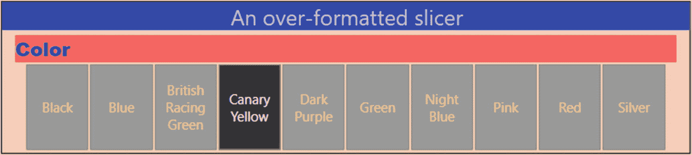

图 22-9：格式化后的切片器

### 对切片器元素进行排序

切片器中的元素默认按字母顺序显示。如果你愿意，可以颠倒此排序顺序，具体操作如下：

1.  单击切片器右上角的省略号。
2.  选择`Sort by color`（按颜色排序）（或任何字段名称）。

此时切片器元素将按字母逆序显示。

> **提示：** 你可以为希望以其他排序顺序显示的任何数据字段添加`Sort by column`（按列排序）。


### 切换为下拉切片器

`切片器`非常有用，但有一个缺点：它们会占用大量宝贵的屏幕空间。因此，微软开发团队提出了一种优雅的解决方案，即使用下拉切片器。在这种模式下，切片器元素仅在点击弹出菜单时才会显示。

将现有切片器转换为下拉切片器：

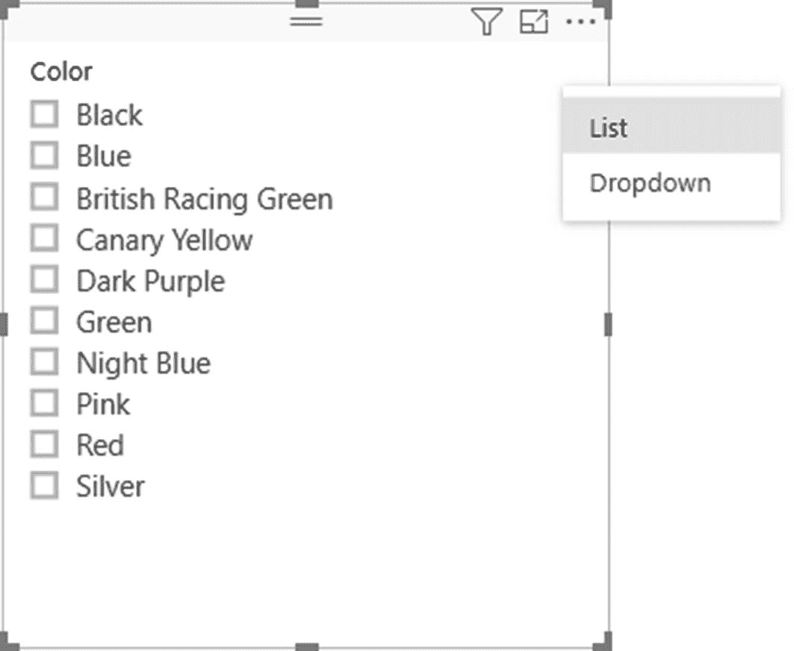

图 22-10 — 切换为下拉切片器

1. 选择一个现有的切片器（或将鼠标指针悬停在它上面）。我将使用本章中一直使用的颜色切片器。
2. 点击右上角“清除选择”图标旁边的 V 形符号。将出现一个弹出菜单，如图 22-10 所示。

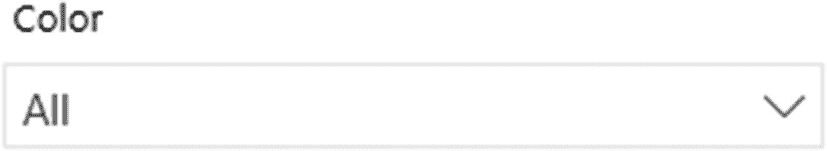

图 22-11 — 一个下拉切片器

3. 选择 `下拉`。切片器将转换为下拉切片器。图 22-11 显示了它现在的样子。
4. 点击切片器弹出列表的 V 形符号，选择要据此切片数据的元素。

> **提示**  
> 在为手机设计 Power BI 报表时，下拉切片器尤其有用。

### 导出切片器数据

切片器数据可以像任何其他视觉对象中的数据一样导出：

1. 点击切片器右上角的省略号。
2. 选择 `导出数据`。
3. 浏览到所需目录并输入文件名。
4. 点击 `保存`。

## 使用图表作为切片器

您已经了解了表格如何成为切片器（一种筛选器）。实际上，图表也可以用作切片器。了解图表如何影响 Power BI Desktop 报表中的数据，甚至可能影响您创建的图表类型，或您决定使用图表而非标准切片器来筛选数据。图表可以作为吸引和保持观众注意力的绝佳工具——在您看到它们能产生的效果后，我相信您也会同意这一点。

### 图表作为切片器（交叉筛选）

首先，让我们看看图表如何充当切片器，来为 Power BI Desktop 报表中的任何一个或所有可视化对象交互式地筛选数据。此技术也称为*交叉筛选*。最初，我们假设目标是使用两个对象生成一个报表：

- 一个按颜色显示“成本加备件”的表格
- 一个按制造商显示“备件”的柱形图

让我们创建一个 `按颜色净毛利` 的表格。它主要用于展示在 Power BI Desktop 报表中将图表用作切片器对其他对象产生的影响。作为额外练习，您还将向页面应用一个筛选器，以演示筛选器和切片器如何协同工作，如下所述。

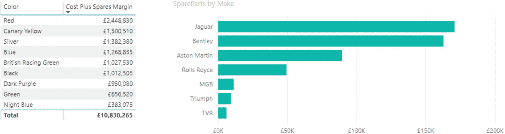

图 22-12 — 准备将图表用作切片器

1. 打开 `C:\PowerBiDesktopSamples\CarSalesDataForReports.pbix` 文件，并添加一个新的空白页。为此示例，您需要一个完全没有杂乱元素的仪表板页面。
2. 添加一个基于以下字段的表格：
   1. `颜色`（来自“颜色”表）
   2. `成本加备件`（来自“发票行”表）
3. 添加一个基于以下字段的条形图：
   1. `制造商`（来自“库存”表）
   2. `备件`（也来自“库存”表）
4. 调整两个可视化对象的布局，使其看起来类似于图 22-12。

要了解如何使用图表作为切片器，请点击按制造商分组的备件成本图表中的任意柱形。在此示例中，我将选择 `捷豹`。

Power BI Desktop 报表看起来将类似于图 22-13。

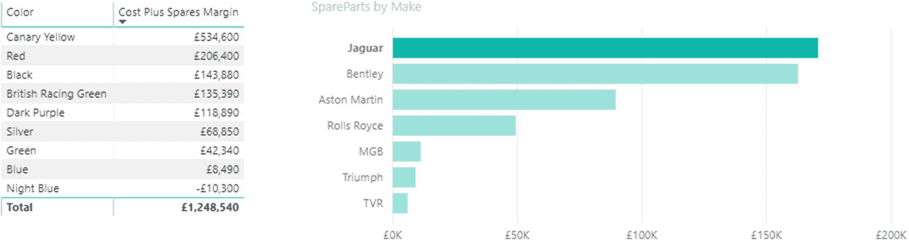

图 22-13 — 使用图表切片数据

您会看到，不仅所选制造商在图表中被突出显示（其他制造商的条形图变暗），而且表格中的数据也会发生变化。它们也仅显示所选制造商的“成本加备件”（按每种颜色）。

要对另一个制造商进行切片，只需点击柱形图中对应的柱形即可。要取消图表作为切片器的效果，您只需*再次*点击已突出显示的柱形。

任何条形图、饼图或柱形图都可以像这样充当切片器，漏斗图、树状图、散点图、气泡图和地图也是如此。核心因素是，要实现简单的切片效果，您需要使用仅包含一个轴的图表；也就是说，源数据中只有一个轴，没有颜色或图例。接下来将解释当您使用更复杂的图表进行切片、筛选和突出显示数据时会发生什么。

> **提示**  
> 完全可以像在切片器中选择多个元素一样，在图表中选择多个柱形来突出显示数据。只需按住 `Ctrl` 键并点击即可选择多个项目。

## 突出显示图表数据

到目前为止，我们已经看到图表如何成为仪表板页面中所有可视化对象的切片器。但是，您还可以利用 Power BI Desktop 交互性的另一个方面，在展示发现时使图表中的数据系列更加突出。数据呈现的这个特定方面被称为*突出显示*。

同样，通过一个实际示例可能最能理解突出显示。首先，我们将创建一个按 `国家名称` 分组的零件和人工成本堆叠条形图；然后，我们将使用它来突出显示图表中的各项成本。

1. 在一个空白的 Power BI Desktop 报表中（以免分心），创建一个基于以下字段的簇状柱形图：
   1. `国家名称`（来自“国家”表）
   2. `备件`（来自“库存”表）
   3. `人工成本`（来自“库存”表）
2. 点击*图例*中的 `备件`。每个国家/地区的柱形中，所有销售成本都会被突出显示（即保持原始颜色），而其他成本则会变灰。

应用突出显示后，图表将如图 22-14 所示。

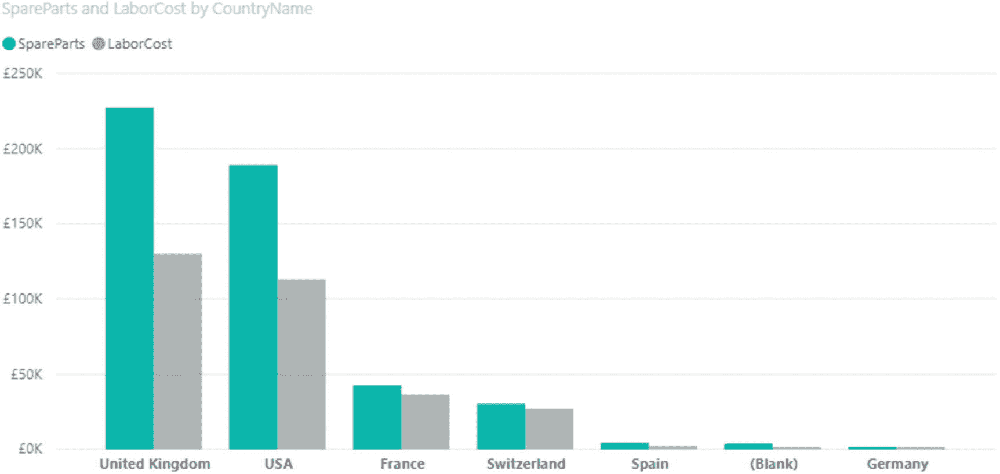

图 22-14 — 在图表内突出显示数据

要移除突出显示，您只需再次点击图例中的同一元素。或者，您也可以点击另一个图例元素来突出显示可视化对象的其他方面。另一种移除突出显示的方法是点击图表内部，但不要点击任何数据元素。

以这种方式突出显示数据应适用于任何类型的条形图或柱形图，以及折线图。对于同时向“轴”和“图例”框添加了数据的饼图，这也很有用，因为这意味着图表中有多个元素，就像条形图、柱形图和折线图一样。您可能会发现它在散点图中用处不大。


## 跨图表突出显示

`跨图表突出显示`为图表的突出显示和筛选功能增添了有趣的额外维度。若将一个图表用作筛选器，另一个图表会随之更新，以反映应用此新筛选器的效果：不仅会排除被筛选掉的所有元素（扇形区、条形或柱形），还会显示被筛选器排除的数据所占的比例。

举例来说，使用文件 `CarSalesDataForReports.pbix` 创建一个按颜色划分的成本价饼图和一个按车辆类型划分的直接成本柱形图。然后，我们对这两个图表进行交叉筛选，并查看结果。具体步骤如下：

1.  使用以下字段创建一个饼图：
    1.  `Color`（来自“Colors”表）
    2.  `CostPrice`（来自“Stock”表）

2.  使用以下字段创建一个（簇状）柱形图：
    1.  `Vehicle`（来自“Stock”表）
    2.  `CostPrice`（来自“Stock”表）

    对于如此简单的图表，一旦源表被转换为图表，Power BI Desktop 会自动将这些字段归入“字段”列表中正确的框中。结果如图 22-15 所示。

    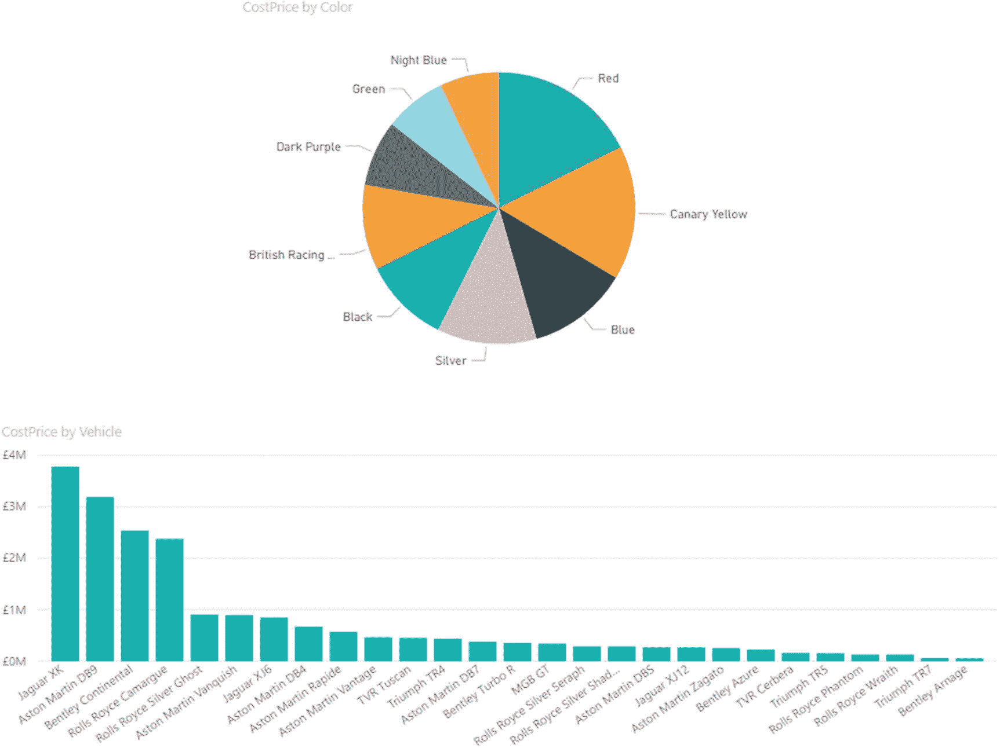

    **图 22-15：** 准备用于跨图表突出显示的图表

    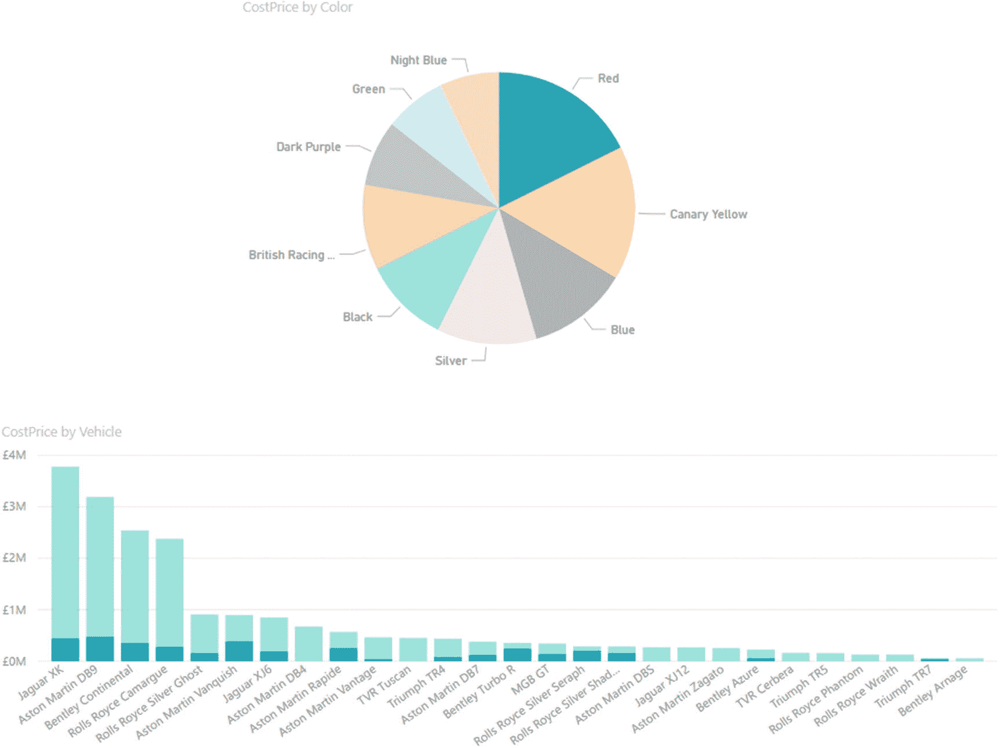

    **图 22-16：** 跨图表突出显示

3.  现在，单击饼图中的一个扇形区（我选择了“红色”）。您应该会看到图 22-16 所示的结果。饼图中所有其他扇区不仅变暗了，而且柱形图中的柱体也已被突出显示，以显示所选颜色在每辆车成本总销售额中所占的比例。

    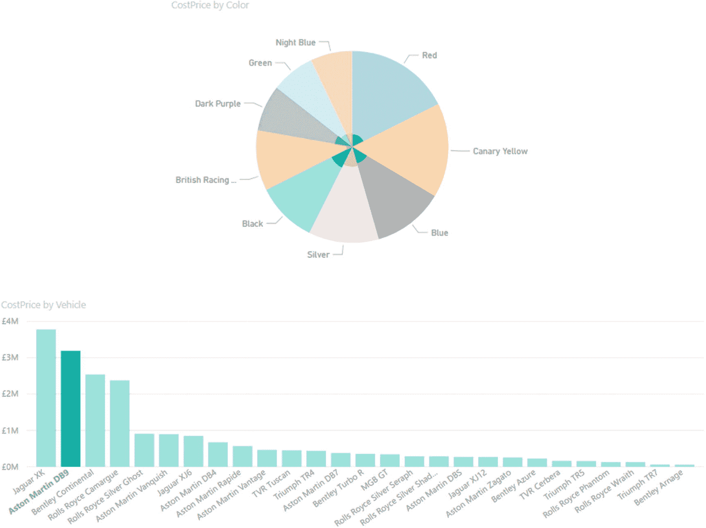

    **图 22-17：** 应用于饼图的跨图表突出显示

4.  现在，单击柱形图中代表“Aston Martin DB9”的柱体。此时您正将柱形图用作一个切片器。如图 22-17 所示，饼图显示了每种颜色的“Aston Martin DB9”销售额所占的比例。

> **注意：** 当您使用筛选器时，并非只是突出显示图表，而是实际筛选了提供给图表的数据；因此，您会从图表中移除元素。而突出显示则会在图表中保留元素，但会强调数据中相对于其他部分的某些方面。

### 在气泡图中突出显示数据

在设计可视化项时，其主要目标归根结底是帮助您穿透数据迷雾，抵达理解、利润或任何分析焦点的阳光高地。但您可能会常感到“只见树木，不见森林”。这正是 Power BI Desktop 在图表可视化中突出显示数据的能力能够如此有效之处。

让我们以一个包含大量信息的可视化项为例：本例中是一个车辆类型的气泡图。确实，在此示例中，观众可能会认为数据太多，以至于难以看清特定品牌汽车的气泡，从而无法按品牌分析销售额数据的独特性。Power BI Desktop 提供了一种在此类图表中隔离数据系列的方法。要实际查看此功能并让细节更清晰，您需要按以下步骤操作：

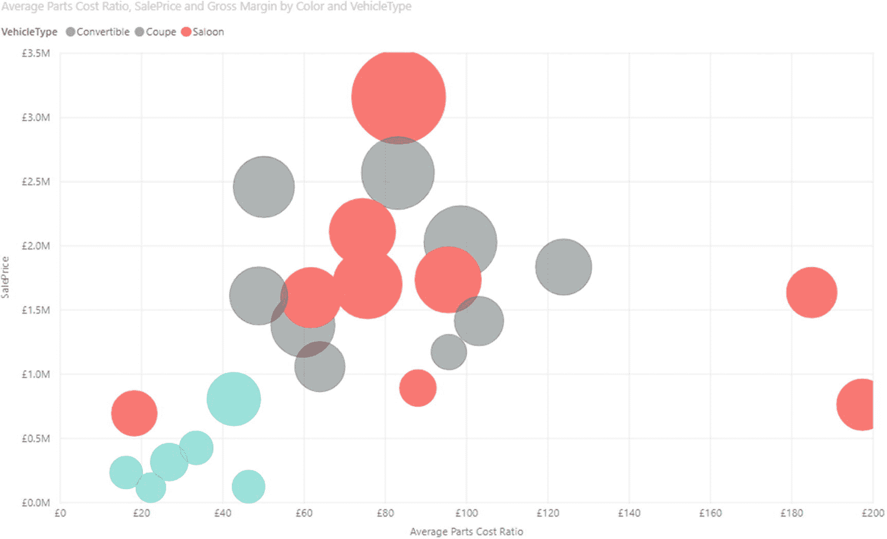

**图 22-18：** 在气泡图中突出显示数据

1.  使用文件 `CarSalesDataForReports.pbix`（请记住，这实际上是一个散点图）创建气泡图，使用以下元素：
    -   *X 轴*：`Average Parts Cost Ratio`（来自“Stock”表）
    -   *Y 轴*：`SalePrice`（来自“InvoiceLines”表）
    -   *大小*：`Gross Margin`（来自“InvoiceLines”表）
    -   *详细信息*：`Color`（来自“Colors”表）
    -   *图例*：`VehicleType`（来自“Stock”表）

2.  在图表的图例中，单击一个车辆类型。在本例中，我使用了“saloon”（英式英语，指轿车）。该车辆类型的数据在图表中被突出显示，而所有其他车辆类型的数据则变暗，从而使一组信息脱颖而出。如图 22-18 所示。

此技术需要注意以下几点：

-   要突出显示另一组数据，只需在图例中单击另一个元素。
-   要恢复显示所有数据，请再次单击图例中已选中的元素。
-   如上所述，以这种方式突出显示数据也会筛选整个页面上的数据。

> **提示：** 您可以为图表添加向下钻取功能，并且仍可像平常一样使用图表突出显示功能，前提是您已按照第 16 章所述，禁用了通过图表元素进行的向下钻取。在这种情况下，您必须使用“钻取”图标来向下（以及向上）钻取。该图表会在钻取层级或子层级突出显示某个元素，同时将筛选应用于 Power BI Desktop 报表。


## 图表作为复杂切片器

你已经了解了如何将图表用作切片器，现在让我们更进一步，看看如何将它们用作更复杂的切片元素。为了说明这一点，我将基于前面示例中展示的原理，添加一个气泡图，它能同时基于两个维度对数据进行切片。

请按照以下步骤进行此示例操作：

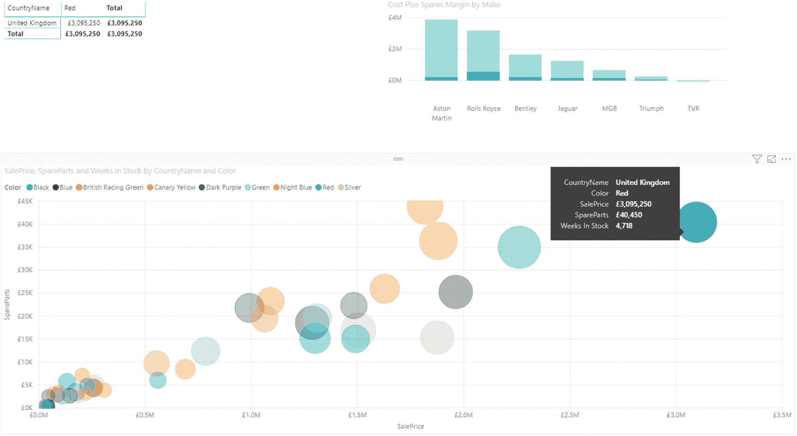

图 22-19  
使用图表进行高亮显示和筛选

1. 创建一个包含以下内容的 Power BI Desktop 报表：
   1. 一个以 `SalePrice` 为值，`CountryName` 和 `Color` 为行列的矩阵
   2. 一个以 `Cost Plus Spares Margin`（来自 `Stock` 表）为值，`Make`（来自 `Stock` 表）为轴的簇状柱形图
2. 使用以下数据创建一个气泡图：
   1. *X 轴*：`SalePrice`（来自 `InvoiceLines` 表）
   2. *Y 轴*：`SpareParts`（来自 `Stock` 表）
   3. *大小*：`Weeks In Stock`（来自 `Stock` 表）
   4. *详细信息*：`CountryName`（来自 `Countries` 表）
   5. *图例*：`Color`（来自 `Colors` 表）
3. 调整气泡图的大小和样式，使其显示在现有的柱形图和表格下方。
4. 单击气泡图中最右侧顶部气泡旁边的气泡。此时 Power BI Desktop 报表应如图 22-19 所示。工具提示会指示哪个气泡被用于筛选其他视觉对象。

你可以看到其他可视化对象已被筛选，构成单个气泡的两个元素（`CountryName` 和 `Color`）都作为筛选器（如果你愿意，也可以称之为双重切片器）生效。这意味着：

- 表格仅显示该国家/地区且该颜色有销售额的颜色数据。
- 图表仅高亮显示该国家/地区和该颜色的数据。

与简单的图表切片器一样，你只需再次单击选中的气泡即可取消筛选效果。或者，通过单击气泡图中的另一个气泡来切换筛选条件。你还会看到图表本身的数据已被高亮显示，但这一点稍后会进一步说明。

显然，你无需在报表的所有可视化对象中都显示你正在筛选和高亮显示的字段。我在此示例中这样做是为了让结果更清晰。在实际应用中，报表中的所有其他可视化对象都将根据气泡图中 `详细信息` 和 `图例` 框中的元素进行筛选。

然而，气泡图并非唯一允许同时应用两个筛选器的图表类型。所有显示多个字段的图表类型都支持此功能。不过，我认为某些图表比其他图表更适合这种特定技术。具体来说，我并不认为折线图总是适合用作 Power BI Desktop 报表的筛选器。散点图如果使用交叉筛选，可能（在视觉上）会有效果，但也同样可能无效。堆叠条形图和堆叠柱形图则非常适合用于交叉筛选，你将在以下部分看到这一点。

### 将柱形图和条形图用作筛选器

柱形图和条形图也可用于同时基于两个元素筛选 Power BI Desktop 报表。唯一的限制是图表的值只能包含一组数值数据。如果条形图或柱形图是堆叠图，则可以单击堆叠条中的任意部分。此外，如果图表是簇状条形图或柱形图，则可以单击一组中的任意柱形，以基于该部分所代表的元素进行切片。

如果这个限制不成问题，那么你可以按照以下步骤使用条形图或柱形图（无论是簇状、堆叠还是 100% 堆叠）为报表应用双重筛选器：

1. 使用 `C:\PowerBiDesktopSamples\CarSalesDataForReports.pbix` 文件创建一个包含以下两个元素的 Power BI Desktop 仪表板：
   1. 一个基于 `Color` 和 `CountryName`（作为行）、`SalesPrice`、`Gross Margin` 和 `CostPrice`（作为值）的矩阵。创建矩阵后，单击层次结构中的“向下展开一级”图标以查看所有层级的数据。
   2. 一个以 `SalesPrice` 为值，`CountryName` 为轴的簇状条形图。
2. 然后使用以下数据创建一个堆叠柱形图：
   1. *值*：`Gross Margin`（来自 `InvoiceLines` 表）
   2. *轴*：`CountryName`（来自 `Countries` 表）
   3. *图例*：`VehicleAgeCategory`（来自 `Stock` 表）

调整图表外观后，最终结果应如图 22-20 所示。

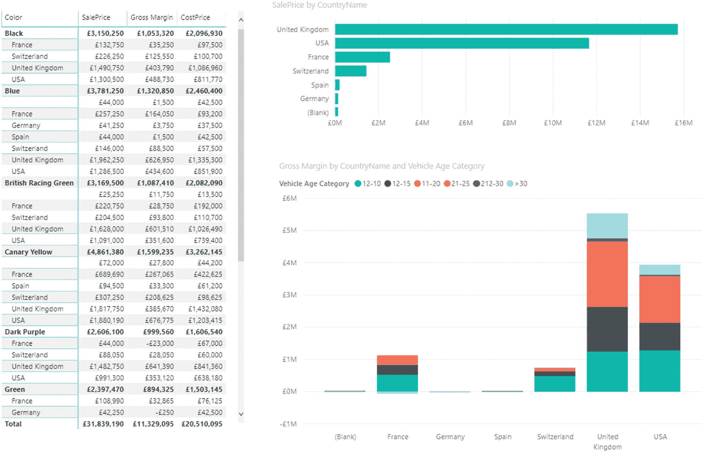

图 22-20  
一个为基于图表的筛选和高亮显示做好准备的报表

单击柱形的任意段会筛选并高亮显示同一报表中针对该国家/地区和车龄范围的其他可视化对象。图 22-21 给出了一个示例，其中为美国柱形选择了 11-20 的车龄范围。

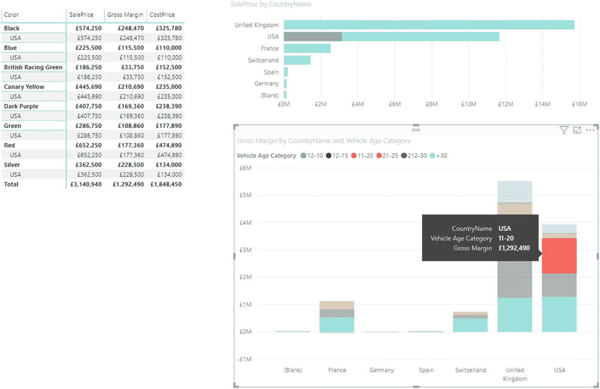

图 22-21  
应用筛选器并高亮显示

单击图例中的任意车龄范围将仅按车龄范围进行筛选。你在图 22-22 中可以看到这一点，其中已选择了图例中的 12-15 项。

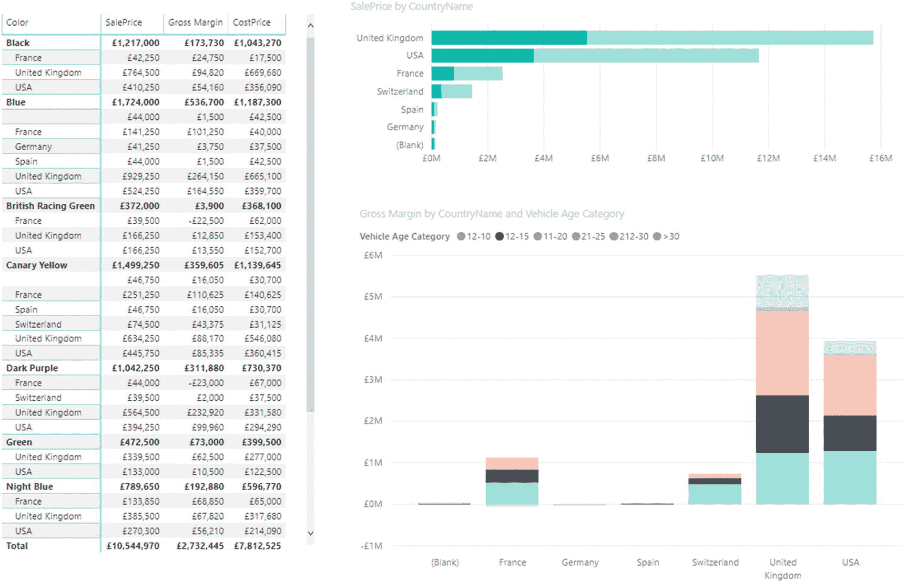

图 22-22  
使用图例元素进行筛选

因此，实际上，您可以根据是将图表还是图例用作筛选源，来选择是筛选单个元素还是多个元素。

**注意：** 仅单击数据点时，折线图不会产生相同的效果。如果单击折线图中的系列，你是在高亮显示该系列，该系列是数值数据，因此不能用作切片器。同样，如果在柱形图或条形图的图例中单击一个元素，你是在选择一个数据系列，这也不能用作切片器（即使它会在图表中高亮显示该系列）。


## 指定视觉交互

在前几节中，您已经看到，在切片器中选择一个或多个项目的影响会自动应用于页面上的每个视觉对象，使用图表作为切片器的效果也是如此。这的确是 Power BI Desktop 的默认行为，除非您特别将某个视觉对象配置为 *不* 对页面上图表或切片器的选中项目做出反应。

实际上，这意味着您可以实现在仪表盘中达到非常高层次的精细度，因为您可以定义哪些视觉对象保持交互性——以及当使用切片器、图表或多个切片器和图表时，哪些视觉对象不得改变。

以下内容说明如何更改默认设置并移除视觉对象的交互性。您需要知道，报表中至少需要有两个视觉对象才能进行此修改。


**图 22-23** 视觉对象的交互图标

1.  选择您希望阻止其对其他视觉对象产生突出显示效果的视觉对象（例如，可以是文本视觉对象、图表视觉对象或切片器）。
2.  在“格式”功能区中，点击`编辑交互`按钮。页面上所有其他视觉对象将显示您在图 22-23 中看到的交互图标（图表中的漏斗和“禁止进入”标志）。

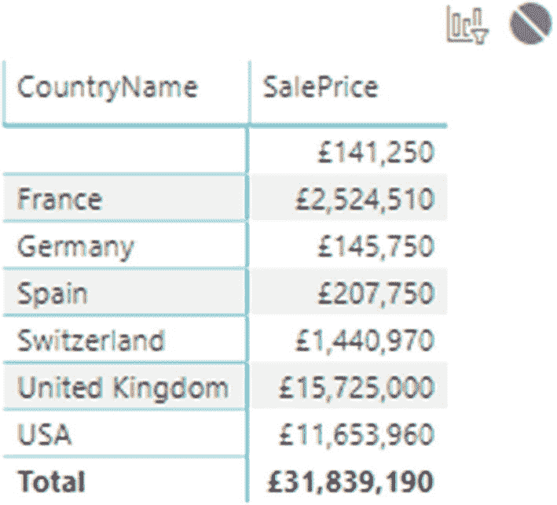

**图 22-24** 设置为阻止交互的视觉交互图标

3.  在另一个可视化对象中点击`停止交互`图标（“禁止进入”标志）。我使用了您之前创建的按国家划分的销售表格。此图标将显示为填充状态，如图 22-24 所示。
4.  对于所有您希望与所选视觉对象“断开连接”的视觉对象，重复步骤 2 和 3。
5.  在“开始”功能区中，点击`编辑交互`按钮以停止视觉交互的配置。这将保留现有的交互设置，但阻止交互图标的显示。

然后，您可以遍历页面上的所有图表和切片器，以设置它们对另一个元素的依赖关系。

> **注意：** 切片器也可以链接到页面上的另一个切片器或依赖于它。因此，您可以像设置任何其他视觉对象一样设置切片器的交互。

## 假设分析切片器

Power BI Desktop 中一个非常有趣（且相对较新）的功能是使用假设分析切片器与数据进行交互。这允许您定义变量值，然后将其应用于数据模型中您选择的任何字段。然后，您可以在屏幕上的滑块中调整假设分析值，并实时观察计算值的变化。

如果您亲自尝试，就能最好地理解此功能。以下是假设分析切片器的一个示例。假设您希望使用文件 `CarSalesDataForReports.pbix` 查看如果供应商提高备件成本，毛利率会发生什么变化。

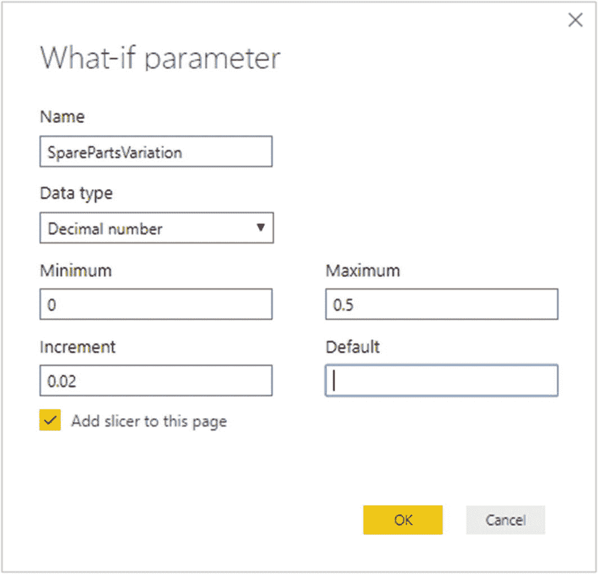

**图 22-25** 假设分析参数对话框

1.  在“建模”功能区中，点击`新建参数`按钮。
2.  在`名称`框中输入 `SparePartsVariation`。
3.  从`数据类型`弹出列表中选择`十进制数`作为数据类型。
4.  将最小值保留为 0，并将最大值输入为 `0.5`（50%）。
5.  将增量设置为 `0.02`（2%）。对话框将类似于图 22-25 所示。

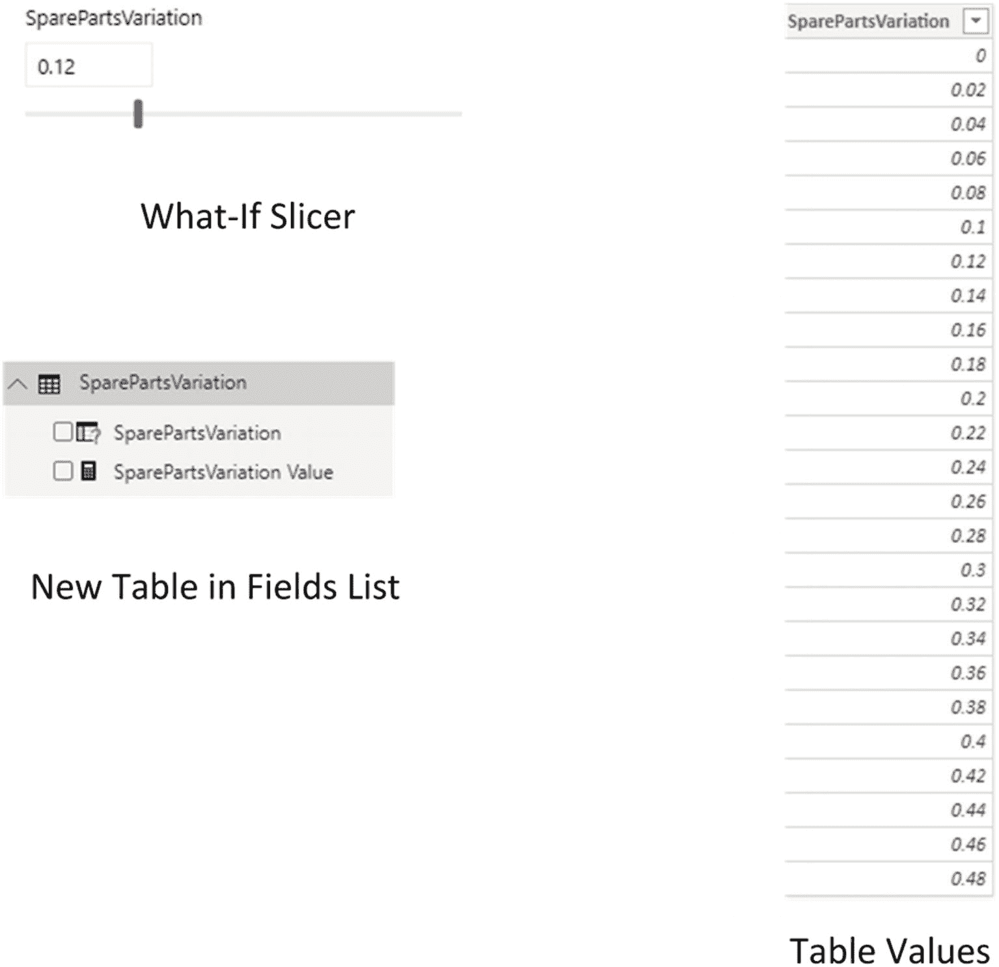

**图 22-26** 一个假设分析切片器

6.  点击`确定`。Power BI Desktop 将向数据模型添加一个名为 `SparePartsVariation` 的新表，并向桌面画布添加一个切片器。调整切片器大小后，您可以在图 22-26 中看到这些内容以及新表中的数据（来自数据视图）。

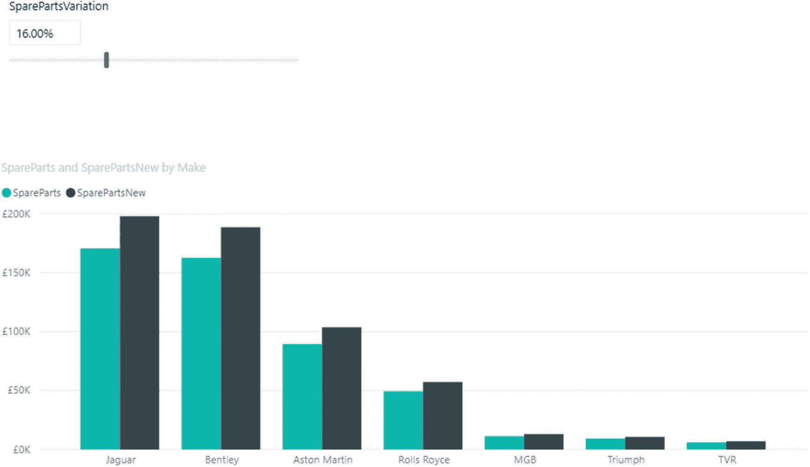

**图 22-27** 应用于图表的假设分析切片器

7.  点击字段列表中的 `Stock` 表，然后点击“开始”或“建模”功能区中的`新建度量值`。
8.  在公式栏中输入以下公式（这将使用假设分析切片器中的乘数来计算新的备件成本）：

    ```
    SparePartsNew = SUM(Stock[SpareParts]) + (SUM(Stock[SpareParts]) * 'SparePartsVariation'[SparePartsVariation Value])
    ```

9.  点击公式栏上的复选框以确认新列的创建。如果您选择 `SparePartsVariation` 表，则可以在数据视图中看到此列。
10. 使用以下字段创建一个簇状柱形图：
    -   `Make`（来自 `Stock` 表）
    -   `SpareParts`（来自 `Stock` 表）
    -   `SparePartsNew`（来自 `SparePartsVariation` 表）
11. 调整滑块以应用备件成本的新增长百分比。生成的图表和切片器将类似于图 22-27 中的样子（我已将 `SparePartsVariation` 格式化为以百分比显示）。

您在假设分析切片器基础表中添加的值可以是固定值、百分比——任何您喜欢的内容。此外，您可以根据假设分析值创建任意数量的新度量值。

> **注意：** 您在步骤 8 中输入的内容是一小段 DAX 代码。不幸的是，本书的范围不包括介绍 DAX。

## 用作切片器的自定义视觉对象

有许多优秀的第三方视觉对象可用作切片器。本节为您提供一些目前可用的第三方切片器的要点。这些只是您可以找到的一小部分切片器。我再次将选择范围限制为由 Microsoft 开发的第三方视觉对象。

以下各节中解释的所有第三方切片器都可以使用您在第十九章中看到的技术添加到 Power BI Desktop 文件中。

## 时间线切片器

时间线切片器允许您拖动日期范围的上限和下限。您还可以定义要交互使用的日期元素（年、季度、月、周或日）。您可以在图 22-28 中看到这一点，其中的时间线切片器正在使用 `DateDimension` 表中的 `DateKey` 字段。

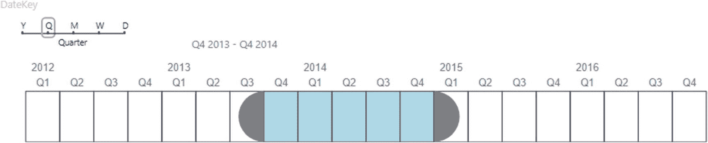

**图 22-28** 时间线切片器

时间线切片器允许您指定：

-   您希望从时间层次结构中显示的详细程度（年级别、季度级别、月级别、周级别或日级别）
-   您通过左右拖动数据范围端点指定的可视数据范围

### 时间刷切片器

时间刷切片器允许您突出显示按时间排序的数据集的一个部分。您可以在图 22-29 中看到这一点，选择时间范围已经过滤了表格。这种方法允许您“聚焦”于切片器中表达的潜在有趣数据，并查看在其他视觉对象中显示的详细信息。

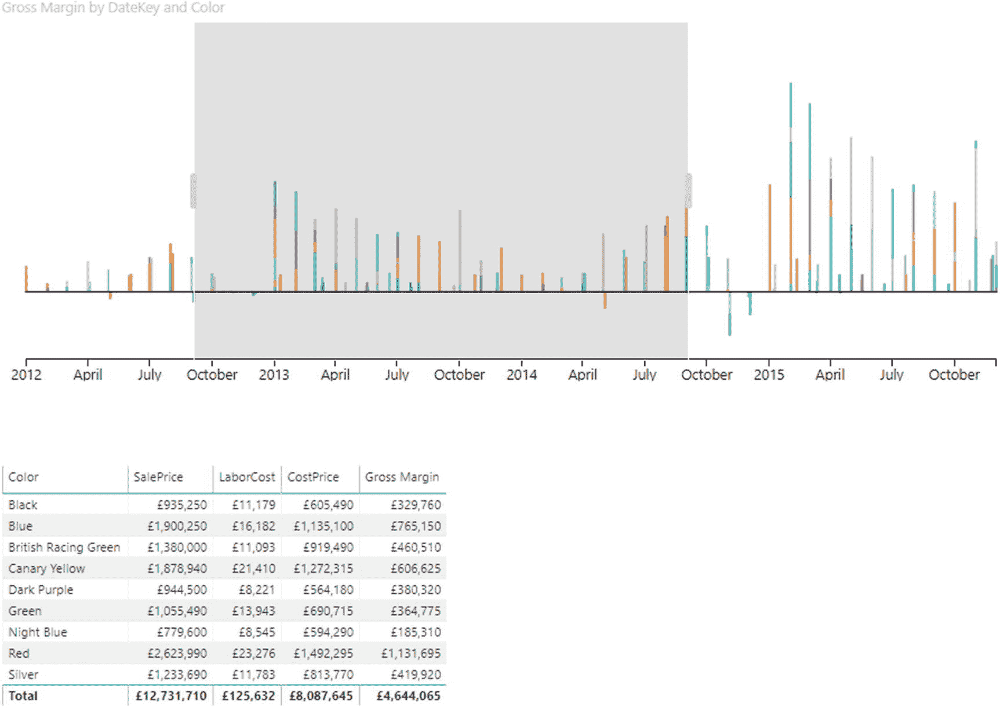

**图 22-29** 时间刷切片器


### 切片器（Chiclet Slicer）

`切片器（Chiclet Slicer）`是一种可以以多种方式排列和格式化的切片器。图 22-30 展示了一个简单示例。

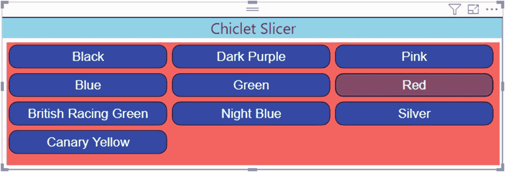

*图 22-30 切片器*

这种特殊的切片器确实提供了丰富的选项。我强烈建议您查看其所有功能。为了吊起您的胃口，值得注意的一点是，您可以：

- 指定已选和未选元素的颜色
- 定义元素的标准高度和宽度
- 为元素添加图像

### 文本筛选器（Text Filter）

`文本筛选器（Text Filter）`是一种切片器，它允许您输入文本——该文本不必是完整单词，甚至不必匹配字段中的任何完整单词——以交互方式筛选文本。您可以在图 22-31 中看到文本筛选器及其应用结果（通过点击放大镜图标）。

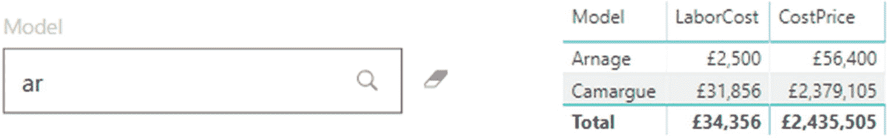

*图 22-31 运行中的文本筛选器*

## 选择正确的交互式数据选择方法

既然您已经了解了 Power BI Desktop 提供的交互式选项，那么值得记住的是，切片器和图表筛选器之间存在一个根本区别：

- 除非您调整了所选切片器与其应（或不应）影响的视觉对象之间的视觉交互，否则切片器和图表筛选器将应用于 Power BI Desktop 页面上的所有视觉对象。
- 高亮仅适用于所选图表，但它会筛选其他表中的数据，并高亮该元素在其他图表中的百分比。

## 本章小结

在本章中，您学习了如何利用 Power BI Desktop 的交互潜力来增强向受众传递信息的效果。您了解了如何向报表添加切片器，以及如何使用它们从包含的可视化效果中筛选数据。接着，您学习了如何在图表中高亮数据。然后，您了解了如何将图表用作交互式切片器，以隔离演示文稿中的特定元素。

之后，您学习了如何控制切片器与页面上其他视觉对象的交互方式，以及如何应用假设分析切片器。最后，您简要了解了一些可用的第三方切片器。

这些技术是强大的工具，能够显著增强您向受众呈现数据的方式。谨慎使用它们，将有助于您的仪表板变得更强大，甚至更令人印象深刻。因此，剩下的就是您开始使用自己的数据应用这些技术。然后，您就可以见证如何利用 Power BI Desktop 的所有交互可能性给您的受众留下深刻印象。

