# 23. 增强仪表板

在使用 Power BI Desktop 一段时间后，我可以假设您已经分析过数据了。事实上，我想您已经能够从对数据的深入挖掘中梳理出一些极其有趣的趋势和揭示性的事实——并且您已经创建了表格、图表、地图和仪表来证明您的观点。为了完成工作，您现在希望为作品的外观和感觉添加最终的润色，使其在受众面前显得精致且专业。

幸运的是，Power BI Desktop 也能帮助您完成所有这些最后的润色。它可以将您的成果提升到更高的演示水平——无需您成为图形设计师——从而吸引您的受众。只需点击几下，您就可以：

- 在报表画布上对齐和分布对象
- 添加自由格式文本
- 向报表添加图像
- 应用报表背景
- 添加基本形状以增强视觉效果
- 叠加对象并定义它们如何一层层放置
- 为智能手机使用准备报表
- 应用预定义主题（或样式表）来标准化报表的呈现

因此，虽然无法与昂贵的绘图应用程序相媲美，但 Power BI Desktop 确实能够添加必要的设计点缀，帮助您抓住受众的注意力，并说服他们相信您分析的价值。此外，您现在可以使用 Power BI 样式表将企业标准的演示风格应用于所有仪表板。

本章将带您了解这些不同的技术，并解释如何通过增强仪表板的呈现来为您的分析添加最后润色。我们将使用 `C:\PowerBiDesktopSamples\CarSalesDataForReports.pbix` 文件作为源数据，并作为本章所有仪表板的示例。您还需要按照附录 A 中的说明，从 Apress 网站将图像文件下载到 `C:\PowerBiDesktopSamples\Images` 文件夹。

## 格式化功能区

在增强仪表板时，您将需要使用另外三个功能区：

- `视图（View）`功能区
- `插入（Insert）`功能区
- `格式（Format）`功能区

以下各节将介绍这三个功能区。

### 视图功能区

视图功能区的选项如图 23-1 所示，并在表 23-1 中说明。

`表 23-1 视图功能区选项`

| 选项 | 说明 |
| --- | --- |
| `主题（Themes）` | 允许您选择要应用于整个仪表板的主题。 |
| `手机布局（Phone layout）` | 在桌面布局和手机布局之间切换。 |
| `页面视图：适应页面（Page view: fit to page）` | 缩放显示以适应当前屏幕尺寸。 |
| `页面视图：适应宽度（Page view: fit to width）` | 缩放显示以适应屏幕宽度。 |
| `页面视图：实际大小（Page view: actual size）` | 以实际大小显示页面。 |
| `显示或隐藏网格线（Show or hide gridlines）` | 显示或隐藏底层网格。 |
| `将对象与网格对齐（Snap objects to grid）` | 强制视觉对象与网格对齐（无论网格是隐藏还是可见），或让它们自由浮动。 |
| `锁定对象（Lock objects）` | 固定所有对象的位置，并阻止它们被调整大小或移动。 |
| `书签窗格（Bookmarks pane）` | 显示或隐藏“书签”窗格。您将在下一章中了解它。 |
| `选择窗格（Selection pane）` | 显示或隐藏“选择”窗格。您将在下一章中了解它。 |
| `同步切片器（Sync slicers）` | 显示或隐藏“同步切片器”窗格。这允许您启用切片器以在您选择的页面上筛选数据。 |
| `性能分析器（Performance analyzer）` | 显示或隐藏 Power BI Desktop 性能分析器。此工具可以帮助您监控报表中每个视觉对象查询数据和呈现结果所花费的时间。 |

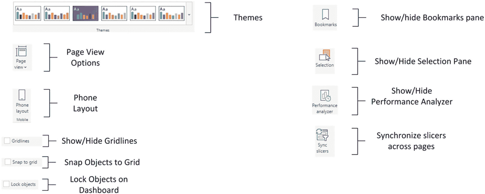
`图 23-1 视图功能区`

### 插入功能区

插入功能区的选项如图 23-2 所示，并在表 23-2 中说明。

`表 23-2 插入功能区选项`

| 选项 | 说明 |
| --- | --- |
| `新视觉对象（New visual）` | 在当前页面中插入一个新的空白视觉对象。 |
| `更多视觉对象（More visuals）` | 允许您从磁盘或应用商店添加第三方视觉对象。 |
| `新页面（New page）` | 允许您复制当前页面或在现有页面之后插入一个空白页面。 |
| `文本框（Text box）` | 在当前页面中插入一个空的文本框。 |
| `询问数据（Ask your data）` | 允许您使用自然语言对数据提问。 |
| `按钮（Buttons）` | 向当前页面添加一个按钮。 |
| `形状（Shapes）` | 向当前页面添加一个形状。 |
| `图像（Image）` | 向当前页面添加一个图像。 |

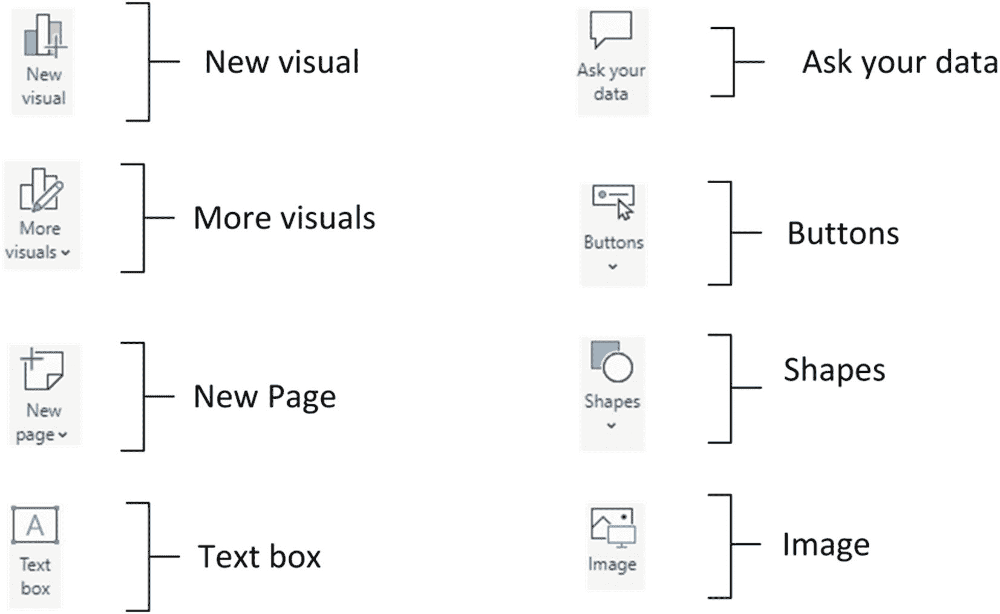
`图 23-2 插入功能区`

### 格式功能区

格式功能区选项如图 23-3 所示，并在表 23-3 中加以说明。

`表 23-3 格式功能区选项`

| 选项 | 说明 |
| --- | --- |
| 编辑交互 | 更改当选中其他视觉对象中的数据点时，视觉对象如何响应。 |
| 向下钻取应用于 | 允许向下钻取以筛选其他视觉对象中的数据。 |
| 上移一层 | 将视觉对象移至对象图层的顶层附近。 |
| 下移一层 | 将视觉对象移至对象图层的底层附近。 |
| 选择 | 显示`Selection`窗格，该窗格允许您显示和隐藏（以及设置其选项卡顺序）页面上的所有视觉对象。 |
| 对齐对象 | 对齐并分布选中的视觉对象。 |
| 组合 | 将选中的视觉对象组合在一起。 |

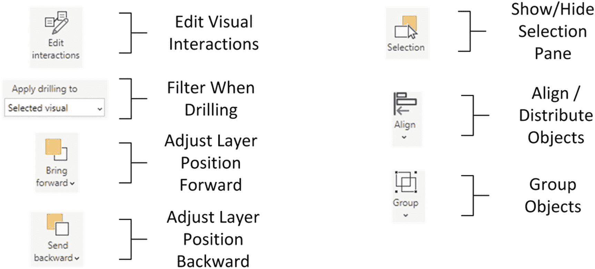
`图 23-3 格式功能区`

## 设置页面格式

在您投入一定时间和精力最终确定演示文稿之前，定义输出的一个基本方面——页面格式至关重要。Power BI Desktop 让您可以从以下输出设备格式中进行选择：

* 16:9
* 4:3
* 信纸
* 工具提示
* 自定义

要更改页面大小，请遵循以下步骤：

1. 单击报表画布上的任意位置（*而非*视觉对象上）。
2. 在 `Visualizations` 窗格中，单击 `Format` 图标。
3. 展开 `Page size` 部分。
4. 从 `Type` 弹出列表中选择一个页面大小预设——或者选择 `Custom` 并以像素为单位输入高度和宽度。

如果您希望指定自己的页面大小，只需从 `Type` 弹出列表中选择 `Custom`，然后以像素为单位输入所需的页面高度或宽度。如果愿意，您也可以使用滚动箭头来设置所需的数值。您可以在图 23-4 中看到此操作的效果。

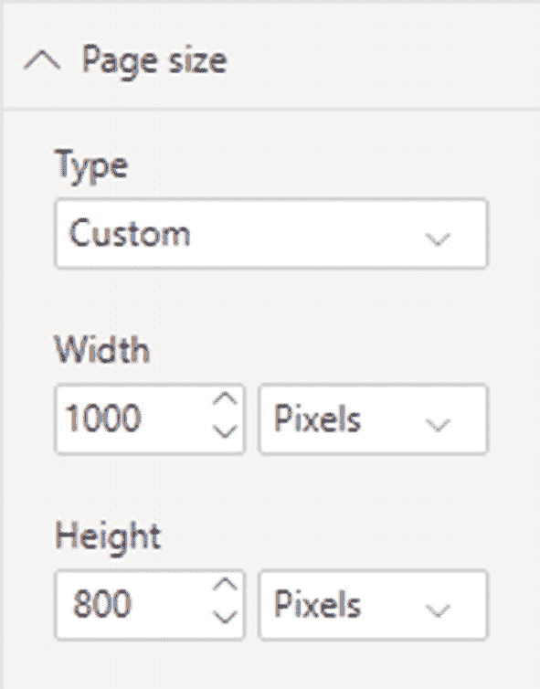
`图 23-4 自定义页面大小设置`

> **注意**：当前，唯一可用的度量单位是像素。

## 对齐和分布视觉对象

有一个快速简单的调整方法能够为任何仪表盘增添精致的外观。这个简单的决定就是完美地对齐视觉对象，以避免给人留下位置参差不齐的印象。无论您是否喜欢，良好对齐的视觉对象会有助于说服您的受众，让他们认为您的分析是有效的。

需要说明的是，当我说*对齐视觉对象*时，这个概念中也包含了分布视觉对象。因此，以下是如何运用这两种技术为您的仪表盘增添专业气息的方法。

## 对齐视觉对象

页面上整洁对齐的一组元素总能取悦受众。更重要的是，将一组现有的视觉对象进行和谐排列，实际上只需要几秒钟。以下是具体操作步骤：

1. 选择您想要对齐的视觉对象（按住 `Ctrl` 键单击每一个）。
2. 在 `Format` 功能区中，单击 `Align` 按钮以显示弹出菜单。它将如图 23-5 所示。

   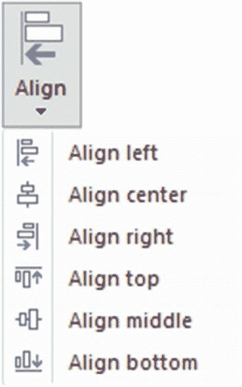
   `图 23-5 对齐选项`

3. 选择所需的选项。

选中的元素将根据您所做的选择，沿它们的顶部、底部、左侧或右侧对齐，或者居中对齐。可用的对齐选项在表 23-4 中列出。

`表 23-4 对齐选项`

| 选项 | 说明 |
| --- | --- |
| 左对齐 | 将所有选中的视觉对象沿其左侧对齐。 |
| 水平居中 | 将所有选中的视觉对象居中对齐。 |
| 右对齐 | 将所有选中的视觉对象沿其右侧对齐。 |

# 分布与对齐视觉对象

## 分布视觉对象

为仪表盘添加最后一抹"注重细节"风采的一种方法是确保所有视觉对象在水平方向和/或垂直方向上都整齐分布。这可以简单地保证每个元素之间有始终相等的间距。

**表 23-5** 分布选项

| 选项 | 说明 |
| --- | --- |
| 水平分布 | 沿水平面分布一系列选中的视觉对象。 |
| 垂直分布 | 沿垂直轴分布一系列选中的视觉对象。 |

1.  选择您想要分布的视觉对象（按住 `Ctrl` 键单击每一个）。
2.  在 `Format` 功能区中，单击 `Distribute` 按钮以显示弹出菜单。它将如图 23-6 所示。
    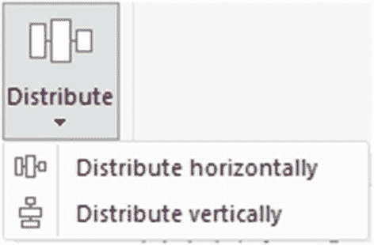
    *图 23-6* 分布选项
3.  选择所需的选项。
4.  选中的元素将根据您的选择进行水平或垂直分布。可用的分布选项在表 23-5 中列出。

> **注意**：您可能需要将一组视觉对象同时在水平和垂直方向上进行分布，以获得最佳效果。您需要依次执行这两个对齐操作才能获得此结果。

## 对齐到网格

Power BI Desktop 画布包含一个网格（类似于方格纸），您可以使用它来对齐视觉对象和其他对象。这可以帮助您创建外观更精致的演示文稿。要对齐到网格，只需：

1.  激活 `View` 菜单。
2.  选择 `Snap objects to grid`。

现在，每当您移动或调整对象大小时，它都会对齐到网格，或者按一个网格点（或像素）增加/减少大小。

## 显示网格

如果您愿意，也可以显示网格来帮助您对齐对象：

1.  激活 `View` 菜单。
2.  选择 `Show gridlines`。

您现在将看到一个由点（每 10 个像素一个点）组成的图案，代表了隐藏的网格。

> **注意**：Power BI Desktop 报表画布中的像素数取决于所选的页面大小。

## 指定视觉对象的精确位置

放置视觉对象时可以应用的最后一个选项是指定它们的精确位置、高度和宽度。当您希望使一系列视觉对象具有相同大小时，此功能特别有用。请遵循以下步骤：

1.  选择您想要调整大小和/或重新定位的视觉对象。
2.  在 `Visualizations` 窗格中，单击 `Format` 图标。
3.  展开 `General` 部分。
4.  设置 `X`（水平起始）位置、`Y`（垂直起始）位置、高度和宽度。

Power BI Desktop 使用像素作为放置单位，与其底层网格使用的单位相同。

# 添加文本框以注释报表

让我们从头开始。您花费了相当多的时间深入研究数据，并找到了有效的方法将受众的注意力吸引到其中包含的宝贵信息上。但是，您还需要最后一步，画龙点睛之作——为报表添加一个标题。由于标题本质上就是一个文本框，这是您添加、格式化和修改文本框的入门介绍。

文本框是一种浮动的文本实体，您可以将其放置在 Power BI Desktop 报表画布上的任何位置。它们对于注释仪表盘的特定部分特别有用。

## 添加文本框

添加文本框的操作非常简单，描述起来比实际操作时间还长，但即便如此，以下是操作步骤：

1.  在 `插入` 功能区中，点击 `文本框` 按钮。仪表盘画布上会出现一个空白文本框。
2.  输入你想要添加的文本；它将成为标题。我输入了"2017 年销售额"。
3.  将鼠标指针放在标题框的角部或侧边中央的控制点上，然后拖动鼠标来调整标题框的大小。
4.  点击文本框的标题栏（文本框顶部的灰色区域），将文本框拖动到页面顶部中央位置。
5.  在空白报表画布上的任意位置点击（以取消选中文本框）。

图 23-7 展示了报表中的文本框。此外，如果你想要修改文本，只需点击文本框内部，然后像在 `PowerPoint` 中一样修改现有文本即可。

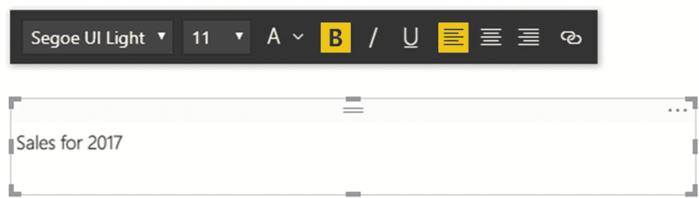
**图 23-7** 在报表中添加文本框

> **注意：** 如果文本框太小无法容纳全部文本，则当你选中它时，文本框上会添加滚动条。

## 移动文本框

文本框像其他任何可视化对象一样，是 `Power BI Desktop` 中的一种可视化对象。因此，可以像移动或调整表格或图表一样来移动和调整文本框大小。所以，移动标题只需：

1.  将鼠标指针悬停在文本框上。会出现一个容器，指示文本框的形状。
2.  点击文本框的顶部条，然后将文本框拖拽到仪表盘画布上的其他位置。

或者，你也可以选中文本框，然后将鼠标指针放在文本框的边缘上（但不要放在角部或侧边的控制点上），然后拖拽文本框到新位置。

## 格式化文本框

你可以对文本框进行特定的格式化，赋予其所需的份量和表现力。尽管这完全是直观的操作，但为了完整性，这里提供一个简短的操作示例：

1.  选中你之前创建的文本框。`格式` 调色板将显示在文本框的下方或上方。
2.  选中你想要修改的文本。
3.  点击 `字体` 弹出菜单，选择你想要应用于所选文本的字体。
4.  点击 `字号` 弹出菜单，选择你想要应用的尺寸（以磅为单位）。
5.  通过点击相关图标，应用你需要的任何字体属性（粗体、下划线、斜体）。
6.  通过点击三个对齐图标之一来对齐文本。这将对文本框中的所有文本生效。

> **提示：** 请记住，你必须高亮选中文本才能进行格式化。如果你选中了文本框本身，则只能更改文本框内文本的对齐方式。

文本框的格式化选项在表 23-6 中进行了解释。

**表 23-6** 文本框格式化选项

| 元素 | 图标 | 描述 |
| --- | --- | --- |
| 字体 | 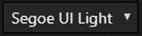 | 允许你从计算机已安装的字体中选择一种。 |
| 字号 |  | 允许你选择字号。 |
| 主题颜色 | 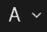 | 允许你选择颜色。 |
| 粗体 |  | 使文本显示为粗体。 |
| 斜体 |  | 使文本显示为斜体。 |
| 下划线 |  | 为文本添加下划线。 |
| 左对齐 |  | 将文本对齐到文本框左侧。 |
| 居中对齐 |  | 将文本在文本框内居中对齐。 |
| 右对齐 |  | 将文本放置在文本框右侧。 |
| 超链接 |  | 为所选文本添加超链接。 |

## 添加超链接

`Power BI Desktop` 仪表盘当然不是孤立存在的。因此，你可以将它们作为链接到其他文档或网页的起点。但请记住，超链接*仅*在 `Power BI Desktop` 文件已部署到云端的 `Power BI Service` 后才会生效。

## 要添加超链接

1. 选中你之前创建的文本框。
2. 选中将成为超链接的文本。
3. 点击“超链接”图标。“格式”调色板将展开并显示超链接框。
4. 输入或粘贴一个 URL。
5. 点击“格式”调色板中的“完成”按钮。

### 移除超链接

要移除已添加的超链接：
1. 选中你之前创建的、包含超链接的文本框。
2. 点击超链接内部。“格式”调色板将展开。
3. 点击“移除”按钮。

如果你愿意，你也可以直接删除作为链接的那部分文本。

### 删除文本框

如果你想删除文本框，请确保：
1. 选中文本框。
2. 点击文本框的弹出菜单（文本框右上角的省略号）。
3. 选择“移除”。文本框将被删除。

另一种删除文本框的方法是，选中文本框，然后按 `Delete` 键。

> **注意：** 仅仅选中并删除文本框内的文本并不会删除文本框本身；所以，为确保报表中不留任何不必要的杂乱对象，请删除任何不需要的空文本框。

### 修改页面背景颜色

`Power BI Desktop` 并非强制你以白色背景呈现每个报表。为了避免单调，你可以通过几次点击，为报表中的每个页面单独添加不同的背景颜色。

要为报表应用背景，你只需执行以下操作：
1. 点击仪表盘画布内部，但不要点击任何已有的视觉对象。
2. 在“可视化”窗格中，点击“格式”图标。
3. 展开“页面背景”部分。可用的选项看起来将如图 23-8 所示。

    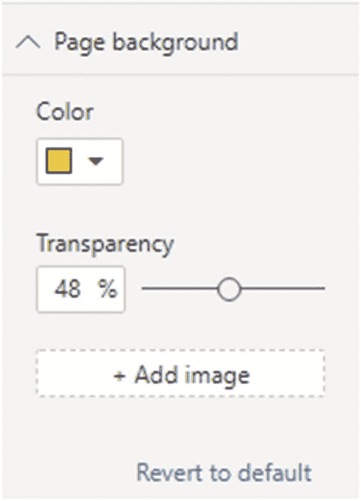

    **图 23-8** 页面背景选项

4. 从可用颜色调色板中选择一种颜色。
5. 向左或向右滑动“透明度”滑块，为所选颜色选择透明度级别。

> **注意：** 你需要单独格式化报表中的每一页。你不能通过按住 `Ctrl` 键点击来选择多个页面。

## 图片

我们都知道一张图片胜过千言万语。Power BI Desktop 同样深知此理。因此，你可以将图片（或通常所说的图像）添加到 Power BI Desktop 报表中，以替代文字并增强演示效果。插入到 Power BI Desktop 报表中的图片可以来自网络，也可以来自磁盘上的文件（无论是本地文件还是可用的网络共享文件）。一旦图片被插入，它便不再与源文件关联。因此，如果源图片发生变化，你必须重新插入它才能保持更新。

以下是图片在 Power BI Desktop 中的一些用途：
- 作为报表的背景图片。
- 在表格中代替文本。例如，可以使用产品图片。
- 在切片器中使用图片。例如，可以是国家或地区的旗帜。
- 独立图片——例如，一个标志，或一个用于吸引观众注意特定要点的补充元素。
- 作为图表背景的图片。

在我们了解可用的图片格式类型之后，我们将看到如何在这些场景中使用图片。

### 图片来源

图片格式种类繁多。Power BI Desktop 接受以下所有行业标准的图片类型：
- `JPEG`：这是一种历史悠久的标准图像文件格式。
- `PNG`：这是一种用于互联网图像的标准文件格式。
- `BMP`：这是一种由 `MS Paint`（举例）生成的标准图像类型。
- `GIF`：这是一种常用于网页的历史悠久的图像格式。
- `TIFF`：这是一种用于扫描图像的标准格式。
- `RLE`：游程编码格式。
- `JPE`：24 位压缩的 JPEG 图形格式。
- `JFIF`：一种使用 JPEG 压缩的位图图形。

所有这些格式（以及它们各自衍生的、Power BI Desktop 能够处理的格式）都能提供质量尚可的图片，这些图片足以满足 Power BI Desktop 报表的需求。但是，如果你尝试插入的图片不是 Power BI Desktop 能够处理的格式，你将收到一条警告，并且该图片将不会被插入。

> **注意：** 当你尝试从文件插入图片时，“打开”对话框会过滤文件，因此只显示具有可接受扩展名的文件。你可以强制对话框显示其他文件格式，但 Power BI Desktop 可能无法加载它们。

### 添加图片

你可能仍然想要向报表中添加完全自由浮动的图片。然而，在沉迷于图片所能实现的各种效果之前，请记住，Power BI Desktop 并非设计为一个高端演示软件包。从本质上讲，它的作用是帮助你快速、清晰地分析和呈现信息。你难免会发现，有些你在 PowerPoint 等软件中习惯做的事情，在 Power BI Desktop 中却无法实现。因此，你可能会倾向于在 Power BI Desktop 中使用图片来达到类似的演示效果，从而使用许多演示技巧和技法。确实，通过添加图片，你可以在 Power BI Desktop 报表中实现许多功能。但你必须问自己的问题是：“我是否在提升报表的价值？”我坚信，在优秀的演示中，少即是多。因此，尽管我会展示一些使用图片的技巧，但其中许多技巧与快速高效创建 Power BI Desktop 报表的原则相悖，并且每当可视化中的数据发生变化时，都可能需要进行大量调整。所以我建议你，除非确实必要，否则不要过度使用图片来增强演示效果。

尽管有这些告诫，我们还是来为一篇 Power BI Desktop 报表添加一个浮动的独立图片。在这个示例中，它是一个公司的标志——卓越英国汽车公司（Brilliant British Cars）的标志，我们在本书中分析的就是该公司的指标。

添加图片非常简单。你只需要：
1. 在 Power BI Desktop 的“开始”功能区中，单击“图片”按钮。将会出现一个经典的 Windows 对话框；让你选择源图片，如图 23-9 所示。

    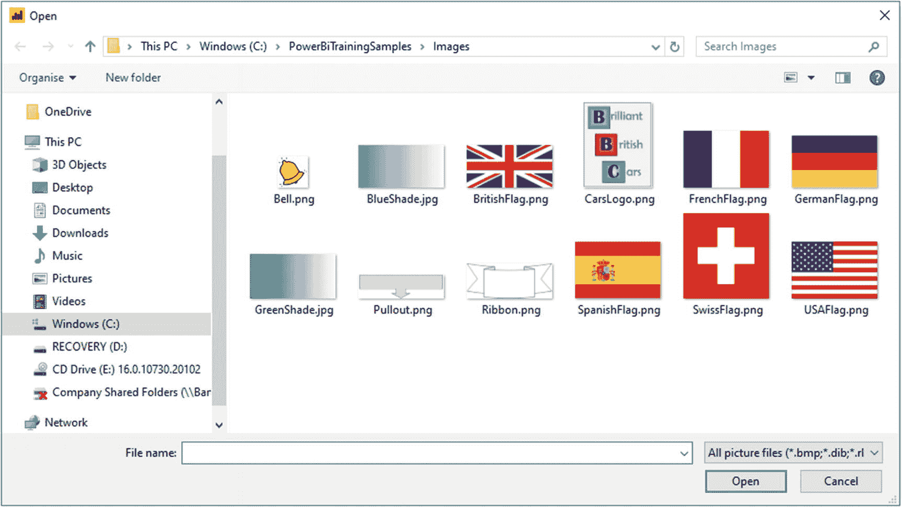

    **图 23-9** 导航到图片文件

2. 导航到包含你要插入图片的目录。在 `C:\PowerBiDesktopSamples\Images` 文件夹中有几个示例图片，你可以按照附录 A 中的说明进行安装。
3. 单击图片文件。在此示例中，我使用了示例图片 `CarsLogo.png`。
4. 单击“打开”。所选图片将被加载到页面中。
5. 将图片拖到页面左上角并调整其大小。仪表板将如图 23-10 所示。

    

    **图 23-10** 添加到仪表板的图片

### 移除图片

要移除图片，你只需要：
1. 选中该图片。
2. 单击图片的弹出菜单（文本框右上角的省略号）。
3. 选择“移除”。该图片将从报表中移除。当然，原始图片文件不会受到任何影响。

另一种删除图片的方法是选中该图片，然后按 `Delete` 键。所选图片将从报表中消失。

### 调整图片大小

Power BI Desktop 仪表板中的图片与其他任何可视化元素一样，都可以完全相同的方式移动和调整大小。只需执行以下操作：
1. 选中你想要调整大小的图片。
2. 将鼠标指针放在图片的角落或侧面中央的控制点上，然后拖动鼠标以调整图片大小。

### 设置图片格式

添加图片后，可以在 Power BI Desktop 中对它进行一定程度的微调。以下是你可以修改的参数：
- 图片缩放
- 图片标题
- 图片背景
- 图片边框
- 纵横比
- 精确位置和大小

除了第一项之外，所有这些修改在 Power BI Desktop 的大多数可视化中都通用。实际上，其中一些你已经多次见过了。因此，我就不浪费你的时间重复你已知或可以在本书其他地方找到的内容了。

不过，图片缩放是完全新奇的。以下是调整图片缩放方式的步骤：
1. 选中你想要修改缩放方式的图片。
2. 在“可视化”窗格（已自动切换为仅显示格式设置选项）中，展开“缩放”部分。
3. 在“缩放”弹出菜单中，选择“填充”。

图片将调整自身以填满图片占位符中的所有可用空间。

表 23-7 解释了三种可用的图片缩放选项。

**表 23-7** 图片缩放选项

| 选项 | 描述 |
| :--- | :--- |
| 常规 | 图片保持其高宽比（无论“锁定纵横比”设置如何），并尽可能调整大小以填满图片占位符。 |
| 填充 | 图片填满图片占位符，但会扭曲图片。 |
| 适应 | 图片填满图片占位符，但会裁剪掉图片的部分区域，而不是扭曲图片。 |

### 背景图片

图片的一个重要且通常非常引人注目的用途是作为报表的背景——甚至可能是一整系列报表的背景。因此，让我们来看看如何将图片用作报表背景。

#### 添加背景图片

首先，你需要添加一张背景图片。同样，这非常简单：
1. 点击要添加背景图片的仪表板画布。确保没有选中任何视觉对象。

## 添加形状

有时，你的图表可能需要一点帮助才能从众多元素中脱颖而出。也许将一小组视觉对象（例如仪表或卡片）分组在一起效果最佳。无论需求如何，Power BI Desktop 都可以通过向页面添加一个或多个形状，为你的仪表板增添一些最后的润色。

以下是你可以选择的内置形状：

-   矩形（也包括正方形）
-   椭圆形（包括圆形）
-   线条
-   三角形
-   箭头

假设你想在仪表板上添加一个装饰性箭头，以吸引读者对特定图表的注意。以下说明如何操作：

1.  在“开始”功能区中，点击`Shapes`（形状）按钮，查看可用形状的弹出列表。你可以在图 23-11 中看到这个列表。
    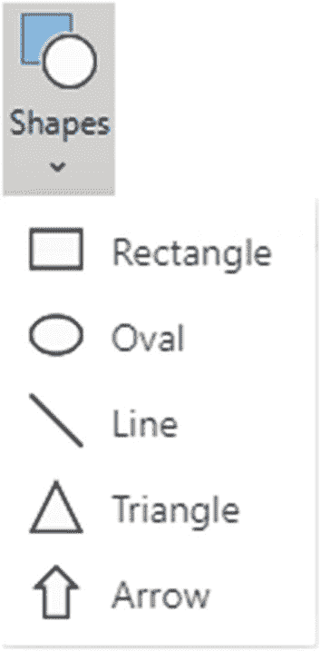
    **图 23-11** 形状弹出列表

2.  选择`Rectangle`（矩形）。一个正方形将被添加到仪表板画布上。

3.  按照调整图表或图片大小相同的方式调整正方形大小。如果你使用顶部、底部或侧边手柄，正方形将变为矩形。

由于其他可用形状的插入方式完全相同，我就不逐一说明了，但你可以通过在页面上添加不同的形状来获得一些乐趣，看看它们如何增强仪表板的效果。

### 格式化形状

你可以调整形状的以下方面：

-   线条
-   填充
-   旋转
-   标题
-   背景
-   纵横比
-   精确位置和大小（X 和 Y 坐标）

由于在格式化视觉对象方面，只有前三项是新的，让我们来看看它们的实际应用。

#### 形状的线条和填充颜色

当我们说到形状中的“线条”时，实际上是指形状的外部边界。Power BI Desktop 允许你修改它的：

-   颜色
-   粗细（也称为权重）
-   透明度

同时，你也可以设置形状的填充颜色。以下是如何为任何可用形状修改基本特征的方法：

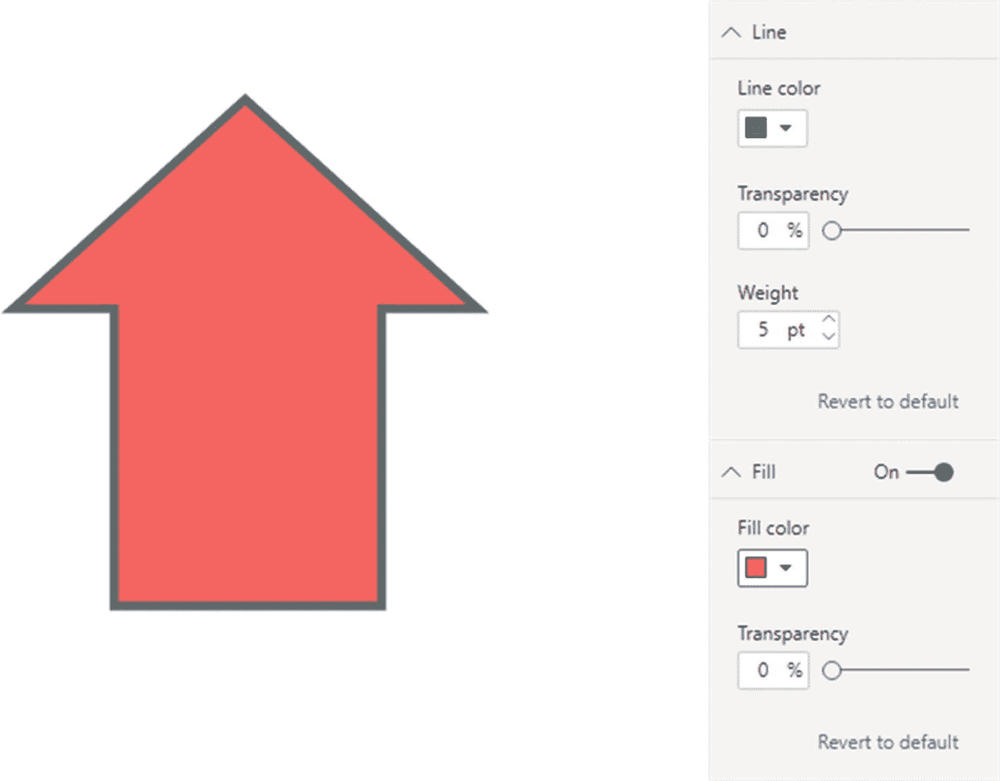
**图 23-12** 格式化形状

1.  选择要格式化的形状。

2.  在`可视化`窗格（现在只显示形状格式化选项）中，展开`Line`（线条）部分。

3.  从可用颜色的弹出调色板中选择线条颜色。形状的外部线条将改变颜色。

4.  调整`Weight`（粗细）以设置线条厚度。形状的外部线条将变粗。

5.  向左移动`Transparency`（透明度）滑块以调整颜色的强度。

6.  展开`Fill`（填充）部分。

7.  从可用颜色的弹出调色板中选择填充颜色。形状的内部将改变颜色。

8.  向右移动`Transparency`（透明度）滑块以调整颜色的强度。`可视化`窗格和形状将看起来像图 23-12 所示。

#### 形状旋转

某些形状需要旋转到正确的方向，以实现你想要的效果。通常需要这样调整的形状是箭头和三角形——尽管此技术可应用于任何形状。要旋转形状：

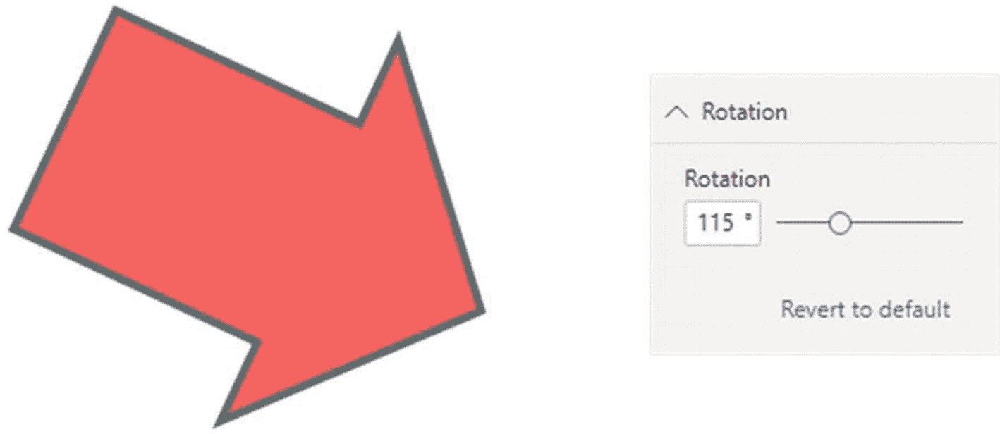
**图 23-13** 旋转形状

1.  选择要旋转的形状。

2.  在`可视化`窗格（现在只显示形状格式化选项）中，展开`Rotation`（旋转）部分。

3.  向左和/或向右拖动`Rotation`（旋转）滑块，将箭头设置为指向你想要的方向。或者，你可以在滑块左侧的`Rotation`（旋转）框中输入精确的旋转值。形状和`可视化`窗格将看起来像图 23-13 所示。

值得注意的是，如果你愿意，可以在`Rotation`（旋转）框中输入精确的旋转角度值。当需要将形状旋转 45 度或 90 度的倍数时，这尤其有用。

> **注意：** 当添加椭圆或矩形时，你会发现 Power BI Desktop 最初将它们分别创建为圆形和正方形。为了确保它们保持完美的形状（如果这是你的需求），请在调整形状大小之前确保`Lock Aspect`（锁定纵横比）格式选项设置为`On`（开启）。

#### 删除形状

要删除一个形状，你只需：

1.  选择要删除的形状。
2.  点击形状的弹出菜单（文本框右上角的省略号）。
3.  选择`Remove`（删除）。该形状将被删除。

另一种删除形状的方法是选中该形状，然后按`Delete`（删除）键。所选形状将从报告中消失。

### 标准化形状

如果你正在为仪表板添加最终的装饰性（最好也具有说明性）点缀，你可能希望让一系列形状看起来完全一致。毕竟，你绝不想让仪表板看起来像一块拼布被。微软 Office 套件中有一个值得信赖的工具可以帮助你以这种方式合理化仪表板——那就是“格式刷”。

1.  选择一个形状，将其作为其他形状的模板。
2.  点击“开始”功能区中的“格式刷”按钮。
3.  点击你想要格式化为与第一个形状完全相同的那个形状。

> **注意：** 你不能像在 MS Word 或 Excel 中格式化时那样，通过双击“格式刷”来将同一格式多次应用于不同形状。

### 组织页面上的视觉对象

一个复杂的仪表板可能由许多元素组成（当然希望不要多到让受众感到困惑）。这时，对最终外观进行一些基本的润色会有所帮助。简单来说：

-   观众更倾向于相信一个组织得井井有条的仪表板。
-   清晰的布局被解读为清晰的思路——这能增加你所呈现事实与数据的可信度。
-   良好的美学效果会为你的论点增色，而不是减分。

因此，在我们结束“如何最终确定和完善仪表板”的探索之旅时，你需要学习如何调整页面上视觉对象（无论是表格、图表、仪表、图片还是形状）之间的相互关系；这本质上意味着在垂直方向上对视觉对象进行分层。

### 分层排列视觉对象

随着报表变得越来越复杂，你将不可避免地需要不仅并排排列其包含的元素，还要将它们上下堆叠。Power BI Desktop 让你能够简单高效地完成此操作。

作为示例，我们来创建一个上面叠加了另一个图表的图表：

1.  使用以下两个字段创建一个环形图：
    -   `成本加备件利润`（来自 `InvoiceLines` 表）
    -   `国家名称`（来自 `Countries` 表）

2.  使用以下两个字段创建一个（簇状）柱形图：
    -   `品牌`（来自 `Stock` 表）
    -   `净利润率`（来自 `InvoiceLines` 表）

在“可视化”窗格中，点击**格式**图标。

展开`Page background`（页面背景）部分。

点击`Add image`（添加图片）。此时将出现一个经典的 Windows 对话框，让你选择源图片。

导航到包含要插入图片的目录。在此示例中，目录为`C:\PowerBiDesktopSamples\Images`。

点击图片文件。本例中我将使用示例图片`GreenShade.jpg`。

点击`Open`（打开）。所选图片将被加载到页面中。

在`Image fit`（图片适应）弹出列表中，选择`Fit`（适应）。

所选图片将覆盖所有视觉对象背后的整个页面。

调整图片大小有三种可能的方式，详见表 23-8。

**表 23-8** 背景图片大小调整选项

| 选项 | 描述 |
| --- | --- |
| `Normal`（正常） | 图片保持其原始大小。 |
| `Fit`（适应） | 图片扩展（可能变形）以覆盖整个仪表板区域。 |
| `Fill`（填充） | 图片按比例扩展，以尽可能覆盖仪表板区域。 |

此外，一旦背景图片被添加到页面，你可以调整其透明度。操作如下：

1.  在已展开的“格式”面板的`Page background`（页面背景）部分，向左或向右拖动`Transparency`（透明度）滑块。

> **注意：** 在 Power BI Desktop 中，你无法手动调整图片的大小。如果你需要图片达到特定尺寸，必须在图片创建应用程序中以精确的所需尺寸创建它。

#### 独立图片的一些用途

图片对报告能起到的作用，只受限于你的想象力，因此不可能提供一份详尽的建议清单。尽管如此，以下是我发现的一些自由格式图片的用途：

-   **公司标志**，正如我们刚刚看到的。
-   **纯装饰效果而添加的图片**。然而，我会对此持保留态度，因为它可能会分散对分析的注意力，而非增强分析效果。不过，有时这恰恰是你想要做的（例如，转移人们对某些灾难性销售数据的注意力）。所以，如果必须的话，可以添加装饰，但请谨慎使用！
-   **增强文本框中的文本**：通过提供与底层图片或背景形成清晰对比的阴影来实现。
-   **作为表格中特定列的背景**。但请注意，如果列的大小被调整，图片无法随之移动。

> **注意：** 如果你想添加覆盖整个仪表板页面的图片，则*不要*向页面添加独立图片，而应使用背景图片技术。否则，你可能会使页面上的其他视觉对象无法被访问。

## 分组视觉对象

Power BI Desktop 还允许你将多个视觉对象分组为一个单一视觉对象。当你想要复制或调整多个对象的大小时，这将非常实用。

操作步骤如下：

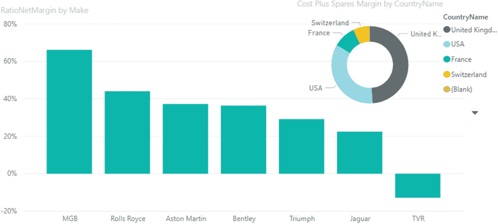

**图 23-15** – 分组后的视觉对象

1.  创建上一节中描述的两个图表。
2.  同时选中两个图表。
3.  在“格式”菜单中，点击“分组” ➤ “分组”。
4.  调整（之前分开的）两个视觉对象合并成的（单个）视觉对象的大小。你应该会看到类似图 23-15 所示的效果。

## 手机布局

越来越多的信息工作者需要在移动中获取数据。这意味着他们要在手机上查看 Power BI 仪表板。为了方便这一点，微软 Power BI 团队在 Power BI Desktop 中添加了一个宝贵功能——手机布局。

此功能允许你获取现有报表，并定义构成仪表板的每个视觉对象如何在智能手机上显示。这种方法有几个优点：

- Power BI 会自动检测所使用的设备类型，并应用相应的呈现样式。
- 您无需创建重复的报表（一个用于电脑屏幕，另一个用于手机），然后同时更新它们。
- 您不必在手机版本的仪表板中包含所有视觉对象。
- 仪表板中某个视觉对象的任何更改都会反映在相应的手机布局中。

举一个简单的例子，以下是从包含你刚刚创建的叠加图表的仪表板中创建手机报表的方法：

1.  打开或创建一个 Power BI Desktop 仪表板。
2.  在“视图”功能区中，点击“手机布局”按钮。你将看到一个类似图 23-16 所示的屏幕。
    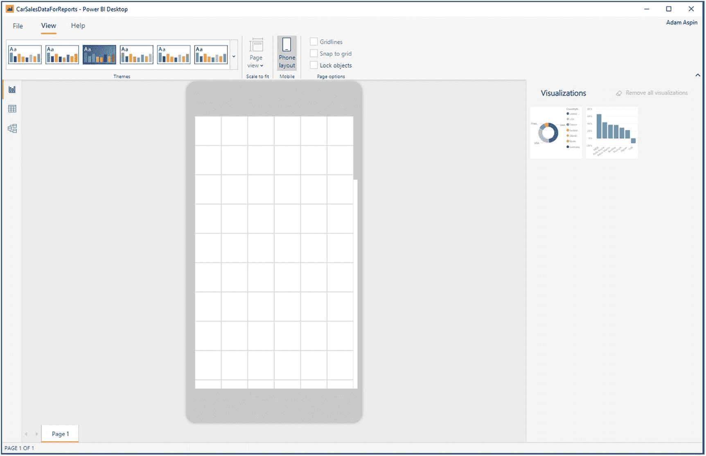
    **图 23-16** – 手机布局
3.  将你想要在手机版报表中使用的第一个视觉对象拖拽到手机屏幕上。
4.  调整视觉对象的大小，使其覆盖所需的手机屏幕区域。
5.  添加你希望使用的任何其他视觉对象，并根据需要调整它们的位置。手机布局屏幕可能看起来像图 23-17 所示。
    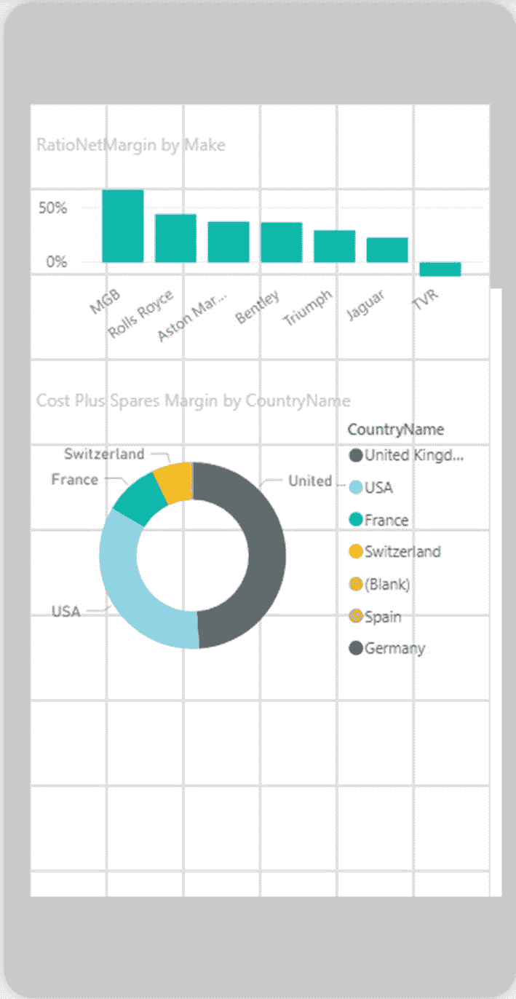
    **图 23-17** – 一个完成的手机布局
6.  再次点击“手机布局”按钮，切换回桌面布局。

现在，一旦此报表发布到 Power BI 服务（或本地 Power BI 报表服务器），任何移动用户将在其智能手机上看到手机布局。不幸的是，设置和使用 Power BI 服务是一个庞大且独立的话题，此处无法展开。

> **注意：** 如果某个视觉对象在手机布局中未完全可见，您将在该视觉对象中看到省略号和一个朝下的小三角形，以指示可见性可能存在问题。

## 报表主题

您可以定义自己的颜色集，这些颜色将自动应用于表格、矩阵以及图表中的数据（如果您愿意的话）。这需要创建一个特定格式的简单文件，然后将其加载到 Power BI Desktop 中。该文件必须包含以下元素：

- 主题名称
- 一组数据颜色，放在方括号内，并用逗号分隔
- 背景元素
- 前景元素
- 用于表格的强调色元素

您可以在以下示例的步骤 1 中查看一个示例文件：

1.  从示例数据中加载名为 `BrilliantBritishCars.json` 的 `.json` 文件。
2.  在“格式”功能区中，单击“主题”弹出菜单，选择 `浏览主题`，然后浏览到您刚刚创建的文件。
3.  单击 `打开`。您将看到如图[23-18]所示的对话框。
    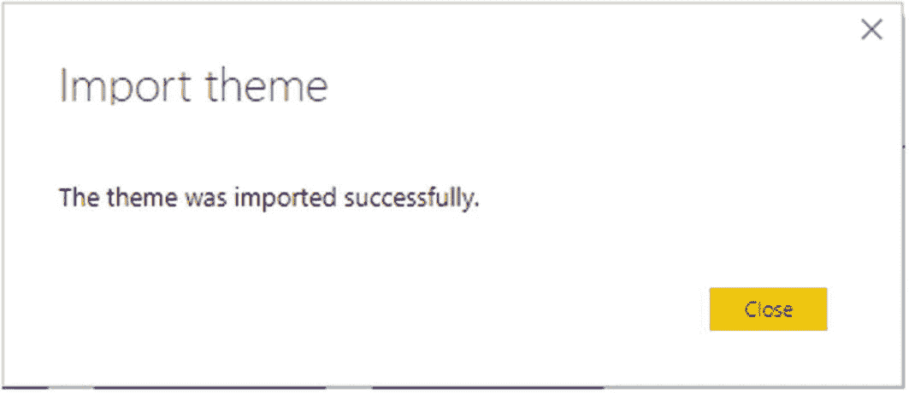
    *图 23-18 — 导入主题对话框*
4.  单击 `确定`。主题文件将打开，并将该主题应用于当前文件中的所有页面。

背景、前景和表格强调色现在将应用于报表中的每一个表格和矩阵。此外，默认情况下，数据颜色将是指定在主题文件中的那些颜色。您可以在图[23-19]中看到这一点。

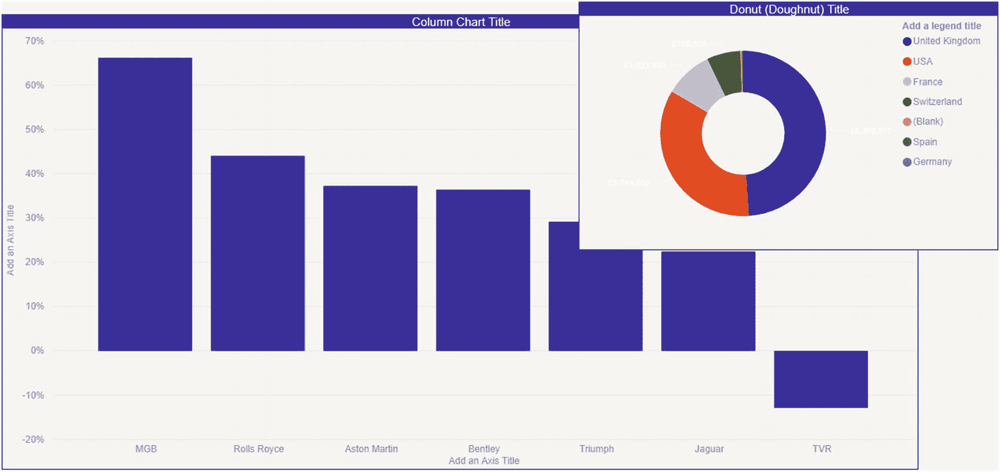
*图 23-19 — 将主题应用于报表*

此主题文件也位于 `C:\PowerBiDesktopSamples` 文件夹中（假设您已从 Apress 网站下载了示例文件）。

> **注意：** 要移除刚刚加载的主题并恢复到默认主题，请在“开始”功能区中单击 `切换主题 ➤ 默认主题`。

在 Power BI Desktop 中，报表主题仍然是一个持续开发中的功能，并且目前处于不断变化的状态。我预计到本书出版时，JSON 文件的结构将有显著的发展。这是一个如此复杂的主题，我只能建议您参考网络上关于此主题的大量可用资源。因此，在本书的这一版中，我无法确切地深入探讨报表品牌化以及创建底层 JSON 文件的问题。我能做的是建议您查看示例数据中的 `BrilliantBritishCars.json` 文件，以了解所需的内容。实际上，您应该能够将此文件作为您自己样式模板的基础。

## 结论

在本章中，您了解了如何在使用 Power BI Desktop 创建极具吸引力的演示文稿时突破常规。您看到了当您向表格和切片器添加图形元素时，添加图像如何能够极大地提升分析给人留下的印象。并且，适度地使用图像、形状和自由格式文本元素，可以吸引观众的注意力，使其关注演示文稿中最突出的特点。所以，现在轮到您使用这些强大的 Power BI Desktop 功能，为您的观众带来真正引人入胜的交互式分析。

在本章中，您还了解了如何将现有报表准备好以在智能手机上显示。只需付出很少的额外努力，您就能确保一个复杂的报表能够完美地适应移动设备。

最后，您学会了如何为 Power BI Desktop 报表应用自己的“品牌化”。这让您可以在一系列报表中自动创建标准化的外观和感觉。

现在是时候学习如何构建结构化的交互式报表，使用户能够深入查看数据并探究数据所包含的详细层次。您将在下一章——也是最后一章——中找到这些内容。