# 24. 高级仪表板设计技术

在本书的最后一章中，我将介绍一系列技术，您可以使用这些技术为您的仪表板增添真正的功能和深度。您在此处发现的方法专门设计用于为您的报表增加结构。这意味着您将能够：

-   引导用户沿着一条数据发现路径，从最高层到最详细层进行探索
-   添加弹出式窗口，以更详细地解释数据的特定方面
-   提供多页报表的导航
-   使用您的数据来讲故事
-   将您的数据叙述呈现为交互式幻灯片

单独来看，用于实现这些目标的技术都非常有用，并且能够推动洞察和理解。然而，如果综合运用，它们可以极大地增强您的仪表板的功能，甚至能唤醒演示中最疲惫的观众。

因此，在本章中，您将学习如何：

-   在报表页面之间实现钻取——甚至跨报表钻取
-   添加弹出式可视化工具提示
-   创建书签以记住页面显示的各种状态——并在页面之间移动
-   设置按钮和图像以控制用户与仪表板的交互——包括在页面之间添加内部链接
-   将切片器应用于报表中的部分或全部页面
-   使用模板来确保您的仪表板在部门或企业范围内具有标准化的外观和感觉

## 钻取

塑造数据叙述的关键技术之一，是能够向下钻取数据并逐步显示更详细的信息层次。简单来说，`Power BI Desktop` 允许您基于交互式选择标准快速轻松地跳转到另一个页面。这使您——以及您的用户——能够以循序渐进的、结构化的方式深入探究数据的细节。

钻取功能至少需要报表中有两个页面：

-   源页面，包含关于多个元素的数据
-   目标（或详细）页面，提供一组不同的可视化对象，旨在提供关于数据某一单一方面的更详细信息层次

让我们实际操作一下。为了避免冗长的步骤说明，我仅要求您创建两个非常简单的报表页面。当然，在实际操作中，您的报表可能比这些复杂得多。

### 源页面

源页面是您将用于数据高层视图的页面。为了便于讨论，我们假设这是公司自成立以来的总销售额，以图表形式呈现：

1.  打开 `Power BI Desktop` 文件 `C:\PowerBiDesktopSamples\CarSalesDataForReports.pbix`。
2.  将空白页面重命名为“`销售`”。
3.  在此页面上，使用以下字段创建一个条形图：
    -   `生产商`
    -   `销售价格`

您可以在图 [24-2] 中看到此图表。

### 目标页面

此页面的设计必须显示更详细的数据，这些数据与你在源页面上用作钻取依据的单个元素相关。在此示例中，这意味着有关车辆*品牌*的信息。此页面还将添加一些特定的调整，以指明它是钻取操作的目标页面。

1.  在现有报表中添加一个新页面。
2.  将此页面重命名为 `Make Details`。
3.  使用字段 `Make` 添加一个卡片。 不必担心此阶段显示的实际品牌是什么。
4.  在卡片的“格式设置”窗格中，将 `Category label` 设置为 `Off`。
5.  使用以下字段添加一个表格：
    -   `FullYear`
    -   `CostPrice`
    -   `SalePrice`
6.  使用以下字段添加一个面积图：
    -   `Color`
    -   `LaborCost`
    -   `SpareParts`

你可以在图 24-3 中看到这两个视觉对象。

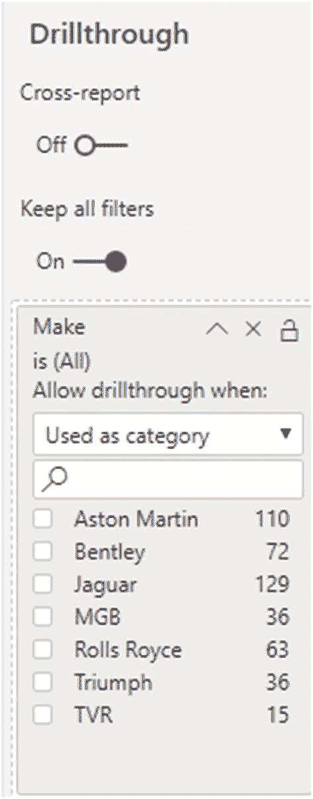
图 24-1 钻取筛选器井

1.  单击报表画布（在任何视觉对象之外），将 `Make` 字段拖到“可视化”窗格的 `Drillthrough` 区域中。将此字段放置在 `Drillthrough Filters` 井中。当前页面的左上角会自动出现一个后退按钮。
2.  将此按钮放置在仪表板上你希望它出现的位置。
3.  单击报表画布，查看“可视化”窗格的 `Drillthrough` 区域。你可以在图 24-1 中看到结果。

这两个页面（源页面和目标页面）现已链接，可以向下钻取数据了。

### 应用钻取

现在你可以使用钻取报表了。

1.  转到 `Sales` 页面。
2.  右键单击图表中的任意柱形。在此示例中，我使用的是 *Rolls Royce*。你将看到如图 24-2 所示的弹出菜单。

    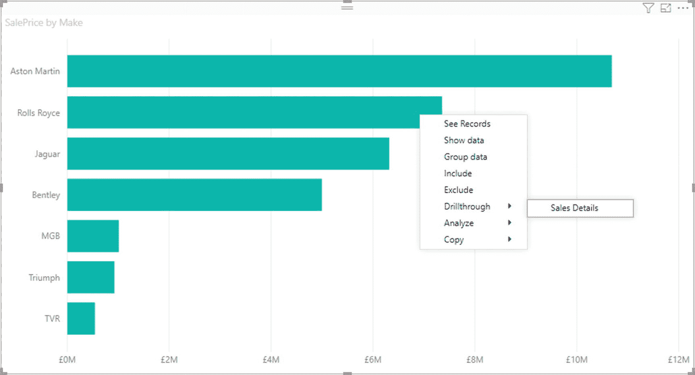
    图 24-2 钻取上下文菜单

3.  选择 `Drillthrough > Sales Details`。`Power BI Desktop` 将显示 `Sales Details` 页面——你可以在卡片视觉对象中看到你在源页面中单击的品牌。在图 24-3 中，你可以看到应用钻取后的目标页面。

    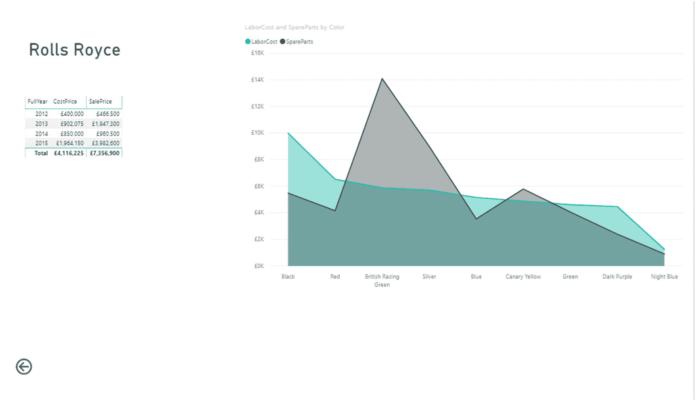
    图 24-3 钻取目标页面

4.  按住 `Ctrl` 键并单击后退按钮以返回到源报表。

将显示 `Make Details` 报表，并将数据筛选为你右键单击的行或数据点对应的品牌。

`Power BI Desktop` 会在钻取报表（“目标”报表页面）上自动创建一个后退按钮。但是，如果你不想使用此按钮，则无需使用。实际上，任何形状或图像都可以成为后退按钮。如果你认为它多余，可以将其删除。

### 多级钻取

钻取并不仅限于单级。一旦你向下钻取到第二页的更详细信息，没有任何限制阻止你再次向下钻取到第三页的更深入细节。你需要做的只是重复你在上一节中学习的过程，只不过这次你将“目标”页面作为起点——并创建第三个页面作为新的目标页面。

在向下钻取到越来越深入的分析级别时，值得注意的是，你可以选择在向下钻取时应用任何现有的筛选器（这是一种相当标准的做法）——或者，你可以覆盖向下钻取时的任何切片器和筛选器，但钻取筛选器本身（即你在上一个示例的步骤 3 中单击的元素）除外。

如果你希望在页面之间向下钻取时阻止筛选器传播，只需在“值”窗格中将 `Keep all filters` 选项设置为 `Off`。你可以在图 24-4 中看到这一点。

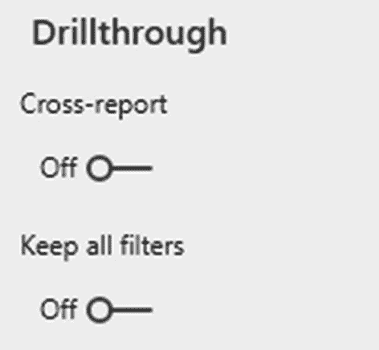
图 24-4 在钻取期间阻止筛选器传播

## 跨 Power BI 文件钻取

钻取并不仅限于单个报表。你也可以跨报表向下钻取。但仅当你已将要进行此操作的报表部署到 `Power BI` 服务时，此功能才有效。

要启用跨报表钻取，只需在“值”窗格中将 `Cross-report` 按钮设置为 `On`。你在图 24-4 中看到过此按钮。

## 弹出式工具提示

弹出式工具提示是 `Power BI Desktop` 提供的最令人印象深刻的功能之一——至少在我交谈过的大多数用户看来是如此。弹出式工具提示允许你将光标悬停在某个元素上（例如饼图扇区、条形图元素，甚至仪表板中的几乎任何指标），并立即显示一个选定的图表、表格或两者组合，悬浮在现有仪表板可视化效果之上。这使你可以为仪表板页面添加即时详细信息，而无需离开该页面。

本质上，弹出式工具提示是一个单独页面，经过特殊配置以容纳少量可视化对象（超过两三个通常就会适得其反）。下面将解释的主要步骤如下：

-   添加新页面
-   指定该页面为工具提示
-   缩小页面尺寸
-   添加工具提示筛选器

在真正创建工具提示页面之前，了解将要对哪个指标进行筛选非常重要。这是因为工具提示筛选器旨在为特定元素提供更精细的详细信息。因此，在构建弹出式工具提示时，你需要知道筛选元素是什么。

在以下示例中，你将使用文件 `C:\PowerBIDesktopSamples\CarSalesDataForMultipages.Pbix`。该文件包含一个按制造商显示销售额的饼图。目标是添加一个工具提示筛选器，以提供关于每个制造商的更多详细信息。因此，字段 `Make` 将成为我们将使用的工具提示筛选器字段。

1.  打开文件 `CarSalesDataForMultipages.Pbix`。
2.  添加一个新页面并将其命名为 `CostsTooltip`。
3.  在“可视化”窗格中，单击该页面的“格式”图标。
4.  展开“页面信息”，并将“工具提示”设置为“开”。
5.  展开“页面大小”，并从可用大小的弹出列表中选择“工具提示”。
6.  展开“页面背景”，并为页面背景选择一种颜色（这将使弹出式工具提示在底层仪表板中更清晰地突出显示）。格式选项如图 24-5 所示。

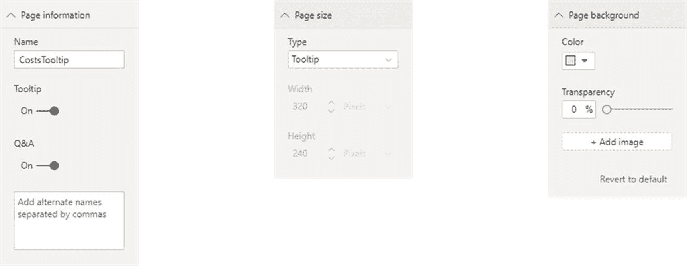
*图 24-5* 工具提示格式选项

7. 在“可视化”窗格中单击“字段”图标，以切换回字段信息。

8. 将 `Make` 字段拖放到“将工具提示字段拖到此处”的区域，如图 24-6 所示。

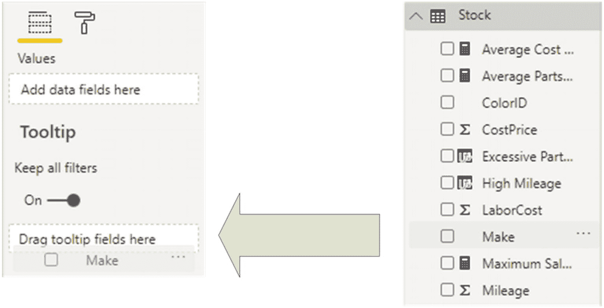

*图 24-6* 指定工具提示筛选器

9. 在新的工具提示页面中，按 `Model` 创建一个包含 `LaborCost` 和 `SpareParts` 的簇状柱形图。你会看到图表比通常情况大得多。这是因为最终的弹出式工具提示以较小的页面尺寸显示，但却占用了工具提示页面中整个仪表板设计图面。

10. 调整图表大小，使其占满工具提示页面中的所有可用空间。

11. 按你的喜好设置图表格式。

现在，当你将鼠标悬停在饼图的任何扇区上时，弹出式工具提示就会出现，如图 24-7 所示。

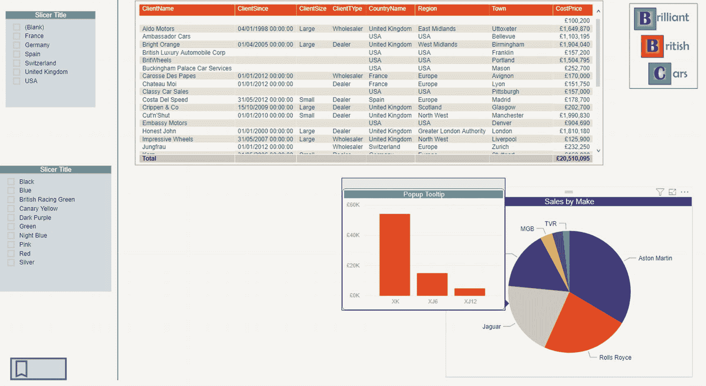

*图 24-7* 显示工具提示筛选器

创建工具提示可视化对象时，有几点重要事项需要注意：

* 你可能更倾向于以像素为单位指定用于弹出式工具提示的页面确切尺寸，而不是使用预设值“工具提示”。为此，首先在“页面格式”选项的“页面大小”部分的“类型”弹出菜单中选择“自定义”，然后以像素为单位输入弹出式工具提示的高度和宽度。

* 你可能希望在创建工具提示页面后将其隐藏，以防止用户点击它并将其作为页面而非工具提示显示。要执行此操作，你只需右键单击页面标签，然后从上下文菜单的可用选项中选择“隐藏页面”即可。

* 只要使用到筛选指标，工具提示弹出窗口就会出现。换句话说，任何包含（此例中的）`Make` 字段的可视化对象（无论该可视化对象位于哪个页面）都会显示该弹出式工具提示。

* 你可以像格式化任何标准可视化对象或页面一样，格式化工具提示可视化对象和成为工具提示的页面。

* 如果需要，工具提示页面可以包含多个不同的可视化对象。

* 工具提示可视化对象本身不能调用其他工具提示可视化对象。

## 书签

书签是 Power BI 最强大和最有用的功能之一。它们通过帮助你的数据讲述自己的故事，将分析从单纯的交互式提升到完全有意义。书签是一种记住仪表板选定方面的方法，以便你可以快速轻松地重置它们。在实践中，这意味着你可以记住以下状态：

* 当前页面。

* 任何活动的筛选器。

* 切片器——这包括切片器类型（下拉列表或列表）和切片器状态（选中的元素）。

* 可视化对象选择状态（例如应用的任何交叉筛选）。

* 已应用于部分或全部可视化对象的任何排序顺序。

* 下钻状态。

* 对象可见性（使用“选择”窗格——稍后你将学到）。

* 任何可见对象的焦点或 Spotlight 模式。

与大多数 Power BI Desktop 功能一样，通过实际操作最能理解书签。因此，这里有一个示例，说明如何创建两个书签，然后依次应用它们：

1. 打开文件 `CarSalesDataForMultipages.Pbix`。

2. 移除所有不必要的筛选器元素和切片器选择，并确保没有活动的交叉筛选。

3. 在“视图”功能区中，单击“书签”图标。将出现“书签”窗格。

4. 单击“添加”。一个新的书签（可能叫 `Bookmark 1`）将出现在书签列表中。

5. 单击新书签右侧的省略号以显示上下文菜单（或者，你也可以右键单击书签名称）。

6. 选择“重命名”。

7. 输入新名称并按 Enter 键。在此示例中，我建议命名为 `Baseline`。书签窗格将类似于图 24-8。你所做的是在应用任何切片器或筛选器之前，“记住”了该页面及其包含的所有可视化对象的状态。

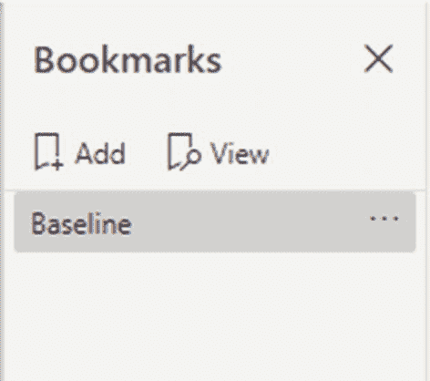

*图 24-8* 书签窗格

8. 应用一两个切片器选择，并单击饼图的一个扇区以交叉筛选数据。然后，单击表格右上角的省略号并选择“Spotlight”。这些修改将改变此页面上显示的数据。

9. 创建第二个书签（如步骤 4-7 所述），命名为 `SlicedData`。现在，你已经“记住”了应用切片器和 Spotlight 后页面的新的、已更改的状态。

单击任一书签都将重新应用创建该书签时处于活动状态的切片器、筛选器和交叉筛选器的状态。

### 更新书签

书签一旦创建，并非一成不变。随着分析需求的变化，你可以随时更新现有的书签。

1. 单击要更新的书签。

2. 添加或删除切片器元素、筛选器和交叉筛选选择，以调整仪表板显示。

3. 单击新书签右侧的省略号以显示上下文菜单（或者，你也可以右键单击书签名称），然后选择“更新”。

书签即被更新（即使没有立即可见的指示），现在页面新的状态已被记住。

### 定义书签的应用范围

正如我之前提到的，书签可以应用于仪表板的多个方面。然而，您不必将书签应用于仪表板的每一个方面。您可以选择让书签应用于表 24-1 中所描述的选项范围。

**表 24-1** 书签的应用范围

| 范围 | 描述 |
| --- | --- |
| 数据 | 这意味着任何已应用的筛选器、切片器、交叉筛选或排序都会随书签一并记忆。 |
| 显示 | 这基本上意味着任何已应用了突出显示选项的可视化对象，其该属性都会被书签“记住”。 |
| 当前页面 | 当前页面包含在书签的定义中——应用书签将显示应用该书签时的页面。 |
| 可视化对象 | 您可以选择一个或多个可视化对象，以限制使用书签时受影响的可视化对象数量。 |

本质上，这意味着书签具有可变的作用范围和效果——而由您来决定其影响范围应有多大。每个单独的书签都可以根据您的需求进行定制，具体如下：

1. 单击要更新的书签。

2. 单击新书签右侧的省略号以显示上下文菜单（或者，您也可以右键单击书签名称），然后取消选中 `显示`。

3. 从上下文菜单中选择 `显示`。

4. 单击新书签右侧的省略号，然后选择 `更新`。

此后，该书签将不再对与之关联的可视化对象应用任何突出显示效果。

> **注意：** 必须至少选择一个书签选项（数据、显示或当前页面），否则书签将变为无效。

### 排列书签

一旦您了解到书签的强大作用，可能会发现自己创建了相当多的书签。因此，有必要了解一下几种有助于更轻松管理书签的技巧。它们是：

- 更改书签在 `书签` 窗格中的显示顺序

- 将书签分组

- 删除书签

例如，要更改书签在 `书签` 窗格中的显示顺序：

1. 在 `书签` 窗格中，将某个书签垂直拖拽到书签列表中的新位置。

删除书签同样简单：右键单击书签，然后从弹出菜单中选择 `删除`。

## 使用书签进行幻灯片放映

Power BI Desktop 不仅仅是一款出色的分析工具。它还能帮助您展示数据，讲述有意义的故事——而在让数据“自己说话”方面，书签可以成为宝贵的助手。这是因为一系列书签可以像幻灯片一样进行播放。

1. 在 `书签` 窗格中，从上到下按有意义的顺序组织书签，该顺序代表您数据驱动叙事的流程。

2. 在 `书签` 窗格中，单击 `视图`。列表中的第一个书签将被激活。报表底部会出现一个新栏。您可以在图 24-9 中看到此栏。

**图 24-9** 幻灯片放映栏

3. 单击向右的 V 形图标以激活列表中的下一个书签。

4. 幻灯片放映结束后，单击 `书签` 窗格右上角的 `退出` 按钮。

这或许不言自明，但单击向左的 V 形图标会激活列表中的上一个书签。

## 按钮

Power BI 首先是一个报表工具。然而，这并不意味着它在任何方面都必须是静态的。为让您能够开发更具交互性的报表，您可以在任何仪表板页面添加按钮。设置完成后，按钮可以让用户：

- 跳转到特定页面

- 返回之前使用的页面

- 打开 Power BI 问答对话框

- 打开网页或内联网页面

在本示例中，您将看到如何添加一个显示所选页面的按钮。这意味着需要创建一个新的“目标”页面，您将通过单击另一个页面中的按钮来“跳转”到该页面。

1. 打开 Power BI Desktop 文件 `C:\PowerBIDesktopSamples\CarSalesDataForMultipages.Pbix`。

2. 插入一个新页面并将其重命名为 `DetailedAnalysis`。

3. 添加一个基于 `SalePrice` 和 `CountryName` 的条形图。

4. 添加一个名为 `Destination` 的书签（如前所述）。

5. 返回 `页面 1`。

## 按钮操作

6. 在`插入`菜单中，单击`按钮`图标中的弹出 V 形图标。您将在弹出菜单中看到可用的按钮选项，如图 24-10 所示。

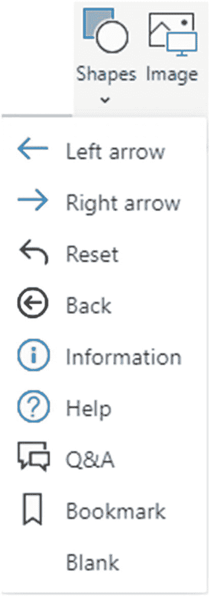
**图 24-10** 按钮弹出菜单

7. 选择`书签`作为按钮类型。一个书签样式的按钮将被添加到仪表板中。
8. 将按钮放置在仪表板的空白区域，并保持按钮处于选中状态。
9. 在`可视化`窗格中，将`按钮文本`设置为`开`。
10. 展开`文本`部分。
11. 输入`点击跳转`作为按钮文本。
12. 确保`操作`部分设置为`开`并展开它。
13. 确保按钮类型设置为`书签`。
14. 选择`Destination`（您在步骤 4 中创建的书签名称）作为链接到此按钮的书签。`可视化`窗格中的`操作`部分将如图 24-11 所示。

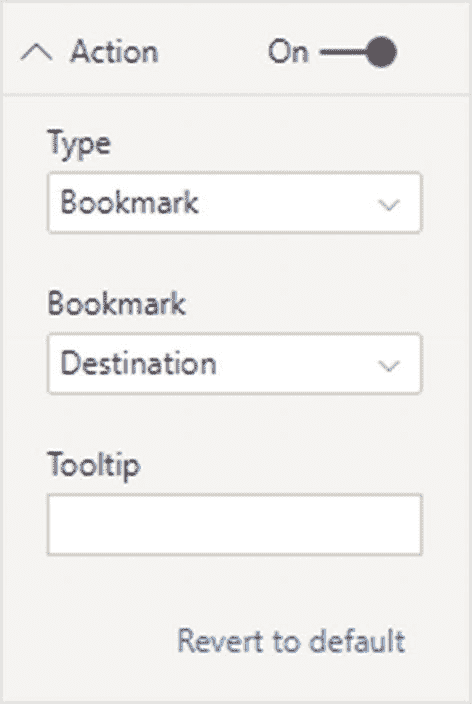
**图 24-11** 将按钮操作设置为“书签”

现在，如果您按住 `Ctrl` 键并单击该按钮，将会显示新页面。

> **注意：** 只有在 Power BI Desktop 中，您才需要使用 `Ctrl`+单击来激活按钮操作。一旦部署到 Azure 的 Power BI 服务中，只需单击即可。

> **警告：** 如果您在选中一个按钮的情况下插入另一个按钮，则现有按钮将被转换为新的按钮类型。

### 按钮选项

Power BI Desktop 为您提供了一系列可选的按钮类型。选择适合您要定义的交互的按钮类型，将帮助您快速、轻松地创建交互式仪表板。不过，值得注意的是，您可以在创建后更改任何按钮类型，并且选择按钮类型仅会应用预设值，如有必要，您可以稍后覆盖这些预设值。

表 24-2 列出了您可以选择的內建按钮类型。

**表 24-2** 按钮类型

| 选项 | 描述 |
| --- | --- |
| 左箭头 | 插入一个带有向左箭头的按钮。默认未指定操作。 |
| 右箭头 | 插入一个带有向右箭头的按钮。默认未指定操作。 |
| 重置 | 插入一个带有向左箭头的按钮。默认未指定操作。 |
| 返回 | 插入一个带有圆形内左箭头的按钮。操作自动设置为返回上一个使用的页面。 |
| 信息 | 插入一个带有信息符号的按钮。默认未指定操作。 |
| 帮助 | 插入一个带有帮助符号的按钮。默认未指定操作。 |
| 问答 | 插入一个带有标注框的按钮。操作指定为激活问答。 |
| 书签 | 插入一个带有书签符号的按钮。操作自动设置为调用书签——您只需指定要使用哪个即可。 |
| 空白 | 插入一个没有图标的按钮。默认未指定操作。 |

### 更改按钮类型

幸运的是，您最初选择的按钮类型并非一成不变。您可以快速轻松地在按钮类型之间切换。

1. 选择您要修改的按钮。
2. 在`可视化`窗格中，展开`操作`部分。
3. 确保`操作`部分设置为`开`并展开它。
4. 从可用操作列表中选择一个不同的操作。

### 按钮操作

目前有四种预定义的操作，你可以将其“附加”到 Power BI 仪表板按钮上，从而为报表增加交互性。表 24-3 展示了可以关联到按钮的操作。

**表 24-3** 按钮操作

| 选项 | 描述 |
| --- | --- |
| 返回 | 添加一个预设为返回上一页的后退按钮。 |
| 书签 | 此类型按钮允许你选择一个要应用的书签。这使你可以修改页面筛选器、切片器和排序顺序，或者跳转到另一个页面——或者两者兼而有之。 |
| 问答 | 显示一个问答资源管理器窗口。 |
| `Web URL` | 在“可视化”窗格的“操作”部分选择“`Web URL`”后，跳转到你输入的 URL。 |

> **注意**
> 当你仅使用按钮在页面之间移动时，通常最好为你要使用的目标页面定义一个书签，且*不*启用该书签的数据和显示选项（如前所述）。这将确保你跳转到目标页面时，不会添加意外的筛选器或切片器。

### 格式化按钮

如你所料，Power BI 允许你像格式化仪表板中的任何视觉对象一样格式化按钮。你可以格式化的元素包括：
* 按钮文本——实际上，你可以定义三种不同的按钮文本：
  * *默认状态*：按钮文本的标准外观
  * *悬停状态*：当光标置于按钮上方时显示的文本
  * *按下状态*：按钮被按下后的状态（假设任何按钮操作不会立即显示新页面）
* 轮廓
* 按钮填充
* 按钮背景

从技术上讲，你还可以为按钮添加标题和边框，但在我看来，鉴于其他可用选项，这些在很大程度上是多余的。

**图 24-12** 按钮格式化

1. 选择你想要修改的按钮。
2. 在“可视化”窗格中，展开“按钮文本”部分。
3. 从可能的按钮状态弹出列表中选择“悬停时”。
4. 为悬停状态添加文本。我将简单添加`悬停`。
5. 修改字体、字体颜色、对齐方式和文本大小。
6. 展开“图标”部分，然后从可用图标列表中选择一个不同的图标。
7. 展开“轮廓”部分，修改默认状态的轮廓颜色和轮廓粗细。
8. 从可能的按钮状态弹出列表中选择“悬停时”。
9. 修改悬停状态的轮廓颜色和轮廓粗细。
10. 展开“填充”部分，修改默认状态的填充颜色。
11. 从可能的按钮状态弹出列表中选择“悬停时”。
12. 修改悬停状态的填充颜色。
13. 你可以在图 24-12 中看到更改两个按钮状态格式化的效果。

> **注意**
> Power BI Desktop 目前不允许你将自定义图像应用到按钮。但是，正如你在下一节中看到的，你可以使用图像和形状作为按钮来产生相同的效果。

### 使用图像和形状作为按钮

很可能是为了弥补当前无法将自定义图像添加到按钮的不足，Power BI Desktop 仍然允许你使用图像和形状作为按钮。值得庆幸的是，这非常简单——因为它与你刚才看到的为按钮设置操作方法完全类似。

以下是一个示例，演示如何使用你之前创建的书签跳转到一个页面：
1. 确保你已向要跳转到的页面（“目标”页面）添加了一个书签。
2. 在另一个页面中，添加或选择你想要用作单击元素以跳转到目标页面的图像。
3. 选中图像后，展开“可视化”窗格中的“操作”部分。
4. 确保“操作”部分设置为“开”并将其展开。
5. 从可用操作列表中选择“书签”。
6. 从可用书签列表中选择书签名称。

> **注意**
> 你可以将完全相同的技术应用于从“插入”功能区添加的任何形状。

### 跨多个页面应用切片器

第 22 章向你介绍了切片器的概念及其在 Power BI 仪表板中的应用。然而，切片器还有更多秘密有待揭示。具体来说，你可以微调切片器在多页报表中的应用，并指定哪些切片器应用于 Power BI 报表中的哪些页面。这意味着，例如，你可以为报表创建一个包含一系列切片器的“主页”，然后调整 Power BI Desktop，确保此页面上的任何或所有切片器将自动应用于其他选定的页面。这为读者保证了可预测且令人安心的用户体验，同时也避免了跨多个页面复制和粘贴一组切片器的必要性。另一个不可忽视的因素是，这种方法释放了报表各页面上相当大的屏幕空间。

假设你有一个报表，其第一页名为“封面页”，包含几个切片器，此外还有三个其他页面。以下介绍如何将初始页面中的切片器应用到其他页面：
1. 单击包含切片器的页面选项卡。
2. 选择你希望将其效果扩展到其他页面的切片器。
3. 在“视图”窗格中，单击“同步切片器”。“同步切片器”窗格将出现，显示报表中所有页面的列表。页面列表的第三列（指示切片器在报表页面上是否可见）当前页已被选中。你可以在图 24-13 中看到这一点。

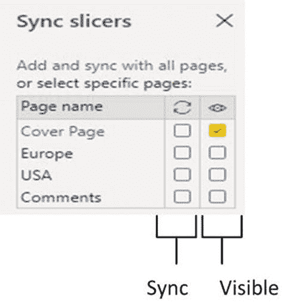
**图 24-13** “同步切片器”窗格

4. 为所有其他页面选中第二列（指定切片器在该页面上处于活动状态）。你可以在图 24-14 中看到这一点。

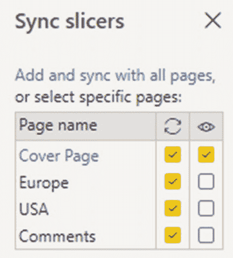
**图 24-14** 切片器跨多个页面同步后的“同步切片器”窗格

5. 单击窗格右上角的叉号图标关闭“同步切片器”窗格。

现在，当你使用选定的切片器交互式地筛选数据时，切片器的效果将扩展到当前页面之外，影响所有选定的页面。

> 这可能看起来违反直觉，但你必须为*当前页面*选中同步框——否则切片器将对其他页面无效。

## 跨多个页面设置切片器可见性

如果你不仅希望切片器跨多个页面产生效果，还希望它们出现在将主动筛选数据的页面上，那么你只需同时选中可见性列中的框和同步框即可。这避免了必须跨多个页面复制和粘贴切片器。另一个优点是，在初始页面上格式化或重新定位源切片器将导致在其他页面上已设为可见的切片器自动更新以反映任何更改。

> **注意**  
> 目前无法通过按住 `Ctrl` 键单击源切片器来同时选择多个切片器并定义它们的应用和可见性。

## 模板

在本书的结尾，我想让你关注一种 Power BI 技术，它能在批量制作仪表板时为你节省大量时间。这就是使用包含以下内容的模板：

-   标准布局（例如徽标和图形元素）。
-   预定义样式（位于附加到模板文件的 JSON 样式表中）。你在第 23 章中已经见过。
-   选定的第三方视觉对象。

Power BI 模板本质上就是一个标准的 Power BI Desktop 文件，它包含上述部分或全部元素，可供你将其用作仪表板的基础，从而呈现标准化的企业外观和风格，同时还能节省时间，因为你无需每次都向新仪表板添加相同的图形元素。

将文件另存为仪表板的步骤如下：

1.  创建一个标准的 Power BI Desktop 文件，其中包含所有元素（徽标、样式、装饰图形、重复元素，例如上次数据更新的日期等）。
2.  在“文件”菜单中，单击“另存为...”。
3.  选择 Power BI 模板文件（`*.pbit`）作为保存类型。
4.  为文件命名，然后单击“保存”。
5.  将出现“导出模板”对话框，你可以在其中输入模板的说明。你可以在图 24-15 中看到此对话框。
    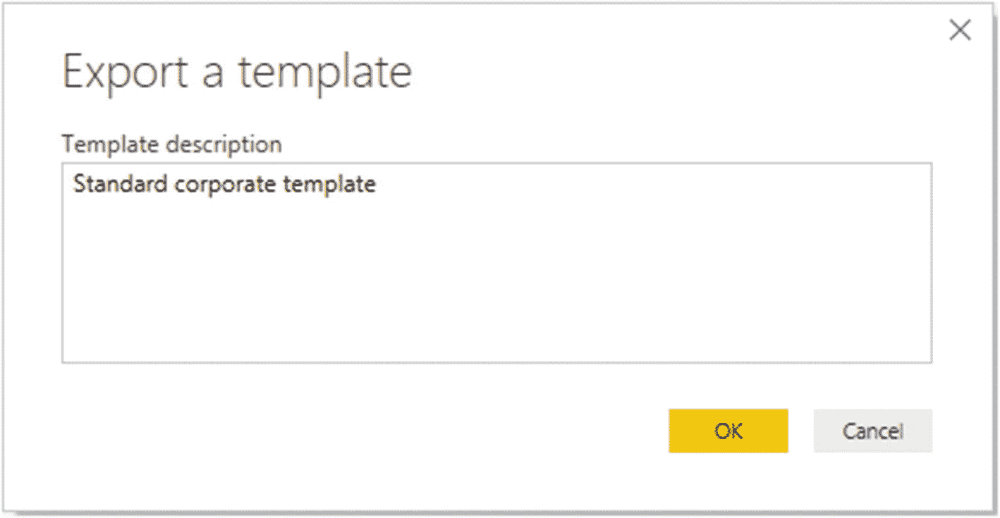
    图 24-15 导出模板对话框
6.  单击“确定”。

现在，当你想要基于该模板创建新仪表板时：

1.  单击“文件”➤“打开”，然后单击“浏览”按钮。将出现 Windows 的“打开”对话框。
2.  在对话框右下角，选择 Power BI 模板文件（`*.pbit`）。
3.  导航到你创建的模板文件，选中它，然后单击“打开”。

模板将作为一个新文件打开。这意味着当你保存该文件时，Power BI Desktop 会提示你输入文件名——这可以防止你打开现有文件（用作模型）并意外覆盖原始文件。

## 结论

在这最后一章中，你学习了如何增强仪表板，并将其发展为结构化报表，引导用户逐步深入地理解他们正在使用 Power BI 分析的数据。你了解了如何通过在报表内部以及跨不同报表添加数据钻取路径来创建数据故事。

你还发现了如何使用弹出式工具提示来突出显示特定的数据元素，以及如何使用按钮和书签定义报表页面之间的特定路径。随后你学习了如何控制切片器在多页报表的全部或部分页面上的影响。

作为最后的点睛之笔，你了解了如何创建可重复使用的模板，这不仅加快了仪表板的创建速度，还能向用户和观众呈现标准化的企业外观和风格。

至此，你使用 Power BI Desktop 创建仪表板的旅程已抵达终点。我真诚地希望你享受这个过程，并能用这个真正强大的工具，在数据分析中获得无限乐趣。