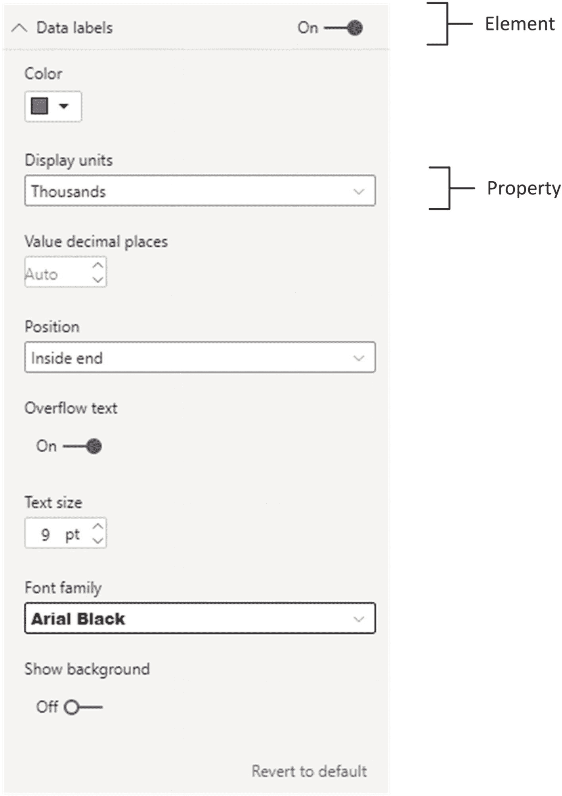
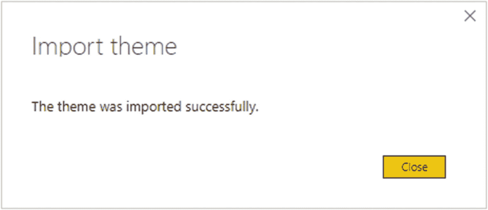
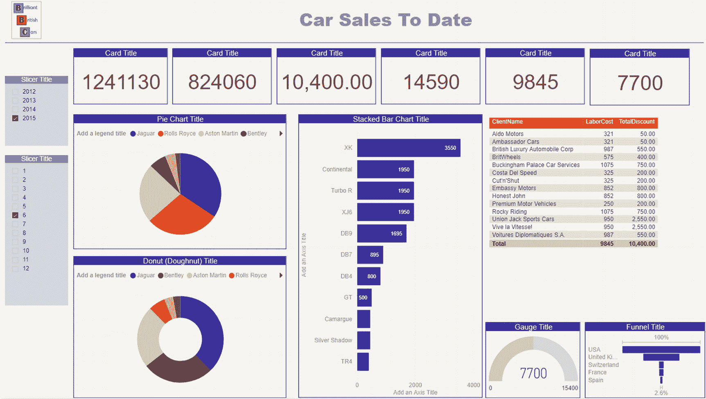

# 1. Power BI 主题简介

在创建引人注目、赋能用户的仪表板方面，Power BI 已风靡全球。它凭借其易用性、广泛的连接选项以及多样化的可视化效果，在分析领域占据了主导地位。

然而，格式化（以及重新格式化）仪表板可视化效果可能既耗时又重复——同样，标准化多个仪表板的呈现方式，为一套报表创建统一的外观和风格也是如此。大多数用户更愿意将时间花在分析和交付有意义的见解上，而不是为图表和表格应用颜色和字体选择。

这正是 Power BI *主题*的创建和应用发挥作用之处。主题是对仪表板部分或全部格式的标准化定义。其范围可以从定义调色板和一系列字体选择，到每个可视化效果的详细规范。应用主题可以让你*即时*格式化仪表板中几乎每一个可视化效果。更重要的是，你随后对主题所做的任何更改，只需点击几下即可重新应用，以更新仪表板的呈现方式。主题可以创建一次，然后应用于几十个甚至数百个 Power BI 仪表板，从而确保整个部门甚至整个组织内呈现风格的一致性和严格的标准化。

主题可以像你要求的那样简单或详细。它们可以指定标准化的字体、文本颜色和字号，或者设定每种可视化效果类型格式化时的最细微细节。事实上，主题被设计为在多个层级上工作——从通用元素开始，然后逐步深入到仪表板中每个元素呈现方式的严格定义。这为你定义如何标准化 Power BI 仪表板提供了多种选择。

## 主题基础

从技术上讲，主题是 JSON 文件。也就是说，它们使用 JSON（JavaScript 对象表示法）格式来存储仪表板对象如何格式化的定义。但如果你以前从未使用过，甚至从未听说过 JSON，也不必担心，因为我将在本书中解释你需要了解的所有内容。目前只需记住一点：主题之于 Power BI，就像外部样式表（非常类似于 Microsoft Word 使用的样式表）。使用外部文件定义格式的优势在于，你可以简单地将主题作为小的文本文件发送给同事，他们只需点击几下即可将其应用到自己的任何 Power BI 仪表板中。主题也可以集成到 Power BI 模板中，从而进一步加快仪表板的创建过程。

主题应用于 Power BI Desktop 文件。加载后，它们就成为 Power BI Desktop `.pbix` 文件的一个不可分割的组成部分。当然，当你发布仪表板时，这些格式也会随之带入 Power BI 服务。此外，你可以通过几次点击在不同的主题文件之间切换，以尝试不同的格式化方法或应用完全不同的外观和风格。同样幸运的是，应用主题文件并非一成不变，因为你随时可以切换到基于另一个主题的 Power BI 呈现风格。因此，你可以自由地尝试不同的风格，直到找到适合你正在创建的特定仪表板的外观和感觉。

一个主题允许你预设 Power BI 格式窗格中定义的几乎所有内容。因此，它可以包含以下内容的格式定义：

*   调色板

*   页面

*   插入的对象（文本框、形状、按钮和图像）

*   内置可视化效果（表格、图表、地图和其他可视化效果）

你甚至可以将主题应用于 Power BI Desktop 的“筛选器”窗格。原理很简单：如果你可以在 Power BI Desktop 的格式窗格中更改呈现方式，那么你就可以使用主题文件来定义该格式。

仪表板主题的可移植性意味着现在有大量不同的主题可供免费使用，以增强 Power BI 仪表板的呈现效果。你甚至可能体验过一些主题，这些主题作为 Power BI Desktop 的组成部分提供，或通过 Web 共享。

在阅读本书并学习如何创建这些主题后，你也能开发出可供分享的主题——与朋友、同事，甚至全世界分享。

## 主题剖析

从一开始就理解主题在两个不同层面运作是很重要的。首先，主题可以被定义为以“通用”方式运作。也就是说，你可以定义一组高级规范来设定仪表板及其包含的可视化效果的核心方面，而无需深入细节。通过这种方式，你可以快速轻松地定义：

*   颜色

*   标准字体属性

*   所有可视化效果的共享元素

*   特定于某些可视化效果类型的特定元素

你将在第 3 章中了解如何创建“通用”主题。

然后，在更细节的层面（一旦你对主题的工作方式有了透彻的理解），你可以指定*每种可视化效果的每个元素的精确格式*，从而完全控制仪表板中每个元素的外观。从第 5 章到第 12 章的主题是在单个可视化效果层面所需的 JSON 的深入定义。

然而，不要以为你必须在两种不同的方法之间做出选择。事实是，一个主题 JSON 文件可以“混合搭配”这两种方法，这样你既可以定义一组整体的风格原则，*同时*也可以添加针对你希望在仪表板中如何显示某些可视化效果的高度具体定义。原则始终是，除非在主题文件中找到了更详细的定义，否则将应用更通用层级的格式。

# 主题与格式窗格

主题本质上就是你通过 Power BI 格式窗格手动定义的格式集合。因此，你需要了解格式窗格是什么以及如何使用它来格式化仪表板对象。不过，我不会在本书中详细解释格式窗格的复杂性，关于如何手动格式化仪表板的完整细节，请参考我的另一本书 `Pro Power BI Desktop`。

尽管如此，仍有必要回顾一下格式窗格的核心元素，以及格式设置在通用层面的工作原理。

本质上，格式化是一个由三个层次组成的层级结构：

*   **视觉对象**（表格或图表——也可以是页面）。

*   **元素**：这是你想要格式化的视觉对象的某个方面。它对应于 Power BI Desktop 中格式窗格的可展开部分（也称之为选项卡或卡片）。例如，图表的 X 轴部分就是一个元素。

*   **属性**（通常称为特性）：这是你定义的具体设置。例如，字体颜色。

你可以在图 1-1 中（以堆积柱形图视觉对象为例）看到这一点，其中“数据标签”元素已展开，显示了可以为数据标签设置的所有可用属性。

图 1-1 格式窗格

在创建主题文件时，牢记这个层级结构非常重要，因为整个 JSON 结构正是基于这种嵌套方式构建的——这将在第 3 章中进一步说明。

# 编写 JSON 文件

由于除了最简单的主题文件外，你都需要编写或修改实际的 JSON 文件，因此你需要选择一个工具来进行修改。由于 JSON 是一种基于文本的格式，有大量的工具可供选择。你可以完全自行选择一款称手的工具。我使用过的工具有：

*   Notepad

*   Notepad++

*   Visual Studio

*   Visual Studio Code

*   在线 JSON 编辑器

可用的工具多达几十种，选择哪款应用完全取决于你。我唯一的建议是，找到一款你用起来舒服、并且能平衡易用性和你所需强大功能的工具。最重要的是，它必须能够保存或导出文本文件。实际上，因为你可能会反复测试和修改你的选择，你选择的工具需要具备多级撤销和重做功能，以及强大的查找和替换能力。

在为 Power BI 编写主题文件时，一个能够以易读格式显示 JSON 的工具是必不可少的。这是因为 Power BI Desktop 使用的 JSON 结构可能非常复杂，因此能够看到文本的嵌套层级及其结构方式会大有帮助。不过，我不想讲得太超前，相关内容将在本书后面部分再提及。

如果你还没决定好，我建议下载 Notepad++。这是一款免费的文本编辑器，能够以非常易读的格式显示 JSON。

# 应用主题

在探讨如何创建你自己的主题之前，最好先提醒你一下主题能够产生的深远影响。希望这能激励你学习更多知识，并鼓励你创建自己的主题文件。

例如，以图 1-2 所示的一个非常简单的仪表板为例。（这是示例文件中的`SampleDashboard.pbix`文件）。

图 1-2 一个未格式化的仪表板

这个仪表板完全是“普通样式”。也就是说，完全没有应用任何格式。试想一下，如果这个仪表板是一个 15 页的报告，而你需要让它不仅看起来赏心悦目，还要符合公司标准。在最坏的情况下，这可能需要耗费数小时。

然而，你很幸运地拥有一个定义了所有公司标准的主题 `JSON` 文件。应用它，你只需要这么做：

图 1-3 主题文件导入成功

1. 单击“`视图`”以激活“`视图`”功能区。
2. 单击“`主题`”弹出菜单。
3. 单击“`浏览主题`”。
4. 导航到示例文件并选择主题文件（本例中为`BaseTheme.json`）。
5. 单击“`打开`”。几秒钟后，您将看到图 1-3 中的对话框。
6. 单击“`关闭`”。

就是这样！你的仪表板（每个页面上的每个对象）现在已瞬间完成格式化。结果如图 1-4 所示。

图 1-4 应用主题文件后的仪表板

现在，你可以根据需要添加任何最终的格式设置，以在单个元素级别覆盖主题（毕竟，主题是节省时间的工具，而非束缚）。最终结果几乎是确定无疑的：你节省了大量添加视觉呈现细节的时间，并确保了你的仪表板符合统一的外观和风格。

**注意**

你在此示例中应用的主题文件，其目的并非展示仪表板设计的精妙之处，也非基于前沿的设计原则。相反，它的设计目的只是为了说明使用主题文件重新格式化整个仪表板是多么快速和简单。

# 结论

在本章中，你已经了解了主题究竟是什么以及它们可以有多么强大。现在，是时候继续前进，开始创建你自己的主题了。首先，我们将从使用 `Power BI Desktop` 为你编写 `JSON` 开始——你将在下一章中发现这一点。

