# 2. 在 Power BI Desktop 中创建并自定义主题

如果你并非 IT 背景出身（或者以前从未使用过 JSON 文件），并且一想到要手工编写复杂的文本结构就感到恐惧，那么现在可以放松并深呼吸了，因为定义一个简单而强大的 Power BI 主题文件异常容易——**无需编写或修改一行代码**。

这是因为 Power BI Desktop 允许你（通过几次点击）指定一组核心格式属性，这些属性将应用于整个仪表板。不仅如此，一旦你定义了这些属性，Power BI Desktop 会自动为你生成 JSON 主题文件，以便你将其用于其他仪表板或与同事共享。所有这些操作都是通过“视图”菜单中“主题”按钮的`自定义当前主题`选项完成的。

虽然这种方法无法让你精确设计每种可视化类型的每一个格式属性，但它能让你在最多几分钟内创建出一种标准的演示风格——随后你可以以此主题为基础进行进一步开发。更重要的是，由此生成的主题文件是了解 JSON 主题如何在 Power BI 中运作的绝佳入门材料。

但请注意，通过 Power BI Desktop 界面创建主题*无法*达到使用“手工编写”的 JSON 所能实现的精细演示级别。因此，最好将你在本章中学到的技巧既视为对主题主题的实用入门，也视为一种极快的方法，用于开发可应用于整个仪表板的简单样式原则。

为了给这个过程提供一些结构，这种直接在 Power BI Desktop 中进行的“交互式主题生成”将你可以更改的主题元素分为以下五个类别：

*   **名称和颜色**：在此处你可以为主题命名，并指定仪表板中使用的调色板和主要颜色。
*   **文本**：在此处你可以为仪表板中的各种元素定义核心文本属性，例如字体、字号和颜色。
*   **视觉对象**：在此处你可以指定所有视觉对象的关键公共属性。
*   **页面**：在此处你可以设置仪表板页面的基本属性。
*   **筛选器窗格**：允许你指定筛选器窗格的显示方式。

你不必指定 Power BI Desktop 在“自定义当前主题”对话框中提供的每个选项。你可以更改几个选项，或者重置所有可用选项（以及介于两者之间的任何步骤）。

## 创建简单主题

作为入门，让我们创建一个非常简单的 JSON 主题文件，该文件会更改 Power BI Desktop 用于颜色选择的调色板中的几种颜色。

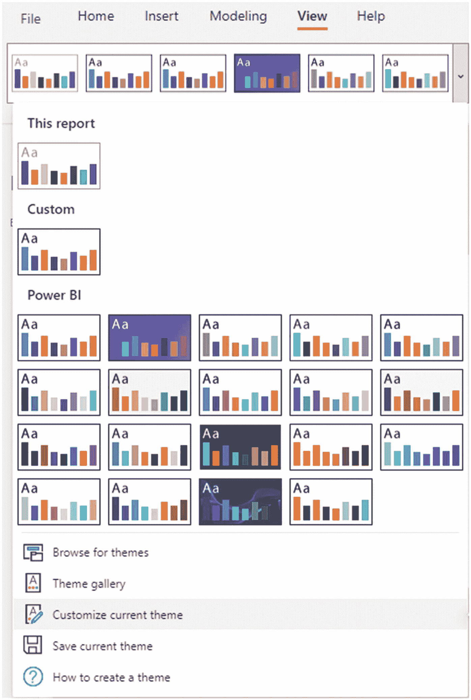

图 2-1 “主题”弹出窗口

1.  激活“视图”菜单。
2.  点击“主题”的弹出按钮。你将看到类似于图 2-1 所示的选项。

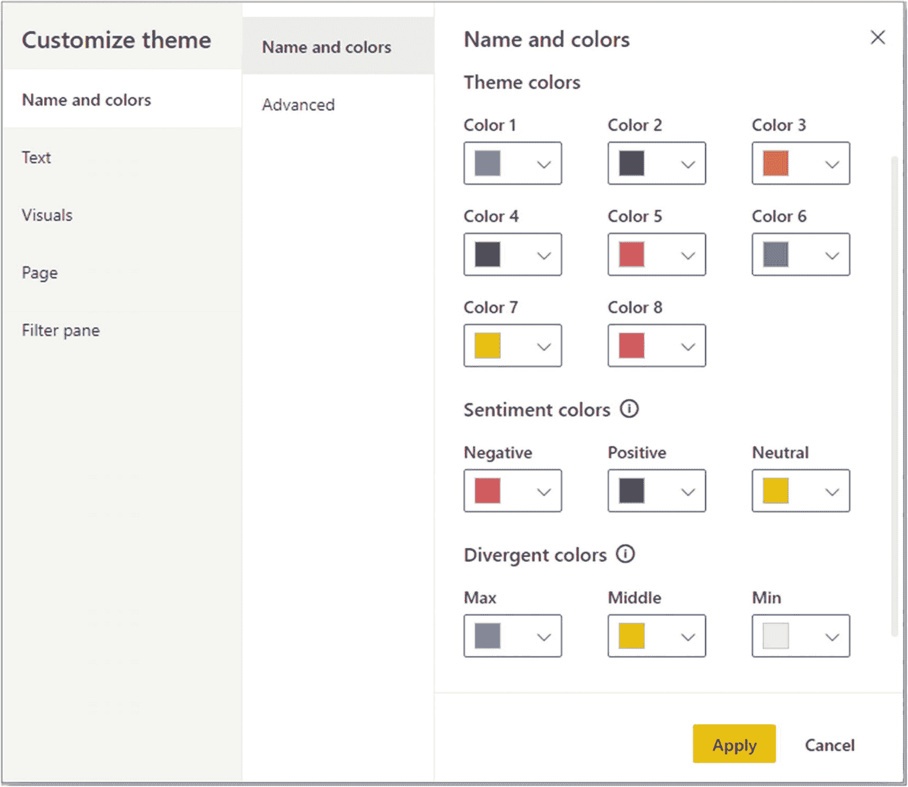

图 2-2 “自定义主题”对话框

1.  点击“自定义当前主题”。将出现如图 2-2 所示的对话框。
2.  在该对话框中，为前几个“主题颜色”选择不同的颜色（这些颜色对应于标准 Power BI 调色板中的颜色，从第三列开始从左到右排列）。值得注意的是，你无法更改调色板中的前两种（单色）颜色。
3.  点击“应用”。所选颜色将应用到当前仪表板。
4.  点击“视图”➤“主题”➤“保存当前主题”。将出现“另存为”对话框。
5.  浏览到合适的目录，并为主题文件输入一个名称。此文件*必须*具有`.json`扩展名。
6.  点击“保存”。

就这样！现在你拥有一个功能完善的 JSON 主题文件，可以将其应用于其他仪表板。只需在应用了此主题文件的仪表板中，显示任意元素的“颜色”弹出窗口，即可看到主题的效果。你会看到可用颜色的第一行已更改为你在前面步骤 4 中选择的颜色（嗯，前两种颜色除外，它们将始终为白色和黑色）。

幸运的是，你刚才所做的选择并非一成不变。因此，你可以随时通过重复刚才的过程、选择任何可用选项并重新保存主题文件来更改主题设置。

**注意**

当你重新保存主题文件时，Power BI Desktop **不会**记住你上次使用的名称，并且默认会使用`Theme.json`。如果你想更新现有文件，请记得在点击“保存”之前选择之前的文件名。当然，你需要确认希望覆盖现有文件。

# 名称和颜色设置

自定义主题所能定义的内容远不止调色板。因此，在解释了基础知识之后，现在是时候回顾一下使用 Power BI Desktop 主题界面时所有可用的自定义选项了。这些选项都出现在图 2-2 所示的对话框中。

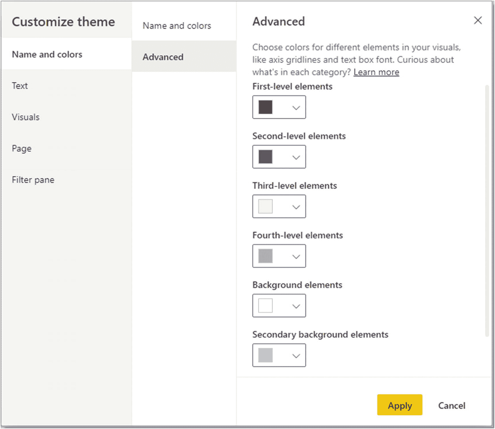

图 2-3 “自定义主题/高级”选项卡

- **名称**：此字段位于“自定义主题/名称和颜色”选项卡的顶部（尽管在图 2-2 中不可见），允许您在 JSON 文件内部添加文本描述。这对于跟踪主题定义的演变，或简单地提醒您某个特定主题的用途非常有用。

- **情绪颜色**：这些颜色用于 KPI 和瀑布图，以指示正面、负面或中性结果。

- **发散颜色**：这些颜色用于条件格式，以显示数据何时落在一个范围内。

- **高级**（颜色）：高级选项允许您设置一系列六种颜色，这些颜色将应用于广泛的 Power BI 仪表板元素。您可以在图 2-3 中看到“自定义主题/高级”选项卡。

由于这些颜色元素的名称有些抽象，以下是每个颜色设置将修改的元素的完整列表：

- **一级元素**：（数据点外部标签背景色、趋势线颜色、文本框默认颜色、表和矩阵值及总计字体颜色、数据条轴线颜色、卡片数据标签、仪表标注值颜色、KPI 目标颜色、KPI 文本颜色、切片器项目颜色（焦点模式时）、切片器下拉项字体颜色、切片器数字输入字体颜色、切片器标题字体颜色、散点图比率线颜色、折线图预测线颜色、地图引导线颜色、筛选器窗格和卡片文本颜色）

- **二级元素**：“浅色”次要文本类、标签颜色、图例标签颜色、坐标轴标签颜色、表和矩阵标题字体颜色、仪表目标和目标引导线颜色、KPI 趋势轴颜色、切片器滑块颜色、切片器项目字体颜色、切片器轮廓颜色、折线图悬停颜色、多行卡片标题颜色、带状图表描边颜色、形状地图边框颜色、按钮文本字体颜色、按钮图标线条颜色、按钮轮廓颜色

- **三级元素**：坐标轴网格线颜色、表和矩阵网格颜色、切片器标题背景色（焦点模式时）、多行卡片轮廓颜色、形状填充颜色、仪表弧背景颜色、已应用筛选器卡片背景颜色、禁用按钮轮廓颜色

- **四级元素**：图例暗色、卡片类别标签颜色、多行卡片类别标签颜色、多行卡片条形颜色、漏斗图转换比描边颜色、禁用按钮文本字体颜色、禁用按钮图标线条颜色

- **背景元素**：（数据点内部标签背景色、切片器下拉项背景颜色、环形图描边颜色、矩形树图描边颜色、组合图背景颜色、按钮填充颜色、筛选器窗格和可用筛选器卡片背景颜色）

- **次要背景元素**：表和矩阵网格轮廓颜色、形状地图默认颜色、带状图表丝带填充颜色（当“匹配系列”选项关闭时）、当背景未设置为 `FFFFFF` 时，禁用按钮填充颜色和禁用按钮轮廓颜色

为了让您了解这些格式是如何应用的，请看图 2-4。请注意，此仪表板并非完整参考——它仅旨在向您展示通用颜色设置原则的工作原理。

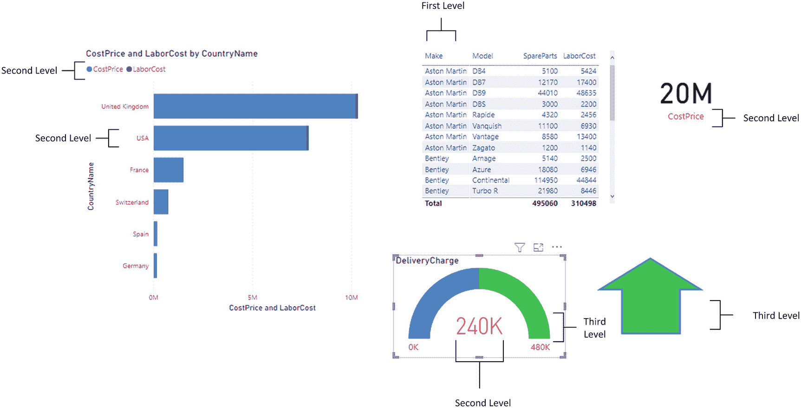

图 2-4 高级颜色自定义结构分解

## 文本设置

正如您可能期望的那样，还有一组文本格式可以定义为自定义主题的一部分。同样，为了使定义元素更容易，它们被细分为若干（此处为四个）不同的元素。这些子元素是：

- **常规**：格式化表和矩阵列标题、矩阵行标题、表和矩阵网格、表和矩阵值

- **标题**：格式化类别轴标题、数值轴标题、多行卡片标题、切片器标题

- **卡片和 KPI**：格式化卡片数据标签、KPI 指示器

- **选项卡标题**：格式化关键影响因素标题

与这些子元素之一对应的每个表格都允许您设置：

- 字体

- 字号

- 字体颜色

让我们逐一查看这些子元素。

“自定义主题/文本/常规”选项卡如图 2-5 所示。

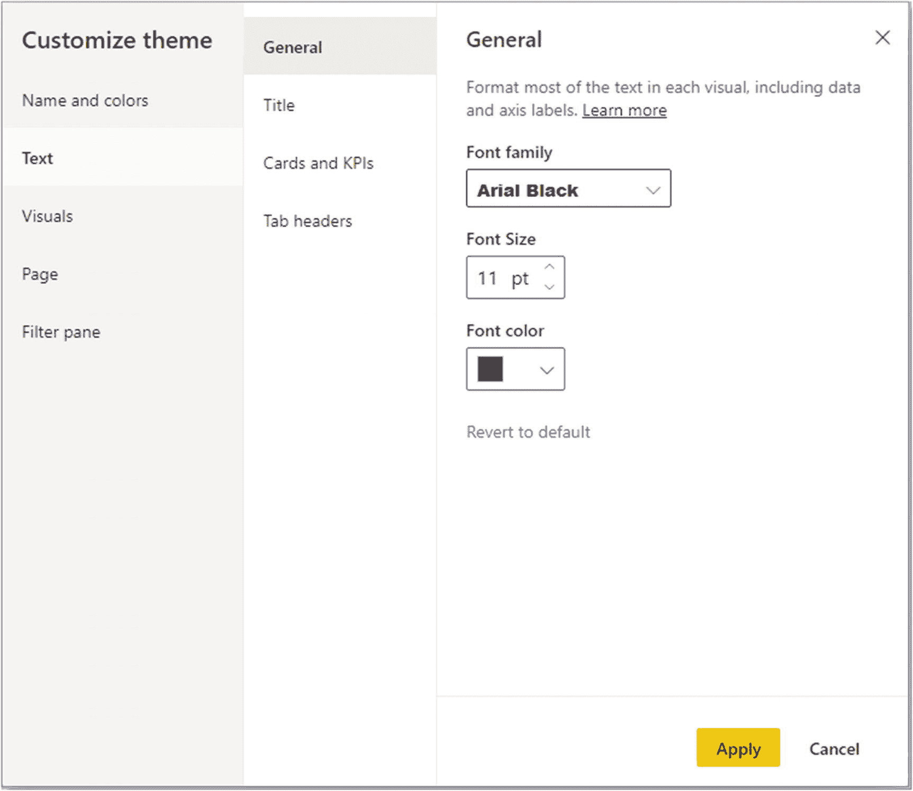

图 2-5 “自定义主题/文本/常规”选项卡

**注意**：正如您将在后续章节中看到的，此设置对应于 JSON 中的 `label` 元素。

“自定义主题/文本/标题”选项卡如图 2-6 所示。

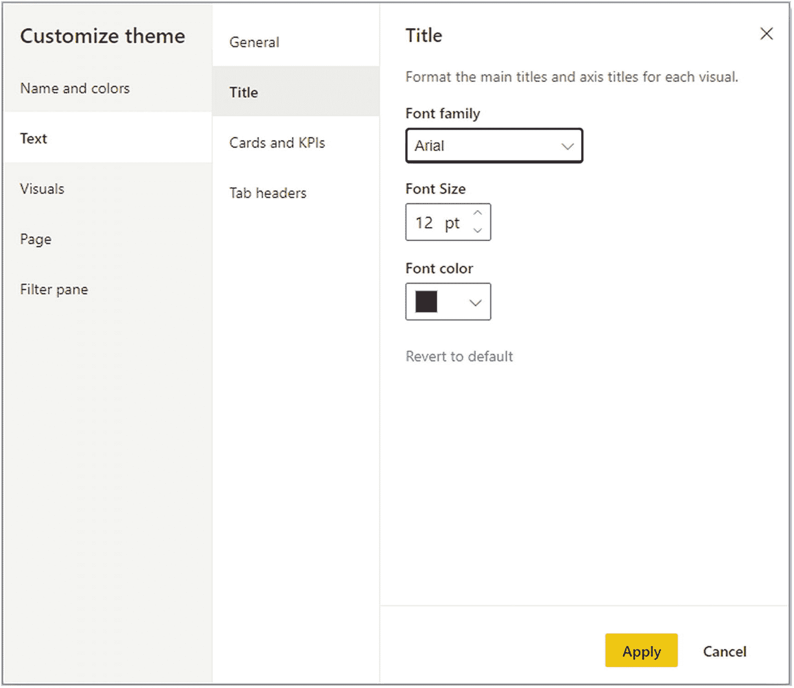

图 2-6 “自定义主题/文本/标题”选项卡

**注意**：正如您将在后续章节中看到的，此设置对应于 JSON 主题中的 `title` 元素。

“自定义主题/文本/卡片和 KPI”选项卡如图 2-7 所示。

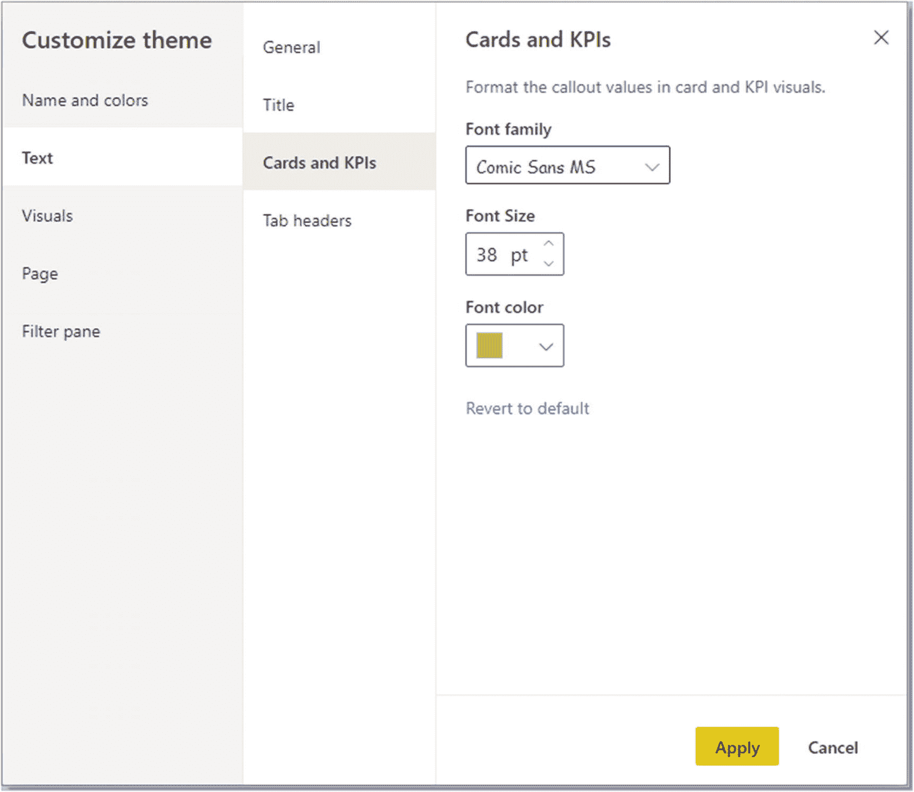

图 2-7 “自定义主题/文本/卡片和 KPI”选项卡

**注意**：正如您将在后续章节中看到的，此设置对应于 JSON 中的 `callout` 元素。

“自定义主题/文本/选项卡标题”选项卡如图 2-8 所示。

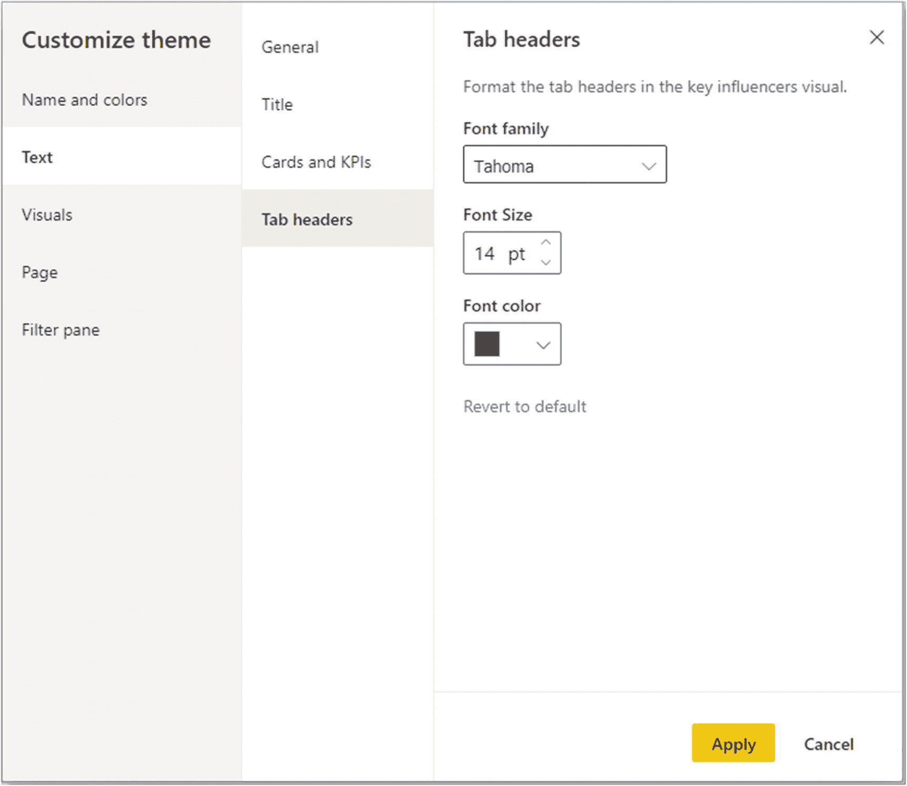

图 2-8 “自定义主题/文本/选项卡标题”选项卡

**注意**：正如您将在后续章节中看到的，此设置对应于 JSON 中的 `header` 元素。

为了让您了解这些文本格式是如何应用的，请看图 2-9。请注意，此图示并非完整参考——同样，其目的仅仅是向您展示通用颜色设置原则的工作原理。

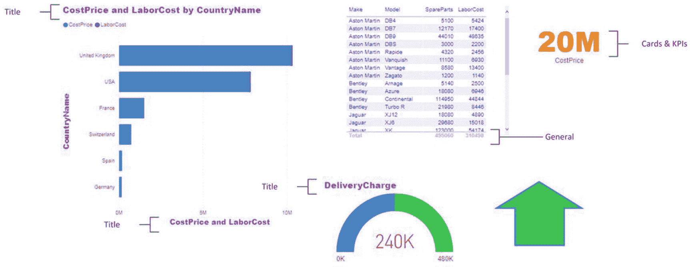

图 2-9 高级文本自定义结构分解

**注意**：您可以从图中看到，在名称和颜色部分定义的颜色会覆盖在文本部分设置的颜色。

# 视觉设置

Power BI 中的所有视觉对象都包含一组核心元素，你可以全局定义其格式。这确保了你在仪表板中创建的所有内置视觉对象具有标准的外观和风格。你可以定义的元素包括：
- `Background`：视觉对象的背景色和透明度
- `Border`：视觉对象的边框属性
- `Header`：视觉对象标头（包括其可见性）
- `Tooltip`：弹出式工具提示元素的颜色

这些元素中的每一个都与你在 Power BI Desktop 的格式窗格中格式化视觉对象时习惯使用的标准卡片（也称为元素或部分）非常对应。它们显示了你可能调整过多次的相同属性，但呈现方式略有不同。

让我们通过查看 `Customize theme` 对话框的 `Visuals` 部分中的四个选项卡，详细了解这些设置的自定义方式。

`Customize theme/Visuals/Background` 选项卡如图 2-10 所示。此选项卡允许你设置所有视觉对象的背景色以及透明度级别。
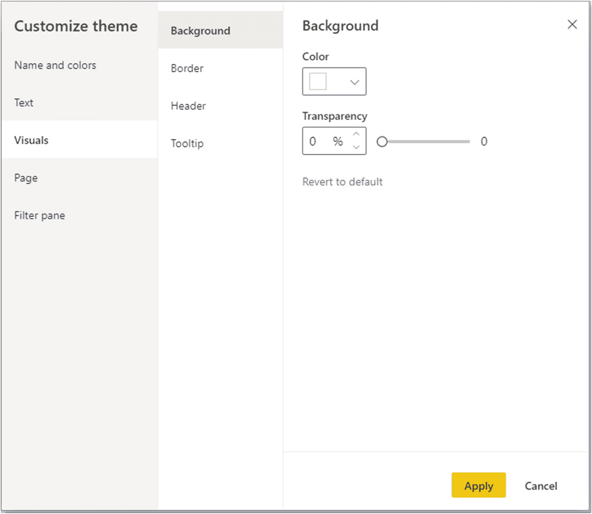
图 2-10 `Customize theme/Visuals/Background` 选项卡

`Customize theme/Visuals/Border` 选项卡如图 2-11 所示。如你所料，此选项卡允许你指定是否需要边框，如果需要，应使用何种颜色。你还可以通过设置半径数值来定义圆角边框。
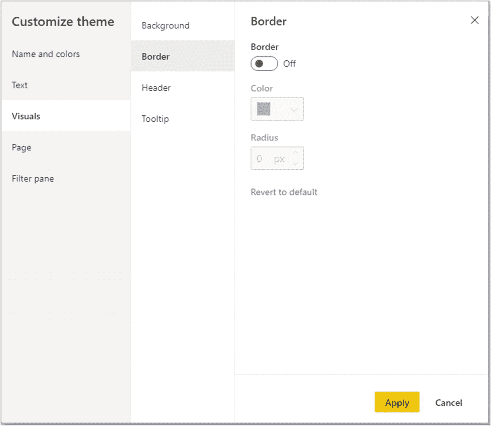
图 2-11 `Customize theme/Visuals/Border` 选项卡

`Customize theme/Visuals/Header` 选项卡（如图 2-12 所示）允许你设置所有视觉对象标头的基本属性。具体来说，你可以定义：
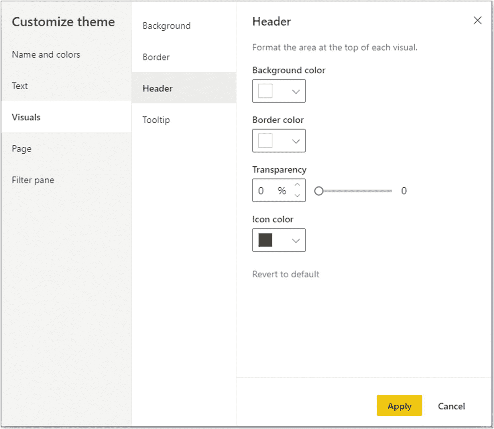
图 2-12 `Customize theme/Visuals/Header` 选项卡
- 标头背景色
- 标头边框颜色
- 标头透明度
- 标头中图标的颜色

`Customize theme/Visuals/Tooltip` 选项卡使你可以定义所有弹出式工具提示的背景、标签和数值字体颜色。如图 2-13 所示。
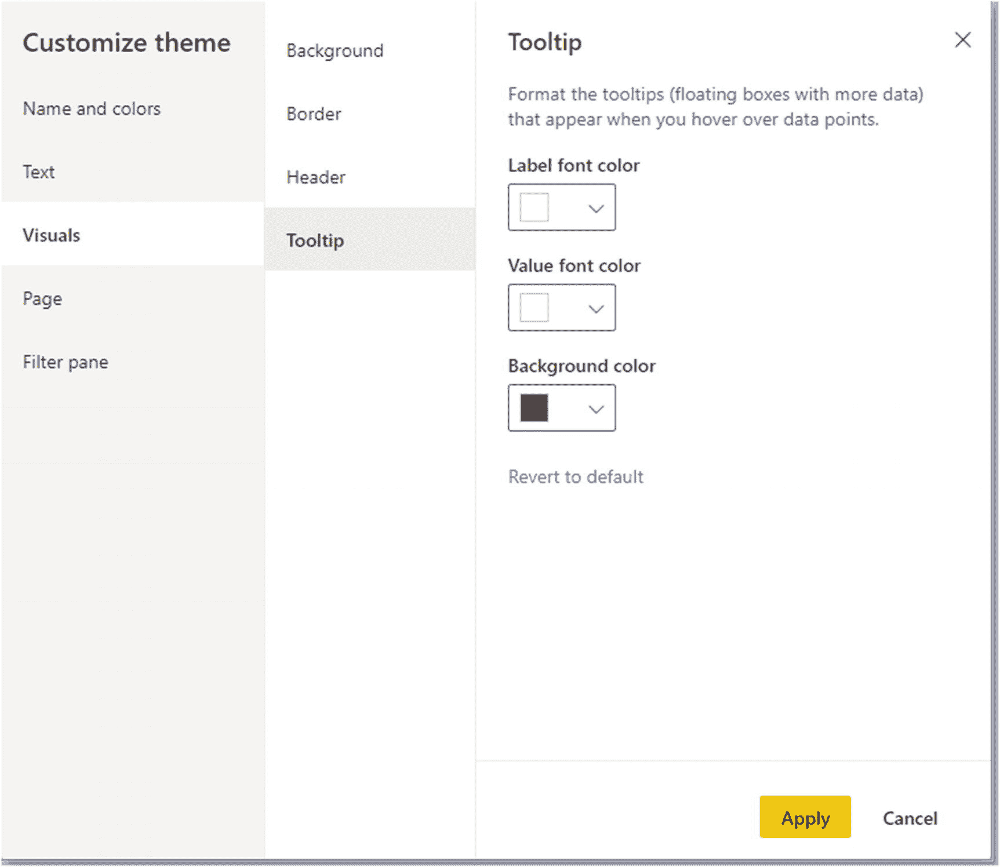
图 2-13 `Customize theme/Visuals/Tooltip` 选项卡

## 页面设置

在使用 Power BI Desktop 创建 `JSON` 主题文件时，有两个关于页面格式的设置你可以进行修改。它们是：
- 墙纸（页面本身以外的区域）
- 页面背景（任何视觉对象下方页面的颜色）

可以通过 `Customize theme/Page` 对话框访问这些设置。

`Customize theme/Page/Wallpaper` 选项卡如图 2-14 所示。
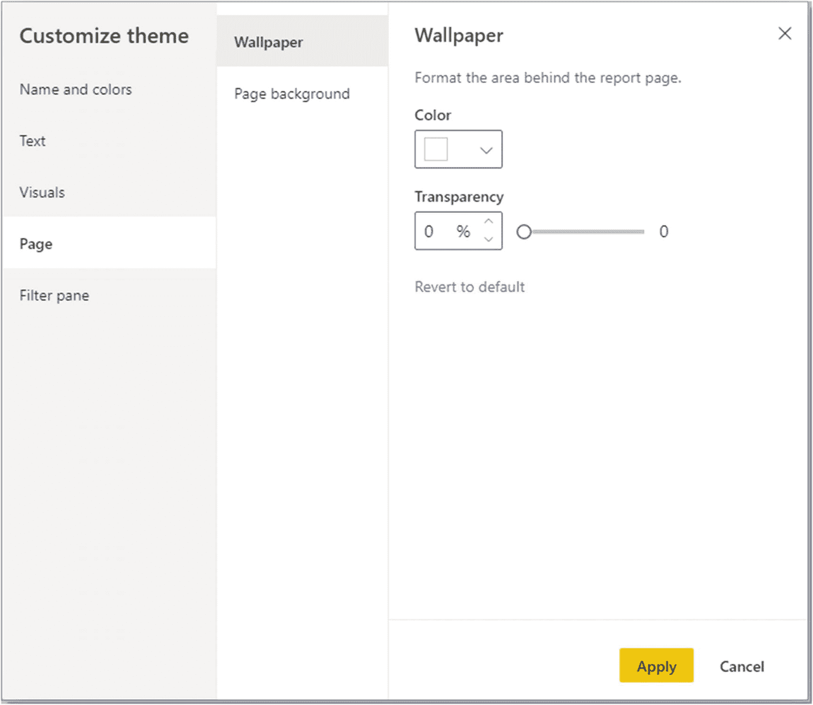
图 2-14 `Customize theme/Page/Wallpaper` 选项卡

如图 2-15 `Customize theme/Page/Page background` 选项卡所示，你还可以设置页面背景的颜色和透明度。
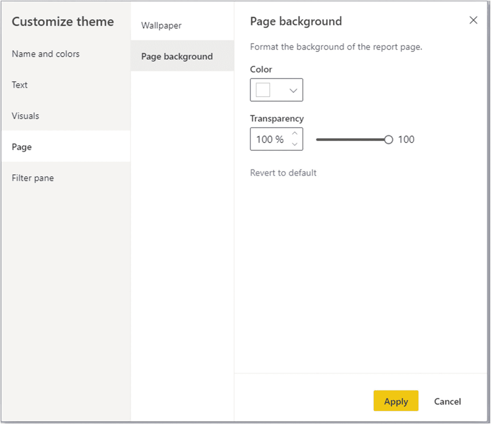
图 2-15 `Customize theme/Page/Page background` 选项卡

## 筛选器窗格设置

你可以定义的自定义主题的最后一个方面涉及筛选器窗格。相当合乎逻辑地，它分为三个区域：
- 筛选器窗格本身
- 可用的筛选器卡片
- 已应用的筛选器卡片

你可以使用的第一个窗格是 `Customize theme/Filter pane/Filter pane` 选项卡。它包含以下可定义的选项：
- 背景色
- 透明度
- 字体和图标颜色
- 标题字号
- 标头字号
- 复选框和应用颜色

你可以在图 2-16 中看到这一点。
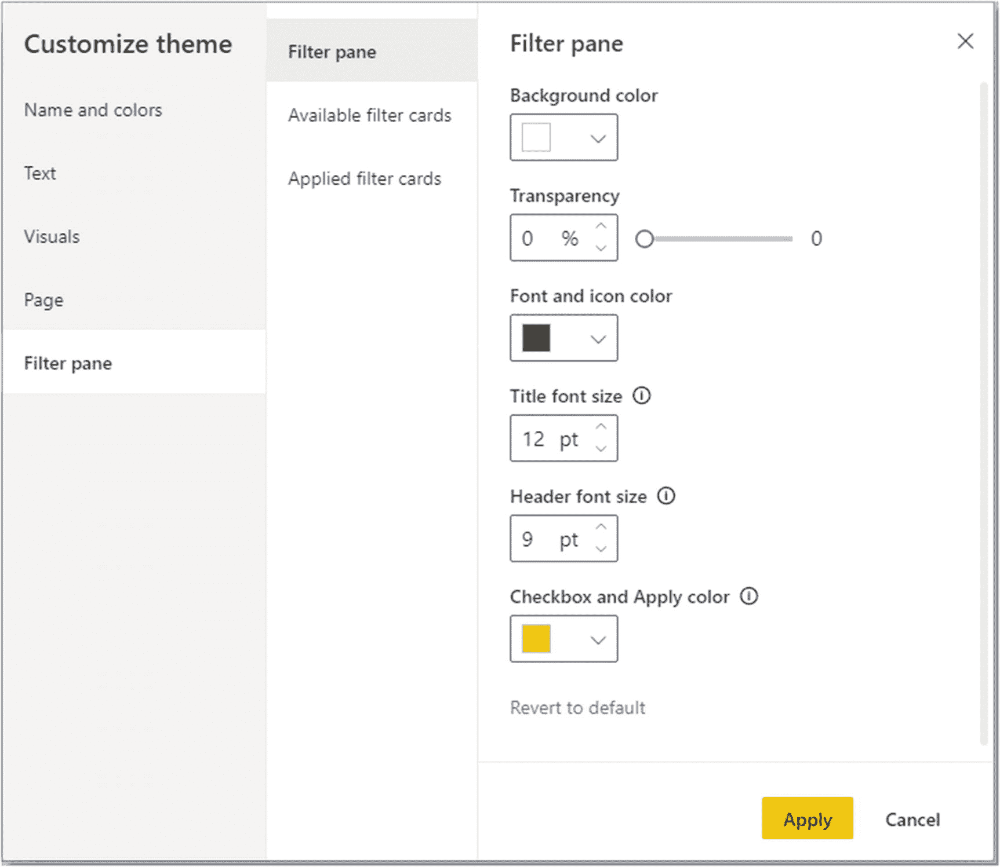
图 2-16 `Customize theme/Filter pane/Filter pane` 选项卡

你可以使用的第二个窗格（如图 2-17 所示）是 `Customize theme/Filter pane/Available filter cards` 选项卡。它包含以下可定义选项（针对筛选器窗格内的筛选器卡片）：
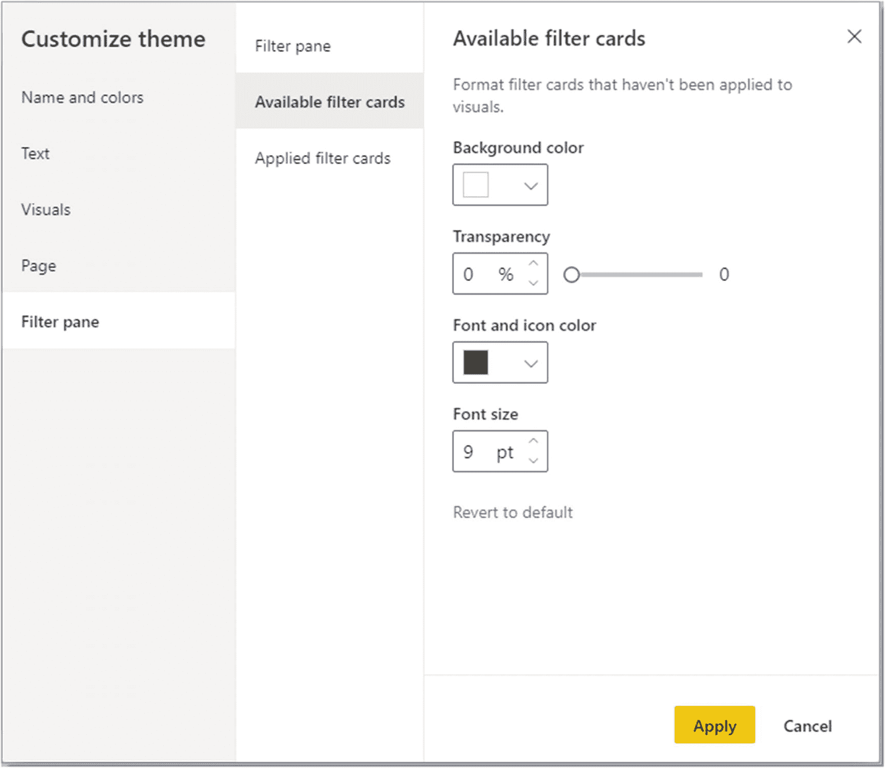
图 2-17 `Customize theme/Filter pane/Available filter cards` 选项卡
- 背景色
- 透明度
- 字体和图标颜色
- 字号

此对话框中你可以使用的最后一个窗格是 `Customize theme/Filter pane/Applied filter cards` 选项卡。此选项卡设置筛选器窗格中任何活动筛选器的格式。此窗格（你可以在图 2-18 中看到）包含在设置筛选器时定义筛选器卡片的选项。它们是：
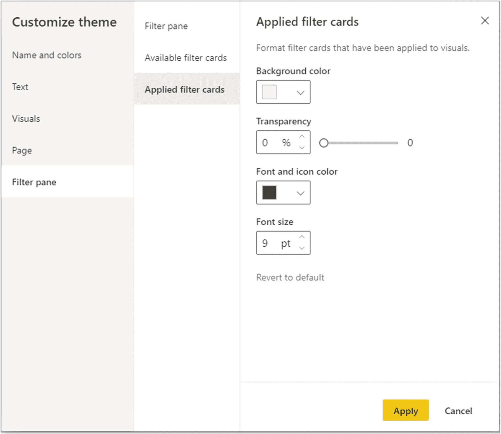
图 2-18 `Customize theme/Filter pane/Applied filter cards` 选项卡
- 背景色
- 透明度
- 字体和图标颜色
- 字号

> **注意**：设置完所有想要的选项后，请记得单击 `Apply` 按钮，然后选择 `View` ➤ `Themes` ➤ `Save current theme` 来保存包含你设置的 `JSON` 文件。

## 关于交互式主题文件创建的总体评价

现在你已经了解了如何使用 Power BI Desktop 创建主题文件，后退一步思考你所取得的成就是一个好主意。
- 你无需编写任何代码就定义了一个高级主题文件。
- 你完全以交互方式完成了此操作。

实际上，就这个过程而言，有一个重要的收获值得记住：
- 你使用 Power BI Desktop 创建的主题文件完整性较低——并且`粒度差得多`——远不如你自己编写的 `JSON` 文件。不过，你可以使用将在本书剩余章节中学到的技术来扩展此文件。

# 关于主题文件

你已经创建了一个 JSON 格式的自定义主题文件。但这具体是什么样的呢？嗯，示例文件`PBIDesktopCustomizedTheme.json`可供参考。你可以在图 2-19 中看到它的样子。

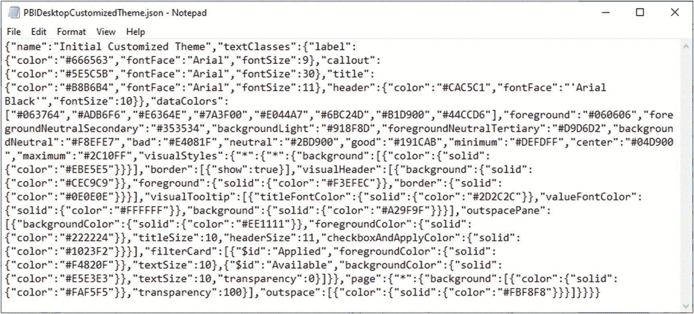

*图 2-19：由 Power BI Desktop 创建的 JSON 文件*

我相信你会同意，Power BI Desktop 生成的 JSON 非常难看且难以阅读。不过，有一些方法可以让 JSON 看起来更美观、更易读。

为了让生成的主题文件中的 JSON 更易于阅读，我建议你使用搜索引擎，搜索类似“JSON 美化”的内容。你会找到许多网站，只需点击几下，就能将这样的 JSON 转化为一个更美观的版本。

几秒钟后，生成的 JSON 看起来就会像下面代码片段中展示的那样：

```
{
"name": "初始自定义主题",
"textClasses": {
"label": { "color": "#666563", "fontFace": "Arial", "fontSize": 9 },
"callout": { "color": "#5E5C5B", "fontFace": "Arial", "fontSize": 30 },
"title": { "color": "#B8B6B4", "fontFace": "Arial", "fontSize": 11 },
"header": { "color": "#CAC5C1", "fontFace": "'Arial Black'", "fontSize": 10 }
},
"dataColors": ["#063764", "#ADB6F6", "#E6364E", "#7A3F00", "#E044A7", "#6BC24D", "#B1D900", "#44CCD6"],
"foreground": "#060606",
"foregroundNeutralSecondary": "#353534",
"backgroundLight": "#918F8D",
"foregroundNeutralTertiary": "#D9D6D2",
"backgroundNeutral": "#F8EFE7",
"bad": "#E4081F",
"neutral": "#2BD900",
"good": "#191CAB",
"minimum": "#DEFDFF",
"center": "#04D900",
"maximum": "#2C10FF",
"visualStyles": {
"*": {
"*": {
"background": [{ "color": { "solid": { "color": "#EBE5E5" } } }],
"border": [{ "show": true }],
"visualHeader": [{
"background": { "solid": { "color": "#CEC9C9" } },
"foreground": { "solid": { "color": "#F3EFEC" } },
"border": { "solid": { "color": "#0E0E0E" } }
}],
"visualTooltip": [{
"titleFontColor": { "solid": { "color": "#2D2C2C" } },
"valueFontColor": { "solid": { "color": "#FFFFFF" } },
"background": { "solid": { "color": "#A29F9F" } }
}],
"outspacePane": [{
"backgroundColor": { "solid": { "color": "#EE1111" } },
"foregroundColor": { "solid": { "color": "#222224" } },
"titleSize": 10,
"headerSize": 11,
"checkboxAndApplyColor": { "solid": { "color": "#1023F2" } }
}],
"filterCard": [
{ "$id": "已应用", "foregroundColor": { "solid": { "color": "#F4820F" } }, "textSize": 10 },
{ "$id": "可用", "backgroundColor": { "solid": { "color": "#E5E3E3" } }, "textSize": 10, "transparency": 0 }
]
}
},
"page": {
"*": {
"background": [{ "color": { "solid": { "color": "#FAF5F5" } }, "transparency": 100 }],
"outspace": [{ "color": { "solid": { "color": "#FBF8F8" } } }]
}
}
}
```

该文件作为示例文件`PBIDesktopCustomizedTheme_Prettified.json`提供。

我知道很多读者看到这样的代码时会感到眼花缭乱。不过，请相信我（并继续阅读），你很快不仅能理解这样的 JSON，还能自己创建它。在这个阶段，关键要点是，你所设置的各种元素（颜色、文本定义等）都存在于 JSON 文件中，连同实际的定义。究竟哪个 JSON 对应哪个格式化元素，则是本书剩余部分要讲述的内容。

你可能很想知道创建自定义主题的所有努力会带来什么结果。那么，图 2-20 展示了一个仪表板页面，其中已应用了主题文件`PBIDesktopCustomizedTheme.json`（如果你还记得第 1 章的内容，操作是依次选择`视图 ➤ 主题 ➤ 浏览主题`）。绝对没有应用其他特定的格式——也就是说，所有格式都源自 JSON 文件，并应用于所有已添加的视觉对象，以及底层页面和筛选器窗格。

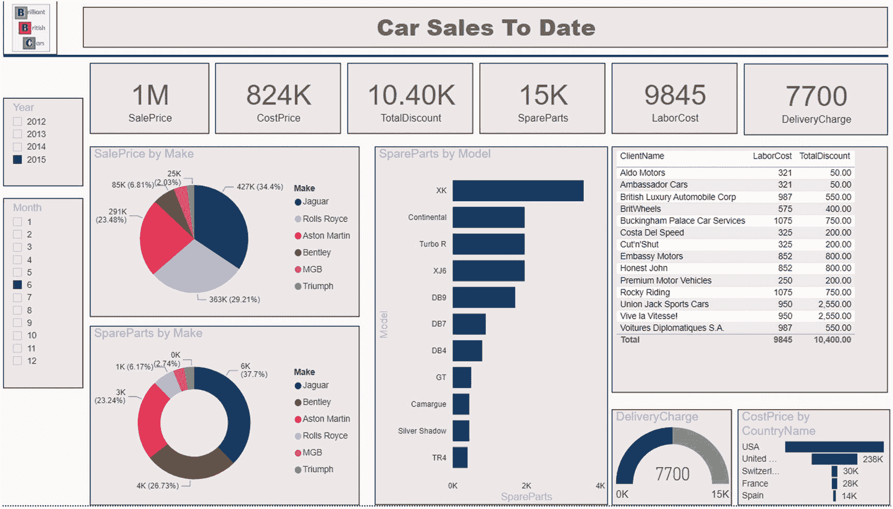

*图 2-20：应用了自定义主题的 Power BI 仪表板*

当使用 Power BI Desktop 界面创建自己的 JSON 主题时，你需要注意以下几点：

- Power BI Desktop *仅*为你修改的任何元素创建 JSON。它不会创建一个定义所有可通过`自定义当前主题`对话框设置的元素的主题文件。也就是说，JSON 输出将不会包含你在各个对话框中*未*修改的任何设置。这使得主题文件更简单、更简洁。
- 现在，任何主题文件都可以应用于现有或空白的 Power BI Desktop 文件，只需依次选择`视图 ➤ 主题 ➤ 浏览主题`，然后导航到你之前保存的 JSON 文件即可。
- 如果某个元素*尚未*使用 Power BI Desktop 中的`格式`窗格进行格式化，主题文件才会应用格式。对于你想要移除之前应用的自定义格式的每个视觉对象中的每个卡片名称，你需要单击`恢复默认设置`。

# 结论

在本章中，你学习了如何完全以交互方式使用 Power BI Desktop 创建和修改 Power BI 的 JSON 主题。事实上，尽管这不是对格式需求的完全精细定义，但这种方法可能就是你为组织或个人需求定义一个完全可用的主题文件所需的一切。

然而，还有更多的方法可以创建精细调整的主题，这些主题可以涵盖 Power BI 中存在的所有格式化可能性。因此，既然你已经胃口大开，是时候继续学习一些逐步深入的示例了。

