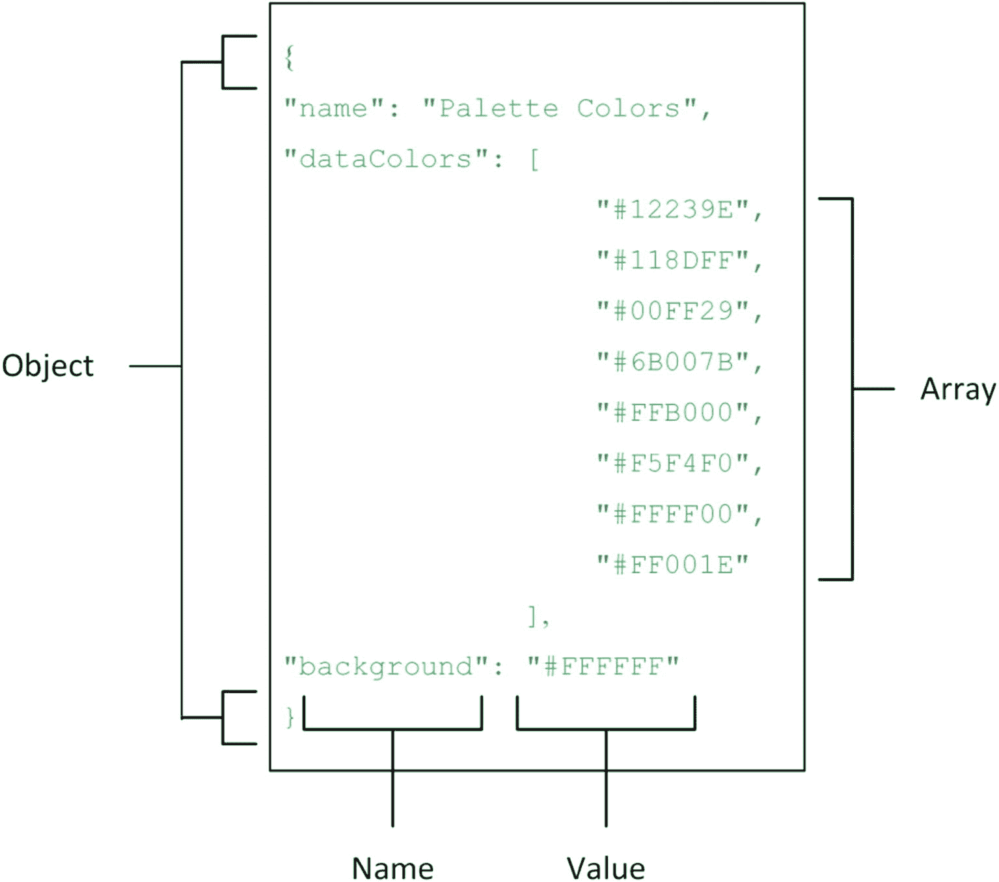
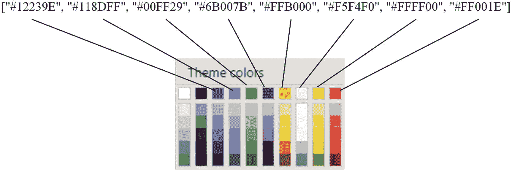
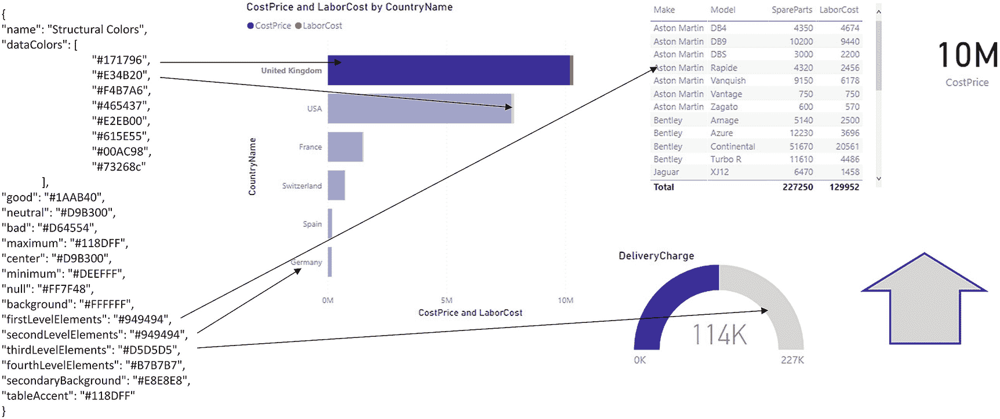
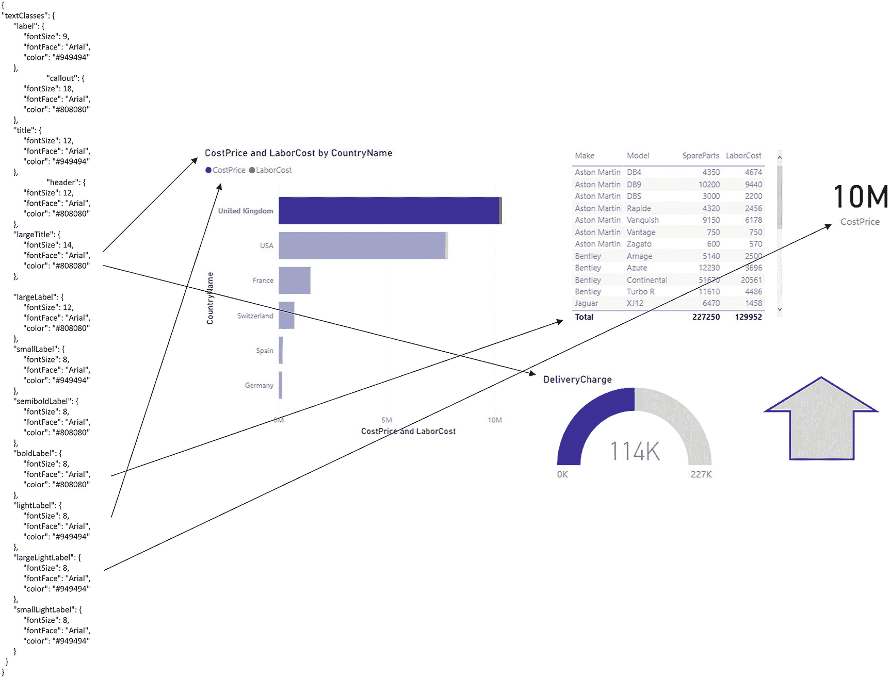
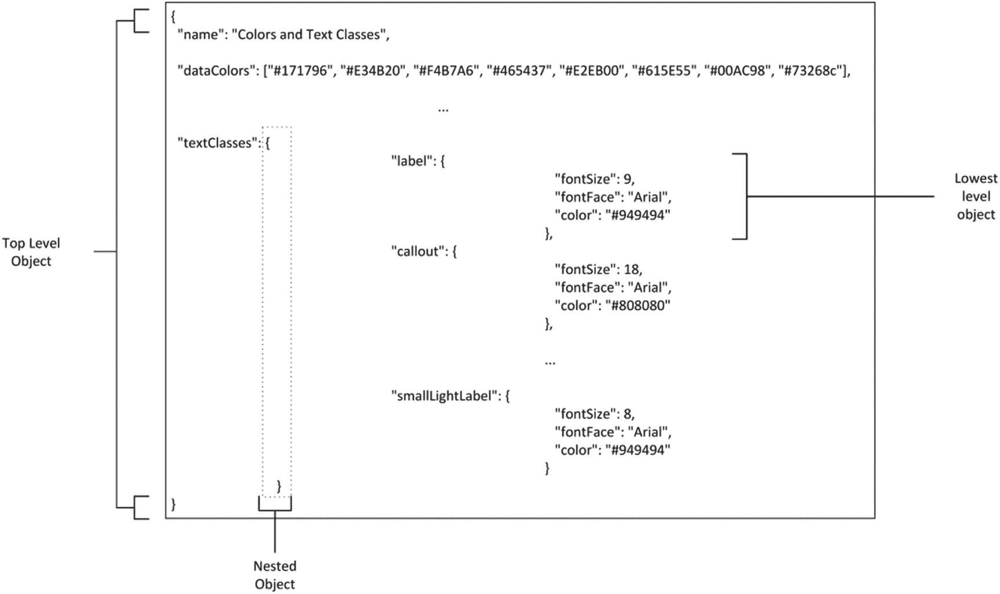

# 3. 高级主题定义

现在，是时候卷起袖子，准备深入探索 Power BI 主题的引擎了。从现在开始，你将直接在 JSON 中创建和修改主题文件的元素，这些元素将控制 Power BI 仪表板的外观。

为了开启你的 Power BI 主题之旅，本章将探讨最高层级的主题定义。这包括创建通用的主题设置，这些设置可以全局应用于多个视觉对象共同的属性，或者实际上，应用于仪表板中几乎每个对象。例如，这可能意味着设置列标题或轴标题的文本属性，而无论具体的视觉对象类型是什么。

这种方法有三个主要优点：
- 首先，它相对容易。
- 其次，它适用于多个元素——因此你无需在主题文件中重复指定多次（每个视觉对象类型一次）。
- 最后，由于这种方法仅设置仪表板各方面的默认格式，你可以像以前使用格式窗格设置最终展示一样，对单个视觉对象的格式进行微调和完善。

更重要的是，设置这些高级元素可能就是你为一系列仪表板设置整体展示效果所需要做的全部工作。你需要在深入（且可能耗时）准备 JSON 文件和提供一个能解决 80-90% 需求的快速方案之间进行权衡。在这种情况下，设置一个高级的、更通用的格式通常是一个完全有效的解决方案。当然，一旦应用了高级样式，你可以随后调整任何需要进一步准备和标准化的视觉对象的 JSON 格式——正如你将在后续章节中发现的那样。

这些更高级别的主题定义涵盖设置：
- 调色板颜色
- 通用颜色
- 通用文本属性

Power BI 将这些主题称为“通用类”。它们非常值得学习，因为它们不仅是介绍 Power BI 主题工作原理的绝佳途径，而且你还可以在日常使用 Power BI 的工作中应用它们。

## 什么是 JSON？

不过，让我们先（非常）简短地了解一下一些 JSON 基础知识。毕竟，你可能以前从未接触过这种格式。如果你已经了解 JSON，可以随意跳过本书中关于 JSON 的章节。如果不是这种情况，我建议你花些时间掌握 JSON 是什么以及它是如何工作的基本概念，因为它对于 Power BI 中的主题定义至关重要。

在上一章中，我们大量提到了 JSON，但从未解释过它是什么，或者 Power BI 为什么使用它。JSON 是 JavaScript Object Notation 的缩写。它是一种轻量级的数据交换格式，对于系统间的数据交换非常可靠，同时又易于人类理解（至少在一定程度上）。它可以被广泛地结构化，同时仍然保持足够的灵活性来存储复杂信息。对于 Power BI 主题而言，这意味着定义了 Power BI 仪表板元素的格式化方式。有趣的是，当用于定义 Power BI 主题文件时，JSON 中的 J 代表 JavaScript 这一点并不重要，因为在此上下文中，JSON 仅仅是一种定义仪表板展示样式的方式。因此，在 Power BI 的上下文中，真正需要记住的关键词是 Object（对象）和 Notation（表示法），因为 JSON 描述了仪表板视觉对象（对象）的格式（表示法）。

JSON 是一个庞大的主题，因此本书只会介绍创建主题文件所需的 JSON 知识。同时，我打算循序渐进地进行，只在需要时才描述所需的 JSON 知识，而不是一口气全部解释清楚。事实上，我将使用一系列文本框来解释必要的 JSON 概念——从这第一个开始，如下所示。

**JSON 基础知识**
- JSON 基于名称/值对的概念。也就是说，它定义了一个名称以及描述该名称的内容（它的值）。
- JSON 使用冒号将名称与其关联的值分隔开。
- JSON 基于对象的概念——在最高层级，整个主题本身就是一个对象。
- 对象可以包含其他（嵌套的）对象。
- 所有对象都用花括号（如果你喜欢的话，也可以叫大括号）`{}` 括起来。
- JSON 使用逗号来分隔元素列表。
- JSON 可以包含数组。这些是用方括号 `[]` 括起来的元素列表。
- JSON 规定文本和数字的输入方式不同。

## 调色板颜色

现在，你将创建你的第一个 Power BI 主题文件。它将非常简单。事实上，从包含示例文件的目录中加载示例文件 `PaletteColors.json` 并对其进行修改，比尝试从头开始手动重新创建整个文件要容易得多。实际上，这是我在创建主题文件时建议你尽可能使用的一种技巧——从能用的东西开始，然后调整和/或扩展它以适合你的新需求。

图 3-1 显示了示例文件 `PaletteColors.json`。



图 3-1 设置调色板的 JSON

该主题文件包含三个核心的 JSON 结构：
- 花括号，用于括起整个 JSON 对象。
- 名称/值对（`name`、`dataColors` 和 `background` 是名称——每种情况下冒号后面的文本是值）。
- 一个数组（方括号内以逗号分隔的十六进制颜色列表）。这里，整个数组就是该名称/值对的值。

由于这是你第一次接触主题文件，我更愿意解释它所包含的一切，因为这将帮助你理解 JSON 是如何工作的。

### JSON 对象
整个 JSON “对象”（如此称呼）必须以左花括号开始，并以右花括号结束。理想情况下，在起始的左花括号之前和结束的右花括号之后不应存在任何文本——不过，只要你没有添加任何额外的文本，添加额外的空行是没问题的。

在顶层花括号对内部，可能还有更多嵌套的花括号对，用于定义其他对象。实际上，当你检查更复杂的 JSON 主题文件时，你会看到这样的例子。

# 主题文件定义的属性

此特定主题文件定义了两组格式属性（`dataColors` 和 `background`），并包含一个用于描述该文件的附加元素（`name`）（毕竟，满是代码的文件不一定容易区分）。文件中的每个元素都由一个称为“名称/值对”的结构定义。它由一个用双引号括起来的格式元素名称（或关键字）组成，其后跟一个冒号，冒号后是该关键字所描述的值。所描述的值范围可以从极其简单（数字或单词）到更复杂的 JSON 结构——正如你在此主题文件中看到的数组那样。

定义的两组格式属性是：

* `dataColors`：调色板
* `background`：页面背景颜色

首先要注意的是，每个格式元素（或关键字）都用双引号括起来，后跟一个冒号，最后是相应格式信息的定义。这种方法也称为`名称/值`配对（即使值本身可能相当复杂）。

其次，关键字中不能有空格。

第三点要注意的是，在 Power BI Desktop 的`格式`窗格中看到的`格式术语`，与主题文件中赋予该元素的关键字之间通常存在对应关系。然而，这种对应关系可能有些近似，并不总是精确的。事实上，有时 Power BI 的演进已经使得 JSON 中使用的关键字与 Power BI Desktop 中显示的格式元素完全分离。因此，随着本书的深入，我将解释 JSON 中使用的关键字与 Power BI Desktop 中使用的术语之间的确切对应关系。

第四点要注意的是，每个关键字/定义对（或者如果你愿意，也可以称作名称/值对）都以逗号结尾，最后一个除外。

第五个重要点是，任何非纯数字的值都必须用双引号括起来。

最后一点是，关键字总是以小写字符开头——并且其拼写和大小写要求非常严格。换句话说，你必须精确地按照 Power BI 期望的方式拼写 JSON 关键字——否则 JSON 属性将不会被应用。这意味着使用正确的关键字是基础。主题文件在很多方面都非常刻板，就关键字而言，它们完全没有通融余地。

# JSON 数组

定义 JSON 文件中 `dataColors` 部分的值有多个。这是因为 Power BI 调色板包含十个元素。前两个是固定不变的（白色和黑色），而其他八个可以由用户定义。

这八个元素（最多——你可以选择设置更少的元素，其余的保留为默认值）在主题文件中被设置为一个数组。这意味着元素列表是：

* 用方括号括起来

* 用逗号分隔——最后一个元素后没有逗号

元素本身可以是全数字或全文本——这取决于数组包含的信息种类。

## JSON 呈现方式

JSON 代码的显示方式可以有无限多种。你刚才看到的代码也可以像这样显示：

```
{
"name": "Intro Theme",
"dataColors": ["#12239E", "#118DFF", "#00FF29", "#6B007B", "#FFB000", "#F5F4F0", "#FFFF00", "#FF001E"],
"background": "#FFFFFF"
}
```

或者像这样（这只是其中一种方式）：

```
{"name": "Intro Theme", "dataColors": ["#12239E", "#118DFF", "#00FF29", "#6B007B", "#FFB000", "#F5F4F0", "#FFFF00", "#FF001E"], "background": "#FFFFFF"}
```

虽然更紧凑的 JSON 代码可能占用页面更少的空间，但我更喜欢通过包含大量的换行、缩进和空白来使代码尽可能易读。这更容易理解主题文件与“格式”窗格中可见的格式元素之间的关联——以及 JSON 文件所映射到的内容。

那么，你在这个小主题文件中创建了什么呢？很简单，你定义了基础调色板，每次你想在 Power BI 仪表板中应用颜色时，该调色板都会出现。你可以在图 3-2 中看到这一点，其中主题文件 `dataColors` 数组中的十六进制颜色定义定义了调色板元素。



`图 3-2` 映射主题文件中的调色板

# JSON 主题文件中的颜色

`dataColors`元素属性中的代码——每个都以井号/哈希符号开头——是对应于特定颜色的十六进制值。如果你有网页设计背景，这可能是你的第二天性。如果没有，那么你需要找到一种方法，来精确找出与你希望在 Power BI 中使用的每种颜色相对应的十六进制值。

幸运的是，有成百上千的网站提供关于颜色使用的指导和工具。因此，在你最常用的搜索引擎中搜索“十六进制颜色”几分钟，应该就能找到一些有用的资源。

同样值得注意的是，Power BI Desktop 的颜色弹出窗口会显示你分配给仪表板元素的颜色的十六进制引用。只需将指针悬停在颜色选择器中选中的颜色上，即可查看其十六进制值。

**注意：** 始终将十六进制颜色值用双引号括起来，并在其前面加上井号/哈希符号（`#`）。

# 通用颜色（颜色类）

在看过一个基础的JSON主题文件后，现在该通过添加一些进一步的通用格式化元素来扩展它了。这些元素将添加上一章中使用`Customize current theme`（自定义当前主题）功能以交互方式添加的情感色和高级颜色，以及另一个无法通过Power BI Desktop界面添加的元素——`tableAccent`（表格强调色）。

您可以在示例文件目录中找到此文件，名为`StructuralColors.JSON`。添加到您之前看到的初始文件中的代码以粗体显示。

```json
{
    "name": "Structural Colors",
    "dataColors": ["#171796", "#E34B20", "#F4B7A6", "#465437", "#E2EB00", "#615E55", "#00AC98", "#73268c"],
    "good": "#1AAB40",
    "neutral": "#D9B300",
    "bad": "#D64554",
    "maximum": "#118DFF",
    "center": "#D9B300",
    "minimum": "#DEEFFF",
    "null": "#FF7F48",
    "background": "#FFFFFF",
    "firstLevelElements": "#949494",
    "secondLevelElements": "#949494",
    "thirdLevelElements": "#D5D5D5",
    "fourthLevelElements": "#B7B7B7",
    "secondaryBackground": "#E8E8E8",
    "tableAccent": "#118DFF"
}
```

如您所见，此文件扩展了简单文件`IntroTheme.json`所遵循的原则。即：

* 整个文件内容包含在一对花括号内。
* 每个定义都是一个名称/值对。
* 除最后一个定义外，所有定义均以逗号结尾。

所有颜色定义（调色板除外）的名称/值对都很简单：

* 左侧是颜色属性的名称（关键字）
* 冒号后的右侧是用于应用所选颜色的十六进制颜色参考

由于上一章已解释了大部分这些颜色元素，此处不再重复其定义。唯一新增的是：

* `tableAccent`（表格强调色）：此元素覆盖表格和矩阵网格轮廓颜色。

值得注意的是，您可以按任意顺序输入这些元素（至少对于像这样的简单JSON文件而言）。逗号分隔是需要记住并严格应用的关键点。换句话说，除最后一个属性定义外，每个属性定义都必须以逗号结尾。

有趣的是，您可以看到较长（且更复杂）的关键字采用驼峰式大小写——即它们以小写字符开头，但较长关键字中的每个单词首字母大写。

### 注意

如果您打算创建一个“前卫的”深色主题（包含黑色或深色背景元素），那么请务必也将其他结构颜色和主要文本类颜色的值设置为浅色——否则许多元素将无法阅读。

如果您现在将此主题应用于仪表板（您自己的仪表板或来自示例文件的示例仪表板`SampleDashboard.pbix`），您将看到几行JSON代码提供了多少格式。

为了让这一点更清晰，请查看图3-3，其中展示了JSON主题中定义的一些颜色是如何应用于Power BI Desktop仪表板的。



**图3-3** 高级颜色自定义

如果您想进行实验，可以修改一些十六进制颜色参考并重新应用主题，以体会使用主题文件时进行一系列更改是多么容易。

## 通用文本属性（文本类）

在上一章中，您使用Power BI Desktop创建了一个定义了四种文本格式的主题文件。这些格式（`label`（标签）、`callout`（标注）、`title`（标题）和`header`（页眉））被用于一系列可视化对象来定义核心文本格式。无论多么有用，这些只是您可以使用主题文件定义的部分通用文本设置。您还可以手动向主题文件添加另外八种设置，以便为仪表板添加更广泛的标准化文本格式。这可以避免您在Power BI中逐个可视化对象地手动格式化一系列文本属性。

让我们来看一个JSON主题文件，它将通用文本类添加到了本章迄今为止所见到的调色板和通用颜色中。此文件名为`ColorsAndTextClasses.json`，可在示例文件中找到。添加的JSON代码在以下代码片段中以粗体显示：

```json
{
    "name": "Colors and Text Classes",
    "dataColors": ["#171796", "#E34B20", "#F4B7A6", "#465437", "#E2EB00", "#615E55", "#00AC98", "#73268c"],
    "background": "#FFFFFF",
    "good": "#1AAB40",
    "neutral": "#D9B300",
    "bad": "#D64554",
    "maximum": "#118DFF",
    "center": "#D9B300",
    "minimum": "#DEEFFF",
    "null": "#FF7F48",
    "firstLevelElements": "#949494",
    "secondLevelElements": "#949494",
    "thirdLevelElements": "#D5D5D5",
    "fourthLevelElements": "#B7B7B7",
    "secondaryBackground": "#E8E8E8",
    "tableAccent": "#118DFF",
    "textClasses": {
        "label": {
            "fontSize": 9,
            "fontFace": "Arial",
            "color": "#949494"
        },
        "callout": {
            "fontSize": 18,
            "fontFace": "Arial",
            "color": "#808080"
        },
        "title": {
            "fontSize": 12,
            "fontFace": "Arial",
            "color": "#949494"
        },
        "header": {
            "fontSize": 12,
            "fontFace": "Arial",
            "color": "#808080"
        },
        "largeTitle": {
            "fontSize": 14,
            "fontFace": "Arial",
            "color": "#808080"
        },
        "largeLabel": {
            "fontSize": 12,
            "fontFace": "Arial",
            "color": "#808080"
        },
        "smallLabel": {
            "fontSize": 8,
            "fontFace": "Arial",
            "color": "#949494"
        },
        "semiboldLabel": {
            "fontSize": 8,
            "fontFace": "Arial",
            "color": "#808080"
        },
        "boldLabel": {
            "fontSize": 8,
            "fontFace": "Arial",
            "color": "#808080"
        },
        "lightLabel": {
            "fontSize": 8,
            "fontFace": "Arial",
            "color": "#949494"
        },
        "largeLightLabel": {
            "fontSize": 8,
            "fontFace": "Arial",
            "color": "#949494"
        },
        "smallLightLabel": {
            "fontSize": 8,
            "fontFace": "Arial",
            "color": "#949494"
        }
    }
}
```

那么，您到底看到的是什么？本质上，这是一组用于一系列可视化对象以定义文本格式的关键字。其中四个已在上一章中解释过，因为它们可以使用Power BI Desktop以交互方式创建。它们是`label`（标签）、`callout`（标注）、`title`（标题）和`header`（页眉）——因此我不再重复它们所应用的文本元素。

然而，其他的则需要一些解释。以下列表定义了每个JSON关键字设置哪个仪表板元素：

* `largeTitle`（大标题）：可视化标题
* `largeLabel`（大标签）：多行卡片数据标签
* `smallLabel`（小标签）：参考线标签、切片器日期范围标签、切片器数字输入文本样式、切片器搜索框、关键影响因素影响者文本
* `semiboldLabel`（半粗体标签）：关键影响因素概要文本
* `boldLabel`（粗体标签）：矩阵小计、矩阵总计、表格合计
* `lightLabel`（细体标签）：图例文本、按钮文本、类别轴标签、漏斗图、图表数据标签、漏斗图转化率标签、仪表目标值、散点图类别标签、切片器项目
* `largeLightLabel`（大号细体标签）：卡片类别标签、仪表标签、多行卡片类别标签
* `smallLightLabel`（小号细体标签）：数据标签、值轴标签

为了使 JSON 主题文件中的元素与其在 Power BI 仪表板中的应用之间的关联更易于理解，请查看图 3-4，其中展示了 JSON 主题中定义的一些文本规范是如何应用于 Power BI 仪表板的。



**图 3-4** 高级文本自定义

请注意，此图*并非*每个文本类应用范围的完整呈现，但它确实勾勒出了文本类的工作方式。

JSON 结构也需要一些解释，因为这是你第一次在主题文件中遇到嵌套对象（即，花括号内包含另一组花括号）。

如你所见，其核心原则依然是键/值对——也就是一个关键字和一个定义。然而，这次的*定义*稍微复杂一些，因为它并非关键字后冒号后面的单个元素，而是一个完整的对象。

你可以在图 3-5 中看到这种示意。



**图 3-5**

嵌套的 JSON 对象

需要注意的要点是：

*   这次，每个定义都是一个独立的、嵌套的对象，以*花括号*开始和结束。

*   每个对象内部都包含一系列键/值对，这些键/值对之间用*逗号分隔*（并且在最后一个键/值对之后没有逗号）。

*   构成文本定义的键/值对，与更简单的键/值对一样，在“外层”级别与其他键/值对之间用*逗号分隔*。

*   *数字不应包含在双引号内*。由于 Power BI 始终期望字体以磅（points）为单位定义，因此你只需指定字体大小的数字即可（无需指定“pt”或类似内容）。

*   你引用的任何*字体*的*拼写必须与 Windows 期望的完全一致*，并且当然必须存在于托管 Power BI 仪表板的系统中。

## JSON 数据类型

任何值（名称/值对中冒号后面的部分）都必须是可识别的 JSON 数据类型。

JSON 可用的数据类型集是有限的：

*   数字（`Number`）

*   字符串（`String`）

*   布尔值（`Boolean`）

*   对象（`Objects`）

*   数组（`Array`）

*   空值（`Null`）

*数字*可以是整数、浮点数或小数。它们*不应*包含在引号内。

*字符串*（或文本或字符）可以是任何文本，并且*必须*包含在双引号内。

*布尔值*简单地表示 true 或 false，并且必须用小写的 *true* 或 *false* 表示（例如，不能使用 yes/no 或 0/1）。

JSON 元素可以是一个嵌套对象——它本身包含更多元素，例如键/值对。

*数组*是一系列元素（字符串、数字、对象，甚至其他数组）。

当你想定义一个完全空的值时，应将其定义为 *null*（小写，不带引号）。

## 结论

本章带你踏上了创建和修改自定义 JSON 主题文件的旅程。你了解了如何在主题文件中以 JSON 形式添加颜色定义和通用文本属性。

希望从本章开头简短文件到最终完整主题文件的演进过程，能让你相信构建 JSON 主题文件不必复杂或困难。由于主题文件的结构基于清晰的逻辑，稍加练习你就能转向更高级的格式定义。像本章中看到的那些具有默认视觉样式的简单主题，随后可以通过为各种类型的视觉效果添加标准元素的规范来进行扩展。这将是下一章的主题。

